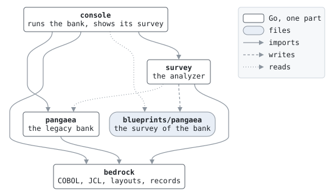

# Copal

*Reading the code that still runs the books.*

Copal is a study of one problem: understanding a legacy COBOL batch system well enough to replace it. The hard part of such a move is rarely the translation; it is knowing what the system does, when nobody can draw the job network or say which rules are in the code. Copal derives that understanding from the source, deterministically, and tests it on three COBOL systems written for the purpose. It does not translate COBOL into anything.

## The parts

The survey is the analyzer; it stands on two parts, and works on three specimens.

| Directory | Part | What it is |
| --- | --- | --- |
| [survey/](survey/) | **Survey** | The analyzer. Reads a COBOL system and writes its blueprints: record layouts, program structure, data flow, business rules as decision tables, and the job network. Serves the same analysis in the browser, finds test cases that reach the rules, and checks a replacement against them. |
| [bedrock/](bedrock/) | **Bedrock** | What runs the specimens: compiling and running COBOL programs, jobs and scripts, and keeping datasets and their catalog. |
| [cobolith](https://github.com/vlumi/cobolith) | **Cobolith** | The library everything reads COBOL with: source, copybooks, record layouts and fields, and JCL, in the IBM, Micro Focus, Hitachi and Fujitsu dialects. Written here, now a repository of its own. |

### The specimens

Three working COBOL systems, fiction written for this project, each in another shop's dialect and run the way that shop would run it. They are managed alike: each compiles with GnuCOBOL, runs a fixture whose outputs are golden files, opens on a portfolio generated from a seed and runs day after day in a machine room written in Go, and has an operations guide in its operators' voice. None of them knows the survey. Each came after the one before, to show where the survey had assumed it.

| Directory | Specimen | COBOL | Run by | Why it is there |
| --- | --- | --- | --- | --- |
| [pangaea/](pangaea/) | **The First Bank of Pangaea**, a bank: a daily batch, a month-end, and an online day of card and ATM authorizations | IBM, fixed format | JCL | The first: the survey was built on it |
| [laurasia/](laurasia/) | **Laurasia Card Services**, a card processor: clearing, posting, disputes, settlement and billing | Micro Focus, free format | shell scripts | To show where the survey assumed Pangaea's dialect, format and JCL |
| [gondwana/](gondwana/) | **Gondwana Life Insurance**, a life insurer: new business, premiums, claims, lapses, reserves and dividends | Fujitsu NetCOBOL, Shift_JIS with Japanese names | Windows batch files | To show where it assumed ASCII, cents and the Western calendar |

The dependencies run one way, and `make ci` checks it: the specimens know nothing of the survey, nor the survey of them; its tests read them as data. The specimens' outputs are golden files, and so are the survey's blueprints of them: a change to the analyzer shows as a diff in what it says about a real system.

## What you can run

Everything is a make target, and plain `make` lists them. You need GnuCOBOL 3.2 (`brew install gnucobol`), Go, Node for the Markdown linter, and `golangci-lint` for `make ci`.

### A specimen

Each specimen runs the same two ways: once on its fixture, printing each step's log and every program's report, and as a living system opened on generated data and run day after day, a line a day.

| | The bank | The card processor | The life insurer |
| --- | --- | --- | --- |
| Its fixture, once | `make pangaea-daily`: the daily batch | `make laurasia-night`: a night and its billing cycle | `make gondwana-month`: a March, its close and the year-end dividends, transcoded for the terminal |
| Open a generated system | `make bank-reset`: about 3,000 accounts | `make cards-open`: about 1,000 cards | `make life-open`: about 2,000 policies |
| Run days | `make bank-days N=5`: business days | `make cards-days N=30`: the night on business days, the billing cycle every day | `make life-days N=261`: the daily run, and the billing, the results, the close and the year end on their days |
| Its data | `pangaea/run/bank/` | `laurasia/run/processor/data/` | `gondwana/run/insurer/data/` |
| Rewrite its goldens | `make pangaea-golden` | `make laurasia-golden` | `make gondwana-golden` |
| Its console | `make bank-console`: accounts, each day's jobs with their return codes and records, what the days changed, at <http://127.0.0.1:4510/> | none yet | none yet |

The bank has an online day too: `make simulate` sends card and ATM traffic to its console's online channel, and the console's **Online** page shows the authorizations as they are answered.

### The survey

| Target | What it does | Where to look |
| --- | --- | --- |
| `make blueprints` | Regenerates the survey of the three specimens | [blueprints/pangaea/](blueprints/pangaea/README.md), [blueprints/laurasia/](blueprints/laurasia/README.md), [blueprints/gondwana/](blueprints/gondwana/README.md) |
| `make explore-pangaea`, `make explore-laurasia`, `make explore-gondwana` | The same analysis as a web app: every job, step, dataset, program, paragraph and field a page, and a field's values followed across programs on the diagrams | <http://127.0.0.1:1192/> |
| `make oracle` | Finds, for each program of the specimens, input data that reaches the rules of its decision tables, by running it; replays the batches on those cases | [oracle/pangaea/](oracle/pangaea/README.md), [oracle/laurasia/](oracle/laurasia/README.md), [oracle/gondwana/](oracle/gondwana/README.md) |
| `make conform-pangaea PROGRAM=TXPOST WITH=bin/txpost` | Runs a replacement for a program, any executable, on the program's recorded cases, and names the first field it gets wrong; `conform-laurasia` and `conform-gondwana` likewise | the terminal |
| `make conform-demo` | The same on BANKDATE rewritten in Go, which conforms on all its cases | the terminal |

### Checks

| Target | What it does |
| --- | --- |
| `make ci` | What the hosted build runs: linters, the dependency check, every test and golden file, the oracle's cases replayed |

## What the survey writes

| For each | The blueprint has |
| --- | --- |
| Program | Its own header comment; files; the flow of its paragraphs, drawn; what each paragraph reads and writes; where every value comes from; its records field by field |
| Copybook | Its records, with each field's kind, and the programs that use it |
| Job | Its steps and the datasets between them, drawn; each step's DD statements bound to the program's files; findings where the job and its programs disagree |
| Paragraph | A decision table: each path through its conditions, and the actions it takes, and each path as a sentence |
| Entity | Who reads, writes and decides on each field across the programs; the state machine of each code field; who owns it |
| Field | Its trail back to the inputs its values come from, and forward to everything they reach, through programs and job steps |
| Rule | A recorded case: input data that reaches it, and what the program wrote and returned; what a replacement for the program has to match |

[docs/blueprints.md](docs/blueprints.md) explains how to read them. Every fact links to the source line it came from, and no language model is involved.

## By the numbers

| | |
| --- | --- |
| Specimens | 3, in three dialects: 46 programs, about 10,000 lines of COBOL, 41 copybooks, 4 jobs in JCL, 5 shell scripts and 7 batch files |
| Blueprints | 153 pages and 63 diagrams, regenerated and compared by `make ci` |
| Decision rules | 497 in the bank and the card processor, of which 224 recorded cases reach 468; 14 are marked with the reason the search cannot reach them, 15 are left. The insurer's 677, counting a called program's by each caller, of which 184 cases reach 348 |
| Cobolith | 0.8.3: four dialects, the Report Writer, and 439 of the 459 programs of NIST's COBOL-85 test suite read |

## A quick tour

1. `make toolchain`: check that the tools are there.
2. `make pangaea-daily`: the bank in one screen; `make laurasia-night`: the card processor's night in one; `make gondwana-month`: the life insurer's March, in Japanese.
3. `make bank-reset` and `make bank-days N=5`: five business days of the generated bank. `make cards-open` and `make cards-days N=30`: a month of the card processor, weekends included. `make life-open` and `make life-days N=261`: a fiscal year of the life insurer, its dividends on the last day.
4. `make bank-console`, then open an account, a day's jobs, and **Compare**.
5. `make simulate` from another terminal: the **Online** page fills with authorizations. Run a day from the console: the channel closes for the batch, and the next morning the purchases and withdrawals are in the master.
6. Read a blueprint: [TXPOST](blueprints/pangaea/programs/TXPOST.md), its [decision tables](blueprints/pangaea/rules/TXPOST.md), and the [DAILY job](blueprints/pangaea/jobs/DAILY.md).
7. `make explore-pangaea`: search for `AM-BALANCE`, open it in TXPOST, and follow its values back to the files that come from outside. `make explore-gondwana`: the same, in Japanese, with the Report Writer's lines among the records.
8. Read an oracle case: [TXPOST's](oracle/pangaea/TXPOST/README.md), rule by rule.
9. `make conform-demo`: a rewrite of BANKDATE in Go checked against its cases. Break the rewrite, in `survey/internal/oracle/testdata/rewrites/bankdate/`, and run it again: the report names the field.
10. `make ci`.

## Reading more

| Document | What it covers |
| --- | --- |
| [docs/architecture.md](docs/architecture.md) | How the parts fit, the dependency rule, and the golden files |
| [docs/blueprints.md](docs/blueprints.md) | How to read what the survey writes |
| [survey/README.md](survey/README.md) | The survey's pipeline, analysis by analysis, and what it does not do |
| [pangaea/](pangaea/README.md), [laurasia/](laurasia/README.md), [gondwana/](gondwana/README.md) | Each specimen, and in its `docs/` its operations guide in its operators' voice |
| [docs/roadmap.md](docs/roadmap.md), [docs/brief.md](docs/brief.md) | The order the work was done in, and the plan and decisions it started from |

## The names

Copal is young amber: resin that has hardened but not quite fossilized, and the traditional base of varnish for old wood. Said aloud, it is not far from COBOL. Pangaea is the single supercontinent before it broke into the continents of today: a monolith, waiting to be split; Laurasia and Gondwana are the two it split into. A survey walks the ground and maps it before anyone builds; bedrock is what everything stands on; a cobolith is the stone it is cut from.

## License

MIT, see [LICENSE](LICENSE). The specimens, their programs, data and documents included, are fiction written for this project and covered by the same license.
