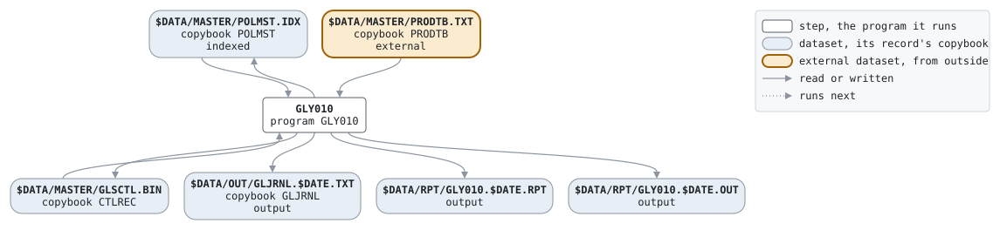

# ANNUAL

```text
ANNUAL.BAT: 年次処理。年度末 (3月31日) の月次締めの後に、契約者
配当の割り当て。

使い方: ANNUAL.BAT YYYYMMDD  年度末の業務日付
環境: GLS_BIN プログラム、GLS_DATA データ

変更履歴
1999-11-08 MS  GL-0233 初版、PC システム移行時 (旧 JCL から)。
```

Script [ANNUAL.BAT](../../../gondwana/scripts/ANNUAL.BAT): 1 steps.

## Contents

- [Network](#network)
- [Steps](#steps)
  - [GLY010](#gly010)
- [Datasets](#datasets)
- [Findings](#findings)

## Network



## Steps

| Step | Program | Reads | Writes | Stops the script if | Description | Source |
| --- | --- | --- | --- | --- | --- | --- |
| GLY010 | [GLY010](../programs/GLY010.md), with $DATE | $DATA/MASTER/POLMST.IDX, $DATA/MASTER/PRODTB.TXT, $DATA/MASTER/GLSCTL.BIN | $DATA/MASTER/POLMST.IDX, $DATA/MASTER/GLSCTL.BIN, $DATA/OUT/GLJRNL.$DATE.TXT, $DATA/RPT/GLY010.$DATE.RPT, $DATA/RPT/GLY010.$DATE.OUT | RC >= 8 | 契約者配当 | [ANNUAL.BAT:22](../../../gondwana/scripts/ANNUAL.BAT#L22) |

### GLY010

| Name | File | File in the program | Copybook | Use |
| --- | --- | --- | --- | --- |
| POLMST | $DATA/MASTER/POLMST.IDX (indexed) | POLMST-F | [POLMST](../copybooks/POLMST.md) | update |
| PRODTB | $DATA/MASTER/PRODTB.TXT | PRODTB-F | [PRODTB](../copybooks/PRODTB.md) | read |
| GLSCTL | $DATA/MASTER/GLSCTL.BIN | GLSCTL-F | [CTLREC](../copybooks/CTLREC.md) | update |
| GLJRNL | $DATA/OUT/GLJRNL.$DATE.TXT | GLJRNL-F | [GLJRNL](../copybooks/GLJRNL.md) | append |
| GLY010R | $DATA/RPT/GLY010.$DATE.RPT | REPORT-F | | write |
| stdout | $DATA/RPT/GLY010.$DATE.OUT | | | write |

## Datasets

Each dataset the job names, the copybook that describes its records, from the programs that read or write it in any job, and the steps that write and read it.

| Dataset | Copybook | Written by | Read by |
| --- | --- | --- | --- |
| $DATA/MASTER/POLMST.IDX | [POLMST](../copybooks/POLMST.md) | GLY010 | GLY010 |
| $DATA/MASTER/PRODTB.TXT | [PRODTB](../copybooks/PRODTB.md) | | GLY010 |
| $DATA/MASTER/GLSCTL.BIN | [CTLREC](../copybooks/CTLREC.md) | GLY010 | GLY010 |
| $DATA/OUT/GLJRNL.$DATE.TXT | [GLJRNL](../copybooks/GLJRNL.md) | GLY010 | |
| $DATA/RPT/GLY010.$DATE.RPT | | GLY010 | |
| $DATA/RPT/GLY010.$DATE.OUT | | GLY010 | |

## Findings

None: every program's file is bound by a DD_ variable.
