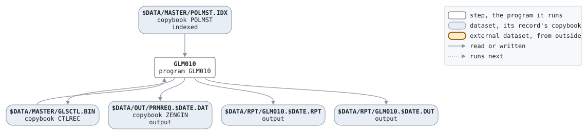

# BILLING

```text
BILLING.BAT: 保険料請求。月に一度、振替日 (27日) の前に、収納代行
に送る口座振替依頼ファイルを作る。

使い方: BILLING.BAT YYYYMMDD  実行日。その月が請求月。
環境: GLS_BIN プログラム、GLS_DATA データ

変更履歴
2003-10-06 MS  GL-0310 初版、口座振替の開始。
```

Script [BILLING.BAT](../../../gondwana/scripts/BILLING.BAT): 1 steps.

## Contents

- [Network](#network)
- [Steps](#steps)
  - [GLM010](#glm010)
- [Datasets](#datasets)
- [Findings](#findings)

## Network



## Steps

| Step | Program | Reads | Writes | Stops the script if | Description | Source |
| --- | --- | --- | --- | --- | --- | --- |
| GLM010 | [GLM010](../programs/GLM010.md), with $DATE | $DATA/MASTER/POLMST.IDX, $DATA/MASTER/GLSCTL.BIN | $DATA/OUT/PRMREQ.$DATE.DAT, $DATA/MASTER/GLSCTL.BIN, $DATA/RPT/GLM010.$DATE.RPT, $DATA/RPT/GLM010.$DATE.OUT | RC >= 8 | 口座振替依頼ファイルの作成 | [BILLING.BAT:21](../../../gondwana/scripts/BILLING.BAT#L21) |

### GLM010

| Name | File | File in the program | Copybook | Use |
| --- | --- | --- | --- | --- |
| POLMST | $DATA/MASTER/POLMST.IDX (indexed) | POLMST-F | [POLMST](../copybooks/POLMST.md) | read |
| PRMREQ | $DATA/OUT/PRMREQ.$DATE.DAT | PRMREQ-F | [ZENGIN](../copybooks/ZENGIN.md) | write |
| GLSCTL | $DATA/MASTER/GLSCTL.BIN | GLSCTL-F | [CTLREC](../copybooks/CTLREC.md) | update |
| GLM010R | $DATA/RPT/GLM010.$DATE.RPT | REPORT-F | | write |
| stdout | $DATA/RPT/GLM010.$DATE.OUT | | | write |

## Datasets

Each dataset the job names, the copybook that describes its records, from the programs that read or write it in any job, and the steps that write and read it.

| Dataset | Copybook | Written by | Read by |
| --- | --- | --- | --- |
| $DATA/MASTER/POLMST.IDX | [POLMST](../copybooks/POLMST.md) | | GLM010 |
| $DATA/OUT/PRMREQ.$DATE.DAT | [ZENGIN](../copybooks/ZENGIN.md) | GLM010 | |
| $DATA/MASTER/GLSCTL.BIN | [CTLREC](../copybooks/CTLREC.md) | GLM010 | GLM010 |
| $DATA/RPT/GLM010.$DATE.RPT | | GLM010 | |
| $DATA/RPT/GLM010.$DATE.OUT | | GLM010 | |

## Findings

- Step GLM010 exports no DD_SORTWK for GLM010's file SORT-F.
