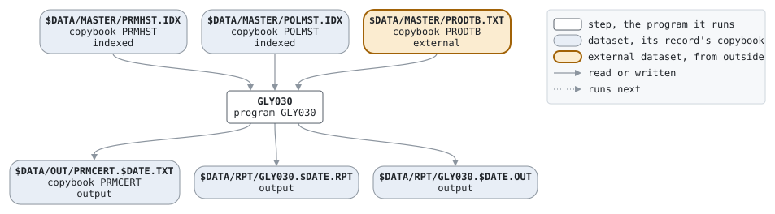

# CERT

```text
CERT.BAT: 保険料控除証明書。年に一度、10月の最初の営業日の日次
処理の後に、その年に収納した保険料の証明書を作り、印刷会社に渡す。

使い方: CERT.BAT YYYYMMDD  業務日付。その年の1月からこの日まで。
環境: GLS_BIN プログラム、GLS_DATA データ

変更履歴
2026-11-19 YN  GL-0827 初版。
```

Script [CERT.BAT](../../../gondwana/scripts/CERT.BAT): 1 steps.

## Contents

- [Network](#network)
- [Steps](#steps)
  - [GLY030](#gly030)
- [Datasets](#datasets)
- [Findings](#findings)

## Network



## Steps

| Step | Program | Reads | Writes | Stops the script if | Description | Source |
| --- | --- | --- | --- | --- | --- | --- |
| GLY030 | [GLY030](../programs/GLY030.md), with $DATE | $DATA/MASTER/PRMHST.IDX, $DATA/MASTER/POLMST.IDX, $DATA/MASTER/PRODTB.TXT | $DATA/OUT/PRMCERT.$DATE.TXT, $DATA/RPT/GLY030.$DATE.RPT, $DATA/RPT/GLY030.$DATE.OUT | RC >= 8 | 保険料控除証明書 | [CERT.BAT:22](../../../gondwana/scripts/CERT.BAT#L22) |

### GLY030

| Name | File | File in the program | Copybook | Use |
| --- | --- | --- | --- | --- |
| PRMHST | $DATA/MASTER/PRMHST.IDX (indexed) | PRMHST-F | [PRMHST](../copybooks/PRMHST.md) | read |
| POLMST | $DATA/MASTER/POLMST.IDX (indexed) | POLMST-F | [POLMST](../copybooks/POLMST.md) | read |
| PRODTB | $DATA/MASTER/PRODTB.TXT | PRODTB-F | [PRODTB](../copybooks/PRODTB.md) | read |
| PRMCERT | $DATA/OUT/PRMCERT.$DATE.TXT | PRMCERT-F | [PRMCERT](../copybooks/PRMCERT.md) | write |
| GLY030R | $DATA/RPT/GLY030.$DATE.RPT | REPORT-F | | write |
| stdout | $DATA/RPT/GLY030.$DATE.OUT | | | write |

## Datasets

Each dataset the job names, the copybook that describes its records, from the programs that read or write it in any job, and the steps that write and read it.

| Dataset | Copybook | Written by | Read by |
| --- | --- | --- | --- |
| $DATA/MASTER/PRMHST.IDX | [PRMHST](../copybooks/PRMHST.md) | | GLY030 |
| $DATA/MASTER/POLMST.IDX | [POLMST](../copybooks/POLMST.md) | | GLY030 |
| $DATA/MASTER/PRODTB.TXT | [PRODTB](../copybooks/PRODTB.md) | | GLY030 |
| $DATA/OUT/PRMCERT.$DATE.TXT | [PRMCERT](../copybooks/PRMCERT.md) | GLY030 | |
| $DATA/RPT/GLY030.$DATE.RPT | | GLY030 | |
| $DATA/RPT/GLY030.$DATE.OUT | | GLY030 | |

## Findings

None: every program's file is bound by a DD_ variable.
