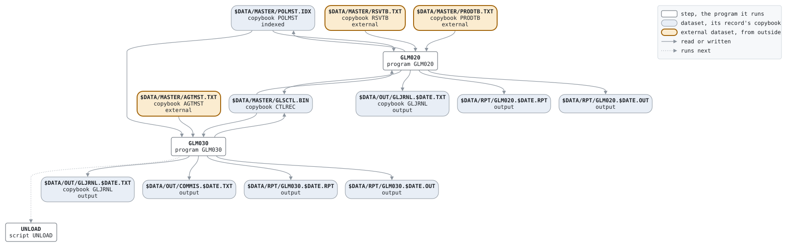

# CLOSE

```text
CLOSE.BAT: 月次締め。月末の日次処理の後に、責任準備金の計算、
代理店手数料の計算、そしてアンロード。

使い方: CLOSE.BAT YYYYMMDD  月末の業務日付
環境: GLS_BIN プログラム、GLS_SCRIPTS バッチファイル、GLS_DATA データ

変更履歴
1999-11-08 MS  GL-0233 初版、PC システム移行時 (旧 JCL から)。
```

Script [CLOSE.BAT](../../../gondwana/scripts/CLOSE.BAT): 3 steps.

## Contents

- [Network](#network)
- [Steps](#steps)
  - [GLM020](#glm020)
  - [GLM030](#glm030)
- [Datasets](#datasets)
- [Findings](#findings)

## Network



## Steps

| Step | Program | Reads | Writes | Stops the script if | Description | Source |
| --- | --- | --- | --- | --- | --- | --- |
| GLM020 | [GLM020](../programs/GLM020.md), with $DATE | $DATA/MASTER/POLMST.IDX, $DATA/MASTER/RSVTB.TXT, $DATA/MASTER/PRODTB.TXT, $DATA/MASTER/GLSCTL.BIN | $DATA/MASTER/POLMST.IDX, $DATA/MASTER/GLSCTL.BIN, $DATA/OUT/GLJRNL.$DATE.TXT, $DATA/RPT/GLM020.$DATE.RPT, $DATA/RPT/GLM020.$DATE.OUT | RC >= 8 | 責任準備金計算 | [CLOSE.BAT:23](../../../gondwana/scripts/CLOSE.BAT#L23) |
| GLM030 | [GLM030](../programs/GLM030.md), with $DATE | $DATA/MASTER/POLMST.IDX, $DATA/MASTER/AGTMST.TXT, $DATA/MASTER/GLSCTL.BIN | $DATA/MASTER/GLSCTL.BIN, $DATA/OUT/GLJRNL.$DATE.TXT, $DATA/OUT/COMMIS.$DATE.TXT, $DATA/RPT/GLM030.$DATE.RPT, $DATA/RPT/GLM030.$DATE.OUT | RC >= 8 | 代理店手数料計算 | [CLOSE.BAT:31](../../../gondwana/scripts/CLOSE.BAT#L31) |
| UNLOAD | script [UNLOAD](UNLOAD.md), with $DATE | | | RC >= 8 | 月末のアンロード | [CLOSE.BAT:36](../../../gondwana/scripts/CLOSE.BAT#L36) |

### GLM020

| Name | File | File in the program | Copybook | Use |
| --- | --- | --- | --- | --- |
| POLMST | $DATA/MASTER/POLMST.IDX (indexed) | POLMST-F | [POLMST](../copybooks/POLMST.md) | update |
| RSVTB | $DATA/MASTER/RSVTB.TXT | RSVTB-F | [RSVTB](../copybooks/RSVTB.md) | read |
| PRODTB | $DATA/MASTER/PRODTB.TXT | PRODTB-F | [PRODTB](../copybooks/PRODTB.md) | read |
| GLSCTL | $DATA/MASTER/GLSCTL.BIN | GLSCTL-F | [CTLREC](../copybooks/CTLREC.md) | update |
| GLJRNL | $DATA/OUT/GLJRNL.$DATE.TXT | GLJRNL-F | [GLJRNL](../copybooks/GLJRNL.md) | append |
| GLM020R | $DATA/RPT/GLM020.$DATE.RPT | REPORT-F | | write |
| stdout | $DATA/RPT/GLM020.$DATE.OUT | | | write |

### GLM030

| Name | File | File in the program | Copybook | Use |
| --- | --- | --- | --- | --- |
| POLMST | $DATA/MASTER/POLMST.IDX (indexed) | POLMST-F | [POLMST](../copybooks/POLMST.md) | read |
| AGTMST | $DATA/MASTER/AGTMST.TXT | AGTMST-F | [AGTMST](../copybooks/AGTMST.md) | read |
| GLSCTL | $DATA/MASTER/GLSCTL.BIN | GLSCTL-F | [CTLREC](../copybooks/CTLREC.md) | update |
| GLJRNL | $DATA/OUT/GLJRNL.$DATE.TXT | GLJRNL-F | [GLJRNL](../copybooks/GLJRNL.md) | append |
| COMMIS | $DATA/OUT/COMMIS.$DATE.TXT | COMMIS-F | | write |
| GLM030R | $DATA/RPT/GLM030.$DATE.RPT | REPORT-F | | write |
| stdout | $DATA/RPT/GLM030.$DATE.OUT | | | write |

## Datasets

Each dataset the job names, the copybook that describes its records, from the programs that read or write it in any job, and the steps that write and read it.

| Dataset | Copybook | Written by | Read by |
| --- | --- | --- | --- |
| $DATA/MASTER/POLMST.IDX | [POLMST](../copybooks/POLMST.md) | GLM020 | GLM020, GLM030 |
| $DATA/MASTER/RSVTB.TXT | [RSVTB](../copybooks/RSVTB.md) | | GLM020 |
| $DATA/MASTER/PRODTB.TXT | [PRODTB](../copybooks/PRODTB.md) | | GLM020 |
| $DATA/MASTER/GLSCTL.BIN | [CTLREC](../copybooks/CTLREC.md) | GLM020, GLM030 | GLM020, GLM030 |
| $DATA/OUT/GLJRNL.$DATE.TXT | [GLJRNL](../copybooks/GLJRNL.md) | GLM020, GLM030 | |
| $DATA/RPT/GLM020.$DATE.RPT | | GLM020 | |
| $DATA/RPT/GLM020.$DATE.OUT | | GLM020 | |
| $DATA/MASTER/AGTMST.TXT | [AGTMST](../copybooks/AGTMST.md) | | GLM030 |
| $DATA/OUT/COMMIS.$DATE.TXT | | GLM030 | |
| $DATA/RPT/GLM030.$DATE.RPT | | GLM030 | |
| $DATA/RPT/GLM030.$DATE.OUT | | GLM030 | |

## Findings

None: every program's file is bound by a DD_ variable.
