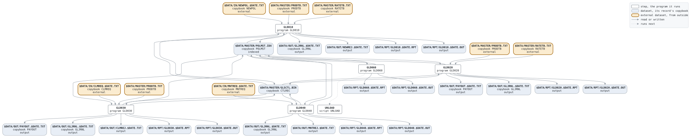

# DAILY

```text
DAILY.BAT: 日次処理。新契約の登録、契約応当日、給付支払、契約変更、
失効、契約者貸付、そしてアンロード。営業日ごとにスケジューラが
起動する。

使い方: DAILY.BAT YYYYMMDD  業務日付
環境: GLS_BIN プログラム、GLS_SCRIPTS バッチファイル、GLS_DATA データ

変更履歴
1999-11-08 MS  GL-0233 初版、PC システム移行時 (旧 JCL から)。
2003-10-06 MS  GL-0310 営業システムの新契約ファイル。
2011-02-14 YN  GL-0520 契約変更に復活。
2012-09-03 YN  GL-0561 契約者貸付。
2026-11-16 YN  GL-0822 給付履歴。
2026-11-18 YN  GL-0825 保障マスタ。
2026-11-19 YN  GL-0827 収納履歴。
```

Script [DAILY.BAT](../../../gondwana/scripts/DAILY.BAT): 7 steps.

## Contents

- [Network](#network)
- [Steps](#steps)
  - [GLD010](#gld010)
  - [GLD020](#gld020)
  - [GLD030](#gld030)
  - [GLD040](#gld040)
  - [GLD060](#gld060)
  - [GLD070](#gld070)
- [Datasets](#datasets)
- [Findings](#findings)

## Network



## Steps

| Step | Program | Reads | Writes | Stops the script if | Description | Source |
| --- | --- | --- | --- | --- | --- | --- |
| GLD010 | [GLD010](../programs/GLD010.md), with $DATE | $DATA/IN/NEWPOL.$DATE.TXT, $DATA/MASTER/POLMST.IDX, $DATA/MASTER/COVMST.IDX, $DATA/MASTER/PRODTB.TXT, $DATA/MASTER/RATETB.TXT, $DATA/MASTER/GLSCTL.BIN, $DATA/MASTER/PRMHST.IDX | $DATA/MASTER/POLMST.IDX, $DATA/MASTER/COVMST.IDX, $DATA/MASTER/GLSCTL.BIN, $DATA/OUT/GLJRNL.$DATE.TXT, $DATA/OUT/NEWREJ.$DATE.TXT, $DATA/RPT/GLD010.$DATE.RPT, $DATA/MASTER/PRMHST.IDX, $DATA/RPT/GLD010.$DATE.OUT | RC >= 8 | 新契約登録 | [DAILY.BAT:36](../../../gondwana/scripts/DAILY.BAT#L36) |
| GLD020 | [GLD020](../programs/GLD020.md), with $DATE | $DATA/MASTER/POLMST.IDX, $DATA/MASTER/COVMST.IDX, $DATA/MASTER/PRODTB.TXT, $DATA/MASTER/RATETB.TXT, $DATA/MASTER/GLSCTL.BIN, $DATA/MASTER/CSVTB.TXT | $DATA/MASTER/POLMST.IDX, $DATA/MASTER/COVMST.IDX, $DATA/MASTER/GLSCTL.BIN, $DATA/OUT/PAYOUT.$DATE.TXT, $DATA/OUT/GLJRNL.$DATE.TXT, $DATA/RPT/GLD020.$DATE.RPT, $DATA/RPT/GLD020.$DATE.OUT | RC >= 8 | 契約応当日処理 | [DAILY.BAT:42](../../../gondwana/scripts/DAILY.BAT#L42) |
| GLD030 | [GLD030](../programs/GLD030.md), with $DATE | $DATA/IN/CLMREQ.$DATE.TXT, $DATA/MASTER/POLMST.IDX, $DATA/MASTER/COVMST.IDX, $DATA/MASTER/PRODTB.TXT, $DATA/MASTER/GLSCTL.BIN, $DATA/MASTER/BENHST.IDX, $DATA/MASTER/CSVTB.TXT | $DATA/MASTER/POLMST.IDX, $DATA/MASTER/COVMST.IDX, $DATA/MASTER/GLSCTL.BIN, $DATA/OUT/PAYOUT.$DATE.TXT, $DATA/OUT/GLJRNL.$DATE.TXT, $DATA/OUT/CLMREJ.$DATE.TXT, $DATA/MASTER/BENHST.IDX, $DATA/RPT/GLD030.$DATE.RPT, $DATA/RPT/GLD030.$DATE.OUT | RC >= 8 | 給付支払 | [DAILY.BAT:51](../../../gondwana/scripts/DAILY.BAT#L51) |
| GLD040 | [GLD040](../programs/GLD040.md), with $DATE | $DATA/IN/MNTREQ.$DATE.TXT, $DATA/MASTER/POLMST.IDX, $DATA/MASTER/COVMST.IDX, $DATA/MASTER/GLSCTL.BIN, $DATA/MASTER/PRMHST.IDX | $DATA/MASTER/POLMST.IDX, $DATA/MASTER/COVMST.IDX, $DATA/MASTER/GLSCTL.BIN, $DATA/OUT/GLJRNL.$DATE.TXT, $DATA/OUT/MNTREJ.$DATE.TXT, $DATA/RPT/GLD040.$DATE.RPT, $DATA/MASTER/PRMHST.IDX, $DATA/RPT/GLD040.$DATE.OUT | RC >= 8 | 契約変更 | [DAILY.BAT:59](../../../gondwana/scripts/DAILY.BAT#L59) |
| GLD060 | [GLD060](../programs/GLD060.md), with $DATE | $DATA/MASTER/POLMST.IDX, $DATA/MASTER/GLSCTL.BIN, $DATA/MASTER/CSVTB.TXT, $DATA/MASTER/PRMHST.IDX | $DATA/MASTER/POLMST.IDX, $DATA/MASTER/GLSCTL.BIN, $DATA/OUT/GLJRNL.$DATE.TXT, $DATA/RPT/GLD060.$DATE.RPT, $DATA/MASTER/PRMHST.IDX, $DATA/RPT/GLD060.$DATE.OUT | RC >= 8 | 失効処理 | [DAILY.BAT:65](../../../gondwana/scripts/DAILY.BAT#L65) |
| GLD070 | [GLD070](../programs/GLD070.md), with $DATE | $DATA/IN/LONREQ.$DATE.TXT, $DATA/MASTER/POLMST.IDX, $DATA/MASTER/GLSCTL.BIN, $DATA/MASTER/CSVTB.TXT | $DATA/MASTER/POLMST.IDX, $DATA/MASTER/GLSCTL.BIN, $DATA/OUT/PAYOUT.$DATE.TXT, $DATA/OUT/GLJRNL.$DATE.TXT, $DATA/OUT/LONREJ.$DATE.TXT, $DATA/RPT/GLD070.$DATE.RPT, $DATA/RPT/GLD070.$DATE.OUT | RC >= 8 | 契約者貸付 | [DAILY.BAT:73](../../../gondwana/scripts/DAILY.BAT#L73) |
| UNLOAD | script [UNLOAD](UNLOAD.md), with $DATE | | | RC >= 8 | 契約マスタのアンロードと制御レコードの更新 | [DAILY.BAT:78](../../../gondwana/scripts/DAILY.BAT#L78) |

### GLD010

| Name | File | File in the program | Copybook | Use |
| --- | --- | --- | --- | --- |
| NEWPOL | $DATA/IN/NEWPOL.$DATE.TXT | NEWPOL-F | [NEWPOL](../copybooks/NEWPOL.md) | read |
| POLMST | $DATA/MASTER/POLMST.IDX (indexed) | POLMST-F | [POLMST](../copybooks/POLMST.md) | update |
| COVMST | $DATA/MASTER/COVMST.IDX (indexed) | COVMST-F | [COVMST](../copybooks/COVMST.md) | update |
| PRODTB | $DATA/MASTER/PRODTB.TXT | PRODTB-F | [PRODTB](../copybooks/PRODTB.md) | read |
| RATETB | $DATA/MASTER/RATETB.TXT | RATETB-F | [RATETB](../copybooks/RATETB.md) | read |
| GLSCTL | $DATA/MASTER/GLSCTL.BIN | GLSCTL-F | [CTLREC](../copybooks/CTLREC.md) | update |
| GLJRNL | $DATA/OUT/GLJRNL.$DATE.TXT | GLJRNL-F | [GLJRNL](../copybooks/GLJRNL.md) | append |
| NEWREJ | $DATA/OUT/NEWREJ.$DATE.TXT | REJECT-F | | write |
| GLD010R | $DATA/RPT/GLD010.$DATE.RPT | REPORT-F | | write |
| PRMHST | $DATA/MASTER/PRMHST.IDX (indexed) | PRMHST-F of [GLC050](../programs/GLC050.md) | [PRMHST](../copybooks/PRMHST.md) | update |
| stdout | $DATA/RPT/GLD010.$DATE.OUT | | | write |

### GLD020

| Name | File | File in the program | Copybook | Use |
| --- | --- | --- | --- | --- |
| POLMST | $DATA/MASTER/POLMST.IDX (indexed) | POLMST-F | [POLMST](../copybooks/POLMST.md) | update |
| COVMST | $DATA/MASTER/COVMST.IDX (indexed) | COVMST-F | [COVMST](../copybooks/COVMST.md) | update |
| PRODTB | $DATA/MASTER/PRODTB.TXT | PRODTB-F | [PRODTB](../copybooks/PRODTB.md) | read |
| RATETB | $DATA/MASTER/RATETB.TXT | RATETB-F | [RATETB](../copybooks/RATETB.md) | read |
| GLSCTL | $DATA/MASTER/GLSCTL.BIN | GLSCTL-F | [CTLREC](../copybooks/CTLREC.md) | update |
| PAYOUT | $DATA/OUT/PAYOUT.$DATE.TXT | PAYOUT-F | [PAYOUT](../copybooks/PAYOUT.md) | append |
| GLJRNL | $DATA/OUT/GLJRNL.$DATE.TXT | GLJRNL-F | [GLJRNL](../copybooks/GLJRNL.md) | append |
| GLD020R | $DATA/RPT/GLD020.$DATE.RPT | REPORT-F | | write |
| CSVTB | $DATA/MASTER/CSVTB.TXT | CSVTB-F of [GLC030](../programs/GLC030.md) | [CSVTB](../copybooks/CSVTB.md) | read |
| stdout | $DATA/RPT/GLD020.$DATE.OUT | | | write |

### GLD030

| Name | File | File in the program | Copybook | Use |
| --- | --- | --- | --- | --- |
| CLMREQ | $DATA/IN/CLMREQ.$DATE.TXT | CLMREQ-F | [CLMREQ](../copybooks/CLMREQ.md) | read |
| POLMST | $DATA/MASTER/POLMST.IDX (indexed) | POLMST-F | [POLMST](../copybooks/POLMST.md) | update |
| COVMST | $DATA/MASTER/COVMST.IDX (indexed) | COVMST-F | [COVMST](../copybooks/COVMST.md) | update |
| PRODTB | $DATA/MASTER/PRODTB.TXT | PRODTB-F | [PRODTB](../copybooks/PRODTB.md) | read |
| GLSCTL | $DATA/MASTER/GLSCTL.BIN | GLSCTL-F | [CTLREC](../copybooks/CTLREC.md) | update |
| PAYOUT | $DATA/OUT/PAYOUT.$DATE.TXT | PAYOUT-F | [PAYOUT](../copybooks/PAYOUT.md) | append |
| GLJRNL | $DATA/OUT/GLJRNL.$DATE.TXT | GLJRNL-F | [GLJRNL](../copybooks/GLJRNL.md) | append |
| CLMREJ | $DATA/OUT/CLMREJ.$DATE.TXT | REJECT-F | | write |
| BENHST | $DATA/MASTER/BENHST.IDX (indexed) | BENHST-F | [BENHST](../copybooks/BENHST.md) | update |
| GLD030R | $DATA/RPT/GLD030.$DATE.RPT | REPORT-F | | write |
| CSVTB | $DATA/MASTER/CSVTB.TXT | CSVTB-F of [GLC030](../programs/GLC030.md) | [CSVTB](../copybooks/CSVTB.md) | read |
| stdout | $DATA/RPT/GLD030.$DATE.OUT | | | write |

### GLD040

| Name | File | File in the program | Copybook | Use |
| --- | --- | --- | --- | --- |
| MNTREQ | $DATA/IN/MNTREQ.$DATE.TXT | MNTREQ-F | [MNTREQ](../copybooks/MNTREQ.md) | read |
| POLMST | $DATA/MASTER/POLMST.IDX (indexed) | POLMST-F | [POLMST](../copybooks/POLMST.md) | update |
| COVMST | $DATA/MASTER/COVMST.IDX (indexed) | COVMST-F | [COVMST](../copybooks/COVMST.md) | update |
| GLSCTL | $DATA/MASTER/GLSCTL.BIN | GLSCTL-F | [CTLREC](../copybooks/CTLREC.md) | update |
| GLJRNL | $DATA/OUT/GLJRNL.$DATE.TXT | GLJRNL-F | [GLJRNL](../copybooks/GLJRNL.md) | append |
| MNTREJ | $DATA/OUT/MNTREJ.$DATE.TXT | REJECT-F | | write |
| GLD040R | $DATA/RPT/GLD040.$DATE.RPT | REPORT-F | | write |
| PRMHST | $DATA/MASTER/PRMHST.IDX (indexed) | PRMHST-F of [GLC050](../programs/GLC050.md) | [PRMHST](../copybooks/PRMHST.md) | update |
| stdout | $DATA/RPT/GLD040.$DATE.OUT | | | write |

### GLD060

| Name | File | File in the program | Copybook | Use |
| --- | --- | --- | --- | --- |
| POLMST | $DATA/MASTER/POLMST.IDX (indexed) | POLMST-F | [POLMST](../copybooks/POLMST.md) | update |
| GLSCTL | $DATA/MASTER/GLSCTL.BIN | GLSCTL-F | [CTLREC](../copybooks/CTLREC.md) | update |
| GLJRNL | $DATA/OUT/GLJRNL.$DATE.TXT | GLJRNL-F | [GLJRNL](../copybooks/GLJRNL.md) | append |
| GLD060R | $DATA/RPT/GLD060.$DATE.RPT | REPORT-F | | write |
| CSVTB | $DATA/MASTER/CSVTB.TXT | CSVTB-F of [GLC030](../programs/GLC030.md) | [CSVTB](../copybooks/CSVTB.md) | read |
| PRMHST | $DATA/MASTER/PRMHST.IDX (indexed) | PRMHST-F of [GLC050](../programs/GLC050.md) | [PRMHST](../copybooks/PRMHST.md) | update |
| stdout | $DATA/RPT/GLD060.$DATE.OUT | | | write |

### GLD070

| Name | File | File in the program | Copybook | Use |
| --- | --- | --- | --- | --- |
| LONREQ | $DATA/IN/LONREQ.$DATE.TXT | LONREQ-F | [LONREQ](../copybooks/LONREQ.md) | read |
| POLMST | $DATA/MASTER/POLMST.IDX (indexed) | POLMST-F | [POLMST](../copybooks/POLMST.md) | update |
| GLSCTL | $DATA/MASTER/GLSCTL.BIN | GLSCTL-F | [CTLREC](../copybooks/CTLREC.md) | update |
| PAYOUT | $DATA/OUT/PAYOUT.$DATE.TXT | PAYOUT-F | [PAYOUT](../copybooks/PAYOUT.md) | append |
| GLJRNL | $DATA/OUT/GLJRNL.$DATE.TXT | GLJRNL-F | [GLJRNL](../copybooks/GLJRNL.md) | append |
| LONREJ | $DATA/OUT/LONREJ.$DATE.TXT | REJECT-F | | write |
| GLD070R | $DATA/RPT/GLD070.$DATE.RPT | REPORT-F | | write |
| CSVTB | $DATA/MASTER/CSVTB.TXT | CSVTB-F of [GLC030](../programs/GLC030.md) | [CSVTB](../copybooks/CSVTB.md) | read |
| stdout | $DATA/RPT/GLD070.$DATE.OUT | | | write |

## Datasets

Each dataset the job names, the copybook that describes its records, from the programs that read or write it in any job, and the steps that write and read it.

| Dataset | Copybook | Written by | Read by |
| --- | --- | --- | --- |
| $DATA/IN/NEWPOL.$DATE.TXT | [NEWPOL](../copybooks/NEWPOL.md) | | GLD010 |
| $DATA/MASTER/POLMST.IDX | [POLMST](../copybooks/POLMST.md) | GLD010, GLD020, GLD030, GLD040, GLD060, GLD070 | GLD010, GLD020, GLD030, GLD040, GLD060, GLD070 |
| $DATA/MASTER/COVMST.IDX | [COVMST](../copybooks/COVMST.md) | GLD010, GLD020, GLD030, GLD040 | GLD010, GLD020, GLD030, GLD040 |
| $DATA/MASTER/PRODTB.TXT | [PRODTB](../copybooks/PRODTB.md) | | GLD010, GLD020, GLD030 |
| $DATA/MASTER/RATETB.TXT | [RATETB](../copybooks/RATETB.md) | | GLD010, GLD020 |
| $DATA/MASTER/GLSCTL.BIN | [CTLREC](../copybooks/CTLREC.md) | GLD010, GLD020, GLD030, GLD040, GLD060, GLD070 | GLD010, GLD020, GLD030, GLD040, GLD060, GLD070 |
| $DATA/OUT/GLJRNL.$DATE.TXT | [GLJRNL](../copybooks/GLJRNL.md) | GLD010, GLD020, GLD030, GLD040, GLD060, GLD070 | |
| $DATA/OUT/NEWREJ.$DATE.TXT | | GLD010 | |
| $DATA/RPT/GLD010.$DATE.RPT | | GLD010 | |
| $DATA/MASTER/PRMHST.IDX | [PRMHST](../copybooks/PRMHST.md) | GLD010, GLD040, GLD060 | GLD010, GLD040, GLD060 |
| $DATA/RPT/GLD010.$DATE.OUT | | GLD010 | |
| $DATA/OUT/PAYOUT.$DATE.TXT | [PAYOUT](../copybooks/PAYOUT.md) | GLD020, GLD030, GLD070 | |
| $DATA/RPT/GLD020.$DATE.RPT | | GLD020 | |
| $DATA/MASTER/CSVTB.TXT | [CSVTB](../copybooks/CSVTB.md) | | GLD020, GLD030, GLD060, GLD070 |
| $DATA/RPT/GLD020.$DATE.OUT | | GLD020 | |
| $DATA/IN/CLMREQ.$DATE.TXT | [CLMREQ](../copybooks/CLMREQ.md) | | GLD030 |
| $DATA/OUT/CLMREJ.$DATE.TXT | | GLD030 | |
| $DATA/MASTER/BENHST.IDX | [BENHST](../copybooks/BENHST.md) | GLD030 | GLD030 |
| $DATA/RPT/GLD030.$DATE.RPT | | GLD030 | |
| $DATA/RPT/GLD030.$DATE.OUT | | GLD030 | |
| $DATA/IN/MNTREQ.$DATE.TXT | [MNTREQ](../copybooks/MNTREQ.md) | | GLD040 |
| $DATA/OUT/MNTREJ.$DATE.TXT | | GLD040 | |
| $DATA/RPT/GLD040.$DATE.RPT | | GLD040 | |
| $DATA/RPT/GLD040.$DATE.OUT | | GLD040 | |
| $DATA/RPT/GLD060.$DATE.RPT | | GLD060 | |
| $DATA/RPT/GLD060.$DATE.OUT | | GLD060 | |
| $DATA/IN/LONREQ.$DATE.TXT | [LONREQ](../copybooks/LONREQ.md) | | GLD070 |
| $DATA/OUT/LONREJ.$DATE.TXT | | GLD070 | |
| $DATA/RPT/GLD070.$DATE.RPT | | GLD070 | |
| $DATA/RPT/GLD070.$DATE.OUT | | GLD070 | |

## Findings

None: every program's file is bound by a DD_ variable.
