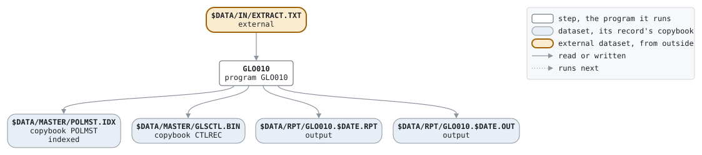

# OPEN

```text
OPEN.BAT: システム開設。契約抽出ファイルから契約マスタの索引
ファイルと制御レコードを作る。一度だけ実行する。

使い方: OPEN.BAT YYYYMMDD  業務日付
環境: GLS_BIN プログラム、GLS_SCRIPTS バッチファイル、GLS_DATA データ

変更履歴
1999-11-08 MS  GL-0233 初版、PC システム移行時。
```

Script [OPEN.BAT](../../../gondwana/scripts/OPEN.BAT): 1 steps.

## Contents

- [Network](#network)
- [Steps](#steps)
  - [GLO010](#glo010)
- [Datasets](#datasets)
- [Findings](#findings)

## Network



## Steps

| Step | Program | Reads | Writes | Stops the script if | Description | Source |
| --- | --- | --- | --- | --- | --- | --- |
| GLO010 | [GLO010](../programs/GLO010.md), with $DATE | $DATA/IN/EXTRACT.TXT | $DATA/MASTER/POLMST.IDX, $DATA/MASTER/GLSCTL.BIN, $DATA/RPT/GLO010.$DATE.RPT, $DATA/RPT/GLO010.$DATE.OUT | RC >= 8 | 契約マスタの初期登録と制御レコード | [OPEN.BAT:25](../../../gondwana/scripts/OPEN.BAT#L25) |

### GLO010

| Name | File | File in the program | Copybook | Use |
| --- | --- | --- | --- | --- |
| EXTRACT | $DATA/IN/EXTRACT.TXT | EXTRACT-F | | read |
| POLMST | $DATA/MASTER/POLMST.IDX (indexed) | POLMST-F | [POLMST](../copybooks/POLMST.md) | write |
| GLSCTL | $DATA/MASTER/GLSCTL.BIN | GLSCTL-F | [CTLREC](../copybooks/CTLREC.md) | write |
| GLO010R | $DATA/RPT/GLO010.$DATE.RPT | REPORT-F | | write |
| stdout | $DATA/RPT/GLO010.$DATE.OUT | | | write |

## Datasets

Each dataset the job names, the copybook that describes its records, from the programs that read or write it in any job, and the steps that write and read it.

| Dataset | Copybook | Written by | Read by |
| --- | --- | --- | --- |
| $DATA/IN/EXTRACT.TXT | | | GLO010 |
| $DATA/MASTER/POLMST.IDX | [POLMST](../copybooks/POLMST.md) | GLO010 | |
| $DATA/MASTER/GLSCTL.BIN | [CTLREC](../copybooks/CTLREC.md) | GLO010 | |
| $DATA/RPT/GLO010.$DATE.RPT | | GLO010 | |
| $DATA/RPT/GLO010.$DATE.OUT | | GLO010 | |

## Findings

None: every program's file is bound by a DD_ variable.
