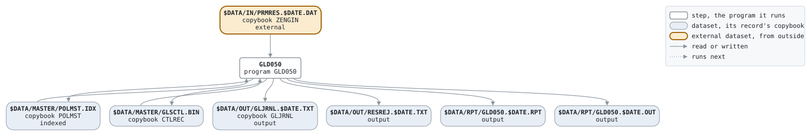

# RESULTS

```text
RESULTS.BAT: 口座振替結果処理。収納代行から結果ファイルが届いた日
(振替日の数営業日後) に、日次処理の前に実行する。

使い方: RESULTS.BAT YYYYMMDD  業務日付。結果ファイルの日付でもある。
環境: GLS_BIN プログラム、GLS_DATA データ

変更履歴
2003-10-06 MS  GL-0310 初版、口座振替の開始。
```

Script [RESULTS.BAT](../../../gondwana/scripts/RESULTS.BAT): 1 steps.

## Contents

- [Network](#network)
- [Steps](#steps)
  - [GLD050](#gld050)
- [Datasets](#datasets)
- [Findings](#findings)

## Network



## Steps

| Step | Program | Reads | Writes | Stops the script if | Description | Source |
| --- | --- | --- | --- | --- | --- | --- |
| GLD050 | [GLD050](../programs/GLD050.md), with $DATE | $DATA/IN/PRMRES.$DATE.DAT, $DATA/MASTER/POLMST.IDX, $DATA/MASTER/GLSCTL.BIN | $DATA/MASTER/POLMST.IDX, $DATA/MASTER/GLSCTL.BIN, $DATA/OUT/GLJRNL.$DATE.TXT, $DATA/OUT/RESREJ.$DATE.TXT, $DATA/RPT/GLD050.$DATE.RPT, $DATA/RPT/GLD050.$DATE.OUT | RC >= 8 | 振替結果の反映 | [RESULTS.BAT:23](../../../gondwana/scripts/RESULTS.BAT#L23) |

### GLD050

| Name | File | File in the program | Copybook | Use |
| --- | --- | --- | --- | --- |
| PRMRES | $DATA/IN/PRMRES.$DATE.DAT | PRMRES-F | [ZENGIN](../copybooks/ZENGIN.md) | read |
| POLMST | $DATA/MASTER/POLMST.IDX (indexed) | POLMST-F | [POLMST](../copybooks/POLMST.md) | update |
| GLSCTL | $DATA/MASTER/GLSCTL.BIN | GLSCTL-F | [CTLREC](../copybooks/CTLREC.md) | update |
| GLJRNL | $DATA/OUT/GLJRNL.$DATE.TXT | GLJRNL-F | [GLJRNL](../copybooks/GLJRNL.md) | append |
| RESREJ | $DATA/OUT/RESREJ.$DATE.TXT | REJECT-F | | write |
| GLD050R | $DATA/RPT/GLD050.$DATE.RPT | REPORT-F | | write |
| stdout | $DATA/RPT/GLD050.$DATE.OUT | | | write |

## Datasets

Each dataset the job names, the copybook that describes its records, from the programs that read or write it in any job, and the steps that write and read it.

| Dataset | Copybook | Written by | Read by |
| --- | --- | --- | --- |
| $DATA/IN/PRMRES.$DATE.DAT | [ZENGIN](../copybooks/ZENGIN.md) | | GLD050 |
| $DATA/MASTER/POLMST.IDX | [POLMST](../copybooks/POLMST.md) | GLD050 | GLD050 |
| $DATA/MASTER/GLSCTL.BIN | [CTLREC](../copybooks/CTLREC.md) | GLD050 | GLD050 |
| $DATA/OUT/GLJRNL.$DATE.TXT | [GLJRNL](../copybooks/GLJRNL.md) | GLD050 | |
| $DATA/OUT/RESREJ.$DATE.TXT | | GLD050 | |
| $DATA/RPT/GLD050.$DATE.RPT | | GLD050 | |
| $DATA/RPT/GLD050.$DATE.OUT | | GLD050 | |

## Findings

None: every program's file is bound by a DD_ variable.
