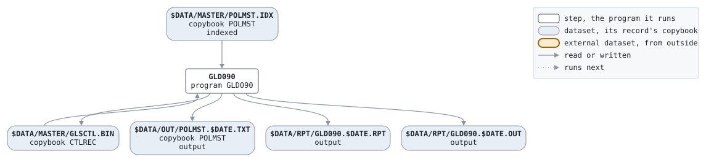

# UNLOAD

```text
UNLOAD.BAT: 契約マスタのアンロード。日次と月次の最後に呼ばれ、
下流に渡すファイルを作り、制御レコードの業務日付を進める。

使い方: UNLOAD.BAT YYYYMMDD  業務日付
環境: GLS_BIN プログラム、GLS_DATA データ

変更履歴
1999-11-08 MS  GL-0233 初版、PC システム移行時。
```

Script [UNLOAD.BAT](../../../gondwana/scripts/UNLOAD.BAT): 1 steps.

## Contents

- [Network](#network)
- [Steps](#steps)
  - [GLD090](#gld090)
- [Datasets](#datasets)
- [Findings](#findings)

## Network



## Steps

| Step | Program | Reads | Writes | Stops the script if | Description | Source |
| --- | --- | --- | --- | --- | --- | --- |
| GLD090 | [GLD090](../programs/GLD090.md), with $DATE | $DATA/MASTER/POLMST.IDX, $DATA/MASTER/GLSCTL.BIN | $DATA/OUT/POLMST.$DATE.TXT, $DATA/MASTER/GLSCTL.BIN, $DATA/RPT/GLD090.$DATE.RPT, $DATA/RPT/GLD090.$DATE.OUT | RC >= 8 | アンロードと制御レコード | [UNLOAD.BAT:21](../../../gondwana/scripts/UNLOAD.BAT#L21) |

### GLD090

| Name | File | File in the program | Copybook | Use |
| --- | --- | --- | --- | --- |
| POLMST | $DATA/MASTER/POLMST.IDX (indexed) | POLMST-F | [POLMST](../copybooks/POLMST.md) | read |
| UNLOAD | $DATA/OUT/POLMST.$DATE.TXT | UNLOAD-F | [POLMST](../copybooks/POLMST.md) | write |
| GLSCTL | $DATA/MASTER/GLSCTL.BIN | GLSCTL-F | [CTLREC](../copybooks/CTLREC.md) | update |
| GLD090R | $DATA/RPT/GLD090.$DATE.RPT | REPORT-F | | write |
| stdout | $DATA/RPT/GLD090.$DATE.OUT | | | write |

## Datasets

Each dataset the job names, the copybook that describes its records, from the programs that read or write it in any job, and the steps that write and read it.

| Dataset | Copybook | Written by | Read by |
| --- | --- | --- | --- |
| $DATA/MASTER/POLMST.IDX | [POLMST](../copybooks/POLMST.md) | | GLD090 |
| $DATA/OUT/POLMST.$DATE.TXT | [POLMST](../copybooks/POLMST.md) | GLD090 | |
| $DATA/MASTER/GLSCTL.BIN | [CTLREC](../copybooks/CTLREC.md) | GLD090 | GLD090 |
| $DATA/RPT/GLD090.$DATE.RPT | | GLD090 | |
| $DATA/RPT/GLD090.$DATE.OUT | | GLD090 | |

## Findings

None: every program's file is bound by a DD_ variable.
