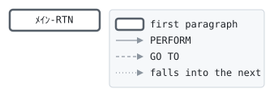

# GLC010

```text
GLC010: 保険年齢

生年月日と基準日 (ともに YYYYMMDD)、年齢を受けて呼ばれる。
保険年齢は満年齢に、次の1年のうち6か月以上が過ぎていれば
1 を足したもの: 39歳7か月の人は40歳として加入する。
月数は満月数で、誕生日の日より前の日は数えない。

変更履歴
日付       担当 変更
1987-04-01 KT   GL-0001 初版。
```

Program [GLC010.cbl](../../../gondwana/programs/GLC010.cbl): 0 files, 1 paragraphs. Its business rules: [1 decision tables](../rules/GLC010.md).

- AUTHOR: ゴンドワナ生命 システム部.
- DATE-WRITTEN: 1987-04-01.

## Contents

- [Files](#files)
- [Flow](#flow)
- [Paragraphs](#paragraphs)
- [Calls](#calls)
- [Data flow](#data-flow)
- [Lineage](#lineage)
  - [Into WS-ｾｲﾈﾝｶﾞｯﾋﾟ](#into-ws-ｾｲﾈﾝｶﾞｯﾋﾟ)
  - [Into WS-ｷｼﾞｭﾝﾋﾞ](#into-ws-ｷｼﾞｭﾝﾋﾞ)
  - [Into WS-ﾂｷｽｳ](#into-ws-ﾂｷｽｳ)
  - [Into WS-ｱﾏﾘ](#into-ws-ｱﾏﾘ)
  - [Into LK-ﾈﾝﾚｲ](#into-lk-ﾈﾝﾚｲ)
- [Parameters](#parameters)
  - [Parameter 1, LK-ｾｲﾈﾝｶﾞｯﾋﾟ](#parameter-1-lk-ｾｲﾈﾝｶﾞｯﾋﾟ)
  - [Parameter 2, LK-ｷｼﾞｭﾝﾋﾞ](#parameter-2-lk-ｷｼﾞｭﾝﾋﾞ)
  - [Parameter 3, LK-ﾈﾝﾚｲ](#parameter-3-lk-ﾈﾝﾚｲ)
- [Records](#records)
  - [WS-ｾｲﾈﾝｶﾞｯﾋﾟ](#ws-ｾｲﾈﾝｶﾞｯﾋﾟ)
  - [WS-ｷｼﾞｭﾝﾋﾞ](#ws-ｷｼﾞｭﾝﾋﾞ)
  - [WS-ﾂｷｽｳ](#ws-ﾂｷｽｳ)
  - [WS-ｱﾏﾘ](#ws-ｱﾏﾘ)
  - [LK-ｾｲﾈﾝｶﾞｯﾋﾟ](#lk-ｾｲﾈﾝｶﾞｯﾋﾟ)
  - [LK-ｷｼﾞｭﾝﾋﾞ](#lk-ｷｼﾞｭﾝﾋﾞ)
  - [LK-ﾈﾝﾚｲ](#lk-ﾈﾝﾚｲ)

## Files

| File | Kind | Assigned to | Organization | Status field | Opened | Records |
| --- | --- | --- | --- | --- | --- | --- |

## Flow



## Paragraphs

| Paragraph | Description | Source | Performs | Goes to | Performed by | Reached by |
| --- | --- | --- | --- | --- | --- | --- |
| ﾒｲﾝ-RTN | ﾒｲﾝ-RTN: 満月数を求め、6か月で切り上げて年にする。 | [GLC010.cbl:40](../../../gondwana/programs/GLC010.cbl#L40) | | | | |

## Calls

Called with LK-ｾｲﾈﾝｶﾞｯﾋﾟ, LK-ｷｼﾞｭﾝﾋﾞ, LK-ﾈﾝﾚｲ by [GLD010](GLD010.md), [GLD020](GLD020.md).

## Data flow

| Paragraph | Reads | Writes |
| --- | --- | --- |
| ﾒｲﾝ-RTN | LK-ｾｲﾈﾝｶﾞｯﾋﾟ, LK-ｷｼﾞｭﾝﾋﾞ, WS-A-YYYY, WS-B-YYYY, WS-A-MM, WS-B-MM, WS-A-DD, WS-B-DD, WS-ﾂｷｽｳ, WS-ｱﾏﾘ, LK-ﾈﾝﾚｲ | WS-ｾｲﾈﾝｶﾞｯﾋﾟ, WS-ｷｼﾞｭﾝﾋﾞ, WS-ﾂｷｽｳ, LK-ﾈﾝﾚｲ, WS-ｱﾏﾘ |

## Lineage

Where each data item's values come from, grouped by the record they go into. A data item links to the record it belongs to.

### Into WS-ｾｲﾈﾝｶﾞｯﾋﾟ

Record [WS-ｾｲﾈﾝｶﾞｯﾋﾟ](#ws-ｾｲﾈﾝｶﾞｯﾋﾟ).

| Into | From | Statement | Paragraph | Source |
| --- | --- | --- | --- | --- |
| WS-ｾｲﾈﾝｶﾞｯﾋﾟ | [LK-ｾｲﾈﾝｶﾞｯﾋﾟ](#lk-ｾｲﾈﾝｶﾞｯﾋﾟ) | MOVE | ﾒｲﾝ-RTN | [GLC010.cbl:41](../../../gondwana/programs/GLC010.cbl#L41) |

### Into WS-ｷｼﾞｭﾝﾋﾞ

Record [WS-ｷｼﾞｭﾝﾋﾞ](#ws-ｷｼﾞｭﾝﾋﾞ).

| Into | From | Statement | Paragraph | Source |
| --- | --- | --- | --- | --- |
| WS-ｷｼﾞｭﾝﾋﾞ | [LK-ｷｼﾞｭﾝﾋﾞ](#lk-ｷｼﾞｭﾝﾋﾞ) | MOVE | ﾒｲﾝ-RTN | [GLC010.cbl:42](../../../gondwana/programs/GLC010.cbl#L42) |

### Into WS-ﾂｷｽｳ

Record [WS-ﾂｷｽｳ](#ws-ﾂｷｽｳ).

| Into | From | Statement | Paragraph | Source |
| --- | --- | --- | --- | --- |
| WS-ﾂｷｽｳ | [WS-A-YYYY](#ws-ｷｼﾞｭﾝﾋﾞ "in WS-ｷｼﾞｭﾝﾋﾞ") | COMPUTE | ﾒｲﾝ-RTN | [GLC010.cbl:43](../../../gondwana/programs/GLC010.cbl#L43) |
| WS-ﾂｷｽｳ | [WS-B-YYYY](#ws-ｾｲﾈﾝｶﾞｯﾋﾟ "in WS-ｾｲﾈﾝｶﾞｯﾋﾟ") | COMPUTE | ﾒｲﾝ-RTN | [GLC010.cbl:43](../../../gondwana/programs/GLC010.cbl#L43) |
| WS-ﾂｷｽｳ | [WS-A-MM](#ws-ｷｼﾞｭﾝﾋﾞ "in WS-ｷｼﾞｭﾝﾋﾞ") | COMPUTE | ﾒｲﾝ-RTN | [GLC010.cbl:43](../../../gondwana/programs/GLC010.cbl#L43) |
| WS-ﾂｷｽｳ | [WS-B-MM](#ws-ｾｲﾈﾝｶﾞｯﾋﾟ "in WS-ｾｲﾈﾝｶﾞｯﾋﾟ") | COMPUTE | ﾒｲﾝ-RTN | [GLC010.cbl:43](../../../gondwana/programs/GLC010.cbl#L43) |
| WS-ﾂｷｽｳ | literal 1 | SUBTRACT | ﾒｲﾝ-RTN | [GLC010.cbl:46](../../../gondwana/programs/GLC010.cbl#L46) |
| WS-ﾂｷｽｳ | literal 0 | MOVE | ﾒｲﾝ-RTN | [GLC010.cbl:49](../../../gondwana/programs/GLC010.cbl#L49) |

### Into WS-ｱﾏﾘ

Record [WS-ｱﾏﾘ](#ws-ｱﾏﾘ).

| Into | From | Statement | Paragraph | Source |
| --- | --- | --- | --- | --- |
| WS-ｱﾏﾘ | [WS-ﾂｷｽｳ](#ws-ﾂｷｽｳ) | DIVIDE | ﾒｲﾝ-RTN | [GLC010.cbl:51](../../../gondwana/programs/GLC010.cbl#L51) |
| WS-ｱﾏﾘ | literal 12 | DIVIDE | ﾒｲﾝ-RTN | [GLC010.cbl:51](../../../gondwana/programs/GLC010.cbl#L51) |

### Into LK-ﾈﾝﾚｲ

Record [LK-ﾈﾝﾚｲ](#lk-ﾈﾝﾚｲ).

| Into | From | Statement | Paragraph | Source |
| --- | --- | --- | --- | --- |
| LK-ﾈﾝﾚｲ | [WS-ﾂｷｽｳ](#ws-ﾂｷｽｳ) | DIVIDE | ﾒｲﾝ-RTN | [GLC010.cbl:51](../../../gondwana/programs/GLC010.cbl#L51) |
| LK-ﾈﾝﾚｲ | literal 12 | DIVIDE | ﾒｲﾝ-RTN | [GLC010.cbl:51](../../../gondwana/programs/GLC010.cbl#L51) |
| LK-ﾈﾝﾚｲ | literal 1 | ADD | ﾒｲﾝ-RTN | [GLC010.cbl:54](../../../gondwana/programs/GLC010.cbl#L54) |

## Parameters

What the program does with each field of the items it is passed, by position: the contract its callers rely on. A statement on a whole item, or a group of it, counts for each field in it; a field neither read nor written is passed for nothing.

### Parameter 1, LK-ｾｲﾈﾝｶﾞｯﾋﾟ

| Field | Reads | Writes |
| --- | :-: | :-: |
| LK-ｾｲﾈﾝｶﾞｯﾋﾟ | yes | |

### Parameter 2, LK-ｷｼﾞｭﾝﾋﾞ

| Field | Reads | Writes |
| --- | :-: | :-: |
| LK-ｷｼﾞｭﾝﾋﾞ | yes | |

### Parameter 3, LK-ﾈﾝﾚｲ

| Field | Reads | Writes |
| --- | :-: | :-: |
| LK-ﾈﾝﾚｲ | yes | yes |

## Records

### WS-ｾｲﾈﾝｶﾞｯﾋﾟ

Working storage. 8 bytes.

| Level | Field | Kind | Start | Length | Picture | Usage | Notes | Source |
| --: | --- | --- | --: | --: | --- | --- | --- | --- |
| 01 | WS-ｾｲﾈﾝｶﾞｯﾋﾟ | group | 1 | 8 | | | | [GLC010.cbl:20](../../../gondwana/programs/GLC010.cbl#L20) |
| 05 | ├ WS-B-YYYY | number | 1 | 4 | 9(4) | | | [GLC010.cbl:21](../../../gondwana/programs/GLC010.cbl#L21) |
| 05 | ├ WS-B-MM | number | 5 | 2 | 99 | | | [GLC010.cbl:22](../../../gondwana/programs/GLC010.cbl#L22) |
| 05 | └ WS-B-DD | number | 7 | 2 | 99 | | | [GLC010.cbl:23](../../../gondwana/programs/GLC010.cbl#L23) |

### WS-ｷｼﾞｭﾝﾋﾞ

Working storage. 8 bytes.

| Level | Field | Kind | Start | Length | Picture | Usage | Notes | Source |
| --: | --- | --- | --: | --: | --- | --- | --- | --- |
| 01 | WS-ｷｼﾞｭﾝﾋﾞ | group | 1 | 8 | | | | [GLC010.cbl:24](../../../gondwana/programs/GLC010.cbl#L24) |
| 05 | ├ WS-A-YYYY | number | 1 | 4 | 9(4) | | | [GLC010.cbl:25](../../../gondwana/programs/GLC010.cbl#L25) |
| 05 | ├ WS-A-MM | number | 5 | 2 | 99 | | | [GLC010.cbl:26](../../../gondwana/programs/GLC010.cbl#L26) |
| 05 | └ WS-A-DD | number | 7 | 2 | 99 | | | [GLC010.cbl:27](../../../gondwana/programs/GLC010.cbl#L27) |

### WS-ﾂｷｽｳ

Working storage. 5 bytes.

| Level | Field | Kind | Start | Length | Picture | Usage | Notes | Source |
| --: | --- | --- | --: | --: | --- | --- | --- | --- |
| 01 | WS-ﾂｷｽｳ | number | 1 | 5 | S9(5) | | | [GLC010.cbl:28](../../../gondwana/programs/GLC010.cbl#L28) |

### WS-ｱﾏﾘ

Working storage. 2 bytes.

| Level | Field | Kind | Start | Length | Picture | Usage | Notes | Source |
| --: | --- | --- | --: | --: | --- | --- | --- | --- |
| 01 | WS-ｱﾏﾘ | number | 1 | 2 | 99 | | | [GLC010.cbl:29](../../../gondwana/programs/GLC010.cbl#L29) |

### LK-ｾｲﾈﾝｶﾞｯﾋﾟ

Linkage. 8 bytes.

| Level | Field | Kind | Start | Length | Picture | Usage | Notes | Source |
| --: | --- | --- | --: | --: | --- | --- | --- | --- |
| 01 | LK-ｾｲﾈﾝｶﾞｯﾋﾟ | date | 1 | 8 | 9(8) | | | [GLC010.cbl:32](../../../gondwana/programs/GLC010.cbl#L32) |

### LK-ｷｼﾞｭﾝﾋﾞ

Linkage. 8 bytes.

| Level | Field | Kind | Start | Length | Picture | Usage | Notes | Source |
| --: | --- | --- | --: | --: | --- | --- | --- | --- |
| 01 | LK-ｷｼﾞｭﾝﾋﾞ | date | 1 | 8 | 9(8) | | | [GLC010.cbl:33](../../../gondwana/programs/GLC010.cbl#L33) |

### LK-ﾈﾝﾚｲ

Linkage. 2 bytes.

| Level | Field | Kind | Start | Length | Picture | Usage | Notes | Source |
| --: | --- | --- | --: | --: | --- | --- | --- | --- |
| 01 | LK-ﾈﾝﾚｲ | number | 1 | 2 | 99 | | | [GLC010.cbl:34](../../../gondwana/programs/GLC010.cbl#L34) |
