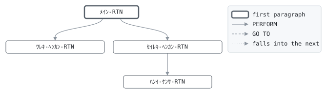

# GLC020

```text
GLC020: 和暦・西暦 日付変換

方向 (W 和暦へ、S 西暦へ)、西暦日付 YYYYMMDD、和暦日付
GYYMMDD、結果を受けて呼ばれる。
和暦へ: その日以前に始まった最後の元号を取り、元年を 1 と
して年を数える。
西暦へ: 元号の開始年に年を足して 1 を引き、その元号の
範囲内にあることを確かめる。昭和64年は 1989-01-07 まで、
平成31年は 2019-04-30 まで。元号は GENGO にある。

結果: 0 変換済、4 いずれの元号の日付でもない。

変更履歴
日付       担当 変更
1987-04-01 KT   GL-0001 初版。
1989-01-16 KT   GL-0044 元号をコードでなくテーブルから。
2019-04-22 YN   GL-0702 元号の末日も検査する。
```

Program [GLC020.cbl](../../../gondwana/programs/GLC020.cbl): 0 files, 4 paragraphs. Its business rules: [5 decision tables](../rules/GLC020.md).

- AUTHOR: ゴンドワナ生命 システム部.
- DATE-WRITTEN: 1987-04-01.

## Contents

- [Files](#files)
- [Flow](#flow)
- [Paragraphs](#paragraphs)
- [Calls](#calls)
- [Data flow](#data-flow)
- [Lineage](#lineage)
  - [Into WS-ﾋﾂﾞｹ](#into-ws-ﾋﾂﾞｹ)
  - [Into WS-ﾊｯｹﾝ](#into-ws-ﾊｯｹﾝ)
  - [Into LK-ｾｲﾚｷ](#into-lk-ｾｲﾚｷ)
  - [Into LK-ﾜﾚｷ](#into-lk-ﾜﾚｷ)
  - [Into LK-ｹｯｶ](#into-lk-ｹｯｶ)
  - [Into other data items](#into-other-data-items)
- [Parameters](#parameters)
  - [Parameter 1, LK-ﾎｳｺｳ](#parameter-1-lk-ﾎｳｺｳ)
  - [Parameter 2, LK-ｾｲﾚｷ](#parameter-2-lk-ｾｲﾚｷ)
  - [Parameter 3, LK-ﾜﾚｷ](#parameter-3-lk-ﾜﾚｷ)
  - [Parameter 4, LK-ｹｯｶ](#parameter-4-lk-ｹｯｶ)
- [Records](#records)
  - [ｹﾞﾝｺﾞｳ-ﾃｲｽﾞｳ](#ｹﾞﾝｺﾞｳ-ﾃｲｽﾞｳ)
  - [ｹﾞﾝｺﾞｳ-ﾃｰﾌﾞﾙ](#ｹﾞﾝｺﾞｳ-ﾃｰﾌﾞﾙ)
  - [ｹﾞﾝｺﾞｳ-ｹﾝｽｳ](#ｹﾞﾝｺﾞｳ-ｹﾝｽｳ)
  - [WS-ﾋﾂﾞｹ](#ws-ﾋﾂﾞｹ)
  - [WS-ﾊｯｹﾝ](#ws-ﾊｯｹﾝ)
  - [LK-ﾎｳｺｳ](#lk-ﾎｳｺｳ)
  - [LK-ｾｲﾚｷ](#lk-ｾｲﾚｷ)
  - [LK-ﾜﾚｷ](#lk-ﾜﾚｷ)
  - [LK-ｹｯｶ](#lk-ｹｯｶ)

## Files

| File | Kind | Assigned to | Organization | Status field | Opened | Records |
| --- | --- | --- | --- | --- | --- | --- |

## Flow



## Paragraphs

| Paragraph | Description | Source | Performs | Goes to | Performed by | Reached by |
| --- | --- | --- | --- | --- | --- | --- |
| ﾒｲﾝ-RTN | ﾒｲﾝ-RTN: どちらかの方向に1回変換する。 | [GLC020.cbl:55](../../../gondwana/programs/GLC020.cbl#L55) | ﾜﾚｷ-ﾍﾝｶﾝ-RTN, ｾｲﾚｷ-ﾍﾝｶﾝ-RTN | | | |
| ﾜﾚｷ-ﾍﾝｶﾝ-RTN | ﾜﾚｷ-ﾍﾝｶﾝ-RTN: その日までに始まっていた最後の元号。 | [GLC020.cbl:70](../../../gondwana/programs/GLC020.cbl#L70) | | | ﾒｲﾝ-RTN | |
| ｾｲﾚｷ-ﾍﾝｶﾝ-RTN | ｾｲﾚｷ-ﾍﾝｶﾝ-RTN: 記号で元号を引き、その範囲内の日付にする。 | [GLC020.cbl:90](../../../gondwana/programs/GLC020.cbl#L90) | ﾊﾝｲ-ｹﾝｻ-RTN | | ﾒｲﾝ-RTN | |
| ﾊﾝｲ-ｹﾝｻ-RTN | ﾊﾝｲ-ｹﾝｻ-RTN: 西暦日付を組み立て、元号の範囲内で、月日が 月日であることを確かめる。 | [GLC020.cbl:107](../../../gondwana/programs/GLC020.cbl#L107) | | | ｾｲﾚｷ-ﾍﾝｶﾝ-RTN | |

## Calls

Called with LK-ﾎｳｺｳ, LK-ｾｲﾚｷ, LK-ﾜﾚｷ, LK-ｹｯｶ by [GLD010](GLD010.md), [GLD020](GLD020.md), [GLD030](GLD030.md), [GLD040](GLD040.md), [GLD050](GLD050.md), [GLD060](GLD060.md), [GLD090](GLD090.md), [GLM010](GLM010.md), [GLM020](GLM020.md), [GLM030](GLM030.md), [GLO010](GLO010.md), [GLY010](GLY010.md).

## Data flow

| Paragraph | Reads | Writes |
| --- | --- | --- |
| ﾒｲﾝ-RTN | LK-ﾎｳｺｳ | LK-ｹｯｶ |
| ﾜﾚｷ-ﾍﾝｶﾝ-RTN | LK-ｾｲﾚｷ, ｹﾞﾝｺﾞｳ-ｹﾝｽｳ, ｹﾞﾝｺﾞｳ-IX, WS-ﾊｯｹﾝ, ｹﾞﾝｺﾞｳ-ｶｲｼﾋﾞ, WS-YYYYMMDD, ｹﾞﾝｺﾞｳ-ｷｺﾞｳ, WS-YYYY, ｹﾞﾝｺﾞｳ-ｶｲｼ-YYYY, WS-ﾋﾂﾞｹ-ﾌﾞﾝｶｲ | WS-YYYYMMDD, WS-ﾊｯｹﾝ, ｹﾞﾝｺﾞｳ-IX, LK-ｹﾞﾝｺﾞｳ, LK-ﾈﾝ, LK-MMDD, LK-ｹｯｶ |
| ｾｲﾚｷ-ﾍﾝｶﾝ-RTN | ｹﾞﾝｺﾞｳ-ｴﾝﾄﾘ, ｹﾞﾝｺﾞｳ-ｷｺﾞｳ, ｹﾞﾝｺﾞｳ-IX, LK-ｹﾞﾝｺﾞｳ, WS-ﾊｯｹﾝ | WS-ﾊｯｹﾝ, ｹﾞﾝｺﾞｳ-IX, LK-ｹｯｶ |
| ﾊﾝｲ-ｹﾝｻ-RTN | ｹﾞﾝｺﾞｳ-ｶｲｼ-YYYY, ｹﾞﾝｺﾞｳ-IX, LK-ﾈﾝ, LK-MMDD, WS-MM, WS-DD, WS-YYYYMMDD, ｹﾞﾝｺﾞｳ-ｶｲｼﾋﾞ, ｹﾞﾝｺﾞｳ-ｹﾝｽｳ, LK-ｹｯｶ | WS-YYYY, WS-ﾋﾂﾞｹ-ﾌﾞﾝｶｲ, LK-ｹｯｶ, ｹﾞﾝｺﾞｳ-IX, LK-ｾｲﾚｷ |

## Lineage

Where each data item's values come from, grouped by the record they go into. A data item links to the record it belongs to.

### Into WS-ﾋﾂﾞｹ

Record [WS-ﾋﾂﾞｹ](#ws-ﾋﾂﾞｹ).

| Into | From | Statement | Paragraph | Source |
| --- | --- | --- | --- | --- |
| WS-YYYY | [ｹﾞﾝｺﾞｳ-ｶｲｼ-YYYY](#ｹﾞﾝｺﾞｳ-ﾃｰﾌﾞﾙ "in ｹﾞﾝｺﾞｳ-ﾃｰﾌﾞﾙ") | COMPUTE | ﾊﾝｲ-ｹﾝｻ-RTN | [GLC020.cbl:108](../../../gondwana/programs/GLC020.cbl#L108) |
| WS-YYYY | ｹﾞﾝｺﾞｳ-IX | COMPUTE | ﾊﾝｲ-ｹﾝｻ-RTN | [GLC020.cbl:108](../../../gondwana/programs/GLC020.cbl#L108) |
| WS-YYYY | [LK-ﾈﾝ](#lk-ﾜﾚｷ "in LK-ﾜﾚｷ") | COMPUTE | ﾊﾝｲ-ｹﾝｻ-RTN | [GLC020.cbl:108](../../../gondwana/programs/GLC020.cbl#L108) |
| WS-YYYYMMDD | [LK-ｾｲﾚｷ](#lk-ｾｲﾚｷ) | MOVE | ﾜﾚｷ-ﾍﾝｶﾝ-RTN | [GLC020.cbl:71](../../../gondwana/programs/GLC020.cbl#L71) |
| WS-ﾋﾂﾞｹ-ﾌﾞﾝｶｲ | [LK-MMDD](#lk-ﾜﾚｷ "in LK-ﾜﾚｷ") | MOVE | ﾊﾝｲ-ｹﾝｻ-RTN | [GLC020.cbl:109](../../../gondwana/programs/GLC020.cbl#L109) |

### Into WS-ﾊｯｹﾝ

Record [WS-ﾊｯｹﾝ](#ws-ﾊｯｹﾝ).

| Into | From | Statement | Paragraph | Source |
| --- | --- | --- | --- | --- |
| WS-ﾊｯｹﾝ | literal condition WS-ｹﾞﾝｺﾞｳ-ﾅｼ | SET | ﾜﾚｷ-ﾍﾝｶﾝ-RTN | [GLC020.cbl:72](../../../gondwana/programs/GLC020.cbl#L72) |
| WS-ﾊｯｹﾝ | literal condition WS-ｹﾞﾝｺﾞｳ-ｱﾘ | SET | ﾜﾚｷ-ﾍﾝｶﾝ-RTN | [GLC020.cbl:76](../../../gondwana/programs/GLC020.cbl#L76) |
| WS-ﾊｯｹﾝ | literal condition WS-ｹﾞﾝｺﾞｳ-ﾅｼ | SET | ｾｲﾚｷ-ﾍﾝｶﾝ-RTN | [GLC020.cbl:91](../../../gondwana/programs/GLC020.cbl#L91) |
| WS-ﾊｯｹﾝ | literal condition WS-ｹﾞﾝｺﾞｳ-ｱﾘ | SET | ｾｲﾚｷ-ﾍﾝｶﾝ-RTN | [GLC020.cbl:97](../../../gondwana/programs/GLC020.cbl#L97) |

### Into LK-ｾｲﾚｷ

Record [LK-ｾｲﾚｷ](#lk-ｾｲﾚｷ).

| Into | From | Statement | Paragraph | Source |
| --- | --- | --- | --- | --- |
| LK-ｾｲﾚｷ | [WS-YYYYMMDD](#ws-ﾋﾂﾞｹ "in WS-ﾋﾂﾞｹ") | MOVE | ﾊﾝｲ-ｹﾝｻ-RTN | [GLC020.cbl:126](../../../gondwana/programs/GLC020.cbl#L126) |

### Into LK-ﾜﾚｷ

Record [LK-ﾜﾚｷ](#lk-ﾜﾚｷ).

| Into | From | Statement | Paragraph | Source |
| --- | --- | --- | --- | --- |
| LK-MMDD | [WS-ﾋﾂﾞｹ-ﾌﾞﾝｶｲ](#ws-ﾋﾂﾞｹ "in WS-ﾋﾂﾞｹ") | MOVE | ﾜﾚｷ-ﾍﾝｶﾝ-RTN | [GLC020.cbl:80](../../../gondwana/programs/GLC020.cbl#L80) |
| LK-ｹﾞﾝｺﾞｳ | [ｹﾞﾝｺﾞｳ-ｷｺﾞｳ](#ｹﾞﾝｺﾞｳ-ﾃｰﾌﾞﾙ "in ｹﾞﾝｺﾞｳ-ﾃｰﾌﾞﾙ") | MOVE | ﾜﾚｷ-ﾍﾝｶﾝ-RTN | [GLC020.cbl:77](../../../gondwana/programs/GLC020.cbl#L77) |
| LK-ﾈﾝ | [WS-YYYY](#ws-ﾋﾂﾞｹ "in WS-ﾋﾂﾞｹ") | COMPUTE | ﾜﾚｷ-ﾍﾝｶﾝ-RTN | [GLC020.cbl:78](../../../gondwana/programs/GLC020.cbl#L78) |
| LK-ﾈﾝ | [ｹﾞﾝｺﾞｳ-ｶｲｼ-YYYY](#ｹﾞﾝｺﾞｳ-ﾃｰﾌﾞﾙ "in ｹﾞﾝｺﾞｳ-ﾃｰﾌﾞﾙ") | COMPUTE | ﾜﾚｷ-ﾍﾝｶﾝ-RTN | [GLC020.cbl:78](../../../gondwana/programs/GLC020.cbl#L78) |
| LK-ﾈﾝ | ｹﾞﾝｺﾞｳ-IX | COMPUTE | ﾜﾚｷ-ﾍﾝｶﾝ-RTN | [GLC020.cbl:78](../../../gondwana/programs/GLC020.cbl#L78) |

### Into LK-ｹｯｶ

Record [LK-ｹｯｶ](#lk-ｹｯｶ).

| Into | From | Statement | Paragraph | Source |
| --- | --- | --- | --- | --- |
| LK-ｹｯｶ | literal condition LK-ﾍﾝｶﾝｽﾞﾐ | SET | ﾒｲﾝ-RTN | [GLC020.cbl:56](../../../gondwana/programs/GLC020.cbl#L56) |
| LK-ｹｯｶ | literal condition LK-ﾋﾂﾞｹ-ﾌｾｲ | SET | ﾒｲﾝ-RTN | [GLC020.cbl:63](../../../gondwana/programs/GLC020.cbl#L63) |
| LK-ｹｯｶ | literal condition LK-ﾋﾂﾞｹ-ﾌｾｲ | SET | ﾜﾚｷ-ﾍﾝｶﾝ-RTN | [GLC020.cbl:84](../../../gondwana/programs/GLC020.cbl#L84) |
| LK-ｹｯｶ | literal condition LK-ﾋﾂﾞｹ-ﾌｾｲ | SET | ｾｲﾚｷ-ﾍﾝｶﾝ-RTN | [GLC020.cbl:95](../../../gondwana/programs/GLC020.cbl#L95) |
| LK-ｹｯｶ | literal condition LK-ﾋﾂﾞｹ-ﾌｾｲ | SET | ﾊﾝｲ-ｹﾝｻ-RTN | [GLC020.cbl:112](../../../gondwana/programs/GLC020.cbl#L112) |
| LK-ｹｯｶ | literal condition LK-ﾋﾂﾞｹ-ﾌｾｲ | SET | ﾊﾝｲ-ｹﾝｻ-RTN | [GLC020.cbl:114](../../../gondwana/programs/GLC020.cbl#L114) |
| LK-ｹｯｶ | literal condition LK-ﾋﾂﾞｹ-ﾌｾｲ | SET | ﾊﾝｲ-ｹﾝｻ-RTN | [GLC020.cbl:116](../../../gondwana/programs/GLC020.cbl#L116) |
| LK-ｹｯｶ | literal condition LK-ﾋﾂﾞｹ-ﾌｾｲ | SET | ﾊﾝｲ-ｹﾝｻ-RTN | [GLC020.cbl:118](../../../gondwana/programs/GLC020.cbl#L118) |
| LK-ｹｯｶ | literal condition LK-ﾋﾂﾞｹ-ﾌｾｲ | SET | ﾊﾝｲ-ｹﾝｻ-RTN | [GLC020.cbl:122](../../../gondwana/programs/GLC020.cbl#L122) |

### Into other data items

Data items the program does not declare, such as special registers and index names.

| Into | From | Statement | Paragraph | Source |
| --- | --- | --- | --- | --- |
| ｹﾞﾝｺﾞｳ-IX | literal 1 | SET | ｾｲﾚｷ-ﾍﾝｶﾝ-RTN | [GLC020.cbl:92](../../../gondwana/programs/GLC020.cbl#L92) |
| ｹﾞﾝｺﾞｳ-IX | literal 1 | SET | ﾊﾝｲ-ｹﾝｻ-RTN | [GLC020.cbl:120](../../../gondwana/programs/GLC020.cbl#L120) |

## Parameters

What the program does with each field of the items it is passed, by position: the contract its callers rely on. A statement on a whole item, or a group of it, counts for each field in it; a field neither read nor written is passed for nothing.

### Parameter 1, LK-ﾎｳｺｳ

| Field | Reads | Writes |
| --- | :-: | :-: |
| LK-ﾎｳｺｳ | yes | |

### Parameter 2, LK-ｾｲﾚｷ

| Field | Reads | Writes |
| --- | :-: | :-: |
| LK-ｾｲﾚｷ | yes | yes |

### Parameter 3, LK-ﾜﾚｷ

| Field | Reads | Writes |
| --- | :-: | :-: |
| LK-ｹﾞﾝｺﾞｳ | yes | yes |
| LK-ﾈﾝ | yes | yes |
| LK-MMDD | yes | yes |

### Parameter 4, LK-ｹｯｶ

| Field | Reads | Writes |
| --- | :-: | :-: |
| LK-ｹｯｶ | yes | yes |

## Records

### ｹﾞﾝｺﾞｳ-ﾃｲｽﾞｳ

Working storage. 65 bytes, layout in copybook [GENGO](../copybooks/GENGO.md).

### ｹﾞﾝｺﾞｳ-ﾃｰﾌﾞﾙ

Working storage. 65 bytes, layout in copybook [GENGO](../copybooks/GENGO.md).

### ｹﾞﾝｺﾞｳ-ｹﾝｽｳ

Working storage. 1 bytes, layout in copybook [GENGO](../copybooks/GENGO.md).

### WS-ﾋﾂﾞｹ

Working storage. 8 bytes.

| Level | Field | Kind | Start | Length | Picture | Usage | Notes | Source |
| --: | --- | --- | --: | --: | --- | --- | --- | --- |
| 01 | WS-ﾋﾂﾞｹ | group | 1 | 8 | | | | [GLC020.cbl:28](../../../gondwana/programs/GLC020.cbl#L28) |
| 05 | ├ WS-YYYYMMDD | date | 1 | 8 | 9(8) | | redefined by WS-ﾋﾂﾞｹ-ﾌﾞﾝｶｲ | [GLC020.cbl:29](../../../gondwana/programs/GLC020.cbl#L29) |
| 05 | ╘ WS-ﾋﾂﾞｹ-ﾌﾞﾝｶｲ | group | 1 | 8 | | | REDEFINES WS-YYYYMMDD | [GLC020.cbl:30](../../../gondwana/programs/GLC020.cbl#L30) |
| 10 |   ├ WS-YYYY | number | 1 | 4 | 9(4) | | | [GLC020.cbl:31](../../../gondwana/programs/GLC020.cbl#L31) |
| 10 |   ├ WS-MM | number | 5 | 2 | 99 | | | [GLC020.cbl:32](../../../gondwana/programs/GLC020.cbl#L32) |
| 10 |   └ WS-DD | number | 7 | 2 | 99 | | | [GLC020.cbl:33](../../../gondwana/programs/GLC020.cbl#L33) |

### WS-ﾊｯｹﾝ

Working storage. 1 bytes.

| Level | Field | Kind | Start | Length | Picture | Usage | Notes | Source |
| --: | --- | --- | --: | --: | --- | --- | --- | --- |
| 01 | WS-ﾊｯｹﾝ | code | 1 | 1 | X | | | [GLC020.cbl:34](../../../gondwana/programs/GLC020.cbl#L34) |
| 88 | ├ WS-ｹﾞﾝｺﾞｳ-ｱﾘ | | | | | | VALUE 'Y' | [GLC020.cbl:35](../../../gondwana/programs/GLC020.cbl#L35) |
| 88 | └ WS-ｹﾞﾝｺﾞｳ-ﾅｼ | | | | | | VALUE 'N' | [GLC020.cbl:36](../../../gondwana/programs/GLC020.cbl#L36) |

### LK-ﾎｳｺｳ

Linkage. 1 bytes.

| Level | Field | Kind | Start | Length | Picture | Usage | Notes | Source |
| --: | --- | --- | --: | --: | --- | --- | --- | --- |
| 01 | LK-ﾎｳｺｳ | code | 1 | 1 | X | | | [GLC020.cbl:39](../../../gondwana/programs/GLC020.cbl#L39) |
| 88 | ├ LK-ﾜﾚｷ-ﾍ | | | | | | VALUE 'W' | [GLC020.cbl:40](../../../gondwana/programs/GLC020.cbl#L40) |
| 88 | └ LK-ｾｲﾚｷ-ﾍ | | | | | | VALUE 'S' | [GLC020.cbl:41](../../../gondwana/programs/GLC020.cbl#L41) |

### LK-ｾｲﾚｷ

Linkage. 8 bytes.

| Level | Field | Kind | Start | Length | Picture | Usage | Notes | Source |
| --: | --- | --- | --: | --: | --- | --- | --- | --- |
| 01 | LK-ｾｲﾚｷ | date | 1 | 8 | 9(8) | | | [GLC020.cbl:42](../../../gondwana/programs/GLC020.cbl#L42) |

### LK-ﾜﾚｷ

Linkage. 7 bytes.

| Level | Field | Kind | Start | Length | Picture | Usage | Notes | Source |
| --: | --- | --- | --: | --: | --- | --- | --- | --- |
| 01 | LK-ﾜﾚｷ | group | 1 | 7 | | | | [GLC020.cbl:43](../../../gondwana/programs/GLC020.cbl#L43) |
| 05 | ├ LK-ｹﾞﾝｺﾞｳ | text | 1 | 1 | X | | | [GLC020.cbl:44](../../../gondwana/programs/GLC020.cbl#L44) |
| 05 | ├ LK-ﾈﾝ | number | 2 | 2 | 99 | | | [GLC020.cbl:45](../../../gondwana/programs/GLC020.cbl#L45) |
| 05 | └ LK-MMDD | date | 4 | 4 | 9(4) | | | [GLC020.cbl:46](../../../gondwana/programs/GLC020.cbl#L46) |

### LK-ｹｯｶ

Linkage. 1 bytes.

| Level | Field | Kind | Start | Length | Picture | Usage | Notes | Source |
| --: | --- | --- | --: | --: | --- | --- | --- | --- |
| 01 | LK-ｹｯｶ | code | 1 | 1 | 9 | | | [GLC020.cbl:47](../../../gondwana/programs/GLC020.cbl#L47) |
| 88 | ├ LK-ﾍﾝｶﾝｽﾞﾐ | | | | | | VALUE 0 | [GLC020.cbl:48](../../../gondwana/programs/GLC020.cbl#L48) |
| 88 | └ LK-ﾋﾂﾞｹ-ﾌｾｲ | | | | | | VALUE 4 | [GLC020.cbl:49](../../../gondwana/programs/GLC020.cbl#L49) |
