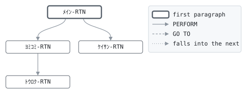

# GLC030

```text
GLC030: 解約返戻金

商品、加入年齢、経過年数、保険金額、返戻金、状態を受けて
呼ばれる。最初の呼び出しで解約返戻金係数 CSVTB を商品・加入
年齢区分・経過年数のテーブルに読み込み、以後は引くだけ。
返戻金は保険金額 1,000 円あたりの係数を掛けた額で、円未満は
切り捨てる。年齢区分は 20歳未満が 1、以後10歳ごと、60歳
以上が 6。経過年数は 40 年で頭打ち。係数表にない商品と
経過年数 0 の契約は返戻金なし。

状態: CSVTB のファイル状態。00 なら返戻金を求めた。

変更履歴
日付       担当 変更
2012-09-03 YN   GL-0561 初版、GLD030 から切り出し。
```

Program [GLC030.cbl](../../../gondwana/programs/GLC030.cbl): 1 files, 4 paragraphs. Its business rules: [4 decision tables](../rules/GLC030.md).

- AUTHOR: ゴンドワナ生命 システム部.
- DATE-WRITTEN: 2012-09-03.

## Contents

- [Files](#files)
- [Flow](#flow)
- [Paragraphs](#paragraphs)
- [Calls](#calls)
- [Data flow](#data-flow)
- [Lineage](#lineage)
  - [Into CV-ｶｲﾔｸﾍﾝﾚｲｷﾝ-ﾚｺｰﾄﾞ](#into-cv-ｶｲﾔｸﾍﾝﾚｲｷﾝ-ﾚｺｰﾄﾞ)
  - [Into WS-ﾖﾐｺﾐ](#into-ws-ﾖﾐｺﾐ)
  - [Into WS-ｶｲﾔｸ-TBL](#into-ws-ｶｲﾔｸ-tbl)
  - [Into WS-ﾈﾝﾚｲｸﾌﾞﾝ](#into-ws-ﾈﾝﾚｲｸﾌﾞﾝ)
  - [Into WS-ﾈﾝｽｳ](#into-ws-ﾈﾝｽｳ)
  - [Into LK-ﾍﾝﾚｲｷﾝ](#into-lk-ﾍﾝﾚｲｷﾝ)
  - [Into LK-ｼﾞｮｳﾀｲ](#into-lk-ｼﾞｮｳﾀｲ)
  - [Into other data items](#into-other-data-items)
- [Parameters](#parameters)
  - [Parameter 1, LK-ｼｮｳﾋﾝ](#parameter-1-lk-ｼｮｳﾋﾝ)
  - [Parameter 2, LK-ｶﾆｭｳﾈﾝﾚｲ](#parameter-2-lk-ｶﾆｭｳﾈﾝﾚｲ)
  - [Parameter 3, LK-ｹｲｶﾈﾝｽｳ](#parameter-3-lk-ｹｲｶﾈﾝｽｳ)
  - [Parameter 4, LK-ﾎｹﾝｷﾝｶﾞｸ](#parameter-4-lk-ﾎｹﾝｷﾝｶﾞｸ)
  - [Parameter 5, LK-ﾍﾝﾚｲｷﾝ](#parameter-5-lk-ﾍﾝﾚｲｷﾝ)
  - [Parameter 6, LK-ｼﾞｮｳﾀｲ](#parameter-6-lk-ｼﾞｮｳﾀｲ)
- [Records](#records)
  - [CV-ｶｲﾔｸﾍﾝﾚｲｷﾝ-ﾚｺｰﾄﾞ](#cv-ｶｲﾔｸﾍﾝﾚｲｷﾝ-ﾚｺｰﾄﾞ)
  - [WS-CSVTB-ST](#ws-csvtb-st)
  - [WS-ﾖﾐｺﾐ](#ws-ﾖﾐｺﾐ)
  - [WS-ｶｲﾔｸ-TBL](#ws-ｶｲﾔｸ-tbl)
  - [WS-ﾈﾝﾚｲｸﾌﾞﾝ](#ws-ﾈﾝﾚｲｸﾌﾞﾝ)
  - [WS-ﾈﾝｽｳ](#ws-ﾈﾝｽｳ)
  - [LK-ｼｮｳﾋﾝ](#lk-ｼｮｳﾋﾝ)
  - [LK-ｶﾆｭｳﾈﾝﾚｲ](#lk-ｶﾆｭｳﾈﾝﾚｲ)
  - [LK-ｹｲｶﾈﾝｽｳ](#lk-ｹｲｶﾈﾝｽｳ)
  - [LK-ﾎｹﾝｷﾝｶﾞｸ](#lk-ﾎｹﾝｷﾝｶﾞｸ)
  - [LK-ﾍﾝﾚｲｷﾝ](#lk-ﾍﾝﾚｲｷﾝ)
  - [LK-ｼﾞｮｳﾀｲ](#lk-ｼﾞｮｳﾀｲ)

## Files

| File | Kind | Assigned to | Organization | Status field | Opened | Records |
| --- | --- | --- | --- | --- | --- | --- |
| CSVTB-F | FD | CSVTB | LINE SEQUENTIAL | WS-CSVTB-ST | INPUT | CV-ｶｲﾔｸﾍﾝﾚｲｷﾝ-ﾚｺｰﾄﾞ |

## Flow



## Paragraphs

| Paragraph | Description | Source | Performs | Goes to | Performed by | Reached by |
| --- | --- | --- | --- | --- | --- | --- |
| ﾒｲﾝ-RTN | ﾒｲﾝ-RTN: 係数表がまだなら読み込み、返戻金を求める。 | [GLC030.cbl:65](../../../gondwana/programs/GLC030.cbl#L65) | ﾖﾐｺﾐ-RTN, ｹｲｻﾝ-RTN | | | |
| ﾖﾐｺﾐ-RTN | ﾖﾐｺﾐ-RTN: 係数表を読み込む。読めなければ状態を返す。 | [GLC030.cbl:79](../../../gondwana/programs/GLC030.cbl#L79) | ﾄｳﾛｸ-RTN | | ﾒｲﾝ-RTN | |
| ﾄｳﾛｸ-RTN | ﾄｳﾛｸ-RTN: 係数1件。その商品の行、なければ空いた行に置く。 11番目の商品は置かない。 | [GLC030.cbl:102](../../../gondwana/programs/GLC030.cbl#L102) | | | ﾖﾐｺﾐ-RTN | |
| ｹｲｻﾝ-RTN | ｹｲｻﾝ-RTN: 年齢区分と経過年数で係数を引き、保険金額に掛ける。 | [GLC030.cbl:118](../../../gondwana/programs/GLC030.cbl#L118) | | | ﾒｲﾝ-RTN | |

## Calls

Called with LK-ｼｮｳﾋﾝ, LK-ｶﾆｭｳﾈﾝﾚｲ, LK-ｹｲｶﾈﾝｽｳ, LK-ﾎｹﾝｷﾝｶﾞｸ, LK-ﾍﾝﾚｲｷﾝ, LK-ｼﾞｮｳﾀｲ by [GLD020](GLD020.md), [GLD030](GLD030.md), [GLD060](GLD060.md), [GLD070](GLD070.md).

## Data flow

| Paragraph | Reads | Writes |
| --- | --- | --- |
| ﾒｲﾝ-RTN | WS-ﾖﾐｺﾐ | LK-ｼﾞｮｳﾀｲ, LK-ﾍﾝﾚｲｷﾝ |
| ﾖﾐｺﾐ-RTN | WS-CSVTB-ST | WS-ｶｲﾔｸ-TBL, WS-CSVTB-ST, CV-ｶｲﾔｸﾍﾝﾚｲｷﾝ-ﾚｺｰﾄﾞ, WS-ﾖﾐｺﾐ, LK-ｼﾞｮｳﾀｲ |
| ﾄｳﾛｸ-RTN | WS-ｶｲﾔｸ-ｼｮｳﾋﾝ, WS-ｼｮｳﾋﾝ-ｺｰﾄﾞ, WS-ｼｮｳﾋﾝ-IX, CV-ｼｮｳﾋﾝ, CV-ｹｲｽｳ, CV-ﾈﾝﾚｲｸﾌﾞﾝ, CV-ｹｲｶﾈﾝｽｳ | WS-ｼｮｳﾋﾝ-IX, WS-ｼｮｳﾋﾝ-ｺｰﾄﾞ, WS-ｶｲﾔｸ-ｹｲｽｳ |
| ｹｲｻﾝ-RTN | LK-ｶﾆｭｳﾈﾝﾚｲ, LK-ｹｲｶﾈﾝｽｳ, WS-ﾈﾝｽｳ, WS-ｶｲﾔｸ-ｼｮｳﾋﾝ, WS-ｼｮｳﾋﾝ-ｺｰﾄﾞ, WS-ｼｮｳﾋﾝ-IX, LK-ｼｮｳﾋﾝ, LK-ﾎｹﾝｷﾝｶﾞｸ, WS-ｶｲﾔｸ-ｹｲｽｳ, WS-ﾈﾝﾚｲｸﾌﾞﾝ | WS-ﾈﾝﾚｲｸﾌﾞﾝ, WS-ﾈﾝｽｳ, WS-ｼｮｳﾋﾝ-IX, LK-ﾍﾝﾚｲｷﾝ |

## Lineage

Where each data item's values come from, grouped by the record they go into. A data item links to the record it belongs to.

### Into CV-ｶｲﾔｸﾍﾝﾚｲｷﾝ-ﾚｺｰﾄﾞ

Record [CV-ｶｲﾔｸﾍﾝﾚｲｷﾝ-ﾚｺｰﾄﾞ](#cv-ｶｲﾔｸﾍﾝﾚｲｷﾝ-ﾚｺｰﾄﾞ), from copybook [CSVTB](../copybooks/CSVTB.md).

| Into | From | Statement | Paragraph | Source |
| --- | --- | --- | --- | --- |
| CV-ｶｲﾔｸﾍﾝﾚｲｷﾝ-ﾚｺｰﾄﾞ | file CSVTB-F | READ | ﾖﾐｺﾐ-RTN | [GLC030.cbl:83](../../../gondwana/programs/GLC030.cbl#L83) |
| CV-ｶｲﾔｸﾍﾝﾚｲｷﾝ-ﾚｺｰﾄﾞ | file CSVTB-F | READ | ﾖﾐｺﾐ-RTN | [GLC030.cbl:86](../../../gondwana/programs/GLC030.cbl#L86) |

### Into WS-ﾖﾐｺﾐ

Record [WS-ﾖﾐｺﾐ](#ws-ﾖﾐｺﾐ).

| Into | From | Statement | Paragraph | Source |
| --- | --- | --- | --- | --- |
| WS-ﾖﾐｺﾐ | literal condition WS-ﾖﾐｺﾐｽﾞﾐ | SET | ﾖﾐｺﾐ-RTN | [GLC030.cbl:89](../../../gondwana/programs/GLC030.cbl#L89) |

### Into WS-ｶｲﾔｸ-TBL

Record [WS-ｶｲﾔｸ-TBL](#ws-ｶｲﾔｸ-tbl).

| Into | From | Statement | Paragraph | Source |
| --- | --- | --- | --- | --- |
| WS-ｶｲﾔｸ-TBL | literal ZEROS | MOVE | ﾖﾐｺﾐ-RTN | [GLC030.cbl:80](../../../gondwana/programs/GLC030.cbl#L80) |
| WS-ｶｲﾔｸ-ｹｲｽｳ | [CV-ｹｲｽｳ](#cv-ｶｲﾔｸﾍﾝﾚｲｷﾝ-ﾚｺｰﾄﾞ "in CV-ｶｲﾔｸﾍﾝﾚｲｷﾝ-ﾚｺｰﾄﾞ") | MOVE | ﾄｳﾛｸ-RTN | [GLC030.cbl:110](../../../gondwana/programs/GLC030.cbl#L110) |
| WS-ｼｮｳﾋﾝ-ｺｰﾄﾞ | [CV-ｼｮｳﾋﾝ](#cv-ｶｲﾔｸﾍﾝﾚｲｷﾝ-ﾚｺｰﾄﾞ "in CV-ｶｲﾔｸﾍﾝﾚｲｷﾝ-ﾚｺｰﾄﾞ") | MOVE | ﾄｳﾛｸ-RTN | [GLC030.cbl:109](../../../gondwana/programs/GLC030.cbl#L109) |

### Into WS-ﾈﾝﾚｲｸﾌﾞﾝ

Record [WS-ﾈﾝﾚｲｸﾌﾞﾝ](#ws-ﾈﾝﾚｲｸﾌﾞﾝ).

| Into | From | Statement | Paragraph | Source |
| --- | --- | --- | --- | --- |
| WS-ﾈﾝﾚｲｸﾌﾞﾝ | literal 1 | MOVE | ｹｲｻﾝ-RTN | [GLC030.cbl:121](../../../gondwana/programs/GLC030.cbl#L121) |
| WS-ﾈﾝﾚｲｸﾌﾞﾝ | [LK-ｶﾆｭｳﾈﾝﾚｲ](#lk-ｶﾆｭｳﾈﾝﾚｲ) | COMPUTE | ｹｲｻﾝ-RTN | [GLC030.cbl:123](../../../gondwana/programs/GLC030.cbl#L123) |
| WS-ﾈﾝﾚｲｸﾌﾞﾝ | literal 6 | MOVE | ｹｲｻﾝ-RTN | [GLC030.cbl:125](../../../gondwana/programs/GLC030.cbl#L125) |

### Into WS-ﾈﾝｽｳ

Record [WS-ﾈﾝｽｳ](#ws-ﾈﾝｽｳ).

| Into | From | Statement | Paragraph | Source |
| --- | --- | --- | --- | --- |
| WS-ﾈﾝｽｳ | literal 40 | MOVE | ｹｲｻﾝ-RTN | [GLC030.cbl:128](../../../gondwana/programs/GLC030.cbl#L128) |
| WS-ﾈﾝｽｳ | [LK-ｹｲｶﾈﾝｽｳ](#lk-ｹｲｶﾈﾝｽｳ) | MOVE | ｹｲｻﾝ-RTN | [GLC030.cbl:130](../../../gondwana/programs/GLC030.cbl#L130) |

### Into LK-ﾍﾝﾚｲｷﾝ

Record [LK-ﾍﾝﾚｲｷﾝ](#lk-ﾍﾝﾚｲｷﾝ).

| Into | From | Statement | Paragraph | Source |
| --- | --- | --- | --- | --- |
| LK-ﾍﾝﾚｲｷﾝ | literal 0 | MOVE | ﾒｲﾝ-RTN | [GLC030.cbl:67](../../../gondwana/programs/GLC030.cbl#L67) |
| LK-ﾍﾝﾚｲｷﾝ | [LK-ﾎｹﾝｷﾝｶﾞｸ](#lk-ﾎｹﾝｷﾝｶﾞｸ) | COMPUTE | ｹｲｻﾝ-RTN | [GLC030.cbl:138](../../../gondwana/programs/GLC030.cbl#L138) |
| LK-ﾍﾝﾚｲｷﾝ | [WS-ｶｲﾔｸ-ｹｲｽｳ](#ws-ｶｲﾔｸ-tbl "in WS-ｶｲﾔｸ-TBL") | COMPUTE | ｹｲｻﾝ-RTN | [GLC030.cbl:138](../../../gondwana/programs/GLC030.cbl#L138) |
| LK-ﾍﾝﾚｲｷﾝ | WS-ｼｮｳﾋﾝ-IX | COMPUTE | ｹｲｻﾝ-RTN | [GLC030.cbl:138](../../../gondwana/programs/GLC030.cbl#L138) |
| LK-ﾍﾝﾚｲｷﾝ | [WS-ﾈﾝﾚｲｸﾌﾞﾝ](#ws-ﾈﾝﾚｲｸﾌﾞﾝ) | COMPUTE | ｹｲｻﾝ-RTN | [GLC030.cbl:138](../../../gondwana/programs/GLC030.cbl#L138) |
| LK-ﾍﾝﾚｲｷﾝ | [WS-ﾈﾝｽｳ](#ws-ﾈﾝｽｳ) | COMPUTE | ｹｲｻﾝ-RTN | [GLC030.cbl:138](../../../gondwana/programs/GLC030.cbl#L138) |

### Into LK-ｼﾞｮｳﾀｲ

Record [LK-ｼﾞｮｳﾀｲ](#lk-ｼﾞｮｳﾀｲ).

| Into | From | Statement | Paragraph | Source |
| --- | --- | --- | --- | --- |
| LK-ｼﾞｮｳﾀｲ | literal condition LK-ﾓﾄﾒﾀ | SET | ﾒｲﾝ-RTN | [GLC030.cbl:66](../../../gondwana/programs/GLC030.cbl#L66) |
| LK-ｼﾞｮｳﾀｲ | [WS-CSVTB-ST](#ws-csvtb-st) | MOVE | ﾖﾐｺﾐ-RTN | [GLC030.cbl:91](../../../gondwana/programs/GLC030.cbl#L91) |
| LK-ｼﾞｮｳﾀｲ | [WS-CSVTB-ST](#ws-csvtb-st) | MOVE | ﾖﾐｺﾐ-RTN | [GLC030.cbl:95](../../../gondwana/programs/GLC030.cbl#L95) |

### Into other data items

Data items the program does not declare, such as special registers and index names.

| Into | From | Statement | Paragraph | Source |
| --- | --- | --- | --- | --- |
| WS-ｼｮｳﾋﾝ-IX | literal 1 | SET | ﾄｳﾛｸ-RTN | [GLC030.cbl:103](../../../gondwana/programs/GLC030.cbl#L103) |
| WS-ｼｮｳﾋﾝ-IX | literal 1 | SET | ｹｲｻﾝ-RTN | [GLC030.cbl:133](../../../gondwana/programs/GLC030.cbl#L133) |

## Parameters

What the program does with each field of the items it is passed, by position: the contract its callers rely on. A statement on a whole item, or a group of it, counts for each field in it; a field neither read nor written is passed for nothing.

### Parameter 1, LK-ｼｮｳﾋﾝ

| Field | Reads | Writes |
| --- | :-: | :-: |
| LK-ｼｮｳﾋﾝ | yes | |

### Parameter 2, LK-ｶﾆｭｳﾈﾝﾚｲ

| Field | Reads | Writes |
| --- | :-: | :-: |
| LK-ｶﾆｭｳﾈﾝﾚｲ | yes | |

### Parameter 3, LK-ｹｲｶﾈﾝｽｳ

| Field | Reads | Writes |
| --- | :-: | :-: |
| LK-ｹｲｶﾈﾝｽｳ | yes | |

### Parameter 4, LK-ﾎｹﾝｷﾝｶﾞｸ

| Field | Reads | Writes |
| --- | :-: | :-: |
| LK-ﾎｹﾝｷﾝｶﾞｸ | yes | |

### Parameter 5, LK-ﾍﾝﾚｲｷﾝ

| Field | Reads | Writes |
| --- | :-: | :-: |
| LK-ﾍﾝﾚｲｷﾝ | | yes |

### Parameter 6, LK-ｼﾞｮｳﾀｲ

| Field | Reads | Writes |
| --- | :-: | :-: |
| LK-ｼﾞｮｳﾀｲ | | yes |

## Records

### CV-ｶｲﾔｸﾍﾝﾚｲｷﾝ-ﾚｺｰﾄﾞ

File CSVTB-F. 12 bytes, layout in copybook [CSVTB](../copybooks/CSVTB.md).

### WS-CSVTB-ST

Working storage. 2 bytes.

| Level | Field | Kind | Start | Length | Picture | Usage | Notes | Source |
| --: | --- | --- | --: | --: | --- | --- | --- | --- |
| 01 | WS-CSVTB-ST | code | 1 | 2 | XX | | | [GLC030.cbl:36](../../../gondwana/programs/GLC030.cbl#L36) |
| 88 | ├ WS-CSVTB-OK | | | | | | VALUE '00' | [GLC030.cbl:37](../../../gondwana/programs/GLC030.cbl#L37) |
| 88 | └ WS-CSVTB-ｵﾜﾘ | | | | | | VALUE '10' | [GLC030.cbl:38](../../../gondwana/programs/GLC030.cbl#L38) |

### WS-ﾖﾐｺﾐ

Working storage. 1 bytes.

| Level | Field | Kind | Start | Length | Picture | Usage | Notes | Source |
| --: | --- | --- | --: | --: | --- | --- | --- | --- |
| 01 | WS-ﾖﾐｺﾐ | code | 1 | 1 | X | | VALUE 'N' | [GLC030.cbl:39](../../../gondwana/programs/GLC030.cbl#L39) |
| 88 | └ WS-ﾖﾐｺﾐｽﾞﾐ | | | | | | VALUE 'Y' | [GLC030.cbl:40](../../../gondwana/programs/GLC030.cbl#L40) |

### WS-ｶｲﾔｸ-TBL

Working storage. 16820 bytes.

| Level | Field | Kind | Start | Length | Picture | Usage | Notes | Source |
| --: | --- | --- | --: | --: | --- | --- | --- | --- |
| 01 | WS-ｶｲﾔｸ-TBL | group | 1 | 16820 | | | | [GLC030.cbl:41](../../../gondwana/programs/GLC030.cbl#L41) |
| 05 | └ WS-ｶｲﾔｸ-ｼｮｳﾋﾝ | group | 1 | 1682 | | | OCCURS 10; INDEXED BY WS-ｼｮｳﾋﾝ-IX | [GLC030.cbl:42](../../../gondwana/programs/GLC030.cbl#L42) |
| 10 |   ├ WS-ｼｮｳﾋﾝ-ｺｰﾄﾞ | text | 1 | 2 | X(2) | | | [GLC030.cbl:44](../../../gondwana/programs/GLC030.cbl#L44) |
| 10 |   └ WS-ｶｲﾔｸ-ｸﾌﾞﾝ | group | 3 | 280 | | | OCCURS 6 | [GLC030.cbl:45](../../../gondwana/programs/GLC030.cbl#L45) |
| 15 |     └ WS-ｶｲﾔｸ-ｹｲｽｳ | rate | 3 | 7 | 9(4)V9(3) | | OCCURS 40 | [GLC030.cbl:46](../../../gondwana/programs/GLC030.cbl#L46) |

### WS-ﾈﾝﾚｲｸﾌﾞﾝ

Working storage. 1 bytes.

| Level | Field | Kind | Start | Length | Picture | Usage | Notes | Source |
| --: | --- | --- | --: | --: | --- | --- | --- | --- |
| 01 | WS-ﾈﾝﾚｲｸﾌﾞﾝ | number | 1 | 1 | 9 | | | [GLC030.cbl:48](../../../gondwana/programs/GLC030.cbl#L48) |

### WS-ﾈﾝｽｳ

Working storage. 2 bytes.

| Level | Field | Kind | Start | Length | Picture | Usage | Notes | Source |
| --: | --- | --- | --: | --: | --- | --- | --- | --- |
| 01 | WS-ﾈﾝｽｳ | number | 1 | 2 | 99 | | | [GLC030.cbl:49](../../../gondwana/programs/GLC030.cbl#L49) |

### LK-ｼｮｳﾋﾝ

Linkage. 2 bytes.

| Level | Field | Kind | Start | Length | Picture | Usage | Notes | Source |
| --: | --- | --- | --: | --: | --- | --- | --- | --- |
| 01 | LK-ｼｮｳﾋﾝ | text | 1 | 2 | X(2) | | | [GLC030.cbl:52](../../../gondwana/programs/GLC030.cbl#L52) |

### LK-ｶﾆｭｳﾈﾝﾚｲ

Linkage. 2 bytes.

| Level | Field | Kind | Start | Length | Picture | Usage | Notes | Source |
| --: | --- | --- | --: | --: | --- | --- | --- | --- |
| 01 | LK-ｶﾆｭｳﾈﾝﾚｲ | number | 1 | 2 | 99 | | | [GLC030.cbl:53](../../../gondwana/programs/GLC030.cbl#L53) |

### LK-ｹｲｶﾈﾝｽｳ

Linkage. 2 bytes.

| Level | Field | Kind | Start | Length | Picture | Usage | Notes | Source |
| --: | --- | --- | --: | --: | --- | --- | --- | --- |
| 01 | LK-ｹｲｶﾈﾝｽｳ | number | 1 | 2 | 99 | | | [GLC030.cbl:54](../../../gondwana/programs/GLC030.cbl#L54) |

### LK-ﾎｹﾝｷﾝｶﾞｸ

Linkage. 9 bytes.

| Level | Field | Kind | Start | Length | Picture | Usage | Notes | Source |
| --: | --- | --- | --: | --: | --- | --- | --- | --- |
| 01 | LK-ﾎｹﾝｷﾝｶﾞｸ | amount | 1 | 9 | 9(9) | | | [GLC030.cbl:55](../../../gondwana/programs/GLC030.cbl#L55) |

### LK-ﾍﾝﾚｲｷﾝ

Linkage. 9 bytes.

| Level | Field | Kind | Start | Length | Picture | Usage | Notes | Source |
| --: | --- | --- | --: | --: | --- | --- | --- | --- |
| 01 | LK-ﾍﾝﾚｲｷﾝ | amount | 1 | 9 | 9(9) | | | [GLC030.cbl:56](../../../gondwana/programs/GLC030.cbl#L56) |

### LK-ｼﾞｮｳﾀｲ

Linkage. 2 bytes.

| Level | Field | Kind | Start | Length | Picture | Usage | Notes | Source |
| --: | --- | --- | --: | --: | --- | --- | --- | --- |
| 01 | LK-ｼﾞｮｳﾀｲ | code | 1 | 2 | XX | | | [GLC030.cbl:57](../../../gondwana/programs/GLC030.cbl#L57) |
| 88 | └ LK-ﾓﾄﾒﾀ | | | | | | VALUE '00' | [GLC030.cbl:58](../../../gondwana/programs/GLC030.cbl#L58) |
