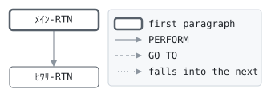

# GLC040

```text
GLC040: 契約者貸付利息

貸付残高、利息起算日 (和暦 GYYMMDD)、基準日 (西暦 YYYYMMDD)、
利息を受けて呼ばれる。利息は残高に年利 3% を掛け、起算日
から基準日までの日数を 365 日で日割りした額で、円未満は
切り捨てる。残高が 0 のとき、起算日が空白か日付でないとき、
基準日が起算日以前のときは利息なし。
呼ぶ側は利息を残高に繰り入れ、起算日を基準日に改める。

変更履歴
日付       担当 変更
2012-09-03 YN   GL-0561 初版。
2016-04-01 YN   GL-0640 年利 3.75% を 3% に。
```

Program [GLC040.cbl](../../../gondwana/programs/GLC040.cbl): 0 files, 2 paragraphs. Its business rules: [2 decision tables](../rules/GLC040.md).

- AUTHOR: ゴンドワナ生命 システム部.
- DATE-WRITTEN: 2012-09-03.

## Contents

- [Files](#files)
- [Flow](#flow)
- [Paragraphs](#paragraphs)
- [Calls](#calls)
- [Data flow](#data-flow)
- [Lineage](#lineage)
  - [Into WS-ﾎｳｺｳ](#into-ws-ﾎｳｺｳ)
  - [Into WS-ｷｻﾝﾋﾞ](#into-ws-ｷｻﾝﾋﾞ)
  - [Into WS-ﾍﾝｶﾝｹｯｶ](#into-ws-ﾍﾝｶﾝｹｯｶ)
  - [Into WS-ﾆｯｽｳ](#into-ws-ﾆｯｽｳ)
  - [Into LK-ｷｻﾝﾋﾞ](#into-lk-ｷｻﾝﾋﾞ)
  - [Into LK-ﾘｿｸ](#into-lk-ﾘｿｸ)
  - [Out of the program](#out-of-the-program)
- [Parameters](#parameters)
  - [Parameter 1, LK-ｻﾞﾝﾀﾞｶ](#parameter-1-lk-ｻﾞﾝﾀﾞｶ)
  - [Parameter 2, LK-ｷｻﾝﾋﾞ](#parameter-2-lk-ｷｻﾝﾋﾞ)
  - [Parameter 3, LK-ｷｼﾞｭﾝﾋﾞ](#parameter-3-lk-ｷｼﾞｭﾝﾋﾞ)
  - [Parameter 4, LK-ﾘｿｸ](#parameter-4-lk-ﾘｿｸ)
- [Records](#records)
  - [WS-ﾈﾝﾘ](#ws-ﾈﾝﾘ)
  - [WS-ﾎｳｺｳ](#ws-ﾎｳｺｳ)
  - [WS-ｷｻﾝﾋﾞ](#ws-ｷｻﾝﾋﾞ)
  - [WS-ﾍﾝｶﾝｹｯｶ](#ws-ﾍﾝｶﾝｹｯｶ)
  - [WS-ﾆｯｽｳ](#ws-ﾆｯｽｳ)
  - [LK-ｻﾞﾝﾀﾞｶ](#lk-ｻﾞﾝﾀﾞｶ)
  - [LK-ｷｻﾝﾋﾞ](#lk-ｷｻﾝﾋﾞ)
  - [LK-ｷｼﾞｭﾝﾋﾞ](#lk-ｷｼﾞｭﾝﾋﾞ)
  - [LK-ﾘｿｸ](#lk-ﾘｿｸ)

## Files

| File | Kind | Assigned to | Organization | Status field | Opened | Records |
| --- | --- | --- | --- | --- | --- | --- |

## Flow



## Paragraphs

| Paragraph | Description | Source | Performs | Goes to | Performed by | Reached by |
| --- | --- | --- | --- | --- | --- | --- |
| ﾒｲﾝ-RTN | ﾒｲﾝ-RTN: 残高と起算日があれば起算日を西暦にして日割りする。 | [GLC040.cbl:40](../../../gondwana/programs/GLC040.cbl#L40) | ﾋﾜﾘ-RTN | | | |
| ﾋﾜﾘ-RTN | ﾋﾜﾘ-RTN: 起算日の翌日から基準日までの日数分の利息。 | [GLC040.cbl:54](../../../gondwana/programs/GLC040.cbl#L54) | | | ﾒｲﾝ-RTN | |

## Calls

Called with LK-ｻﾞﾝﾀﾞｶ, LK-ｷｻﾝﾋﾞ, LK-ｷｼﾞｭﾝﾋﾞ, LK-ﾘｿｸ by [GLD020](GLD020.md), [GLD030](GLD030.md), [GLD060](GLD060.md), [GLD070](GLD070.md).

| Calls | Passing | Paragraph | Source |
| --- | --- | --- | --- |
| [GLC020](GLC020.md) | WS-ﾎｳｺｳ, WS-ｷｻﾝﾋﾞ, LK-ｷｻﾝﾋﾞ, WS-ﾍﾝｶﾝｹｯｶ | ﾒｲﾝ-RTN | [GLC040.cbl:43](../../../gondwana/programs/GLC040.cbl#L43) |

## Data flow

| Paragraph | Reads | Writes |
| --- | --- | --- |
| ﾒｲﾝ-RTN | LK-ｻﾞﾝﾀﾞｶ, LK-ｷｻﾝﾋﾞ, WS-ﾎｳｺｳ, WS-ｷｻﾝﾋﾞ, WS-ﾍﾝｶﾝｹｯｶ | LK-ﾘｿｸ, WS-ﾎｳｺｳ, WS-ｷｻﾝﾋﾞ, LK-ｷｻﾝﾋﾞ, WS-ﾍﾝｶﾝｹｯｶ |
| ﾋﾜﾘ-RTN | LK-ｷｼﾞｭﾝﾋﾞ, WS-ｷｻﾝﾋﾞ, WS-ﾆｯｽｳ, LK-ｻﾞﾝﾀﾞｶ, WS-ﾈﾝﾘ | WS-ﾆｯｽｳ, LK-ﾘｿｸ |

## Lineage

Where each data item's values come from, grouped by the record they go into. A data item links to the record it belongs to.

### Into WS-ﾎｳｺｳ

Record [WS-ﾎｳｺｳ](#ws-ﾎｳｺｳ).

| Into | From | Statement | Paragraph | Source |
| --- | --- | --- | --- | --- |
| WS-ﾎｳｺｳ | call GLC020 argument 1 | CALL | ﾒｲﾝ-RTN | [GLC040.cbl:43](../../../gondwana/programs/GLC040.cbl#L43) |

### Into WS-ｷｻﾝﾋﾞ

Record [WS-ｷｻﾝﾋﾞ](#ws-ｷｻﾝﾋﾞ).

| Into | From | Statement | Paragraph | Source |
| --- | --- | --- | --- | --- |
| WS-ｷｻﾝﾋﾞ | call GLC020 argument 2 | CALL | ﾒｲﾝ-RTN | [GLC040.cbl:43](../../../gondwana/programs/GLC040.cbl#L43) |

### Into WS-ﾍﾝｶﾝｹｯｶ

Record [WS-ﾍﾝｶﾝｹｯｶ](#ws-ﾍﾝｶﾝｹｯｶ).

| Into | From | Statement | Paragraph | Source |
| --- | --- | --- | --- | --- |
| WS-ﾍﾝｶﾝｹｯｶ | call GLC020 argument 4 | CALL | ﾒｲﾝ-RTN | [GLC040.cbl:43](../../../gondwana/programs/GLC040.cbl#L43) |

### Into WS-ﾆｯｽｳ

Record [WS-ﾆｯｽｳ](#ws-ﾆｯｽｳ).

| Into | From | Statement | Paragraph | Source |
| --- | --- | --- | --- | --- |
| WS-ﾆｯｽｳ | [LK-ｷｼﾞｭﾝﾋﾞ](#lk-ｷｼﾞｭﾝﾋﾞ) | COMPUTE | ﾋﾜﾘ-RTN | [GLC040.cbl:55](../../../gondwana/programs/GLC040.cbl#L55) |
| WS-ﾆｯｽｳ | [WS-ｷｻﾝﾋﾞ](#ws-ｷｻﾝﾋﾞ) | COMPUTE | ﾋﾜﾘ-RTN | [GLC040.cbl:55](../../../gondwana/programs/GLC040.cbl#L55) |

### Into LK-ｷｻﾝﾋﾞ

Record [LK-ｷｻﾝﾋﾞ](#lk-ｷｻﾝﾋﾞ).

| Into | From | Statement | Paragraph | Source |
| --- | --- | --- | --- | --- |
| LK-ｷｻﾝﾋﾞ | call GLC020 argument 3 | CALL | ﾒｲﾝ-RTN | [GLC040.cbl:43](../../../gondwana/programs/GLC040.cbl#L43) |

### Into LK-ﾘｿｸ

Record [LK-ﾘｿｸ](#lk-ﾘｿｸ).

| Into | From | Statement | Paragraph | Source |
| --- | --- | --- | --- | --- |
| LK-ﾘｿｸ | literal 0 | MOVE | ﾒｲﾝ-RTN | [GLC040.cbl:41](../../../gondwana/programs/GLC040.cbl#L41) |
| LK-ﾘｿｸ | [LK-ｻﾞﾝﾀﾞｶ](#lk-ｻﾞﾝﾀﾞｶ) | COMPUTE | ﾋﾜﾘ-RTN | [GLC040.cbl:58](../../../gondwana/programs/GLC040.cbl#L58) |
| LK-ﾘｿｸ | [WS-ﾈﾝﾘ](#ws-ﾈﾝﾘ) | COMPUTE | ﾋﾜﾘ-RTN | [GLC040.cbl:58](../../../gondwana/programs/GLC040.cbl#L58) |
| LK-ﾘｿｸ | [WS-ﾆｯｽｳ](#ws-ﾆｯｽｳ) | COMPUTE | ﾋﾜﾘ-RTN | [GLC040.cbl:58](../../../gondwana/programs/GLC040.cbl#L58) |

### Out of the program

Records written to files, items passed to the programs called, and items displayed to the job's output.

| Into | From | Statement | Paragraph | Source |
| --- | --- | --- | --- | --- |
| call GLC020 argument 1 | [WS-ﾎｳｺｳ](#ws-ﾎｳｺｳ) | CALL | ﾒｲﾝ-RTN | [GLC040.cbl:43](../../../gondwana/programs/GLC040.cbl#L43) |
| call GLC020 argument 2 | [WS-ｷｻﾝﾋﾞ](#ws-ｷｻﾝﾋﾞ) | CALL | ﾒｲﾝ-RTN | [GLC040.cbl:43](../../../gondwana/programs/GLC040.cbl#L43) |
| call GLC020 argument 3 | [LK-ｷｻﾝﾋﾞ](#lk-ｷｻﾝﾋﾞ) | CALL | ﾒｲﾝ-RTN | [GLC040.cbl:43](../../../gondwana/programs/GLC040.cbl#L43) |
| call GLC020 argument 4 | [WS-ﾍﾝｶﾝｹｯｶ](#ws-ﾍﾝｶﾝｹｯｶ) | CALL | ﾒｲﾝ-RTN | [GLC040.cbl:43](../../../gondwana/programs/GLC040.cbl#L43) |

## Parameters

What the program does with each field of the items it is passed, by position: the contract its callers rely on. A statement on a whole item, or a group of it, counts for each field in it; a field neither read nor written is passed for nothing.

### Parameter 1, LK-ｻﾞﾝﾀﾞｶ

| Field | Reads | Writes |
| --- | :-: | :-: |
| LK-ｻﾞﾝﾀﾞｶ | yes | |

### Parameter 2, LK-ｷｻﾝﾋﾞ

| Field | Reads | Writes |
| --- | :-: | :-: |
| LK-ｷｻﾝﾋﾞ | yes | yes |

### Parameter 3, LK-ｷｼﾞｭﾝﾋﾞ

| Field | Reads | Writes |
| --- | :-: | :-: |
| LK-ｷｼﾞｭﾝﾋﾞ | yes | |

### Parameter 4, LK-ﾘｿｸ

| Field | Reads | Writes |
| --- | :-: | :-: |
| LK-ﾘｿｸ | | yes |

## Records

### WS-ﾈﾝﾘ

Working storage. 4 bytes.

| Level | Field | Kind | Start | Length | Picture | Usage | Notes | Source |
| --: | --- | --- | --: | --: | --- | --- | --- | --- |
| 01 | WS-ﾈﾝﾘ | amount | 1 | 4 | V9(4) | | VALUE 0.0300 | [GLC040.cbl:23](../../../gondwana/programs/GLC040.cbl#L23) |

### WS-ﾎｳｺｳ

Working storage. 1 bytes.

| Level | Field | Kind | Start | Length | Picture | Usage | Notes | Source |
| --: | --- | --- | --: | --: | --- | --- | --- | --- |
| 01 | WS-ﾎｳｺｳ | text | 1 | 1 | X | | VALUE 'S' | [GLC040.cbl:24](../../../gondwana/programs/GLC040.cbl#L24) |

### WS-ｷｻﾝﾋﾞ

Working storage. 8 bytes.

| Level | Field | Kind | Start | Length | Picture | Usage | Notes | Source |
| --: | --- | --- | --: | --: | --- | --- | --- | --- |
| 01 | WS-ｷｻﾝﾋﾞ | date | 1 | 8 | 9(8) | | | [GLC040.cbl:25](../../../gondwana/programs/GLC040.cbl#L25) |

### WS-ﾍﾝｶﾝｹｯｶ

Working storage. 1 bytes.

| Level | Field | Kind | Start | Length | Picture | Usage | Notes | Source |
| --: | --- | --- | --: | --: | --- | --- | --- | --- |
| 01 | WS-ﾍﾝｶﾝｹｯｶ | number | 1 | 1 | 9 | | | [GLC040.cbl:26](../../../gondwana/programs/GLC040.cbl#L26) |

### WS-ﾆｯｽｳ

Working storage. 7 bytes.

| Level | Field | Kind | Start | Length | Picture | Usage | Notes | Source |
| --: | --- | --- | --: | --: | --- | --- | --- | --- |
| 01 | WS-ﾆｯｽｳ | number | 1 | 7 | S9(7) | | | [GLC040.cbl:27](../../../gondwana/programs/GLC040.cbl#L27) |

### LK-ｻﾞﾝﾀﾞｶ

Linkage. 9 bytes.

| Level | Field | Kind | Start | Length | Picture | Usage | Notes | Source |
| --: | --- | --- | --: | --: | --- | --- | --- | --- |
| 01 | LK-ｻﾞﾝﾀﾞｶ | amount | 1 | 9 | 9(9) | | | [GLC040.cbl:30](../../../gondwana/programs/GLC040.cbl#L30) |

### LK-ｷｻﾝﾋﾞ

Linkage. 7 bytes.

| Level | Field | Kind | Start | Length | Picture | Usage | Notes | Source |
| --: | --- | --- | --: | --: | --- | --- | --- | --- |
| 01 | LK-ｷｻﾝﾋﾞ | date | 1 | 7 | X(7) | | | [GLC040.cbl:31](../../../gondwana/programs/GLC040.cbl#L31) |

### LK-ｷｼﾞｭﾝﾋﾞ

Linkage. 8 bytes.

| Level | Field | Kind | Start | Length | Picture | Usage | Notes | Source |
| --: | --- | --- | --: | --: | --- | --- | --- | --- |
| 01 | LK-ｷｼﾞｭﾝﾋﾞ | date | 1 | 8 | 9(8) | | | [GLC040.cbl:32](../../../gondwana/programs/GLC040.cbl#L32) |

### LK-ﾘｿｸ

Linkage. 9 bytes.

| Level | Field | Kind | Start | Length | Picture | Usage | Notes | Source |
| --: | --- | --- | --: | --: | --- | --- | --- | --- |
| 01 | LK-ﾘｿｸ | amount | 1 | 9 | 9(9) | | | [GLC040.cbl:33](../../../gondwana/programs/GLC040.cbl#L33) |
