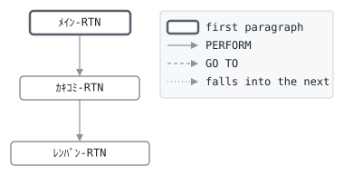

# GLC050

```text
GLC050: 収納履歴の書き込み

保険料を収納したプログラムから呼ばれる。機能 W は収納1件を
収納履歴 PRMHST に、その契約の次の連番で書く。ファイルは
最初の W で開き (なければ作る)、開いたままにする。機能 C は
開いていれば閉じる: 呼ぶ側は終了時に必ず C で呼ぶ。
状態は "00" で正常、それ以外はファイル状態をそのまま返す。

呼び出し: CALL "GLC050" USING 機能 収納 状態
  機能 PIC X      W 書き込み、C クローズ
  収納            証券番号 X(10)、収納日 9(8) 西暦、種別 X、
                  金額 9(9)、回数 99、払込済年月 9(6)
  状態 PIC XX

変更履歴
日付       担当 変更
2026-11-19 YN   GL-0827 初版。
```

Program [GLC050.cbl](../../../gondwana/programs/GLC050.cbl): 1 files, 3 paragraphs. Its business rules: [3 decision tables](../rules/GLC050.md).

- AUTHOR: ゴンドワナ生命 システム部.
- DATE-WRITTEN: 2026-11-19.

## Contents

- [Files](#files)
- [Flow](#flow)
- [Paragraphs](#paragraphs)
- [Calls](#calls)
- [Data flow](#data-flow)
- [Lineage](#lineage)
  - [Into SH-ｼｭｳﾉｳ-ﾚｺｰﾄﾞ](#into-sh-ｼｭｳﾉｳ-ﾚｺｰﾄﾞ)
  - [Into WS-ｵｰﾌﾟﾝ](#into-ws-ｵｰﾌﾟﾝ)
  - [Into WS-ﾚﾝﾊﾞﾝ](#into-ws-ﾚﾝﾊﾞﾝ)
  - [Into LK-ｼﾞｮｳﾀｲ](#into-lk-ｼﾞｮｳﾀｲ)
  - [Out of the program](#out-of-the-program)
- [Field origins](#field-origins)
  - [File PRMHST-F](#file-prmhst-f)
- [Parameters](#parameters)
  - [Parameter 1, LK-ｷﾉｳ](#parameter-1-lk-ｷﾉｳ)
  - [Parameter 2, LK-ｼｭｳﾉｳ](#parameter-2-lk-ｼｭｳﾉｳ)
  - [Parameter 3, LK-ｼﾞｮｳﾀｲ](#parameter-3-lk-ｼﾞｮｳﾀｲ)
- [Records](#records)
  - [SH-ｼｭｳﾉｳ-ﾚｺｰﾄﾞ](#sh-ｼｭｳﾉｳ-ﾚｺｰﾄﾞ)
  - [WS-PRMHST-ST](#ws-prmhst-st)
  - [WS-ｵｰﾌﾟﾝ](#ws-ｵｰﾌﾟﾝ)
  - [WS-ﾚﾝﾊﾞﾝ](#ws-ﾚﾝﾊﾞﾝ)
  - [LK-ｷﾉｳ](#lk-ｷﾉｳ)
  - [LK-ｼｭｳﾉｳ](#lk-ｼｭｳﾉｳ)
  - [LK-ｼﾞｮｳﾀｲ](#lk-ｼﾞｮｳﾀｲ)

## Files

| File | Kind | Assigned to | Organization | Status field | Opened | Records |
| --- | --- | --- | --- | --- | --- | --- |
| PRMHST-F | FD | PRMHST | INDEXED, key SH-ｷｰ, DYNAMIC access | WS-PRMHST-ST | I-O | SH-ｼｭｳﾉｳ-ﾚｺｰﾄﾞ |

## Flow



## Paragraphs

| Paragraph | Description | Source | Performs | Goes to | Performed by | Reached by |
| --- | --- | --- | --- | --- | --- | --- |
| ﾒｲﾝ-RTN | ﾒｲﾝ-RTN: 機能により書き込みかクローズ。 | [GLC050.cbl:66](../../../gondwana/programs/GLC050.cbl#L66) | ｶｷｺﾐ-RTN | | | |
| ｶｷｺﾐ-RTN | ｶｷｺﾐ-RTN: 開いていなければ開き、契約の最後の連番を求めて 次の連番で書く。 | [GLC050.cbl:81](../../../gondwana/programs/GLC050.cbl#L81) | ﾚﾝﾊﾞﾝ-RTN | | ﾒｲﾝ-RTN | |
| ﾚﾝﾊﾞﾝ-RTN | ﾚﾝﾊﾞﾝ-RTN: 契約の収納履歴を連番順にたどり、最後の連番を 求める。なければ 0。 | [GLC050.cbl:110](../../../gondwana/programs/GLC050.cbl#L110) | | | ｶｷｺﾐ-RTN | |

## Calls

Called with LK-ｷﾉｳ, LK-ｼｭｳﾉｳ, LK-ｼﾞｮｳﾀｲ by [GLD010](GLD010.md), [GLD040](GLD040.md), [GLD050](GLD050.md), [GLD060](GLD060.md).

## Data flow

| Paragraph | Reads | Writes |
| --- | --- | --- |
| ﾒｲﾝ-RTN | LK-ｷﾉｳ, WS-ｵｰﾌﾟﾝ | LK-ｼﾞｮｳﾀｲ, WS-PRMHST-ST, WS-ｵｰﾌﾟﾝ |
| ｶｷｺﾐ-RTN | WS-ｵｰﾌﾟﾝ, WS-PRMHST-ST, LK-ｼｮｳｹﾝﾊﾞﾝｺﾞｳ, WS-ﾚﾝﾊﾞﾝ, LK-ｼｭｳﾉｳﾋﾞ, LK-ｼｭﾍﾞﾂ, LK-ｷﾝｶﾞｸ, LK-ｶｲｽｳ, LK-ﾊﾗｲｺﾐｽﾞﾐﾈﾝｹﾞﾂ | WS-PRMHST-ST, WS-ｵｰﾌﾟﾝ, SH-ｼｭｳﾉｳ-ﾚｺｰﾄﾞ, SH-ｼｮｳｹﾝﾊﾞﾝｺﾞｳ, SH-ﾚﾝﾊﾞﾝ, SH-ｼｭｳﾉｳﾋﾞ, SH-ｼｭﾍﾞﾂ, SH-ｷﾝｶﾞｸ, SH-ｶｲｽｳ, SH-ﾊﾗｲｺﾐｽﾞﾐﾈﾝｹﾞﾂ, LK-ｼﾞｮｳﾀｲ |
| ﾚﾝﾊﾞﾝ-RTN | LK-ｼｮｳｹﾝﾊﾞﾝｺﾞｳ, SH-ｷｰ, WS-PRMHST-ST, SH-ｼｮｳｹﾝﾊﾞﾝｺﾞｳ, SH-ﾚﾝﾊﾞﾝ | WS-ﾚﾝﾊﾞﾝ, SH-ｼｮｳｹﾝﾊﾞﾝｺﾞｳ, SH-ﾚﾝﾊﾞﾝ, WS-PRMHST-ST, SH-ｼｭｳﾉｳ-ﾚｺｰﾄﾞ |

## Lineage

Where each data item's values come from, grouped by the record they go into. A data item links to the record it belongs to.

### Into SH-ｼｭｳﾉｳ-ﾚｺｰﾄﾞ

Record [SH-ｼｭｳﾉｳ-ﾚｺｰﾄﾞ](#sh-ｼｭｳﾉｳ-ﾚｺｰﾄﾞ), from copybook [PRMHST](../copybooks/PRMHST.md).

| Into | From | Statement | Paragraph | Source |
| --- | --- | --- | --- | --- |
| SH-ｶｲｽｳ | [LK-ｶｲｽｳ](#lk-ｼｭｳﾉｳ "in LK-ｼｭｳﾉｳ") | MOVE | ｶｷｺﾐ-RTN | [GLC050.cbl:98](../../../gondwana/programs/GLC050.cbl#L98) |
| SH-ｷﾝｶﾞｸ | [LK-ｷﾝｶﾞｸ](#lk-ｼｭｳﾉｳ "in LK-ｼｭｳﾉｳ") | MOVE | ｶｷｺﾐ-RTN | [GLC050.cbl:97](../../../gondwana/programs/GLC050.cbl#L97) |
| SH-ｼｭｳﾉｳ-ﾚｺｰﾄﾞ | literal SPACES | MOVE | ｶｷｺﾐ-RTN | [GLC050.cbl:92](../../../gondwana/programs/GLC050.cbl#L92) |
| SH-ｼｭｳﾉｳ-ﾚｺｰﾄﾞ | file PRMHST-F | READ | ﾚﾝﾊﾞﾝ-RTN | [GLC050.cbl:116](../../../gondwana/programs/GLC050.cbl#L116) |
| SH-ｼｭｳﾉｳ-ﾚｺｰﾄﾞ | file PRMHST-F | READ | ﾚﾝﾊﾞﾝ-RTN | [GLC050.cbl:121](../../../gondwana/programs/GLC050.cbl#L121) |
| SH-ｼｭｳﾉｳﾋﾞ | [LK-ｼｭｳﾉｳﾋﾞ](#lk-ｼｭｳﾉｳ "in LK-ｼｭｳﾉｳ") | MOVE | ｶｷｺﾐ-RTN | [GLC050.cbl:95](../../../gondwana/programs/GLC050.cbl#L95) |
| SH-ｼｭﾍﾞﾂ | [LK-ｼｭﾍﾞﾂ](#lk-ｼｭｳﾉｳ "in LK-ｼｭｳﾉｳ") | MOVE | ｶｷｺﾐ-RTN | [GLC050.cbl:96](../../../gondwana/programs/GLC050.cbl#L96) |
| SH-ｼｮｳｹﾝﾊﾞﾝｺﾞｳ | [LK-ｼｮｳｹﾝﾊﾞﾝｺﾞｳ](#lk-ｼｭｳﾉｳ "in LK-ｼｭｳﾉｳ") | MOVE | ｶｷｺﾐ-RTN | [GLC050.cbl:93](../../../gondwana/programs/GLC050.cbl#L93) |
| SH-ｼｮｳｹﾝﾊﾞﾝｺﾞｳ | [LK-ｼｮｳｹﾝﾊﾞﾝｺﾞｳ](#lk-ｼｭｳﾉｳ "in LK-ｼｭｳﾉｳ") | MOVE | ﾚﾝﾊﾞﾝ-RTN | [GLC050.cbl:112](../../../gondwana/programs/GLC050.cbl#L112) |
| SH-ﾊﾗｲｺﾐｽﾞﾐﾈﾝｹﾞﾂ | [LK-ﾊﾗｲｺﾐｽﾞﾐﾈﾝｹﾞﾂ](#lk-ｼｭｳﾉｳ "in LK-ｼｭｳﾉｳ") | MOVE | ｶｷｺﾐ-RTN | [GLC050.cbl:99](../../../gondwana/programs/GLC050.cbl#L99) |
| SH-ﾚﾝﾊﾞﾝ | [WS-ﾚﾝﾊﾞﾝ](#ws-ﾚﾝﾊﾞﾝ) | COMPUTE | ｶｷｺﾐ-RTN | [GLC050.cbl:94](../../../gondwana/programs/GLC050.cbl#L94) |
| SH-ﾚﾝﾊﾞﾝ | literal 0 | MOVE | ﾚﾝﾊﾞﾝ-RTN | [GLC050.cbl:113](../../../gondwana/programs/GLC050.cbl#L113) |

### Into WS-ｵｰﾌﾟﾝ

Record [WS-ｵｰﾌﾟﾝ](#ws-ｵｰﾌﾟﾝ).

| Into | From | Statement | Paragraph | Source |
| --- | --- | --- | --- | --- |
| WS-ｵｰﾌﾟﾝ | literal condition WS-ｵｰﾌﾟﾝﾏｴ | SET | ﾒｲﾝ-RTN | [GLC050.cbl:73](../../../gondwana/programs/GLC050.cbl#L73) |
| WS-ｵｰﾌﾟﾝ | literal condition WS-ｵｰﾌﾟﾝｽﾞﾐ | SET | ｶｷｺﾐ-RTN | [GLC050.cbl:85](../../../gondwana/programs/GLC050.cbl#L85) |

### Into WS-ﾚﾝﾊﾞﾝ

Record [WS-ﾚﾝﾊﾞﾝ](#ws-ﾚﾝﾊﾞﾝ).

| Into | From | Statement | Paragraph | Source |
| --- | --- | --- | --- | --- |
| WS-ﾚﾝﾊﾞﾝ | literal 0 | MOVE | ﾚﾝﾊﾞﾝ-RTN | [GLC050.cbl:111](../../../gondwana/programs/GLC050.cbl#L111) |
| WS-ﾚﾝﾊﾞﾝ | [SH-ﾚﾝﾊﾞﾝ](#sh-ｼｭｳﾉｳ-ﾚｺｰﾄﾞ "in SH-ｼｭｳﾉｳ-ﾚｺｰﾄﾞ") | MOVE | ﾚﾝﾊﾞﾝ-RTN | [GLC050.cbl:120](../../../gondwana/programs/GLC050.cbl#L120) |

### Into LK-ｼﾞｮｳﾀｲ

Record [LK-ｼﾞｮｳﾀｲ](#lk-ｼﾞｮｳﾀｲ).

| Into | From | Statement | Paragraph | Source |
| --- | --- | --- | --- | --- |
| LK-ｼﾞｮｳﾀｲ | literal condition LK-ｾｲｼﾞｮｳ | SET | ﾒｲﾝ-RTN | [GLC050.cbl:67](../../../gondwana/programs/GLC050.cbl#L67) |
| LK-ｼﾞｮｳﾀｲ | [WS-PRMHST-ST](#ws-prmhst-st) | MOVE | ｶｷｺﾐ-RTN | [GLC050.cbl:103](../../../gondwana/programs/GLC050.cbl#L103) |

### Out of the program

Records written to files, items passed to the programs called, and items displayed to the job's output.

| Into | From | Statement | Paragraph | Source |
| --- | --- | --- | --- | --- |
| file PRMHST-F | [SH-ｼｭｳﾉｳ-ﾚｺｰﾄﾞ](#sh-ｼｭｳﾉｳ-ﾚｺｰﾄﾞ) | WRITE | ｶｷｺﾐ-RTN | [GLC050.cbl:100](../../../gondwana/programs/GLC050.cbl#L100) |

## Field origins

Where the values of each field the program writes to a file come from: the fields of the files it reads, literals, and initial values, followed through every statement that moves a value, and through groups and redefinitions by the bytes they share.

### File PRMHST-F

Written from [SH-ｼｭｳﾉｳ-ﾚｺｰﾄﾞ](#sh-ｼｭｳﾉｳ-ﾚｺｰﾄﾞ).

| Field | Position | Origins |
| --- | --: | --- |
| SH-ｼｮｳｹﾝﾊﾞﾝｺﾞｳ | 1-10 | parameter 2 LK-ｼｮｳｹﾝﾊﾞﾝｺﾞｳ |
| SH-ﾚﾝﾊﾞﾝ | 11-14 | file PRMHST-F SH-ﾚﾝﾊﾞﾝ; literal 0 |
| SH-ｼｭｳﾉｳﾋﾞ | 15-22 | parameter 2 LK-ｼｭｳﾉｳﾋﾞ |
| SH-ｼｭﾍﾞﾂ | 23 | parameter 2 LK-ｼｭﾍﾞﾂ |
| SH-ｷﾝｶﾞｸ | 24-32 | parameter 2 LK-ｷﾝｶﾞｸ |
| SH-ｶｲｽｳ | 33-34 | parameter 2 LK-ｶｲｽｳ |
| SH-ﾊﾗｲｺﾐｽﾞﾐﾈﾝｹﾞﾂ | 35-40 | parameter 2 LK-ﾊﾗｲｺﾐｽﾞﾐﾈﾝｹﾞﾂ |

## Parameters

What the program does with each field of the items it is passed, by position: the contract its callers rely on. A statement on a whole item, or a group of it, counts for each field in it; a field neither read nor written is passed for nothing.

### Parameter 1, LK-ｷﾉｳ

| Field | Reads | Writes |
| --- | :-: | :-: |
| LK-ｷﾉｳ | yes | |

### Parameter 2, LK-ｼｭｳﾉｳ

| Field | Reads | Writes |
| --- | :-: | :-: |
| LK-ｼｮｳｹﾝﾊﾞﾝｺﾞｳ | yes | |
| LK-ｼｭｳﾉｳﾋﾞ | yes | |
| LK-ｼｭﾍﾞﾂ | yes | |
| LK-ｷﾝｶﾞｸ | yes | |
| LK-ｶｲｽｳ | yes | |
| LK-ﾊﾗｲｺﾐｽﾞﾐﾈﾝｹﾞﾂ | yes | |

### Parameter 3, LK-ｼﾞｮｳﾀｲ

| Field | Reads | Writes |
| --- | :-: | :-: |
| LK-ｼﾞｮｳﾀｲ | | yes |

## Records

### SH-ｼｭｳﾉｳ-ﾚｺｰﾄﾞ

File PRMHST-F. 60 bytes, layout in copybook [PRMHST](../copybooks/PRMHST.md).

### WS-PRMHST-ST

Working storage. 2 bytes.

| Level | Field | Kind | Start | Length | Picture | Usage | Notes | Source |
| --: | --- | --- | --: | --: | --- | --- | --- | --- |
| 01 | WS-PRMHST-ST | code | 1 | 2 | XX | | | [GLC050.cbl:40](../../../gondwana/programs/GLC050.cbl#L40) |
| 88 | ├ WS-PRMHST-OK | | | | | | VALUE '00', '05' | [GLC050.cbl:41](../../../gondwana/programs/GLC050.cbl#L41) |
| 88 | └ WS-PRMHST-ｵﾜﾘ | | | | | | VALUE '10', '23' | [GLC050.cbl:42](../../../gondwana/programs/GLC050.cbl#L42) |

### WS-ｵｰﾌﾟﾝ

Working storage. 1 bytes.

| Level | Field | Kind | Start | Length | Picture | Usage | Notes | Source |
| --: | --- | --- | --: | --: | --- | --- | --- | --- |
| 01 | WS-ｵｰﾌﾟﾝ | code | 1 | 1 | X | | VALUE 'N' | [GLC050.cbl:43](../../../gondwana/programs/GLC050.cbl#L43) |
| 88 | ├ WS-ｵｰﾌﾟﾝｽﾞﾐ | | | | | | VALUE 'Y' | [GLC050.cbl:44](../../../gondwana/programs/GLC050.cbl#L44) |
| 88 | └ WS-ｵｰﾌﾟﾝﾏｴ | | | | | | VALUE 'N' | [GLC050.cbl:45](../../../gondwana/programs/GLC050.cbl#L45) |

### WS-ﾚﾝﾊﾞﾝ

Working storage. 4 bytes.

| Level | Field | Kind | Start | Length | Picture | Usage | Notes | Source |
| --: | --- | --- | --: | --: | --- | --- | --- | --- |
| 01 | WS-ﾚﾝﾊﾞﾝ | number | 1 | 4 | 9(4) | | | [GLC050.cbl:46](../../../gondwana/programs/GLC050.cbl#L46) |

### LK-ｷﾉｳ

Linkage. 1 bytes.

| Level | Field | Kind | Start | Length | Picture | Usage | Notes | Source |
| --: | --- | --- | --: | --: | --- | --- | --- | --- |
| 01 | LK-ｷﾉｳ | code | 1 | 1 | X | | | [GLC050.cbl:49](../../../gondwana/programs/GLC050.cbl#L49) |
| 88 | ├ LK-ｶｷｺﾐ | | | | | | VALUE 'W' | [GLC050.cbl:50](../../../gondwana/programs/GLC050.cbl#L50) |
| 88 | └ LK-ｸﾛｰｽﾞ | | | | | | VALUE 'C' | [GLC050.cbl:51](../../../gondwana/programs/GLC050.cbl#L51) |

### LK-ｼｭｳﾉｳ

Linkage. 36 bytes.

| Level | Field | Kind | Start | Length | Picture | Usage | Notes | Source |
| --: | --- | --- | --: | --: | --- | --- | --- | --- |
| 01 | LK-ｼｭｳﾉｳ | group | 1 | 36 | | | | [GLC050.cbl:52](../../../gondwana/programs/GLC050.cbl#L52) |
| 05 | ├ LK-ｼｮｳｹﾝﾊﾞﾝｺﾞｳ | text | 1 | 10 | X(10) | | | [GLC050.cbl:53](../../../gondwana/programs/GLC050.cbl#L53) |
| 05 | ├ LK-ｼｭｳﾉｳﾋﾞ | date | 11 | 8 | 9(8) | | | [GLC050.cbl:54](../../../gondwana/programs/GLC050.cbl#L54) |
| 05 | ├ LK-ｼｭﾍﾞﾂ | text | 19 | 1 | X | | | [GLC050.cbl:55](../../../gondwana/programs/GLC050.cbl#L55) |
| 05 | ├ LK-ｷﾝｶﾞｸ | amount | 20 | 9 | 9(9) | | | [GLC050.cbl:56](../../../gondwana/programs/GLC050.cbl#L56) |
| 05 | ├ LK-ｶｲｽｳ | number | 29 | 2 | 99 | | | [GLC050.cbl:57](../../../gondwana/programs/GLC050.cbl#L57) |
| 05 | └ LK-ﾊﾗｲｺﾐｽﾞﾐﾈﾝｹﾞﾂ | date | 31 | 6 | 9(6) | | | [GLC050.cbl:58](../../../gondwana/programs/GLC050.cbl#L58) |

### LK-ｼﾞｮｳﾀｲ

Linkage. 2 bytes.

| Level | Field | Kind | Start | Length | Picture | Usage | Notes | Source |
| --: | --- | --- | --: | --: | --- | --- | --- | --- |
| 01 | LK-ｼﾞｮｳﾀｲ | code | 1 | 2 | XX | | | [GLC050.cbl:59](../../../gondwana/programs/GLC050.cbl#L59) |
| 88 | └ LK-ｾｲｼﾞｮｳ | | | | | | VALUE '00' | [GLC050.cbl:60](../../../gondwana/programs/GLC050.cbl#L60) |
