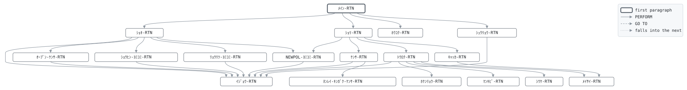

# GLD010

```text
GLD010: 新契約登録

日次。営業システムからの新契約ファイル NEWPOL を読み、
1件ずつ検査して契約マスタに登録する。検査は商品、証券番号
の重複、払込方法、契約日と生年月日 (西暦で届くので和暦に
変換できること)、性別、契約日時点の保険年齢が商品の範囲内
であること、保険金額が範囲内であること、料率があること。
保険料は保険金額1,000円あたりの月払料率から求め、円未満
切捨て。年払は月払の12倍から5%を引く。第1回保険料は申込時
に収納済みのため、払込済年月は契約月とし、保険料収入を
仕訳する。満期日は契約日に保険期間を足した日 (終身・医療は
なし)。却下は理由コードを付けて却下ファイルへ。

復帰コード: 0 全件登録、4 却下あり、8 日付が日付でない、
            16 ファイル異常。

変更履歴
日付       担当 変更
1987-04-01 KT   GL-0001 初版、申込書のパンチ入力から。
2003-10-06 MS   GL-0310 営業システムのファイルから。
2008-06-02 YN   GL-0455 医療保険。
```

Program [GLD010.cbl](../../../gondwana/programs/GLD010.cbl): 8 files, 18 paragraphs. Its business rules: [13 decision tables](../rules/GLD010.md).

- AUTHOR: ゴンドワナ生命 システム部.
- DATE-WRITTEN: 1987-04-01.

## Contents

- [Files](#files)
- [Flow](#flow)
- [Paragraphs](#paragraphs)
- [Calls](#calls)
- [Data flow](#data-flow)
- [Lineage](#lineage)
  - [Into NP-ｼﾝｹｲﾔｸ-ﾚｺｰﾄﾞ](#into-np-ｼﾝｹｲﾔｸ-ﾚｺｰﾄﾞ)
  - [Into PM-ｹｲﾔｸ-ﾚｺｰﾄﾞ](#into-pm-ｹｲﾔｸ-ﾚｺｰﾄﾞ)
  - [Into PR-ｼｮｳﾋﾝ-ﾚｺｰﾄﾞ](#into-pr-ｼｮｳﾋﾝ-ﾚｺｰﾄﾞ)
  - [Into RT-ﾘｮｳﾘﾂ-ﾚｺｰﾄﾞ](#into-rt-ﾘｮｳﾘﾂ-ﾚｺｰﾄﾞ)
  - [Into CT-ｾｲｷﾞｮ-ﾚｺｰﾄﾞ](#into-ct-ｾｲｷﾞｮ-ﾚｺｰﾄﾞ)
  - [Into JR-ｼﾜｹ-ﾚｺｰﾄﾞ](#into-jr-ｼﾜｹ-ﾚｺｰﾄﾞ)
  - [Into ｷｬｯｶ-ﾚｺｰﾄﾞ](#into-ｷｬｯｶ-ﾚｺｰﾄﾞ)
  - [Into ﾎｳｺｸ-ｷﾞｮｳ](#into-ﾎｳｺｸ-ｷﾞｮｳ)
  - [Into WS-ｺﾏﾝﾄﾞｷﾞｮｳ](#into-ws-ｺﾏﾝﾄﾞｷﾞｮｳ)
  - [Into WS-ｴﾗｰﾌｧｲﾙ](#into-ws-ｴﾗｰﾌｧｲﾙ)
  - [Into WS-ｴﾗｰｽﾃｰﾀｽ](#into-ws-ｴﾗｰｽﾃｰﾀｽ)
  - [Into WS-ｷﾞｮｳﾑﾋﾂﾞｹ](#into-ws-ｷﾞｮｳﾑﾋﾂﾞｹ)
  - [Into WS-ｷﾞｮｳﾑﾋﾂﾞｹ-ﾜﾚｷ](#into-ws-ｷﾞｮｳﾑﾋﾂﾞｹ-ﾜﾚｷ)
  - [Into WS-ﾎｳｺｳ](#into-ws-ﾎｳｺｳ)
  - [Into WS-ﾍﾝｶﾝｹｯｶ](#into-ws-ﾍﾝｶﾝｹｯｶ)
  - [Into WS-ｹｲﾔｸﾋﾞ-ﾜﾚｷ](#into-ws-ｹｲﾔｸﾋﾞ-ﾜﾚｷ)
  - [Into WS-ｾｲﾈﾝｶﾞｯﾋﾟ-ﾜﾚｷ](#into-ws-ｾｲﾈﾝｶﾞｯﾋﾟ-ﾜﾚｷ)
  - [Into WS-ﾏﾝｷﾋﾞ](#into-ws-ﾏﾝｷﾋﾞ)
  - [Into WS-ﾏﾝｷﾋﾞ-ﾌﾞﾝｶｲ](#into-ws-ﾏﾝｷﾋﾞ-ﾌﾞﾝｶｲ)
  - [Into WS-ﾏﾝｷﾋﾞ-ﾜﾚｷ](#into-ws-ﾏﾝｷﾋﾞ-ﾜﾚｷ)
  - [Into WS-ﾈﾝﾚｲ](#into-ws-ﾈﾝﾚｲ)
  - [Into WS-ｹﾞﾂｶﾞｸ](#into-ws-ｹﾞﾂｶﾞｸ)
  - [Into WS-ｼｮｳﾋﾝ-TBL](#into-ws-ｼｮｳﾋﾝ-tbl)
  - [Into WS-ﾘｮｳﾘﾂ-TBL](#into-ws-ﾘｮｳﾘﾂ-tbl)
  - [Into WS-ﾈﾝﾚｲ-ｿｴｼﾞ](#into-ws-ﾈﾝﾚｲ-ｿｴｼﾞ)
  - [Into WS-ｹﾝｽｳ](#into-ws-ｹﾝｽｳ)
  - [Into WS-ﾘﾕｳ](#into-ws-ﾘﾕｳ)
  - [Into WS-ﾌｯｷｺｰﾄﾞ](#into-ws-ﾌｯｷｺｰﾄﾞ)
  - [Into WS-ﾎｳｺｸ](#into-ws-ﾎｳｺｸ)
  - [Out of the program](#out-of-the-program)
  - [Into other data items](#into-other-data-items)
- [Field origins](#field-origins)
  - [File REPORT-F](#file-report-f)
  - [File POLMST-F](#file-polmst-f)
  - [File GLJRNL-F](#file-gljrnl-f)
  - [File REJECT-F](#file-reject-f)
  - [File GLSCTL-F](#file-glsctl-f)
- [Links between records](#links-between-records)
- [Records](#records)
  - [NP-ｼﾝｹｲﾔｸ-ﾚｺｰﾄﾞ](#np-ｼﾝｹｲﾔｸ-ﾚｺｰﾄﾞ)
  - [PM-ｹｲﾔｸ-ﾚｺｰﾄﾞ](#pm-ｹｲﾔｸ-ﾚｺｰﾄﾞ)
  - [PR-ｼｮｳﾋﾝ-ﾚｺｰﾄﾞ](#pr-ｼｮｳﾋﾝ-ﾚｺｰﾄﾞ)
  - [RT-ﾘｮｳﾘﾂ-ﾚｺｰﾄﾞ](#rt-ﾘｮｳﾘﾂ-ﾚｺｰﾄﾞ)
  - [CT-ｾｲｷﾞｮ-ﾚｺｰﾄﾞ](#ct-ｾｲｷﾞｮ-ﾚｺｰﾄﾞ)
  - [JR-ｼﾜｹ-ﾚｺｰﾄﾞ](#jr-ｼﾜｹ-ﾚｺｰﾄﾞ)
  - [ｷｬｯｶ-ﾚｺｰﾄﾞ](#ｷｬｯｶ-ﾚｺｰﾄﾞ)
  - [ﾎｳｺｸ-ｷﾞｮｳ](#ﾎｳｺｸ-ｷﾞｮｳ)
  - [WS-ｽﾃｰﾀｽ](#ws-ｽﾃｰﾀｽ)
  - [WS-ｺﾏﾝﾄﾞｷﾞｮｳ](#ws-ｺﾏﾝﾄﾞｷﾞｮｳ)
  - [WS-ｴﾗｰﾌｧｲﾙ](#ws-ｴﾗｰﾌｧｲﾙ)
  - [WS-ｴﾗｰｽﾃｰﾀｽ](#ws-ｴﾗｰｽﾃｰﾀｽ)
  - [WS-ｷﾞｮｳﾑﾋﾂﾞｹ](#ws-ｷﾞｮｳﾑﾋﾂﾞｹ)
  - [WS-ｷﾞｮｳﾑﾋﾂﾞｹ-ﾜﾚｷ](#ws-ｷﾞｮｳﾑﾋﾂﾞｹ-ﾜﾚｷ)
  - [WS-ﾎｳｺｳ](#ws-ﾎｳｺｳ)
  - [WS-ﾍﾝｶﾝｹｯｶ](#ws-ﾍﾝｶﾝｹｯｶ)
  - [WS-ｹｲﾔｸﾋﾞ-ﾜﾚｷ](#ws-ｹｲﾔｸﾋﾞ-ﾜﾚｷ)
  - [WS-ｾｲﾈﾝｶﾞｯﾋﾟ-ﾜﾚｷ](#ws-ｾｲﾈﾝｶﾞｯﾋﾟ-ﾜﾚｷ)
  - [WS-ﾏﾝｷﾋﾞ](#ws-ﾏﾝｷﾋﾞ)
  - [WS-ﾏﾝｷﾋﾞ-ﾌﾞﾝｶｲ](#ws-ﾏﾝｷﾋﾞ-ﾌﾞﾝｶｲ)
  - [WS-ﾏﾝｷﾋﾞ-ﾜﾚｷ](#ws-ﾏﾝｷﾋﾞ-ﾜﾚｷ)
  - [WS-ﾈﾝﾚｲ](#ws-ﾈﾝﾚｲ)
  - [WS-ｹﾞﾂｶﾞｸ](#ws-ｹﾞﾂｶﾞｸ)
  - [WS-ｼｮｳﾋﾝ-TBL](#ws-ｼｮｳﾋﾝ-tbl)
  - [WS-ﾘｮｳﾘﾂ-TBL](#ws-ﾘｮｳﾘﾂ-tbl)
  - [WS-ﾈﾝﾚｲ-ｿｴｼﾞ](#ws-ﾈﾝﾚｲ-ｿｴｼﾞ)
  - [WS-ｹﾝｽｳ](#ws-ｹﾝｽｳ)
  - [WS-ﾘﾕｳ](#ws-ﾘﾕｳ)
  - [WS-ﾘﾕｳ-ﾒｯｾｰｼﾞ](#ws-ﾘﾕｳ-ﾒｯｾｰｼﾞ)
  - [WS-ﾘﾕｳ-ﾒｯｾｰｼﾞ-TBL](#ws-ﾘﾕｳ-ﾒｯｾｰｼﾞ-tbl)
  - [WS-ﾌｯｷｺｰﾄﾞ](#ws-ﾌｯｷｺｰﾄﾞ)
  - [WS-ﾎｳｺｸ](#ws-ﾎｳｺｸ)

## Files

| File | Kind | Assigned to | Organization | Status field | Opened | Records |
| --- | --- | --- | --- | --- | --- | --- |
| NEWPOL-F | FD | NEWPOL | LINE SEQUENTIAL | WS-NEWPOL-ST | INPUT | NP-ｼﾝｹｲﾔｸ-ﾚｺｰﾄﾞ |
| POLMST-F | FD | POLMST | INDEXED, key PM-ｼｮｳｹﾝﾊﾞﾝｺﾞｳ, RANDOM access | WS-POLMST-ST | I-O | PM-ｹｲﾔｸ-ﾚｺｰﾄﾞ |
| PRODTB-F | FD | PRODTB | LINE SEQUENTIAL | WS-PRODTB-ST | INPUT | PR-ｼｮｳﾋﾝ-ﾚｺｰﾄﾞ |
| RATETB-F | FD | RATETB | LINE SEQUENTIAL | WS-RATETB-ST | INPUT | RT-ﾘｮｳﾘﾂ-ﾚｺｰﾄﾞ |
| GLSCTL-F | FD | GLSCTL | SEQUENTIAL | WS-GLSCTL-ST | I-O | CT-ｾｲｷﾞｮ-ﾚｺｰﾄﾞ |
| GLJRNL-F | FD | GLJRNL | LINE SEQUENTIAL | WS-GLJRNL-ST | EXTEND | JR-ｼﾜｹ-ﾚｺｰﾄﾞ |
| REJECT-F | FD | NEWREJ | LINE SEQUENTIAL | WS-REJECT-ST | OUTPUT | ｷｬｯｶ-ﾚｺｰﾄﾞ |
| REPORT-F | FD | GLD010R | LINE SEQUENTIAL | WS-REPORT-ST | OUTPUT | ﾎｳｺｸ-ｷﾞｮｳ |

## Flow



## Paragraphs

| Paragraph | Description | Source | Performs | Goes to | Performed by | Reached by |
| --- | --- | --- | --- | --- | --- | --- |
| ﾒｲﾝ-RTN | ﾒｲﾝ-RTN: 準備、1件ずつの登録、報告、終了。 | [GLD010.cbl:179](../../../gondwana/programs/GLD010.cbl#L179) | ｼｮｷ-RTN, ｼｮﾘ-RTN, ﾎｳｺｸ-RTN, ｼｭｳﾘｮｳ-RTN | | | |
| ｼｮｷ-RTN | ｼｮｷ-RTN: 業務日付、ファイル、テーブル、制御レコード。 | [GLD010.cbl:190](../../../gondwana/programs/GLD010.cbl#L190) | ｵｰﾌﾟﾝ-ｹﾝｻ-RTN, ｼｮｳﾋﾝ-ﾖﾐｺﾐ-RTN, ﾘｮｳﾘﾂ-ﾖﾐｺﾐ-RTN, ｲｼﾞｮｳ-RTN, NEWPOL-ﾖﾐｺﾐ-RTN | | ﾒｲﾝ-RTN | |
| ｵｰﾌﾟﾝ-ｹﾝｻ-RTN | ｵｰﾌﾟﾝ-ｹﾝｻ-RTN: 開けなかったファイルがあれば異常終了。 | [GLD010.cbl:223](../../../gondwana/programs/GLD010.cbl#L223) | ｲｼﾞｮｳ-RTN | | ｼｮｷ-RTN | |
| NEWPOL-ﾖﾐｺﾐ-RTN | NEWPOL-ﾖﾐｺﾐ-RTN: 新契約ファイルの次の行。 | [GLD010.cbl:259](../../../gondwana/programs/GLD010.cbl#L259) | ｲｼﾞｮｳ-RTN | | ｼｮｷ-RTN, ｼｮﾘ-RTN | |
| ｼｮﾘ-RTN | ｼｮﾘ-RTN: 1件を検査し、通れば登録、通らなければ却下。 | [GLD010.cbl:274](../../../gondwana/programs/GLD010.cbl#L274) | ｹﾝｻ-RTN, ﾄｳﾛｸ-RTN, ｷｬｯｶ-RTN, NEWPOL-ﾖﾐｺﾐ-RTN | | ﾒｲﾝ-RTN | |
| ｹﾝｻ-RTN | ｹﾝｻ-RTN: 検査を順に行い、最初に引っかかった理由を残す。 | [GLD010.cbl:286](../../../gondwana/programs/GLD010.cbl#L286) | ｲｼﾞｮｳ-RTN, ﾈﾝﾚｲ-ｷﾝｶﾞｸ-ｹﾝｻ-RTN | | ｼｮﾘ-RTN | |
| ﾈﾝﾚｲ-ｷﾝｶﾞｸ-ｹﾝｻ-RTN | ﾈﾝﾚｲ-ｷﾝｶﾞｸ-ｹﾝｻ-RTN: 契約日時点の保険年齢と保険金額が商品の 範囲内で、料率があること。 | [GLD010.cbl:337](../../../gondwana/programs/GLD010.cbl#L337) | | | ｹﾝｻ-RTN | |
| ﾄｳﾛｸ-RTN | ﾄｳﾛｸ-RTN: マスタレコードを組み立てて書き、第1回保険料を 仕訳し、明細を報告する。 | [GLD010.cbl:358](../../../gondwana/programs/GLD010.cbl#L358) | ﾎｹﾝﾘｮｳ-RTN, ﾏﾝｷﾋﾞ-RTN, ｲｼﾞｮｳ-RTN, ｼﾜｹ-RTN, ﾒｲｻｲ-RTN | | ｼｮﾘ-RTN | |
| ﾎｹﾝﾘｮｳ-RTN | ﾎｹﾝﾘｮｳ-RTN: 保険金額1,000円あたりの月払料率から、円未満 切捨て。年払は12か月分の5%引き。 | [GLD010.cbl:406](../../../gondwana/programs/GLD010.cbl#L406) | | | ﾄｳﾛｸ-RTN | |
| ﾏﾝｷﾋﾞ-RTN | ﾏﾝｷﾋﾞ-RTN: 契約日に保険期間を足した日を和暦で。期間のない 商品 (終身、医療) は空白。 | [GLD010.cbl:419](../../../gondwana/programs/GLD010.cbl#L419) | | | ﾄｳﾛｸ-RTN | |
| ｼﾜｹ-RTN | ｼﾜｹ-RTN: 第1回保険料の保険料収入を貸方に仕訳する。 | [GLD010.cbl:433](../../../gondwana/programs/GLD010.cbl#L433) | | | ﾄｳﾛｸ-RTN | |
| ｷｬｯｶ-RTN | ｷｬｯｶ-RTN: 却下ファイルに理由を付けて書き、明細を報告する。 | [GLD010.cbl:449](../../../gondwana/programs/GLD010.cbl#L449) | ﾒｲｻｲ-RTN | | ｼｮﾘ-RTN | |
| ﾒｲｻｲ-RTN | ﾒｲｻｲ-RTN: 1件の明細行。 | [GLD010.cbl:463](../../../gondwana/programs/GLD010.cbl#L463) | | | ﾄｳﾛｸ-RTN, ｷｬｯｶ-RTN | |
| ﾎｳｺｸ-RTN | ﾎｳｺｸ-RTN: 件数と合計。 | [GLD010.cbl:475](../../../gondwana/programs/GLD010.cbl#L475) | | | ﾒｲﾝ-RTN | |
| ｼｭｳﾘｮｳ-RTN | ｼｭｳﾘｮｳ-RTN: 制御レコードを書き戻し、ファイルを閉じる。 | [GLD010.cbl:497](../../../gondwana/programs/GLD010.cbl#L497) | ｲｼﾞｮｳ-RTN | | ﾒｲﾝ-RTN | |
| ｲｼﾞｮｳ-RTN | ｲｼﾞｮｳ-RTN: ファイル異常は 16 で終わる。 | [GLD010.cbl:512](../../../gondwana/programs/GLD010.cbl#L512) | | | ｼｮｷ-RTN, ｵｰﾌﾟﾝ-ｹﾝｻ-RTN, NEWPOL-ﾖﾐｺﾐ-RTN, ｹﾝｻ-RTN, ﾄｳﾛｸ-RTN, ｼｭｳﾘｮｳ-RTN, ｼｮｳﾋﾝ-ﾖﾐｺﾐ-RTN, ﾘｮｳﾘﾂ-ﾖﾐｺﾐ-RTN | |
| ｼｮｳﾋﾝ-ﾖﾐｺﾐ-RTN | ｼｮｳﾋﾝ-ﾖﾐｺﾐ-RTN: 商品テーブルを読み込む。 | [PRDLOD.cpy:16](../../../gondwana/copybooks/PRDLOD.cpy#L16) | ｲｼﾞｮｳ-RTN | | ｼｮｷ-RTN | |
| ﾘｮｳﾘﾂ-ﾖﾐｺﾐ-RTN | ﾘｮｳﾘﾂ-ﾖﾐｺﾐ-RTN: 料率を商品・性別・年齢のテーブルに読み込む。 商品テーブルにない商品の料率は読み飛ばす。 | [RATLOD.cpy:16](../../../gondwana/copybooks/RATLOD.cpy#L16) | ｲｼﾞｮｳ-RTN | | ｼｮｷ-RTN | |

## Calls

| Calls | Passing | Paragraph | Source |
| --- | --- | --- | --- |
| [GLC020](GLC020.md) | WS-ﾎｳｺｳ, WS-ｷﾞｮｳﾑﾋﾂﾞｹ, WS-ｷﾞｮｳﾑﾋﾂﾞｹ-ﾜﾚｷ, WS-ﾍﾝｶﾝｹｯｶ | ｼｮｷ-RTN | [GLD010.cbl:194](../../../gondwana/programs/GLD010.cbl#L194) |
| [GLC020](GLC020.md) | WS-ﾎｳｺｳ, NP-ｹｲﾔｸﾋﾞ, WS-ｹｲﾔｸﾋﾞ-ﾜﾚｷ, WS-ﾍﾝｶﾝｹｯｶ | ｹﾝｻ-RTN | [GLD010.cbl:313](../../../gondwana/programs/GLD010.cbl#L313) |
| [GLC020](GLC020.md) | WS-ﾎｳｺｳ, NP-ｾｲﾈﾝｶﾞｯﾋﾟ, WS-ｾｲﾈﾝｶﾞｯﾋﾟ-ﾜﾚｷ, WS-ﾍﾝｶﾝｹｯｶ | ｹﾝｻ-RTN | [GLD010.cbl:320](../../../gondwana/programs/GLD010.cbl#L320) |
| [GLC010](GLC010.md) | NP-ｾｲﾈﾝｶﾞｯﾋﾟ, NP-ｹｲﾔｸﾋﾞ, WS-ﾈﾝﾚｲ | ﾈﾝﾚｲ-ｷﾝｶﾞｸ-ｹﾝｻ-RTN | [GLD010.cbl:338](../../../gondwana/programs/GLD010.cbl#L338) |
| [GLC020](GLC020.md) | WS-ﾎｳｺｳ, WS-ﾏﾝｷﾋﾞ, WS-ﾏﾝｷﾋﾞ-ﾜﾚｷ, WS-ﾍﾝｶﾝｹｯｶ | ﾏﾝｷﾋﾞ-RTN | [GLD010.cbl:425](../../../gondwana/programs/GLD010.cbl#L425) |

## Data flow

| Paragraph | Reads | Writes |
| --- | --- | --- |
| ﾒｲﾝ-RTN | WS-NEWPOL-ST, WS-ﾌｯｷｺｰﾄﾞ | RETURN-CODE |
| ｼｮｷ-RTN | WS-ｺﾏﾝﾄﾞｷﾞｮｳ, WS-ﾎｳｺｳ, WS-ｷﾞｮｳﾑﾋﾂﾞｹ, WS-ｷﾞｮｳﾑﾋﾂﾞｹ-ﾜﾚｷ, WS-ﾍﾝｶﾝｹｯｶ, WS-GLSCTL-ST, WS-ﾋｮｳﾀﾞｲ-ｷﾞｮｳ | WS-ｺﾏﾝﾄﾞｷﾞｮｳ, WS-ｷﾞｮｳﾑﾋﾂﾞｹ, WS-ﾎｳｺｳ, WS-ｷﾞｮｳﾑﾋﾂﾞｹ-ﾜﾚｷ, WS-ﾍﾝｶﾝｹｯｶ, RETURN-CODE, WS-NEWPOL-ST, WS-PRODTB-ST, WS-RATETB-ST, WS-POLMST-ST, WS-GLSCTL-ST, WS-GLJRNL-ST, WS-REJECT-ST, WS-REPORT-ST, CT-ｾｲｷﾞｮ-ﾚｺｰﾄﾞ, WS-ｴﾗｰﾌｧｲﾙ, WS-ｴﾗｰｽﾃｰﾀｽ, WS-ﾋｮｳﾀﾞｲ-ﾋﾂﾞｹ, ﾎｳｺｸ-ｷﾞｮｳ |
| ｵｰﾌﾟﾝ-ｹﾝｻ-RTN | WS-NEWPOL-ST, WS-PRODTB-ST, WS-RATETB-ST, WS-POLMST-ST, WS-GLSCTL-ST, WS-GLJRNL-ST, WS-REJECT-ST, WS-REPORT-ST, WS-ｴﾗｰﾌｧｲﾙ | WS-ｴﾗｰﾌｧｲﾙ, WS-ｴﾗｰｽﾃｰﾀｽ |
| NEWPOL-ﾖﾐｺﾐ-RTN | WS-NEWPOL-ST, WS-ﾖﾐｺﾐｹﾝｽｳ | NP-ｼﾝｹｲﾔｸ-ﾚｺｰﾄﾞ, WS-NEWPOL-ST, WS-ﾖﾐｺﾐｹﾝｽｳ, WS-ｴﾗｰﾌｧｲﾙ, WS-ｴﾗｰｽﾃｰﾀｽ |
| ｼｮﾘ-RTN | WS-ﾘﾕｳ | |
| ｹﾝｻ-RTN | WS-ｼｮｳﾋﾝ, WS-ｼｮｳﾋﾝ-ｺｰﾄﾞ, WS-ｼｮｳﾋﾝ-IX, NP-ｼｮｳﾋﾝ, WS-ﾘﾕｳ, NP-ｼｮｳｹﾝﾊﾞﾝｺﾞｳ, WS-POLMST-ST, NP-ﾊﾗｲｺﾐﾎｳﾎｳ, WS-ﾎｳｺｳ, NP-ｹｲﾔｸﾋﾞ, WS-ｹｲﾔｸﾋﾞ-ﾜﾚｷ, WS-ﾍﾝｶﾝｹｯｶ, NP-ｾｲﾈﾝｶﾞｯﾋﾟ, WS-ｾｲﾈﾝｶﾞｯﾋﾟ-ﾜﾚｷ, NP-ｾｲﾍﾞﾂ | WS-ﾘﾕｳ, WS-ｼｮｳﾋﾝ-IX, PM-ｼｮｳｹﾝﾊﾞﾝｺﾞｳ, PM-ｹｲﾔｸ-ﾚｺｰﾄﾞ, WS-POLMST-ST, WS-ｴﾗｰﾌｧｲﾙ, WS-ｴﾗｰｽﾃｰﾀｽ, WS-ﾎｳｺｳ, NP-ｹｲﾔｸﾋﾞ, WS-ｹｲﾔｸﾋﾞ-ﾜﾚｷ, WS-ﾍﾝｶﾝｹｯｶ, NP-ｾｲﾈﾝｶﾞｯﾋﾟ, WS-ｾｲﾈﾝｶﾞｯﾋﾟ-ﾜﾚｷ |
| ﾈﾝﾚｲ-ｷﾝｶﾞｸ-ｹﾝｻ-RTN | NP-ｾｲﾈﾝｶﾞｯﾋﾟ, NP-ｹｲﾔｸﾋﾞ, WS-ﾈﾝﾚｲ, WS-ｼｮｳﾋﾝ-ｻｲﾃｲﾈﾝﾚｲ, WS-ｼｮｳﾋﾝ-IX, WS-ｼｮｳﾋﾝ-ｻｲｺｳﾈﾝﾚｲ, NP-ﾎｹﾝｷﾝｶﾞｸ, WS-ｼｮｳﾋﾝ-ｻｲﾃｲｷﾝｶﾞｸ, WS-ｼｮｳﾋﾝ-ｻｲｺｳｷﾝｶﾞｸ, WS-ﾘｮｳﾘﾂ, NP-ｾｲﾍﾞﾂ, WS-ﾈﾝﾚｲ-ｿｴｼﾞ | NP-ｾｲﾈﾝｶﾞｯﾋﾟ, NP-ｹｲﾔｸﾋﾞ, WS-ﾈﾝﾚｲ, WS-ﾘﾕｳ, WS-ﾈﾝﾚｲ-ｿｴｼﾞ |
| ﾄｳﾛｸ-RTN | NP-ｼｮｳｹﾝﾊﾞﾝｺﾞｳ, NP-ｼｮｳﾋﾝ, NP-ﾎｹﾝｷﾝｶﾞｸ, NP-ﾊﾗｲｺﾐﾎｳﾎｳ, WS-ｹｲﾔｸﾋﾞ-ﾜﾚｷ, WS-ｼｮｳﾋﾝ-ﾎｹﾝｷｶﾝ, WS-ｼｮｳﾋﾝ-IX, NP-ｹｲﾔｸﾋﾞ, WS-ｷﾞｮｳﾑﾋﾂﾞｹ-ﾜﾚｷ, NP-ｼﾒｲ, NP-ｼﾒｲｶﾅ, WS-ｾｲﾈﾝｶﾞｯﾋﾟ-ﾜﾚｷ, NP-ｾｲﾍﾞﾂ, WS-ﾈﾝﾚｲ, NP-ｼﾞｭｳｼｮ, NP-ｳｹﾄﾘﾆﾝ, NP-ｷﾞﾝｺｳｺｰﾄﾞ, NP-ｼﾃﾝｺｰﾄﾞ, NP-ﾖｷﾝｼｭﾓｸ, NP-ｺｳｻﾞﾊﾞﾝｺﾞｳ, NP-ｺｳｻﾞﾒｲｷﾞ, NP-ﾀﾞｲﾘﾃﾝｺｰﾄﾞ, PM-ﾎｹﾝﾘｮｳ, WS-POLMST-ST, WS-ﾄｳﾛｸｹﾝｽｳ, PM-ﾎｹﾝｷﾝｶﾞｸ, WS-ﾄｳﾛｸｷﾝｶﾞｸ, WS-ﾄｳﾛｸﾎｹﾝﾘｮｳ | PM-ｹｲﾔｸ-ﾚｺｰﾄﾞ, PM-ｼｮｳｹﾝﾊﾞﾝｺﾞｳ, PM-ｼﾞｮｳﾀｲ, PM-ｼｮｳﾋﾝ, PM-ﾎｹﾝｷﾝｶﾞｸ, PM-ﾊﾗｲｺﾐﾎｳﾎｳ, PM-ｹｲﾔｸﾋﾞ, PM-ﾎｹﾝｷｶﾝ, PM-ｹｲｶﾈﾝｽｳ, PM-ﾊﾗｲｺﾐｽﾞﾐﾈﾝｹﾞﾂ, PM-ﾐﾉｳｶｲｽｳ, PM-ｼﾞｮｳﾀｲﾋﾂﾞｹ, PM-ｼﾒｲ, PM-ｼﾒｲｶﾅ, PM-ｾｲﾈﾝｶﾞｯﾋﾟ, PM-ｾｲﾍﾞﾂ, PM-ｶﾆｭｳﾈﾝﾚｲ, PM-ｼﾞｭｳｼｮ, PM-ｳｹﾄﾘﾆﾝ, PM-ｷﾞﾝｺｳｺｰﾄﾞ, PM-ｼﾃﾝｺｰﾄﾞ, PM-ﾖｷﾝｼｭﾓｸ, PM-ｺｳｻﾞﾊﾞﾝｺﾞｳ, PM-ｺｳｻﾞﾒｲｷﾞ, PM-ﾀﾞｲﾘﾃﾝｺｰﾄﾞ, PM-ｶｼﾂｹｻﾞﾝﾀﾞｶ, PM-ｾｷﾆﾝｼﾞｭﾝﾋﾞｷﾝ, PM-ﾊｲﾄｳﾙｲｹｲ, PM-ｻｲｼｭｳﾆｭｳｷﾝﾈﾝｹﾞﾂ, PM-ｻｲｼｭｳﾆｭｳｷﾝｶﾞｸ, WS-POLMST-ST, WS-ｴﾗｰﾌｧｲﾙ, WS-ｴﾗｰｽﾃｰﾀｽ, WS-ﾄｳﾛｸｹﾝｽｳ, WS-ﾄｳﾛｸｷﾝｶﾞｸ, WS-ﾄｳﾛｸﾎｹﾝﾘｮｳ, WS-ﾒｲｻｲ-ｹｯｶ |
| ﾎｹﾝﾘｮｳ-RTN | NP-ﾎｹﾝｷﾝｶﾞｸ, WS-ﾘｮｳﾘﾂ, WS-ｼｮｳﾋﾝ-IX, NP-ｾｲﾍﾞﾂ, WS-ﾈﾝﾚｲ-ｿｴｼﾞ, NP-ﾊﾗｲｺﾐﾎｳﾎｳ, WS-ｹﾞﾂｶﾞｸ | WS-ｹﾞﾂｶﾞｸ, PM-ﾎｹﾝﾘｮｳ |
| ﾏﾝｷﾋﾞ-RTN | PM-ﾎｹﾝｷｶﾝ, NP-ｹｲﾔｸﾋﾞ, WS-ﾏﾝｷ-YYYY, WS-ﾎｳｺｳ, WS-ﾏﾝｷﾋﾞ, WS-ﾏﾝｷﾋﾞ-ﾜﾚｷ, WS-ﾍﾝｶﾝｹｯｶ | PM-ﾏﾝｷﾋﾞ, WS-ﾏﾝｷﾋﾞ, WS-ﾏﾝｷ-YYYY, WS-ﾎｳｺｳ, WS-ﾏﾝｷﾋﾞ-ﾜﾚｷ, WS-ﾍﾝｶﾝｹｯｶ |
| ｼﾜｹ-RTN | CT-ｼﾞｶｲｼﾜｹﾊﾞﾝｺﾞｳ, WS-ｷﾞｮｳﾑﾋﾂﾞｹ-ﾜﾚｷ, PM-ﾎｹﾝﾘｮｳ, PM-ｼｮｳｹﾝﾊﾞﾝｺﾞｳ | JR-ｼﾜｹ-ﾚｺｰﾄﾞ, JR-ｼﾜｹﾊﾞﾝｺﾞｳ, CT-ｼﾞｶｲｼﾜｹﾊﾞﾝｺﾞｳ, JR-ﾋﾂﾞｹ, JR-ﾌﾟﾛｸﾞﾗﾑ, JR-ｶﾝｼﾞｮｳｶﾓｸ, JR-ﾀｲｼｬｸ, JR-ｷﾝｶﾞｸ, JR-ｼｮｳｹﾝﾊﾞﾝｺﾞｳ, JR-ﾃｷﾖｳ, WS-GLJRNL-ST |
| ｷｬｯｶ-RTN | NP-ｼﾝｹｲﾔｸ-ﾚｺｰﾄﾞ, WS-ﾘﾕｳ, WS-ﾒｯｾｰｼﾞ, WS-ｷｬｯｶｹﾝｽｳ | ｷｬｯｶ-ﾃﾞｰﾀ, ｷｬｯｶ-ﾘﾕｳ, ｷｬｯｶ-ﾒｯｾｰｼﾞ, ｷｬｯｶ-ﾚｺｰﾄﾞ, WS-REJECT-ST, WS-ｷｬｯｶｹﾝｽｳ, WS-ﾌｯｷｺｰﾄﾞ, WS-ﾈﾝﾚｲ, PM-ﾎｹﾝﾘｮｳ, WS-ﾒｲｻｲ-ｹｯｶ |
| ﾒｲｻｲ-RTN | NP-ｼｮｳｹﾝﾊﾞﾝｺﾞｳ, NP-ｼｮｳﾋﾝ, NP-ｼﾒｲ, WS-ﾈﾝﾚｲ, NP-ﾎｹﾝｷﾝｶﾞｸ, PM-ﾎｹﾝﾘｮｳ, WS-ﾒｲｻｲ-ｷﾞｮｳ | WS-ﾒｲｻｲ-ｼｮｳｹﾝ, WS-ﾒｲｻｲ-ｼｮｳﾋﾝ, WS-ﾒｲｻｲ-ｼﾒｲ, WS-ﾒｲｻｲ-ﾈﾝﾚｲ, WS-ﾒｲｻｲ-ｷﾝｶﾞｸ, WS-ﾒｲｻｲ-ﾎｹﾝﾘｮｳ, ﾎｳｺｸ-ｷﾞｮｳ, WS-REPORT-ST |
| ﾎｳｺｸ-RTN | WS-ﾖﾐｺﾐｹﾝｽｳ, WS-ｹﾝｽｳ-ｷﾞｮｳ, WS-ﾄｳﾛｸｹﾝｽｳ, WS-ｷｬｯｶｹﾝｽｳ, WS-ﾄｳﾛｸｷﾝｶﾞｸ, WS-ﾄｳﾛｸﾎｹﾝﾘｮｳ | ﾎｳｺｸ-ｷﾞｮｳ, WS-REPORT-ST, WS-ｹﾝｽｳ-ﾗﾍﾞﾙ, WS-ｹﾝｽｳ-ｱﾀｲ |
| ｼｭｳﾘｮｳ-RTN | WS-GLSCTL-ST, WS-ﾄｳﾛｸｹﾝｽｳ, WS-ｷｬｯｶｹﾝｽｳ | CT-ｾｲｷﾞｮ-ﾚｺｰﾄﾞ, WS-GLSCTL-ST, WS-ｴﾗｰﾌｧｲﾙ, WS-ｴﾗｰｽﾃｰﾀｽ, WS-NEWPOL-ST, WS-POLMST-ST, WS-PRODTB-ST, WS-RATETB-ST, WS-GLJRNL-ST, WS-REJECT-ST, WS-REPORT-ST |
| ｲｼﾞｮｳ-RTN | WS-ｴﾗｰﾌｧｲﾙ, WS-ｴﾗｰｽﾃｰﾀｽ | RETURN-CODE |
| ｼｮｳﾋﾝ-ﾖﾐｺﾐ-RTN | WS-PRODTB-ST, WS-ｼｮｳﾋﾝｹﾝｽｳ, PR-ｺｰﾄﾞ, WS-ｼｮｳﾋﾝ-IX, PR-ﾒｲｼｮｳ, PR-ｼｭﾙｲ, PR-ｻｲﾃｲﾈﾝﾚｲ, PR-ｻｲｺｳﾈﾝﾚｲ, PR-ﾎｹﾝｷｶﾝ, PR-ｻｲﾃｲﾎｹﾝｷﾝｶﾞｸ, PR-ｻｲｺｳﾎｹﾝｷﾝｶﾞｸ, PR-ﾆｭｳｲﾝﾆﾁｶﾞｸﾘﾂ, PR-ﾒﾝｾｷﾆｯｽｳ, PR-ﾊｲﾄｳﾘﾂ | PR-ｼｮｳﾋﾝ-ﾚｺｰﾄﾞ, WS-PRODTB-ST, WS-ｼｮｳﾋﾝｹﾝｽｳ, WS-ｼｮｳﾋﾝ-IX, WS-ｼｮｳﾋﾝ-ｺｰﾄﾞ, WS-ｼｮｳﾋﾝ-ﾒｲｼｮｳ, WS-ｼｮｳﾋﾝ-ｼｭﾙｲ, WS-ｼｮｳﾋﾝ-ｻｲﾃｲﾈﾝﾚｲ, WS-ｼｮｳﾋﾝ-ｻｲｺｳﾈﾝﾚｲ, WS-ｼｮｳﾋﾝ-ﾎｹﾝｷｶﾝ, WS-ｼｮｳﾋﾝ-ｻｲﾃｲｷﾝｶﾞｸ, WS-ｼｮｳﾋﾝ-ｻｲｺｳｷﾝｶﾞｸ, WS-ｼｮｳﾋﾝ-ﾆｭｳｲﾝﾆﾁｶﾞｸﾘﾂ, WS-ｼｮｳﾋﾝ-ﾒﾝｾｷﾆｯｽｳ, WS-ｼｮｳﾋﾝ-ﾊｲﾄｳﾘﾂ, WS-ｴﾗｰﾌｧｲﾙ, WS-ｴﾗｰｽﾃｰﾀｽ |
| ﾘｮｳﾘﾂ-ﾖﾐｺﾐ-RTN | WS-RATETB-ST, WS-ｼｮｳﾋﾝ, WS-ｼｮｳﾋﾝ-ｺｰﾄﾞ, WS-ｼｮｳﾋﾝ-IX, RT-ｼｮｳﾋﾝ, RT-ﾈﾝﾚｲ, RT-ﾘｮｳﾘﾂ, RT-ｾｲﾍﾞﾂ, WS-ﾈﾝﾚｲ-ｿｴｼﾞ | WS-ﾘｮｳﾘﾂ-TBL, RT-ﾘｮｳﾘﾂ-ﾚｺｰﾄﾞ, WS-RATETB-ST, WS-ｼｮｳﾋﾝ-IX, WS-ﾈﾝﾚｲ-ｿｴｼﾞ, WS-ﾘｮｳﾘﾂ, WS-ｴﾗｰﾌｧｲﾙ, WS-ｴﾗｰｽﾃｰﾀｽ |

## Lineage

Where each data item's values come from, grouped by the record they go into. A data item links to the record it belongs to.

### Into NP-ｼﾝｹｲﾔｸ-ﾚｺｰﾄﾞ

Record [NP-ｼﾝｹｲﾔｸ-ﾚｺｰﾄﾞ](#np-ｼﾝｹｲﾔｸ-ﾚｺｰﾄﾞ), from copybook [NEWPOL](../copybooks/NEWPOL.md).

| Into | From | Statement | Paragraph | Source |
| --- | --- | --- | --- | --- |
| NP-ｹｲﾔｸﾋﾞ | call GLC020 argument 2 | CALL | ｹﾝｻ-RTN | [GLD010.cbl:313](../../../gondwana/programs/GLD010.cbl#L313) |
| NP-ｹｲﾔｸﾋﾞ | call GLC010 argument 2 | CALL | ﾈﾝﾚｲ-ｷﾝｶﾞｸ-ｹﾝｻ-RTN | [GLD010.cbl:338](../../../gondwana/programs/GLD010.cbl#L338) |
| NP-ｼﾝｹｲﾔｸ-ﾚｺｰﾄﾞ | file NEWPOL-F | READ | NEWPOL-ﾖﾐｺﾐ-RTN | [GLD010.cbl:260](../../../gondwana/programs/GLD010.cbl#L260) |
| NP-ｾｲﾈﾝｶﾞｯﾋﾟ | call GLC020 argument 2 | CALL | ｹﾝｻ-RTN | [GLD010.cbl:320](../../../gondwana/programs/GLD010.cbl#L320) |
| NP-ｾｲﾈﾝｶﾞｯﾋﾟ | call GLC010 argument 1 | CALL | ﾈﾝﾚｲ-ｷﾝｶﾞｸ-ｹﾝｻ-RTN | [GLD010.cbl:338](../../../gondwana/programs/GLD010.cbl#L338) |

### Into PM-ｹｲﾔｸ-ﾚｺｰﾄﾞ

Record [PM-ｹｲﾔｸ-ﾚｺｰﾄﾞ](#pm-ｹｲﾔｸ-ﾚｺｰﾄﾞ), from copybook [POLMST](../copybooks/POLMST.md).

| Into | From | Statement | Paragraph | Source |
| --- | --- | --- | --- | --- |
| PM-ｳｹﾄﾘﾆﾝ | [NP-ｳｹﾄﾘﾆﾝ](#np-ｼﾝｹｲﾔｸ-ﾚｺｰﾄﾞ "in NP-ｼﾝｹｲﾔｸ-ﾚｺｰﾄﾞ") | MOVE | ﾄｳﾛｸ-RTN | [GLD010.cbl:379](../../../gondwana/programs/GLD010.cbl#L379) |
| PM-ｶｼﾂｹｻﾞﾝﾀﾞｶ | literal 0 | MOVE | ﾄｳﾛｸ-RTN | [GLD010.cbl:386](../../../gondwana/programs/GLD010.cbl#L386) |
| PM-ｶﾆｭｳﾈﾝﾚｲ | [WS-ﾈﾝﾚｲ](#ws-ﾈﾝﾚｲ) | MOVE | ﾄｳﾛｸ-RTN | [GLD010.cbl:377](../../../gondwana/programs/GLD010.cbl#L377) |
| PM-ｷﾞﾝｺｳｺｰﾄﾞ | [NP-ｷﾞﾝｺｳｺｰﾄﾞ](#np-ｼﾝｹｲﾔｸ-ﾚｺｰﾄﾞ "in NP-ｼﾝｹｲﾔｸ-ﾚｺｰﾄﾞ") | MOVE | ﾄｳﾛｸ-RTN | [GLD010.cbl:380](../../../gondwana/programs/GLD010.cbl#L380) |
| PM-ｹｲｶﾈﾝｽｳ | literal 1 | MOVE | ﾄｳﾛｸ-RTN | [GLD010.cbl:369](../../../gondwana/programs/GLD010.cbl#L369) |
| PM-ｹｲﾔｸ-ﾚｺｰﾄﾞ | file POLMST-F | READ | ｹﾝｻ-RTN | [GLD010.cbl:297](../../../gondwana/programs/GLD010.cbl#L297) |
| PM-ｹｲﾔｸ-ﾚｺｰﾄﾞ | literal SPACES | MOVE | ﾄｳﾛｸ-RTN | [GLD010.cbl:359](../../../gondwana/programs/GLD010.cbl#L359) |
| PM-ｹｲﾔｸﾋﾞ | [WS-ｹｲﾔｸﾋﾞ-ﾜﾚｷ](#ws-ｹｲﾔｸﾋﾞ-ﾜﾚｷ) | MOVE | ﾄｳﾛｸ-RTN | [GLD010.cbl:366](../../../gondwana/programs/GLD010.cbl#L366) |
| PM-ｺｳｻﾞﾊﾞﾝｺﾞｳ | [NP-ｺｳｻﾞﾊﾞﾝｺﾞｳ](#np-ｼﾝｹｲﾔｸ-ﾚｺｰﾄﾞ "in NP-ｼﾝｹｲﾔｸ-ﾚｺｰﾄﾞ") | MOVE | ﾄｳﾛｸ-RTN | [GLD010.cbl:383](../../../gondwana/programs/GLD010.cbl#L383) |
| PM-ｺｳｻﾞﾒｲｷﾞ | [NP-ｺｳｻﾞﾒｲｷﾞ](#np-ｼﾝｹｲﾔｸ-ﾚｺｰﾄﾞ "in NP-ｼﾝｹｲﾔｸ-ﾚｺｰﾄﾞ") | MOVE | ﾄｳﾛｸ-RTN | [GLD010.cbl:384](../../../gondwana/programs/GLD010.cbl#L384) |
| PM-ｻｲｼｭｳﾆｭｳｷﾝｶﾞｸ | [PM-ﾎｹﾝﾘｮｳ](#pm-ｹｲﾔｸ-ﾚｺｰﾄﾞ "in PM-ｹｲﾔｸ-ﾚｺｰﾄﾞ") | MOVE | ﾄｳﾛｸ-RTN | [GLD010.cbl:388](../../../gondwana/programs/GLD010.cbl#L388) |
| PM-ｻｲｼｭｳﾆｭｳｷﾝﾈﾝｹﾞﾂ | [NP-ｹｲﾔｸﾋﾞ](#np-ｼﾝｹｲﾔｸ-ﾚｺｰﾄﾞ "in NP-ｼﾝｹｲﾔｸ-ﾚｺｰﾄﾞ") | MOVE | ﾄｳﾛｸ-RTN | [GLD010.cbl:387](../../../gondwana/programs/GLD010.cbl#L387) |
| PM-ｼｮｳｹﾝﾊﾞﾝｺﾞｳ | [NP-ｼｮｳｹﾝﾊﾞﾝｺﾞｳ](#np-ｼﾝｹｲﾔｸ-ﾚｺｰﾄﾞ "in NP-ｼﾝｹｲﾔｸ-ﾚｺｰﾄﾞ") | MOVE | ｹﾝｻ-RTN | [GLD010.cbl:296](../../../gondwana/programs/GLD010.cbl#L296) |
| PM-ｼｮｳｹﾝﾊﾞﾝｺﾞｳ | [NP-ｼｮｳｹﾝﾊﾞﾝｺﾞｳ](#np-ｼﾝｹｲﾔｸ-ﾚｺｰﾄﾞ "in NP-ｼﾝｹｲﾔｸ-ﾚｺｰﾄﾞ") | MOVE | ﾄｳﾛｸ-RTN | [GLD010.cbl:360](../../../gondwana/programs/GLD010.cbl#L360) |
| PM-ｼｮｳﾋﾝ | [NP-ｼｮｳﾋﾝ](#np-ｼﾝｹｲﾔｸ-ﾚｺｰﾄﾞ "in NP-ｼﾝｹｲﾔｸ-ﾚｺｰﾄﾞ") | MOVE | ﾄｳﾛｸ-RTN | [GLD010.cbl:362](../../../gondwana/programs/GLD010.cbl#L362) |
| PM-ｼﾃﾝｺｰﾄﾞ | [NP-ｼﾃﾝｺｰﾄﾞ](#np-ｼﾝｹｲﾔｸ-ﾚｺｰﾄﾞ "in NP-ｼﾝｹｲﾔｸ-ﾚｺｰﾄﾞ") | MOVE | ﾄｳﾛｸ-RTN | [GLD010.cbl:381](../../../gondwana/programs/GLD010.cbl#L381) |
| PM-ｼﾒｲ | [NP-ｼﾒｲ](#np-ｼﾝｹｲﾔｸ-ﾚｺｰﾄﾞ "in NP-ｼﾝｹｲﾔｸ-ﾚｺｰﾄﾞ") | MOVE | ﾄｳﾛｸ-RTN | [GLD010.cbl:373](../../../gondwana/programs/GLD010.cbl#L373) |
| PM-ｼﾒｲｶﾅ | [NP-ｼﾒｲｶﾅ](#np-ｼﾝｹｲﾔｸ-ﾚｺｰﾄﾞ "in NP-ｼﾝｹｲﾔｸ-ﾚｺｰﾄﾞ") | MOVE | ﾄｳﾛｸ-RTN | [GLD010.cbl:374](../../../gondwana/programs/GLD010.cbl#L374) |
| PM-ｼﾞｭｳｼｮ | [NP-ｼﾞｭｳｼｮ](#np-ｼﾝｹｲﾔｸ-ﾚｺｰﾄﾞ "in NP-ｼﾝｹｲﾔｸ-ﾚｺｰﾄﾞ") | MOVE | ﾄｳﾛｸ-RTN | [GLD010.cbl:378](../../../gondwana/programs/GLD010.cbl#L378) |
| PM-ｼﾞｮｳﾀｲ | literal condition PM-ﾕｳｺｳ | SET | ﾄｳﾛｸ-RTN | [GLD010.cbl:361](../../../gondwana/programs/GLD010.cbl#L361) |
| PM-ｼﾞｮｳﾀｲﾋﾂﾞｹ | [WS-ｷﾞｮｳﾑﾋﾂﾞｹ-ﾜﾚｷ](#ws-ｷﾞｮｳﾑﾋﾂﾞｹ-ﾜﾚｷ) | MOVE | ﾄｳﾛｸ-RTN | [GLD010.cbl:372](../../../gondwana/programs/GLD010.cbl#L372) |
| PM-ｾｲﾈﾝｶﾞｯﾋﾟ | [WS-ｾｲﾈﾝｶﾞｯﾋﾟ-ﾜﾚｷ](#ws-ｾｲﾈﾝｶﾞｯﾋﾟ-ﾜﾚｷ) | MOVE | ﾄｳﾛｸ-RTN | [GLD010.cbl:375](../../../gondwana/programs/GLD010.cbl#L375) |
| PM-ｾｲﾍﾞﾂ | [NP-ｾｲﾍﾞﾂ](#np-ｼﾝｹｲﾔｸ-ﾚｺｰﾄﾞ "in NP-ｼﾝｹｲﾔｸ-ﾚｺｰﾄﾞ") | MOVE | ﾄｳﾛｸ-RTN | [GLD010.cbl:376](../../../gondwana/programs/GLD010.cbl#L376) |
| PM-ｾｷﾆﾝｼﾞｭﾝﾋﾞｷﾝ | literal 0 | MOVE | ﾄｳﾛｸ-RTN | [GLD010.cbl:386](../../../gondwana/programs/GLD010.cbl#L386) |
| PM-ﾀﾞｲﾘﾃﾝｺｰﾄﾞ | [NP-ﾀﾞｲﾘﾃﾝｺｰﾄﾞ](#np-ｼﾝｹｲﾔｸ-ﾚｺｰﾄﾞ "in NP-ｼﾝｹｲﾔｸ-ﾚｺｰﾄﾞ") | MOVE | ﾄｳﾛｸ-RTN | [GLD010.cbl:385](../../../gondwana/programs/GLD010.cbl#L385) |
| PM-ﾊｲﾄｳﾙｲｹｲ | literal 0 | MOVE | ﾄｳﾛｸ-RTN | [GLD010.cbl:386](../../../gondwana/programs/GLD010.cbl#L386) |
| PM-ﾊﾗｲｺﾐｽﾞﾐﾈﾝｹﾞﾂ | [NP-ｹｲﾔｸﾋﾞ](#np-ｼﾝｹｲﾔｸ-ﾚｺｰﾄﾞ "in NP-ｼﾝｹｲﾔｸ-ﾚｺｰﾄﾞ") | MOVE | ﾄｳﾛｸ-RTN | [GLD010.cbl:370](../../../gondwana/programs/GLD010.cbl#L370) |
| PM-ﾊﾗｲｺﾐﾎｳﾎｳ | [NP-ﾊﾗｲｺﾐﾎｳﾎｳ](#np-ｼﾝｹｲﾔｸ-ﾚｺｰﾄﾞ "in NP-ｼﾝｹｲﾔｸ-ﾚｺｰﾄﾞ") | MOVE | ﾄｳﾛｸ-RTN | [GLD010.cbl:365](../../../gondwana/programs/GLD010.cbl#L365) |
| PM-ﾎｹﾝｷｶﾝ | [WS-ｼｮｳﾋﾝ-ﾎｹﾝｷｶﾝ](#ws-ｼｮｳﾋﾝ-tbl "in WS-ｼｮｳﾋﾝ-TBL") | MOVE | ﾄｳﾛｸ-RTN | [GLD010.cbl:367](../../../gondwana/programs/GLD010.cbl#L367) |
| PM-ﾎｹﾝｷﾝｶﾞｸ | [NP-ﾎｹﾝｷﾝｶﾞｸ](#np-ｼﾝｹｲﾔｸ-ﾚｺｰﾄﾞ "in NP-ｼﾝｹｲﾔｸ-ﾚｺｰﾄﾞ") | MOVE | ﾄｳﾛｸ-RTN | [GLD010.cbl:363](../../../gondwana/programs/GLD010.cbl#L363) |
| PM-ﾎｹﾝﾘｮｳ | [WS-ｹﾞﾂｶﾞｸ](#ws-ｹﾞﾂｶﾞｸ) | COMPUTE | ﾎｹﾝﾘｮｳ-RTN | [GLD010.cbl:410](../../../gondwana/programs/GLD010.cbl#L410) |
| PM-ﾎｹﾝﾘｮｳ | [WS-ｹﾞﾂｶﾞｸ](#ws-ｹﾞﾂｶﾞｸ) | MOVE | ﾎｹﾝﾘｮｳ-RTN | [GLD010.cbl:412](../../../gondwana/programs/GLD010.cbl#L412) |
| PM-ﾎｹﾝﾘｮｳ | literal 0 | MOVE | ｷｬｯｶ-RTN | [GLD010.cbl:456](../../../gondwana/programs/GLD010.cbl#L456) |
| PM-ﾏﾝｷﾋﾞ | literal SPACES | MOVE | ﾏﾝｷﾋﾞ-RTN | [GLD010.cbl:421](../../../gondwana/programs/GLD010.cbl#L421) |
| PM-ﾏﾝｷﾋﾞ | [WS-ﾏﾝｷﾋﾞ-ﾜﾚｷ](#ws-ﾏﾝｷﾋﾞ-ﾜﾚｷ) | MOVE | ﾏﾝｷﾋﾞ-RTN | [GLD010.cbl:427](../../../gondwana/programs/GLD010.cbl#L427) |
| PM-ﾐﾉｳｶｲｽｳ | literal 0 | MOVE | ﾄｳﾛｸ-RTN | [GLD010.cbl:371](../../../gondwana/programs/GLD010.cbl#L371) |
| PM-ﾖｷﾝｼｭﾓｸ | [NP-ﾖｷﾝｼｭﾓｸ](#np-ｼﾝｹｲﾔｸ-ﾚｺｰﾄﾞ "in NP-ｼﾝｹｲﾔｸ-ﾚｺｰﾄﾞ") | MOVE | ﾄｳﾛｸ-RTN | [GLD010.cbl:382](../../../gondwana/programs/GLD010.cbl#L382) |

### Into PR-ｼｮｳﾋﾝ-ﾚｺｰﾄﾞ

Record [PR-ｼｮｳﾋﾝ-ﾚｺｰﾄﾞ](#pr-ｼｮｳﾋﾝ-ﾚｺｰﾄﾞ), from copybook [PRODTB](../copybooks/PRODTB.md).

| Into | From | Statement | Paragraph | Source |
| --- | --- | --- | --- | --- |
| PR-ｼｮｳﾋﾝ-ﾚｺｰﾄﾞ | file PRODTB-F | READ | ｼｮｳﾋﾝ-ﾖﾐｺﾐ-RTN | [PRDLOD.cpy:17](../../../gondwana/copybooks/PRDLOD.cpy#L17) |
| PR-ｼｮｳﾋﾝ-ﾚｺｰﾄﾞ | file PRODTB-F | READ | ｼｮｳﾋﾝ-ﾖﾐｺﾐ-RTN | [PRDLOD.cpy:35](../../../gondwana/copybooks/PRDLOD.cpy#L35) |

### Into RT-ﾘｮｳﾘﾂ-ﾚｺｰﾄﾞ

Record [RT-ﾘｮｳﾘﾂ-ﾚｺｰﾄﾞ](#rt-ﾘｮｳﾘﾂ-ﾚｺｰﾄﾞ), from copybook [RATETB](../copybooks/RATETB.md).

| Into | From | Statement | Paragraph | Source |
| --- | --- | --- | --- | --- |
| RT-ﾘｮｳﾘﾂ-ﾚｺｰﾄﾞ | file RATETB-F | READ | ﾘｮｳﾘﾂ-ﾖﾐｺﾐ-RTN | [RATLOD.cpy:18](../../../gondwana/copybooks/RATLOD.cpy#L18) |
| RT-ﾘｮｳﾘﾂ-ﾚｺｰﾄﾞ | file RATETB-F | READ | ﾘｮｳﾘﾂ-ﾖﾐｺﾐ-RTN | [RATLOD.cpy:28](../../../gondwana/copybooks/RATLOD.cpy#L28) |

### Into CT-ｾｲｷﾞｮ-ﾚｺｰﾄﾞ

Record [CT-ｾｲｷﾞｮ-ﾚｺｰﾄﾞ](#ct-ｾｲｷﾞｮ-ﾚｺｰﾄﾞ), from copybook [CTLREC](../copybooks/CTLREC.md).

| Into | From | Statement | Paragraph | Source |
| --- | --- | --- | --- | --- |
| CT-ｼﾞｶｲｼﾜｹﾊﾞﾝｺﾞｳ | literal 1 | ADD | ｼﾜｹ-RTN | [GLD010.cbl:436](../../../gondwana/programs/GLD010.cbl#L436) |
| CT-ｾｲｷﾞｮ-ﾚｺｰﾄﾞ | file GLSCTL-F | READ | ｼｮｷ-RTN | [GLD010.cbl:208](../../../gondwana/programs/GLD010.cbl#L208) |

### Into JR-ｼﾜｹ-ﾚｺｰﾄﾞ

Record [JR-ｼﾜｹ-ﾚｺｰﾄﾞ](#jr-ｼﾜｹ-ﾚｺｰﾄﾞ), from copybook [GLJRNL](../copybooks/GLJRNL.md).

| Into | From | Statement | Paragraph | Source |
| --- | --- | --- | --- | --- |
| JR-ｶﾝｼﾞｮｳｶﾓｸ | literal 4110 | MOVE | ｼﾜｹ-RTN | [GLD010.cbl:439](../../../gondwana/programs/GLD010.cbl#L439) |
| JR-ｷﾝｶﾞｸ | [PM-ﾎｹﾝﾘｮｳ](#pm-ｹｲﾔｸ-ﾚｺｰﾄﾞ "in PM-ｹｲﾔｸ-ﾚｺｰﾄﾞ") | MOVE | ｼﾜｹ-RTN | [GLD010.cbl:441](../../../gondwana/programs/GLD010.cbl#L441) |
| JR-ｼｮｳｹﾝﾊﾞﾝｺﾞｳ | [PM-ｼｮｳｹﾝﾊﾞﾝｺﾞｳ](#pm-ｹｲﾔｸ-ﾚｺｰﾄﾞ "in PM-ｹｲﾔｸ-ﾚｺｰﾄﾞ") | MOVE | ｼﾜｹ-RTN | [GLD010.cbl:442](../../../gondwana/programs/GLD010.cbl#L442) |
| JR-ｼﾜｹ-ﾚｺｰﾄﾞ | literal SPACES | MOVE | ｼﾜｹ-RTN | [GLD010.cbl:434](../../../gondwana/programs/GLD010.cbl#L434) |
| JR-ｼﾜｹﾊﾞﾝｺﾞｳ | [CT-ｼﾞｶｲｼﾜｹﾊﾞﾝｺﾞｳ](#ct-ｾｲｷﾞｮ-ﾚｺｰﾄﾞ "in CT-ｾｲｷﾞｮ-ﾚｺｰﾄﾞ") | MOVE | ｼﾜｹ-RTN | [GLD010.cbl:435](../../../gondwana/programs/GLD010.cbl#L435) |
| JR-ﾀｲｼｬｸ | literal condition JR-ｶｼｶﾀ | SET | ｼﾜｹ-RTN | [GLD010.cbl:440](../../../gondwana/programs/GLD010.cbl#L440) |
| JR-ﾃｷﾖｳ | literal '第1回保険料' | MOVE | ｼﾜｹ-RTN | [GLD010.cbl:443](../../../gondwana/programs/GLD010.cbl#L443) |
| JR-ﾋﾂﾞｹ | [WS-ｷﾞｮｳﾑﾋﾂﾞｹ-ﾜﾚｷ](#ws-ｷﾞｮｳﾑﾋﾂﾞｹ-ﾜﾚｷ) | MOVE | ｼﾜｹ-RTN | [GLD010.cbl:437](../../../gondwana/programs/GLD010.cbl#L437) |
| JR-ﾌﾟﾛｸﾞﾗﾑ | literal 'GLD010' | MOVE | ｼﾜｹ-RTN | [GLD010.cbl:438](../../../gondwana/programs/GLD010.cbl#L438) |

### Into ｷｬｯｶ-ﾚｺｰﾄﾞ

Record [ｷｬｯｶ-ﾚｺｰﾄﾞ](#ｷｬｯｶ-ﾚｺｰﾄﾞ).

| Into | From | Statement | Paragraph | Source |
| --- | --- | --- | --- | --- |
| ｷｬｯｶ-ﾃﾞｰﾀ | [NP-ｼﾝｹｲﾔｸ-ﾚｺｰﾄﾞ](#np-ｼﾝｹｲﾔｸ-ﾚｺｰﾄﾞ) | MOVE | ｷｬｯｶ-RTN | [GLD010.cbl:450](../../../gondwana/programs/GLD010.cbl#L450) |
| ｷｬｯｶ-ﾒｯｾｰｼﾞ | [WS-ﾒｯｾｰｼﾞ](#ws-ﾘﾕｳ-ﾒｯｾｰｼﾞ-tbl "in WS-ﾘﾕｳ-ﾒｯｾｰｼﾞ-TBL") | MOVE | ｷｬｯｶ-RTN | [GLD010.cbl:452](../../../gondwana/programs/GLD010.cbl#L452) |
| ｷｬｯｶ-ﾘﾕｳ | [WS-ﾘﾕｳ](#ws-ﾘﾕｳ) | MOVE | ｷｬｯｶ-RTN | [GLD010.cbl:451](../../../gondwana/programs/GLD010.cbl#L451) |

### Into ﾎｳｺｸ-ｷﾞｮｳ

Record [ﾎｳｺｸ-ｷﾞｮｳ](#ﾎｳｺｸ-ｷﾞｮｳ).

| Into | From | Statement | Paragraph | Source |
| --- | --- | --- | --- | --- |
| ﾎｳｺｸ-ｷﾞｮｳ | [WS-ﾋｮｳﾀﾞｲ-ｷﾞｮｳ](#ws-ﾎｳｺｸ "in WS-ﾎｳｺｸ") | WRITE | ｼｮｷ-RTN | [GLD010.cbl:215](../../../gondwana/programs/GLD010.cbl#L215) |
| ﾎｳｺｸ-ｷﾞｮｳ | literal SPACES | MOVE | ｼｮｷ-RTN | [GLD010.cbl:216](../../../gondwana/programs/GLD010.cbl#L216) |
| ﾎｳｺｸ-ｷﾞｮｳ | [WS-ﾒｲｻｲ-ｷﾞｮｳ](#ws-ﾎｳｺｸ "in WS-ﾎｳｺｸ") | WRITE | ﾒｲｻｲ-RTN | [GLD010.cbl:470](../../../gondwana/programs/GLD010.cbl#L470) |
| ﾎｳｺｸ-ｷﾞｮｳ | literal SPACES | MOVE | ﾎｳｺｸ-RTN | [GLD010.cbl:476](../../../gondwana/programs/GLD010.cbl#L476) |
| ﾎｳｺｸ-ｷﾞｮｳ | [WS-ｹﾝｽｳ-ｷﾞｮｳ](#ws-ﾎｳｺｸ "in WS-ﾎｳｺｸ") | WRITE | ﾎｳｺｸ-RTN | [GLD010.cbl:480](../../../gondwana/programs/GLD010.cbl#L480) |
| ﾎｳｺｸ-ｷﾞｮｳ | [WS-ｹﾝｽｳ-ｷﾞｮｳ](#ws-ﾎｳｺｸ "in WS-ﾎｳｺｸ") | WRITE | ﾎｳｺｸ-RTN | [GLD010.cbl:483](../../../gondwana/programs/GLD010.cbl#L483) |
| ﾎｳｺｸ-ｷﾞｮｳ | [WS-ｹﾝｽｳ-ｷﾞｮｳ](#ws-ﾎｳｺｸ "in WS-ﾎｳｺｸ") | WRITE | ﾎｳｺｸ-RTN | [GLD010.cbl:486](../../../gondwana/programs/GLD010.cbl#L486) |
| ﾎｳｺｸ-ｷﾞｮｳ | [WS-ｹﾝｽｳ-ｷﾞｮｳ](#ws-ﾎｳｺｸ "in WS-ﾎｳｺｸ") | WRITE | ﾎｳｺｸ-RTN | [GLD010.cbl:489](../../../gondwana/programs/GLD010.cbl#L489) |
| ﾎｳｺｸ-ｷﾞｮｳ | [WS-ｹﾝｽｳ-ｷﾞｮｳ](#ws-ﾎｳｺｸ "in WS-ﾎｳｺｸ") | WRITE | ﾎｳｺｸ-RTN | [GLD010.cbl:492](../../../gondwana/programs/GLD010.cbl#L492) |

### Into WS-ｺﾏﾝﾄﾞｷﾞｮｳ

Record [WS-ｺﾏﾝﾄﾞｷﾞｮｳ](#ws-ｺﾏﾝﾄﾞｷﾞｮｳ).

| Into | From | Statement | Paragraph | Source |
| --- | --- | --- | --- | --- |
| WS-ｺﾏﾝﾄﾞｷﾞｮｳ | COMMAND-LINE | ACCEPT | ｼｮｷ-RTN | [GLD010.cbl:191](../../../gondwana/programs/GLD010.cbl#L191) |

### Into WS-ｴﾗｰﾌｧｲﾙ

Record [WS-ｴﾗｰﾌｧｲﾙ](#ws-ｴﾗｰﾌｧｲﾙ).

| Into | From | Statement | Paragraph | Source |
| --- | --- | --- | --- | --- |
| WS-ｴﾗｰﾌｧｲﾙ | literal 'GLSCTL' | MOVE | ｼｮｷ-RTN | [GLD010.cbl:210](../../../gondwana/programs/GLD010.cbl#L210) |
| WS-ｴﾗｰﾌｧｲﾙ | literal 'NEWPOL' | MOVE | ｵｰﾌﾟﾝ-ｹﾝｻ-RTN | [GLD010.cbl:226](../../../gondwana/programs/GLD010.cbl#L226) |
| WS-ｴﾗｰﾌｧｲﾙ | literal 'PRODTB' | MOVE | ｵｰﾌﾟﾝ-ｹﾝｻ-RTN | [GLD010.cbl:229](../../../gondwana/programs/GLD010.cbl#L229) |
| WS-ｴﾗｰﾌｧｲﾙ | literal 'RATETB' | MOVE | ｵｰﾌﾟﾝ-ｹﾝｻ-RTN | [GLD010.cbl:232](../../../gondwana/programs/GLD010.cbl#L232) |
| WS-ｴﾗｰﾌｧｲﾙ | literal 'POLMST' | MOVE | ｵｰﾌﾟﾝ-ｹﾝｻ-RTN | [GLD010.cbl:235](../../../gondwana/programs/GLD010.cbl#L235) |
| WS-ｴﾗｰﾌｧｲﾙ | literal 'GLSCTL' | MOVE | ｵｰﾌﾟﾝ-ｹﾝｻ-RTN | [GLD010.cbl:238](../../../gondwana/programs/GLD010.cbl#L238) |
| WS-ｴﾗｰﾌｧｲﾙ | literal 'GLJRNL' | MOVE | ｵｰﾌﾟﾝ-ｹﾝｻ-RTN | [GLD010.cbl:241](../../../gondwana/programs/GLD010.cbl#L241) |
| WS-ｴﾗｰﾌｧｲﾙ | literal 'NEWREJ' | MOVE | ｵｰﾌﾟﾝ-ｹﾝｻ-RTN | [GLD010.cbl:244](../../../gondwana/programs/GLD010.cbl#L244) |
| WS-ｴﾗｰﾌｧｲﾙ | literal 'GLD010R' | MOVE | ｵｰﾌﾟﾝ-ｹﾝｻ-RTN | [GLD010.cbl:247](../../../gondwana/programs/GLD010.cbl#L247) |
| WS-ｴﾗｰﾌｧｲﾙ | literal SPACES | MOVE | ｵｰﾌﾟﾝ-ｹﾝｻ-RTN | [GLD010.cbl:250](../../../gondwana/programs/GLD010.cbl#L250) |
| WS-ｴﾗｰﾌｧｲﾙ | literal 'NEWPOL' | MOVE | NEWPOL-ﾖﾐｺﾐ-RTN | [GLD010.cbl:265](../../../gondwana/programs/GLD010.cbl#L265) |
| WS-ｴﾗｰﾌｧｲﾙ | literal 'POLMST' | MOVE | ｹﾝｻ-RTN | [GLD010.cbl:302](../../../gondwana/programs/GLD010.cbl#L302) |
| WS-ｴﾗｰﾌｧｲﾙ | literal 'POLMST' | MOVE | ﾄｳﾛｸ-RTN | [GLD010.cbl:391](../../../gondwana/programs/GLD010.cbl#L391) |
| WS-ｴﾗｰﾌｧｲﾙ | literal 'GLSCTL' | MOVE | ｼｭｳﾘｮｳ-RTN | [GLD010.cbl:500](../../../gondwana/programs/GLD010.cbl#L500) |
| WS-ｴﾗｰﾌｧｲﾙ | literal 'PRODTB' | MOVE | ｼｮｳﾋﾝ-ﾖﾐｺﾐ-RTN | [PRDLOD.cpy:38](../../../gondwana/copybooks/PRDLOD.cpy#L38) |
| WS-ｴﾗｰﾌｧｲﾙ | literal 'RATETB' | MOVE | ﾘｮｳﾘﾂ-ﾖﾐｺﾐ-RTN | [RATLOD.cpy:31](../../../gondwana/copybooks/RATLOD.cpy#L31) |

### Into WS-ｴﾗｰｽﾃｰﾀｽ

Record [WS-ｴﾗｰｽﾃｰﾀｽ](#ws-ｴﾗｰｽﾃｰﾀｽ).

| Into | From | Statement | Paragraph | Source |
| --- | --- | --- | --- | --- |
| WS-ｴﾗｰｽﾃｰﾀｽ | [WS-GLSCTL-ST](#ws-ｽﾃｰﾀｽ "in WS-ｽﾃｰﾀｽ") | MOVE | ｼｮｷ-RTN | [GLD010.cbl:211](../../../gondwana/programs/GLD010.cbl#L211) |
| WS-ｴﾗｰｽﾃｰﾀｽ | [WS-NEWPOL-ST](#ws-ｽﾃｰﾀｽ "in WS-ｽﾃｰﾀｽ") | MOVE | ｵｰﾌﾟﾝ-ｹﾝｻ-RTN | [GLD010.cbl:227](../../../gondwana/programs/GLD010.cbl#L227) |
| WS-ｴﾗｰｽﾃｰﾀｽ | [WS-PRODTB-ST](#ws-ｽﾃｰﾀｽ "in WS-ｽﾃｰﾀｽ") | MOVE | ｵｰﾌﾟﾝ-ｹﾝｻ-RTN | [GLD010.cbl:230](../../../gondwana/programs/GLD010.cbl#L230) |
| WS-ｴﾗｰｽﾃｰﾀｽ | [WS-RATETB-ST](#ws-ｽﾃｰﾀｽ "in WS-ｽﾃｰﾀｽ") | MOVE | ｵｰﾌﾟﾝ-ｹﾝｻ-RTN | [GLD010.cbl:233](../../../gondwana/programs/GLD010.cbl#L233) |
| WS-ｴﾗｰｽﾃｰﾀｽ | [WS-POLMST-ST](#ws-ｽﾃｰﾀｽ "in WS-ｽﾃｰﾀｽ") | MOVE | ｵｰﾌﾟﾝ-ｹﾝｻ-RTN | [GLD010.cbl:236](../../../gondwana/programs/GLD010.cbl#L236) |
| WS-ｴﾗｰｽﾃｰﾀｽ | [WS-GLSCTL-ST](#ws-ｽﾃｰﾀｽ "in WS-ｽﾃｰﾀｽ") | MOVE | ｵｰﾌﾟﾝ-ｹﾝｻ-RTN | [GLD010.cbl:239](../../../gondwana/programs/GLD010.cbl#L239) |
| WS-ｴﾗｰｽﾃｰﾀｽ | [WS-GLJRNL-ST](#ws-ｽﾃｰﾀｽ "in WS-ｽﾃｰﾀｽ") | MOVE | ｵｰﾌﾟﾝ-ｹﾝｻ-RTN | [GLD010.cbl:242](../../../gondwana/programs/GLD010.cbl#L242) |
| WS-ｴﾗｰｽﾃｰﾀｽ | [WS-REJECT-ST](#ws-ｽﾃｰﾀｽ "in WS-ｽﾃｰﾀｽ") | MOVE | ｵｰﾌﾟﾝ-ｹﾝｻ-RTN | [GLD010.cbl:245](../../../gondwana/programs/GLD010.cbl#L245) |
| WS-ｴﾗｰｽﾃｰﾀｽ | [WS-REPORT-ST](#ws-ｽﾃｰﾀｽ "in WS-ｽﾃｰﾀｽ") | MOVE | ｵｰﾌﾟﾝ-ｹﾝｻ-RTN | [GLD010.cbl:248](../../../gondwana/programs/GLD010.cbl#L248) |
| WS-ｴﾗｰｽﾃｰﾀｽ | [WS-NEWPOL-ST](#ws-ｽﾃｰﾀｽ "in WS-ｽﾃｰﾀｽ") | MOVE | NEWPOL-ﾖﾐｺﾐ-RTN | [GLD010.cbl:266](../../../gondwana/programs/GLD010.cbl#L266) |
| WS-ｴﾗｰｽﾃｰﾀｽ | [WS-POLMST-ST](#ws-ｽﾃｰﾀｽ "in WS-ｽﾃｰﾀｽ") | MOVE | ｹﾝｻ-RTN | [GLD010.cbl:303](../../../gondwana/programs/GLD010.cbl#L303) |
| WS-ｴﾗｰｽﾃｰﾀｽ | [WS-POLMST-ST](#ws-ｽﾃｰﾀｽ "in WS-ｽﾃｰﾀｽ") | MOVE | ﾄｳﾛｸ-RTN | [GLD010.cbl:392](../../../gondwana/programs/GLD010.cbl#L392) |
| WS-ｴﾗｰｽﾃｰﾀｽ | [WS-GLSCTL-ST](#ws-ｽﾃｰﾀｽ "in WS-ｽﾃｰﾀｽ") | MOVE | ｼｭｳﾘｮｳ-RTN | [GLD010.cbl:501](../../../gondwana/programs/GLD010.cbl#L501) |
| WS-ｴﾗｰｽﾃｰﾀｽ | [WS-PRODTB-ST](#ws-ｽﾃｰﾀｽ "in WS-ｽﾃｰﾀｽ") | MOVE | ｼｮｳﾋﾝ-ﾖﾐｺﾐ-RTN | [PRDLOD.cpy:39](../../../gondwana/copybooks/PRDLOD.cpy#L39) |
| WS-ｴﾗｰｽﾃｰﾀｽ | [WS-RATETB-ST](#ws-ｽﾃｰﾀｽ "in WS-ｽﾃｰﾀｽ") | MOVE | ﾘｮｳﾘﾂ-ﾖﾐｺﾐ-RTN | [RATLOD.cpy:32](../../../gondwana/copybooks/RATLOD.cpy#L32) |

### Into WS-ｷﾞｮｳﾑﾋﾂﾞｹ

Record [WS-ｷﾞｮｳﾑﾋﾂﾞｹ](#ws-ｷﾞｮｳﾑﾋﾂﾞｹ).

| Into | From | Statement | Paragraph | Source |
| --- | --- | --- | --- | --- |
| WS-ｷﾞｮｳﾑﾋﾂﾞｹ | [WS-ｺﾏﾝﾄﾞｷﾞｮｳ](#ws-ｺﾏﾝﾄﾞｷﾞｮｳ) | MOVE | ｼｮｷ-RTN | [GLD010.cbl:192](../../../gondwana/programs/GLD010.cbl#L192) |
| WS-ｷﾞｮｳﾑﾋﾂﾞｹ | call GLC020 argument 2 | CALL | ｼｮｷ-RTN | [GLD010.cbl:194](../../../gondwana/programs/GLD010.cbl#L194) |

### Into WS-ｷﾞｮｳﾑﾋﾂﾞｹ-ﾜﾚｷ

Record [WS-ｷﾞｮｳﾑﾋﾂﾞｹ-ﾜﾚｷ](#ws-ｷﾞｮｳﾑﾋﾂﾞｹ-ﾜﾚｷ).

| Into | From | Statement | Paragraph | Source |
| --- | --- | --- | --- | --- |
| WS-ｷﾞｮｳﾑﾋﾂﾞｹ-ﾜﾚｷ | call GLC020 argument 3 | CALL | ｼｮｷ-RTN | [GLD010.cbl:194](../../../gondwana/programs/GLD010.cbl#L194) |

### Into WS-ﾎｳｺｳ

Record [WS-ﾎｳｺｳ](#ws-ﾎｳｺｳ).

| Into | From | Statement | Paragraph | Source |
| --- | --- | --- | --- | --- |
| WS-ﾎｳｺｳ | literal 'W' | MOVE | ｼｮｷ-RTN | [GLD010.cbl:193](../../../gondwana/programs/GLD010.cbl#L193) |
| WS-ﾎｳｺｳ | call GLC020 argument 1 | CALL | ｼｮｷ-RTN | [GLD010.cbl:194](../../../gondwana/programs/GLD010.cbl#L194) |
| WS-ﾎｳｺｳ | literal 'W' | MOVE | ｹﾝｻ-RTN | [GLD010.cbl:312](../../../gondwana/programs/GLD010.cbl#L312) |
| WS-ﾎｳｺｳ | call GLC020 argument 1 | CALL | ｹﾝｻ-RTN | [GLD010.cbl:313](../../../gondwana/programs/GLD010.cbl#L313) |
| WS-ﾎｳｺｳ | call GLC020 argument 1 | CALL | ｹﾝｻ-RTN | [GLD010.cbl:320](../../../gondwana/programs/GLD010.cbl#L320) |
| WS-ﾎｳｺｳ | call GLC020 argument 1 | CALL | ﾏﾝｷﾋﾞ-RTN | [GLD010.cbl:425](../../../gondwana/programs/GLD010.cbl#L425) |

### Into WS-ﾍﾝｶﾝｹｯｶ

Record [WS-ﾍﾝｶﾝｹｯｶ](#ws-ﾍﾝｶﾝｹｯｶ).

| Into | From | Statement | Paragraph | Source |
| --- | --- | --- | --- | --- |
| WS-ﾍﾝｶﾝｹｯｶ | call GLC020 argument 4 | CALL | ｼｮｷ-RTN | [GLD010.cbl:194](../../../gondwana/programs/GLD010.cbl#L194) |
| WS-ﾍﾝｶﾝｹｯｶ | call GLC020 argument 4 | CALL | ｹﾝｻ-RTN | [GLD010.cbl:313](../../../gondwana/programs/GLD010.cbl#L313) |
| WS-ﾍﾝｶﾝｹｯｶ | call GLC020 argument 4 | CALL | ｹﾝｻ-RTN | [GLD010.cbl:320](../../../gondwana/programs/GLD010.cbl#L320) |
| WS-ﾍﾝｶﾝｹｯｶ | call GLC020 argument 4 | CALL | ﾏﾝｷﾋﾞ-RTN | [GLD010.cbl:425](../../../gondwana/programs/GLD010.cbl#L425) |

### Into WS-ｹｲﾔｸﾋﾞ-ﾜﾚｷ

Record [WS-ｹｲﾔｸﾋﾞ-ﾜﾚｷ](#ws-ｹｲﾔｸﾋﾞ-ﾜﾚｷ).

| Into | From | Statement | Paragraph | Source |
| --- | --- | --- | --- | --- |
| WS-ｹｲﾔｸﾋﾞ-ﾜﾚｷ | call GLC020 argument 3 | CALL | ｹﾝｻ-RTN | [GLD010.cbl:313](../../../gondwana/programs/GLD010.cbl#L313) |

### Into WS-ｾｲﾈﾝｶﾞｯﾋﾟ-ﾜﾚｷ

Record [WS-ｾｲﾈﾝｶﾞｯﾋﾟ-ﾜﾚｷ](#ws-ｾｲﾈﾝｶﾞｯﾋﾟ-ﾜﾚｷ).

| Into | From | Statement | Paragraph | Source |
| --- | --- | --- | --- | --- |
| WS-ｾｲﾈﾝｶﾞｯﾋﾟ-ﾜﾚｷ | call GLC020 argument 3 | CALL | ｹﾝｻ-RTN | [GLD010.cbl:320](../../../gondwana/programs/GLD010.cbl#L320) |

### Into WS-ﾏﾝｷﾋﾞ

Record [WS-ﾏﾝｷﾋﾞ](#ws-ﾏﾝｷﾋﾞ).

| Into | From | Statement | Paragraph | Source |
| --- | --- | --- | --- | --- |
| WS-ﾏﾝｷﾋﾞ | [NP-ｹｲﾔｸﾋﾞ](#np-ｼﾝｹｲﾔｸ-ﾚｺｰﾄﾞ "in NP-ｼﾝｹｲﾔｸ-ﾚｺｰﾄﾞ") | MOVE | ﾏﾝｷﾋﾞ-RTN | [GLD010.cbl:423](../../../gondwana/programs/GLD010.cbl#L423) |
| WS-ﾏﾝｷﾋﾞ | call GLC020 argument 2 | CALL | ﾏﾝｷﾋﾞ-RTN | [GLD010.cbl:425](../../../gondwana/programs/GLD010.cbl#L425) |

### Into WS-ﾏﾝｷﾋﾞ-ﾌﾞﾝｶｲ

Record [WS-ﾏﾝｷﾋﾞ-ﾌﾞﾝｶｲ](#ws-ﾏﾝｷﾋﾞ-ﾌﾞﾝｶｲ).

| Into | From | Statement | Paragraph | Source |
| --- | --- | --- | --- | --- |
| WS-ﾏﾝｷ-YYYY | [PM-ﾎｹﾝｷｶﾝ](#pm-ｹｲﾔｸ-ﾚｺｰﾄﾞ "in PM-ｹｲﾔｸ-ﾚｺｰﾄﾞ") | ADD | ﾏﾝｷﾋﾞ-RTN | [GLD010.cbl:424](../../../gondwana/programs/GLD010.cbl#L424) |

### Into WS-ﾏﾝｷﾋﾞ-ﾜﾚｷ

Record [WS-ﾏﾝｷﾋﾞ-ﾜﾚｷ](#ws-ﾏﾝｷﾋﾞ-ﾜﾚｷ).

| Into | From | Statement | Paragraph | Source |
| --- | --- | --- | --- | --- |
| WS-ﾏﾝｷﾋﾞ-ﾜﾚｷ | call GLC020 argument 3 | CALL | ﾏﾝｷﾋﾞ-RTN | [GLD010.cbl:425](../../../gondwana/programs/GLD010.cbl#L425) |

### Into WS-ﾈﾝﾚｲ

Record [WS-ﾈﾝﾚｲ](#ws-ﾈﾝﾚｲ).

| Into | From | Statement | Paragraph | Source |
| --- | --- | --- | --- | --- |
| WS-ﾈﾝﾚｲ | call GLC010 argument 3 | CALL | ﾈﾝﾚｲ-ｷﾝｶﾞｸ-ｹﾝｻ-RTN | [GLD010.cbl:338](../../../gondwana/programs/GLD010.cbl#L338) |
| WS-ﾈﾝﾚｲ | literal 0 | MOVE | ｷｬｯｶ-RTN | [GLD010.cbl:456](../../../gondwana/programs/GLD010.cbl#L456) |

### Into WS-ｹﾞﾂｶﾞｸ

Record [WS-ｹﾞﾂｶﾞｸ](#ws-ｹﾞﾂｶﾞｸ).

| Into | From | Statement | Paragraph | Source |
| --- | --- | --- | --- | --- |
| WS-ｹﾞﾂｶﾞｸ | [NP-ﾎｹﾝｷﾝｶﾞｸ](#np-ｼﾝｹｲﾔｸ-ﾚｺｰﾄﾞ "in NP-ｼﾝｹｲﾔｸ-ﾚｺｰﾄﾞ") | COMPUTE | ﾎｹﾝﾘｮｳ-RTN | [GLD010.cbl:407](../../../gondwana/programs/GLD010.cbl#L407) |
| WS-ｹﾞﾂｶﾞｸ | [WS-ﾘｮｳﾘﾂ](#ws-ﾘｮｳﾘﾂ-tbl "in WS-ﾘｮｳﾘﾂ-TBL") | COMPUTE | ﾎｹﾝﾘｮｳ-RTN | [GLD010.cbl:407](../../../gondwana/programs/GLD010.cbl#L407) |
| WS-ｹﾞﾂｶﾞｸ | WS-ｼｮｳﾋﾝ-IX | COMPUTE | ﾎｹﾝﾘｮｳ-RTN | [GLD010.cbl:407](../../../gondwana/programs/GLD010.cbl#L407) |
| WS-ｹﾞﾂｶﾞｸ | [NP-ｾｲﾍﾞﾂ](#np-ｼﾝｹｲﾔｸ-ﾚｺｰﾄﾞ "in NP-ｼﾝｹｲﾔｸ-ﾚｺｰﾄﾞ") | COMPUTE | ﾎｹﾝﾘｮｳ-RTN | [GLD010.cbl:407](../../../gondwana/programs/GLD010.cbl#L407) |
| WS-ｹﾞﾂｶﾞｸ | [WS-ﾈﾝﾚｲ-ｿｴｼﾞ](#ws-ﾈﾝﾚｲ-ｿｴｼﾞ) | COMPUTE | ﾎｹﾝﾘｮｳ-RTN | [GLD010.cbl:407](../../../gondwana/programs/GLD010.cbl#L407) |

### Into WS-ｼｮｳﾋﾝ-TBL

Record [WS-ｼｮｳﾋﾝ-TBL](#ws-ｼｮｳﾋﾝ-tbl), from copybook [TBLWS](../copybooks/TBLWS.md).

| Into | From | Statement | Paragraph | Source |
| --- | --- | --- | --- | --- |
| WS-ｼｮｳﾋﾝ-ｺｰﾄﾞ | [PR-ｺｰﾄﾞ](#pr-ｼｮｳﾋﾝ-ﾚｺｰﾄﾞ "in PR-ｼｮｳﾋﾝ-ﾚｺｰﾄﾞ") | MOVE | ｼｮｳﾋﾝ-ﾖﾐｺﾐ-RTN | [PRDLOD.cpy:21](../../../gondwana/copybooks/PRDLOD.cpy#L21) |
| WS-ｼｮｳﾋﾝ-ｻｲｺｳｷﾝｶﾞｸ | [PR-ｻｲｺｳﾎｹﾝｷﾝｶﾞｸ](#pr-ｼｮｳﾋﾝ-ﾚｺｰﾄﾞ "in PR-ｼｮｳﾋﾝ-ﾚｺｰﾄﾞ") | MOVE | ｼｮｳﾋﾝ-ﾖﾐｺﾐ-RTN | [PRDLOD.cpy:29](../../../gondwana/copybooks/PRDLOD.cpy#L29) |
| WS-ｼｮｳﾋﾝ-ｻｲｺｳﾈﾝﾚｲ | [PR-ｻｲｺｳﾈﾝﾚｲ](#pr-ｼｮｳﾋﾝ-ﾚｺｰﾄﾞ "in PR-ｼｮｳﾋﾝ-ﾚｺｰﾄﾞ") | MOVE | ｼｮｳﾋﾝ-ﾖﾐｺﾐ-RTN | [PRDLOD.cpy:25](../../../gondwana/copybooks/PRDLOD.cpy#L25) |
| WS-ｼｮｳﾋﾝ-ｻｲﾃｲｷﾝｶﾞｸ | [PR-ｻｲﾃｲﾎｹﾝｷﾝｶﾞｸ](#pr-ｼｮｳﾋﾝ-ﾚｺｰﾄﾞ "in PR-ｼｮｳﾋﾝ-ﾚｺｰﾄﾞ") | MOVE | ｼｮｳﾋﾝ-ﾖﾐｺﾐ-RTN | [PRDLOD.cpy:27](../../../gondwana/copybooks/PRDLOD.cpy#L27) |
| WS-ｼｮｳﾋﾝ-ｻｲﾃｲﾈﾝﾚｲ | [PR-ｻｲﾃｲﾈﾝﾚｲ](#pr-ｼｮｳﾋﾝ-ﾚｺｰﾄﾞ "in PR-ｼｮｳﾋﾝ-ﾚｺｰﾄﾞ") | MOVE | ｼｮｳﾋﾝ-ﾖﾐｺﾐ-RTN | [PRDLOD.cpy:24](../../../gondwana/copybooks/PRDLOD.cpy#L24) |
| WS-ｼｮｳﾋﾝ-ｼｭﾙｲ | [PR-ｼｭﾙｲ](#pr-ｼｮｳﾋﾝ-ﾚｺｰﾄﾞ "in PR-ｼｮｳﾋﾝ-ﾚｺｰﾄﾞ") | MOVE | ｼｮｳﾋﾝ-ﾖﾐｺﾐ-RTN | [PRDLOD.cpy:23](../../../gondwana/copybooks/PRDLOD.cpy#L23) |
| WS-ｼｮｳﾋﾝ-ﾆｭｳｲﾝﾆﾁｶﾞｸﾘﾂ | [PR-ﾆｭｳｲﾝﾆﾁｶﾞｸﾘﾂ](#pr-ｼｮｳﾋﾝ-ﾚｺｰﾄﾞ "in PR-ｼｮｳﾋﾝ-ﾚｺｰﾄﾞ") | MOVE | ｼｮｳﾋﾝ-ﾖﾐｺﾐ-RTN | [PRDLOD.cpy:31](../../../gondwana/copybooks/PRDLOD.cpy#L31) |
| WS-ｼｮｳﾋﾝ-ﾊｲﾄｳﾘﾂ | [PR-ﾊｲﾄｳﾘﾂ](#pr-ｼｮｳﾋﾝ-ﾚｺｰﾄﾞ "in PR-ｼｮｳﾋﾝ-ﾚｺｰﾄﾞ") | MOVE | ｼｮｳﾋﾝ-ﾖﾐｺﾐ-RTN | [PRDLOD.cpy:34](../../../gondwana/copybooks/PRDLOD.cpy#L34) |
| WS-ｼｮｳﾋﾝ-ﾎｹﾝｷｶﾝ | [PR-ﾎｹﾝｷｶﾝ](#pr-ｼｮｳﾋﾝ-ﾚｺｰﾄﾞ "in PR-ｼｮｳﾋﾝ-ﾚｺｰﾄﾞ") | MOVE | ｼｮｳﾋﾝ-ﾖﾐｺﾐ-RTN | [PRDLOD.cpy:26](../../../gondwana/copybooks/PRDLOD.cpy#L26) |
| WS-ｼｮｳﾋﾝ-ﾒｲｼｮｳ | [PR-ﾒｲｼｮｳ](#pr-ｼｮｳﾋﾝ-ﾚｺｰﾄﾞ "in PR-ｼｮｳﾋﾝ-ﾚｺｰﾄﾞ") | MOVE | ｼｮｳﾋﾝ-ﾖﾐｺﾐ-RTN | [PRDLOD.cpy:22](../../../gondwana/copybooks/PRDLOD.cpy#L22) |
| WS-ｼｮｳﾋﾝ-ﾒﾝｾｷﾆｯｽｳ | [PR-ﾒﾝｾｷﾆｯｽｳ](#pr-ｼｮｳﾋﾝ-ﾚｺｰﾄﾞ "in PR-ｼｮｳﾋﾝ-ﾚｺｰﾄﾞ") | MOVE | ｼｮｳﾋﾝ-ﾖﾐｺﾐ-RTN | [PRDLOD.cpy:33](../../../gondwana/copybooks/PRDLOD.cpy#L33) |
| WS-ｼｮｳﾋﾝｹﾝｽｳ | literal 1 | ADD | ｼｮｳﾋﾝ-ﾖﾐｺﾐ-RTN | [PRDLOD.cpy:19](../../../gondwana/copybooks/PRDLOD.cpy#L19) |

### Into WS-ﾘｮｳﾘﾂ-TBL

Record [WS-ﾘｮｳﾘﾂ-TBL](#ws-ﾘｮｳﾘﾂ-tbl), from copybook [TBLWS](../copybooks/TBLWS.md).

| Into | From | Statement | Paragraph | Source |
| --- | --- | --- | --- | --- |
| WS-ﾘｮｳﾘﾂ | [RT-ﾘｮｳﾘﾂ](#rt-ﾘｮｳﾘﾂ-ﾚｺｰﾄﾞ "in RT-ﾘｮｳﾘﾂ-ﾚｺｰﾄﾞ") | MOVE | ﾘｮｳﾘﾂ-ﾖﾐｺﾐ-RTN | [RATLOD.cpy:24](../../../gondwana/copybooks/RATLOD.cpy#L24) |
| WS-ﾘｮｳﾘﾂ-TBL | literal ZEROS | MOVE | ﾘｮｳﾘﾂ-ﾖﾐｺﾐ-RTN | [RATLOD.cpy:17](../../../gondwana/copybooks/RATLOD.cpy#L17) |

### Into WS-ﾈﾝﾚｲ-ｿｴｼﾞ

Record [WS-ﾈﾝﾚｲ-ｿｴｼﾞ](#ws-ﾈﾝﾚｲ-ｿｴｼﾞ), from copybook [TBLWS](../copybooks/TBLWS.md).

| Into | From | Statement | Paragraph | Source |
| --- | --- | --- | --- | --- |
| WS-ﾈﾝﾚｲ-ｿｴｼﾞ | [WS-ﾈﾝﾚｲ](#ws-ﾈﾝﾚｲ) | COMPUTE | ﾈﾝﾚｲ-ｷﾝｶﾞｸ-ｹﾝｻ-RTN | [GLD010.cbl:347](../../../gondwana/programs/GLD010.cbl#L347) |
| WS-ﾈﾝﾚｲ-ｿｴｼﾞ | [RT-ﾈﾝﾚｲ](#rt-ﾘｮｳﾘﾂ-ﾚｺｰﾄﾞ "in RT-ﾘｮｳﾘﾂ-ﾚｺｰﾄﾞ") | COMPUTE | ﾘｮｳﾘﾂ-ﾖﾐｺﾐ-RTN | [RATLOD.cpy:23](../../../gondwana/copybooks/RATLOD.cpy#L23) |

### Into WS-ｹﾝｽｳ

Record [WS-ｹﾝｽｳ](#ws-ｹﾝｽｳ).

| Into | From | Statement | Paragraph | Source |
| --- | --- | --- | --- | --- |
| WS-ｷｬｯｶｹﾝｽｳ | literal 1 | ADD | ｷｬｯｶ-RTN | [GLD010.cbl:454](../../../gondwana/programs/GLD010.cbl#L454) |
| WS-ﾄｳﾛｸｷﾝｶﾞｸ | [PM-ﾎｹﾝｷﾝｶﾞｸ](#pm-ｹｲﾔｸ-ﾚｺｰﾄﾞ "in PM-ｹｲﾔｸ-ﾚｺｰﾄﾞ") | ADD | ﾄｳﾛｸ-RTN | [GLD010.cbl:397](../../../gondwana/programs/GLD010.cbl#L397) |
| WS-ﾄｳﾛｸｹﾝｽｳ | literal 1 | ADD | ﾄｳﾛｸ-RTN | [GLD010.cbl:396](../../../gondwana/programs/GLD010.cbl#L396) |
| WS-ﾄｳﾛｸﾎｹﾝﾘｮｳ | [PM-ﾎｹﾝﾘｮｳ](#pm-ｹｲﾔｸ-ﾚｺｰﾄﾞ "in PM-ｹｲﾔｸ-ﾚｺｰﾄﾞ") | ADD | ﾄｳﾛｸ-RTN | [GLD010.cbl:398](../../../gondwana/programs/GLD010.cbl#L398) |
| WS-ﾖﾐｺﾐｹﾝｽｳ | literal 1 | ADD | NEWPOL-ﾖﾐｺﾐ-RTN | [GLD010.cbl:262](../../../gondwana/programs/GLD010.cbl#L262) |

### Into WS-ﾘﾕｳ

Record [WS-ﾘﾕｳ](#ws-ﾘﾕｳ).

| Into | From | Statement | Paragraph | Source |
| --- | --- | --- | --- | --- |
| WS-ﾘﾕｳ | literal condition WS-ﾘﾕｳ-ﾅｼ | SET | ｹﾝｻ-RTN | [GLD010.cbl:287](../../../gondwana/programs/GLD010.cbl#L287) |
| WS-ﾘﾕｳ | literal condition WS-ｼｮｳﾋﾝ-ﾅｼ | SET | ｹﾝｻ-RTN | [GLD010.cbl:291](../../../gondwana/programs/GLD010.cbl#L291) |
| WS-ﾘﾕｳ | literal condition WS-ｼｮｳｹﾝ-ﾁｮｳﾌｸ | SET | ｹﾝｻ-RTN | [GLD010.cbl:299](../../../gondwana/programs/GLD010.cbl#L299) |
| WS-ﾘﾕｳ | literal condition WS-ﾊﾗｲｺﾐ-ﾌｾｲ | SET | ｹﾝｻ-RTN | [GLD010.cbl:309](../../../gondwana/programs/GLD010.cbl#L309) |
| WS-ﾘﾕｳ | literal condition WS-ｹｲﾔｸﾋﾞ-ﾌｾｲ | SET | ｹﾝｻ-RTN | [GLD010.cbl:316](../../../gondwana/programs/GLD010.cbl#L316) |
| WS-ﾘﾕｳ | literal condition WS-ｾｲﾈﾝｶﾞｯﾋﾟ-ﾌｾｲ | SET | ｹﾝｻ-RTN | [GLD010.cbl:323](../../../gondwana/programs/GLD010.cbl#L323) |
| WS-ﾘﾕｳ | literal condition WS-ｾｲﾍﾞﾂ-ﾌｾｲ | SET | ｹﾝｻ-RTN | [GLD010.cbl:327](../../../gondwana/programs/GLD010.cbl#L327) |
| WS-ﾘﾕｳ | literal condition WS-ﾈﾝﾚｲ-ﾊﾝｲｶﾞｲ | SET | ﾈﾝﾚｲ-ｷﾝｶﾞｸ-ｹﾝｻ-RTN | [GLD010.cbl:342](../../../gondwana/programs/GLD010.cbl#L342) |
| WS-ﾘﾕｳ | literal condition WS-ｷﾝｶﾞｸ-ﾊﾝｲｶﾞｲ | SET | ﾈﾝﾚｲ-ｷﾝｶﾞｸ-ｹﾝｻ-RTN | [GLD010.cbl:345](../../../gondwana/programs/GLD010.cbl#L345) |
| WS-ﾘﾕｳ | literal condition WS-ﾘｮｳﾘﾂ-ﾅｼ | SET | ﾈﾝﾚｲ-ｷﾝｶﾞｸ-ｹﾝｻ-RTN | [GLD010.cbl:350](../../../gondwana/programs/GLD010.cbl#L350) |

### Into WS-ﾌｯｷｺｰﾄﾞ

Record [WS-ﾌｯｷｺｰﾄﾞ](#ws-ﾌｯｷｺｰﾄﾞ).

| Into | From | Statement | Paragraph | Source |
| --- | --- | --- | --- | --- |
| WS-ﾌｯｷｺｰﾄﾞ | literal 4 | MOVE | ｷｬｯｶ-RTN | [GLD010.cbl:455](../../../gondwana/programs/GLD010.cbl#L455) |

### Into WS-ﾎｳｺｸ

Record [WS-ﾎｳｺｸ](#ws-ﾎｳｺｸ).

| Into | From | Statement | Paragraph | Source |
| --- | --- | --- | --- | --- |
| WS-ｹﾝｽｳ-ｱﾀｲ | [WS-ﾖﾐｺﾐｹﾝｽｳ](#ws-ｹﾝｽｳ "in WS-ｹﾝｽｳ") | MOVE | ﾎｳｺｸ-RTN | [GLD010.cbl:479](../../../gondwana/programs/GLD010.cbl#L479) |
| WS-ｹﾝｽｳ-ｱﾀｲ | [WS-ﾄｳﾛｸｹﾝｽｳ](#ws-ｹﾝｽｳ "in WS-ｹﾝｽｳ") | MOVE | ﾎｳｺｸ-RTN | [GLD010.cbl:482](../../../gondwana/programs/GLD010.cbl#L482) |
| WS-ｹﾝｽｳ-ｱﾀｲ | [WS-ｷｬｯｶｹﾝｽｳ](#ws-ｹﾝｽｳ "in WS-ｹﾝｽｳ") | MOVE | ﾎｳｺｸ-RTN | [GLD010.cbl:485](../../../gondwana/programs/GLD010.cbl#L485) |
| WS-ｹﾝｽｳ-ｱﾀｲ | [WS-ﾄｳﾛｸｷﾝｶﾞｸ](#ws-ｹﾝｽｳ "in WS-ｹﾝｽｳ") | MOVE | ﾎｳｺｸ-RTN | [GLD010.cbl:488](../../../gondwana/programs/GLD010.cbl#L488) |
| WS-ｹﾝｽｳ-ｱﾀｲ | [WS-ﾄｳﾛｸﾎｹﾝﾘｮｳ](#ws-ｹﾝｽｳ "in WS-ｹﾝｽｳ") | MOVE | ﾎｳｺｸ-RTN | [GLD010.cbl:491](../../../gondwana/programs/GLD010.cbl#L491) |
| WS-ｹﾝｽｳ-ﾗﾍﾞﾙ | literal '読込件数' | MOVE | ﾎｳｺｸ-RTN | [GLD010.cbl:478](../../../gondwana/programs/GLD010.cbl#L478) |
| WS-ｹﾝｽｳ-ﾗﾍﾞﾙ | literal '登録件数' | MOVE | ﾎｳｺｸ-RTN | [GLD010.cbl:481](../../../gondwana/programs/GLD010.cbl#L481) |
| WS-ｹﾝｽｳ-ﾗﾍﾞﾙ | literal '却下件数' | MOVE | ﾎｳｺｸ-RTN | [GLD010.cbl:484](../../../gondwana/programs/GLD010.cbl#L484) |
| WS-ｹﾝｽｳ-ﾗﾍﾞﾙ | literal '登録保険金額' | MOVE | ﾎｳｺｸ-RTN | [GLD010.cbl:487](../../../gondwana/programs/GLD010.cbl#L487) |
| WS-ｹﾝｽｳ-ﾗﾍﾞﾙ | literal '登録保険料' | MOVE | ﾎｳｺｸ-RTN | [GLD010.cbl:490](../../../gondwana/programs/GLD010.cbl#L490) |
| WS-ﾋｮｳﾀﾞｲ-ﾋﾂﾞｹ | [WS-ｷﾞｮｳﾑﾋﾂﾞｹ-ﾜﾚｷ](#ws-ｷﾞｮｳﾑﾋﾂﾞｹ-ﾜﾚｷ) | MOVE | ｼｮｷ-RTN | [GLD010.cbl:214](../../../gondwana/programs/GLD010.cbl#L214) |
| WS-ﾒｲｻｲ-ｷﾝｶﾞｸ | [NP-ﾎｹﾝｷﾝｶﾞｸ](#np-ｼﾝｹｲﾔｸ-ﾚｺｰﾄﾞ "in NP-ｼﾝｹｲﾔｸ-ﾚｺｰﾄﾞ") | MOVE | ﾒｲｻｲ-RTN | [GLD010.cbl:468](../../../gondwana/programs/GLD010.cbl#L468) |
| WS-ﾒｲｻｲ-ｹｯｶ | literal '登録' | MOVE | ﾄｳﾛｸ-RTN | [GLD010.cbl:399](../../../gondwana/programs/GLD010.cbl#L399) |
| WS-ﾒｲｻｲ-ｹｯｶ | [WS-ﾒｯｾｰｼﾞ](#ws-ﾘﾕｳ-ﾒｯｾｰｼﾞ-tbl "in WS-ﾘﾕｳ-ﾒｯｾｰｼﾞ-TBL") | MOVE | ｷｬｯｶ-RTN | [GLD010.cbl:457](../../../gondwana/programs/GLD010.cbl#L457) |
| WS-ﾒｲｻｲ-ｼｮｳｹﾝ | [NP-ｼｮｳｹﾝﾊﾞﾝｺﾞｳ](#np-ｼﾝｹｲﾔｸ-ﾚｺｰﾄﾞ "in NP-ｼﾝｹｲﾔｸ-ﾚｺｰﾄﾞ") | MOVE | ﾒｲｻｲ-RTN | [GLD010.cbl:464](../../../gondwana/programs/GLD010.cbl#L464) |
| WS-ﾒｲｻｲ-ｼｮｳﾋﾝ | [NP-ｼｮｳﾋﾝ](#np-ｼﾝｹｲﾔｸ-ﾚｺｰﾄﾞ "in NP-ｼﾝｹｲﾔｸ-ﾚｺｰﾄﾞ") | MOVE | ﾒｲｻｲ-RTN | [GLD010.cbl:465](../../../gondwana/programs/GLD010.cbl#L465) |
| WS-ﾒｲｻｲ-ｼﾒｲ | [NP-ｼﾒｲ](#np-ｼﾝｹｲﾔｸ-ﾚｺｰﾄﾞ "in NP-ｼﾝｹｲﾔｸ-ﾚｺｰﾄﾞ") | MOVE | ﾒｲｻｲ-RTN | [GLD010.cbl:466](../../../gondwana/programs/GLD010.cbl#L466) |
| WS-ﾒｲｻｲ-ﾈﾝﾚｲ | [WS-ﾈﾝﾚｲ](#ws-ﾈﾝﾚｲ) | MOVE | ﾒｲｻｲ-RTN | [GLD010.cbl:467](../../../gondwana/programs/GLD010.cbl#L467) |
| WS-ﾒｲｻｲ-ﾎｹﾝﾘｮｳ | [PM-ﾎｹﾝﾘｮｳ](#pm-ｹｲﾔｸ-ﾚｺｰﾄﾞ "in PM-ｹｲﾔｸ-ﾚｺｰﾄﾞ") | MOVE | ﾒｲｻｲ-RTN | [GLD010.cbl:469](../../../gondwana/programs/GLD010.cbl#L469) |

### Out of the program

Records written to files, items passed to the programs called, and items displayed to the job's output.

| Into | From | Statement | Paragraph | Source |
| --- | --- | --- | --- | --- |
| call GLC010 argument 1 | [NP-ｾｲﾈﾝｶﾞｯﾋﾟ](#np-ｼﾝｹｲﾔｸ-ﾚｺｰﾄﾞ "in NP-ｼﾝｹｲﾔｸ-ﾚｺｰﾄﾞ") | CALL | ﾈﾝﾚｲ-ｷﾝｶﾞｸ-ｹﾝｻ-RTN | [GLD010.cbl:338](../../../gondwana/programs/GLD010.cbl#L338) |
| call GLC010 argument 2 | [NP-ｹｲﾔｸﾋﾞ](#np-ｼﾝｹｲﾔｸ-ﾚｺｰﾄﾞ "in NP-ｼﾝｹｲﾔｸ-ﾚｺｰﾄﾞ") | CALL | ﾈﾝﾚｲ-ｷﾝｶﾞｸ-ｹﾝｻ-RTN | [GLD010.cbl:338](../../../gondwana/programs/GLD010.cbl#L338) |
| call GLC010 argument 3 | [WS-ﾈﾝﾚｲ](#ws-ﾈﾝﾚｲ) | CALL | ﾈﾝﾚｲ-ｷﾝｶﾞｸ-ｹﾝｻ-RTN | [GLD010.cbl:338](../../../gondwana/programs/GLD010.cbl#L338) |
| call GLC020 argument 1 | [WS-ﾎｳｺｳ](#ws-ﾎｳｺｳ) | CALL | ｼｮｷ-RTN | [GLD010.cbl:194](../../../gondwana/programs/GLD010.cbl#L194) |
| call GLC020 argument 2 | [WS-ｷﾞｮｳﾑﾋﾂﾞｹ](#ws-ｷﾞｮｳﾑﾋﾂﾞｹ) | CALL | ｼｮｷ-RTN | [GLD010.cbl:194](../../../gondwana/programs/GLD010.cbl#L194) |
| call GLC020 argument 3 | [WS-ｷﾞｮｳﾑﾋﾂﾞｹ-ﾜﾚｷ](#ws-ｷﾞｮｳﾑﾋﾂﾞｹ-ﾜﾚｷ) | CALL | ｼｮｷ-RTN | [GLD010.cbl:194](../../../gondwana/programs/GLD010.cbl#L194) |
| call GLC020 argument 4 | [WS-ﾍﾝｶﾝｹｯｶ](#ws-ﾍﾝｶﾝｹｯｶ) | CALL | ｼｮｷ-RTN | [GLD010.cbl:194](../../../gondwana/programs/GLD010.cbl#L194) |
| call GLC020 argument 1 | [WS-ﾎｳｺｳ](#ws-ﾎｳｺｳ) | CALL | ｹﾝｻ-RTN | [GLD010.cbl:313](../../../gondwana/programs/GLD010.cbl#L313) |
| call GLC020 argument 2 | [NP-ｹｲﾔｸﾋﾞ](#np-ｼﾝｹｲﾔｸ-ﾚｺｰﾄﾞ "in NP-ｼﾝｹｲﾔｸ-ﾚｺｰﾄﾞ") | CALL | ｹﾝｻ-RTN | [GLD010.cbl:313](../../../gondwana/programs/GLD010.cbl#L313) |
| call GLC020 argument 3 | [WS-ｹｲﾔｸﾋﾞ-ﾜﾚｷ](#ws-ｹｲﾔｸﾋﾞ-ﾜﾚｷ) | CALL | ｹﾝｻ-RTN | [GLD010.cbl:313](../../../gondwana/programs/GLD010.cbl#L313) |
| call GLC020 argument 4 | [WS-ﾍﾝｶﾝｹｯｶ](#ws-ﾍﾝｶﾝｹｯｶ) | CALL | ｹﾝｻ-RTN | [GLD010.cbl:313](../../../gondwana/programs/GLD010.cbl#L313) |
| call GLC020 argument 1 | [WS-ﾎｳｺｳ](#ws-ﾎｳｺｳ) | CALL | ｹﾝｻ-RTN | [GLD010.cbl:320](../../../gondwana/programs/GLD010.cbl#L320) |
| call GLC020 argument 2 | [NP-ｾｲﾈﾝｶﾞｯﾋﾟ](#np-ｼﾝｹｲﾔｸ-ﾚｺｰﾄﾞ "in NP-ｼﾝｹｲﾔｸ-ﾚｺｰﾄﾞ") | CALL | ｹﾝｻ-RTN | [GLD010.cbl:320](../../../gondwana/programs/GLD010.cbl#L320) |
| call GLC020 argument 3 | [WS-ｾｲﾈﾝｶﾞｯﾋﾟ-ﾜﾚｷ](#ws-ｾｲﾈﾝｶﾞｯﾋﾟ-ﾜﾚｷ) | CALL | ｹﾝｻ-RTN | [GLD010.cbl:320](../../../gondwana/programs/GLD010.cbl#L320) |
| call GLC020 argument 4 | [WS-ﾍﾝｶﾝｹｯｶ](#ws-ﾍﾝｶﾝｹｯｶ) | CALL | ｹﾝｻ-RTN | [GLD010.cbl:320](../../../gondwana/programs/GLD010.cbl#L320) |
| call GLC020 argument 1 | [WS-ﾎｳｺｳ](#ws-ﾎｳｺｳ) | CALL | ﾏﾝｷﾋﾞ-RTN | [GLD010.cbl:425](../../../gondwana/programs/GLD010.cbl#L425) |
| call GLC020 argument 2 | [WS-ﾏﾝｷﾋﾞ](#ws-ﾏﾝｷﾋﾞ) | CALL | ﾏﾝｷﾋﾞ-RTN | [GLD010.cbl:425](../../../gondwana/programs/GLD010.cbl#L425) |
| call GLC020 argument 3 | [WS-ﾏﾝｷﾋﾞ-ﾜﾚｷ](#ws-ﾏﾝｷﾋﾞ-ﾜﾚｷ) | CALL | ﾏﾝｷﾋﾞ-RTN | [GLD010.cbl:425](../../../gondwana/programs/GLD010.cbl#L425) |
| call GLC020 argument 4 | [WS-ﾍﾝｶﾝｹｯｶ](#ws-ﾍﾝｶﾝｹｯｶ) | CALL | ﾏﾝｷﾋﾞ-RTN | [GLD010.cbl:425](../../../gondwana/programs/GLD010.cbl#L425) |
| file GLJRNL-F | [JR-ｼﾜｹ-ﾚｺｰﾄﾞ](#jr-ｼﾜｹ-ﾚｺｰﾄﾞ) | WRITE | ｼﾜｹ-RTN | [GLD010.cbl:444](../../../gondwana/programs/GLD010.cbl#L444) |
| file GLSCTL-F | [CT-ｾｲｷﾞｮ-ﾚｺｰﾄﾞ](#ct-ｾｲｷﾞｮ-ﾚｺｰﾄﾞ) | REWRITE | ｼｭｳﾘｮｳ-RTN | [GLD010.cbl:498](../../../gondwana/programs/GLD010.cbl#L498) |
| file POLMST-F | [PM-ｹｲﾔｸ-ﾚｺｰﾄﾞ](#pm-ｹｲﾔｸ-ﾚｺｰﾄﾞ) | WRITE | ﾄｳﾛｸ-RTN | [GLD010.cbl:389](../../../gondwana/programs/GLD010.cbl#L389) |
| file REJECT-F | [ｷｬｯｶ-ﾚｺｰﾄﾞ](#ｷｬｯｶ-ﾚｺｰﾄﾞ) | WRITE | ｷｬｯｶ-RTN | [GLD010.cbl:453](../../../gondwana/programs/GLD010.cbl#L453) |
| file REPORT-F | [ﾎｳｺｸ-ｷﾞｮｳ](#ﾎｳｺｸ-ｷﾞｮｳ) | WRITE | ｼｮｷ-RTN | [GLD010.cbl:215](../../../gondwana/programs/GLD010.cbl#L215) |
| file REPORT-F | [ﾎｳｺｸ-ｷﾞｮｳ](#ﾎｳｺｸ-ｷﾞｮｳ) | WRITE | ｼｮｷ-RTN | [GLD010.cbl:217](../../../gondwana/programs/GLD010.cbl#L217) |
| file REPORT-F | [ﾎｳｺｸ-ｷﾞｮｳ](#ﾎｳｺｸ-ｷﾞｮｳ) | WRITE | ﾒｲｻｲ-RTN | [GLD010.cbl:470](../../../gondwana/programs/GLD010.cbl#L470) |
| file REPORT-F | [ﾎｳｺｸ-ｷﾞｮｳ](#ﾎｳｺｸ-ｷﾞｮｳ) | WRITE | ﾎｳｺｸ-RTN | [GLD010.cbl:477](../../../gondwana/programs/GLD010.cbl#L477) |
| file REPORT-F | [ﾎｳｺｸ-ｷﾞｮｳ](#ﾎｳｺｸ-ｷﾞｮｳ) | WRITE | ﾎｳｺｸ-RTN | [GLD010.cbl:480](../../../gondwana/programs/GLD010.cbl#L480) |
| file REPORT-F | [ﾎｳｺｸ-ｷﾞｮｳ](#ﾎｳｺｸ-ｷﾞｮｳ) | WRITE | ﾎｳｺｸ-RTN | [GLD010.cbl:483](../../../gondwana/programs/GLD010.cbl#L483) |
| file REPORT-F | [ﾎｳｺｸ-ｷﾞｮｳ](#ﾎｳｺｸ-ｷﾞｮｳ) | WRITE | ﾎｳｺｸ-RTN | [GLD010.cbl:486](../../../gondwana/programs/GLD010.cbl#L486) |
| file REPORT-F | [ﾎｳｺｸ-ｷﾞｮｳ](#ﾎｳｺｸ-ｷﾞｮｳ) | WRITE | ﾎｳｺｸ-RTN | [GLD010.cbl:489](../../../gondwana/programs/GLD010.cbl#L489) |
| file REPORT-F | [ﾎｳｺｸ-ｷﾞｮｳ](#ﾎｳｺｸ-ｷﾞｮｳ) | WRITE | ﾎｳｺｸ-RTN | [GLD010.cbl:492](../../../gondwana/programs/GLD010.cbl#L492) |
| SYSOUT | [WS-ｺﾏﾝﾄﾞｷﾞｮｳ](#ws-ｺﾏﾝﾄﾞｷﾞｮｳ) | DISPLAY | ｼｮｷ-RTN | [GLD010.cbl:197](../../../gondwana/programs/GLD010.cbl#L197) |
| SYSOUT | [WS-ﾄｳﾛｸｹﾝｽｳ](#ws-ｹﾝｽｳ "in WS-ｹﾝｽｳ") | DISPLAY | ｼｭｳﾘｮｳ-RTN | [GLD010.cbl:506](../../../gondwana/programs/GLD010.cbl#L506) |
| SYSOUT | [WS-ｷｬｯｶｹﾝｽｳ](#ws-ｹﾝｽｳ "in WS-ｹﾝｽｳ") | DISPLAY | ｼｭｳﾘｮｳ-RTN | [GLD010.cbl:506](../../../gondwana/programs/GLD010.cbl#L506) |
| SYSOUT | [WS-ｴﾗｰﾌｧｲﾙ](#ws-ｴﾗｰﾌｧｲﾙ) | DISPLAY | ｲｼﾞｮｳ-RTN | [GLD010.cbl:513](../../../gondwana/programs/GLD010.cbl#L513) |
| SYSOUT | [WS-ｴﾗｰｽﾃｰﾀｽ](#ws-ｴﾗｰｽﾃｰﾀｽ) | DISPLAY | ｲｼﾞｮｳ-RTN | [GLD010.cbl:513](../../../gondwana/programs/GLD010.cbl#L513) |

### Into other data items

Data items the program does not declare, such as special registers and index names.

| Into | From | Statement | Paragraph | Source |
| --- | --- | --- | --- | --- |
| RETURN-CODE | [WS-ﾌｯｷｺｰﾄﾞ](#ws-ﾌｯｷｺｰﾄﾞ) | MOVE | ﾒｲﾝ-RTN | [GLD010.cbl:184](../../../gondwana/programs/GLD010.cbl#L184) |
| RETURN-CODE | literal 8 | MOVE | ｼｮｷ-RTN | [GLD010.cbl:198](../../../gondwana/programs/GLD010.cbl#L198) |
| RETURN-CODE | literal 16 | MOVE | ｲｼﾞｮｳ-RTN | [GLD010.cbl:515](../../../gondwana/programs/GLD010.cbl#L515) |
| WS-ｼｮｳﾋﾝ-IX | literal 1 | SET | ｹﾝｻ-RTN | [GLD010.cbl:288](../../../gondwana/programs/GLD010.cbl#L288) |
| WS-ｼｮｳﾋﾝ-IX | [WS-ｼｮｳﾋﾝｹﾝｽｳ](#ws-ｼｮｳﾋﾝ-tbl "in WS-ｼｮｳﾋﾝ-TBL") | SET | ｼｮｳﾋﾝ-ﾖﾐｺﾐ-RTN | [PRDLOD.cpy:20](../../../gondwana/copybooks/PRDLOD.cpy#L20) |
| WS-ｼｮｳﾋﾝ-IX | literal 1 | SET | ﾘｮｳﾘﾂ-ﾖﾐｺﾐ-RTN | [RATLOD.cpy:20](../../../gondwana/copybooks/RATLOD.cpy#L20) |

## Field origins

Where the values of each field the program writes to a file come from: the fields of the files it reads, literals, and initial values, followed through every statement that moves a value, and through groups and redefinitions by the bytes they share.

### File REPORT-F

Written from [ﾎｳｺｸ-ｷﾞｮｳ](#ﾎｳｺｸ-ｷﾞｮｳ).

| Field | Position | Origins |
| --- | --: | --- |
| ﾎｳｺｸ-ｷﾞｮｳ | 1-100 | literal SPACES |

### File POLMST-F

Written from [PM-ｹｲﾔｸ-ﾚｺｰﾄﾞ](#pm-ｹｲﾔｸ-ﾚｺｰﾄﾞ).

| Field | Position | Origins |
| --- | --: | --- |
| PM-ｼｮｳｹﾝﾊﾞﾝｺﾞｳ | 1-10 | file NEWPOL-F NP-ｼｮｳｹﾝﾊﾞﾝｺﾞｳ |
| PM-ｼﾞｮｳﾀｲ | 11 | literal condition PM-ﾕｳｺｳ |
| PM-ｼｮｳﾋﾝ | 12-13 | file NEWPOL-F NP-ｼｮｳﾋﾝ |
| PM-ﾎｹﾝｷﾝｶﾞｸ | 14-22 | file NEWPOL-F NP-ﾎｹﾝｷﾝｶﾞｸ |
| PM-ﾎｹﾝﾘｮｳ | 23-29 | call GLC010 argument 3 WS-ﾈﾝﾚｲ; file NEWPOL-F NP-ｾｲﾍﾞﾂ; file NEWPOL-F NP-ﾎｹﾝｷﾝｶﾞｸ; file RATETB-F RT-ﾈﾝﾚｲ; file RATETB-F RT-ﾘｮｳﾘﾂ; literal 0; in GLC010, literal 0; in GLC010, literal 1; call GLC020 argument 2 NP-ｾｲﾈﾝｶﾞｯﾋﾟ; file NEWPOL-F NP-ｾｲﾈﾝｶﾞｯﾋﾟ; call GLC020 argument 2 NP-ｹｲﾔｸﾋﾞ; file NEWPOL-F NP-ｹｲﾔｸﾋﾞ; in GLC010, literal 12 |
| PM-ﾊﾗｲｺﾐﾎｳﾎｳ | 30 | file NEWPOL-F NP-ﾊﾗｲｺﾐﾎｳﾎｳ |
| PM-ｹｲﾔｸﾋﾞ | 31-37 | call GLC020 argument 3 WS-ｹｲﾔｸﾋﾞ-ﾜﾚｷ; file NEWPOL-F NP-ｹｲﾔｸﾋﾞ |
| PM-ﾎｹﾝｷｶﾝ | 38-39 | file PRODTB-F PR-ﾎｹﾝｷｶﾝ |
| PM-ﾏﾝｷﾋﾞ | 40-46 | call GLC020 argument 3 WS-ﾏﾝｷﾋﾞ-ﾜﾚｷ; literal SPACES; call GLC010 argument 2 NP-ｹｲﾔｸﾋﾞ; call GLC020 argument 2 NP-ｹｲﾔｸﾋﾞ; file NEWPOL-F NP-ｹｲﾔｸﾋﾞ; file PRODTB-F PR-ﾎｹﾝｷｶﾝ |
| PM-ｹｲｶﾈﾝｽｳ | 47-48 | literal 1 |
| PM-ﾊﾗｲｺﾐｽﾞﾐﾈﾝｹﾞﾂ | 49-54 | call GLC010 argument 2 NP-ｹｲﾔｸﾋﾞ; call GLC020 argument 2 NP-ｹｲﾔｸﾋﾞ; file NEWPOL-F NP-ｹｲﾔｸﾋﾞ |
| PM-ﾐﾉｳｶｲｽｳ | 55-56 | literal 0 |
| PM-ﾕｳﾖｶｲｼﾋﾞ | 57-63 | literal SPACES |
| PM-ｼｯｺｳﾋﾞ | 64-70 | literal SPACES |
| PM-ｼﾞｮｳﾀｲﾋﾂﾞｹ | 71-77 | call GLC020 argument 3 WS-ｷﾞｮｳﾑﾋﾂﾞｹ-ﾜﾚｷ; stream COMMAND-LINE WS-ｺﾏﾝﾄﾞｷﾞｮｳ |
| PM-ｼﾒｲ | 78-97 | file NEWPOL-F NP-ｼﾒｲ |
| PM-ｼﾒｲｶﾅ | 98-117 | file NEWPOL-F NP-ｼﾒｲｶﾅ |
| PM-ｾｲﾈﾝｶﾞｯﾋﾟ | 118-124 | call GLC020 argument 3 WS-ｾｲﾈﾝｶﾞｯﾋﾟ-ﾜﾚｷ; file NEWPOL-F NP-ｾｲﾈﾝｶﾞｯﾋﾟ |
| PM-ｾｲﾍﾞﾂ | 125 | file NEWPOL-F NP-ｾｲﾍﾞﾂ |
| PM-ｶﾆｭｳﾈﾝﾚｲ | 126-127 | call GLC010 argument 3 WS-ﾈﾝﾚｲ; literal 0; in GLC010, literal 0; in GLC010, literal 1; call GLC020 argument 2 NP-ｾｲﾈﾝｶﾞｯﾋﾟ; file NEWPOL-F NP-ｾｲﾈﾝｶﾞｯﾋﾟ; call GLC020 argument 2 NP-ｹｲﾔｸﾋﾞ; file NEWPOL-F NP-ｹｲﾔｸﾋﾞ; in GLC010, literal 12 |
| PM-ｼﾞｭｳｼｮ | 128-167 | file NEWPOL-F NP-ｼﾞｭｳｼｮ |
| PM-ｳｹﾄﾘﾆﾝ | 168-187 | file NEWPOL-F NP-ｳｹﾄﾘﾆﾝ |
| PM-ｷﾞﾝｺｳｺｰﾄﾞ | 188-191 | file NEWPOL-F NP-ｷﾞﾝｺｳｺｰﾄﾞ |
| PM-ｼﾃﾝｺｰﾄﾞ | 192-194 | file NEWPOL-F NP-ｼﾃﾝｺｰﾄﾞ |
| PM-ﾖｷﾝｼｭﾓｸ | 195 | file NEWPOL-F NP-ﾖｷﾝｼｭﾓｸ |
| PM-ｺｳｻﾞﾊﾞﾝｺﾞｳ | 196-202 | file NEWPOL-F NP-ｺｳｻﾞﾊﾞﾝｺﾞｳ |
| PM-ｺｳｻﾞﾒｲｷﾞ | 203-232 | file NEWPOL-F NP-ｺｳｻﾞﾒｲｷﾞ |
| PM-ﾀﾞｲﾘﾃﾝｺｰﾄﾞ | 233-238 | file NEWPOL-F NP-ﾀﾞｲﾘﾃﾝｺｰﾄﾞ |
| PM-ｶｼﾂｹｻﾞﾝﾀﾞｶ | 239-247 | literal 0 |
| PM-ｾｷﾆﾝｼﾞｭﾝﾋﾞｷﾝ | 248-256 | literal 0 |
| PM-ﾊｲﾄｳﾙｲｹｲ | 257-265 | literal 0 |
| PM-ｻｲｼｭｳﾆｭｳｷﾝﾈﾝｹﾞﾂ | 266-271 | call GLC010 argument 2 NP-ｹｲﾔｸﾋﾞ; call GLC020 argument 2 NP-ｹｲﾔｸﾋﾞ; file NEWPOL-F NP-ｹｲﾔｸﾋﾞ |
| PM-ｻｲｼｭｳﾆｭｳｷﾝｶﾞｸ | 272-278 | call GLC010 argument 3 WS-ﾈﾝﾚｲ; file NEWPOL-F NP-ｾｲﾍﾞﾂ; file NEWPOL-F NP-ﾎｹﾝｷﾝｶﾞｸ; file RATETB-F RT-ﾈﾝﾚｲ; file RATETB-F RT-ﾘｮｳﾘﾂ; literal 0; in GLC010, literal 0; in GLC010, literal 1; call GLC020 argument 2 NP-ｾｲﾈﾝｶﾞｯﾋﾟ; file NEWPOL-F NP-ｾｲﾈﾝｶﾞｯﾋﾟ; call GLC020 argument 2 NP-ｹｲﾔｸﾋﾞ; file NEWPOL-F NP-ｹｲﾔｸﾋﾞ; in GLC010, literal 12 |

### File GLJRNL-F

Written from [JR-ｼﾜｹ-ﾚｺｰﾄﾞ](#jr-ｼﾜｹ-ﾚｺｰﾄﾞ).

| Field | Position | Origins |
| --- | --: | --- |
| JR-ｼﾜｹﾊﾞﾝｺﾞｳ | 1-9 | file GLSCTL-F CT-ｼﾞｶｲｼﾜｹﾊﾞﾝｺﾞｳ; literal 1 |
| JR-ﾋﾂﾞｹ | 10-16 | call GLC020 argument 3 WS-ｷﾞｮｳﾑﾋﾂﾞｹ-ﾜﾚｷ; stream COMMAND-LINE WS-ｺﾏﾝﾄﾞｷﾞｮｳ |
| JR-ﾌﾟﾛｸﾞﾗﾑ | 17-22 | literal 'GLD010' |
| JR-ｶﾝｼﾞｮｳｶﾓｸ | 23-26 | literal 4110 |
| JR-ﾀｲｼｬｸ | 27 | literal condition JR-ｶｼｶﾀ |
| JR-ｷﾝｶﾞｸ | 28-38 | call GLC010 argument 3 WS-ﾈﾝﾚｲ; file NEWPOL-F NP-ｾｲﾍﾞﾂ; file NEWPOL-F NP-ﾎｹﾝｷﾝｶﾞｸ; file RATETB-F RT-ﾈﾝﾚｲ; file RATETB-F RT-ﾘｮｳﾘﾂ; literal 0; in GLC010, literal 0; in GLC010, literal 1; call GLC020 argument 2 NP-ｾｲﾈﾝｶﾞｯﾋﾟ; file NEWPOL-F NP-ｾｲﾈﾝｶﾞｯﾋﾟ; call GLC020 argument 2 NP-ｹｲﾔｸﾋﾞ; file NEWPOL-F NP-ｹｲﾔｸﾋﾞ; in GLC010, literal 12 |
| JR-ｼｮｳｹﾝﾊﾞﾝｺﾞｳ | 39-48 | file NEWPOL-F NP-ｼｮｳｹﾝﾊﾞﾝｺﾞｳ |
| JR-ﾃｷﾖｳ | 49-68 | literal '第1回保険料' |

### File REJECT-F

Written from [ｷｬｯｶ-ﾚｺｰﾄﾞ](#ｷｬｯｶ-ﾚｺｰﾄﾞ).

| Field | Position | Origins |
| --- | --: | --- |
| ｷｬｯｶ-ﾃﾞｰﾀ | 1-200 | call GLC010 argument 1 NP-ｼﾝｹｲﾔｸ-ﾚｺｰﾄﾞ; call GLC010 argument 2 NP-ｼﾝｹｲﾔｸ-ﾚｺｰﾄﾞ; call GLC020 argument 2 NP-ｼﾝｹｲﾔｸ-ﾚｺｰﾄﾞ; file NEWPOL-F NP-ｼﾝｹｲﾔｸ-ﾚｺｰﾄﾞ |
| ｷｬｯｶ-ﾘﾕｳ | 201-202 | literal condition WS-ｷﾝｶﾞｸ-ﾊﾝｲｶﾞｲ; literal condition WS-ｹｲﾔｸﾋﾞ-ﾌｾｲ; literal condition WS-ｼｮｳｹﾝ-ﾁｮｳﾌｸ; literal condition WS-ｼｮｳﾋﾝ-ﾅｼ; literal condition WS-ｾｲﾈﾝｶﾞｯﾋﾟ-ﾌｾｲ; literal condition WS-ｾｲﾍﾞﾂ-ﾌｾｲ; literal condition WS-ﾈﾝﾚｲ-ﾊﾝｲｶﾞｲ; literal condition WS-ﾊﾗｲｺﾐ-ﾌｾｲ; literal condition WS-ﾘｮｳﾘﾂ-ﾅｼ; literal condition WS-ﾘﾕｳ-ﾅｼ |
| ｷｬｯｶ-ﾒｯｾｰｼﾞ | 203-222 | |

### File GLSCTL-F

Written from [CT-ｾｲｷﾞｮ-ﾚｺｰﾄﾞ](#ct-ｾｲｷﾞｮ-ﾚｺｰﾄﾞ).

| Field | Position | Origins |
| --- | --: | --- |
| CT-ｷﾞｮｳﾑﾋﾂﾞｹ | 1-8 | file GLSCTL-F CT-ｷﾞｮｳﾑﾋﾂﾞｹ |
| CT-ｷﾞｮｳﾑﾋﾂﾞｹ-ﾜﾚｷ | 9-15 | file GLSCTL-F CT-ｷﾞｮｳﾑﾋﾂﾞｹ-ﾜﾚｷ |
| CT-ｻｲｼｭｳｾｲｷｭｳﾈﾝｹﾞﾂ | 17-22 | file GLSCTL-F CT-ｻｲｼｭｳｾｲｷｭｳﾈﾝｹﾞﾂ |
| CT-ｼﾞｶｲｼﾊﾗｲﾊﾞﾝｺﾞｳ | 25-28 | file GLSCTL-F CT-ｼﾞｶｲｼﾊﾗｲﾊﾞﾝｺﾞｳ |
| CT-ｼﾞｶｲｼﾜｹﾊﾞﾝｺﾞｳ | 29-32 | file GLSCTL-F CT-ｼﾞｶｲｼﾜｹﾊﾞﾝｺﾞｳ; literal 1 |
| CT-ﾕｳｺｳｹﾝｽｳ | 33-36 | file GLSCTL-F CT-ﾕｳｺｳｹﾝｽｳ |
| CT-ｿｳｹﾝｽｳ | 37-40 | file GLSCTL-F CT-ｿｳｹﾝｽｳ |
| CT-ﾕｳｺｳﾎｹﾝｷﾝｶﾞｸ | 41-48 | file GLSCTL-F CT-ﾕｳｺｳﾎｹﾝｷﾝｶﾞｸ |

## Links between records

Fields of one input the program relies on to find or match the records of another: moved into an indexed file's record key to read it by, compared for equality, or compared for order to merge the two in that order, each side's values from that field alone.

| Field | Of | Links to | Of | How | Source |
| --- | --- | --- | --- | --- | --- |
| NP-ｼｮｳｹﾝﾊﾞﾝｺﾞｳ | NEWPOL-F | PM-ｼｮｳｹﾝﾊﾞﾝｺﾞｳ | POLMST-F | key to read by | [GLD010.cbl:296](../../../gondwana/programs/GLD010.cbl#L296) |
| PR-ｺｰﾄﾞ | PRODTB-F | NP-ｼｮｳﾋﾝ | NEWPOL-F | equal to | [GLD010.cbl:289](../../../gondwana/programs/GLD010.cbl#L289) |
| PR-ｺｰﾄﾞ | PRODTB-F | RT-ｼｮｳﾋﾝ | RATETB-F | equal to | [RATLOD.cpy:21](../../../gondwana/copybooks/RATLOD.cpy#L21) |

## Records

### NP-ｼﾝｹｲﾔｸ-ﾚｺｰﾄﾞ

File NEWPOL-F. 200 bytes, layout in copybook [NEWPOL](../copybooks/NEWPOL.md).

### PM-ｹｲﾔｸ-ﾚｺｰﾄﾞ

File POLMST-F. 300 bytes, layout in copybook [POLMST](../copybooks/POLMST.md).

### PR-ｼｮｳﾋﾝ-ﾚｺｰﾄﾞ

File PRODTB-F. 60 bytes, layout in copybook [PRODTB](../copybooks/PRODTB.md).

### RT-ﾘｮｳﾘﾂ-ﾚｺｰﾄﾞ

File RATETB-F. 10 bytes, layout in copybook [RATETB](../copybooks/RATETB.md).

### CT-ｾｲｷﾞｮ-ﾚｺｰﾄﾞ

File GLSCTL-F. 64 bytes, layout in copybook [CTLREC](../copybooks/CTLREC.md).

### JR-ｼﾜｹ-ﾚｺｰﾄﾞ

File GLJRNL-F. 80 bytes, layout in copybook [GLJRNL](../copybooks/GLJRNL.md).

### ｷｬｯｶ-ﾚｺｰﾄﾞ

File REJECT-F. 222 bytes.

| Level | Field | Kind | Start | Length | Picture | Usage | Notes | Source |
| --: | --- | --- | --: | --: | --- | --- | --- | --- |
| 01 | ｷｬｯｶ-ﾚｺｰﾄﾞ | group | 1 | 222 | | | | [GLD010.cbl:75](../../../gondwana/programs/GLD010.cbl#L75) |
| 05 | ├ ｷｬｯｶ-ﾃﾞｰﾀ | text | 1 | 200 | X(200) | | | [GLD010.cbl:76](../../../gondwana/programs/GLD010.cbl#L76) |
| 05 | ├ ｷｬｯｶ-ﾘﾕｳ | number | 201 | 2 | 99 | | | [GLD010.cbl:77](../../../gondwana/programs/GLD010.cbl#L77) |
| 05 | └ ｷｬｯｶ-ﾒｯｾｰｼﾞ | text | 203 | 20 | X(20) | | | [GLD010.cbl:78](../../../gondwana/programs/GLD010.cbl#L78) |

### ﾎｳｺｸ-ｷﾞｮｳ

File REPORT-F. 100 bytes.

| Level | Field | Kind | Start | Length | Picture | Usage | Notes | Source |
| --: | --- | --- | --: | --: | --- | --- | --- | --- |
| 01 | ﾎｳｺｸ-ｷﾞｮｳ | text | 1 | 100 | X(100) | | | [GLD010.cbl:80](../../../gondwana/programs/GLD010.cbl#L80) |

### WS-ｽﾃｰﾀｽ

Working storage. 16 bytes.

| Level | Field | Kind | Start | Length | Picture | Usage | Notes | Source |
| --: | --- | --- | --: | --: | --- | --- | --- | --- |
| 01 | WS-ｽﾃｰﾀｽ | group | 1 | 16 | | | | [GLD010.cbl:83](../../../gondwana/programs/GLD010.cbl#L83) |
| 05 | ├ WS-NEWPOL-ST | code | 1 | 2 | XX | | | [GLD010.cbl:84](../../../gondwana/programs/GLD010.cbl#L84) |
| 88 | │ ├ WS-NEWPOL-OK | | | | | | VALUE '00' | [GLD010.cbl:85](../../../gondwana/programs/GLD010.cbl#L85) |
| 88 | │ └ WS-NEWPOL-ｵﾜﾘ | | | | | | VALUE '10' | [GLD010.cbl:86](../../../gondwana/programs/GLD010.cbl#L86) |
| 05 | ├ WS-POLMST-ST | code | 3 | 2 | XX | | | [GLD010.cbl:87](../../../gondwana/programs/GLD010.cbl#L87) |
| 88 | │ ├ WS-POLMST-OK | | | | | | VALUE '00' | [GLD010.cbl:88](../../../gondwana/programs/GLD010.cbl#L88) |
| 88 | │ └ WS-POLMST-ﾅｼ | | | | | | VALUE '23' | [GLD010.cbl:89](../../../gondwana/programs/GLD010.cbl#L89) |
| 05 | ├ WS-PRODTB-ST | code | 5 | 2 | XX | | | [GLD010.cbl:90](../../../gondwana/programs/GLD010.cbl#L90) |
| 88 | │ ├ WS-PRODTB-OK | | | | | | VALUE '00' | [GLD010.cbl:91](../../../gondwana/programs/GLD010.cbl#L91) |
| 88 | │ └ WS-PRODTB-ｵﾜﾘ | | | | | | VALUE '10' | [GLD010.cbl:92](../../../gondwana/programs/GLD010.cbl#L92) |
| 05 | ├ WS-RATETB-ST | code | 7 | 2 | XX | | | [GLD010.cbl:93](../../../gondwana/programs/GLD010.cbl#L93) |
| 88 | │ ├ WS-RATETB-OK | | | | | | VALUE '00' | [GLD010.cbl:94](../../../gondwana/programs/GLD010.cbl#L94) |
| 88 | │ └ WS-RATETB-ｵﾜﾘ | | | | | | VALUE '10' | [GLD010.cbl:95](../../../gondwana/programs/GLD010.cbl#L95) |
| 05 | ├ WS-GLSCTL-ST | code | 9 | 2 | XX | | | [GLD010.cbl:96](../../../gondwana/programs/GLD010.cbl#L96) |
| 88 | │ └ WS-GLSCTL-OK | | | | | | VALUE '00' | [GLD010.cbl:97](../../../gondwana/programs/GLD010.cbl#L97) |
| 05 | ├ WS-GLJRNL-ST | code | 11 | 2 | XX | | | [GLD010.cbl:98](../../../gondwana/programs/GLD010.cbl#L98) |
| 88 | │ └ WS-GLJRNL-OK | | | | | | VALUE '00', '05' | [GLD010.cbl:99](../../../gondwana/programs/GLD010.cbl#L99) |
| 05 | ├ WS-REJECT-ST | code | 13 | 2 | XX | | | [GLD010.cbl:100](../../../gondwana/programs/GLD010.cbl#L100) |
| 88 | │ └ WS-REJECT-OK | | | | | | VALUE '00' | [GLD010.cbl:101](../../../gondwana/programs/GLD010.cbl#L101) |
| 05 | └ WS-REPORT-ST | code | 15 | 2 | XX | | | [GLD010.cbl:102](../../../gondwana/programs/GLD010.cbl#L102) |
| 88 |   └ WS-REPORT-OK | | | | | | VALUE '00' | [GLD010.cbl:103](../../../gondwana/programs/GLD010.cbl#L103) |

### WS-ｺﾏﾝﾄﾞｷﾞｮｳ

Working storage. 80 bytes.

| Level | Field | Kind | Start | Length | Picture | Usage | Notes | Source |
| --: | --- | --- | --: | --: | --- | --- | --- | --- |
| 01 | WS-ｺﾏﾝﾄﾞｷﾞｮｳ | text | 1 | 80 | X(80) | | | [GLD010.cbl:104](../../../gondwana/programs/GLD010.cbl#L104) |

### WS-ｴﾗｰﾌｧｲﾙ

Working storage. 8 bytes.

| Level | Field | Kind | Start | Length | Picture | Usage | Notes | Source |
| --: | --- | --- | --: | --: | --- | --- | --- | --- |
| 01 | WS-ｴﾗｰﾌｧｲﾙ | text | 1 | 8 | X(8) | | | [GLD010.cbl:105](../../../gondwana/programs/GLD010.cbl#L105) |

### WS-ｴﾗｰｽﾃｰﾀｽ

Working storage. 2 bytes.

| Level | Field | Kind | Start | Length | Picture | Usage | Notes | Source |
| --: | --- | --- | --: | --: | --- | --- | --- | --- |
| 01 | WS-ｴﾗｰｽﾃｰﾀｽ | text | 1 | 2 | XX | | | [GLD010.cbl:106](../../../gondwana/programs/GLD010.cbl#L106) |

### WS-ｷﾞｮｳﾑﾋﾂﾞｹ

Working storage. 8 bytes.

| Level | Field | Kind | Start | Length | Picture | Usage | Notes | Source |
| --: | --- | --- | --: | --: | --- | --- | --- | --- |
| 01 | WS-ｷﾞｮｳﾑﾋﾂﾞｹ | date | 1 | 8 | 9(8) | | | [GLD010.cbl:107](../../../gondwana/programs/GLD010.cbl#L107) |

### WS-ｷﾞｮｳﾑﾋﾂﾞｹ-ﾜﾚｷ

Working storage. 7 bytes.

| Level | Field | Kind | Start | Length | Picture | Usage | Notes | Source |
| --: | --- | --- | --: | --: | --- | --- | --- | --- |
| 01 | WS-ｷﾞｮｳﾑﾋﾂﾞｹ-ﾜﾚｷ | date | 1 | 7 | X(7) | | | [GLD010.cbl:108](../../../gondwana/programs/GLD010.cbl#L108) |

### WS-ﾎｳｺｳ

Working storage. 1 bytes.

| Level | Field | Kind | Start | Length | Picture | Usage | Notes | Source |
| --: | --- | --- | --: | --: | --- | --- | --- | --- |
| 01 | WS-ﾎｳｺｳ | text | 1 | 1 | X | | | [GLD010.cbl:109](../../../gondwana/programs/GLD010.cbl#L109) |

### WS-ﾍﾝｶﾝｹｯｶ

Working storage. 1 bytes.

| Level | Field | Kind | Start | Length | Picture | Usage | Notes | Source |
| --: | --- | --- | --: | --: | --- | --- | --- | --- |
| 01 | WS-ﾍﾝｶﾝｹｯｶ | number | 1 | 1 | 9 | | | [GLD010.cbl:110](../../../gondwana/programs/GLD010.cbl#L110) |

### WS-ｹｲﾔｸﾋﾞ-ﾜﾚｷ

Working storage. 7 bytes.

| Level | Field | Kind | Start | Length | Picture | Usage | Notes | Source |
| --: | --- | --- | --: | --: | --- | --- | --- | --- |
| 01 | WS-ｹｲﾔｸﾋﾞ-ﾜﾚｷ | date | 1 | 7 | X(7) | | | [GLD010.cbl:111](../../../gondwana/programs/GLD010.cbl#L111) |

### WS-ｾｲﾈﾝｶﾞｯﾋﾟ-ﾜﾚｷ

Working storage. 7 bytes.

| Level | Field | Kind | Start | Length | Picture | Usage | Notes | Source |
| --: | --- | --- | --: | --: | --- | --- | --- | --- |
| 01 | WS-ｾｲﾈﾝｶﾞｯﾋﾟ-ﾜﾚｷ | date | 1 | 7 | X(7) | | | [GLD010.cbl:112](../../../gondwana/programs/GLD010.cbl#L112) |

### WS-ﾏﾝｷﾋﾞ

Working storage. 8 bytes.

| Level | Field | Kind | Start | Length | Picture | Usage | Notes | Source |
| --: | --- | --- | --: | --: | --- | --- | --- | --- |
| 01 | WS-ﾏﾝｷﾋﾞ | date | 1 | 8 | 9(8) | | | [GLD010.cbl:113](../../../gondwana/programs/GLD010.cbl#L113) |

### WS-ﾏﾝｷﾋﾞ-ﾌﾞﾝｶｲ

Working storage. 8 bytes.

| Level | Field | Kind | Start | Length | Picture | Usage | Notes | Source |
| --: | --- | --- | --: | --: | --- | --- | --- | --- |
| 01 | WS-ﾏﾝｷﾋﾞ-ﾌﾞﾝｶｲ | group | 1 | 8 | | | REDEFINES WS-ﾏﾝｷﾋﾞ | [GLD010.cbl:114](../../../gondwana/programs/GLD010.cbl#L114) |
| 05 | ├ WS-ﾏﾝｷ-YYYY | number | 1 | 4 | 9(4) | | | [GLD010.cbl:115](../../../gondwana/programs/GLD010.cbl#L115) |
| 05 | └ WS-ﾏﾝｷ-MMDD | date | 5 | 4 | 9(4) | | | [GLD010.cbl:116](../../../gondwana/programs/GLD010.cbl#L116) |

### WS-ﾏﾝｷﾋﾞ-ﾜﾚｷ

Working storage. 7 bytes.

| Level | Field | Kind | Start | Length | Picture | Usage | Notes | Source |
| --: | --- | --- | --: | --: | --- | --- | --- | --- |
| 01 | WS-ﾏﾝｷﾋﾞ-ﾜﾚｷ | date | 1 | 7 | X(7) | | | [GLD010.cbl:117](../../../gondwana/programs/GLD010.cbl#L117) |

### WS-ﾈﾝﾚｲ

Working storage. 2 bytes.

| Level | Field | Kind | Start | Length | Picture | Usage | Notes | Source |
| --: | --- | --- | --: | --: | --- | --- | --- | --- |
| 01 | WS-ﾈﾝﾚｲ | number | 1 | 2 | 99 | | | [GLD010.cbl:118](../../../gondwana/programs/GLD010.cbl#L118) |

### WS-ｹﾞﾂｶﾞｸ

Working storage. 9 bytes.

| Level | Field | Kind | Start | Length | Picture | Usage | Notes | Source |
| --: | --- | --- | --: | --: | --- | --- | --- | --- |
| 01 | WS-ｹﾞﾂｶﾞｸ | amount | 1 | 9 | 9(9) | | | [GLD010.cbl:119](../../../gondwana/programs/GLD010.cbl#L119) |

### WS-ｼｮｳﾋﾝ-TBL

Working storage. 592 bytes, layout in copybook [TBLWS](../copybooks/TBLWS.md).

### WS-ﾘｮｳﾘﾂ-TBL

Working storage. 8100 bytes, layout in copybook [TBLWS](../copybooks/TBLWS.md).

### WS-ﾈﾝﾚｲ-ｿｴｼﾞ

Working storage. 2 bytes, layout in copybook [TBLWS](../copybooks/TBLWS.md).

### WS-ｹﾝｽｳ

Working storage. 45 bytes.

| Level | Field | Kind | Start | Length | Picture | Usage | Notes | Source |
| --: | --- | --- | --: | --: | --- | --- | --- | --- |
| 01 | WS-ｹﾝｽｳ | group | 1 | 45 | | | | [GLD010.cbl:121](../../../gondwana/programs/GLD010.cbl#L121) |
| 05 | ├ WS-ﾖﾐｺﾐｹﾝｽｳ | number | 1 | 7 | 9(7) | | VALUE 0 | [GLD010.cbl:122](../../../gondwana/programs/GLD010.cbl#L122) |
| 05 | ├ WS-ﾄｳﾛｸｹﾝｽｳ | number | 8 | 7 | 9(7) | | VALUE 0 | [GLD010.cbl:123](../../../gondwana/programs/GLD010.cbl#L123) |
| 05 | ├ WS-ｷｬｯｶｹﾝｽｳ | number | 15 | 7 | 9(7) | | VALUE 0 | [GLD010.cbl:124](../../../gondwana/programs/GLD010.cbl#L124) |
| 05 | ├ WS-ﾄｳﾛｸｷﾝｶﾞｸ | amount | 22 | 13 | 9(13) | | VALUE 0 | [GLD010.cbl:125](../../../gondwana/programs/GLD010.cbl#L125) |
| 05 | └ WS-ﾄｳﾛｸﾎｹﾝﾘｮｳ | amount | 35 | 11 | 9(11) | | VALUE 0 | [GLD010.cbl:126](../../../gondwana/programs/GLD010.cbl#L126) |

### WS-ﾘﾕｳ

Working storage. 2 bytes.

| Level | Field | Kind | Start | Length | Picture | Usage | Notes | Source |
| --: | --- | --- | --: | --: | --- | --- | --- | --- |
| 01 | WS-ﾘﾕｳ | code | 1 | 2 | 99 | | | [GLD010.cbl:127](../../../gondwana/programs/GLD010.cbl#L127) |
| 88 | ├ WS-ﾘﾕｳ-ﾅｼ | | | | | | VALUE 0 | [GLD010.cbl:128](../../../gondwana/programs/GLD010.cbl#L128) |
| 88 | ├ WS-ｼｮｳﾋﾝ-ﾅｼ | | | | | | VALUE 1 | [GLD010.cbl:129](../../../gondwana/programs/GLD010.cbl#L129) |
| 88 | ├ WS-ｼｮｳｹﾝ-ﾁｮｳﾌｸ | | | | | | VALUE 2 | [GLD010.cbl:130](../../../gondwana/programs/GLD010.cbl#L130) |
| 88 | ├ WS-ﾊﾗｲｺﾐ-ﾌｾｲ | | | | | | VALUE 3 | [GLD010.cbl:131](../../../gondwana/programs/GLD010.cbl#L131) |
| 88 | ├ WS-ｹｲﾔｸﾋﾞ-ﾌｾｲ | | | | | | VALUE 4 | [GLD010.cbl:132](../../../gondwana/programs/GLD010.cbl#L132) |
| 88 | ├ WS-ｾｲﾈﾝｶﾞｯﾋﾟ-ﾌｾｲ | | | | | | VALUE 5 | [GLD010.cbl:133](../../../gondwana/programs/GLD010.cbl#L133) |
| 88 | ├ WS-ｾｲﾍﾞﾂ-ﾌｾｲ | | | | | | VALUE 6 | [GLD010.cbl:134](../../../gondwana/programs/GLD010.cbl#L134) |
| 88 | ├ WS-ﾈﾝﾚｲ-ﾊﾝｲｶﾞｲ | | | | | | VALUE 7 | [GLD010.cbl:135](../../../gondwana/programs/GLD010.cbl#L135) |
| 88 | ├ WS-ｷﾝｶﾞｸ-ﾊﾝｲｶﾞｲ | | | | | | VALUE 8 | [GLD010.cbl:136](../../../gondwana/programs/GLD010.cbl#L136) |
| 88 | └ WS-ﾘｮｳﾘﾂ-ﾅｼ | | | | | | VALUE 9 | [GLD010.cbl:137](../../../gondwana/programs/GLD010.cbl#L137) |

### WS-ﾘﾕｳ-ﾒｯｾｰｼﾞ

Working storage. 180 bytes.

| Level | Field | Kind | Start | Length | Picture | Usage | Notes | Source |
| --: | --- | --- | --: | --: | --- | --- | --- | --- |
| 01 | WS-ﾘﾕｳ-ﾒｯｾｰｼﾞ | group | 1 | 180 | | | | [GLD010.cbl:138](../../../gondwana/programs/GLD010.cbl#L138) |
| 05 | ├ FILLER | filler | 1 | 20 | X(20) | | VALUE '商品なし' | [GLD010.cbl:139](../../../gondwana/programs/GLD010.cbl#L139) |
| 05 | ├ FILLER | filler | 21 | 20 | X(20) | | VALUE '証券番号重複' | [GLD010.cbl:140](../../../gondwana/programs/GLD010.cbl#L140) |
| 05 | ├ FILLER | filler | 41 | 20 | X(20) | | VALUE '払込方法不正' | [GLD010.cbl:141](../../../gondwana/programs/GLD010.cbl#L141) |
| 05 | ├ FILLER | filler | 61 | 20 | X(20) | | VALUE '契約日不正' | [GLD010.cbl:142](../../../gondwana/programs/GLD010.cbl#L142) |
| 05 | ├ FILLER | filler | 81 | 20 | X(20) | | VALUE '生年月日不正' | [GLD010.cbl:143](../../../gondwana/programs/GLD010.cbl#L143) |
| 05 | ├ FILLER | filler | 101 | 20 | X(20) | | VALUE '性別不正' | [GLD010.cbl:144](../../../gondwana/programs/GLD010.cbl#L144) |
| 05 | ├ FILLER | filler | 121 | 20 | X(20) | | VALUE '年齢範囲外' | [GLD010.cbl:145](../../../gondwana/programs/GLD010.cbl#L145) |
| 05 | ├ FILLER | filler | 141 | 20 | X(20) | | VALUE '保険金額範囲外' | [GLD010.cbl:146](../../../gondwana/programs/GLD010.cbl#L146) |
| 05 | └ FILLER | filler | 161 | 20 | X(20) | | VALUE '料率なし' | [GLD010.cbl:147](../../../gondwana/programs/GLD010.cbl#L147) |

### WS-ﾘﾕｳ-ﾒｯｾｰｼﾞ-TBL

Working storage. 180 bytes.

| Level | Field | Kind | Start | Length | Picture | Usage | Notes | Source |
| --: | --- | --- | --: | --: | --- | --- | --- | --- |
| 01 | WS-ﾘﾕｳ-ﾒｯｾｰｼﾞ-TBL | group | 1 | 180 | | | REDEFINES WS-ﾘﾕｳ-ﾒｯｾｰｼﾞ | [GLD010.cbl:148](../../../gondwana/programs/GLD010.cbl#L148) |
| 05 | └ WS-ﾒｯｾｰｼﾞ | text | 1 | 20 | X(20) | | OCCURS 9 | [GLD010.cbl:149](../../../gondwana/programs/GLD010.cbl#L149) |

### WS-ﾌｯｷｺｰﾄﾞ

Working storage. 2 bytes.

| Level | Field | Kind | Start | Length | Picture | Usage | Notes | Source |
| --: | --- | --- | --: | --: | --- | --- | --- | --- |
| 01 | WS-ﾌｯｷｺｰﾄﾞ | number | 1 | 2 | 99 | | VALUE 0 | [GLD010.cbl:150](../../../gondwana/programs/GLD010.cbl#L150) |

### WS-ﾎｳｺｸ

Working storage. 152 bytes.

| Level | Field | Kind | Start | Length | Picture | Usage | Notes | Source |
| --: | --- | --- | --: | --: | --- | --- | --- | --- |
| 01 | WS-ﾎｳｺｸ | group | 1 | 152 | | | | [GLD010.cbl:151](../../../gondwana/programs/GLD010.cbl#L151) |
| 05 | ├ WS-ﾋｮｳﾀﾞｲ-ｷﾞｮｳ | group | 1 | 39 | | | | [GLD010.cbl:152](../../../gondwana/programs/GLD010.cbl#L152) |
| 10 | │ ├ FILLER | filler | 1 | 28 | X(28) | | VALUE 'ゴンドワナ生命  新契約登録' | [GLD010.cbl:153](../../../gondwana/programs/GLD010.cbl#L153) |
| 10 | │ ├ FILLER | filler | 29 | 4 | X(4) | | VALUE SPACES | [GLD010.cbl:155](../../../gondwana/programs/GLD010.cbl#L155) |
| 10 | │ └ WS-ﾋｮｳﾀﾞｲ-ﾋﾂﾞｹ | date | 33 | 7 | X(7) | | | [GLD010.cbl:156](../../../gondwana/programs/GLD010.cbl#L156) |
| 05 | ├ WS-ﾒｲｻｲ-ｷﾞｮｳ | group | 40 | 86 | | | | [GLD010.cbl:157](../../../gondwana/programs/GLD010.cbl#L157) |
| 10 | │ ├ WS-ﾒｲｻｲ-ｼｮｳｹﾝ | text | 40 | 10 | X(10) | | | [GLD010.cbl:158](../../../gondwana/programs/GLD010.cbl#L158) |
| 10 | │ ├ FILLER | filler | 50 | 2 | X(2) | | VALUE SPACES | [GLD010.cbl:159](../../../gondwana/programs/GLD010.cbl#L159) |
| 10 | │ ├ WS-ﾒｲｻｲ-ｼｮｳﾋﾝ | text | 52 | 2 | X(2) | | | [GLD010.cbl:160](../../../gondwana/programs/GLD010.cbl#L160) |
| 10 | │ ├ FILLER | filler | 54 | 2 | X(2) | | VALUE SPACES | [GLD010.cbl:161](../../../gondwana/programs/GLD010.cbl#L161) |
| 10 | │ ├ WS-ﾒｲｻｲ-ｼﾒｲ | text | 56 | 20 | X(20) | | | [GLD010.cbl:162](../../../gondwana/programs/GLD010.cbl#L162) |
| 10 | │ ├ FILLER | filler | 76 | 2 | X(2) | | VALUE SPACES | [GLD010.cbl:163](../../../gondwana/programs/GLD010.cbl#L163) |
| 10 | │ ├ WS-ﾒｲｻｲ-ﾈﾝﾚｲ | edited | 78 | 2 | Z9 | | | [GLD010.cbl:164](../../../gondwana/programs/GLD010.cbl#L164) |
| 10 | │ ├ FILLER | filler | 80 | 2 | X(2) | | VALUE '歳' | [GLD010.cbl:165](../../../gondwana/programs/GLD010.cbl#L165) |
| 10 | │ ├ WS-ﾒｲｻｲ-ｷﾝｶﾞｸ | edited | 82 | 11 | ZZZ,ZZZ,ZZ9 | | | [GLD010.cbl:166](../../../gondwana/programs/GLD010.cbl#L166) |
| 10 | │ ├ FILLER | filler | 93 | 2 | X(2) | | VALUE SPACES | [GLD010.cbl:167](../../../gondwana/programs/GLD010.cbl#L167) |
| 10 | │ ├ WS-ﾒｲｻｲ-ﾎｹﾝﾘｮｳ | edited | 95 | 9 | Z,ZZZ,ZZ9 | | | [GLD010.cbl:168](../../../gondwana/programs/GLD010.cbl#L168) |
| 10 | │ ├ FILLER | filler | 104 | 2 | X(2) | | VALUE SPACES | [GLD010.cbl:169](../../../gondwana/programs/GLD010.cbl#L169) |
| 10 | │ └ WS-ﾒｲｻｲ-ｹｯｶ | text | 106 | 20 | X(20) | | | [GLD010.cbl:170](../../../gondwana/programs/GLD010.cbl#L170) |
| 05 | └ WS-ｹﾝｽｳ-ｷﾞｮｳ | group | 126 | 27 | | | | [GLD010.cbl:171](../../../gondwana/programs/GLD010.cbl#L171) |
| 10 |   ├ WS-ｹﾝｽｳ-ﾗﾍﾞﾙ | text | 126 | 16 | X(16) | | | [GLD010.cbl:172](../../../gondwana/programs/GLD010.cbl#L172) |
| 10 |   └ WS-ｹﾝｽｳ-ｱﾀｲ | edited | 142 | 11 | ZZZ,ZZZ,ZZ9 | | | [GLD010.cbl:173](../../../gondwana/programs/GLD010.cbl#L173) |
