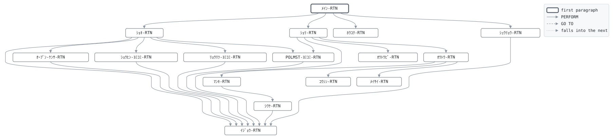

# GLD020

```text
GLD020: 契約応当日処理

日次。保障中 (有効・猶予中) の契約のうち、応当日 (契約日の
月日) が前回業務日付の翌日から業務日付までにあるものの経過
年数を1つ進める。週末の応当日は翌営業日に処理する。応当日が
満期日でもあれば、養老保険は満期保険金 (保険金額に配当累計
を加えた額) を支払って満期とし、定期保険は更新する: その
時点の保険年齢で保険料を引き直し、満期日を保険期間分
先に送る。保険年齢が商品の最高年齢を超えていれば更新せず
期間満了とする (支払なし)。終身・医療は経過年数のみ。
支払番号と仕訳番号は制御レコードから採番する。

復帰コード: 0 処理済、8 日付が日付でない、16 ファイル異常。

変更履歴
日付       担当 変更
1987-04-01 KT   GL-0001 初版。
1992-03-02 KT   GL-0117 定期保険の更新。
2001-07-02 MS   GL-0271 満期保険金に配当累計を加える。
2026-10-05 YN   GL-0815 前回業務日付からの応当日。
```

Program [GLD020.cbl](../../../gondwana/programs/GLD020.cbl): 7 files, 16 paragraphs. Its business rules: [13 decision tables](../rules/GLD020.md).

- AUTHOR: ゴンドワナ生命 システム部.
- DATE-WRITTEN: 1987-04-01.

## Contents

- [Files](#files)
- [Flow](#flow)
- [Paragraphs](#paragraphs)
- [Calls](#calls)
- [Data flow](#data-flow)
- [Lineage](#lineage)
  - [Into PM-ｹｲﾔｸ-ﾚｺｰﾄﾞ](#into-pm-ｹｲﾔｸ-ﾚｺｰﾄﾞ)
  - [Into PR-ｼｮｳﾋﾝ-ﾚｺｰﾄﾞ](#into-pr-ｼｮｳﾋﾝ-ﾚｺｰﾄﾞ)
  - [Into RT-ﾘｮｳﾘﾂ-ﾚｺｰﾄﾞ](#into-rt-ﾘｮｳﾘﾂ-ﾚｺｰﾄﾞ)
  - [Into CT-ｾｲｷﾞｮ-ﾚｺｰﾄﾞ](#into-ct-ｾｲｷﾞｮ-ﾚｺｰﾄﾞ)
  - [Into PY-ｼﾊﾗｲ-ﾚｺｰﾄﾞ](#into-py-ｼﾊﾗｲ-ﾚｺｰﾄﾞ)
  - [Into JR-ｼﾜｹ-ﾚｺｰﾄﾞ](#into-jr-ｼﾜｹ-ﾚｺｰﾄﾞ)
  - [Into ﾎｳｺｸ-ｷﾞｮｳ](#into-ﾎｳｺｸ-ｷﾞｮｳ)
  - [Into WS-ｺﾏﾝﾄﾞｷﾞｮｳ](#into-ws-ｺﾏﾝﾄﾞｷﾞｮｳ)
  - [Into WS-ｴﾗｰﾌｧｲﾙ](#into-ws-ｴﾗｰﾌｧｲﾙ)
  - [Into WS-ｴﾗｰｽﾃｰﾀｽ](#into-ws-ｴﾗｰｽﾃｰﾀｽ)
  - [Into WS-ｷﾞｮｳﾑﾋﾂﾞｹ](#into-ws-ｷﾞｮｳﾑﾋﾂﾞｹ)
  - [Into WS-ｷﾞｮｳﾑﾋﾂﾞｹ-ﾜﾚｷ](#into-ws-ｷﾞｮｳﾑﾋﾂﾞｹ-ﾜﾚｷ)
  - [Into WS-ﾎｳｺｳ](#into-ws-ﾎｳｺｳ)
  - [Into WS-ﾍﾝｶﾝｹｯｶ](#into-ws-ﾍﾝｶﾝｹｯｶ)
  - [Into WS-ｾｲﾈﾝｶﾞｯﾋﾟ](#into-ws-ｾｲﾈﾝｶﾞｯﾋﾟ)
  - [Into WS-ﾈﾝﾚｲ](#into-ws-ﾈﾝﾚｲ)
  - [Into WS-ｹﾞﾂｶﾞｸ](#into-ws-ｹﾞﾂｶﾞｸ)
  - [Into WS-ﾏﾝｷﾋﾞ](#into-ws-ﾏﾝｷﾋﾞ)
  - [Into WS-ﾏﾝｷﾋﾞ-ﾌﾞﾝｶｲ](#into-ws-ﾏﾝｷﾋﾞ-ﾌﾞﾝｶｲ)
  - [Into WS-ﾏﾝｷﾋﾞ-ﾜﾚｷ](#into-ws-ﾏﾝｷﾋﾞ-ﾜﾚｷ)
  - [Into WS-ｹｲﾔｸﾋﾞ](#into-ws-ｹｲﾔｸﾋﾞ)
  - [Into WS-ｵｳﾄｳﾋﾞ](#into-ws-ｵｳﾄｳﾋﾞ)
  - [Into WS-ｵｳﾄｳﾋﾞ-ﾌﾞﾝｶｲ](#into-ws-ｵｳﾄｳﾋﾞ-ﾌﾞﾝｶｲ)
  - [Into WS-ｵｳﾄｳﾋﾞ-ﾜﾚｷ](#into-ws-ｵｳﾄｳﾋﾞ-ﾜﾚｷ)
  - [Into WS-ｵｳﾄｳ-ﾊﾝﾃｲ](#into-ws-ｵｳﾄｳ-ﾊﾝﾃｲ)
  - [Into WS-ｼｮｳﾋﾝ-TBL](#into-ws-ｼｮｳﾋﾝ-tbl)
  - [Into WS-ﾘｮｳﾘﾂ-TBL](#into-ws-ﾘｮｳﾘﾂ-tbl)
  - [Into WS-ﾈﾝﾚｲ-ｿｴｼﾞ](#into-ws-ﾈﾝﾚｲ-ｿｴｼﾞ)
  - [Into WS-ｹﾝｽｳ](#into-ws-ｹﾝｽｳ)
  - [Into WS-ﾎｳｺｸ](#into-ws-ﾎｳｺｸ)
  - [Out of the program](#out-of-the-program)
  - [Into other data items](#into-other-data-items)
- [Field origins](#field-origins)
  - [File REPORT-F](#file-report-f)
  - [File POLMST-F](#file-polmst-f)
  - [File PAYOUT-F](#file-payout-f)
  - [File GLJRNL-F](#file-gljrnl-f)
  - [File GLSCTL-F](#file-glsctl-f)
- [Links between records](#links-between-records)
- [Records](#records)
  - [PM-ｹｲﾔｸ-ﾚｺｰﾄﾞ](#pm-ｹｲﾔｸ-ﾚｺｰﾄﾞ)
  - [PR-ｼｮｳﾋﾝ-ﾚｺｰﾄﾞ](#pr-ｼｮｳﾋﾝ-ﾚｺｰﾄﾞ)
  - [RT-ﾘｮｳﾘﾂ-ﾚｺｰﾄﾞ](#rt-ﾘｮｳﾘﾂ-ﾚｺｰﾄﾞ)
  - [CT-ｾｲｷﾞｮ-ﾚｺｰﾄﾞ](#ct-ｾｲｷﾞｮ-ﾚｺｰﾄﾞ)
  - [PY-ｼﾊﾗｲ-ﾚｺｰﾄﾞ](#py-ｼﾊﾗｲ-ﾚｺｰﾄﾞ)
  - [JR-ｼﾜｹ-ﾚｺｰﾄﾞ](#jr-ｼﾜｹ-ﾚｺｰﾄﾞ)
  - [ﾎｳｺｸ-ｷﾞｮｳ](#ﾎｳｺｸ-ｷﾞｮｳ)
  - [WS-ｽﾃｰﾀｽ](#ws-ｽﾃｰﾀｽ)
  - [WS-ｺﾏﾝﾄﾞｷﾞｮｳ](#ws-ｺﾏﾝﾄﾞｷﾞｮｳ)
  - [WS-ｴﾗｰﾌｧｲﾙ](#ws-ｴﾗｰﾌｧｲﾙ)
  - [WS-ｴﾗｰｽﾃｰﾀｽ](#ws-ｴﾗｰｽﾃｰﾀｽ)
  - [WS-ｷﾞｮｳﾑﾋﾂﾞｹ](#ws-ｷﾞｮｳﾑﾋﾂﾞｹ)
  - [WS-ｷﾞｮｳﾑﾋﾂﾞｹ-ﾌﾞﾝｶｲ](#ws-ｷﾞｮｳﾑﾋﾂﾞｹ-ﾌﾞﾝｶｲ)
  - [WS-ｷﾞｮｳﾑﾋﾂﾞｹ-ﾜﾚｷ](#ws-ｷﾞｮｳﾑﾋﾂﾞｹ-ﾜﾚｷ)
  - [WS-ﾎｳｺｳ](#ws-ﾎｳｺｳ)
  - [WS-ﾍﾝｶﾝｹｯｶ](#ws-ﾍﾝｶﾝｹｯｶ)
  - [WS-ｾｲﾈﾝｶﾞｯﾋﾟ](#ws-ｾｲﾈﾝｶﾞｯﾋﾟ)
  - [WS-ﾈﾝﾚｲ](#ws-ﾈﾝﾚｲ)
  - [WS-ｹﾞﾂｶﾞｸ](#ws-ｹﾞﾂｶﾞｸ)
  - [WS-ﾏﾝｷﾋﾞ](#ws-ﾏﾝｷﾋﾞ)
  - [WS-ﾏﾝｷﾋﾞ-ﾌﾞﾝｶｲ](#ws-ﾏﾝｷﾋﾞ-ﾌﾞﾝｶｲ)
  - [WS-ﾏﾝｷﾋﾞ-ﾜﾚｷ](#ws-ﾏﾝｷﾋﾞ-ﾜﾚｷ)
  - [WS-ｹｲﾔｸﾋﾞ](#ws-ｹｲﾔｸﾋﾞ)
  - [WS-ｹｲﾔｸﾋﾞ-ﾌﾞﾝｶｲ](#ws-ｹｲﾔｸﾋﾞ-ﾌﾞﾝｶｲ)
  - [WS-ｵｳﾄｳﾋﾞ](#ws-ｵｳﾄｳﾋﾞ)
  - [WS-ｵｳﾄｳﾋﾞ-ﾌﾞﾝｶｲ](#ws-ｵｳﾄｳﾋﾞ-ﾌﾞﾝｶｲ)
  - [WS-ｵｳﾄｳﾋﾞ-ﾜﾚｷ](#ws-ｵｳﾄｳﾋﾞ-ﾜﾚｷ)
  - [WS-ｵｳﾄｳ-ﾊﾝﾃｲ](#ws-ｵｳﾄｳ-ﾊﾝﾃｲ)
  - [WS-ｼｮｳﾋﾝ-TBL](#ws-ｼｮｳﾋﾝ-tbl)
  - [WS-ﾘｮｳﾘﾂ-TBL](#ws-ﾘｮｳﾘﾂ-tbl)
  - [WS-ﾈﾝﾚｲ-ｿｴｼﾞ](#ws-ﾈﾝﾚｲ-ｿｴｼﾞ)
  - [WS-ｹﾝｽｳ](#ws-ｹﾝｽｳ)
  - [WS-ﾎｳｺｸ](#ws-ﾎｳｺｸ)

## Files

| File | Kind | Assigned to | Organization | Status field | Opened | Records |
| --- | --- | --- | --- | --- | --- | --- |
| POLMST-F | FD | POLMST | INDEXED, key PM-ｼｮｳｹﾝﾊﾞﾝｺﾞｳ, DYNAMIC access | WS-POLMST-ST | I-O | PM-ｹｲﾔｸ-ﾚｺｰﾄﾞ |
| PRODTB-F | FD | PRODTB | LINE SEQUENTIAL | WS-PRODTB-ST | INPUT | PR-ｼｮｳﾋﾝ-ﾚｺｰﾄﾞ |
| RATETB-F | FD | RATETB | LINE SEQUENTIAL | WS-RATETB-ST | INPUT | RT-ﾘｮｳﾘﾂ-ﾚｺｰﾄﾞ |
| GLSCTL-F | FD | GLSCTL | SEQUENTIAL | WS-GLSCTL-ST | I-O | CT-ｾｲｷﾞｮ-ﾚｺｰﾄﾞ |
| PAYOUT-F | FD | PAYOUT | LINE SEQUENTIAL | WS-PAYOUT-ST | EXTEND | PY-ｼﾊﾗｲ-ﾚｺｰﾄﾞ |
| GLJRNL-F | FD | GLJRNL | LINE SEQUENTIAL | WS-GLJRNL-ST | EXTEND | JR-ｼﾜｹ-ﾚｺｰﾄﾞ |
| REPORT-F | FD | GLD020R | LINE SEQUENTIAL | WS-REPORT-ST | OUTPUT | ﾎｳｺｸ-ｷﾞｮｳ |

## Flow



## Paragraphs

| Paragraph | Description | Source | Performs | Goes to | Performed by | Reached by |
| --- | --- | --- | --- | --- | --- | --- |
| ﾒｲﾝ-RTN | ﾒｲﾝ-RTN: 準備、マスタ全件の走査、報告、終了。 | [GLD020.cbl:155](../../../gondwana/programs/GLD020.cbl#L155) | ｼｮｷ-RTN, ｼｮﾘ-RTN, ﾎｳｺｸ-RTN, ｼｭｳﾘｮｳ-RTN | | | |
| ｼｮｷ-RTN | ｼｮｷ-RTN: 業務日付、ファイル、テーブル、制御レコード。 | [GLD020.cbl:166](../../../gondwana/programs/GLD020.cbl#L166) | ｵｰﾌﾟﾝ-ｹﾝｻ-RTN, ｼｮｳﾋﾝ-ﾖﾐｺﾐ-RTN, ﾘｮｳﾘﾂ-ﾖﾐｺﾐ-RTN, ｲｼﾞｮｳ-RTN, POLMST-ﾖﾐｺﾐ-RTN | | ﾒｲﾝ-RTN | |
| ｵｰﾌﾟﾝ-ｹﾝｻ-RTN | ｵｰﾌﾟﾝ-ｹﾝｻ-RTN: 開けなかったファイルがあれば異常終了。 | [GLD020.cbl:200](../../../gondwana/programs/GLD020.cbl#L200) | ｲｼﾞｮｳ-RTN | | ｼｮｷ-RTN | |
| POLMST-ﾖﾐｺﾐ-RTN | POLMST-ﾖﾐｺﾐ-RTN: マスタの次の契約。 | [GLD020.cbl:233](../../../gondwana/programs/GLD020.cbl#L233) | ｲｼﾞｮｳ-RTN | | ｼｮｷ-RTN, ｼｮﾘ-RTN | |
| ｼｮﾘ-RTN | ｼｮﾘ-RTN: 保障中の契約の応当日を求め、処理すべきなら処理し、 書き戻す。 | [GLD020.cbl:245](../../../gondwana/programs/GLD020.cbl#L245) | ｵｳﾄｳﾋﾞ-RTN, ｵｳﾄｳ-RTN, ｲｼﾞｮｳ-RTN, POLMST-ﾖﾐｺﾐ-RTN | | ﾒｲﾝ-RTN | |
| ｵｳﾄｳﾋﾞ-RTN | ｵｳﾄｳﾋﾞ-RTN: 今回の応当日は、契約日の月日を業務年に置いた日、 業務日付より後なら前年の。契約日より後で、前回業務日付 (制御 レコード) より後か業務日付に等しければ処理する。開設日と 再実行では前回業務日付が業務日付に等しく、当日の分を処理する。 | [GLD020.cbl:266](../../../gondwana/programs/GLD020.cbl#L266) | | | ｼｮﾘ-RTN | |
| ｵｳﾄｳ-RTN | ｵｳﾄｳ-RTN: 経過年数を進め、応当日が満期日なら商品により満期 か更新。 | [GLD020.cbl:290](../../../gondwana/programs/GLD020.cbl#L290) | ﾏﾝｷ-RTN, ｺｳｼﾝ-RTN, ﾒｲｻｲ-RTN | | ｼｮﾘ-RTN | |
| ﾏﾝｷ-RTN | ﾏﾝｷ-RTN: 満期保険金に配当累計を加えて支払い、満期とする。 | [GLD020.cbl:306](../../../gondwana/programs/GLD020.cbl#L306) | ｼﾜｹ-RTN | | ｵｳﾄｳ-RTN | |
| ｺｳｼﾝ-RTN | ｺｳｼﾝ-RTN: 定期保険の更新。応当日時点の保険年齢が商品の最高 年齢以内なら保険料を引き直して応当日から期間を延ばし、超えて いれば期間満了。 | [GLD020.cbl:339](../../../gondwana/programs/GLD020.cbl#L339) | | | ｵｳﾄｳ-RTN | |
| ｼﾜｹ-RTN | ｼﾜｹ-RTN: 借方1行。科目、金額、摘要は呼ぶ側が入れる。 | [GLD020.cbl:377](../../../gondwana/programs/GLD020.cbl#L377) | ｲｼﾞｮｳ-RTN | | ﾏﾝｷ-RTN | |
| ﾒｲｻｲ-RTN | ﾒｲｻｲ-RTN: 1件の明細行。 | [GLD020.cbl:394](../../../gondwana/programs/GLD020.cbl#L394) | | | ｵｳﾄｳ-RTN | |
| ﾎｳｺｸ-RTN | ﾎｳｺｸ-RTN: 件数。 | [GLD020.cbl:404](../../../gondwana/programs/GLD020.cbl#L404) | | | ﾒｲﾝ-RTN | |
| ｼｭｳﾘｮｳ-RTN | ｼｭｳﾘｮｳ-RTN: 制御レコードを書き戻し、ファイルを閉じる。 | [GLD020.cbl:426](../../../gondwana/programs/GLD020.cbl#L426) | ｲｼﾞｮｳ-RTN | | ﾒｲﾝ-RTN | |
| ｲｼﾞｮｳ-RTN | ｲｼﾞｮｳ-RTN: ファイル異常は 16 で終わる。 | [GLD020.cbl:441](../../../gondwana/programs/GLD020.cbl#L441) | | | ｼｮｷ-RTN, ｵｰﾌﾟﾝ-ｹﾝｻ-RTN, POLMST-ﾖﾐｺﾐ-RTN, ｼｮﾘ-RTN, ｼﾜｹ-RTN, ｼｭｳﾘｮｳ-RTN, ｼｮｳﾋﾝ-ﾖﾐｺﾐ-RTN, ﾘｮｳﾘﾂ-ﾖﾐｺﾐ-RTN | |
| ｼｮｳﾋﾝ-ﾖﾐｺﾐ-RTN | ｼｮｳﾋﾝ-ﾖﾐｺﾐ-RTN: 商品テーブルを読み込む。 | [PRDLOD.cpy:16](../../../gondwana/copybooks/PRDLOD.cpy#L16) | ｲｼﾞｮｳ-RTN | | ｼｮｷ-RTN | |
| ﾘｮｳﾘﾂ-ﾖﾐｺﾐ-RTN | ﾘｮｳﾘﾂ-ﾖﾐｺﾐ-RTN: 料率を商品・性別・年齢のテーブルに読み込む。 商品テーブルにない商品の料率は読み飛ばす。 | [RATLOD.cpy:16](../../../gondwana/copybooks/RATLOD.cpy#L16) | ｲｼﾞｮｳ-RTN | | ｼｮｷ-RTN | |

## Calls

| Calls | Passing | Paragraph | Source |
| --- | --- | --- | --- |
| [GLC020](GLC020.md) | WS-ﾎｳｺｳ, WS-ｷﾞｮｳﾑﾋﾂﾞｹ, WS-ｷﾞｮｳﾑﾋﾂﾞｹ-ﾜﾚｷ, WS-ﾍﾝｶﾝｹｯｶ | ｼｮｷ-RTN | [GLD020.cbl:170](../../../gondwana/programs/GLD020.cbl#L170) |
| [GLC020](GLC020.md) | WS-ﾎｳｺｳ, WS-ｹｲﾔｸﾋﾞ, PM-ｹｲﾔｸﾋﾞ, WS-ﾍﾝｶﾝｹｯｶ | ｵｳﾄｳﾋﾞ-RTN | [GLD020.cbl:268](../../../gondwana/programs/GLD020.cbl#L268) |
| [GLC020](GLC020.md) | WS-ﾎｳｺｳ, WS-ｵｳﾄｳﾋﾞ, WS-ｵｳﾄｳﾋﾞ-ﾜﾚｷ, WS-ﾍﾝｶﾝｹｯｶ | ｵｳﾄｳﾋﾞ-RTN | [GLD020.cbl:280](../../../gondwana/programs/GLD020.cbl#L280) |
| [GLC020](GLC020.md) | WS-ﾎｳｺｳ, WS-ｾｲﾈﾝｶﾞｯﾋﾟ, PM-ｾｲﾈﾝｶﾞｯﾋﾟ, WS-ﾍﾝｶﾝｹｯｶ | ｺｳｼﾝ-RTN | [GLD020.cbl:341](../../../gondwana/programs/GLD020.cbl#L341) |
| [GLC010](GLC010.md) | WS-ｾｲﾈﾝｶﾞｯﾋﾟ, WS-ｵｳﾄｳﾋﾞ, WS-ﾈﾝﾚｲ | ｺｳｼﾝ-RTN | [GLD020.cbl:343](../../../gondwana/programs/GLD020.cbl#L343) |
| [GLC020](GLC020.md) | WS-ﾎｳｺｳ, WS-ﾏﾝｷﾋﾞ, WS-ﾏﾝｷﾋﾞ-ﾜﾚｷ, WS-ﾍﾝｶﾝｹｯｶ | ｺｳｼﾝ-RTN | [GLD020.cbl:367](../../../gondwana/programs/GLD020.cbl#L367) |

## Data flow

| Paragraph | Reads | Writes |
| --- | --- | --- |
| ﾒｲﾝ-RTN | WS-POLMST-ST | RETURN-CODE |
| ｼｮｷ-RTN | WS-ｺﾏﾝﾄﾞｷﾞｮｳ, WS-ﾎｳｺｳ, WS-ｷﾞｮｳﾑﾋﾂﾞｹ, WS-ｷﾞｮｳﾑﾋﾂﾞｹ-ﾜﾚｷ, WS-ﾍﾝｶﾝｹｯｶ, WS-GLSCTL-ST, WS-ﾋｮｳﾀﾞｲ-ｷﾞｮｳ | WS-ｺﾏﾝﾄﾞｷﾞｮｳ, WS-ｷﾞｮｳﾑﾋﾂﾞｹ, WS-ﾎｳｺｳ, WS-ｷﾞｮｳﾑﾋﾂﾞｹ-ﾜﾚｷ, WS-ﾍﾝｶﾝｹｯｶ, RETURN-CODE, WS-PRODTB-ST, WS-RATETB-ST, WS-POLMST-ST, WS-GLSCTL-ST, WS-PAYOUT-ST, WS-GLJRNL-ST, WS-REPORT-ST, PY-ｼﾊﾗｲ-ﾚｺｰﾄﾞ, JR-ｼﾜｹ-ﾚｺｰﾄﾞ, CT-ｾｲｷﾞｮ-ﾚｺｰﾄﾞ, WS-ｴﾗｰﾌｧｲﾙ, WS-ｴﾗｰｽﾃｰﾀｽ, WS-ﾋｮｳﾀﾞｲ-ﾋﾂﾞｹ, ﾎｳｺｸ-ｷﾞｮｳ |
| ｵｰﾌﾟﾝ-ｹﾝｻ-RTN | WS-PRODTB-ST, WS-RATETB-ST, WS-POLMST-ST, WS-GLSCTL-ST, WS-PAYOUT-ST, WS-GLJRNL-ST, WS-REPORT-ST, WS-ｴﾗｰﾌｧｲﾙ | WS-ｴﾗｰﾌｧｲﾙ, WS-ｴﾗｰｽﾃｰﾀｽ |
| POLMST-ﾖﾐｺﾐ-RTN | WS-POLMST-ST | PM-ｹｲﾔｸ-ﾚｺｰﾄﾞ, WS-POLMST-ST, WS-ｴﾗｰﾌｧｲﾙ, WS-ｴﾗｰｽﾃｰﾀｽ |
| ｼｮﾘ-RTN | PM-ｼﾞｮｳﾀｲ, WS-ｵｳﾄｳ-ﾊﾝﾃｲ, WS-POLMST-ST | PM-ｹｲﾔｸ-ﾚｺｰﾄﾞ, WS-POLMST-ST, WS-ｴﾗｰﾌｧｲﾙ, WS-ｴﾗｰｽﾃｰﾀｽ |
| ｵｳﾄｳﾋﾞ-RTN | WS-ﾎｳｺｳ, WS-ｹｲﾔｸﾋﾞ, PM-ｹｲﾔｸﾋﾞ, WS-ﾍﾝｶﾝｹｯｶ, WS-ｷﾞｮｳﾑ-YYYY, WS-ｹｲﾔｸ-MMDD, WS-ｵｳﾄｳﾋﾞ, WS-ｷﾞｮｳﾑﾋﾂﾞｹ, WS-ｵｳﾄｳ-YYYY, CT-ｷﾞｮｳﾑﾋﾂﾞｹ, WS-ｵｳﾄｳﾋﾞ-ﾜﾚｷ | WS-ﾎｳｺｳ, WS-ｹｲﾔｸﾋﾞ, PM-ｹｲﾔｸﾋﾞ, WS-ﾍﾝｶﾝｹｯｶ, WS-ｵｳﾄｳ-YYYY, WS-ｵｳﾄｳ-MMDD, WS-ｵｳﾄｳ-ﾊﾝﾃｲ, WS-ｵｳﾄｳﾋﾞ, WS-ｵｳﾄｳﾋﾞ-ﾜﾚｷ |
| ｵｳﾄｳ-RTN | WS-ｵｳﾄｳｹﾝｽｳ, PM-ｹｲｶﾈﾝｽｳ, PM-ｼｮｳﾋﾝ, PM-ﾏﾝｷﾋﾞ, WS-ｵｳﾄｳﾋﾞ-ﾜﾚｷ | WS-ｵｳﾄｳｹﾝｽｳ, PM-ｹｲｶﾈﾝｽｳ, WS-ﾒｲｻｲ-ｷﾝｶﾞｸ, WS-ﾒｲｻｲ-ｹｯｶ |
| ﾏﾝｷ-RTN | WS-ﾏﾝｷｹﾝｽｳ, CT-ｼﾞｶｲｼﾊﾗｲﾊﾞﾝｺﾞｳ, WS-ｷﾞｮｳﾑﾋﾂﾞｹ-ﾜﾚｷ, PM-ｼｮｳｹﾝﾊﾞﾝｺﾞｳ, PM-ﾎｹﾝｷﾝｶﾞｸ, PM-ﾊｲﾄｳﾙｲｹｲ, PM-ｺｳｻﾞﾒｲｷﾞ, PY-ｷﾝｶﾞｸ, WS-ﾏﾝｷｷﾝｶﾞｸ | WS-ﾏﾝｷｹﾝｽｳ, PY-ｼﾊﾗｲﾊﾞﾝｺﾞｳ, CT-ｼﾞｶｲｼﾊﾗｲﾊﾞﾝｺﾞｳ, PY-ｼﾊﾗｲﾋﾞ, PY-ｼｮｳｹﾝﾊﾞﾝｺﾞｳ, PY-ｼｭﾍﾞﾂ, PY-ｷﾝｶﾞｸ, PY-ｳｹﾄﾘﾆﾝｶﾅ, PY-ｾｲｷｭｳﾊﾞﾝｺﾞｳ, PY-ｼﾊﾗｲ-ﾚｺｰﾄﾞ, WS-PAYOUT-ST, JR-ｶﾝｼﾞｮｳｶﾓｸ, JR-ｷﾝｶﾞｸ, JR-ﾃｷﾖｳ, WS-ﾏﾝｷｷﾝｶﾞｸ, WS-ﾒｲｻｲ-ｷﾝｶﾞｸ, PM-ﾊｲﾄｳﾙｲｹｲ, PM-ｼﾞｮｳﾀｲ, PM-ｼﾞｮｳﾀｲﾋﾂﾞｹ, WS-ﾒｲｻｲ-ｹｯｶ |
| ｺｳｼﾝ-RTN | WS-ﾎｳｺｳ, WS-ｾｲﾈﾝｶﾞｯﾋﾟ, PM-ｾｲﾈﾝｶﾞｯﾋﾟ, WS-ﾍﾝｶﾝｹｯｶ, WS-ｵｳﾄｳﾋﾞ, WS-ﾈﾝﾚｲ, WS-ｼｮｳﾋﾝ, WS-ｼｮｳﾋﾝ-ｺｰﾄﾞ, WS-ｼｮｳﾋﾝ-IX, PM-ｼｮｳﾋﾝ, WS-ｼｮｳﾋﾝ-ｻｲｺｳﾈﾝﾚｲ, WS-ﾏﾝﾘｮｳｹﾝｽｳ, WS-ｷﾞｮｳﾑﾋﾂﾞｹ-ﾜﾚｷ, WS-ｺｳｼﾝｹﾝｽｳ, PM-ﾎｹﾝｷﾝｶﾞｸ, WS-ﾘｮｳﾘﾂ, PM-ｾｲﾍﾞﾂ, WS-ﾈﾝﾚｲ-ｿｴｼﾞ, PM-ﾊﾗｲｺﾐﾎｳﾎｳ, WS-ｹﾞﾂｶﾞｸ, PM-ﾎｹﾝｷｶﾝ, WS-ﾏﾝｷ-YYYY, WS-ﾏﾝｷﾋﾞ, WS-ﾏﾝｷﾋﾞ-ﾜﾚｷ, PM-ﾎｹﾝﾘｮｳ | WS-ﾎｳｺｳ, WS-ｾｲﾈﾝｶﾞｯﾋﾟ, PM-ｾｲﾈﾝｶﾞｯﾋﾟ, WS-ﾍﾝｶﾝｹｯｶ, WS-ｵｳﾄｳﾋﾞ, WS-ﾈﾝﾚｲ, WS-ｼｮｳﾋﾝ-IX, WS-ﾏﾝﾘｮｳｹﾝｽｳ, PM-ｼﾞｮｳﾀｲ, PM-ｼﾞｮｳﾀｲﾋﾂﾞｹ, WS-ﾒｲｻｲ-ｹｯｶ, WS-ｺｳｼﾝｹﾝｽｳ, WS-ﾈﾝﾚｲ-ｿｴｼﾞ, WS-ｹﾞﾂｶﾞｸ, PM-ﾎｹﾝﾘｮｳ, WS-ﾏﾝｷﾋﾞ, WS-ﾏﾝｷ-YYYY, WS-ﾏﾝｷﾋﾞ-ﾜﾚｷ, PM-ﾏﾝｷﾋﾞ, WS-ﾒｲｻｲ-ｷﾝｶﾞｸ |
| ｼﾜｹ-RTN | CT-ｼﾞｶｲｼﾜｹﾊﾞﾝｺﾞｳ, WS-ｷﾞｮｳﾑﾋﾂﾞｹ-ﾜﾚｷ, PM-ｼｮｳｹﾝﾊﾞﾝｺﾞｳ, WS-GLJRNL-ST | JR-ｼﾜｹﾊﾞﾝｺﾞｳ, CT-ｼﾞｶｲｼﾜｹﾊﾞﾝｺﾞｳ, JR-ﾋﾂﾞｹ, JR-ﾌﾟﾛｸﾞﾗﾑ, JR-ﾀｲｼｬｸ, JR-ｼｮｳｹﾝﾊﾞﾝｺﾞｳ, JR-ｼﾜｹ-ﾚｺｰﾄﾞ, WS-GLJRNL-ST, WS-ｴﾗｰﾌｧｲﾙ, WS-ｴﾗｰｽﾃｰﾀｽ |
| ﾒｲｻｲ-RTN | PM-ｼｮｳｹﾝﾊﾞﾝｺﾞｳ, PM-ｼｮｳﾋﾝ, PM-ｼﾒｲ, PM-ｹｲｶﾈﾝｽｳ, WS-ﾒｲｻｲ-ｷﾞｮｳ | WS-ﾒｲｻｲ-ｼｮｳｹﾝ, WS-ﾒｲｻｲ-ｼｮｳﾋﾝ, WS-ﾒｲｻｲ-ｼﾒｲ, WS-ﾒｲｻｲ-ﾈﾝｽｳ, ﾎｳｺｸ-ｷﾞｮｳ, WS-REPORT-ST |
| ﾎｳｺｸ-RTN | WS-ｵｳﾄｳｹﾝｽｳ, WS-ｹﾝｽｳ-ｷﾞｮｳ, WS-ｺｳｼﾝｹﾝｽｳ, WS-ﾏﾝﾘｮｳｹﾝｽｳ, WS-ﾏﾝｷｹﾝｽｳ, WS-ﾏﾝｷｷﾝｶﾞｸ | ﾎｳｺｸ-ｷﾞｮｳ, WS-REPORT-ST, WS-ｹﾝｽｳ-ﾗﾍﾞﾙ, WS-ｹﾝｽｳ-ｱﾀｲ |
| ｼｭｳﾘｮｳ-RTN | WS-GLSCTL-ST, WS-ｵｳﾄｳｹﾝｽｳ, WS-ｺｳｼﾝｹﾝｽｳ, WS-ﾏﾝｷｹﾝｽｳ | CT-ｾｲｷﾞｮ-ﾚｺｰﾄﾞ, WS-GLSCTL-ST, WS-ｴﾗｰﾌｧｲﾙ, WS-ｴﾗｰｽﾃｰﾀｽ, WS-POLMST-ST, WS-PRODTB-ST, WS-RATETB-ST, WS-PAYOUT-ST, WS-GLJRNL-ST, WS-REPORT-ST |
| ｲｼﾞｮｳ-RTN | WS-ｴﾗｰﾌｧｲﾙ, WS-ｴﾗｰｽﾃｰﾀｽ | RETURN-CODE |
| ｼｮｳﾋﾝ-ﾖﾐｺﾐ-RTN | WS-PRODTB-ST, WS-ｼｮｳﾋﾝｹﾝｽｳ, PR-ｺｰﾄﾞ, WS-ｼｮｳﾋﾝ-IX, PR-ﾒｲｼｮｳ, PR-ｼｭﾙｲ, PR-ｻｲﾃｲﾈﾝﾚｲ, PR-ｻｲｺｳﾈﾝﾚｲ, PR-ﾎｹﾝｷｶﾝ, PR-ｻｲﾃｲﾎｹﾝｷﾝｶﾞｸ, PR-ｻｲｺｳﾎｹﾝｷﾝｶﾞｸ, PR-ﾆｭｳｲﾝﾆﾁｶﾞｸﾘﾂ, PR-ﾒﾝｾｷﾆｯｽｳ, PR-ﾊｲﾄｳﾘﾂ | PR-ｼｮｳﾋﾝ-ﾚｺｰﾄﾞ, WS-PRODTB-ST, WS-ｼｮｳﾋﾝｹﾝｽｳ, WS-ｼｮｳﾋﾝ-IX, WS-ｼｮｳﾋﾝ-ｺｰﾄﾞ, WS-ｼｮｳﾋﾝ-ﾒｲｼｮｳ, WS-ｼｮｳﾋﾝ-ｼｭﾙｲ, WS-ｼｮｳﾋﾝ-ｻｲﾃｲﾈﾝﾚｲ, WS-ｼｮｳﾋﾝ-ｻｲｺｳﾈﾝﾚｲ, WS-ｼｮｳﾋﾝ-ﾎｹﾝｷｶﾝ, WS-ｼｮｳﾋﾝ-ｻｲﾃｲｷﾝｶﾞｸ, WS-ｼｮｳﾋﾝ-ｻｲｺｳｷﾝｶﾞｸ, WS-ｼｮｳﾋﾝ-ﾆｭｳｲﾝﾆﾁｶﾞｸﾘﾂ, WS-ｼｮｳﾋﾝ-ﾒﾝｾｷﾆｯｽｳ, WS-ｼｮｳﾋﾝ-ﾊｲﾄｳﾘﾂ, WS-ｴﾗｰﾌｧｲﾙ, WS-ｴﾗｰｽﾃｰﾀｽ |
| ﾘｮｳﾘﾂ-ﾖﾐｺﾐ-RTN | WS-RATETB-ST, WS-ｼｮｳﾋﾝ, WS-ｼｮｳﾋﾝ-ｺｰﾄﾞ, WS-ｼｮｳﾋﾝ-IX, RT-ｼｮｳﾋﾝ, RT-ﾈﾝﾚｲ, RT-ﾘｮｳﾘﾂ, RT-ｾｲﾍﾞﾂ, WS-ﾈﾝﾚｲ-ｿｴｼﾞ | WS-ﾘｮｳﾘﾂ-TBL, RT-ﾘｮｳﾘﾂ-ﾚｺｰﾄﾞ, WS-RATETB-ST, WS-ｼｮｳﾋﾝ-IX, WS-ﾈﾝﾚｲ-ｿｴｼﾞ, WS-ﾘｮｳﾘﾂ, WS-ｴﾗｰﾌｧｲﾙ, WS-ｴﾗｰｽﾃｰﾀｽ |

## Lineage

Where each data item's values come from, grouped by the record they go into. A data item links to the record it belongs to.

### Into PM-ｹｲﾔｸ-ﾚｺｰﾄﾞ

Record [PM-ｹｲﾔｸ-ﾚｺｰﾄﾞ](#pm-ｹｲﾔｸ-ﾚｺｰﾄﾞ), from copybook [POLMST](../copybooks/POLMST.md).

| Into | From | Statement | Paragraph | Source |
| --- | --- | --- | --- | --- |
| PM-ｹｲｶﾈﾝｽｳ | literal 1 | ADD | ｵｳﾄｳ-RTN | [GLD020.cbl:292](../../../gondwana/programs/GLD020.cbl#L292) |
| PM-ｹｲﾔｸ-ﾚｺｰﾄﾞ | file POLMST-F | READ | POLMST-ﾖﾐｺﾐ-RTN | [GLD020.cbl:234](../../../gondwana/programs/GLD020.cbl#L234) |
| PM-ｹｲﾔｸﾋﾞ | call GLC020 argument 3 | CALL | ｵｳﾄｳﾋﾞ-RTN | [GLD020.cbl:268](../../../gondwana/programs/GLD020.cbl#L268) |
| PM-ｼﾞｮｳﾀｲ | literal condition PM-ﾏﾝｷ | SET | ﾏﾝｷ-RTN | [GLD020.cbl:330](../../../gondwana/programs/GLD020.cbl#L330) |
| PM-ｼﾞｮｳﾀｲ | literal condition PM-ﾏﾝｷ | SET | ｺｳｼﾝ-RTN | [GLD020.cbl:351](../../../gondwana/programs/GLD020.cbl#L351) |
| PM-ｼﾞｮｳﾀｲﾋﾂﾞｹ | [WS-ｷﾞｮｳﾑﾋﾂﾞｹ-ﾜﾚｷ](#ws-ｷﾞｮｳﾑﾋﾂﾞｹ-ﾜﾚｷ) | MOVE | ﾏﾝｷ-RTN | [GLD020.cbl:331](../../../gondwana/programs/GLD020.cbl#L331) |
| PM-ｼﾞｮｳﾀｲﾋﾂﾞｹ | [WS-ｷﾞｮｳﾑﾋﾂﾞｹ-ﾜﾚｷ](#ws-ｷﾞｮｳﾑﾋﾂﾞｹ-ﾜﾚｷ) | MOVE | ｺｳｼﾝ-RTN | [GLD020.cbl:352](../../../gondwana/programs/GLD020.cbl#L352) |
| PM-ｾｲﾈﾝｶﾞｯﾋﾟ | call GLC020 argument 3 | CALL | ｺｳｼﾝ-RTN | [GLD020.cbl:341](../../../gondwana/programs/GLD020.cbl#L341) |
| PM-ﾊｲﾄｳﾙｲｹｲ | literal 0 | MOVE | ﾏﾝｷ-RTN | [GLD020.cbl:329](../../../gondwana/programs/GLD020.cbl#L329) |
| PM-ﾎｹﾝﾘｮｳ | [WS-ｹﾞﾂｶﾞｸ](#ws-ｹﾞﾂｶﾞｸ) | COMPUTE | ｺｳｼﾝ-RTN | [GLD020.cbl:360](../../../gondwana/programs/GLD020.cbl#L360) |
| PM-ﾎｹﾝﾘｮｳ | [WS-ｹﾞﾂｶﾞｸ](#ws-ｹﾞﾂｶﾞｸ) | MOVE | ｺｳｼﾝ-RTN | [GLD020.cbl:362](../../../gondwana/programs/GLD020.cbl#L362) |
| PM-ﾏﾝｷﾋﾞ | [WS-ﾏﾝｷﾋﾞ-ﾜﾚｷ](#ws-ﾏﾝｷﾋﾞ-ﾜﾚｷ) | MOVE | ｺｳｼﾝ-RTN | [GLD020.cbl:369](../../../gondwana/programs/GLD020.cbl#L369) |

### Into PR-ｼｮｳﾋﾝ-ﾚｺｰﾄﾞ

Record [PR-ｼｮｳﾋﾝ-ﾚｺｰﾄﾞ](#pr-ｼｮｳﾋﾝ-ﾚｺｰﾄﾞ), from copybook [PRODTB](../copybooks/PRODTB.md).

| Into | From | Statement | Paragraph | Source |
| --- | --- | --- | --- | --- |
| PR-ｼｮｳﾋﾝ-ﾚｺｰﾄﾞ | file PRODTB-F | READ | ｼｮｳﾋﾝ-ﾖﾐｺﾐ-RTN | [PRDLOD.cpy:17](../../../gondwana/copybooks/PRDLOD.cpy#L17) |
| PR-ｼｮｳﾋﾝ-ﾚｺｰﾄﾞ | file PRODTB-F | READ | ｼｮｳﾋﾝ-ﾖﾐｺﾐ-RTN | [PRDLOD.cpy:35](../../../gondwana/copybooks/PRDLOD.cpy#L35) |

### Into RT-ﾘｮｳﾘﾂ-ﾚｺｰﾄﾞ

Record [RT-ﾘｮｳﾘﾂ-ﾚｺｰﾄﾞ](#rt-ﾘｮｳﾘﾂ-ﾚｺｰﾄﾞ), from copybook [RATETB](../copybooks/RATETB.md).

| Into | From | Statement | Paragraph | Source |
| --- | --- | --- | --- | --- |
| RT-ﾘｮｳﾘﾂ-ﾚｺｰﾄﾞ | file RATETB-F | READ | ﾘｮｳﾘﾂ-ﾖﾐｺﾐ-RTN | [RATLOD.cpy:18](../../../gondwana/copybooks/RATLOD.cpy#L18) |
| RT-ﾘｮｳﾘﾂ-ﾚｺｰﾄﾞ | file RATETB-F | READ | ﾘｮｳﾘﾂ-ﾖﾐｺﾐ-RTN | [RATLOD.cpy:28](../../../gondwana/copybooks/RATLOD.cpy#L28) |

### Into CT-ｾｲｷﾞｮ-ﾚｺｰﾄﾞ

Record [CT-ｾｲｷﾞｮ-ﾚｺｰﾄﾞ](#ct-ｾｲｷﾞｮ-ﾚｺｰﾄﾞ), from copybook [CTLREC](../copybooks/CTLREC.md).

| Into | From | Statement | Paragraph | Source |
| --- | --- | --- | --- | --- |
| CT-ｼﾞｶｲｼﾊﾗｲﾊﾞﾝｺﾞｳ | literal 1 | ADD | ﾏﾝｷ-RTN | [GLD020.cbl:309](../../../gondwana/programs/GLD020.cbl#L309) |
| CT-ｼﾞｶｲｼﾜｹﾊﾞﾝｺﾞｳ | literal 1 | ADD | ｼﾜｹ-RTN | [GLD020.cbl:379](../../../gondwana/programs/GLD020.cbl#L379) |
| CT-ｾｲｷﾞｮ-ﾚｺｰﾄﾞ | file GLSCTL-F | READ | ｼｮｷ-RTN | [GLD020.cbl:185](../../../gondwana/programs/GLD020.cbl#L185) |

### Into PY-ｼﾊﾗｲ-ﾚｺｰﾄﾞ

Record [PY-ｼﾊﾗｲ-ﾚｺｰﾄﾞ](#py-ｼﾊﾗｲ-ﾚｺｰﾄﾞ), from copybook [PAYOUT](../copybooks/PAYOUT.md).

| Into | From | Statement | Paragraph | Source |
| --- | --- | --- | --- | --- |
| PY-ｳｹﾄﾘﾆﾝｶﾅ | [PM-ｺｳｻﾞﾒｲｷﾞ](#pm-ｹｲﾔｸ-ﾚｺｰﾄﾞ "in PM-ｹｲﾔｸ-ﾚｺｰﾄﾞ") | MOVE | ﾏﾝｷ-RTN | [GLD020.cbl:314](../../../gondwana/programs/GLD020.cbl#L314) |
| PY-ｷﾝｶﾞｸ | [PM-ﾎｹﾝｷﾝｶﾞｸ](#pm-ｹｲﾔｸ-ﾚｺｰﾄﾞ "in PM-ｹｲﾔｸ-ﾚｺｰﾄﾞ") | COMPUTE | ﾏﾝｷ-RTN | [GLD020.cbl:313](../../../gondwana/programs/GLD020.cbl#L313) |
| PY-ｷﾝｶﾞｸ | [PM-ﾊｲﾄｳﾙｲｹｲ](#pm-ｹｲﾔｸ-ﾚｺｰﾄﾞ "in PM-ｹｲﾔｸ-ﾚｺｰﾄﾞ") | COMPUTE | ﾏﾝｷ-RTN | [GLD020.cbl:313](../../../gondwana/programs/GLD020.cbl#L313) |
| PY-ｼｭﾍﾞﾂ | literal condition PY-ﾏﾝｷ | SET | ﾏﾝｷ-RTN | [GLD020.cbl:312](../../../gondwana/programs/GLD020.cbl#L312) |
| PY-ｼｮｳｹﾝﾊﾞﾝｺﾞｳ | [PM-ｼｮｳｹﾝﾊﾞﾝｺﾞｳ](#pm-ｹｲﾔｸ-ﾚｺｰﾄﾞ "in PM-ｹｲﾔｸ-ﾚｺｰﾄﾞ") | MOVE | ﾏﾝｷ-RTN | [GLD020.cbl:311](../../../gondwana/programs/GLD020.cbl#L311) |
| PY-ｼﾊﾗｲ-ﾚｺｰﾄﾞ | literal SPACES | MOVE | ｼｮｷ-RTN | [GLD020.cbl:182](../../../gondwana/programs/GLD020.cbl#L182) |
| PY-ｼﾊﾗｲﾊﾞﾝｺﾞｳ | [CT-ｼﾞｶｲｼﾊﾗｲﾊﾞﾝｺﾞｳ](#ct-ｾｲｷﾞｮ-ﾚｺｰﾄﾞ "in CT-ｾｲｷﾞｮ-ﾚｺｰﾄﾞ") | MOVE | ﾏﾝｷ-RTN | [GLD020.cbl:308](../../../gondwana/programs/GLD020.cbl#L308) |
| PY-ｼﾊﾗｲﾋﾞ | [WS-ｷﾞｮｳﾑﾋﾂﾞｹ-ﾜﾚｷ](#ws-ｷﾞｮｳﾑﾋﾂﾞｹ-ﾜﾚｷ) | MOVE | ﾏﾝｷ-RTN | [GLD020.cbl:310](../../../gondwana/programs/GLD020.cbl#L310) |
| PY-ｾｲｷｭｳﾊﾞﾝｺﾞｳ | literal SPACES | MOVE | ﾏﾝｷ-RTN | [GLD020.cbl:315](../../../gondwana/programs/GLD020.cbl#L315) |

### Into JR-ｼﾜｹ-ﾚｺｰﾄﾞ

Record [JR-ｼﾜｹ-ﾚｺｰﾄﾞ](#jr-ｼﾜｹ-ﾚｺｰﾄﾞ), from copybook [GLJRNL](../copybooks/GLJRNL.md).

| Into | From | Statement | Paragraph | Source |
| --- | --- | --- | --- | --- |
| JR-ｶﾝｼﾞｮｳｶﾓｸ | literal 5140 | MOVE | ﾏﾝｷ-RTN | [GLD020.cbl:317](../../../gondwana/programs/GLD020.cbl#L317) |
| JR-ｶﾝｼﾞｮｳｶﾓｸ | literal 2310 | MOVE | ﾏﾝｷ-RTN | [GLD020.cbl:322](../../../gondwana/programs/GLD020.cbl#L322) |
| JR-ｷﾝｶﾞｸ | [PM-ﾎｹﾝｷﾝｶﾞｸ](#pm-ｹｲﾔｸ-ﾚｺｰﾄﾞ "in PM-ｹｲﾔｸ-ﾚｺｰﾄﾞ") | MOVE | ﾏﾝｷ-RTN | [GLD020.cbl:318](../../../gondwana/programs/GLD020.cbl#L318) |
| JR-ｷﾝｶﾞｸ | [PM-ﾊｲﾄｳﾙｲｹｲ](#pm-ｹｲﾔｸ-ﾚｺｰﾄﾞ "in PM-ｹｲﾔｸ-ﾚｺｰﾄﾞ") | MOVE | ﾏﾝｷ-RTN | [GLD020.cbl:323](../../../gondwana/programs/GLD020.cbl#L323) |
| JR-ｼｮｳｹﾝﾊﾞﾝｺﾞｳ | [PM-ｼｮｳｹﾝﾊﾞﾝｺﾞｳ](#pm-ｹｲﾔｸ-ﾚｺｰﾄﾞ "in PM-ｹｲﾔｸ-ﾚｺｰﾄﾞ") | MOVE | ｼﾜｹ-RTN | [GLD020.cbl:383](../../../gondwana/programs/GLD020.cbl#L383) |
| JR-ｼﾜｹ-ﾚｺｰﾄﾞ | literal SPACES | MOVE | ｼｮｷ-RTN | [GLD020.cbl:182](../../../gondwana/programs/GLD020.cbl#L182) |
| JR-ｼﾜｹﾊﾞﾝｺﾞｳ | [CT-ｼﾞｶｲｼﾜｹﾊﾞﾝｺﾞｳ](#ct-ｾｲｷﾞｮ-ﾚｺｰﾄﾞ "in CT-ｾｲｷﾞｮ-ﾚｺｰﾄﾞ") | MOVE | ｼﾜｹ-RTN | [GLD020.cbl:378](../../../gondwana/programs/GLD020.cbl#L378) |
| JR-ﾀｲｼｬｸ | literal condition JR-ｶﾘｶﾀ | SET | ｼﾜｹ-RTN | [GLD020.cbl:382](../../../gondwana/programs/GLD020.cbl#L382) |
| JR-ﾃｷﾖｳ | literal '満期保険金' | MOVE | ﾏﾝｷ-RTN | [GLD020.cbl:319](../../../gondwana/programs/GLD020.cbl#L319) |
| JR-ﾃｷﾖｳ | literal '配当金支払' | MOVE | ﾏﾝｷ-RTN | [GLD020.cbl:324](../../../gondwana/programs/GLD020.cbl#L324) |
| JR-ﾋﾂﾞｹ | [WS-ｷﾞｮｳﾑﾋﾂﾞｹ-ﾜﾚｷ](#ws-ｷﾞｮｳﾑﾋﾂﾞｹ-ﾜﾚｷ) | MOVE | ｼﾜｹ-RTN | [GLD020.cbl:380](../../../gondwana/programs/GLD020.cbl#L380) |
| JR-ﾌﾟﾛｸﾞﾗﾑ | literal 'GLD020' | MOVE | ｼﾜｹ-RTN | [GLD020.cbl:381](../../../gondwana/programs/GLD020.cbl#L381) |

### Into ﾎｳｺｸ-ｷﾞｮｳ

Record [ﾎｳｺｸ-ｷﾞｮｳ](#ﾎｳｺｸ-ｷﾞｮｳ).

| Into | From | Statement | Paragraph | Source |
| --- | --- | --- | --- | --- |
| ﾎｳｺｸ-ｷﾞｮｳ | [WS-ﾋｮｳﾀﾞｲ-ｷﾞｮｳ](#ws-ﾎｳｺｸ "in WS-ﾎｳｺｸ") | WRITE | ｼｮｷ-RTN | [GLD020.cbl:192](../../../gondwana/programs/GLD020.cbl#L192) |
| ﾎｳｺｸ-ｷﾞｮｳ | literal SPACES | MOVE | ｼｮｷ-RTN | [GLD020.cbl:193](../../../gondwana/programs/GLD020.cbl#L193) |
| ﾎｳｺｸ-ｷﾞｮｳ | [WS-ﾒｲｻｲ-ｷﾞｮｳ](#ws-ﾎｳｺｸ "in WS-ﾎｳｺｸ") | WRITE | ﾒｲｻｲ-RTN | [GLD020.cbl:399](../../../gondwana/programs/GLD020.cbl#L399) |
| ﾎｳｺｸ-ｷﾞｮｳ | literal SPACES | MOVE | ﾎｳｺｸ-RTN | [GLD020.cbl:405](../../../gondwana/programs/GLD020.cbl#L405) |
| ﾎｳｺｸ-ｷﾞｮｳ | [WS-ｹﾝｽｳ-ｷﾞｮｳ](#ws-ﾎｳｺｸ "in WS-ﾎｳｺｸ") | WRITE | ﾎｳｺｸ-RTN | [GLD020.cbl:409](../../../gondwana/programs/GLD020.cbl#L409) |
| ﾎｳｺｸ-ｷﾞｮｳ | [WS-ｹﾝｽｳ-ｷﾞｮｳ](#ws-ﾎｳｺｸ "in WS-ﾎｳｺｸ") | WRITE | ﾎｳｺｸ-RTN | [GLD020.cbl:412](../../../gondwana/programs/GLD020.cbl#L412) |
| ﾎｳｺｸ-ｷﾞｮｳ | [WS-ｹﾝｽｳ-ｷﾞｮｳ](#ws-ﾎｳｺｸ "in WS-ﾎｳｺｸ") | WRITE | ﾎｳｺｸ-RTN | [GLD020.cbl:415](../../../gondwana/programs/GLD020.cbl#L415) |
| ﾎｳｺｸ-ｷﾞｮｳ | [WS-ｹﾝｽｳ-ｷﾞｮｳ](#ws-ﾎｳｺｸ "in WS-ﾎｳｺｸ") | WRITE | ﾎｳｺｸ-RTN | [GLD020.cbl:418](../../../gondwana/programs/GLD020.cbl#L418) |
| ﾎｳｺｸ-ｷﾞｮｳ | [WS-ｹﾝｽｳ-ｷﾞｮｳ](#ws-ﾎｳｺｸ "in WS-ﾎｳｺｸ") | WRITE | ﾎｳｺｸ-RTN | [GLD020.cbl:421](../../../gondwana/programs/GLD020.cbl#L421) |

### Into WS-ｺﾏﾝﾄﾞｷﾞｮｳ

Record [WS-ｺﾏﾝﾄﾞｷﾞｮｳ](#ws-ｺﾏﾝﾄﾞｷﾞｮｳ).

| Into | From | Statement | Paragraph | Source |
| --- | --- | --- | --- | --- |
| WS-ｺﾏﾝﾄﾞｷﾞｮｳ | COMMAND-LINE | ACCEPT | ｼｮｷ-RTN | [GLD020.cbl:167](../../../gondwana/programs/GLD020.cbl#L167) |

### Into WS-ｴﾗｰﾌｧｲﾙ

Record [WS-ｴﾗｰﾌｧｲﾙ](#ws-ｴﾗｰﾌｧｲﾙ).

| Into | From | Statement | Paragraph | Source |
| --- | --- | --- | --- | --- |
| WS-ｴﾗｰﾌｧｲﾙ | literal 'GLSCTL' | MOVE | ｼｮｷ-RTN | [GLD020.cbl:187](../../../gondwana/programs/GLD020.cbl#L187) |
| WS-ｴﾗｰﾌｧｲﾙ | literal 'PRODTB' | MOVE | ｵｰﾌﾟﾝ-ｹﾝｻ-RTN | [GLD020.cbl:203](../../../gondwana/programs/GLD020.cbl#L203) |
| WS-ｴﾗｰﾌｧｲﾙ | literal 'RATETB' | MOVE | ｵｰﾌﾟﾝ-ｹﾝｻ-RTN | [GLD020.cbl:206](../../../gondwana/programs/GLD020.cbl#L206) |
| WS-ｴﾗｰﾌｧｲﾙ | literal 'POLMST' | MOVE | ｵｰﾌﾟﾝ-ｹﾝｻ-RTN | [GLD020.cbl:209](../../../gondwana/programs/GLD020.cbl#L209) |
| WS-ｴﾗｰﾌｧｲﾙ | literal 'GLSCTL' | MOVE | ｵｰﾌﾟﾝ-ｹﾝｻ-RTN | [GLD020.cbl:212](../../../gondwana/programs/GLD020.cbl#L212) |
| WS-ｴﾗｰﾌｧｲﾙ | literal 'PAYOUT' | MOVE | ｵｰﾌﾟﾝ-ｹﾝｻ-RTN | [GLD020.cbl:215](../../../gondwana/programs/GLD020.cbl#L215) |
| WS-ｴﾗｰﾌｧｲﾙ | literal 'GLJRNL' | MOVE | ｵｰﾌﾟﾝ-ｹﾝｻ-RTN | [GLD020.cbl:218](../../../gondwana/programs/GLD020.cbl#L218) |
| WS-ｴﾗｰﾌｧｲﾙ | literal 'GLD020R' | MOVE | ｵｰﾌﾟﾝ-ｹﾝｻ-RTN | [GLD020.cbl:221](../../../gondwana/programs/GLD020.cbl#L221) |
| WS-ｴﾗｰﾌｧｲﾙ | literal SPACES | MOVE | ｵｰﾌﾟﾝ-ｹﾝｻ-RTN | [GLD020.cbl:224](../../../gondwana/programs/GLD020.cbl#L224) |
| WS-ｴﾗｰﾌｧｲﾙ | literal 'POLMST' | MOVE | POLMST-ﾖﾐｺﾐ-RTN | [GLD020.cbl:236](../../../gondwana/programs/GLD020.cbl#L236) |
| WS-ｴﾗｰﾌｧｲﾙ | literal 'POLMST' | MOVE | ｼｮﾘ-RTN | [GLD020.cbl:252](../../../gondwana/programs/GLD020.cbl#L252) |
| WS-ｴﾗｰﾌｧｲﾙ | literal 'GLJRNL' | MOVE | ｼﾜｹ-RTN | [GLD020.cbl:386](../../../gondwana/programs/GLD020.cbl#L386) |
| WS-ｴﾗｰﾌｧｲﾙ | literal 'GLSCTL' | MOVE | ｼｭｳﾘｮｳ-RTN | [GLD020.cbl:429](../../../gondwana/programs/GLD020.cbl#L429) |
| WS-ｴﾗｰﾌｧｲﾙ | literal 'PRODTB' | MOVE | ｼｮｳﾋﾝ-ﾖﾐｺﾐ-RTN | [PRDLOD.cpy:38](../../../gondwana/copybooks/PRDLOD.cpy#L38) |
| WS-ｴﾗｰﾌｧｲﾙ | literal 'RATETB' | MOVE | ﾘｮｳﾘﾂ-ﾖﾐｺﾐ-RTN | [RATLOD.cpy:31](../../../gondwana/copybooks/RATLOD.cpy#L31) |

### Into WS-ｴﾗｰｽﾃｰﾀｽ

Record [WS-ｴﾗｰｽﾃｰﾀｽ](#ws-ｴﾗｰｽﾃｰﾀｽ).

| Into | From | Statement | Paragraph | Source |
| --- | --- | --- | --- | --- |
| WS-ｴﾗｰｽﾃｰﾀｽ | [WS-GLSCTL-ST](#ws-ｽﾃｰﾀｽ "in WS-ｽﾃｰﾀｽ") | MOVE | ｼｮｷ-RTN | [GLD020.cbl:188](../../../gondwana/programs/GLD020.cbl#L188) |
| WS-ｴﾗｰｽﾃｰﾀｽ | [WS-PRODTB-ST](#ws-ｽﾃｰﾀｽ "in WS-ｽﾃｰﾀｽ") | MOVE | ｵｰﾌﾟﾝ-ｹﾝｻ-RTN | [GLD020.cbl:204](../../../gondwana/programs/GLD020.cbl#L204) |
| WS-ｴﾗｰｽﾃｰﾀｽ | [WS-RATETB-ST](#ws-ｽﾃｰﾀｽ "in WS-ｽﾃｰﾀｽ") | MOVE | ｵｰﾌﾟﾝ-ｹﾝｻ-RTN | [GLD020.cbl:207](../../../gondwana/programs/GLD020.cbl#L207) |
| WS-ｴﾗｰｽﾃｰﾀｽ | [WS-POLMST-ST](#ws-ｽﾃｰﾀｽ "in WS-ｽﾃｰﾀｽ") | MOVE | ｵｰﾌﾟﾝ-ｹﾝｻ-RTN | [GLD020.cbl:210](../../../gondwana/programs/GLD020.cbl#L210) |
| WS-ｴﾗｰｽﾃｰﾀｽ | [WS-GLSCTL-ST](#ws-ｽﾃｰﾀｽ "in WS-ｽﾃｰﾀｽ") | MOVE | ｵｰﾌﾟﾝ-ｹﾝｻ-RTN | [GLD020.cbl:213](../../../gondwana/programs/GLD020.cbl#L213) |
| WS-ｴﾗｰｽﾃｰﾀｽ | [WS-PAYOUT-ST](#ws-ｽﾃｰﾀｽ "in WS-ｽﾃｰﾀｽ") | MOVE | ｵｰﾌﾟﾝ-ｹﾝｻ-RTN | [GLD020.cbl:216](../../../gondwana/programs/GLD020.cbl#L216) |
| WS-ｴﾗｰｽﾃｰﾀｽ | [WS-GLJRNL-ST](#ws-ｽﾃｰﾀｽ "in WS-ｽﾃｰﾀｽ") | MOVE | ｵｰﾌﾟﾝ-ｹﾝｻ-RTN | [GLD020.cbl:219](../../../gondwana/programs/GLD020.cbl#L219) |
| WS-ｴﾗｰｽﾃｰﾀｽ | [WS-REPORT-ST](#ws-ｽﾃｰﾀｽ "in WS-ｽﾃｰﾀｽ") | MOVE | ｵｰﾌﾟﾝ-ｹﾝｻ-RTN | [GLD020.cbl:222](../../../gondwana/programs/GLD020.cbl#L222) |
| WS-ｴﾗｰｽﾃｰﾀｽ | [WS-POLMST-ST](#ws-ｽﾃｰﾀｽ "in WS-ｽﾃｰﾀｽ") | MOVE | POLMST-ﾖﾐｺﾐ-RTN | [GLD020.cbl:237](../../../gondwana/programs/GLD020.cbl#L237) |
| WS-ｴﾗｰｽﾃｰﾀｽ | [WS-POLMST-ST](#ws-ｽﾃｰﾀｽ "in WS-ｽﾃｰﾀｽ") | MOVE | ｼｮﾘ-RTN | [GLD020.cbl:253](../../../gondwana/programs/GLD020.cbl#L253) |
| WS-ｴﾗｰｽﾃｰﾀｽ | [WS-GLJRNL-ST](#ws-ｽﾃｰﾀｽ "in WS-ｽﾃｰﾀｽ") | MOVE | ｼﾜｹ-RTN | [GLD020.cbl:387](../../../gondwana/programs/GLD020.cbl#L387) |
| WS-ｴﾗｰｽﾃｰﾀｽ | [WS-GLSCTL-ST](#ws-ｽﾃｰﾀｽ "in WS-ｽﾃｰﾀｽ") | MOVE | ｼｭｳﾘｮｳ-RTN | [GLD020.cbl:430](../../../gondwana/programs/GLD020.cbl#L430) |
| WS-ｴﾗｰｽﾃｰﾀｽ | [WS-PRODTB-ST](#ws-ｽﾃｰﾀｽ "in WS-ｽﾃｰﾀｽ") | MOVE | ｼｮｳﾋﾝ-ﾖﾐｺﾐ-RTN | [PRDLOD.cpy:39](../../../gondwana/copybooks/PRDLOD.cpy#L39) |
| WS-ｴﾗｰｽﾃｰﾀｽ | [WS-RATETB-ST](#ws-ｽﾃｰﾀｽ "in WS-ｽﾃｰﾀｽ") | MOVE | ﾘｮｳﾘﾂ-ﾖﾐｺﾐ-RTN | [RATLOD.cpy:32](../../../gondwana/copybooks/RATLOD.cpy#L32) |

### Into WS-ｷﾞｮｳﾑﾋﾂﾞｹ

Record [WS-ｷﾞｮｳﾑﾋﾂﾞｹ](#ws-ｷﾞｮｳﾑﾋﾂﾞｹ).

| Into | From | Statement | Paragraph | Source |
| --- | --- | --- | --- | --- |
| WS-ｷﾞｮｳﾑﾋﾂﾞｹ | [WS-ｺﾏﾝﾄﾞｷﾞｮｳ](#ws-ｺﾏﾝﾄﾞｷﾞｮｳ) | MOVE | ｼｮｷ-RTN | [GLD020.cbl:168](../../../gondwana/programs/GLD020.cbl#L168) |
| WS-ｷﾞｮｳﾑﾋﾂﾞｹ | call GLC020 argument 2 | CALL | ｼｮｷ-RTN | [GLD020.cbl:170](../../../gondwana/programs/GLD020.cbl#L170) |

### Into WS-ｷﾞｮｳﾑﾋﾂﾞｹ-ﾜﾚｷ

Record [WS-ｷﾞｮｳﾑﾋﾂﾞｹ-ﾜﾚｷ](#ws-ｷﾞｮｳﾑﾋﾂﾞｹ-ﾜﾚｷ).

| Into | From | Statement | Paragraph | Source |
| --- | --- | --- | --- | --- |
| WS-ｷﾞｮｳﾑﾋﾂﾞｹ-ﾜﾚｷ | call GLC020 argument 3 | CALL | ｼｮｷ-RTN | [GLD020.cbl:170](../../../gondwana/programs/GLD020.cbl#L170) |

### Into WS-ﾎｳｺｳ

Record [WS-ﾎｳｺｳ](#ws-ﾎｳｺｳ).

| Into | From | Statement | Paragraph | Source |
| --- | --- | --- | --- | --- |
| WS-ﾎｳｺｳ | literal 'W' | MOVE | ｼｮｷ-RTN | [GLD020.cbl:169](../../../gondwana/programs/GLD020.cbl#L169) |
| WS-ﾎｳｺｳ | call GLC020 argument 1 | CALL | ｼｮｷ-RTN | [GLD020.cbl:170](../../../gondwana/programs/GLD020.cbl#L170) |
| WS-ﾎｳｺｳ | literal 'S' | MOVE | ｵｳﾄｳﾋﾞ-RTN | [GLD020.cbl:267](../../../gondwana/programs/GLD020.cbl#L267) |
| WS-ﾎｳｺｳ | call GLC020 argument 1 | CALL | ｵｳﾄｳﾋﾞ-RTN | [GLD020.cbl:268](../../../gondwana/programs/GLD020.cbl#L268) |
| WS-ﾎｳｺｳ | literal 'W' | MOVE | ｵｳﾄｳﾋﾞ-RTN | [GLD020.cbl:279](../../../gondwana/programs/GLD020.cbl#L279) |
| WS-ﾎｳｺｳ | call GLC020 argument 1 | CALL | ｵｳﾄｳﾋﾞ-RTN | [GLD020.cbl:280](../../../gondwana/programs/GLD020.cbl#L280) |
| WS-ﾎｳｺｳ | literal 'S' | MOVE | ｺｳｼﾝ-RTN | [GLD020.cbl:340](../../../gondwana/programs/GLD020.cbl#L340) |
| WS-ﾎｳｺｳ | call GLC020 argument 1 | CALL | ｺｳｼﾝ-RTN | [GLD020.cbl:341](../../../gondwana/programs/GLD020.cbl#L341) |
| WS-ﾎｳｺｳ | literal 'W' | MOVE | ｺｳｼﾝ-RTN | [GLD020.cbl:366](../../../gondwana/programs/GLD020.cbl#L366) |
| WS-ﾎｳｺｳ | call GLC020 argument 1 | CALL | ｺｳｼﾝ-RTN | [GLD020.cbl:367](../../../gondwana/programs/GLD020.cbl#L367) |

### Into WS-ﾍﾝｶﾝｹｯｶ

Record [WS-ﾍﾝｶﾝｹｯｶ](#ws-ﾍﾝｶﾝｹｯｶ).

| Into | From | Statement | Paragraph | Source |
| --- | --- | --- | --- | --- |
| WS-ﾍﾝｶﾝｹｯｶ | call GLC020 argument 4 | CALL | ｼｮｷ-RTN | [GLD020.cbl:170](../../../gondwana/programs/GLD020.cbl#L170) |
| WS-ﾍﾝｶﾝｹｯｶ | call GLC020 argument 4 | CALL | ｵｳﾄｳﾋﾞ-RTN | [GLD020.cbl:268](../../../gondwana/programs/GLD020.cbl#L268) |
| WS-ﾍﾝｶﾝｹｯｶ | call GLC020 argument 4 | CALL | ｵｳﾄｳﾋﾞ-RTN | [GLD020.cbl:280](../../../gondwana/programs/GLD020.cbl#L280) |
| WS-ﾍﾝｶﾝｹｯｶ | call GLC020 argument 4 | CALL | ｺｳｼﾝ-RTN | [GLD020.cbl:341](../../../gondwana/programs/GLD020.cbl#L341) |
| WS-ﾍﾝｶﾝｹｯｶ | call GLC020 argument 4 | CALL | ｺｳｼﾝ-RTN | [GLD020.cbl:367](../../../gondwana/programs/GLD020.cbl#L367) |

### Into WS-ｾｲﾈﾝｶﾞｯﾋﾟ

Record [WS-ｾｲﾈﾝｶﾞｯﾋﾟ](#ws-ｾｲﾈﾝｶﾞｯﾋﾟ).

| Into | From | Statement | Paragraph | Source |
| --- | --- | --- | --- | --- |
| WS-ｾｲﾈﾝｶﾞｯﾋﾟ | call GLC020 argument 2 | CALL | ｺｳｼﾝ-RTN | [GLD020.cbl:341](../../../gondwana/programs/GLD020.cbl#L341) |
| WS-ｾｲﾈﾝｶﾞｯﾋﾟ | call GLC010 argument 1 | CALL | ｺｳｼﾝ-RTN | [GLD020.cbl:343](../../../gondwana/programs/GLD020.cbl#L343) |

### Into WS-ﾈﾝﾚｲ

Record [WS-ﾈﾝﾚｲ](#ws-ﾈﾝﾚｲ).

| Into | From | Statement | Paragraph | Source |
| --- | --- | --- | --- | --- |
| WS-ﾈﾝﾚｲ | call GLC010 argument 3 | CALL | ｺｳｼﾝ-RTN | [GLD020.cbl:343](../../../gondwana/programs/GLD020.cbl#L343) |

### Into WS-ｹﾞﾂｶﾞｸ

Record [WS-ｹﾞﾂｶﾞｸ](#ws-ｹﾞﾂｶﾞｸ).

| Into | From | Statement | Paragraph | Source |
| --- | --- | --- | --- | --- |
| WS-ｹﾞﾂｶﾞｸ | [PM-ﾎｹﾝｷﾝｶﾞｸ](#pm-ｹｲﾔｸ-ﾚｺｰﾄﾞ "in PM-ｹｲﾔｸ-ﾚｺｰﾄﾞ") | COMPUTE | ｺｳｼﾝ-RTN | [GLD020.cbl:357](../../../gondwana/programs/GLD020.cbl#L357) |
| WS-ｹﾞﾂｶﾞｸ | [WS-ﾘｮｳﾘﾂ](#ws-ﾘｮｳﾘﾂ-tbl "in WS-ﾘｮｳﾘﾂ-TBL") | COMPUTE | ｺｳｼﾝ-RTN | [GLD020.cbl:357](../../../gondwana/programs/GLD020.cbl#L357) |
| WS-ｹﾞﾂｶﾞｸ | WS-ｼｮｳﾋﾝ-IX | COMPUTE | ｺｳｼﾝ-RTN | [GLD020.cbl:357](../../../gondwana/programs/GLD020.cbl#L357) |
| WS-ｹﾞﾂｶﾞｸ | [PM-ｾｲﾍﾞﾂ](#pm-ｹｲﾔｸ-ﾚｺｰﾄﾞ "in PM-ｹｲﾔｸ-ﾚｺｰﾄﾞ") | COMPUTE | ｺｳｼﾝ-RTN | [GLD020.cbl:357](../../../gondwana/programs/GLD020.cbl#L357) |
| WS-ｹﾞﾂｶﾞｸ | [WS-ﾈﾝﾚｲ-ｿｴｼﾞ](#ws-ﾈﾝﾚｲ-ｿｴｼﾞ) | COMPUTE | ｺｳｼﾝ-RTN | [GLD020.cbl:357](../../../gondwana/programs/GLD020.cbl#L357) |

### Into WS-ﾏﾝｷﾋﾞ

Record [WS-ﾏﾝｷﾋﾞ](#ws-ﾏﾝｷﾋﾞ).

| Into | From | Statement | Paragraph | Source |
| --- | --- | --- | --- | --- |
| WS-ﾏﾝｷﾋﾞ | [WS-ｵｳﾄｳﾋﾞ](#ws-ｵｳﾄｳﾋﾞ) | MOVE | ｺｳｼﾝ-RTN | [GLD020.cbl:364](../../../gondwana/programs/GLD020.cbl#L364) |
| WS-ﾏﾝｷﾋﾞ | call GLC020 argument 2 | CALL | ｺｳｼﾝ-RTN | [GLD020.cbl:367](../../../gondwana/programs/GLD020.cbl#L367) |

### Into WS-ﾏﾝｷﾋﾞ-ﾌﾞﾝｶｲ

Record [WS-ﾏﾝｷﾋﾞ-ﾌﾞﾝｶｲ](#ws-ﾏﾝｷﾋﾞ-ﾌﾞﾝｶｲ).

| Into | From | Statement | Paragraph | Source |
| --- | --- | --- | --- | --- |
| WS-ﾏﾝｷ-YYYY | [PM-ﾎｹﾝｷｶﾝ](#pm-ｹｲﾔｸ-ﾚｺｰﾄﾞ "in PM-ｹｲﾔｸ-ﾚｺｰﾄﾞ") | ADD | ｺｳｼﾝ-RTN | [GLD020.cbl:365](../../../gondwana/programs/GLD020.cbl#L365) |

### Into WS-ﾏﾝｷﾋﾞ-ﾜﾚｷ

Record [WS-ﾏﾝｷﾋﾞ-ﾜﾚｷ](#ws-ﾏﾝｷﾋﾞ-ﾜﾚｷ).

| Into | From | Statement | Paragraph | Source |
| --- | --- | --- | --- | --- |
| WS-ﾏﾝｷﾋﾞ-ﾜﾚｷ | call GLC020 argument 3 | CALL | ｺｳｼﾝ-RTN | [GLD020.cbl:367](../../../gondwana/programs/GLD020.cbl#L367) |

### Into WS-ｹｲﾔｸﾋﾞ

Record [WS-ｹｲﾔｸﾋﾞ](#ws-ｹｲﾔｸﾋﾞ).

| Into | From | Statement | Paragraph | Source |
| --- | --- | --- | --- | --- |
| WS-ｹｲﾔｸﾋﾞ | call GLC020 argument 2 | CALL | ｵｳﾄｳﾋﾞ-RTN | [GLD020.cbl:268](../../../gondwana/programs/GLD020.cbl#L268) |

### Into WS-ｵｳﾄｳﾋﾞ

Record [WS-ｵｳﾄｳﾋﾞ](#ws-ｵｳﾄｳﾋﾞ).

| Into | From | Statement | Paragraph | Source |
| --- | --- | --- | --- | --- |
| WS-ｵｳﾄｳﾋﾞ | call GLC020 argument 2 | CALL | ｵｳﾄｳﾋﾞ-RTN | [GLD020.cbl:280](../../../gondwana/programs/GLD020.cbl#L280) |
| WS-ｵｳﾄｳﾋﾞ | call GLC010 argument 2 | CALL | ｺｳｼﾝ-RTN | [GLD020.cbl:343](../../../gondwana/programs/GLD020.cbl#L343) |

### Into WS-ｵｳﾄｳﾋﾞ-ﾌﾞﾝｶｲ

Record [WS-ｵｳﾄｳﾋﾞ-ﾌﾞﾝｶｲ](#ws-ｵｳﾄｳﾋﾞ-ﾌﾞﾝｶｲ).

| Into | From | Statement | Paragraph | Source |
| --- | --- | --- | --- | --- |
| WS-ｵｳﾄｳ-MMDD | [WS-ｹｲﾔｸ-MMDD](#ws-ｹｲﾔｸﾋﾞ-ﾌﾞﾝｶｲ "in WS-ｹｲﾔｸﾋﾞ-ﾌﾞﾝｶｲ") | MOVE | ｵｳﾄｳﾋﾞ-RTN | [GLD020.cbl:271](../../../gondwana/programs/GLD020.cbl#L271) |
| WS-ｵｳﾄｳ-YYYY | [WS-ｷﾞｮｳﾑ-YYYY](#ws-ｷﾞｮｳﾑﾋﾂﾞｹ-ﾌﾞﾝｶｲ "in WS-ｷﾞｮｳﾑﾋﾂﾞｹ-ﾌﾞﾝｶｲ") | MOVE | ｵｳﾄｳﾋﾞ-RTN | [GLD020.cbl:270](../../../gondwana/programs/GLD020.cbl#L270) |
| WS-ｵｳﾄｳ-YYYY | literal 1 | SUBTRACT | ｵｳﾄｳﾋﾞ-RTN | [GLD020.cbl:273](../../../gondwana/programs/GLD020.cbl#L273) |

### Into WS-ｵｳﾄｳﾋﾞ-ﾜﾚｷ

Record [WS-ｵｳﾄｳﾋﾞ-ﾜﾚｷ](#ws-ｵｳﾄｳﾋﾞ-ﾜﾚｷ).

| Into | From | Statement | Paragraph | Source |
| --- | --- | --- | --- | --- |
| WS-ｵｳﾄｳﾋﾞ-ﾜﾚｷ | call GLC020 argument 3 | CALL | ｵｳﾄｳﾋﾞ-RTN | [GLD020.cbl:280](../../../gondwana/programs/GLD020.cbl#L280) |

### Into WS-ｵｳﾄｳ-ﾊﾝﾃｲ

Record [WS-ｵｳﾄｳ-ﾊﾝﾃｲ](#ws-ｵｳﾄｳ-ﾊﾝﾃｲ).

| Into | From | Statement | Paragraph | Source |
| --- | --- | --- | --- | --- |
| WS-ｵｳﾄｳ-ﾊﾝﾃｲ | literal condition WS-ｵｳﾄｳ-ｱﾘ | SET | ｵｳﾄｳﾋﾞ-RTN | [GLD020.cbl:278](../../../gondwana/programs/GLD020.cbl#L278) |
| WS-ｵｳﾄｳ-ﾊﾝﾃｲ | literal condition WS-ｵｳﾄｳ-ﾅｼ | SET | ｵｳﾄｳﾋﾞ-RTN | [GLD020.cbl:283](../../../gondwana/programs/GLD020.cbl#L283) |

### Into WS-ｼｮｳﾋﾝ-TBL

Record [WS-ｼｮｳﾋﾝ-TBL](#ws-ｼｮｳﾋﾝ-tbl), from copybook [TBLWS](../copybooks/TBLWS.md).

| Into | From | Statement | Paragraph | Source |
| --- | --- | --- | --- | --- |
| WS-ｼｮｳﾋﾝ-ｺｰﾄﾞ | [PR-ｺｰﾄﾞ](#pr-ｼｮｳﾋﾝ-ﾚｺｰﾄﾞ "in PR-ｼｮｳﾋﾝ-ﾚｺｰﾄﾞ") | MOVE | ｼｮｳﾋﾝ-ﾖﾐｺﾐ-RTN | [PRDLOD.cpy:21](../../../gondwana/copybooks/PRDLOD.cpy#L21) |
| WS-ｼｮｳﾋﾝ-ｻｲｺｳｷﾝｶﾞｸ | [PR-ｻｲｺｳﾎｹﾝｷﾝｶﾞｸ](#pr-ｼｮｳﾋﾝ-ﾚｺｰﾄﾞ "in PR-ｼｮｳﾋﾝ-ﾚｺｰﾄﾞ") | MOVE | ｼｮｳﾋﾝ-ﾖﾐｺﾐ-RTN | [PRDLOD.cpy:29](../../../gondwana/copybooks/PRDLOD.cpy#L29) |
| WS-ｼｮｳﾋﾝ-ｻｲｺｳﾈﾝﾚｲ | [PR-ｻｲｺｳﾈﾝﾚｲ](#pr-ｼｮｳﾋﾝ-ﾚｺｰﾄﾞ "in PR-ｼｮｳﾋﾝ-ﾚｺｰﾄﾞ") | MOVE | ｼｮｳﾋﾝ-ﾖﾐｺﾐ-RTN | [PRDLOD.cpy:25](../../../gondwana/copybooks/PRDLOD.cpy#L25) |
| WS-ｼｮｳﾋﾝ-ｻｲﾃｲｷﾝｶﾞｸ | [PR-ｻｲﾃｲﾎｹﾝｷﾝｶﾞｸ](#pr-ｼｮｳﾋﾝ-ﾚｺｰﾄﾞ "in PR-ｼｮｳﾋﾝ-ﾚｺｰﾄﾞ") | MOVE | ｼｮｳﾋﾝ-ﾖﾐｺﾐ-RTN | [PRDLOD.cpy:27](../../../gondwana/copybooks/PRDLOD.cpy#L27) |
| WS-ｼｮｳﾋﾝ-ｻｲﾃｲﾈﾝﾚｲ | [PR-ｻｲﾃｲﾈﾝﾚｲ](#pr-ｼｮｳﾋﾝ-ﾚｺｰﾄﾞ "in PR-ｼｮｳﾋﾝ-ﾚｺｰﾄﾞ") | MOVE | ｼｮｳﾋﾝ-ﾖﾐｺﾐ-RTN | [PRDLOD.cpy:24](../../../gondwana/copybooks/PRDLOD.cpy#L24) |
| WS-ｼｮｳﾋﾝ-ｼｭﾙｲ | [PR-ｼｭﾙｲ](#pr-ｼｮｳﾋﾝ-ﾚｺｰﾄﾞ "in PR-ｼｮｳﾋﾝ-ﾚｺｰﾄﾞ") | MOVE | ｼｮｳﾋﾝ-ﾖﾐｺﾐ-RTN | [PRDLOD.cpy:23](../../../gondwana/copybooks/PRDLOD.cpy#L23) |
| WS-ｼｮｳﾋﾝ-ﾆｭｳｲﾝﾆﾁｶﾞｸﾘﾂ | [PR-ﾆｭｳｲﾝﾆﾁｶﾞｸﾘﾂ](#pr-ｼｮｳﾋﾝ-ﾚｺｰﾄﾞ "in PR-ｼｮｳﾋﾝ-ﾚｺｰﾄﾞ") | MOVE | ｼｮｳﾋﾝ-ﾖﾐｺﾐ-RTN | [PRDLOD.cpy:31](../../../gondwana/copybooks/PRDLOD.cpy#L31) |
| WS-ｼｮｳﾋﾝ-ﾊｲﾄｳﾘﾂ | [PR-ﾊｲﾄｳﾘﾂ](#pr-ｼｮｳﾋﾝ-ﾚｺｰﾄﾞ "in PR-ｼｮｳﾋﾝ-ﾚｺｰﾄﾞ") | MOVE | ｼｮｳﾋﾝ-ﾖﾐｺﾐ-RTN | [PRDLOD.cpy:34](../../../gondwana/copybooks/PRDLOD.cpy#L34) |
| WS-ｼｮｳﾋﾝ-ﾎｹﾝｷｶﾝ | [PR-ﾎｹﾝｷｶﾝ](#pr-ｼｮｳﾋﾝ-ﾚｺｰﾄﾞ "in PR-ｼｮｳﾋﾝ-ﾚｺｰﾄﾞ") | MOVE | ｼｮｳﾋﾝ-ﾖﾐｺﾐ-RTN | [PRDLOD.cpy:26](../../../gondwana/copybooks/PRDLOD.cpy#L26) |
| WS-ｼｮｳﾋﾝ-ﾒｲｼｮｳ | [PR-ﾒｲｼｮｳ](#pr-ｼｮｳﾋﾝ-ﾚｺｰﾄﾞ "in PR-ｼｮｳﾋﾝ-ﾚｺｰﾄﾞ") | MOVE | ｼｮｳﾋﾝ-ﾖﾐｺﾐ-RTN | [PRDLOD.cpy:22](../../../gondwana/copybooks/PRDLOD.cpy#L22) |
| WS-ｼｮｳﾋﾝ-ﾒﾝｾｷﾆｯｽｳ | [PR-ﾒﾝｾｷﾆｯｽｳ](#pr-ｼｮｳﾋﾝ-ﾚｺｰﾄﾞ "in PR-ｼｮｳﾋﾝ-ﾚｺｰﾄﾞ") | MOVE | ｼｮｳﾋﾝ-ﾖﾐｺﾐ-RTN | [PRDLOD.cpy:33](../../../gondwana/copybooks/PRDLOD.cpy#L33) |
| WS-ｼｮｳﾋﾝｹﾝｽｳ | literal 1 | ADD | ｼｮｳﾋﾝ-ﾖﾐｺﾐ-RTN | [PRDLOD.cpy:19](../../../gondwana/copybooks/PRDLOD.cpy#L19) |

### Into WS-ﾘｮｳﾘﾂ-TBL

Record [WS-ﾘｮｳﾘﾂ-TBL](#ws-ﾘｮｳﾘﾂ-tbl), from copybook [TBLWS](../copybooks/TBLWS.md).

| Into | From | Statement | Paragraph | Source |
| --- | --- | --- | --- | --- |
| WS-ﾘｮｳﾘﾂ | [RT-ﾘｮｳﾘﾂ](#rt-ﾘｮｳﾘﾂ-ﾚｺｰﾄﾞ "in RT-ﾘｮｳﾘﾂ-ﾚｺｰﾄﾞ") | MOVE | ﾘｮｳﾘﾂ-ﾖﾐｺﾐ-RTN | [RATLOD.cpy:24](../../../gondwana/copybooks/RATLOD.cpy#L24) |
| WS-ﾘｮｳﾘﾂ-TBL | literal ZEROS | MOVE | ﾘｮｳﾘﾂ-ﾖﾐｺﾐ-RTN | [RATLOD.cpy:17](../../../gondwana/copybooks/RATLOD.cpy#L17) |

### Into WS-ﾈﾝﾚｲ-ｿｴｼﾞ

Record [WS-ﾈﾝﾚｲ-ｿｴｼﾞ](#ws-ﾈﾝﾚｲ-ｿｴｼﾞ), from copybook [TBLWS](../copybooks/TBLWS.md).

| Into | From | Statement | Paragraph | Source |
| --- | --- | --- | --- | --- |
| WS-ﾈﾝﾚｲ-ｿｴｼﾞ | [WS-ﾈﾝﾚｲ](#ws-ﾈﾝﾚｲ) | COMPUTE | ｺｳｼﾝ-RTN | [GLD020.cbl:356](../../../gondwana/programs/GLD020.cbl#L356) |
| WS-ﾈﾝﾚｲ-ｿｴｼﾞ | [RT-ﾈﾝﾚｲ](#rt-ﾘｮｳﾘﾂ-ﾚｺｰﾄﾞ "in RT-ﾘｮｳﾘﾂ-ﾚｺｰﾄﾞ") | COMPUTE | ﾘｮｳﾘﾂ-ﾖﾐｺﾐ-RTN | [RATLOD.cpy:23](../../../gondwana/copybooks/RATLOD.cpy#L23) |

### Into WS-ｹﾝｽｳ

Record [WS-ｹﾝｽｳ](#ws-ｹﾝｽｳ).

| Into | From | Statement | Paragraph | Source |
| --- | --- | --- | --- | --- |
| WS-ｵｳﾄｳｹﾝｽｳ | literal 1 | ADD | ｵｳﾄｳ-RTN | [GLD020.cbl:291](../../../gondwana/programs/GLD020.cbl#L291) |
| WS-ｺｳｼﾝｹﾝｽｳ | literal 1 | ADD | ｺｳｼﾝ-RTN | [GLD020.cbl:355](../../../gondwana/programs/GLD020.cbl#L355) |
| WS-ﾏﾝｷｷﾝｶﾞｸ | [PY-ｷﾝｶﾞｸ](#py-ｼﾊﾗｲ-ﾚｺｰﾄﾞ "in PY-ｼﾊﾗｲ-ﾚｺｰﾄﾞ") | ADD | ﾏﾝｷ-RTN | [GLD020.cbl:327](../../../gondwana/programs/GLD020.cbl#L327) |
| WS-ﾏﾝｷｹﾝｽｳ | literal 1 | ADD | ﾏﾝｷ-RTN | [GLD020.cbl:307](../../../gondwana/programs/GLD020.cbl#L307) |
| WS-ﾏﾝﾘｮｳｹﾝｽｳ | literal 1 | ADD | ｺｳｼﾝ-RTN | [GLD020.cbl:350](../../../gondwana/programs/GLD020.cbl#L350) |

### Into WS-ﾎｳｺｸ

Record [WS-ﾎｳｺｸ](#ws-ﾎｳｺｸ).

| Into | From | Statement | Paragraph | Source |
| --- | --- | --- | --- | --- |
| WS-ｹﾝｽｳ-ｱﾀｲ | [WS-ｵｳﾄｳｹﾝｽｳ](#ws-ｹﾝｽｳ "in WS-ｹﾝｽｳ") | MOVE | ﾎｳｺｸ-RTN | [GLD020.cbl:408](../../../gondwana/programs/GLD020.cbl#L408) |
| WS-ｹﾝｽｳ-ｱﾀｲ | [WS-ｺｳｼﾝｹﾝｽｳ](#ws-ｹﾝｽｳ "in WS-ｹﾝｽｳ") | MOVE | ﾎｳｺｸ-RTN | [GLD020.cbl:411](../../../gondwana/programs/GLD020.cbl#L411) |
| WS-ｹﾝｽｳ-ｱﾀｲ | [WS-ﾏﾝﾘｮｳｹﾝｽｳ](#ws-ｹﾝｽｳ "in WS-ｹﾝｽｳ") | MOVE | ﾎｳｺｸ-RTN | [GLD020.cbl:414](../../../gondwana/programs/GLD020.cbl#L414) |
| WS-ｹﾝｽｳ-ｱﾀｲ | [WS-ﾏﾝｷｹﾝｽｳ](#ws-ｹﾝｽｳ "in WS-ｹﾝｽｳ") | MOVE | ﾎｳｺｸ-RTN | [GLD020.cbl:417](../../../gondwana/programs/GLD020.cbl#L417) |
| WS-ｹﾝｽｳ-ｱﾀｲ | [WS-ﾏﾝｷｷﾝｶﾞｸ](#ws-ｹﾝｽｳ "in WS-ｹﾝｽｳ") | MOVE | ﾎｳｺｸ-RTN | [GLD020.cbl:420](../../../gondwana/programs/GLD020.cbl#L420) |
| WS-ｹﾝｽｳ-ﾗﾍﾞﾙ | literal '応当件数' | MOVE | ﾎｳｺｸ-RTN | [GLD020.cbl:407](../../../gondwana/programs/GLD020.cbl#L407) |
| WS-ｹﾝｽｳ-ﾗﾍﾞﾙ | literal '更新件数' | MOVE | ﾎｳｺｸ-RTN | [GLD020.cbl:410](../../../gondwana/programs/GLD020.cbl#L410) |
| WS-ｹﾝｽｳ-ﾗﾍﾞﾙ | literal '期間満了件数' | MOVE | ﾎｳｺｸ-RTN | [GLD020.cbl:413](../../../gondwana/programs/GLD020.cbl#L413) |
| WS-ｹﾝｽｳ-ﾗﾍﾞﾙ | literal '満期件数' | MOVE | ﾎｳｺｸ-RTN | [GLD020.cbl:416](../../../gondwana/programs/GLD020.cbl#L416) |
| WS-ｹﾝｽｳ-ﾗﾍﾞﾙ | literal '満期保険金' | MOVE | ﾎｳｺｸ-RTN | [GLD020.cbl:419](../../../gondwana/programs/GLD020.cbl#L419) |
| WS-ﾋｮｳﾀﾞｲ-ﾋﾂﾞｹ | [WS-ｷﾞｮｳﾑﾋﾂﾞｹ-ﾜﾚｷ](#ws-ｷﾞｮｳﾑﾋﾂﾞｹ-ﾜﾚｷ) | MOVE | ｼｮｷ-RTN | [GLD020.cbl:191](../../../gondwana/programs/GLD020.cbl#L191) |
| WS-ﾒｲｻｲ-ｷﾝｶﾞｸ | literal 0 | MOVE | ｵｳﾄｳ-RTN | [GLD020.cbl:293](../../../gondwana/programs/GLD020.cbl#L293) |
| WS-ﾒｲｻｲ-ｷﾝｶﾞｸ | [PY-ｷﾝｶﾞｸ](#py-ｼﾊﾗｲ-ﾚｺｰﾄﾞ "in PY-ｼﾊﾗｲ-ﾚｺｰﾄﾞ") | MOVE | ﾏﾝｷ-RTN | [GLD020.cbl:328](../../../gondwana/programs/GLD020.cbl#L328) |
| WS-ﾒｲｻｲ-ｷﾝｶﾞｸ | [PM-ﾎｹﾝﾘｮｳ](#pm-ｹｲﾔｸ-ﾚｺｰﾄﾞ "in PM-ｹｲﾔｸ-ﾚｺｰﾄﾞ") | MOVE | ｺｳｼﾝ-RTN | [GLD020.cbl:370](../../../gondwana/programs/GLD020.cbl#L370) |
| WS-ﾒｲｻｲ-ｹｯｶ | literal '年度更新' | MOVE | ｵｳﾄｳ-RTN | [GLD020.cbl:294](../../../gondwana/programs/GLD020.cbl#L294) |
| WS-ﾒｲｻｲ-ｹｯｶ | literal '満期' | MOVE | ﾏﾝｷ-RTN | [GLD020.cbl:332](../../../gondwana/programs/GLD020.cbl#L332) |
| WS-ﾒｲｻｲ-ｹｯｶ | literal '期間満了' | MOVE | ｺｳｼﾝ-RTN | [GLD020.cbl:353](../../../gondwana/programs/GLD020.cbl#L353) |
| WS-ﾒｲｻｲ-ｹｯｶ | literal '更新' | MOVE | ｺｳｼﾝ-RTN | [GLD020.cbl:371](../../../gondwana/programs/GLD020.cbl#L371) |
| WS-ﾒｲｻｲ-ｼｮｳｹﾝ | [PM-ｼｮｳｹﾝﾊﾞﾝｺﾞｳ](#pm-ｹｲﾔｸ-ﾚｺｰﾄﾞ "in PM-ｹｲﾔｸ-ﾚｺｰﾄﾞ") | MOVE | ﾒｲｻｲ-RTN | [GLD020.cbl:395](../../../gondwana/programs/GLD020.cbl#L395) |
| WS-ﾒｲｻｲ-ｼｮｳﾋﾝ | [PM-ｼｮｳﾋﾝ](#pm-ｹｲﾔｸ-ﾚｺｰﾄﾞ "in PM-ｹｲﾔｸ-ﾚｺｰﾄﾞ") | MOVE | ﾒｲｻｲ-RTN | [GLD020.cbl:396](../../../gondwana/programs/GLD020.cbl#L396) |
| WS-ﾒｲｻｲ-ｼﾒｲ | [PM-ｼﾒｲ](#pm-ｹｲﾔｸ-ﾚｺｰﾄﾞ "in PM-ｹｲﾔｸ-ﾚｺｰﾄﾞ") | MOVE | ﾒｲｻｲ-RTN | [GLD020.cbl:397](../../../gondwana/programs/GLD020.cbl#L397) |
| WS-ﾒｲｻｲ-ﾈﾝｽｳ | [PM-ｹｲｶﾈﾝｽｳ](#pm-ｹｲﾔｸ-ﾚｺｰﾄﾞ "in PM-ｹｲﾔｸ-ﾚｺｰﾄﾞ") | MOVE | ﾒｲｻｲ-RTN | [GLD020.cbl:398](../../../gondwana/programs/GLD020.cbl#L398) |

### Out of the program

Records written to files, items passed to the programs called, and items displayed to the job's output.

| Into | From | Statement | Paragraph | Source |
| --- | --- | --- | --- | --- |
| call GLC010 argument 1 | [WS-ｾｲﾈﾝｶﾞｯﾋﾟ](#ws-ｾｲﾈﾝｶﾞｯﾋﾟ) | CALL | ｺｳｼﾝ-RTN | [GLD020.cbl:343](../../../gondwana/programs/GLD020.cbl#L343) |
| call GLC010 argument 2 | [WS-ｵｳﾄｳﾋﾞ](#ws-ｵｳﾄｳﾋﾞ) | CALL | ｺｳｼﾝ-RTN | [GLD020.cbl:343](../../../gondwana/programs/GLD020.cbl#L343) |
| call GLC010 argument 3 | [WS-ﾈﾝﾚｲ](#ws-ﾈﾝﾚｲ) | CALL | ｺｳｼﾝ-RTN | [GLD020.cbl:343](../../../gondwana/programs/GLD020.cbl#L343) |
| call GLC020 argument 1 | [WS-ﾎｳｺｳ](#ws-ﾎｳｺｳ) | CALL | ｼｮｷ-RTN | [GLD020.cbl:170](../../../gondwana/programs/GLD020.cbl#L170) |
| call GLC020 argument 2 | [WS-ｷﾞｮｳﾑﾋﾂﾞｹ](#ws-ｷﾞｮｳﾑﾋﾂﾞｹ) | CALL | ｼｮｷ-RTN | [GLD020.cbl:170](../../../gondwana/programs/GLD020.cbl#L170) |
| call GLC020 argument 3 | [WS-ｷﾞｮｳﾑﾋﾂﾞｹ-ﾜﾚｷ](#ws-ｷﾞｮｳﾑﾋﾂﾞｹ-ﾜﾚｷ) | CALL | ｼｮｷ-RTN | [GLD020.cbl:170](../../../gondwana/programs/GLD020.cbl#L170) |
| call GLC020 argument 4 | [WS-ﾍﾝｶﾝｹｯｶ](#ws-ﾍﾝｶﾝｹｯｶ) | CALL | ｼｮｷ-RTN | [GLD020.cbl:170](../../../gondwana/programs/GLD020.cbl#L170) |
| call GLC020 argument 1 | [WS-ﾎｳｺｳ](#ws-ﾎｳｺｳ) | CALL | ｵｳﾄｳﾋﾞ-RTN | [GLD020.cbl:268](../../../gondwana/programs/GLD020.cbl#L268) |
| call GLC020 argument 2 | [WS-ｹｲﾔｸﾋﾞ](#ws-ｹｲﾔｸﾋﾞ) | CALL | ｵｳﾄｳﾋﾞ-RTN | [GLD020.cbl:268](../../../gondwana/programs/GLD020.cbl#L268) |
| call GLC020 argument 3 | [PM-ｹｲﾔｸﾋﾞ](#pm-ｹｲﾔｸ-ﾚｺｰﾄﾞ "in PM-ｹｲﾔｸ-ﾚｺｰﾄﾞ") | CALL | ｵｳﾄｳﾋﾞ-RTN | [GLD020.cbl:268](../../../gondwana/programs/GLD020.cbl#L268) |
| call GLC020 argument 4 | [WS-ﾍﾝｶﾝｹｯｶ](#ws-ﾍﾝｶﾝｹｯｶ) | CALL | ｵｳﾄｳﾋﾞ-RTN | [GLD020.cbl:268](../../../gondwana/programs/GLD020.cbl#L268) |
| call GLC020 argument 1 | [WS-ﾎｳｺｳ](#ws-ﾎｳｺｳ) | CALL | ｵｳﾄｳﾋﾞ-RTN | [GLD020.cbl:280](../../../gondwana/programs/GLD020.cbl#L280) |
| call GLC020 argument 2 | [WS-ｵｳﾄｳﾋﾞ](#ws-ｵｳﾄｳﾋﾞ) | CALL | ｵｳﾄｳﾋﾞ-RTN | [GLD020.cbl:280](../../../gondwana/programs/GLD020.cbl#L280) |
| call GLC020 argument 3 | [WS-ｵｳﾄｳﾋﾞ-ﾜﾚｷ](#ws-ｵｳﾄｳﾋﾞ-ﾜﾚｷ) | CALL | ｵｳﾄｳﾋﾞ-RTN | [GLD020.cbl:280](../../../gondwana/programs/GLD020.cbl#L280) |
| call GLC020 argument 4 | [WS-ﾍﾝｶﾝｹｯｶ](#ws-ﾍﾝｶﾝｹｯｶ) | CALL | ｵｳﾄｳﾋﾞ-RTN | [GLD020.cbl:280](../../../gondwana/programs/GLD020.cbl#L280) |
| call GLC020 argument 1 | [WS-ﾎｳｺｳ](#ws-ﾎｳｺｳ) | CALL | ｺｳｼﾝ-RTN | [GLD020.cbl:341](../../../gondwana/programs/GLD020.cbl#L341) |
| call GLC020 argument 2 | [WS-ｾｲﾈﾝｶﾞｯﾋﾟ](#ws-ｾｲﾈﾝｶﾞｯﾋﾟ) | CALL | ｺｳｼﾝ-RTN | [GLD020.cbl:341](../../../gondwana/programs/GLD020.cbl#L341) |
| call GLC020 argument 3 | [PM-ｾｲﾈﾝｶﾞｯﾋﾟ](#pm-ｹｲﾔｸ-ﾚｺｰﾄﾞ "in PM-ｹｲﾔｸ-ﾚｺｰﾄﾞ") | CALL | ｺｳｼﾝ-RTN | [GLD020.cbl:341](../../../gondwana/programs/GLD020.cbl#L341) |
| call GLC020 argument 4 | [WS-ﾍﾝｶﾝｹｯｶ](#ws-ﾍﾝｶﾝｹｯｶ) | CALL | ｺｳｼﾝ-RTN | [GLD020.cbl:341](../../../gondwana/programs/GLD020.cbl#L341) |
| call GLC020 argument 1 | [WS-ﾎｳｺｳ](#ws-ﾎｳｺｳ) | CALL | ｺｳｼﾝ-RTN | [GLD020.cbl:367](../../../gondwana/programs/GLD020.cbl#L367) |
| call GLC020 argument 2 | [WS-ﾏﾝｷﾋﾞ](#ws-ﾏﾝｷﾋﾞ) | CALL | ｺｳｼﾝ-RTN | [GLD020.cbl:367](../../../gondwana/programs/GLD020.cbl#L367) |
| call GLC020 argument 3 | [WS-ﾏﾝｷﾋﾞ-ﾜﾚｷ](#ws-ﾏﾝｷﾋﾞ-ﾜﾚｷ) | CALL | ｺｳｼﾝ-RTN | [GLD020.cbl:367](../../../gondwana/programs/GLD020.cbl#L367) |
| call GLC020 argument 4 | [WS-ﾍﾝｶﾝｹｯｶ](#ws-ﾍﾝｶﾝｹｯｶ) | CALL | ｺｳｼﾝ-RTN | [GLD020.cbl:367](../../../gondwana/programs/GLD020.cbl#L367) |
| file GLJRNL-F | [JR-ｼﾜｹ-ﾚｺｰﾄﾞ](#jr-ｼﾜｹ-ﾚｺｰﾄﾞ) | WRITE | ｼﾜｹ-RTN | [GLD020.cbl:384](../../../gondwana/programs/GLD020.cbl#L384) |
| file GLSCTL-F | [CT-ｾｲｷﾞｮ-ﾚｺｰﾄﾞ](#ct-ｾｲｷﾞｮ-ﾚｺｰﾄﾞ) | REWRITE | ｼｭｳﾘｮｳ-RTN | [GLD020.cbl:427](../../../gondwana/programs/GLD020.cbl#L427) |
| file PAYOUT-F | [PY-ｼﾊﾗｲ-ﾚｺｰﾄﾞ](#py-ｼﾊﾗｲ-ﾚｺｰﾄﾞ) | WRITE | ﾏﾝｷ-RTN | [GLD020.cbl:316](../../../gondwana/programs/GLD020.cbl#L316) |
| file POLMST-F | [PM-ｹｲﾔｸ-ﾚｺｰﾄﾞ](#pm-ｹｲﾔｸ-ﾚｺｰﾄﾞ) | REWRITE | ｼｮﾘ-RTN | [GLD020.cbl:250](../../../gondwana/programs/GLD020.cbl#L250) |
| file REPORT-F | [ﾎｳｺｸ-ｷﾞｮｳ](#ﾎｳｺｸ-ｷﾞｮｳ) | WRITE | ｼｮｷ-RTN | [GLD020.cbl:192](../../../gondwana/programs/GLD020.cbl#L192) |
| file REPORT-F | [ﾎｳｺｸ-ｷﾞｮｳ](#ﾎｳｺｸ-ｷﾞｮｳ) | WRITE | ｼｮｷ-RTN | [GLD020.cbl:194](../../../gondwana/programs/GLD020.cbl#L194) |
| file REPORT-F | [ﾎｳｺｸ-ｷﾞｮｳ](#ﾎｳｺｸ-ｷﾞｮｳ) | WRITE | ﾒｲｻｲ-RTN | [GLD020.cbl:399](../../../gondwana/programs/GLD020.cbl#L399) |
| file REPORT-F | [ﾎｳｺｸ-ｷﾞｮｳ](#ﾎｳｺｸ-ｷﾞｮｳ) | WRITE | ﾎｳｺｸ-RTN | [GLD020.cbl:406](../../../gondwana/programs/GLD020.cbl#L406) |
| file REPORT-F | [ﾎｳｺｸ-ｷﾞｮｳ](#ﾎｳｺｸ-ｷﾞｮｳ) | WRITE | ﾎｳｺｸ-RTN | [GLD020.cbl:409](../../../gondwana/programs/GLD020.cbl#L409) |
| file REPORT-F | [ﾎｳｺｸ-ｷﾞｮｳ](#ﾎｳｺｸ-ｷﾞｮｳ) | WRITE | ﾎｳｺｸ-RTN | [GLD020.cbl:412](../../../gondwana/programs/GLD020.cbl#L412) |
| file REPORT-F | [ﾎｳｺｸ-ｷﾞｮｳ](#ﾎｳｺｸ-ｷﾞｮｳ) | WRITE | ﾎｳｺｸ-RTN | [GLD020.cbl:415](../../../gondwana/programs/GLD020.cbl#L415) |
| file REPORT-F | [ﾎｳｺｸ-ｷﾞｮｳ](#ﾎｳｺｸ-ｷﾞｮｳ) | WRITE | ﾎｳｺｸ-RTN | [GLD020.cbl:418](../../../gondwana/programs/GLD020.cbl#L418) |
| file REPORT-F | [ﾎｳｺｸ-ｷﾞｮｳ](#ﾎｳｺｸ-ｷﾞｮｳ) | WRITE | ﾎｳｺｸ-RTN | [GLD020.cbl:421](../../../gondwana/programs/GLD020.cbl#L421) |
| SYSOUT | [WS-ｺﾏﾝﾄﾞｷﾞｮｳ](#ws-ｺﾏﾝﾄﾞｷﾞｮｳ) | DISPLAY | ｼｮｷ-RTN | [GLD020.cbl:173](../../../gondwana/programs/GLD020.cbl#L173) |
| SYSOUT | [WS-ｵｳﾄｳｹﾝｽｳ](#ws-ｹﾝｽｳ "in WS-ｹﾝｽｳ") | DISPLAY | ｼｭｳﾘｮｳ-RTN | [GLD020.cbl:435](../../../gondwana/programs/GLD020.cbl#L435) |
| SYSOUT | [WS-ｺｳｼﾝｹﾝｽｳ](#ws-ｹﾝｽｳ "in WS-ｹﾝｽｳ") | DISPLAY | ｼｭｳﾘｮｳ-RTN | [GLD020.cbl:435](../../../gondwana/programs/GLD020.cbl#L435) |
| SYSOUT | [WS-ﾏﾝｷｹﾝｽｳ](#ws-ｹﾝｽｳ "in WS-ｹﾝｽｳ") | DISPLAY | ｼｭｳﾘｮｳ-RTN | [GLD020.cbl:435](../../../gondwana/programs/GLD020.cbl#L435) |
| SYSOUT | [WS-ｴﾗｰﾌｧｲﾙ](#ws-ｴﾗｰﾌｧｲﾙ) | DISPLAY | ｲｼﾞｮｳ-RTN | [GLD020.cbl:442](../../../gondwana/programs/GLD020.cbl#L442) |
| SYSOUT | [WS-ｴﾗｰｽﾃｰﾀｽ](#ws-ｴﾗｰｽﾃｰﾀｽ) | DISPLAY | ｲｼﾞｮｳ-RTN | [GLD020.cbl:442](../../../gondwana/programs/GLD020.cbl#L442) |

### Into other data items

Data items the program does not declare, such as special registers and index names.

| Into | From | Statement | Paragraph | Source |
| --- | --- | --- | --- | --- |
| RETURN-CODE | literal 0 | MOVE | ﾒｲﾝ-RTN | [GLD020.cbl:160](../../../gondwana/programs/GLD020.cbl#L160) |
| RETURN-CODE | literal 8 | MOVE | ｼｮｷ-RTN | [GLD020.cbl:174](../../../gondwana/programs/GLD020.cbl#L174) |
| RETURN-CODE | literal 16 | MOVE | ｲｼﾞｮｳ-RTN | [GLD020.cbl:444](../../../gondwana/programs/GLD020.cbl#L444) |
| WS-ｼｮｳﾋﾝ-IX | literal 1 | SET | ｺｳｼﾝ-RTN | [GLD020.cbl:344](../../../gondwana/programs/GLD020.cbl#L344) |
| WS-ｼｮｳﾋﾝ-IX | [WS-ｼｮｳﾋﾝｹﾝｽｳ](#ws-ｼｮｳﾋﾝ-tbl "in WS-ｼｮｳﾋﾝ-TBL") | SET | ｼｮｳﾋﾝ-ﾖﾐｺﾐ-RTN | [PRDLOD.cpy:20](../../../gondwana/copybooks/PRDLOD.cpy#L20) |
| WS-ｼｮｳﾋﾝ-IX | literal 1 | SET | ﾘｮｳﾘﾂ-ﾖﾐｺﾐ-RTN | [RATLOD.cpy:20](../../../gondwana/copybooks/RATLOD.cpy#L20) |

## Field origins

Where the values of each field the program writes to a file come from: the fields of the files it reads, literals, and initial values, followed through every statement that moves a value, and through groups and redefinitions by the bytes they share.

### File REPORT-F

Written from [ﾎｳｺｸ-ｷﾞｮｳ](#ﾎｳｺｸ-ｷﾞｮｳ).

| Field | Position | Origins |
| --- | --: | --- |
| ﾎｳｺｸ-ｷﾞｮｳ | 1-100 | literal SPACES |

### File POLMST-F

Written from [PM-ｹｲﾔｸ-ﾚｺｰﾄﾞ](#pm-ｹｲﾔｸ-ﾚｺｰﾄﾞ).

| Field | Position | Origins |
| --- | --: | --- |
| PM-ｼｮｳｹﾝﾊﾞﾝｺﾞｳ | 1-10 | file POLMST-F PM-ｼｮｳｹﾝﾊﾞﾝｺﾞｳ |
| PM-ｼﾞｮｳﾀｲ | 11 | file POLMST-F PM-ｼﾞｮｳﾀｲ; literal condition PM-ﾏﾝｷ |
| PM-ｼｮｳﾋﾝ | 12-13 | file POLMST-F PM-ｼｮｳﾋﾝ |
| PM-ﾎｹﾝｷﾝｶﾞｸ | 14-22 | file POLMST-F PM-ﾎｹﾝｷﾝｶﾞｸ |
| PM-ﾎｹﾝﾘｮｳ | 23-29 | call GLC010 argument 3 WS-ﾈﾝﾚｲ; file POLMST-F PM-ｾｲﾍﾞﾂ; file POLMST-F PM-ﾎｹﾝｷﾝｶﾞｸ; file POLMST-F PM-ﾎｹﾝﾘｮｳ; file RATETB-F RT-ﾘｮｳﾘﾂ; in GLC010, literal 0; in GLC010, literal 1; call GLC020 argument 2 WS-ｾｲﾈﾝｶﾞｯﾋﾟ; file POLMST-F PM-ｾｲﾈﾝｶﾞｯﾋﾟ; call GLC020 argument 2 WS-ｵｳﾄｳﾋﾞ; call GLC020 argument 2 WS-ｷﾞｮｳﾑ-YYYY; call GLC020 argument 2 WS-ｹｲﾔｸ-MMDD; literal 1; stream COMMAND-LINE WS-ｺﾏﾝﾄﾞｷﾞｮｳ 1-4; in GLC010, literal 12 |
| PM-ﾊﾗｲｺﾐﾎｳﾎｳ | 30 | file POLMST-F PM-ﾊﾗｲｺﾐﾎｳﾎｳ |
| PM-ｹｲﾔｸﾋﾞ | 31-37 | call GLC020 argument 3 PM-ｹｲﾔｸﾋﾞ; file POLMST-F PM-ｹｲﾔｸﾋﾞ |
| PM-ﾎｹﾝｷｶﾝ | 38-39 | file POLMST-F PM-ﾎｹﾝｷｶﾝ |
| PM-ﾏﾝｷﾋﾞ | 40-46 | call GLC020 argument 3 WS-ﾏﾝｷﾋﾞ-ﾜﾚｷ; file POLMST-F PM-ﾏﾝｷﾋﾞ; call GLC010 argument 2 WS-ｵｳﾄｳﾋﾞ; call GLC020 argument 2 WS-ｵｳﾄｳﾋﾞ; call GLC020 argument 2 WS-ｷﾞｮｳﾑ-YYYY; call GLC020 argument 2 WS-ｹｲﾔｸ-MMDD; file POLMST-F PM-ﾎｹﾝｷｶﾝ; literal 1; stream COMMAND-LINE WS-ｺﾏﾝﾄﾞｷﾞｮｳ 1-4 |
| PM-ｹｲｶﾈﾝｽｳ | 47-48 | file POLMST-F PM-ｹｲｶﾈﾝｽｳ; literal 1 |
| PM-ﾊﾗｲｺﾐｽﾞﾐﾈﾝｹﾞﾂ | 49-54 | file POLMST-F PM-ﾊﾗｲｺﾐｽﾞﾐﾈﾝｹﾞﾂ |
| PM-ﾐﾉｳｶｲｽｳ | 55-56 | file POLMST-F PM-ﾐﾉｳｶｲｽｳ |
| PM-ﾕｳﾖｶｲｼﾋﾞ | 57-63 | file POLMST-F PM-ﾕｳﾖｶｲｼﾋﾞ |
| PM-ｼｯｺｳﾋﾞ | 64-70 | file POLMST-F PM-ｼｯｺｳﾋﾞ |
| PM-ｼﾞｮｳﾀｲﾋﾂﾞｹ | 71-77 | call GLC020 argument 3 WS-ｷﾞｮｳﾑﾋﾂﾞｹ-ﾜﾚｷ; file POLMST-F PM-ｼﾞｮｳﾀｲﾋﾂﾞｹ; stream COMMAND-LINE WS-ｺﾏﾝﾄﾞｷﾞｮｳ 1-8 |
| PM-ｼﾒｲ | 78-97 | file POLMST-F PM-ｼﾒｲ |
| PM-ｼﾒｲｶﾅ | 98-117 | file POLMST-F PM-ｼﾒｲｶﾅ |
| PM-ｾｲﾈﾝｶﾞｯﾋﾟ | 118-124 | call GLC020 argument 3 PM-ｾｲﾈﾝｶﾞｯﾋﾟ; file POLMST-F PM-ｾｲﾈﾝｶﾞｯﾋﾟ; call GLC010 argument 1 WS-ｾｲﾈﾝｶﾞｯﾋﾟ |
| PM-ｾｲﾍﾞﾂ | 125 | file POLMST-F PM-ｾｲﾍﾞﾂ |
| PM-ｶﾆｭｳﾈﾝﾚｲ | 126-127 | file POLMST-F PM-ｶﾆｭｳﾈﾝﾚｲ |
| PM-ｼﾞｭｳｼｮ | 128-167 | file POLMST-F PM-ｼﾞｭｳｼｮ |
| PM-ｳｹﾄﾘﾆﾝ | 168-187 | file POLMST-F PM-ｳｹﾄﾘﾆﾝ |
| PM-ｷﾞﾝｺｳｺｰﾄﾞ | 188-191 | file POLMST-F PM-ｷﾞﾝｺｳｺｰﾄﾞ |
| PM-ｼﾃﾝｺｰﾄﾞ | 192-194 | file POLMST-F PM-ｼﾃﾝｺｰﾄﾞ |
| PM-ﾖｷﾝｼｭﾓｸ | 195 | file POLMST-F PM-ﾖｷﾝｼｭﾓｸ |
| PM-ｺｳｻﾞﾊﾞﾝｺﾞｳ | 196-202 | file POLMST-F PM-ｺｳｻﾞﾊﾞﾝｺﾞｳ |
| PM-ｺｳｻﾞﾒｲｷﾞ | 203-232 | file POLMST-F PM-ｺｳｻﾞﾒｲｷﾞ |
| PM-ﾀﾞｲﾘﾃﾝｺｰﾄﾞ | 233-238 | file POLMST-F PM-ﾀﾞｲﾘﾃﾝｺｰﾄﾞ |
| PM-ｶｼﾂｹｻﾞﾝﾀﾞｶ | 239-247 | file POLMST-F PM-ｶｼﾂｹｻﾞﾝﾀﾞｶ |
| PM-ｾｷﾆﾝｼﾞｭﾝﾋﾞｷﾝ | 248-256 | file POLMST-F PM-ｾｷﾆﾝｼﾞｭﾝﾋﾞｷﾝ |
| PM-ﾊｲﾄｳﾙｲｹｲ | 257-265 | file POLMST-F PM-ﾊｲﾄｳﾙｲｹｲ; literal 0 |
| PM-ｻｲｼｭｳﾆｭｳｷﾝﾈﾝｹﾞﾂ | 266-271 | file POLMST-F PM-ｻｲｼｭｳﾆｭｳｷﾝﾈﾝｹﾞﾂ |
| PM-ｻｲｼｭｳﾆｭｳｷﾝｶﾞｸ | 272-278 | file POLMST-F PM-ｻｲｼｭｳﾆｭｳｷﾝｶﾞｸ |

### File PAYOUT-F

Written from [PY-ｼﾊﾗｲ-ﾚｺｰﾄﾞ](#py-ｼﾊﾗｲ-ﾚｺｰﾄﾞ).

| Field | Position | Origins |
| --- | --: | --- |
| PY-ｼﾊﾗｲﾊﾞﾝｺﾞｳ | 1-9 | file GLSCTL-F CT-ｼﾞｶｲｼﾊﾗｲﾊﾞﾝｺﾞｳ; literal 1 |
| PY-ｼﾊﾗｲﾋﾞ | 10-16 | call GLC020 argument 3 WS-ｷﾞｮｳﾑﾋﾂﾞｹ-ﾜﾚｷ; stream COMMAND-LINE WS-ｺﾏﾝﾄﾞｷﾞｮｳ 1-8 |
| PY-ｼｮｳｹﾝﾊﾞﾝｺﾞｳ | 17-26 | file POLMST-F PM-ｼｮｳｹﾝﾊﾞﾝｺﾞｳ |
| PY-ｼｭﾍﾞﾂ | 27 | literal condition PY-ﾏﾝｷ |
| PY-ｷﾝｶﾞｸ | 28-36 | file POLMST-F PM-ﾊｲﾄｳﾙｲｹｲ; file POLMST-F PM-ﾎｹﾝｷﾝｶﾞｸ |
| PY-ｳｹﾄﾘﾆﾝｶﾅ | 37-66 | file POLMST-F PM-ｺｳｻﾞﾒｲｷﾞ |
| PY-ｾｲｷｭｳﾊﾞﾝｺﾞｳ | 67-74 | literal SPACES |

### File GLJRNL-F

Written from [JR-ｼﾜｹ-ﾚｺｰﾄﾞ](#jr-ｼﾜｹ-ﾚｺｰﾄﾞ).

| Field | Position | Origins |
| --- | --: | --- |
| JR-ｼﾜｹﾊﾞﾝｺﾞｳ | 1-9 | file GLSCTL-F CT-ｼﾞｶｲｼﾜｹﾊﾞﾝｺﾞｳ; literal 1 |
| JR-ﾋﾂﾞｹ | 10-16 | call GLC020 argument 3 WS-ｷﾞｮｳﾑﾋﾂﾞｹ-ﾜﾚｷ; stream COMMAND-LINE WS-ｺﾏﾝﾄﾞｷﾞｮｳ 1-8 |
| JR-ﾌﾟﾛｸﾞﾗﾑ | 17-22 | literal 'GLD020' |
| JR-ｶﾝｼﾞｮｳｶﾓｸ | 23-26 | literal 2310; literal 5140 |
| JR-ﾀｲｼｬｸ | 27 | literal condition JR-ｶﾘｶﾀ |
| JR-ｷﾝｶﾞｸ | 28-38 | file POLMST-F PM-ﾊｲﾄｳﾙｲｹｲ; file POLMST-F PM-ﾎｹﾝｷﾝｶﾞｸ |
| JR-ｼｮｳｹﾝﾊﾞﾝｺﾞｳ | 39-48 | file POLMST-F PM-ｼｮｳｹﾝﾊﾞﾝｺﾞｳ |
| JR-ﾃｷﾖｳ | 49-68 | literal '満期保険金'; literal '配当金支払' |

### File GLSCTL-F

Written from [CT-ｾｲｷﾞｮ-ﾚｺｰﾄﾞ](#ct-ｾｲｷﾞｮ-ﾚｺｰﾄﾞ).

| Field | Position | Origins |
| --- | --: | --- |
| CT-ｷﾞｮｳﾑﾋﾂﾞｹ | 1-8 | file GLSCTL-F CT-ｷﾞｮｳﾑﾋﾂﾞｹ |
| CT-ｷﾞｮｳﾑﾋﾂﾞｹ-ﾜﾚｷ | 9-15 | file GLSCTL-F CT-ｷﾞｮｳﾑﾋﾂﾞｹ-ﾜﾚｷ |
| CT-ｻｲｼｭｳｾｲｷｭｳﾈﾝｹﾞﾂ | 17-22 | file GLSCTL-F CT-ｻｲｼｭｳｾｲｷｭｳﾈﾝｹﾞﾂ |
| CT-ｼﾞｶｲｼﾊﾗｲﾊﾞﾝｺﾞｳ | 25-28 | file GLSCTL-F CT-ｼﾞｶｲｼﾊﾗｲﾊﾞﾝｺﾞｳ; literal 1 |
| CT-ｼﾞｶｲｼﾜｹﾊﾞﾝｺﾞｳ | 29-32 | file GLSCTL-F CT-ｼﾞｶｲｼﾜｹﾊﾞﾝｺﾞｳ; literal 1 |
| CT-ﾕｳｺｳｹﾝｽｳ | 33-36 | file GLSCTL-F CT-ﾕｳｺｳｹﾝｽｳ |
| CT-ｿｳｹﾝｽｳ | 37-40 | file GLSCTL-F CT-ｿｳｹﾝｽｳ |
| CT-ﾕｳｺｳﾎｹﾝｷﾝｶﾞｸ | 41-48 | file GLSCTL-F CT-ﾕｳｺｳﾎｹﾝｷﾝｶﾞｸ |

## Links between records

Fields of one input the program relies on to find or match the records of another: moved into an indexed file's record key to read it by, compared for equality, or compared for order to merge the two in that order, each side's values from that field alone.

| Field | Of | Links to | Of | How | Source |
| --- | --- | --- | --- | --- | --- |
| PR-ｺｰﾄﾞ | PRODTB-F | PM-ｼｮｳﾋﾝ | POLMST-F | equal to | [GLD020.cbl:345](../../../gondwana/programs/GLD020.cbl#L345) |
| PR-ｺｰﾄﾞ | PRODTB-F | RT-ｼｮｳﾋﾝ | RATETB-F | equal to | [RATLOD.cpy:21](../../../gondwana/copybooks/RATLOD.cpy#L21) |

## Records

### PM-ｹｲﾔｸ-ﾚｺｰﾄﾞ

File POLMST-F. 300 bytes, layout in copybook [POLMST](../copybooks/POLMST.md).

### PR-ｼｮｳﾋﾝ-ﾚｺｰﾄﾞ

File PRODTB-F. 60 bytes, layout in copybook [PRODTB](../copybooks/PRODTB.md).

### RT-ﾘｮｳﾘﾂ-ﾚｺｰﾄﾞ

File RATETB-F. 10 bytes, layout in copybook [RATETB](../copybooks/RATETB.md).

### CT-ｾｲｷﾞｮ-ﾚｺｰﾄﾞ

File GLSCTL-F. 64 bytes, layout in copybook [CTLREC](../copybooks/CTLREC.md).

### PY-ｼﾊﾗｲ-ﾚｺｰﾄﾞ

File PAYOUT-F. 100 bytes, layout in copybook [PAYOUT](../copybooks/PAYOUT.md).

### JR-ｼﾜｹ-ﾚｺｰﾄﾞ

File GLJRNL-F. 80 bytes, layout in copybook [GLJRNL](../copybooks/GLJRNL.md).

### ﾎｳｺｸ-ｷﾞｮｳ

File REPORT-F. 100 bytes.

| Level | Field | Kind | Start | Length | Picture | Usage | Notes | Source |
| --: | --- | --- | --: | --: | --- | --- | --- | --- |
| 01 | ﾎｳｺｸ-ｷﾞｮｳ | text | 1 | 100 | X(100) | | | [GLD020.cbl:71](../../../gondwana/programs/GLD020.cbl#L71) |

### WS-ｽﾃｰﾀｽ

Working storage. 14 bytes.

| Level | Field | Kind | Start | Length | Picture | Usage | Notes | Source |
| --: | --- | --- | --: | --: | --- | --- | --- | --- |
| 01 | WS-ｽﾃｰﾀｽ | group | 1 | 14 | | | | [GLD020.cbl:74](../../../gondwana/programs/GLD020.cbl#L74) |
| 05 | ├ WS-POLMST-ST | code | 1 | 2 | XX | | | [GLD020.cbl:75](../../../gondwana/programs/GLD020.cbl#L75) |
| 88 | │ ├ WS-POLMST-OK | | | | | | VALUE '00' | [GLD020.cbl:76](../../../gondwana/programs/GLD020.cbl#L76) |
| 88 | │ └ WS-POLMST-ｵﾜﾘ | | | | | | VALUE '10' | [GLD020.cbl:77](../../../gondwana/programs/GLD020.cbl#L77) |
| 05 | ├ WS-PRODTB-ST | code | 3 | 2 | XX | | | [GLD020.cbl:78](../../../gondwana/programs/GLD020.cbl#L78) |
| 88 | │ ├ WS-PRODTB-OK | | | | | | VALUE '00' | [GLD020.cbl:79](../../../gondwana/programs/GLD020.cbl#L79) |
| 88 | │ └ WS-PRODTB-ｵﾜﾘ | | | | | | VALUE '10' | [GLD020.cbl:80](../../../gondwana/programs/GLD020.cbl#L80) |
| 05 | ├ WS-RATETB-ST | code | 5 | 2 | XX | | | [GLD020.cbl:81](../../../gondwana/programs/GLD020.cbl#L81) |
| 88 | │ ├ WS-RATETB-OK | | | | | | VALUE '00' | [GLD020.cbl:82](../../../gondwana/programs/GLD020.cbl#L82) |
| 88 | │ └ WS-RATETB-ｵﾜﾘ | | | | | | VALUE '10' | [GLD020.cbl:83](../../../gondwana/programs/GLD020.cbl#L83) |
| 05 | ├ WS-GLSCTL-ST | code | 7 | 2 | XX | | | [GLD020.cbl:84](../../../gondwana/programs/GLD020.cbl#L84) |
| 88 | │ └ WS-GLSCTL-OK | | | | | | VALUE '00' | [GLD020.cbl:85](../../../gondwana/programs/GLD020.cbl#L85) |
| 05 | ├ WS-PAYOUT-ST | code | 9 | 2 | XX | | | [GLD020.cbl:86](../../../gondwana/programs/GLD020.cbl#L86) |
| 88 | │ └ WS-PAYOUT-OK | | | | | | VALUE '00', '05' | [GLD020.cbl:87](../../../gondwana/programs/GLD020.cbl#L87) |
| 05 | ├ WS-GLJRNL-ST | code | 11 | 2 | XX | | | [GLD020.cbl:88](../../../gondwana/programs/GLD020.cbl#L88) |
| 88 | │ └ WS-GLJRNL-OK | | | | | | VALUE '00', '05' | [GLD020.cbl:89](../../../gondwana/programs/GLD020.cbl#L89) |
| 05 | └ WS-REPORT-ST | code | 13 | 2 | XX | | | [GLD020.cbl:90](../../../gondwana/programs/GLD020.cbl#L90) |
| 88 |   └ WS-REPORT-OK | | | | | | VALUE '00' | [GLD020.cbl:91](../../../gondwana/programs/GLD020.cbl#L91) |

### WS-ｺﾏﾝﾄﾞｷﾞｮｳ

Working storage. 80 bytes.

| Level | Field | Kind | Start | Length | Picture | Usage | Notes | Source |
| --: | --- | --- | --: | --: | --- | --- | --- | --- |
| 01 | WS-ｺﾏﾝﾄﾞｷﾞｮｳ | text | 1 | 80 | X(80) | | | [GLD020.cbl:92](../../../gondwana/programs/GLD020.cbl#L92) |

### WS-ｴﾗｰﾌｧｲﾙ

Working storage. 8 bytes.

| Level | Field | Kind | Start | Length | Picture | Usage | Notes | Source |
| --: | --- | --- | --: | --: | --- | --- | --- | --- |
| 01 | WS-ｴﾗｰﾌｧｲﾙ | text | 1 | 8 | X(8) | | | [GLD020.cbl:93](../../../gondwana/programs/GLD020.cbl#L93) |

### WS-ｴﾗｰｽﾃｰﾀｽ

Working storage. 2 bytes.

| Level | Field | Kind | Start | Length | Picture | Usage | Notes | Source |
| --: | --- | --- | --: | --: | --- | --- | --- | --- |
| 01 | WS-ｴﾗｰｽﾃｰﾀｽ | text | 1 | 2 | XX | | | [GLD020.cbl:94](../../../gondwana/programs/GLD020.cbl#L94) |

### WS-ｷﾞｮｳﾑﾋﾂﾞｹ

Working storage. 8 bytes.

| Level | Field | Kind | Start | Length | Picture | Usage | Notes | Source |
| --: | --- | --- | --: | --: | --- | --- | --- | --- |
| 01 | WS-ｷﾞｮｳﾑﾋﾂﾞｹ | date | 1 | 8 | 9(8) | | | [GLD020.cbl:95](../../../gondwana/programs/GLD020.cbl#L95) |

### WS-ｷﾞｮｳﾑﾋﾂﾞｹ-ﾌﾞﾝｶｲ

Working storage. 8 bytes.

| Level | Field | Kind | Start | Length | Picture | Usage | Notes | Source |
| --: | --- | --- | --: | --: | --- | --- | --- | --- |
| 01 | WS-ｷﾞｮｳﾑﾋﾂﾞｹ-ﾌﾞﾝｶｲ | group | 1 | 8 | | | REDEFINES WS-ｷﾞｮｳﾑﾋﾂﾞｹ | [GLD020.cbl:96](../../../gondwana/programs/GLD020.cbl#L96) |
| 05 | ├ WS-ｷﾞｮｳﾑ-YYYY | number | 1 | 4 | 9(4) | | | [GLD020.cbl:97](../../../gondwana/programs/GLD020.cbl#L97) |
| 05 | └ WS-ｷﾞｮｳﾑ-MMDD | date | 5 | 4 | 9(4) | | | [GLD020.cbl:98](../../../gondwana/programs/GLD020.cbl#L98) |

### WS-ｷﾞｮｳﾑﾋﾂﾞｹ-ﾜﾚｷ

Working storage. 7 bytes.

| Level | Field | Kind | Start | Length | Picture | Usage | Notes | Source |
| --: | --- | --- | --: | --: | --- | --- | --- | --- |
| 01 | WS-ｷﾞｮｳﾑﾋﾂﾞｹ-ﾜﾚｷ | date | 1 | 7 | X(7) | | | [GLD020.cbl:99](../../../gondwana/programs/GLD020.cbl#L99) |

### WS-ﾎｳｺｳ

Working storage. 1 bytes.

| Level | Field | Kind | Start | Length | Picture | Usage | Notes | Source |
| --: | --- | --- | --: | --: | --- | --- | --- | --- |
| 01 | WS-ﾎｳｺｳ | text | 1 | 1 | X | | | [GLD020.cbl:100](../../../gondwana/programs/GLD020.cbl#L100) |

### WS-ﾍﾝｶﾝｹｯｶ

Working storage. 1 bytes.

| Level | Field | Kind | Start | Length | Picture | Usage | Notes | Source |
| --: | --- | --- | --: | --: | --- | --- | --- | --- |
| 01 | WS-ﾍﾝｶﾝｹｯｶ | number | 1 | 1 | 9 | | | [GLD020.cbl:101](../../../gondwana/programs/GLD020.cbl#L101) |

### WS-ｾｲﾈﾝｶﾞｯﾋﾟ

Working storage. 8 bytes.

| Level | Field | Kind | Start | Length | Picture | Usage | Notes | Source |
| --: | --- | --- | --: | --: | --- | --- | --- | --- |
| 01 | WS-ｾｲﾈﾝｶﾞｯﾋﾟ | date | 1 | 8 | 9(8) | | | [GLD020.cbl:102](../../../gondwana/programs/GLD020.cbl#L102) |

### WS-ﾈﾝﾚｲ

Working storage. 2 bytes.

| Level | Field | Kind | Start | Length | Picture | Usage | Notes | Source |
| --: | --- | --- | --: | --: | --- | --- | --- | --- |
| 01 | WS-ﾈﾝﾚｲ | number | 1 | 2 | 99 | | | [GLD020.cbl:103](../../../gondwana/programs/GLD020.cbl#L103) |

### WS-ｹﾞﾂｶﾞｸ

Working storage. 9 bytes.

| Level | Field | Kind | Start | Length | Picture | Usage | Notes | Source |
| --: | --- | --- | --: | --: | --- | --- | --- | --- |
| 01 | WS-ｹﾞﾂｶﾞｸ | amount | 1 | 9 | 9(9) | | | [GLD020.cbl:104](../../../gondwana/programs/GLD020.cbl#L104) |

### WS-ﾏﾝｷﾋﾞ

Working storage. 8 bytes.

| Level | Field | Kind | Start | Length | Picture | Usage | Notes | Source |
| --: | --- | --- | --: | --: | --- | --- | --- | --- |
| 01 | WS-ﾏﾝｷﾋﾞ | date | 1 | 8 | 9(8) | | | [GLD020.cbl:105](../../../gondwana/programs/GLD020.cbl#L105) |

### WS-ﾏﾝｷﾋﾞ-ﾌﾞﾝｶｲ

Working storage. 8 bytes.

| Level | Field | Kind | Start | Length | Picture | Usage | Notes | Source |
| --: | --- | --- | --: | --: | --- | --- | --- | --- |
| 01 | WS-ﾏﾝｷﾋﾞ-ﾌﾞﾝｶｲ | group | 1 | 8 | | | REDEFINES WS-ﾏﾝｷﾋﾞ | [GLD020.cbl:106](../../../gondwana/programs/GLD020.cbl#L106) |
| 05 | ├ WS-ﾏﾝｷ-YYYY | number | 1 | 4 | 9(4) | | | [GLD020.cbl:107](../../../gondwana/programs/GLD020.cbl#L107) |
| 05 | └ WS-ﾏﾝｷ-MMDD | date | 5 | 4 | 9(4) | | | [GLD020.cbl:108](../../../gondwana/programs/GLD020.cbl#L108) |

### WS-ﾏﾝｷﾋﾞ-ﾜﾚｷ

Working storage. 7 bytes.

| Level | Field | Kind | Start | Length | Picture | Usage | Notes | Source |
| --: | --- | --- | --: | --: | --- | --- | --- | --- |
| 01 | WS-ﾏﾝｷﾋﾞ-ﾜﾚｷ | date | 1 | 7 | X(7) | | | [GLD020.cbl:109](../../../gondwana/programs/GLD020.cbl#L109) |

### WS-ｹｲﾔｸﾋﾞ

Working storage. 8 bytes.

| Level | Field | Kind | Start | Length | Picture | Usage | Notes | Source |
| --: | --- | --- | --: | --: | --- | --- | --- | --- |
| 01 | WS-ｹｲﾔｸﾋﾞ | date | 1 | 8 | 9(8) | | | [GLD020.cbl:110](../../../gondwana/programs/GLD020.cbl#L110) |

### WS-ｹｲﾔｸﾋﾞ-ﾌﾞﾝｶｲ

Working storage. 8 bytes.

| Level | Field | Kind | Start | Length | Picture | Usage | Notes | Source |
| --: | --- | --- | --: | --: | --- | --- | --- | --- |
| 01 | WS-ｹｲﾔｸﾋﾞ-ﾌﾞﾝｶｲ | group | 1 | 8 | | | REDEFINES WS-ｹｲﾔｸﾋﾞ | [GLD020.cbl:111](../../../gondwana/programs/GLD020.cbl#L111) |
| 05 | ├ WS-ｹｲﾔｸ-YYYY | number | 1 | 4 | 9(4) | | | [GLD020.cbl:112](../../../gondwana/programs/GLD020.cbl#L112) |
| 05 | └ WS-ｹｲﾔｸ-MMDD | date | 5 | 4 | 9(4) | | | [GLD020.cbl:113](../../../gondwana/programs/GLD020.cbl#L113) |

### WS-ｵｳﾄｳﾋﾞ

Working storage. 8 bytes.

| Level | Field | Kind | Start | Length | Picture | Usage | Notes | Source |
| --: | --- | --- | --: | --: | --- | --- | --- | --- |
| 01 | WS-ｵｳﾄｳﾋﾞ | date | 1 | 8 | 9(8) | | | [GLD020.cbl:114](../../../gondwana/programs/GLD020.cbl#L114) |

### WS-ｵｳﾄｳﾋﾞ-ﾌﾞﾝｶｲ

Working storage. 8 bytes.

| Level | Field | Kind | Start | Length | Picture | Usage | Notes | Source |
| --: | --- | --- | --: | --: | --- | --- | --- | --- |
| 01 | WS-ｵｳﾄｳﾋﾞ-ﾌﾞﾝｶｲ | group | 1 | 8 | | | REDEFINES WS-ｵｳﾄｳﾋﾞ | [GLD020.cbl:115](../../../gondwana/programs/GLD020.cbl#L115) |
| 05 | ├ WS-ｵｳﾄｳ-YYYY | number | 1 | 4 | 9(4) | | | [GLD020.cbl:116](../../../gondwana/programs/GLD020.cbl#L116) |
| 05 | └ WS-ｵｳﾄｳ-MMDD | date | 5 | 4 | 9(4) | | | [GLD020.cbl:117](../../../gondwana/programs/GLD020.cbl#L117) |

### WS-ｵｳﾄｳﾋﾞ-ﾜﾚｷ

Working storage. 7 bytes.

| Level | Field | Kind | Start | Length | Picture | Usage | Notes | Source |
| --: | --- | --- | --: | --: | --- | --- | --- | --- |
| 01 | WS-ｵｳﾄｳﾋﾞ-ﾜﾚｷ | date | 1 | 7 | X(7) | | | [GLD020.cbl:118](../../../gondwana/programs/GLD020.cbl#L118) |

### WS-ｵｳﾄｳ-ﾊﾝﾃｲ

Working storage. 1 bytes.

| Level | Field | Kind | Start | Length | Picture | Usage | Notes | Source |
| --: | --- | --- | --: | --: | --- | --- | --- | --- |
| 01 | WS-ｵｳﾄｳ-ﾊﾝﾃｲ | code | 1 | 1 | X | | | [GLD020.cbl:119](../../../gondwana/programs/GLD020.cbl#L119) |
| 88 | ├ WS-ｵｳﾄｳ-ｱﾘ | | | | | | VALUE 'Y' | [GLD020.cbl:120](../../../gondwana/programs/GLD020.cbl#L120) |
| 88 | └ WS-ｵｳﾄｳ-ﾅｼ | | | | | | VALUE 'N' | [GLD020.cbl:121](../../../gondwana/programs/GLD020.cbl#L121) |

### WS-ｼｮｳﾋﾝ-TBL

Working storage. 592 bytes, layout in copybook [TBLWS](../copybooks/TBLWS.md).

### WS-ﾘｮｳﾘﾂ-TBL

Working storage. 8100 bytes, layout in copybook [TBLWS](../copybooks/TBLWS.md).

### WS-ﾈﾝﾚｲ-ｿｴｼﾞ

Working storage. 2 bytes, layout in copybook [TBLWS](../copybooks/TBLWS.md).

### WS-ｹﾝｽｳ

Working storage. 41 bytes.

| Level | Field | Kind | Start | Length | Picture | Usage | Notes | Source |
| --: | --- | --- | --: | --: | --- | --- | --- | --- |
| 01 | WS-ｹﾝｽｳ | group | 1 | 41 | | | | [GLD020.cbl:123](../../../gondwana/programs/GLD020.cbl#L123) |
| 05 | ├ WS-ｵｳﾄｳｹﾝｽｳ | number | 1 | 7 | 9(7) | | VALUE 0 | [GLD020.cbl:124](../../../gondwana/programs/GLD020.cbl#L124) |
| 05 | ├ WS-ｺｳｼﾝｹﾝｽｳ | number | 8 | 7 | 9(7) | | VALUE 0 | [GLD020.cbl:125](../../../gondwana/programs/GLD020.cbl#L125) |
| 05 | ├ WS-ﾏﾝﾘｮｳｹﾝｽｳ | number | 15 | 7 | 9(7) | | VALUE 0 | [GLD020.cbl:126](../../../gondwana/programs/GLD020.cbl#L126) |
| 05 | ├ WS-ﾏﾝｷｹﾝｽｳ | number | 22 | 7 | 9(7) | | VALUE 0 | [GLD020.cbl:127](../../../gondwana/programs/GLD020.cbl#L127) |
| 05 | └ WS-ﾏﾝｷｷﾝｶﾞｸ | amount | 29 | 13 | 9(13) | | VALUE 0 | [GLD020.cbl:128](../../../gondwana/programs/GLD020.cbl#L128) |

### WS-ﾎｳｺｸ

Working storage. 135 bytes.

| Level | Field | Kind | Start | Length | Picture | Usage | Notes | Source |
| --: | --- | --- | --: | --: | --- | --- | --- | --- |
| 01 | WS-ﾎｳｺｸ | group | 1 | 135 | | | | [GLD020.cbl:129](../../../gondwana/programs/GLD020.cbl#L129) |
| 05 | ├ WS-ﾋｮｳﾀﾞｲ-ｷﾞｮｳ | group | 1 | 39 | | | | [GLD020.cbl:130](../../../gondwana/programs/GLD020.cbl#L130) |
| 10 | │ ├ FILLER | filler | 1 | 30 | X(30) | | VALUE 'ゴンドワナ生命  契約応当日処理' | [GLD020.cbl:131](../../../gondwana/programs/GLD020.cbl#L131) |
| 10 | │ ├ FILLER | filler | 31 | 2 | X(2) | | VALUE SPACES | [GLD020.cbl:133](../../../gondwana/programs/GLD020.cbl#L133) |
| 10 | │ └ WS-ﾋｮｳﾀﾞｲ-ﾋﾂﾞｹ | date | 33 | 7 | X(7) | | | [GLD020.cbl:134](../../../gondwana/programs/GLD020.cbl#L134) |
| 05 | ├ WS-ﾒｲｻｲ-ｷﾞｮｳ | group | 40 | 69 | | | | [GLD020.cbl:135](../../../gondwana/programs/GLD020.cbl#L135) |
| 10 | │ ├ WS-ﾒｲｻｲ-ｼｮｳｹﾝ | text | 40 | 10 | X(10) | | | [GLD020.cbl:136](../../../gondwana/programs/GLD020.cbl#L136) |
| 10 | │ ├ FILLER | filler | 50 | 2 | X(2) | | VALUE SPACES | [GLD020.cbl:137](../../../gondwana/programs/GLD020.cbl#L137) |
| 10 | │ ├ WS-ﾒｲｻｲ-ｼｮｳﾋﾝ | text | 52 | 2 | X(2) | | | [GLD020.cbl:138](../../../gondwana/programs/GLD020.cbl#L138) |
| 10 | │ ├ FILLER | filler | 54 | 2 | X(2) | | VALUE SPACES | [GLD020.cbl:139](../../../gondwana/programs/GLD020.cbl#L139) |
| 10 | │ ├ WS-ﾒｲｻｲ-ｼﾒｲ | text | 56 | 20 | X(20) | | | [GLD020.cbl:140](../../../gondwana/programs/GLD020.cbl#L140) |
| 10 | │ ├ FILLER | filler | 76 | 2 | X(2) | | VALUE SPACES | [GLD020.cbl:141](../../../gondwana/programs/GLD020.cbl#L141) |
| 10 | │ ├ WS-ﾒｲｻｲ-ﾈﾝｽｳ | edited | 78 | 2 | Z9 | | | [GLD020.cbl:142](../../../gondwana/programs/GLD020.cbl#L142) |
| 10 | │ ├ FILLER | filler | 80 | 4 | X(4) | | VALUE '年目' | [GLD020.cbl:143](../../../gondwana/programs/GLD020.cbl#L143) |
| 10 | │ ├ FILLER | filler | 84 | 2 | X(2) | | VALUE SPACES | [GLD020.cbl:144](../../../gondwana/programs/GLD020.cbl#L144) |
| 10 | │ ├ WS-ﾒｲｻｲ-ｹｯｶ | text | 86 | 12 | X(12) | | | [GLD020.cbl:145](../../../gondwana/programs/GLD020.cbl#L145) |
| 10 | │ └ WS-ﾒｲｻｲ-ｷﾝｶﾞｸ | edited | 98 | 11 | ZZZ,ZZZ,ZZ9 | | | [GLD020.cbl:146](../../../gondwana/programs/GLD020.cbl#L146) |
| 05 | └ WS-ｹﾝｽｳ-ｷﾞｮｳ | group | 109 | 27 | | | | [GLD020.cbl:147](../../../gondwana/programs/GLD020.cbl#L147) |
| 10 |   ├ WS-ｹﾝｽｳ-ﾗﾍﾞﾙ | text | 109 | 16 | X(16) | | | [GLD020.cbl:148](../../../gondwana/programs/GLD020.cbl#L148) |
| 10 |   └ WS-ｹﾝｽｳ-ｱﾀｲ | edited | 125 | 11 | ZZZ,ZZZ,ZZ9 | | | [GLD020.cbl:149](../../../gondwana/programs/GLD020.cbl#L149) |
