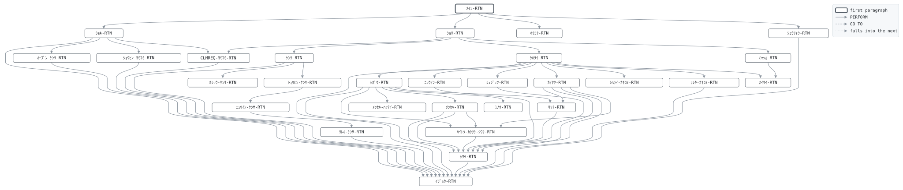

# GLD030

```text
GLD030: 給付支払

日次。支社からの給付請求ファイル CLMREQ を読み、死亡保険金、
入院給付金、解約返戻金を支払う。
検査は種別、契約の有無、事由発生日 (和暦で届く)、事由が契約
日以後で業務日付以前であること、契約の状態。死亡・入院は
事由発生日に保障中であったこと: いま保障中 (有効・猶予中)
か、失効中でも事由が失効日より前。解約は失効中でもよい。
死亡: 医療保険には死亡保障がない。保険金額に配当累計を
加え、貸付残高と未納保険料 (月払は払込済年月の翌月から
事由の月まで、年払は有効でなければ1回分) を引いた額。支払済
とする。契約日または復活日から3年以内の自殺は免責で、
保険金に代えて解約返戻金を支払う。
入院: 医療保険に限る。日数は 1 以上、1入院 120 日まで、
通算 1,000 日まで。契約日から免責日数の間の入院は支払わ
ない。日額は保険金額に入院日額率を掛けて 1,000 で割った額。
契約はそのまま。
手術: 入院と同じ検査。日数欄の倍率 (10, 20, 40) を日額に
掛けた額。
入院と手術は支払うたびに給付履歴 BENHST に残し、同じ事由
発生日の同じ種別の請求は二重請求として却下する。
解約: 解約返戻金 (GLC030: 商品・加入年齢区分・経過年数の
係数を保険金額 1,000 円あたりに掛けた額) から貸付残高を
引いた額。0 以下なら支払なしで解約とする。
貸付残高は業務日付までの利息 (GLC040) を繰り入れた上で、
支払時に回収し、仕訳する。

復帰コード: 0 全件支払、4 却下あり、8 日付が日付でない、
            16 ファイル異常。

変更履歴
日付       担当 変更
1987-04-01 KT   GL-0001 初版。
2001-07-02 MS   GL-0271 死亡保険金に配当累計を加える。
2008-06-02 YN   GL-0455 入院給付金、免責期間。
2012-09-03 YN   GL-0561 解約返戻金を GLC030 から。貸付利息。
2026-11-16 YN   GL-0821 事由発生日時点の保障、未納保険料の
                        差引、自殺免責、医療保険の死亡請求。
2026-11-16 YN   GL-0822 給付履歴、通算日数、手術給付金。
```

Program [GLD030.cbl](../../../gondwana/programs/GLD030.cbl): 9 files, 29 paragraphs. Its business rules: [23 decision tables](../rules/GLD030.md).

- AUTHOR: ゴンドワナ生命 システム部.
- DATE-WRITTEN: 1987-04-01.

## Contents

- [Files](#files)
- [Flow](#flow)
- [Paragraphs](#paragraphs)
- [Calls](#calls)
- [Data flow](#data-flow)
- [Lineage](#lineage)
  - [Into CR-ｾｲｷｭｳ-ﾚｺｰﾄﾞ](#into-cr-ｾｲｷｭｳ-ﾚｺｰﾄﾞ)
  - [Into PM-ｹｲﾔｸ-ﾚｺｰﾄﾞ](#into-pm-ｹｲﾔｸ-ﾚｺｰﾄﾞ)
  - [Into PR-ｼｮｳﾋﾝ-ﾚｺｰﾄﾞ](#into-pr-ｼｮｳﾋﾝ-ﾚｺｰﾄﾞ)
  - [Into CT-ｾｲｷﾞｮ-ﾚｺｰﾄﾞ](#into-ct-ｾｲｷﾞｮ-ﾚｺｰﾄﾞ)
  - [Into PY-ｼﾊﾗｲ-ﾚｺｰﾄﾞ](#into-py-ｼﾊﾗｲ-ﾚｺｰﾄﾞ)
  - [Into JR-ｼﾜｹ-ﾚｺｰﾄﾞ](#into-jr-ｼﾜｹ-ﾚｺｰﾄﾞ)
  - [Into ｷｬｯｶ-ﾚｺｰﾄﾞ](#into-ｷｬｯｶ-ﾚｺｰﾄﾞ)
  - [Into BH-ﾘﾚｷ-ﾚｺｰﾄﾞ](#into-bh-ﾘﾚｷ-ﾚｺｰﾄﾞ)
  - [Into ﾎｳｺｸ-ｷﾞｮｳ](#into-ﾎｳｺｸ-ｷﾞｮｳ)
  - [Into WS-ｽﾃｰﾀｽ](#into-ws-ｽﾃｰﾀｽ)
  - [Into WS-ｺﾏﾝﾄﾞｷﾞｮｳ](#into-ws-ｺﾏﾝﾄﾞｷﾞｮｳ)
  - [Into WS-ｴﾗｰﾌｧｲﾙ](#into-ws-ｴﾗｰﾌｧｲﾙ)
  - [Into WS-ｴﾗｰｽﾃｰﾀｽ](#into-ws-ｴﾗｰｽﾃｰﾀｽ)
  - [Into WS-ｷﾞｮｳﾑﾋﾂﾞｹ](#into-ws-ｷﾞｮｳﾑﾋﾂﾞｹ)
  - [Into WS-ｷﾞｮｳﾑﾋﾂﾞｹ-ﾜﾚｷ](#into-ws-ｷﾞｮｳﾑﾋﾂﾞｹ-ﾜﾚｷ)
  - [Into WS-ﾎｳｺｳ](#into-ws-ﾎｳｺｳ)
  - [Into WS-ﾍﾝｶﾝｹｯｶ](#into-ws-ﾍﾝｶﾝｹｯｶ)
  - [Into WS-ｼﾞﾕｳﾋﾞ](#into-ws-ｼﾞﾕｳﾋﾞ)
  - [Into WS-ｼｯｺｳﾋﾞ](#into-ws-ｼｯｺｳﾋﾞ)
  - [Into WS-ﾒﾝｾｷｷｹﾞﾝ](#into-ws-ﾒﾝｾｷｷｹﾞﾝ)
  - [Into WS-ﾒﾝｾｷ-ﾊﾝﾃｲ](#into-ws-ﾒﾝｾｷ-ﾊﾝﾃｲ)
  - [Into WS-ﾊﾗｲｺﾐｽﾞﾐ](#into-ws-ﾊﾗｲｺﾐｽﾞﾐ)
  - [Into WS-ﾐﾉｳﾂｷｽｳ](#into-ws-ﾐﾉｳﾂｷｽｳ)
  - [Into WS-ﾐﾉｳｶﾞｸ](#into-ws-ﾐﾉｳｶﾞｸ)
  - [Into WS-ﾂｳｻﾝﾆｯｽｳ](#into-ws-ﾂｳｻﾝﾆｯｽｳ)
  - [Into WS-ﾘﾚｷ-ﾚﾝﾊﾞﾝ](#into-ws-ﾘﾚｷ-ﾚﾝﾊﾞﾝ)
  - [Into WS-ｹｲﾔｸﾋﾞ](#into-ws-ｹｲﾔｸﾋﾞ)
  - [Into WS-ｹｲｶﾆｯｽｳ](#into-ws-ｹｲｶﾆｯｽｳ)
  - [Into WS-ﾆｯｽｳ](#into-ws-ﾆｯｽｳ)
  - [Into WS-ﾆﾁｶﾞｸ](#into-ws-ﾆﾁｶﾞｸ)
  - [Into WS-ｷﾝｶﾞｸ](#into-ws-ｷﾝｶﾞｸ)
  - [Into WS-ﾍﾝﾚｲｷﾝ](#into-ws-ﾍﾝﾚｲｷﾝ)
  - [Into WS-ﾘｿｸ](#into-ws-ﾘｿｸ)
  - [Into WS-ｼｮｳﾋﾝ-TBL](#into-ws-ｼｮｳﾋﾝ-tbl)
  - [Into WS-ｹﾝｽｳ](#into-ws-ｹﾝｽｳ)
  - [Into WS-ﾘﾕｳ](#into-ws-ﾘﾕｳ)
  - [Into WS-ｼｭﾍﾞﾂﾒｲ](#into-ws-ｼｭﾍﾞﾂﾒｲ)
  - [Into WS-ﾌｯｷｺｰﾄﾞ](#into-ws-ﾌｯｷｺｰﾄﾞ)
  - [Into WS-ﾎｳｺｸ](#into-ws-ﾎｳｺｸ)
  - [Out of the program](#out-of-the-program)
  - [Into other data items](#into-other-data-items)
- [Field origins](#field-origins)
  - [File REPORT-F](#file-report-f)
  - [File POLMST-F](#file-polmst-f)
  - [File BENHST-F](#file-benhst-f)
  - [File GLJRNL-F](#file-gljrnl-f)
  - [File PAYOUT-F](#file-payout-f)
  - [File REJECT-F](#file-reject-f)
  - [File GLSCTL-F](#file-glsctl-f)
- [Links between records](#links-between-records)
- [Records](#records)
  - [CR-ｾｲｷｭｳ-ﾚｺｰﾄﾞ](#cr-ｾｲｷｭｳ-ﾚｺｰﾄﾞ)
  - [PM-ｹｲﾔｸ-ﾚｺｰﾄﾞ](#pm-ｹｲﾔｸ-ﾚｺｰﾄﾞ)
  - [PR-ｼｮｳﾋﾝ-ﾚｺｰﾄﾞ](#pr-ｼｮｳﾋﾝ-ﾚｺｰﾄﾞ)
  - [CT-ｾｲｷﾞｮ-ﾚｺｰﾄﾞ](#ct-ｾｲｷﾞｮ-ﾚｺｰﾄﾞ)
  - [PY-ｼﾊﾗｲ-ﾚｺｰﾄﾞ](#py-ｼﾊﾗｲ-ﾚｺｰﾄﾞ)
  - [JR-ｼﾜｹ-ﾚｺｰﾄﾞ](#jr-ｼﾜｹ-ﾚｺｰﾄﾞ)
  - [ｷｬｯｶ-ﾚｺｰﾄﾞ](#ｷｬｯｶ-ﾚｺｰﾄﾞ)
  - [BH-ﾘﾚｷ-ﾚｺｰﾄﾞ](#bh-ﾘﾚｷ-ﾚｺｰﾄﾞ)
  - [ﾎｳｺｸ-ｷﾞｮｳ](#ﾎｳｺｸ-ｷﾞｮｳ)
  - [WS-ｽﾃｰﾀｽ](#ws-ｽﾃｰﾀｽ)
  - [WS-ｺﾏﾝﾄﾞｷﾞｮｳ](#ws-ｺﾏﾝﾄﾞｷﾞｮｳ)
  - [WS-ｴﾗｰﾌｧｲﾙ](#ws-ｴﾗｰﾌｧｲﾙ)
  - [WS-ｴﾗｰｽﾃｰﾀｽ](#ws-ｴﾗｰｽﾃｰﾀｽ)
  - [WS-ｷﾞｮｳﾑﾋﾂﾞｹ](#ws-ｷﾞｮｳﾑﾋﾂﾞｹ)
  - [WS-ｷﾞｮｳﾑﾋﾂﾞｹ-ﾜﾚｷ](#ws-ｷﾞｮｳﾑﾋﾂﾞｹ-ﾜﾚｷ)
  - [WS-ﾎｳｺｳ](#ws-ﾎｳｺｳ)
  - [WS-ﾍﾝｶﾝｹｯｶ](#ws-ﾍﾝｶﾝｹｯｶ)
  - [WS-ｼﾞﾕｳﾋﾞ](#ws-ｼﾞﾕｳﾋﾞ)
  - [WS-ｼﾞﾕｳﾋﾞ-ﾌﾞﾝｶｲ](#ws-ｼﾞﾕｳﾋﾞ-ﾌﾞﾝｶｲ)
  - [WS-ｼｯｺｳﾋﾞ](#ws-ｼｯｺｳﾋﾞ)
  - [WS-ﾒﾝｾｷｷｹﾞﾝ](#ws-ﾒﾝｾｷｷｹﾞﾝ)
  - [WS-ﾒﾝｾｷ-ﾊﾝﾃｲ](#ws-ﾒﾝｾｷ-ﾊﾝﾃｲ)
  - [WS-ﾊﾗｲｺﾐｽﾞﾐ](#ws-ﾊﾗｲｺﾐｽﾞﾐ)
  - [WS-ﾐﾉｳﾂｷｽｳ](#ws-ﾐﾉｳﾂｷｽｳ)
  - [WS-ﾐﾉｳｶﾞｸ](#ws-ﾐﾉｳｶﾞｸ)
  - [WS-ﾂｳｻﾝﾆｯｽｳ](#ws-ﾂｳｻﾝﾆｯｽｳ)
  - [WS-ﾘﾚｷ-ﾚﾝﾊﾞﾝ](#ws-ﾘﾚｷ-ﾚﾝﾊﾞﾝ)
  - [WS-ｹｲﾔｸﾋﾞ](#ws-ｹｲﾔｸﾋﾞ)
  - [WS-ｹｲｶﾆｯｽｳ](#ws-ｹｲｶﾆｯｽｳ)
  - [WS-ﾆｯｽｳ](#ws-ﾆｯｽｳ)
  - [WS-ﾆﾁｶﾞｸ](#ws-ﾆﾁｶﾞｸ)
  - [WS-ｷﾝｶﾞｸ](#ws-ｷﾝｶﾞｸ)
  - [WS-ﾍﾝﾚｲｷﾝ](#ws-ﾍﾝﾚｲｷﾝ)
  - [WS-ﾘｿｸ](#ws-ﾘｿｸ)
  - [WS-ｼﾊﾗｲｼｭﾍﾞﾂ](#ws-ｼﾊﾗｲｼｭﾍﾞﾂ)
  - [WS-ｼｮｳﾋﾝ-TBL](#ws-ｼｮｳﾋﾝ-tbl)
  - [WS-ﾘｮｳﾘﾂ-TBL](#ws-ﾘｮｳﾘﾂ-tbl)
  - [WS-ﾈﾝﾚｲ-ｿｴｼﾞ](#ws-ﾈﾝﾚｲ-ｿｴｼﾞ)
  - [WS-ｹﾝｽｳ](#ws-ｹﾝｽｳ)
  - [WS-ﾘﾕｳ](#ws-ﾘﾕｳ)
  - [WS-ﾘﾕｳ-ﾒｯｾｰｼﾞ](#ws-ﾘﾕｳ-ﾒｯｾｰｼﾞ)
  - [WS-ﾘﾕｳ-ﾒｯｾｰｼﾞ-TBL](#ws-ﾘﾕｳ-ﾒｯｾｰｼﾞ-tbl)
  - [WS-ｼｭﾍﾞﾂﾒｲ](#ws-ｼｭﾍﾞﾂﾒｲ)
  - [WS-ﾌｯｷｺｰﾄﾞ](#ws-ﾌｯｷｺｰﾄﾞ)
  - [WS-ﾎｳｺｸ](#ws-ﾎｳｺｸ)

## Files

| File | Kind | Assigned to | Organization | Status field | Opened | Records |
| --- | --- | --- | --- | --- | --- | --- |
| CLMREQ-F | FD | CLMREQ | LINE SEQUENTIAL | WS-CLMREQ-ST | INPUT | CR-ｾｲｷｭｳ-ﾚｺｰﾄﾞ |
| POLMST-F | FD | POLMST | INDEXED, key PM-ｼｮｳｹﾝﾊﾞﾝｺﾞｳ, RANDOM access | WS-POLMST-ST | I-O | PM-ｹｲﾔｸ-ﾚｺｰﾄﾞ |
| PRODTB-F | FD | PRODTB | LINE SEQUENTIAL | WS-PRODTB-ST | INPUT | PR-ｼｮｳﾋﾝ-ﾚｺｰﾄﾞ |
| GLSCTL-F | FD | GLSCTL | SEQUENTIAL | WS-GLSCTL-ST | I-O | CT-ｾｲｷﾞｮ-ﾚｺｰﾄﾞ |
| PAYOUT-F | FD | PAYOUT | LINE SEQUENTIAL | WS-PAYOUT-ST | EXTEND | PY-ｼﾊﾗｲ-ﾚｺｰﾄﾞ |
| GLJRNL-F | FD | GLJRNL | LINE SEQUENTIAL | WS-GLJRNL-ST | EXTEND | JR-ｼﾜｹ-ﾚｺｰﾄﾞ |
| REJECT-F | FD | CLMREJ | LINE SEQUENTIAL | WS-REJECT-ST | OUTPUT | ｷｬｯｶ-ﾚｺｰﾄﾞ |
| BENHST-F | FD | BENHST | INDEXED, key BH-ｷｰ, DYNAMIC access | WS-BENHST-ST | I-O | BH-ﾘﾚｷ-ﾚｺｰﾄﾞ |
| REPORT-F | FD | GLD030R | LINE SEQUENTIAL | WS-REPORT-ST | OUTPUT | ﾎｳｺｸ-ｷﾞｮｳ |

## Flow



## Paragraphs

| Paragraph | Description | Source | Performs | Goes to | Performed by | Reached by |
| --- | --- | --- | --- | --- | --- | --- |
| ﾒｲﾝ-RTN | ﾒｲﾝ-RTN: 準備、1件ずつの支払、報告、終了。 | [GLD030.cbl:227](../../../gondwana/programs/GLD030.cbl#L227) | ｼｮｷ-RTN, ｼｮﾘ-RTN, ﾎｳｺｸ-RTN, ｼｭｳﾘｮｳ-RTN | | | |
| ｼｮｷ-RTN | ｼｮｷ-RTN: 業務日付、ファイル、テーブル、制御レコード。 | [GLD030.cbl:238](../../../gondwana/programs/GLD030.cbl#L238) | ｵｰﾌﾟﾝ-ｹﾝｻ-RTN, ｼｮｳﾋﾝ-ﾖﾐｺﾐ-RTN, ｲｼﾞｮｳ-RTN, CLMREQ-ﾖﾐｺﾐ-RTN | | ﾒｲﾝ-RTN | |
| ｵｰﾌﾟﾝ-ｹﾝｻ-RTN | ｵｰﾌﾟﾝ-ｹﾝｻ-RTN: 開けなかったファイルがあれば異常終了。 | [GLD030.cbl:271](../../../gondwana/programs/GLD030.cbl#L271) | ｲｼﾞｮｳ-RTN | | ｼｮｷ-RTN | |
| CLMREQ-ﾖﾐｺﾐ-RTN | CLMREQ-ﾖﾐｺﾐ-RTN: 請求ファイルの次の行。 | [GLD030.cbl:310](../../../gondwana/programs/GLD030.cbl#L310) | ｲｼﾞｮｳ-RTN | | ｼｮｷ-RTN, ｼｮﾘ-RTN | |
| ｼｮﾘ-RTN | ｼｮﾘ-RTN: 1件を検査し、通れば支払、通らなければ却下。 | [GLD030.cbl:325](../../../gondwana/programs/GLD030.cbl#L325) | ｹﾝｻ-RTN, ｼﾊﾗｲ-RTN, ｷｬｯｶ-RTN, CLMREQ-ﾖﾐｺﾐ-RTN | | ﾒｲﾝ-RTN | |
| ｹﾝｻ-RTN | ｹﾝｻ-RTN: 請求に共通の検査、次いで種別ごとの検査。 | [GLD030.cbl:337](../../../gondwana/programs/GLD030.cbl#L337) | ｲｼﾞｮｳ-RTN, ﾎｼｮｳ-ｹﾝｻ-RTN, ｼｮｳﾋﾝ-ｹﾝｻ-RTN | | ｼｮﾘ-RTN | |
| ﾎｼｮｳ-ｹﾝｻ-RTN | ﾎｼｮｳ-ｹﾝｻ-RTN: 事由発生日に保障中であったこと。いま保障中 か、失効中で事由が失効日より前。 | [GLD030.cbl:402](../../../gondwana/programs/GLD030.cbl#L402) | | | ｹﾝｻ-RTN | |
| ｼｮｳﾋﾝ-ｹﾝｻ-RTN | ｼｮｳﾋﾝ-ｹﾝｻ-RTN: 商品を引き、医療保険の死亡請求は却下、入院 と手術の請求は入院の検査へ。 | [GLD030.cbl:420](../../../gondwana/programs/GLD030.cbl#L420) | ﾆｭｳｲﾝ-ｹﾝｻ-RTN | | ｹﾝｻ-RTN | |
| ﾆｭｳｲﾝ-ｹﾝｻ-RTN | ﾆｭｳｲﾝ-ｹﾝｻ-RTN: 医療保険であること、日数か倍率、免責期間、 次いで給付履歴。 | [GLD030.cbl:437](../../../gondwana/programs/GLD030.cbl#L437) | ﾘﾚｷ-ｹﾝｻ-RTN | | ｼｮｳﾋﾝ-ｹﾝｻ-RTN | |
| ﾘﾚｷ-ｹﾝｻ-RTN | ﾘﾚｷ-ｹﾝｻ-RTN: 契約の給付履歴を連番順にたどり、入院の通算 日数と最後の連番を求める。同じ種別で同じ事由発生日の履歴 があれば二重請求、入院で通算が 1,000 日に達していれば超過。 | [GLD030.cbl:459](../../../gondwana/programs/GLD030.cbl#L459) | ｲｼﾞｮｳ-RTN | | ﾆｭｳｲﾝ-ｹﾝｻ-RTN | |
| ｼﾊﾗｲ-RTN | ｼﾊﾗｲ-RTN: 種別ごとに金額を求め、支払を書き、契約を更新する。 | [GLD030.cbl:491](../../../gondwana/programs/GLD030.cbl#L491) | ｼﾎﾞｳ-RTN, ﾆｭｳｲﾝ-RTN, ｼｭｼﾞｭﾂ-RTN, ｶｲﾔｸ-RTN, ｼﾊﾗｲ-ｶｷｺﾐ-RTN, ﾘﾚｷ-ｶｷｺﾐ-RTN, ｲｼﾞｮｳ-RTN, ﾒｲｻｲ-RTN | | ｼｮﾘ-RTN | |
| ｼﾎﾞｳ-RTN | ｼﾎﾞｳ-RTN: 免責でなければ、保険金額に配当累計を加え、貸付 残高と未納保険料を引く。 | [GLD030.cbl:524](../../../gondwana/programs/GLD030.cbl#L524) | ﾘｿｸ-RTN, ﾒﾝｾｷ-ﾊﾝﾃｲ-RTN, ﾒﾝｾｷ-RTN, ﾐﾉｳ-RTN, ｼﾜｹ-RTN, ﾊｲﾄｳ-ｶｼﾂｹ-ｼﾜｹ-RTN | | ｼﾊﾗｲ-RTN | |
| ﾒﾝｾｷ-ﾊﾝﾃｲ-RTN | ﾒﾝｾｷ-ﾊﾝﾃｲ-RTN: 自殺で、事由が契約日か復活日のうち遅い方から 3年以内なら免責。 | [GLD030.cbl:556](../../../gondwana/programs/GLD030.cbl#L556) | | | ｼﾎﾞｳ-RTN | |
| ﾒﾝｾｷ-RTN | ﾒﾝｾｷ-RTN: 保険金に代えて解約返戻金に配当累計を加え、貸付 残高を引いて支払う。0 以下なら支払なし。 | [GLD030.cbl:574](../../../gondwana/programs/GLD030.cbl#L574) | ｲｼﾞｮｳ-RTN, ｼﾜｹ-RTN, ﾊｲﾄｳ-ｶｼﾂｹ-ｼﾜｹ-RTN | | ｼﾎﾞｳ-RTN | |
| ﾐﾉｳ-RTN | ﾐﾉｳ-RTN: 死亡保険金から引く未納保険料。月払は払込済年月の 翌月から事由の月まで、年払は有効でなければ1回分。 | [GLD030.cbl:599](../../../gondwana/programs/GLD030.cbl#L599) | | | ｼﾎﾞｳ-RTN | |
| ﾘﾚｷ-ｶｷｺﾐ-RTN | ﾘﾚｷ-ｶｷｺﾐ-RTN: 支払った入院か手術を給付履歴の次の連番に 書く。 | [GLD030.cbl:620](../../../gondwana/programs/GLD030.cbl#L620) | ｲｼﾞｮｳ-RTN | | ｼﾊﾗｲ-RTN | |
| ﾆｭｳｲﾝ-RTN | ﾆｭｳｲﾝ-RTN: 日額に日数を掛ける。日数は1入院 120 日まで、 通算 1,000 日の残りまで。 | [GLD030.cbl:641](../../../gondwana/programs/GLD030.cbl#L641) | ｼﾜｹ-RTN | | ｼﾊﾗｲ-RTN | |
| ｼｭｼﾞｭﾂ-RTN | ｼｭｼﾞｭﾂ-RTN: 日額に日数欄の倍率を掛ける。 | [GLD030.cbl:663](../../../gondwana/programs/GLD030.cbl#L663) | ｼﾜｹ-RTN | | ｼﾊﾗｲ-RTN | |
| ｶｲﾔｸ-RTN | ｶｲﾔｸ-RTN: 解約返戻金を GLC030 で求め、貸付残高を引く。0 以下 なら支払なし。 | [GLD030.cbl:679](../../../gondwana/programs/GLD030.cbl#L679) | ﾘｿｸ-RTN, ｲｼﾞｮｳ-RTN, ｼﾜｹ-RTN, ﾊｲﾄｳ-ｶｼﾂｹ-ｼﾜｹ-RTN | | ｼﾊﾗｲ-RTN | |
| ﾘｿｸ-RTN | ﾘｿｸ-RTN: 業務日付までの貸付利息を残高に繰り入れる。 | [GLD030.cbl:707](../../../gondwana/programs/GLD030.cbl#L707) | ｼﾜｹ-RTN | | ｼﾎﾞｳ-RTN, ｶｲﾔｸ-RTN | |
| ﾊｲﾄｳ-ｶｼﾂｹ-ｼﾜｹ-RTN | ﾊｲﾄｳ-ｶｼﾂｹ-ｼﾜｹ-RTN: 配当累計の支払と貸付残高の回収の仕訳。 | [GLD030.cbl:722](../../../gondwana/programs/GLD030.cbl#L722) | ｼﾜｹ-RTN | | ｼﾎﾞｳ-RTN, ﾒﾝｾｷ-RTN, ｶｲﾔｸ-RTN | |
| ｼﾜｹ-RTN | ｼﾜｹ-RTN: 仕訳1行。科目、貸借、金額、摘要は呼ぶ側が入れる。 | [GLD030.cbl:741](../../../gondwana/programs/GLD030.cbl#L741) | ｲｼﾞｮｳ-RTN | | ｼﾎﾞｳ-RTN, ﾒﾝｾｷ-RTN, ﾆｭｳｲﾝ-RTN, ｼｭｼﾞｭﾂ-RTN, ｶｲﾔｸ-RTN, ﾘｿｸ-RTN, ﾊｲﾄｳ-ｶｼﾂｹ-ｼﾜｹ-RTN | |
| ｼﾊﾗｲ-ｶｷｺﾐ-RTN | ｼﾊﾗｲ-ｶｷｺﾐ-RTN: 支払レコードを採番して書く。 | [GLD030.cbl:757](../../../gondwana/programs/GLD030.cbl#L757) | | | ｼﾊﾗｲ-RTN | |
| ｷｬｯｶ-RTN | ｷｬｯｶ-RTN: 却下ファイルに理由を付けて書き、明細を報告する。 | [GLD030.cbl:771](../../../gondwana/programs/GLD030.cbl#L771) | ﾒｲｻｲ-RTN | | ｼｮﾘ-RTN | |
| ﾒｲｻｲ-RTN | ﾒｲｻｲ-RTN: 1件の明細行。 | [GLD030.cbl:784](../../../gondwana/programs/GLD030.cbl#L784) | | | ｼﾊﾗｲ-RTN, ｷｬｯｶ-RTN | |
| ﾎｳｺｸ-RTN | ﾎｳｺｸ-RTN: 件数と合計。 | [GLD030.cbl:794](../../../gondwana/programs/GLD030.cbl#L794) | | | ﾒｲﾝ-RTN | |
| ｼｭｳﾘｮｳ-RTN | ｼｭｳﾘｮｳ-RTN: 制御レコードを書き戻し、ファイルを閉じる。 | [GLD030.cbl:813](../../../gondwana/programs/GLD030.cbl#L813) | ｲｼﾞｮｳ-RTN | | ﾒｲﾝ-RTN | |
| ｲｼﾞｮｳ-RTN | ｲｼﾞｮｳ-RTN: ファイル異常は 16 で終わる。 | [GLD030.cbl:828](../../../gondwana/programs/GLD030.cbl#L828) | | | ｼｮｷ-RTN, ｵｰﾌﾟﾝ-ｹﾝｻ-RTN, CLMREQ-ﾖﾐｺﾐ-RTN, ｹﾝｻ-RTN, ﾘﾚｷ-ｹﾝｻ-RTN, ｼﾊﾗｲ-RTN, ﾒﾝｾｷ-RTN, ﾘﾚｷ-ｶｷｺﾐ-RTN, ｶｲﾔｸ-RTN, ｼﾜｹ-RTN, ｼｭｳﾘｮｳ-RTN, ｼｮｳﾋﾝ-ﾖﾐｺﾐ-RTN | |
| ｼｮｳﾋﾝ-ﾖﾐｺﾐ-RTN | ｼｮｳﾋﾝ-ﾖﾐｺﾐ-RTN: 商品テーブルを読み込む。 | [PRDLOD.cpy:16](../../../gondwana/copybooks/PRDLOD.cpy#L16) | ｲｼﾞｮｳ-RTN | | ｼｮｷ-RTN | |

## Calls

| Calls | Passing | Paragraph | Source |
| --- | --- | --- | --- |
| [GLC020](GLC020.md) | WS-ﾎｳｺｳ, WS-ｷﾞｮｳﾑﾋﾂﾞｹ, WS-ｷﾞｮｳﾑﾋﾂﾞｹ-ﾜﾚｷ, WS-ﾍﾝｶﾝｹｯｶ | ｼｮｷ-RTN | [GLD030.cbl:242](../../../gondwana/programs/GLD030.cbl#L242) |
| [GLC020](GLC020.md) | WS-ﾎｳｺｳ, WS-ｼﾞﾕｳﾋﾞ, CR-ｼﾞﾕｳﾊｯｾｲﾋﾞ, WS-ﾍﾝｶﾝｹｯｶ | ｹﾝｻ-RTN | [GLD030.cbl:368](../../../gondwana/programs/GLD030.cbl#L368) |
| [GLC020](GLC020.md) | WS-ﾎｳｺｳ, WS-ｹｲﾔｸﾋﾞ, PM-ｹｲﾔｸﾋﾞ, WS-ﾍﾝｶﾝｹｯｶ | ｹﾝｻ-RTN | [GLD030.cbl:375](../../../gondwana/programs/GLD030.cbl#L375) |
| [GLC020](GLC020.md) | WS-ﾎｳｺｳ, WS-ｼｯｺｳﾋﾞ, PM-ｼｯｺｳﾋﾞ, WS-ﾍﾝｶﾝｹｯｶ | ﾎｼｮｳ-ｹﾝｻ-RTN | [GLD030.cbl:407](../../../gondwana/programs/GLD030.cbl#L407) |
| [GLC020](GLC020.md) | WS-ﾎｳｺｳ, WS-ﾒﾝｾｷｷｹﾞﾝ, PM-ﾌｯｶﾂﾋﾞ, WS-ﾍﾝｶﾝｹｯｶ | ﾒﾝｾｷ-ﾊﾝﾃｲ-RTN | [GLD030.cbl:561](../../../gondwana/programs/GLD030.cbl#L561) |
| [GLC030](GLC030.md) | PM-ｼｮｳﾋﾝ, PM-ｶﾆｭｳﾈﾝﾚｲ, PM-ｹｲｶﾈﾝｽｳ, PM-ﾎｹﾝｷﾝｶﾞｸ, WS-ﾍﾝﾚｲｷﾝ, WS-CSVTB-ST | ﾒﾝｾｷ-RTN | [GLD030.cbl:575](../../../gondwana/programs/GLD030.cbl#L575) |
| [GLC030](GLC030.md) | PM-ｼｮｳﾋﾝ, PM-ｶﾆｭｳﾈﾝﾚｲ, PM-ｹｲｶﾈﾝｽｳ, PM-ﾎｹﾝｷﾝｶﾞｸ, WS-ﾍﾝﾚｲｷﾝ, WS-CSVTB-ST | ｶｲﾔｸ-RTN | [GLD030.cbl:681](../../../gondwana/programs/GLD030.cbl#L681) |
| [GLC040](GLC040.md) | PM-ｶｼﾂｹｻﾞﾝﾀﾞｶ, PM-ｶｼﾂｹｷｻﾝﾋﾞ, WS-ｷﾞｮｳﾑﾋﾂﾞｹ, WS-ﾘｿｸ | ﾘｿｸ-RTN | [GLD030.cbl:708](../../../gondwana/programs/GLD030.cbl#L708) |

## Data flow

| Paragraph | Reads | Writes |
| --- | --- | --- |
| ﾒｲﾝ-RTN | WS-CLMREQ-ST, WS-ﾌｯｷｺｰﾄﾞ | RETURN-CODE |
| ｼｮｷ-RTN | WS-ｺﾏﾝﾄﾞｷﾞｮｳ, WS-ﾎｳｺｳ, WS-ｷﾞｮｳﾑﾋﾂﾞｹ, WS-ｷﾞｮｳﾑﾋﾂﾞｹ-ﾜﾚｷ, WS-ﾍﾝｶﾝｹｯｶ, WS-GLSCTL-ST, WS-ﾋｮｳﾀﾞｲ-ｷﾞｮｳ | WS-ｺﾏﾝﾄﾞｷﾞｮｳ, WS-ｷﾞｮｳﾑﾋﾂﾞｹ, WS-ﾎｳｺｳ, WS-ｷﾞｮｳﾑﾋﾂﾞｹ-ﾜﾚｷ, WS-ﾍﾝｶﾝｹｯｶ, RETURN-CODE, WS-CLMREQ-ST, WS-PRODTB-ST, WS-POLMST-ST, WS-GLSCTL-ST, WS-BENHST-ST, WS-PAYOUT-ST, WS-GLJRNL-ST, WS-REJECT-ST, WS-REPORT-ST, PY-ｼﾊﾗｲ-ﾚｺｰﾄﾞ, JR-ｼﾜｹ-ﾚｺｰﾄﾞ, CT-ｾｲｷﾞｮ-ﾚｺｰﾄﾞ, WS-ｴﾗｰﾌｧｲﾙ, WS-ｴﾗｰｽﾃｰﾀｽ, WS-ﾋｮｳﾀﾞｲ-ﾋﾂﾞｹ, ﾎｳｺｸ-ｷﾞｮｳ |
| ｵｰﾌﾟﾝ-ｹﾝｻ-RTN | WS-CLMREQ-ST, WS-PRODTB-ST, WS-POLMST-ST, WS-GLSCTL-ST, WS-PAYOUT-ST, WS-GLJRNL-ST, WS-REJECT-ST, WS-BENHST-ST, WS-REPORT-ST, WS-ｴﾗｰﾌｧｲﾙ | WS-ｴﾗｰﾌｧｲﾙ, WS-ｴﾗｰｽﾃｰﾀｽ |
| CLMREQ-ﾖﾐｺﾐ-RTN | WS-CLMREQ-ST, WS-ﾖﾐｺﾐｹﾝｽｳ | CR-ｾｲｷｭｳ-ﾚｺｰﾄﾞ, WS-CLMREQ-ST, WS-ﾖﾐｺﾐｹﾝｽｳ, WS-ｴﾗｰﾌｧｲﾙ, WS-ｴﾗｰｽﾃｰﾀｽ |
| ｼｮﾘ-RTN | WS-ﾘﾕｳ | |
| ｹﾝｻ-RTN | CR-ｼｭﾍﾞﾂ, WS-ﾘﾕｳ, CR-ｼｮｳｹﾝﾊﾞﾝｺﾞｳ, WS-POLMST-ST, WS-ﾎｳｺｳ, WS-ｼﾞﾕｳﾋﾞ, CR-ｼﾞﾕｳﾊｯｾｲﾋﾞ, WS-ﾍﾝｶﾝｹｯｶ, WS-ｹｲﾔｸﾋﾞ, PM-ｹｲﾔｸﾋﾞ, WS-ｷﾞｮｳﾑﾋﾂﾞｹ, PM-ｼﾞｮｳﾀｲ | WS-ﾘﾕｳ, WS-ｷﾝｶﾞｸ, WS-ｼｭﾍﾞﾂﾒｲ, PM-ｼｮｳｹﾝﾊﾞﾝｺﾞｳ, PM-ｹｲﾔｸ-ﾚｺｰﾄﾞ, WS-POLMST-ST, WS-ｴﾗｰﾌｧｲﾙ, WS-ｴﾗｰｽﾃｰﾀｽ, WS-ﾎｳｺｳ, WS-ｼﾞﾕｳﾋﾞ, CR-ｼﾞﾕｳﾊｯｾｲﾋﾞ, WS-ﾍﾝｶﾝｹｯｶ, WS-ｹｲﾔｸﾋﾞ, PM-ｹｲﾔｸﾋﾞ |
| ﾎｼｮｳ-ｹﾝｻ-RTN | PM-ｼﾞｮｳﾀｲ, WS-ﾎｳｺｳ, WS-ｼｯｺｳﾋﾞ, PM-ｼｯｺｳﾋﾞ, WS-ﾍﾝｶﾝｹｯｶ, WS-ｼﾞﾕｳﾋﾞ | WS-ﾎｳｺｳ, WS-ｼｯｺｳﾋﾞ, PM-ｼｯｺｳﾋﾞ, WS-ﾍﾝｶﾝｹｯｶ, WS-ﾘﾕｳ |
| ｼｮｳﾋﾝ-ｹﾝｻ-RTN | WS-ｼｮｳﾋﾝ, WS-ｼｮｳﾋﾝ-ｺｰﾄﾞ, WS-ｼｮｳﾋﾝ-IX, PM-ｼｮｳﾋﾝ, CR-ｼｭﾍﾞﾂ, WS-ｼｮｳﾋﾝ-ｼｭﾙｲ | WS-ｼｮｳﾋﾝ-IX, WS-ﾘﾕｳ |
| ﾆｭｳｲﾝ-ｹﾝｻ-RTN | WS-ｼﾞﾕｳﾋﾞ, WS-ｹｲﾔｸﾋﾞ, WS-ｼｮｳﾋﾝ-ｼｭﾙｲ, WS-ｼｮｳﾋﾝ-IX, CR-ｼｭﾍﾞﾂ, CR-ﾆｯｽｳ, WS-ｹｲｶﾆｯｽｳ, WS-ｼｮｳﾋﾝ-ﾒﾝｾｷﾆｯｽｳ | WS-ｹｲｶﾆｯｽｳ, WS-ﾘﾕｳ |
| ﾘﾚｷ-ｹﾝｻ-RTN | CR-ｼｮｳｹﾝﾊﾞﾝｺﾞｳ, BH-ｷｰ, WS-BENHST-ST, BH-ｼｮｳｹﾝﾊﾞﾝｺﾞｳ, BH-ﾚﾝﾊﾞﾝ, BH-ｼｭﾍﾞﾂ, BH-ﾆｯｽｳ, WS-ﾂｳｻﾝﾆｯｽｳ, CR-ｼｭﾍﾞﾂ, BH-ｼﾞﾕｳﾊｯｾｲﾋﾞ, CR-ｼﾞﾕｳﾊｯｾｲﾋﾞ, WS-ﾘﾕｳ | WS-ﾂｳｻﾝﾆｯｽｳ, WS-ﾘﾚｷ-ﾚﾝﾊﾞﾝ, BH-ｼｮｳｹﾝﾊﾞﾝｺﾞｳ, BH-ﾚﾝﾊﾞﾝ, WS-BENHST-ST, BH-ﾘﾚｷ-ﾚｺｰﾄﾞ, WS-ﾘﾕｳ, WS-ｴﾗｰﾌｧｲﾙ, WS-ｴﾗｰｽﾃｰﾀｽ |
| ｼﾊﾗｲ-RTN | CR-ｼｭﾍﾞﾂ, WS-ｷﾝｶﾞｸ, WS-ｷﾞｮｳﾑﾋﾂﾞｹ-ﾜﾚｷ, WS-POLMST-ST, WS-ｼﾊﾗｲｹﾝｽｳ | PM-ｼﾞｮｳﾀｲﾋﾂﾞｹ, PM-ｹｲﾔｸ-ﾚｺｰﾄﾞ, WS-POLMST-ST, WS-ｴﾗｰﾌｧｲﾙ, WS-ｴﾗｰｽﾃｰﾀｽ, WS-ｼﾊﾗｲｹﾝｽｳ, WS-ﾒｲｻｲ-ｹｯｶ |
| ｼﾎﾞｳ-RTN | WS-ﾒﾝｾｷ-ﾊﾝﾃｲ, PM-ﾎｹﾝｷﾝｶﾞｸ, PM-ﾊｲﾄｳﾙｲｹｲ, PM-ｶｼﾂｹｻﾞﾝﾀﾞｶ, WS-ﾐﾉｳｶﾞｸ | WS-ｷﾝｶﾞｸ, JR-ｶﾝｼﾞｮｳｶﾓｸ, JR-ｷﾝｶﾞｸ, JR-ﾀｲｼｬｸ, JR-ﾃｷﾖｳ, PM-ﾊｲﾄｳﾙｲｹｲ, PM-ｶｼﾂｹｻﾞﾝﾀﾞｶ, PM-ｶｼﾂｹｷｻﾝﾋﾞ, PM-ｼﾞｮｳﾀｲ, PY-ｼｭﾍﾞﾂ |
| ﾒﾝｾｷ-ﾊﾝﾃｲ-RTN | CR-ｼﾞﾕｳｺｰﾄﾞ, WS-ｹｲﾔｸﾋﾞ, PM-ﾌｯｶﾂﾋﾞ, WS-ﾎｳｺｳ, WS-ﾒﾝｾｷｷｹﾞﾝ, WS-ﾍﾝｶﾝｹｯｶ, WS-ｼﾞﾕｳﾋﾞ | WS-ﾒﾝｾｷ-ﾊﾝﾃｲ, WS-ﾒﾝｾｷｷｹﾞﾝ, WS-ﾎｳｺｳ, PM-ﾌｯｶﾂﾋﾞ, WS-ﾍﾝｶﾝｹｯｶ |
| ﾒﾝｾｷ-RTN | PM-ｼｮｳﾋﾝ, PM-ｶﾆｭｳﾈﾝﾚｲ, PM-ｹｲｶﾈﾝｽｳ, PM-ﾎｹﾝｷﾝｶﾞｸ, WS-ﾍﾝﾚｲｷﾝ, WS-CSVTB-ST, PM-ﾊｲﾄｳﾙｲｹｲ, PM-ｶｼﾂｹｻﾞﾝﾀﾞｶ, WS-ｷﾝｶﾞｸ | PM-ｼｮｳﾋﾝ, PM-ｶﾆｭｳﾈﾝﾚｲ, PM-ｹｲｶﾈﾝｽｳ, PM-ﾎｹﾝｷﾝｶﾞｸ, WS-ﾍﾝﾚｲｷﾝ, WS-CSVTB-ST, WS-ｴﾗｰﾌｧｲﾙ, WS-ｴﾗｰｽﾃｰﾀｽ, WS-ｷﾝｶﾞｸ, JR-ｶﾝｼﾞｮｳｶﾓｸ, JR-ｷﾝｶﾞｸ, JR-ﾀｲｼｬｸ, JR-ﾃｷﾖｳ |
| ﾐﾉｳ-RTN | PM-ﾊﾗｲｺﾐｽﾞﾐﾈﾝｹﾞﾂ, PM-ﾊﾗｲｺﾐﾎｳﾎｳ, PM-ｼﾞｮｳﾀｲ, WS-ｼﾞﾕｳ-YYYY, WS-ﾊﾗｲｺﾐ-YYYY, WS-ｼﾞﾕｳ-MM, WS-ﾊﾗｲｺﾐ-MM, WS-ﾐﾉｳﾂｷｽｳ, PM-ﾎｹﾝﾘｮｳ | WS-ﾊﾗｲｺﾐｽﾞﾐ, WS-ﾐﾉｳﾂｷｽｳ, WS-ﾐﾉｳｶﾞｸ |
| ﾘﾚｷ-ｶｷｺﾐ-RTN | CR-ｼｮｳｹﾝﾊﾞﾝｺﾞｳ, WS-ﾘﾚｷ-ﾚﾝﾊﾞﾝ, CR-ｼｭﾍﾞﾂ, CR-ｼﾞﾕｳﾊｯｾｲﾋﾞ, WS-ﾆｯｽｳ, WS-ｷﾝｶﾞｸ, WS-ｷﾞｮｳﾑﾋﾂﾞｹ-ﾜﾚｷ, CR-ｾｲｷｭｳﾊﾞﾝｺﾞｳ, WS-BENHST-ST | BH-ﾘﾚｷ-ﾚｺｰﾄﾞ, BH-ｼｮｳｹﾝﾊﾞﾝｺﾞｳ, BH-ﾚﾝﾊﾞﾝ, BH-ｼｭﾍﾞﾂ, BH-ｼﾞﾕｳﾊｯｾｲﾋﾞ, BH-ﾆｯｽｳ, BH-ｷﾝｶﾞｸ, BH-ｼﾊﾗｲﾋﾞ, BH-ｾｲｷｭｳﾊﾞﾝｺﾞｳ, WS-BENHST-ST, WS-ｴﾗｰﾌｧｲﾙ, WS-ｴﾗｰｽﾃｰﾀｽ |
| ﾆｭｳｲﾝ-RTN | CR-ﾆｯｽｳ, WS-ﾂｳｻﾝﾆｯｽｳ, WS-ﾆｯｽｳ, PM-ﾎｹﾝｷﾝｶﾞｸ, WS-ｼｮｳﾋﾝ-ﾆｭｳｲﾝﾆﾁｶﾞｸﾘﾂ, WS-ｼｮｳﾋﾝ-IX, WS-ﾆﾁｶﾞｸ, WS-ｷﾝｶﾞｸ | WS-ﾆｯｽｳ, WS-ﾆﾁｶﾞｸ, WS-ｷﾝｶﾞｸ, JR-ｶﾝｼﾞｮｳｶﾓｸ, JR-ｷﾝｶﾞｸ, JR-ﾀｲｼｬｸ, JR-ﾃｷﾖｳ, PY-ｼｭﾍﾞﾂ |
| ｼｭｼﾞｭﾂ-RTN | CR-ﾆｯｽｳ, PM-ﾎｹﾝｷﾝｶﾞｸ, WS-ｼｮｳﾋﾝ-ﾆｭｳｲﾝﾆﾁｶﾞｸﾘﾂ, WS-ｼｮｳﾋﾝ-IX, WS-ﾆﾁｶﾞｸ, WS-ﾆｯｽｳ, WS-ｷﾝｶﾞｸ | WS-ﾆｯｽｳ, WS-ﾆﾁｶﾞｸ, WS-ｷﾝｶﾞｸ, JR-ｶﾝｼﾞｮｳｶﾓｸ, JR-ｷﾝｶﾞｸ, JR-ﾀｲｼｬｸ, JR-ﾃｷﾖｳ, PY-ｼｭﾍﾞﾂ |
| ｶｲﾔｸ-RTN | PM-ｼｮｳﾋﾝ, PM-ｶﾆｭｳﾈﾝﾚｲ, PM-ｹｲｶﾈﾝｽｳ, PM-ﾎｹﾝｷﾝｶﾞｸ, WS-ﾍﾝﾚｲｷﾝ, WS-CSVTB-ST, PM-ｶｼﾂｹｻﾞﾝﾀﾞｶ, WS-ｷﾝｶﾞｸ | PM-ｼｮｳﾋﾝ, PM-ｶﾆｭｳﾈﾝﾚｲ, PM-ｹｲｶﾈﾝｽｳ, PM-ﾎｹﾝｷﾝｶﾞｸ, WS-ﾍﾝﾚｲｷﾝ, WS-CSVTB-ST, WS-ｴﾗｰﾌｧｲﾙ, WS-ｴﾗｰｽﾃｰﾀｽ, WS-ｷﾝｶﾞｸ, JR-ｶﾝｼﾞｮｳｶﾓｸ, JR-ｷﾝｶﾞｸ, JR-ﾀｲｼｬｸ, JR-ﾃｷﾖｳ, PM-ｶｼﾂｹｻﾞﾝﾀﾞｶ, PM-ｶｼﾂｹｷｻﾝﾋﾞ, PM-ｼﾞｮｳﾀｲ, PY-ｼｭﾍﾞﾂ |
| ﾘｿｸ-RTN | PM-ｶｼﾂｹｻﾞﾝﾀﾞｶ, PM-ｶｼﾂｹｷｻﾝﾋﾞ, WS-ｷﾞｮｳﾑﾋﾂﾞｹ, WS-ﾘｿｸ | PM-ｶｼﾂｹｻﾞﾝﾀﾞｶ, PM-ｶｼﾂｹｷｻﾝﾋﾞ, WS-ｷﾞｮｳﾑﾋﾂﾞｹ, WS-ﾘｿｸ, JR-ｶﾝｼﾞｮｳｶﾓｸ, JR-ｷﾝｶﾞｸ, JR-ﾀｲｼｬｸ, JR-ﾃｷﾖｳ |
| ﾊｲﾄｳ-ｶｼﾂｹ-ｼﾜｹ-RTN | CR-ｼｭﾍﾞﾂ, PM-ﾊｲﾄｳﾙｲｹｲ, PM-ｶｼﾂｹｻﾞﾝﾀﾞｶ | JR-ｶﾝｼﾞｮｳｶﾓｸ, JR-ｷﾝｶﾞｸ, JR-ﾀｲｼｬｸ, JR-ﾃｷﾖｳ |
| ｼﾜｹ-RTN | CT-ｼﾞｶｲｼﾜｹﾊﾞﾝｺﾞｳ, WS-ｷﾞｮｳﾑﾋﾂﾞｹ-ﾜﾚｷ, PM-ｼｮｳｹﾝﾊﾞﾝｺﾞｳ, WS-GLJRNL-ST | JR-ｼﾜｹﾊﾞﾝｺﾞｳ, CT-ｼﾞｶｲｼﾜｹﾊﾞﾝｺﾞｳ, JR-ﾋﾂﾞｹ, JR-ﾌﾟﾛｸﾞﾗﾑ, JR-ｼｮｳｹﾝﾊﾞﾝｺﾞｳ, JR-ｼﾜｹ-ﾚｺｰﾄﾞ, WS-GLJRNL-ST, WS-ｴﾗｰﾌｧｲﾙ, WS-ｴﾗｰｽﾃｰﾀｽ |
| ｼﾊﾗｲ-ｶｷｺﾐ-RTN | CT-ｼﾞｶｲｼﾊﾗｲﾊﾞﾝｺﾞｳ, WS-ｷﾞｮｳﾑﾋﾂﾞｹ-ﾜﾚｷ, PM-ｼｮｳｹﾝﾊﾞﾝｺﾞｳ, WS-ｷﾝｶﾞｸ, CR-ｳｹﾄﾘﾆﾝｶﾅ, CR-ｾｲｷｭｳﾊﾞﾝｺﾞｳ, WS-ｼﾊﾗｲｷﾝｶﾞｸ | PY-ｼﾊﾗｲﾊﾞﾝｺﾞｳ, CT-ｼﾞｶｲｼﾊﾗｲﾊﾞﾝｺﾞｳ, PY-ｼﾊﾗｲﾋﾞ, PY-ｼｮｳｹﾝﾊﾞﾝｺﾞｳ, PY-ｷﾝｶﾞｸ, PY-ｳｹﾄﾘﾆﾝｶﾅ, PY-ｾｲｷｭｳﾊﾞﾝｺﾞｳ, PY-ｼﾊﾗｲ-ﾚｺｰﾄﾞ, WS-PAYOUT-ST, WS-ｼﾊﾗｲｷﾝｶﾞｸ |
| ｷｬｯｶ-RTN | CR-ｾｲｷｭｳ-ﾚｺｰﾄﾞ, WS-ﾘﾕｳ, WS-ﾒｯｾｰｼﾞ, WS-ｷｬｯｶｹﾝｽｳ | ｷｬｯｶ-ﾃﾞｰﾀ, ｷｬｯｶ-ﾘﾕｳ, ｷｬｯｶ-ﾒｯｾｰｼﾞ, ｷｬｯｶ-ﾚｺｰﾄﾞ, WS-REJECT-ST, WS-ｷｬｯｶｹﾝｽｳ, WS-ﾌｯｷｺｰﾄﾞ, WS-ﾒｲｻｲ-ｹｯｶ |
| ﾒｲｻｲ-RTN | CR-ｾｲｷｭｳﾊﾞﾝｺﾞｳ, CR-ｼｮｳｹﾝﾊﾞﾝｺﾞｳ, WS-ｼｭﾍﾞﾂﾒｲ, WS-ｷﾝｶﾞｸ, WS-ﾒｲｻｲ-ｷﾞｮｳ | WS-ﾒｲｻｲ-ｾｲｷｭｳ, WS-ﾒｲｻｲ-ｼｮｳｹﾝ, WS-ﾒｲｻｲ-ｼｭﾍﾞﾂ, WS-ﾒｲｻｲ-ｷﾝｶﾞｸ, ﾎｳｺｸ-ｷﾞｮｳ, WS-REPORT-ST |
| ﾎｳｺｸ-RTN | WS-ﾖﾐｺﾐｹﾝｽｳ, WS-ｹﾝｽｳ-ｷﾞｮｳ, WS-ｼﾊﾗｲｹﾝｽｳ, WS-ｷｬｯｶｹﾝｽｳ, WS-ｼﾊﾗｲｷﾝｶﾞｸ | ﾎｳｺｸ-ｷﾞｮｳ, WS-REPORT-ST, WS-ｹﾝｽｳ-ﾗﾍﾞﾙ, WS-ｹﾝｽｳ-ｱﾀｲ |
| ｼｭｳﾘｮｳ-RTN | WS-GLSCTL-ST, WS-ｼﾊﾗｲｹﾝｽｳ, WS-ｷｬｯｶｹﾝｽｳ | CT-ｾｲｷﾞｮ-ﾚｺｰﾄﾞ, WS-GLSCTL-ST, WS-ｴﾗｰﾌｧｲﾙ, WS-ｴﾗｰｽﾃｰﾀｽ, WS-CLMREQ-ST, WS-POLMST-ST, WS-PRODTB-ST, WS-BENHST-ST, WS-PAYOUT-ST, WS-GLJRNL-ST, WS-REJECT-ST, WS-REPORT-ST |
| ｲｼﾞｮｳ-RTN | WS-ｴﾗｰﾌｧｲﾙ, WS-ｴﾗｰｽﾃｰﾀｽ | RETURN-CODE |
| ｼｮｳﾋﾝ-ﾖﾐｺﾐ-RTN | WS-PRODTB-ST, WS-ｼｮｳﾋﾝｹﾝｽｳ, PR-ｺｰﾄﾞ, WS-ｼｮｳﾋﾝ-IX, PR-ﾒｲｼｮｳ, PR-ｼｭﾙｲ, PR-ｻｲﾃｲﾈﾝﾚｲ, PR-ｻｲｺｳﾈﾝﾚｲ, PR-ﾎｹﾝｷｶﾝ, PR-ｻｲﾃｲﾎｹﾝｷﾝｶﾞｸ, PR-ｻｲｺｳﾎｹﾝｷﾝｶﾞｸ, PR-ﾆｭｳｲﾝﾆﾁｶﾞｸﾘﾂ, PR-ﾒﾝｾｷﾆｯｽｳ, PR-ﾊｲﾄｳﾘﾂ | PR-ｼｮｳﾋﾝ-ﾚｺｰﾄﾞ, WS-PRODTB-ST, WS-ｼｮｳﾋﾝｹﾝｽｳ, WS-ｼｮｳﾋﾝ-IX, WS-ｼｮｳﾋﾝ-ｺｰﾄﾞ, WS-ｼｮｳﾋﾝ-ﾒｲｼｮｳ, WS-ｼｮｳﾋﾝ-ｼｭﾙｲ, WS-ｼｮｳﾋﾝ-ｻｲﾃｲﾈﾝﾚｲ, WS-ｼｮｳﾋﾝ-ｻｲｺｳﾈﾝﾚｲ, WS-ｼｮｳﾋﾝ-ﾎｹﾝｷｶﾝ, WS-ｼｮｳﾋﾝ-ｻｲﾃｲｷﾝｶﾞｸ, WS-ｼｮｳﾋﾝ-ｻｲｺｳｷﾝｶﾞｸ, WS-ｼｮｳﾋﾝ-ﾆｭｳｲﾝﾆﾁｶﾞｸﾘﾂ, WS-ｼｮｳﾋﾝ-ﾒﾝｾｷﾆｯｽｳ, WS-ｼｮｳﾋﾝ-ﾊｲﾄｳﾘﾂ, WS-ｴﾗｰﾌｧｲﾙ, WS-ｴﾗｰｽﾃｰﾀｽ |

## Lineage

Where each data item's values come from, grouped by the record they go into. A data item links to the record it belongs to.

### Into CR-ｾｲｷｭｳ-ﾚｺｰﾄﾞ

Record [CR-ｾｲｷｭｳ-ﾚｺｰﾄﾞ](#cr-ｾｲｷｭｳ-ﾚｺｰﾄﾞ), from copybook [CLMREQ](../copybooks/CLMREQ.md).

| Into | From | Statement | Paragraph | Source |
| --- | --- | --- | --- | --- |
| CR-ｼﾞﾕｳﾊｯｾｲﾋﾞ | call GLC020 argument 3 | CALL | ｹﾝｻ-RTN | [GLD030.cbl:368](../../../gondwana/programs/GLD030.cbl#L368) |
| CR-ｾｲｷｭｳ-ﾚｺｰﾄﾞ | file CLMREQ-F | READ | CLMREQ-ﾖﾐｺﾐ-RTN | [GLD030.cbl:311](../../../gondwana/programs/GLD030.cbl#L311) |

### Into PM-ｹｲﾔｸ-ﾚｺｰﾄﾞ

Record [PM-ｹｲﾔｸ-ﾚｺｰﾄﾞ](#pm-ｹｲﾔｸ-ﾚｺｰﾄﾞ), from copybook [POLMST](../copybooks/POLMST.md).

| Into | From | Statement | Paragraph | Source |
| --- | --- | --- | --- | --- |
| PM-ｶｼﾂｹｷｻﾝﾋﾞ | literal SPACES | MOVE | ｼﾎﾞｳ-RTN | [GLD030.cbl:548](../../../gondwana/programs/GLD030.cbl#L548) |
| PM-ｶｼﾂｹｷｻﾝﾋﾞ | literal SPACES | MOVE | ｶｲﾔｸ-RTN | [GLD030.cbl:700](../../../gondwana/programs/GLD030.cbl#L700) |
| PM-ｶｼﾂｹｷｻﾝﾋﾞ | call GLC040 argument 2 | CALL | ﾘｿｸ-RTN | [GLD030.cbl:708](../../../gondwana/programs/GLD030.cbl#L708) |
| PM-ｶｼﾂｹｻﾞﾝﾀﾞｶ | literal 0 | MOVE | ｼﾎﾞｳ-RTN | [GLD030.cbl:547](../../../gondwana/programs/GLD030.cbl#L547) |
| PM-ｶｼﾂｹｻﾞﾝﾀﾞｶ | literal 0 | MOVE | ｶｲﾔｸ-RTN | [GLD030.cbl:699](../../../gondwana/programs/GLD030.cbl#L699) |
| PM-ｶｼﾂｹｻﾞﾝﾀﾞｶ | call GLC040 argument 1 | CALL | ﾘｿｸ-RTN | [GLD030.cbl:708](../../../gondwana/programs/GLD030.cbl#L708) |
| PM-ｶｼﾂｹｻﾞﾝﾀﾞｶ | [WS-ﾘｿｸ](#ws-ﾘｿｸ) | ADD | ﾘｿｸ-RTN | [GLD030.cbl:711](../../../gondwana/programs/GLD030.cbl#L711) |
| PM-ｶﾆｭｳﾈﾝﾚｲ | call GLC030 argument 2 | CALL | ﾒﾝｾｷ-RTN | [GLD030.cbl:575](../../../gondwana/programs/GLD030.cbl#L575) |
| PM-ｶﾆｭｳﾈﾝﾚｲ | call GLC030 argument 2 | CALL | ｶｲﾔｸ-RTN | [GLD030.cbl:681](../../../gondwana/programs/GLD030.cbl#L681) |
| PM-ｹｲｶﾈﾝｽｳ | call GLC030 argument 3 | CALL | ﾒﾝｾｷ-RTN | [GLD030.cbl:575](../../../gondwana/programs/GLD030.cbl#L575) |
| PM-ｹｲｶﾈﾝｽｳ | call GLC030 argument 3 | CALL | ｶｲﾔｸ-RTN | [GLD030.cbl:681](../../../gondwana/programs/GLD030.cbl#L681) |
| PM-ｹｲﾔｸ-ﾚｺｰﾄﾞ | file POLMST-F | READ | ｹﾝｻ-RTN | [GLD030.cbl:355](../../../gondwana/programs/GLD030.cbl#L355) |
| PM-ｹｲﾔｸﾋﾞ | call GLC020 argument 3 | CALL | ｹﾝｻ-RTN | [GLD030.cbl:375](../../../gondwana/programs/GLD030.cbl#L375) |
| PM-ｼｮｳｹﾝﾊﾞﾝｺﾞｳ | [CR-ｼｮｳｹﾝﾊﾞﾝｺﾞｳ](#cr-ｾｲｷｭｳ-ﾚｺｰﾄﾞ "in CR-ｾｲｷｭｳ-ﾚｺｰﾄﾞ") | MOVE | ｹﾝｻ-RTN | [GLD030.cbl:354](../../../gondwana/programs/GLD030.cbl#L354) |
| PM-ｼｮｳﾋﾝ | call GLC030 argument 1 | CALL | ﾒﾝｾｷ-RTN | [GLD030.cbl:575](../../../gondwana/programs/GLD030.cbl#L575) |
| PM-ｼｮｳﾋﾝ | call GLC030 argument 1 | CALL | ｶｲﾔｸ-RTN | [GLD030.cbl:681](../../../gondwana/programs/GLD030.cbl#L681) |
| PM-ｼｯｺｳﾋﾞ | call GLC020 argument 3 | CALL | ﾎｼｮｳ-ｹﾝｻ-RTN | [GLD030.cbl:407](../../../gondwana/programs/GLD030.cbl#L407) |
| PM-ｼﾞｮｳﾀｲ | literal condition PM-ｼﾊﾗｲｽﾞﾐ | SET | ｼﾎﾞｳ-RTN | [GLD030.cbl:549](../../../gondwana/programs/GLD030.cbl#L549) |
| PM-ｼﾞｮｳﾀｲ | literal condition PM-ｶｲﾔｸ | SET | ｶｲﾔｸ-RTN | [GLD030.cbl:701](../../../gondwana/programs/GLD030.cbl#L701) |
| PM-ｼﾞｮｳﾀｲﾋﾂﾞｹ | [WS-ｷﾞｮｳﾑﾋﾂﾞｹ-ﾜﾚｷ](#ws-ｷﾞｮｳﾑﾋﾂﾞｹ-ﾜﾚｷ) | MOVE | ｼﾊﾗｲ-RTN | [GLD030.cbl:508](../../../gondwana/programs/GLD030.cbl#L508) |
| PM-ﾊｲﾄｳﾙｲｹｲ | literal 0 | MOVE | ｼﾎﾞｳ-RTN | [GLD030.cbl:547](../../../gondwana/programs/GLD030.cbl#L547) |
| PM-ﾌｯｶﾂﾋﾞ | call GLC020 argument 3 | CALL | ﾒﾝｾｷ-ﾊﾝﾃｲ-RTN | [GLD030.cbl:561](../../../gondwana/programs/GLD030.cbl#L561) |
| PM-ﾎｹﾝｷﾝｶﾞｸ | call GLC030 argument 4 | CALL | ﾒﾝｾｷ-RTN | [GLD030.cbl:575](../../../gondwana/programs/GLD030.cbl#L575) |
| PM-ﾎｹﾝｷﾝｶﾞｸ | call GLC030 argument 4 | CALL | ｶｲﾔｸ-RTN | [GLD030.cbl:681](../../../gondwana/programs/GLD030.cbl#L681) |

### Into PR-ｼｮｳﾋﾝ-ﾚｺｰﾄﾞ

Record [PR-ｼｮｳﾋﾝ-ﾚｺｰﾄﾞ](#pr-ｼｮｳﾋﾝ-ﾚｺｰﾄﾞ), from copybook [PRODTB](../copybooks/PRODTB.md).

| Into | From | Statement | Paragraph | Source |
| --- | --- | --- | --- | --- |
| PR-ｼｮｳﾋﾝ-ﾚｺｰﾄﾞ | file PRODTB-F | READ | ｼｮｳﾋﾝ-ﾖﾐｺﾐ-RTN | [PRDLOD.cpy:17](../../../gondwana/copybooks/PRDLOD.cpy#L17) |
| PR-ｼｮｳﾋﾝ-ﾚｺｰﾄﾞ | file PRODTB-F | READ | ｼｮｳﾋﾝ-ﾖﾐｺﾐ-RTN | [PRDLOD.cpy:35](../../../gondwana/copybooks/PRDLOD.cpy#L35) |

### Into CT-ｾｲｷﾞｮ-ﾚｺｰﾄﾞ

Record [CT-ｾｲｷﾞｮ-ﾚｺｰﾄﾞ](#ct-ｾｲｷﾞｮ-ﾚｺｰﾄﾞ), from copybook [CTLREC](../copybooks/CTLREC.md).

| Into | From | Statement | Paragraph | Source |
| --- | --- | --- | --- | --- |
| CT-ｼﾞｶｲｼﾊﾗｲﾊﾞﾝｺﾞｳ | literal 1 | ADD | ｼﾊﾗｲ-ｶｷｺﾐ-RTN | [GLD030.cbl:759](../../../gondwana/programs/GLD030.cbl#L759) |
| CT-ｼﾞｶｲｼﾜｹﾊﾞﾝｺﾞｳ | literal 1 | ADD | ｼﾜｹ-RTN | [GLD030.cbl:743](../../../gondwana/programs/GLD030.cbl#L743) |
| CT-ｾｲｷﾞｮ-ﾚｺｰﾄﾞ | file GLSCTL-F | READ | ｼｮｷ-RTN | [GLD030.cbl:256](../../../gondwana/programs/GLD030.cbl#L256) |

### Into PY-ｼﾊﾗｲ-ﾚｺｰﾄﾞ

Record [PY-ｼﾊﾗｲ-ﾚｺｰﾄﾞ](#py-ｼﾊﾗｲ-ﾚｺｰﾄﾞ), from copybook [PAYOUT](../copybooks/PAYOUT.md).

| Into | From | Statement | Paragraph | Source |
| --- | --- | --- | --- | --- |
| PY-ｳｹﾄﾘﾆﾝｶﾅ | [CR-ｳｹﾄﾘﾆﾝｶﾅ](#cr-ｾｲｷｭｳ-ﾚｺｰﾄﾞ "in CR-ｾｲｷｭｳ-ﾚｺｰﾄﾞ") | MOVE | ｼﾊﾗｲ-ｶｷｺﾐ-RTN | [GLD030.cbl:763](../../../gondwana/programs/GLD030.cbl#L763) |
| PY-ｷﾝｶﾞｸ | [WS-ｷﾝｶﾞｸ](#ws-ｷﾝｶﾞｸ) | MOVE | ｼﾊﾗｲ-ｶｷｺﾐ-RTN | [GLD030.cbl:762](../../../gondwana/programs/GLD030.cbl#L762) |
| PY-ｼｭﾍﾞﾂ | literal condition PY-ｼﾎﾞｳ | SET | ｼﾎﾞｳ-RTN | [GLD030.cbl:550](../../../gondwana/programs/GLD030.cbl#L550) |
| PY-ｼｭﾍﾞﾂ | literal condition PY-ﾆｭｳｲﾝ | SET | ﾆｭｳｲﾝ-RTN | [GLD030.cbl:658](../../../gondwana/programs/GLD030.cbl#L658) |
| PY-ｼｭﾍﾞﾂ | literal condition PY-ｼｭｼﾞｭﾂ | SET | ｼｭｼﾞｭﾂ-RTN | [GLD030.cbl:673](../../../gondwana/programs/GLD030.cbl#L673) |
| PY-ｼｭﾍﾞﾂ | literal condition PY-ｶｲﾔｸ | SET | ｶｲﾔｸ-RTN | [GLD030.cbl:702](../../../gondwana/programs/GLD030.cbl#L702) |
| PY-ｼｮｳｹﾝﾊﾞﾝｺﾞｳ | [PM-ｼｮｳｹﾝﾊﾞﾝｺﾞｳ](#pm-ｹｲﾔｸ-ﾚｺｰﾄﾞ "in PM-ｹｲﾔｸ-ﾚｺｰﾄﾞ") | MOVE | ｼﾊﾗｲ-ｶｷｺﾐ-RTN | [GLD030.cbl:761](../../../gondwana/programs/GLD030.cbl#L761) |
| PY-ｼﾊﾗｲ-ﾚｺｰﾄﾞ | literal SPACES | MOVE | ｼｮｷ-RTN | [GLD030.cbl:254](../../../gondwana/programs/GLD030.cbl#L254) |
| PY-ｼﾊﾗｲﾊﾞﾝｺﾞｳ | [CT-ｼﾞｶｲｼﾊﾗｲﾊﾞﾝｺﾞｳ](#ct-ｾｲｷﾞｮ-ﾚｺｰﾄﾞ "in CT-ｾｲｷﾞｮ-ﾚｺｰﾄﾞ") | MOVE | ｼﾊﾗｲ-ｶｷｺﾐ-RTN | [GLD030.cbl:758](../../../gondwana/programs/GLD030.cbl#L758) |
| PY-ｼﾊﾗｲﾋﾞ | [WS-ｷﾞｮｳﾑﾋﾂﾞｹ-ﾜﾚｷ](#ws-ｷﾞｮｳﾑﾋﾂﾞｹ-ﾜﾚｷ) | MOVE | ｼﾊﾗｲ-ｶｷｺﾐ-RTN | [GLD030.cbl:760](../../../gondwana/programs/GLD030.cbl#L760) |
| PY-ｾｲｷｭｳﾊﾞﾝｺﾞｳ | [CR-ｾｲｷｭｳﾊﾞﾝｺﾞｳ](#cr-ｾｲｷｭｳ-ﾚｺｰﾄﾞ "in CR-ｾｲｷｭｳ-ﾚｺｰﾄﾞ") | MOVE | ｼﾊﾗｲ-ｶｷｺﾐ-RTN | [GLD030.cbl:764](../../../gondwana/programs/GLD030.cbl#L764) |

### Into JR-ｼﾜｹ-ﾚｺｰﾄﾞ

Record [JR-ｼﾜｹ-ﾚｺｰﾄﾞ](#jr-ｼﾜｹ-ﾚｺｰﾄﾞ), from copybook [GLJRNL](../copybooks/GLJRNL.md).

| Into | From | Statement | Paragraph | Source |
| --- | --- | --- | --- | --- |
| JR-ｶﾝｼﾞｮｳｶﾓｸ | literal 5110 | MOVE | ｼﾎﾞｳ-RTN | [GLD030.cbl:533](../../../gondwana/programs/GLD030.cbl#L533) |
| JR-ｶﾝｼﾞｮｳｶﾓｸ | literal 4110 | MOVE | ｼﾎﾞｳ-RTN | [GLD030.cbl:540](../../../gondwana/programs/GLD030.cbl#L540) |
| JR-ｶﾝｼﾞｮｳｶﾓｸ | literal 5130 | MOVE | ﾒﾝｾｷ-RTN | [GLD030.cbl:585](../../../gondwana/programs/GLD030.cbl#L585) |
| JR-ｶﾝｼﾞｮｳｶﾓｸ | literal 5120 | MOVE | ﾆｭｳｲﾝ-RTN | [GLD030.cbl:653](../../../gondwana/programs/GLD030.cbl#L653) |
| JR-ｶﾝｼﾞｮｳｶﾓｸ | literal 5120 | MOVE | ｼｭｼﾞｭﾂ-RTN | [GLD030.cbl:668](../../../gondwana/programs/GLD030.cbl#L668) |
| JR-ｶﾝｼﾞｮｳｶﾓｸ | literal 5130 | MOVE | ｶｲﾔｸ-RTN | [GLD030.cbl:690](../../../gondwana/programs/GLD030.cbl#L690) |
| JR-ｶﾝｼﾞｮｳｶﾓｸ | literal 4310 | MOVE | ﾘｿｸ-RTN | [GLD030.cbl:712](../../../gondwana/programs/GLD030.cbl#L712) |
| JR-ｶﾝｼﾞｮｳｶﾓｸ | literal 2310 | MOVE | ﾊｲﾄｳ-ｶｼﾂｹ-ｼﾜｹ-RTN | [GLD030.cbl:724](../../../gondwana/programs/GLD030.cbl#L724) |
| JR-ｶﾝｼﾞｮｳｶﾓｸ | literal 1210 | MOVE | ﾊｲﾄｳ-ｶｼﾂｹ-ｼﾜｹ-RTN | [GLD030.cbl:731](../../../gondwana/programs/GLD030.cbl#L731) |
| JR-ｷﾝｶﾞｸ | [PM-ﾎｹﾝｷﾝｶﾞｸ](#pm-ｹｲﾔｸ-ﾚｺｰﾄﾞ "in PM-ｹｲﾔｸ-ﾚｺｰﾄﾞ") | MOVE | ｼﾎﾞｳ-RTN | [GLD030.cbl:534](../../../gondwana/programs/GLD030.cbl#L534) |
| JR-ｷﾝｶﾞｸ | [WS-ﾐﾉｳｶﾞｸ](#ws-ﾐﾉｳｶﾞｸ) | MOVE | ｼﾎﾞｳ-RTN | [GLD030.cbl:541](../../../gondwana/programs/GLD030.cbl#L541) |
| JR-ｷﾝｶﾞｸ | [WS-ﾍﾝﾚｲｷﾝ](#ws-ﾍﾝﾚｲｷﾝ) | MOVE | ﾒﾝｾｷ-RTN | [GLD030.cbl:586](../../../gondwana/programs/GLD030.cbl#L586) |
| JR-ｷﾝｶﾞｸ | [WS-ｷﾝｶﾞｸ](#ws-ｷﾝｶﾞｸ) | MOVE | ﾆｭｳｲﾝ-RTN | [GLD030.cbl:654](../../../gondwana/programs/GLD030.cbl#L654) |
| JR-ｷﾝｶﾞｸ | [WS-ｷﾝｶﾞｸ](#ws-ｷﾝｶﾞｸ) | MOVE | ｼｭｼﾞｭﾂ-RTN | [GLD030.cbl:669](../../../gondwana/programs/GLD030.cbl#L669) |
| JR-ｷﾝｶﾞｸ | [WS-ﾍﾝﾚｲｷﾝ](#ws-ﾍﾝﾚｲｷﾝ) | MOVE | ｶｲﾔｸ-RTN | [GLD030.cbl:691](../../../gondwana/programs/GLD030.cbl#L691) |
| JR-ｷﾝｶﾞｸ | [WS-ﾘｿｸ](#ws-ﾘｿｸ) | MOVE | ﾘｿｸ-RTN | [GLD030.cbl:713](../../../gondwana/programs/GLD030.cbl#L713) |
| JR-ｷﾝｶﾞｸ | [PM-ﾊｲﾄｳﾙｲｹｲ](#pm-ｹｲﾔｸ-ﾚｺｰﾄﾞ "in PM-ｹｲﾔｸ-ﾚｺｰﾄﾞ") | MOVE | ﾊｲﾄｳ-ｶｼﾂｹ-ｼﾜｹ-RTN | [GLD030.cbl:725](../../../gondwana/programs/GLD030.cbl#L725) |
| JR-ｷﾝｶﾞｸ | [PM-ｶｼﾂｹｻﾞﾝﾀﾞｶ](#pm-ｹｲﾔｸ-ﾚｺｰﾄﾞ "in PM-ｹｲﾔｸ-ﾚｺｰﾄﾞ") | MOVE | ﾊｲﾄｳ-ｶｼﾂｹ-ｼﾜｹ-RTN | [GLD030.cbl:732](../../../gondwana/programs/GLD030.cbl#L732) |
| JR-ｼｮｳｹﾝﾊﾞﾝｺﾞｳ | [PM-ｼｮｳｹﾝﾊﾞﾝｺﾞｳ](#pm-ｹｲﾔｸ-ﾚｺｰﾄﾞ "in PM-ｹｲﾔｸ-ﾚｺｰﾄﾞ") | MOVE | ｼﾜｹ-RTN | [GLD030.cbl:746](../../../gondwana/programs/GLD030.cbl#L746) |
| JR-ｼﾜｹ-ﾚｺｰﾄﾞ | literal SPACES | MOVE | ｼｮｷ-RTN | [GLD030.cbl:254](../../../gondwana/programs/GLD030.cbl#L254) |
| JR-ｼﾜｹﾊﾞﾝｺﾞｳ | [CT-ｼﾞｶｲｼﾜｹﾊﾞﾝｺﾞｳ](#ct-ｾｲｷﾞｮ-ﾚｺｰﾄﾞ "in CT-ｾｲｷﾞｮ-ﾚｺｰﾄﾞ") | MOVE | ｼﾜｹ-RTN | [GLD030.cbl:742](../../../gondwana/programs/GLD030.cbl#L742) |
| JR-ﾀｲｼｬｸ | literal condition JR-ｶﾘｶﾀ | SET | ｼﾎﾞｳ-RTN | [GLD030.cbl:535](../../../gondwana/programs/GLD030.cbl#L535) |
| JR-ﾀｲｼｬｸ | literal condition JR-ｶｼｶﾀ | SET | ｼﾎﾞｳ-RTN | [GLD030.cbl:542](../../../gondwana/programs/GLD030.cbl#L542) |
| JR-ﾀｲｼｬｸ | literal condition JR-ｶﾘｶﾀ | SET | ﾒﾝｾｷ-RTN | [GLD030.cbl:587](../../../gondwana/programs/GLD030.cbl#L587) |
| JR-ﾀｲｼｬｸ | literal condition JR-ｶﾘｶﾀ | SET | ﾆｭｳｲﾝ-RTN | [GLD030.cbl:655](../../../gondwana/programs/GLD030.cbl#L655) |
| JR-ﾀｲｼｬｸ | literal condition JR-ｶﾘｶﾀ | SET | ｼｭｼﾞｭﾂ-RTN | [GLD030.cbl:670](../../../gondwana/programs/GLD030.cbl#L670) |
| JR-ﾀｲｼｬｸ | literal condition JR-ｶﾘｶﾀ | SET | ｶｲﾔｸ-RTN | [GLD030.cbl:692](../../../gondwana/programs/GLD030.cbl#L692) |
| JR-ﾀｲｼｬｸ | literal condition JR-ｶｼｶﾀ | SET | ﾘｿｸ-RTN | [GLD030.cbl:714](../../../gondwana/programs/GLD030.cbl#L714) |
| JR-ﾀｲｼｬｸ | literal condition JR-ｶﾘｶﾀ | SET | ﾊｲﾄｳ-ｶｼﾂｹ-ｼﾜｹ-RTN | [GLD030.cbl:726](../../../gondwana/programs/GLD030.cbl#L726) |
| JR-ﾀｲｼｬｸ | literal condition JR-ｶｼｶﾀ | SET | ﾊｲﾄｳ-ｶｼﾂｹ-ｼﾜｹ-RTN | [GLD030.cbl:733](../../../gondwana/programs/GLD030.cbl#L733) |
| JR-ﾃｷﾖｳ | literal '死亡保険金' | MOVE | ｼﾎﾞｳ-RTN | [GLD030.cbl:536](../../../gondwana/programs/GLD030.cbl#L536) |
| JR-ﾃｷﾖｳ | literal '未納保険料充当' | MOVE | ｼﾎﾞｳ-RTN | [GLD030.cbl:543](../../../gondwana/programs/GLD030.cbl#L543) |
| JR-ﾃｷﾖｳ | literal '免責時返戻金' | MOVE | ﾒﾝｾｷ-RTN | [GLD030.cbl:588](../../../gondwana/programs/GLD030.cbl#L588) |
| JR-ﾃｷﾖｳ | literal '入院給付金' | MOVE | ﾆｭｳｲﾝ-RTN | [GLD030.cbl:656](../../../gondwana/programs/GLD030.cbl#L656) |
| JR-ﾃｷﾖｳ | literal '手術給付金' | MOVE | ｼｭｼﾞｭﾂ-RTN | [GLD030.cbl:671](../../../gondwana/programs/GLD030.cbl#L671) |
| JR-ﾃｷﾖｳ | literal '解約返戻金' | MOVE | ｶｲﾔｸ-RTN | [GLD030.cbl:693](../../../gondwana/programs/GLD030.cbl#L693) |
| JR-ﾃｷﾖｳ | literal '貸付金利息' | MOVE | ﾘｿｸ-RTN | [GLD030.cbl:715](../../../gondwana/programs/GLD030.cbl#L715) |
| JR-ﾃｷﾖｳ | literal '配当金支払' | MOVE | ﾊｲﾄｳ-ｶｼﾂｹ-ｼﾜｹ-RTN | [GLD030.cbl:727](../../../gondwana/programs/GLD030.cbl#L727) |
| JR-ﾃｷﾖｳ | literal '貸付金回収' | MOVE | ﾊｲﾄｳ-ｶｼﾂｹ-ｼﾜｹ-RTN | [GLD030.cbl:734](../../../gondwana/programs/GLD030.cbl#L734) |
| JR-ﾋﾂﾞｹ | [WS-ｷﾞｮｳﾑﾋﾂﾞｹ-ﾜﾚｷ](#ws-ｷﾞｮｳﾑﾋﾂﾞｹ-ﾜﾚｷ) | MOVE | ｼﾜｹ-RTN | [GLD030.cbl:744](../../../gondwana/programs/GLD030.cbl#L744) |
| JR-ﾌﾟﾛｸﾞﾗﾑ | literal 'GLD030' | MOVE | ｼﾜｹ-RTN | [GLD030.cbl:745](../../../gondwana/programs/GLD030.cbl#L745) |

### Into ｷｬｯｶ-ﾚｺｰﾄﾞ

Record [ｷｬｯｶ-ﾚｺｰﾄﾞ](#ｷｬｯｶ-ﾚｺｰﾄﾞ).

| Into | From | Statement | Paragraph | Source |
| --- | --- | --- | --- | --- |
| ｷｬｯｶ-ﾃﾞｰﾀ | [CR-ｾｲｷｭｳ-ﾚｺｰﾄﾞ](#cr-ｾｲｷｭｳ-ﾚｺｰﾄﾞ) | MOVE | ｷｬｯｶ-RTN | [GLD030.cbl:772](../../../gondwana/programs/GLD030.cbl#L772) |
| ｷｬｯｶ-ﾒｯｾｰｼﾞ | [WS-ﾒｯｾｰｼﾞ](#ws-ﾘﾕｳ-ﾒｯｾｰｼﾞ-tbl "in WS-ﾘﾕｳ-ﾒｯｾｰｼﾞ-TBL") | MOVE | ｷｬｯｶ-RTN | [GLD030.cbl:774](../../../gondwana/programs/GLD030.cbl#L774) |
| ｷｬｯｶ-ﾘﾕｳ | [WS-ﾘﾕｳ](#ws-ﾘﾕｳ) | MOVE | ｷｬｯｶ-RTN | [GLD030.cbl:773](../../../gondwana/programs/GLD030.cbl#L773) |

### Into BH-ﾘﾚｷ-ﾚｺｰﾄﾞ

Record [BH-ﾘﾚｷ-ﾚｺｰﾄﾞ](#bh-ﾘﾚｷ-ﾚｺｰﾄﾞ), from copybook [BENHST](../copybooks/BENHST.md).

| Into | From | Statement | Paragraph | Source |
| --- | --- | --- | --- | --- |
| BH-ｷﾝｶﾞｸ | [WS-ｷﾝｶﾞｸ](#ws-ｷﾝｶﾞｸ) | MOVE | ﾘﾚｷ-ｶｷｺﾐ-RTN | [GLD030.cbl:627](../../../gondwana/programs/GLD030.cbl#L627) |
| BH-ｼｭﾍﾞﾂ | [CR-ｼｭﾍﾞﾂ](#cr-ｾｲｷｭｳ-ﾚｺｰﾄﾞ "in CR-ｾｲｷｭｳ-ﾚｺｰﾄﾞ") | MOVE | ﾘﾚｷ-ｶｷｺﾐ-RTN | [GLD030.cbl:624](../../../gondwana/programs/GLD030.cbl#L624) |
| BH-ｼｮｳｹﾝﾊﾞﾝｺﾞｳ | [CR-ｼｮｳｹﾝﾊﾞﾝｺﾞｳ](#cr-ｾｲｷｭｳ-ﾚｺｰﾄﾞ "in CR-ｾｲｷｭｳ-ﾚｺｰﾄﾞ") | MOVE | ﾘﾚｷ-ｹﾝｻ-RTN | [GLD030.cbl:461](../../../gondwana/programs/GLD030.cbl#L461) |
| BH-ｼｮｳｹﾝﾊﾞﾝｺﾞｳ | [CR-ｼｮｳｹﾝﾊﾞﾝｺﾞｳ](#cr-ｾｲｷｭｳ-ﾚｺｰﾄﾞ "in CR-ｾｲｷｭｳ-ﾚｺｰﾄﾞ") | MOVE | ﾘﾚｷ-ｶｷｺﾐ-RTN | [GLD030.cbl:622](../../../gondwana/programs/GLD030.cbl#L622) |
| BH-ｼﾊﾗｲﾋﾞ | [WS-ｷﾞｮｳﾑﾋﾂﾞｹ-ﾜﾚｷ](#ws-ｷﾞｮｳﾑﾋﾂﾞｹ-ﾜﾚｷ) | MOVE | ﾘﾚｷ-ｶｷｺﾐ-RTN | [GLD030.cbl:628](../../../gondwana/programs/GLD030.cbl#L628) |
| BH-ｼﾞﾕｳﾊｯｾｲﾋﾞ | [CR-ｼﾞﾕｳﾊｯｾｲﾋﾞ](#cr-ｾｲｷｭｳ-ﾚｺｰﾄﾞ "in CR-ｾｲｷｭｳ-ﾚｺｰﾄﾞ") | MOVE | ﾘﾚｷ-ｶｷｺﾐ-RTN | [GLD030.cbl:625](../../../gondwana/programs/GLD030.cbl#L625) |
| BH-ｾｲｷｭｳﾊﾞﾝｺﾞｳ | [CR-ｾｲｷｭｳﾊﾞﾝｺﾞｳ](#cr-ｾｲｷｭｳ-ﾚｺｰﾄﾞ "in CR-ｾｲｷｭｳ-ﾚｺｰﾄﾞ") | MOVE | ﾘﾚｷ-ｶｷｺﾐ-RTN | [GLD030.cbl:629](../../../gondwana/programs/GLD030.cbl#L629) |
| BH-ﾆｯｽｳ | [WS-ﾆｯｽｳ](#ws-ﾆｯｽｳ) | MOVE | ﾘﾚｷ-ｶｷｺﾐ-RTN | [GLD030.cbl:626](../../../gondwana/programs/GLD030.cbl#L626) |
| BH-ﾘﾚｷ-ﾚｺｰﾄﾞ | file BENHST-F | READ | ﾘﾚｷ-ｹﾝｻ-RTN | [GLD030.cbl:465](../../../gondwana/programs/GLD030.cbl#L465) |
| BH-ﾘﾚｷ-ﾚｺｰﾄﾞ | file BENHST-F | READ | ﾘﾚｷ-ｹﾝｻ-RTN | [GLD030.cbl:477](../../../gondwana/programs/GLD030.cbl#L477) |
| BH-ﾘﾚｷ-ﾚｺｰﾄﾞ | literal SPACES | MOVE | ﾘﾚｷ-ｶｷｺﾐ-RTN | [GLD030.cbl:621](../../../gondwana/programs/GLD030.cbl#L621) |
| BH-ﾚﾝﾊﾞﾝ | literal 0 | MOVE | ﾘﾚｷ-ｹﾝｻ-RTN | [GLD030.cbl:462](../../../gondwana/programs/GLD030.cbl#L462) |
| BH-ﾚﾝﾊﾞﾝ | [WS-ﾘﾚｷ-ﾚﾝﾊﾞﾝ](#ws-ﾘﾚｷ-ﾚﾝﾊﾞﾝ) | COMPUTE | ﾘﾚｷ-ｶｷｺﾐ-RTN | [GLD030.cbl:623](../../../gondwana/programs/GLD030.cbl#L623) |

### Into ﾎｳｺｸ-ｷﾞｮｳ

Record [ﾎｳｺｸ-ｷﾞｮｳ](#ﾎｳｺｸ-ｷﾞｮｳ).

| Into | From | Statement | Paragraph | Source |
| --- | --- | --- | --- | --- |
| ﾎｳｺｸ-ｷﾞｮｳ | [WS-ﾋｮｳﾀﾞｲ-ｷﾞｮｳ](#ws-ﾎｳｺｸ "in WS-ﾎｳｺｸ") | WRITE | ｼｮｷ-RTN | [GLD030.cbl:263](../../../gondwana/programs/GLD030.cbl#L263) |
| ﾎｳｺｸ-ｷﾞｮｳ | literal SPACES | MOVE | ｼｮｷ-RTN | [GLD030.cbl:264](../../../gondwana/programs/GLD030.cbl#L264) |
| ﾎｳｺｸ-ｷﾞｮｳ | [WS-ﾒｲｻｲ-ｷﾞｮｳ](#ws-ﾎｳｺｸ "in WS-ﾎｳｺｸ") | WRITE | ﾒｲｻｲ-RTN | [GLD030.cbl:789](../../../gondwana/programs/GLD030.cbl#L789) |
| ﾎｳｺｸ-ｷﾞｮｳ | literal SPACES | MOVE | ﾎｳｺｸ-RTN | [GLD030.cbl:795](../../../gondwana/programs/GLD030.cbl#L795) |
| ﾎｳｺｸ-ｷﾞｮｳ | [WS-ｹﾝｽｳ-ｷﾞｮｳ](#ws-ﾎｳｺｸ "in WS-ﾎｳｺｸ") | WRITE | ﾎｳｺｸ-RTN | [GLD030.cbl:799](../../../gondwana/programs/GLD030.cbl#L799) |
| ﾎｳｺｸ-ｷﾞｮｳ | [WS-ｹﾝｽｳ-ｷﾞｮｳ](#ws-ﾎｳｺｸ "in WS-ﾎｳｺｸ") | WRITE | ﾎｳｺｸ-RTN | [GLD030.cbl:802](../../../gondwana/programs/GLD030.cbl#L802) |
| ﾎｳｺｸ-ｷﾞｮｳ | [WS-ｹﾝｽｳ-ｷﾞｮｳ](#ws-ﾎｳｺｸ "in WS-ﾎｳｺｸ") | WRITE | ﾎｳｺｸ-RTN | [GLD030.cbl:805](../../../gondwana/programs/GLD030.cbl#L805) |
| ﾎｳｺｸ-ｷﾞｮｳ | [WS-ｹﾝｽｳ-ｷﾞｮｳ](#ws-ﾎｳｺｸ "in WS-ﾎｳｺｸ") | WRITE | ﾎｳｺｸ-RTN | [GLD030.cbl:808](../../../gondwana/programs/GLD030.cbl#L808) |

### Into WS-ｽﾃｰﾀｽ

Record [WS-ｽﾃｰﾀｽ](#ws-ｽﾃｰﾀｽ).

| Into | From | Statement | Paragraph | Source |
| --- | --- | --- | --- | --- |
| WS-CSVTB-ST | call GLC030 argument 6 | CALL | ﾒﾝｾｷ-RTN | [GLD030.cbl:575](../../../gondwana/programs/GLD030.cbl#L575) |
| WS-CSVTB-ST | call GLC030 argument 6 | CALL | ｶｲﾔｸ-RTN | [GLD030.cbl:681](../../../gondwana/programs/GLD030.cbl#L681) |

### Into WS-ｺﾏﾝﾄﾞｷﾞｮｳ

Record [WS-ｺﾏﾝﾄﾞｷﾞｮｳ](#ws-ｺﾏﾝﾄﾞｷﾞｮｳ).

| Into | From | Statement | Paragraph | Source |
| --- | --- | --- | --- | --- |
| WS-ｺﾏﾝﾄﾞｷﾞｮｳ | COMMAND-LINE | ACCEPT | ｼｮｷ-RTN | [GLD030.cbl:239](../../../gondwana/programs/GLD030.cbl#L239) |

### Into WS-ｴﾗｰﾌｧｲﾙ

Record [WS-ｴﾗｰﾌｧｲﾙ](#ws-ｴﾗｰﾌｧｲﾙ).

| Into | From | Statement | Paragraph | Source |
| --- | --- | --- | --- | --- |
| WS-ｴﾗｰﾌｧｲﾙ | literal 'GLSCTL' | MOVE | ｼｮｷ-RTN | [GLD030.cbl:258](../../../gondwana/programs/GLD030.cbl#L258) |
| WS-ｴﾗｰﾌｧｲﾙ | literal 'CLMREQ' | MOVE | ｵｰﾌﾟﾝ-ｹﾝｻ-RTN | [GLD030.cbl:274](../../../gondwana/programs/GLD030.cbl#L274) |
| WS-ｴﾗｰﾌｧｲﾙ | literal 'PRODTB' | MOVE | ｵｰﾌﾟﾝ-ｹﾝｻ-RTN | [GLD030.cbl:277](../../../gondwana/programs/GLD030.cbl#L277) |
| WS-ｴﾗｰﾌｧｲﾙ | literal 'POLMST' | MOVE | ｵｰﾌﾟﾝ-ｹﾝｻ-RTN | [GLD030.cbl:280](../../../gondwana/programs/GLD030.cbl#L280) |
| WS-ｴﾗｰﾌｧｲﾙ | literal 'GLSCTL' | MOVE | ｵｰﾌﾟﾝ-ｹﾝｻ-RTN | [GLD030.cbl:283](../../../gondwana/programs/GLD030.cbl#L283) |
| WS-ｴﾗｰﾌｧｲﾙ | literal 'PAYOUT' | MOVE | ｵｰﾌﾟﾝ-ｹﾝｻ-RTN | [GLD030.cbl:286](../../../gondwana/programs/GLD030.cbl#L286) |
| WS-ｴﾗｰﾌｧｲﾙ | literal 'GLJRNL' | MOVE | ｵｰﾌﾟﾝ-ｹﾝｻ-RTN | [GLD030.cbl:289](../../../gondwana/programs/GLD030.cbl#L289) |
| WS-ｴﾗｰﾌｧｲﾙ | literal 'CLMREJ' | MOVE | ｵｰﾌﾟﾝ-ｹﾝｻ-RTN | [GLD030.cbl:292](../../../gondwana/programs/GLD030.cbl#L292) |
| WS-ｴﾗｰﾌｧｲﾙ | literal 'BENHST' | MOVE | ｵｰﾌﾟﾝ-ｹﾝｻ-RTN | [GLD030.cbl:295](../../../gondwana/programs/GLD030.cbl#L295) |
| WS-ｴﾗｰﾌｧｲﾙ | literal 'GLD030R' | MOVE | ｵｰﾌﾟﾝ-ｹﾝｻ-RTN | [GLD030.cbl:298](../../../gondwana/programs/GLD030.cbl#L298) |
| WS-ｴﾗｰﾌｧｲﾙ | literal SPACES | MOVE | ｵｰﾌﾟﾝ-ｹﾝｻ-RTN | [GLD030.cbl:301](../../../gondwana/programs/GLD030.cbl#L301) |
| WS-ｴﾗｰﾌｧｲﾙ | literal 'CLMREQ' | MOVE | CLMREQ-ﾖﾐｺﾐ-RTN | [GLD030.cbl:316](../../../gondwana/programs/GLD030.cbl#L316) |
| WS-ｴﾗｰﾌｧｲﾙ | literal 'POLMST' | MOVE | ｹﾝｻ-RTN | [GLD030.cbl:360](../../../gondwana/programs/GLD030.cbl#L360) |
| WS-ｴﾗｰﾌｧｲﾙ | literal 'BENHST' | MOVE | ﾘﾚｷ-ｹﾝｻ-RTN | [GLD030.cbl:480](../../../gondwana/programs/GLD030.cbl#L480) |
| WS-ｴﾗｰﾌｧｲﾙ | literal 'POLMST' | MOVE | ｼﾊﾗｲ-RTN | [GLD030.cbl:512](../../../gondwana/programs/GLD030.cbl#L512) |
| WS-ｴﾗｰﾌｧｲﾙ | literal 'CSVTB' | MOVE | ﾒﾝｾｷ-RTN | [GLD030.cbl:578](../../../gondwana/programs/GLD030.cbl#L578) |
| WS-ｴﾗｰﾌｧｲﾙ | literal 'BENHST' | MOVE | ﾘﾚｷ-ｶｷｺﾐ-RTN | [GLD030.cbl:632](../../../gondwana/programs/GLD030.cbl#L632) |
| WS-ｴﾗｰﾌｧｲﾙ | literal 'CSVTB' | MOVE | ｶｲﾔｸ-RTN | [GLD030.cbl:684](../../../gondwana/programs/GLD030.cbl#L684) |
| WS-ｴﾗｰﾌｧｲﾙ | literal 'GLJRNL' | MOVE | ｼﾜｹ-RTN | [GLD030.cbl:749](../../../gondwana/programs/GLD030.cbl#L749) |
| WS-ｴﾗｰﾌｧｲﾙ | literal 'GLSCTL' | MOVE | ｼｭｳﾘｮｳ-RTN | [GLD030.cbl:816](../../../gondwana/programs/GLD030.cbl#L816) |
| WS-ｴﾗｰﾌｧｲﾙ | literal 'PRODTB' | MOVE | ｼｮｳﾋﾝ-ﾖﾐｺﾐ-RTN | [PRDLOD.cpy:38](../../../gondwana/copybooks/PRDLOD.cpy#L38) |

### Into WS-ｴﾗｰｽﾃｰﾀｽ

Record [WS-ｴﾗｰｽﾃｰﾀｽ](#ws-ｴﾗｰｽﾃｰﾀｽ).

| Into | From | Statement | Paragraph | Source |
| --- | --- | --- | --- | --- |
| WS-ｴﾗｰｽﾃｰﾀｽ | [WS-GLSCTL-ST](#ws-ｽﾃｰﾀｽ "in WS-ｽﾃｰﾀｽ") | MOVE | ｼｮｷ-RTN | [GLD030.cbl:259](../../../gondwana/programs/GLD030.cbl#L259) |
| WS-ｴﾗｰｽﾃｰﾀｽ | [WS-CLMREQ-ST](#ws-ｽﾃｰﾀｽ "in WS-ｽﾃｰﾀｽ") | MOVE | ｵｰﾌﾟﾝ-ｹﾝｻ-RTN | [GLD030.cbl:275](../../../gondwana/programs/GLD030.cbl#L275) |
| WS-ｴﾗｰｽﾃｰﾀｽ | [WS-PRODTB-ST](#ws-ｽﾃｰﾀｽ "in WS-ｽﾃｰﾀｽ") | MOVE | ｵｰﾌﾟﾝ-ｹﾝｻ-RTN | [GLD030.cbl:278](../../../gondwana/programs/GLD030.cbl#L278) |
| WS-ｴﾗｰｽﾃｰﾀｽ | [WS-POLMST-ST](#ws-ｽﾃｰﾀｽ "in WS-ｽﾃｰﾀｽ") | MOVE | ｵｰﾌﾟﾝ-ｹﾝｻ-RTN | [GLD030.cbl:281](../../../gondwana/programs/GLD030.cbl#L281) |
| WS-ｴﾗｰｽﾃｰﾀｽ | [WS-GLSCTL-ST](#ws-ｽﾃｰﾀｽ "in WS-ｽﾃｰﾀｽ") | MOVE | ｵｰﾌﾟﾝ-ｹﾝｻ-RTN | [GLD030.cbl:284](../../../gondwana/programs/GLD030.cbl#L284) |
| WS-ｴﾗｰｽﾃｰﾀｽ | [WS-PAYOUT-ST](#ws-ｽﾃｰﾀｽ "in WS-ｽﾃｰﾀｽ") | MOVE | ｵｰﾌﾟﾝ-ｹﾝｻ-RTN | [GLD030.cbl:287](../../../gondwana/programs/GLD030.cbl#L287) |
| WS-ｴﾗｰｽﾃｰﾀｽ | [WS-GLJRNL-ST](#ws-ｽﾃｰﾀｽ "in WS-ｽﾃｰﾀｽ") | MOVE | ｵｰﾌﾟﾝ-ｹﾝｻ-RTN | [GLD030.cbl:290](../../../gondwana/programs/GLD030.cbl#L290) |
| WS-ｴﾗｰｽﾃｰﾀｽ | [WS-REJECT-ST](#ws-ｽﾃｰﾀｽ "in WS-ｽﾃｰﾀｽ") | MOVE | ｵｰﾌﾟﾝ-ｹﾝｻ-RTN | [GLD030.cbl:293](../../../gondwana/programs/GLD030.cbl#L293) |
| WS-ｴﾗｰｽﾃｰﾀｽ | [WS-BENHST-ST](#ws-ｽﾃｰﾀｽ "in WS-ｽﾃｰﾀｽ") | MOVE | ｵｰﾌﾟﾝ-ｹﾝｻ-RTN | [GLD030.cbl:296](../../../gondwana/programs/GLD030.cbl#L296) |
| WS-ｴﾗｰｽﾃｰﾀｽ | [WS-REPORT-ST](#ws-ｽﾃｰﾀｽ "in WS-ｽﾃｰﾀｽ") | MOVE | ｵｰﾌﾟﾝ-ｹﾝｻ-RTN | [GLD030.cbl:299](../../../gondwana/programs/GLD030.cbl#L299) |
| WS-ｴﾗｰｽﾃｰﾀｽ | [WS-CLMREQ-ST](#ws-ｽﾃｰﾀｽ "in WS-ｽﾃｰﾀｽ") | MOVE | CLMREQ-ﾖﾐｺﾐ-RTN | [GLD030.cbl:317](../../../gondwana/programs/GLD030.cbl#L317) |
| WS-ｴﾗｰｽﾃｰﾀｽ | [WS-POLMST-ST](#ws-ｽﾃｰﾀｽ "in WS-ｽﾃｰﾀｽ") | MOVE | ｹﾝｻ-RTN | [GLD030.cbl:361](../../../gondwana/programs/GLD030.cbl#L361) |
| WS-ｴﾗｰｽﾃｰﾀｽ | [WS-BENHST-ST](#ws-ｽﾃｰﾀｽ "in WS-ｽﾃｰﾀｽ") | MOVE | ﾘﾚｷ-ｹﾝｻ-RTN | [GLD030.cbl:481](../../../gondwana/programs/GLD030.cbl#L481) |
| WS-ｴﾗｰｽﾃｰﾀｽ | [WS-POLMST-ST](#ws-ｽﾃｰﾀｽ "in WS-ｽﾃｰﾀｽ") | MOVE | ｼﾊﾗｲ-RTN | [GLD030.cbl:513](../../../gondwana/programs/GLD030.cbl#L513) |
| WS-ｴﾗｰｽﾃｰﾀｽ | [WS-CSVTB-ST](#ws-ｽﾃｰﾀｽ "in WS-ｽﾃｰﾀｽ") | MOVE | ﾒﾝｾｷ-RTN | [GLD030.cbl:579](../../../gondwana/programs/GLD030.cbl#L579) |
| WS-ｴﾗｰｽﾃｰﾀｽ | [WS-BENHST-ST](#ws-ｽﾃｰﾀｽ "in WS-ｽﾃｰﾀｽ") | MOVE | ﾘﾚｷ-ｶｷｺﾐ-RTN | [GLD030.cbl:633](../../../gondwana/programs/GLD030.cbl#L633) |
| WS-ｴﾗｰｽﾃｰﾀｽ | [WS-CSVTB-ST](#ws-ｽﾃｰﾀｽ "in WS-ｽﾃｰﾀｽ") | MOVE | ｶｲﾔｸ-RTN | [GLD030.cbl:685](../../../gondwana/programs/GLD030.cbl#L685) |
| WS-ｴﾗｰｽﾃｰﾀｽ | [WS-GLJRNL-ST](#ws-ｽﾃｰﾀｽ "in WS-ｽﾃｰﾀｽ") | MOVE | ｼﾜｹ-RTN | [GLD030.cbl:750](../../../gondwana/programs/GLD030.cbl#L750) |
| WS-ｴﾗｰｽﾃｰﾀｽ | [WS-GLSCTL-ST](#ws-ｽﾃｰﾀｽ "in WS-ｽﾃｰﾀｽ") | MOVE | ｼｭｳﾘｮｳ-RTN | [GLD030.cbl:817](../../../gondwana/programs/GLD030.cbl#L817) |
| WS-ｴﾗｰｽﾃｰﾀｽ | [WS-PRODTB-ST](#ws-ｽﾃｰﾀｽ "in WS-ｽﾃｰﾀｽ") | MOVE | ｼｮｳﾋﾝ-ﾖﾐｺﾐ-RTN | [PRDLOD.cpy:39](../../../gondwana/copybooks/PRDLOD.cpy#L39) |

### Into WS-ｷﾞｮｳﾑﾋﾂﾞｹ

Record [WS-ｷﾞｮｳﾑﾋﾂﾞｹ](#ws-ｷﾞｮｳﾑﾋﾂﾞｹ).

| Into | From | Statement | Paragraph | Source |
| --- | --- | --- | --- | --- |
| WS-ｷﾞｮｳﾑﾋﾂﾞｹ | [WS-ｺﾏﾝﾄﾞｷﾞｮｳ](#ws-ｺﾏﾝﾄﾞｷﾞｮｳ) | MOVE | ｼｮｷ-RTN | [GLD030.cbl:240](../../../gondwana/programs/GLD030.cbl#L240) |
| WS-ｷﾞｮｳﾑﾋﾂﾞｹ | call GLC020 argument 2 | CALL | ｼｮｷ-RTN | [GLD030.cbl:242](../../../gondwana/programs/GLD030.cbl#L242) |
| WS-ｷﾞｮｳﾑﾋﾂﾞｹ | call GLC040 argument 3 | CALL | ﾘｿｸ-RTN | [GLD030.cbl:708](../../../gondwana/programs/GLD030.cbl#L708) |

### Into WS-ｷﾞｮｳﾑﾋﾂﾞｹ-ﾜﾚｷ

Record [WS-ｷﾞｮｳﾑﾋﾂﾞｹ-ﾜﾚｷ](#ws-ｷﾞｮｳﾑﾋﾂﾞｹ-ﾜﾚｷ).

| Into | From | Statement | Paragraph | Source |
| --- | --- | --- | --- | --- |
| WS-ｷﾞｮｳﾑﾋﾂﾞｹ-ﾜﾚｷ | call GLC020 argument 3 | CALL | ｼｮｷ-RTN | [GLD030.cbl:242](../../../gondwana/programs/GLD030.cbl#L242) |

### Into WS-ﾎｳｺｳ

Record [WS-ﾎｳｺｳ](#ws-ﾎｳｺｳ).

| Into | From | Statement | Paragraph | Source |
| --- | --- | --- | --- | --- |
| WS-ﾎｳｺｳ | literal 'W' | MOVE | ｼｮｷ-RTN | [GLD030.cbl:241](../../../gondwana/programs/GLD030.cbl#L241) |
| WS-ﾎｳｺｳ | call GLC020 argument 1 | CALL | ｼｮｷ-RTN | [GLD030.cbl:242](../../../gondwana/programs/GLD030.cbl#L242) |
| WS-ﾎｳｺｳ | literal 'S' | MOVE | ｹﾝｻ-RTN | [GLD030.cbl:367](../../../gondwana/programs/GLD030.cbl#L367) |
| WS-ﾎｳｺｳ | call GLC020 argument 1 | CALL | ｹﾝｻ-RTN | [GLD030.cbl:368](../../../gondwana/programs/GLD030.cbl#L368) |
| WS-ﾎｳｺｳ | call GLC020 argument 1 | CALL | ｹﾝｻ-RTN | [GLD030.cbl:375](../../../gondwana/programs/GLD030.cbl#L375) |
| WS-ﾎｳｺｳ | call GLC020 argument 1 | CALL | ﾎｼｮｳ-ｹﾝｻ-RTN | [GLD030.cbl:407](../../../gondwana/programs/GLD030.cbl#L407) |
| WS-ﾎｳｺｳ | call GLC020 argument 1 | CALL | ﾒﾝｾｷ-ﾊﾝﾃｲ-RTN | [GLD030.cbl:561](../../../gondwana/programs/GLD030.cbl#L561) |

### Into WS-ﾍﾝｶﾝｹｯｶ

Record [WS-ﾍﾝｶﾝｹｯｶ](#ws-ﾍﾝｶﾝｹｯｶ).

| Into | From | Statement | Paragraph | Source |
| --- | --- | --- | --- | --- |
| WS-ﾍﾝｶﾝｹｯｶ | call GLC020 argument 4 | CALL | ｼｮｷ-RTN | [GLD030.cbl:242](../../../gondwana/programs/GLD030.cbl#L242) |
| WS-ﾍﾝｶﾝｹｯｶ | call GLC020 argument 4 | CALL | ｹﾝｻ-RTN | [GLD030.cbl:368](../../../gondwana/programs/GLD030.cbl#L368) |
| WS-ﾍﾝｶﾝｹｯｶ | call GLC020 argument 4 | CALL | ｹﾝｻ-RTN | [GLD030.cbl:375](../../../gondwana/programs/GLD030.cbl#L375) |
| WS-ﾍﾝｶﾝｹｯｶ | call GLC020 argument 4 | CALL | ﾎｼｮｳ-ｹﾝｻ-RTN | [GLD030.cbl:407](../../../gondwana/programs/GLD030.cbl#L407) |
| WS-ﾍﾝｶﾝｹｯｶ | call GLC020 argument 4 | CALL | ﾒﾝｾｷ-ﾊﾝﾃｲ-RTN | [GLD030.cbl:561](../../../gondwana/programs/GLD030.cbl#L561) |

### Into WS-ｼﾞﾕｳﾋﾞ

Record [WS-ｼﾞﾕｳﾋﾞ](#ws-ｼﾞﾕｳﾋﾞ).

| Into | From | Statement | Paragraph | Source |
| --- | --- | --- | --- | --- |
| WS-ｼﾞﾕｳﾋﾞ | call GLC020 argument 2 | CALL | ｹﾝｻ-RTN | [GLD030.cbl:368](../../../gondwana/programs/GLD030.cbl#L368) |

### Into WS-ｼｯｺｳﾋﾞ

Record [WS-ｼｯｺｳﾋﾞ](#ws-ｼｯｺｳﾋﾞ).

| Into | From | Statement | Paragraph | Source |
| --- | --- | --- | --- | --- |
| WS-ｼｯｺｳﾋﾞ | call GLC020 argument 2 | CALL | ﾎｼｮｳ-ｹﾝｻ-RTN | [GLD030.cbl:407](../../../gondwana/programs/GLD030.cbl#L407) |

### Into WS-ﾒﾝｾｷｷｹﾞﾝ

Record [WS-ﾒﾝｾｷｷｹﾞﾝ](#ws-ﾒﾝｾｷｷｹﾞﾝ).

| Into | From | Statement | Paragraph | Source |
| --- | --- | --- | --- | --- |
| WS-ﾒﾝｾｷｷｹﾞﾝ | [WS-ｹｲﾔｸﾋﾞ](#ws-ｹｲﾔｸﾋﾞ) | MOVE | ﾒﾝｾｷ-ﾊﾝﾃｲ-RTN | [GLD030.cbl:559](../../../gondwana/programs/GLD030.cbl#L559) |
| WS-ﾒﾝｾｷｷｹﾞﾝ | call GLC020 argument 2 | CALL | ﾒﾝｾｷ-ﾊﾝﾃｲ-RTN | [GLD030.cbl:561](../../../gondwana/programs/GLD030.cbl#L561) |
| WS-ﾒﾝｾｷｷｹﾞﾝ | literal 30000 | ADD | ﾒﾝｾｷ-ﾊﾝﾃｲ-RTN | [GLD030.cbl:564](../../../gondwana/programs/GLD030.cbl#L564) |

### Into WS-ﾒﾝｾｷ-ﾊﾝﾃｲ

Record [WS-ﾒﾝｾｷ-ﾊﾝﾃｲ](#ws-ﾒﾝｾｷ-ﾊﾝﾃｲ).

| Into | From | Statement | Paragraph | Source |
| --- | --- | --- | --- | --- |
| WS-ﾒﾝｾｷ-ﾊﾝﾃｲ | literal condition WS-ﾒﾝｾｷ-ﾅｼ | SET | ﾒﾝｾｷ-ﾊﾝﾃｲ-RTN | [GLD030.cbl:557](../../../gondwana/programs/GLD030.cbl#L557) |
| WS-ﾒﾝｾｷ-ﾊﾝﾃｲ | literal condition WS-ﾒﾝｾｷ-ｱﾘ | SET | ﾒﾝｾｷ-ﾊﾝﾃｲ-RTN | [GLD030.cbl:566](../../../gondwana/programs/GLD030.cbl#L566) |

### Into WS-ﾊﾗｲｺﾐｽﾞﾐ

Record [WS-ﾊﾗｲｺﾐｽﾞﾐ](#ws-ﾊﾗｲｺﾐｽﾞﾐ).

| Into | From | Statement | Paragraph | Source |
| --- | --- | --- | --- | --- |
| WS-ﾊﾗｲｺﾐｽﾞﾐ | [PM-ﾊﾗｲｺﾐｽﾞﾐﾈﾝｹﾞﾂ](#pm-ｹｲﾔｸ-ﾚｺｰﾄﾞ "in PM-ｹｲﾔｸ-ﾚｺｰﾄﾞ") | MOVE | ﾐﾉｳ-RTN | [GLD030.cbl:600](../../../gondwana/programs/GLD030.cbl#L600) |

### Into WS-ﾐﾉｳﾂｷｽｳ

Record [WS-ﾐﾉｳﾂｷｽｳ](#ws-ﾐﾉｳﾂｷｽｳ).

| Into | From | Statement | Paragraph | Source |
| --- | --- | --- | --- | --- |
| WS-ﾐﾉｳﾂｷｽｳ | literal 0 | MOVE | ﾐﾉｳ-RTN | [GLD030.cbl:601](../../../gondwana/programs/GLD030.cbl#L601) |
| WS-ﾐﾉｳﾂｷｽｳ | literal 1 | MOVE | ﾐﾉｳ-RTN | [GLD030.cbl:604](../../../gondwana/programs/GLD030.cbl#L604) |
| WS-ﾐﾉｳﾂｷｽｳ | [WS-ｼﾞﾕｳ-YYYY](#ws-ｼﾞﾕｳﾋﾞ-ﾌﾞﾝｶｲ "in WS-ｼﾞﾕｳﾋﾞ-ﾌﾞﾝｶｲ") | COMPUTE | ﾐﾉｳ-RTN | [GLD030.cbl:607](../../../gondwana/programs/GLD030.cbl#L607) |
| WS-ﾐﾉｳﾂｷｽｳ | [WS-ﾊﾗｲｺﾐ-YYYY](#ws-ﾊﾗｲｺﾐｽﾞﾐ "in WS-ﾊﾗｲｺﾐｽﾞﾐ") | COMPUTE | ﾐﾉｳ-RTN | [GLD030.cbl:607](../../../gondwana/programs/GLD030.cbl#L607) |
| WS-ﾐﾉｳﾂｷｽｳ | [WS-ｼﾞﾕｳ-MM](#ws-ｼﾞﾕｳﾋﾞ-ﾌﾞﾝｶｲ "in WS-ｼﾞﾕｳﾋﾞ-ﾌﾞﾝｶｲ") | COMPUTE | ﾐﾉｳ-RTN | [GLD030.cbl:607](../../../gondwana/programs/GLD030.cbl#L607) |
| WS-ﾐﾉｳﾂｷｽｳ | [WS-ﾊﾗｲｺﾐ-MM](#ws-ﾊﾗｲｺﾐｽﾞﾐ "in WS-ﾊﾗｲｺﾐｽﾞﾐ") | COMPUTE | ﾐﾉｳ-RTN | [GLD030.cbl:607](../../../gondwana/programs/GLD030.cbl#L607) |
| WS-ﾐﾉｳﾂｷｽｳ | literal 0 | MOVE | ﾐﾉｳ-RTN | [GLD030.cbl:611](../../../gondwana/programs/GLD030.cbl#L611) |

### Into WS-ﾐﾉｳｶﾞｸ

Record [WS-ﾐﾉｳｶﾞｸ](#ws-ﾐﾉｳｶﾞｸ).

| Into | From | Statement | Paragraph | Source |
| --- | --- | --- | --- | --- |
| WS-ﾐﾉｳｶﾞｸ | [PM-ﾎｹﾝﾘｮｳ](#pm-ｹｲﾔｸ-ﾚｺｰﾄﾞ "in PM-ｹｲﾔｸ-ﾚｺｰﾄﾞ") | COMPUTE | ﾐﾉｳ-RTN | [GLD030.cbl:614](../../../gondwana/programs/GLD030.cbl#L614) |
| WS-ﾐﾉｳｶﾞｸ | [WS-ﾐﾉｳﾂｷｽｳ](#ws-ﾐﾉｳﾂｷｽｳ) | COMPUTE | ﾐﾉｳ-RTN | [GLD030.cbl:614](../../../gondwana/programs/GLD030.cbl#L614) |

### Into WS-ﾂｳｻﾝﾆｯｽｳ

Record [WS-ﾂｳｻﾝﾆｯｽｳ](#ws-ﾂｳｻﾝﾆｯｽｳ).

| Into | From | Statement | Paragraph | Source |
| --- | --- | --- | --- | --- |
| WS-ﾂｳｻﾝﾆｯｽｳ | literal 0 | MOVE | ﾘﾚｷ-ｹﾝｻ-RTN | [GLD030.cbl:460](../../../gondwana/programs/GLD030.cbl#L460) |
| WS-ﾂｳｻﾝﾆｯｽｳ | [BH-ﾆｯｽｳ](#bh-ﾘﾚｷ-ﾚｺｰﾄﾞ "in BH-ﾘﾚｷ-ﾚｺｰﾄﾞ") | ADD | ﾘﾚｷ-ｹﾝｻ-RTN | [GLD030.cbl:471](../../../gondwana/programs/GLD030.cbl#L471) |

### Into WS-ﾘﾚｷ-ﾚﾝﾊﾞﾝ

Record [WS-ﾘﾚｷ-ﾚﾝﾊﾞﾝ](#ws-ﾘﾚｷ-ﾚﾝﾊﾞﾝ).

| Into | From | Statement | Paragraph | Source |
| --- | --- | --- | --- | --- |
| WS-ﾘﾚｷ-ﾚﾝﾊﾞﾝ | literal 0 | MOVE | ﾘﾚｷ-ｹﾝｻ-RTN | [GLD030.cbl:460](../../../gondwana/programs/GLD030.cbl#L460) |
| WS-ﾘﾚｷ-ﾚﾝﾊﾞﾝ | [BH-ﾚﾝﾊﾞﾝ](#bh-ﾘﾚｷ-ﾚｺｰﾄﾞ "in BH-ﾘﾚｷ-ﾚｺｰﾄﾞ") | MOVE | ﾘﾚｷ-ｹﾝｻ-RTN | [GLD030.cbl:469](../../../gondwana/programs/GLD030.cbl#L469) |

### Into WS-ｹｲﾔｸﾋﾞ

Record [WS-ｹｲﾔｸﾋﾞ](#ws-ｹｲﾔｸﾋﾞ).

| Into | From | Statement | Paragraph | Source |
| --- | --- | --- | --- | --- |
| WS-ｹｲﾔｸﾋﾞ | call GLC020 argument 2 | CALL | ｹﾝｻ-RTN | [GLD030.cbl:375](../../../gondwana/programs/GLD030.cbl#L375) |

### Into WS-ｹｲｶﾆｯｽｳ

Record [WS-ｹｲｶﾆｯｽｳ](#ws-ｹｲｶﾆｯｽｳ).

| Into | From | Statement | Paragraph | Source |
| --- | --- | --- | --- | --- |
| WS-ｹｲｶﾆｯｽｳ | [WS-ｼﾞﾕｳﾋﾞ](#ws-ｼﾞﾕｳﾋﾞ) | COMPUTE | ﾆｭｳｲﾝ-ｹﾝｻ-RTN | [GLD030.cbl:438](../../../gondwana/programs/GLD030.cbl#L438) |
| WS-ｹｲｶﾆｯｽｳ | [WS-ｹｲﾔｸﾋﾞ](#ws-ｹｲﾔｸﾋﾞ) | COMPUTE | ﾆｭｳｲﾝ-ｹﾝｻ-RTN | [GLD030.cbl:438](../../../gondwana/programs/GLD030.cbl#L438) |

### Into WS-ﾆｯｽｳ

Record [WS-ﾆｯｽｳ](#ws-ﾆｯｽｳ).

| Into | From | Statement | Paragraph | Source |
| --- | --- | --- | --- | --- |
| WS-ﾆｯｽｳ | literal 120 | MOVE | ﾆｭｳｲﾝ-RTN | [GLD030.cbl:643](../../../gondwana/programs/GLD030.cbl#L643) |
| WS-ﾆｯｽｳ | [CR-ﾆｯｽｳ](#cr-ｾｲｷｭｳ-ﾚｺｰﾄﾞ "in CR-ｾｲｷｭｳ-ﾚｺｰﾄﾞ") | MOVE | ﾆｭｳｲﾝ-RTN | [GLD030.cbl:645](../../../gondwana/programs/GLD030.cbl#L645) |
| WS-ﾆｯｽｳ | [WS-ﾂｳｻﾝﾆｯｽｳ](#ws-ﾂｳｻﾝﾆｯｽｳ) | COMPUTE | ﾆｭｳｲﾝ-RTN | [GLD030.cbl:648](../../../gondwana/programs/GLD030.cbl#L648) |
| WS-ﾆｯｽｳ | [CR-ﾆｯｽｳ](#cr-ｾｲｷｭｳ-ﾚｺｰﾄﾞ "in CR-ｾｲｷｭｳ-ﾚｺｰﾄﾞ") | MOVE | ｼｭｼﾞｭﾂ-RTN | [GLD030.cbl:664](../../../gondwana/programs/GLD030.cbl#L664) |

### Into WS-ﾆﾁｶﾞｸ

Record [WS-ﾆﾁｶﾞｸ](#ws-ﾆﾁｶﾞｸ).

| Into | From | Statement | Paragraph | Source |
| --- | --- | --- | --- | --- |
| WS-ﾆﾁｶﾞｸ | [PM-ﾎｹﾝｷﾝｶﾞｸ](#pm-ｹｲﾔｸ-ﾚｺｰﾄﾞ "in PM-ｹｲﾔｸ-ﾚｺｰﾄﾞ") | COMPUTE | ﾆｭｳｲﾝ-RTN | [GLD030.cbl:650](../../../gondwana/programs/GLD030.cbl#L650) |
| WS-ﾆﾁｶﾞｸ | [WS-ｼｮｳﾋﾝ-ﾆｭｳｲﾝﾆﾁｶﾞｸﾘﾂ](#ws-ｼｮｳﾋﾝ-tbl "in WS-ｼｮｳﾋﾝ-TBL") | COMPUTE | ﾆｭｳｲﾝ-RTN | [GLD030.cbl:650](../../../gondwana/programs/GLD030.cbl#L650) |
| WS-ﾆﾁｶﾞｸ | WS-ｼｮｳﾋﾝ-IX | COMPUTE | ﾆｭｳｲﾝ-RTN | [GLD030.cbl:650](../../../gondwana/programs/GLD030.cbl#L650) |
| WS-ﾆﾁｶﾞｸ | [PM-ﾎｹﾝｷﾝｶﾞｸ](#pm-ｹｲﾔｸ-ﾚｺｰﾄﾞ "in PM-ｹｲﾔｸ-ﾚｺｰﾄﾞ") | COMPUTE | ｼｭｼﾞｭﾂ-RTN | [GLD030.cbl:665](../../../gondwana/programs/GLD030.cbl#L665) |
| WS-ﾆﾁｶﾞｸ | [WS-ｼｮｳﾋﾝ-ﾆｭｳｲﾝﾆﾁｶﾞｸﾘﾂ](#ws-ｼｮｳﾋﾝ-tbl "in WS-ｼｮｳﾋﾝ-TBL") | COMPUTE | ｼｭｼﾞｭﾂ-RTN | [GLD030.cbl:665](../../../gondwana/programs/GLD030.cbl#L665) |
| WS-ﾆﾁｶﾞｸ | WS-ｼｮｳﾋﾝ-IX | COMPUTE | ｼｭｼﾞｭﾂ-RTN | [GLD030.cbl:665](../../../gondwana/programs/GLD030.cbl#L665) |

### Into WS-ｷﾝｶﾞｸ

Record [WS-ｷﾝｶﾞｸ](#ws-ｷﾝｶﾞｸ).

| Into | From | Statement | Paragraph | Source |
| --- | --- | --- | --- | --- |
| WS-ｷﾝｶﾞｸ | literal 0 | MOVE | ｹﾝｻ-RTN | [GLD030.cbl:339](../../../gondwana/programs/GLD030.cbl#L339) |
| WS-ｷﾝｶﾞｸ | [PM-ﾎｹﾝｷﾝｶﾞｸ](#pm-ｹｲﾔｸ-ﾚｺｰﾄﾞ "in PM-ｹｲﾔｸ-ﾚｺｰﾄﾞ") | COMPUTE | ｼﾎﾞｳ-RTN | [GLD030.cbl:531](../../../gondwana/programs/GLD030.cbl#L531) |
| WS-ｷﾝｶﾞｸ | [PM-ﾊｲﾄｳﾙｲｹｲ](#pm-ｹｲﾔｸ-ﾚｺｰﾄﾞ "in PM-ｹｲﾔｸ-ﾚｺｰﾄﾞ") | COMPUTE | ｼﾎﾞｳ-RTN | [GLD030.cbl:531](../../../gondwana/programs/GLD030.cbl#L531) |
| WS-ｷﾝｶﾞｸ | [PM-ｶｼﾂｹｻﾞﾝﾀﾞｶ](#pm-ｹｲﾔｸ-ﾚｺｰﾄﾞ "in PM-ｹｲﾔｸ-ﾚｺｰﾄﾞ") | COMPUTE | ｼﾎﾞｳ-RTN | [GLD030.cbl:531](../../../gondwana/programs/GLD030.cbl#L531) |
| WS-ｷﾝｶﾞｸ | [WS-ﾐﾉｳｶﾞｸ](#ws-ﾐﾉｳｶﾞｸ) | COMPUTE | ｼﾎﾞｳ-RTN | [GLD030.cbl:531](../../../gondwana/programs/GLD030.cbl#L531) |
| WS-ｷﾝｶﾞｸ | [WS-ﾍﾝﾚｲｷﾝ](#ws-ﾍﾝﾚｲｷﾝ) | COMPUTE | ﾒﾝｾｷ-RTN | [GLD030.cbl:582](../../../gondwana/programs/GLD030.cbl#L582) |
| WS-ｷﾝｶﾞｸ | [PM-ﾊｲﾄｳﾙｲｹｲ](#pm-ｹｲﾔｸ-ﾚｺｰﾄﾞ "in PM-ｹｲﾔｸ-ﾚｺｰﾄﾞ") | COMPUTE | ﾒﾝｾｷ-RTN | [GLD030.cbl:582](../../../gondwana/programs/GLD030.cbl#L582) |
| WS-ｷﾝｶﾞｸ | [PM-ｶｼﾂｹｻﾞﾝﾀﾞｶ](#pm-ｹｲﾔｸ-ﾚｺｰﾄﾞ "in PM-ｹｲﾔｸ-ﾚｺｰﾄﾞ") | COMPUTE | ﾒﾝｾｷ-RTN | [GLD030.cbl:582](../../../gondwana/programs/GLD030.cbl#L582) |
| WS-ｷﾝｶﾞｸ | literal 0 | MOVE | ﾒﾝｾｷ-RTN | [GLD030.cbl:592](../../../gondwana/programs/GLD030.cbl#L592) |
| WS-ｷﾝｶﾞｸ | [WS-ﾆﾁｶﾞｸ](#ws-ﾆﾁｶﾞｸ) | COMPUTE | ﾆｭｳｲﾝ-RTN | [GLD030.cbl:652](../../../gondwana/programs/GLD030.cbl#L652) |
| WS-ｷﾝｶﾞｸ | [WS-ﾆｯｽｳ](#ws-ﾆｯｽｳ) | COMPUTE | ﾆｭｳｲﾝ-RTN | [GLD030.cbl:652](../../../gondwana/programs/GLD030.cbl#L652) |
| WS-ｷﾝｶﾞｸ | [WS-ﾆﾁｶﾞｸ](#ws-ﾆﾁｶﾞｸ) | COMPUTE | ｼｭｼﾞｭﾂ-RTN | [GLD030.cbl:667](../../../gondwana/programs/GLD030.cbl#L667) |
| WS-ｷﾝｶﾞｸ | [WS-ﾆｯｽｳ](#ws-ﾆｯｽｳ) | COMPUTE | ｼｭｼﾞｭﾂ-RTN | [GLD030.cbl:667](../../../gondwana/programs/GLD030.cbl#L667) |
| WS-ｷﾝｶﾞｸ | [WS-ﾍﾝﾚｲｷﾝ](#ws-ﾍﾝﾚｲｷﾝ) | COMPUTE | ｶｲﾔｸ-RTN | [GLD030.cbl:688](../../../gondwana/programs/GLD030.cbl#L688) |
| WS-ｷﾝｶﾞｸ | [PM-ｶｼﾂｹｻﾞﾝﾀﾞｶ](#pm-ｹｲﾔｸ-ﾚｺｰﾄﾞ "in PM-ｹｲﾔｸ-ﾚｺｰﾄﾞ") | COMPUTE | ｶｲﾔｸ-RTN | [GLD030.cbl:688](../../../gondwana/programs/GLD030.cbl#L688) |
| WS-ｷﾝｶﾞｸ | literal 0 | MOVE | ｶｲﾔｸ-RTN | [GLD030.cbl:697](../../../gondwana/programs/GLD030.cbl#L697) |

### Into WS-ﾍﾝﾚｲｷﾝ

Record [WS-ﾍﾝﾚｲｷﾝ](#ws-ﾍﾝﾚｲｷﾝ).

| Into | From | Statement | Paragraph | Source |
| --- | --- | --- | --- | --- |
| WS-ﾍﾝﾚｲｷﾝ | call GLC030 argument 5 | CALL | ﾒﾝｾｷ-RTN | [GLD030.cbl:575](../../../gondwana/programs/GLD030.cbl#L575) |
| WS-ﾍﾝﾚｲｷﾝ | call GLC030 argument 5 | CALL | ｶｲﾔｸ-RTN | [GLD030.cbl:681](../../../gondwana/programs/GLD030.cbl#L681) |

### Into WS-ﾘｿｸ

Record [WS-ﾘｿｸ](#ws-ﾘｿｸ).

| Into | From | Statement | Paragraph | Source |
| --- | --- | --- | --- | --- |
| WS-ﾘｿｸ | call GLC040 argument 4 | CALL | ﾘｿｸ-RTN | [GLD030.cbl:708](../../../gondwana/programs/GLD030.cbl#L708) |

### Into WS-ｼｮｳﾋﾝ-TBL

Record [WS-ｼｮｳﾋﾝ-TBL](#ws-ｼｮｳﾋﾝ-tbl), from copybook [TBLWS](../copybooks/TBLWS.md).

| Into | From | Statement | Paragraph | Source |
| --- | --- | --- | --- | --- |
| WS-ｼｮｳﾋﾝ-ｺｰﾄﾞ | [PR-ｺｰﾄﾞ](#pr-ｼｮｳﾋﾝ-ﾚｺｰﾄﾞ "in PR-ｼｮｳﾋﾝ-ﾚｺｰﾄﾞ") | MOVE | ｼｮｳﾋﾝ-ﾖﾐｺﾐ-RTN | [PRDLOD.cpy:21](../../../gondwana/copybooks/PRDLOD.cpy#L21) |
| WS-ｼｮｳﾋﾝ-ｻｲｺｳｷﾝｶﾞｸ | [PR-ｻｲｺｳﾎｹﾝｷﾝｶﾞｸ](#pr-ｼｮｳﾋﾝ-ﾚｺｰﾄﾞ "in PR-ｼｮｳﾋﾝ-ﾚｺｰﾄﾞ") | MOVE | ｼｮｳﾋﾝ-ﾖﾐｺﾐ-RTN | [PRDLOD.cpy:29](../../../gondwana/copybooks/PRDLOD.cpy#L29) |
| WS-ｼｮｳﾋﾝ-ｻｲｺｳﾈﾝﾚｲ | [PR-ｻｲｺｳﾈﾝﾚｲ](#pr-ｼｮｳﾋﾝ-ﾚｺｰﾄﾞ "in PR-ｼｮｳﾋﾝ-ﾚｺｰﾄﾞ") | MOVE | ｼｮｳﾋﾝ-ﾖﾐｺﾐ-RTN | [PRDLOD.cpy:25](../../../gondwana/copybooks/PRDLOD.cpy#L25) |
| WS-ｼｮｳﾋﾝ-ｻｲﾃｲｷﾝｶﾞｸ | [PR-ｻｲﾃｲﾎｹﾝｷﾝｶﾞｸ](#pr-ｼｮｳﾋﾝ-ﾚｺｰﾄﾞ "in PR-ｼｮｳﾋﾝ-ﾚｺｰﾄﾞ") | MOVE | ｼｮｳﾋﾝ-ﾖﾐｺﾐ-RTN | [PRDLOD.cpy:27](../../../gondwana/copybooks/PRDLOD.cpy#L27) |
| WS-ｼｮｳﾋﾝ-ｻｲﾃｲﾈﾝﾚｲ | [PR-ｻｲﾃｲﾈﾝﾚｲ](#pr-ｼｮｳﾋﾝ-ﾚｺｰﾄﾞ "in PR-ｼｮｳﾋﾝ-ﾚｺｰﾄﾞ") | MOVE | ｼｮｳﾋﾝ-ﾖﾐｺﾐ-RTN | [PRDLOD.cpy:24](../../../gondwana/copybooks/PRDLOD.cpy#L24) |
| WS-ｼｮｳﾋﾝ-ｼｭﾙｲ | [PR-ｼｭﾙｲ](#pr-ｼｮｳﾋﾝ-ﾚｺｰﾄﾞ "in PR-ｼｮｳﾋﾝ-ﾚｺｰﾄﾞ") | MOVE | ｼｮｳﾋﾝ-ﾖﾐｺﾐ-RTN | [PRDLOD.cpy:23](../../../gondwana/copybooks/PRDLOD.cpy#L23) |
| WS-ｼｮｳﾋﾝ-ﾆｭｳｲﾝﾆﾁｶﾞｸﾘﾂ | [PR-ﾆｭｳｲﾝﾆﾁｶﾞｸﾘﾂ](#pr-ｼｮｳﾋﾝ-ﾚｺｰﾄﾞ "in PR-ｼｮｳﾋﾝ-ﾚｺｰﾄﾞ") | MOVE | ｼｮｳﾋﾝ-ﾖﾐｺﾐ-RTN | [PRDLOD.cpy:31](../../../gondwana/copybooks/PRDLOD.cpy#L31) |
| WS-ｼｮｳﾋﾝ-ﾊｲﾄｳﾘﾂ | [PR-ﾊｲﾄｳﾘﾂ](#pr-ｼｮｳﾋﾝ-ﾚｺｰﾄﾞ "in PR-ｼｮｳﾋﾝ-ﾚｺｰﾄﾞ") | MOVE | ｼｮｳﾋﾝ-ﾖﾐｺﾐ-RTN | [PRDLOD.cpy:34](../../../gondwana/copybooks/PRDLOD.cpy#L34) |
| WS-ｼｮｳﾋﾝ-ﾎｹﾝｷｶﾝ | [PR-ﾎｹﾝｷｶﾝ](#pr-ｼｮｳﾋﾝ-ﾚｺｰﾄﾞ "in PR-ｼｮｳﾋﾝ-ﾚｺｰﾄﾞ") | MOVE | ｼｮｳﾋﾝ-ﾖﾐｺﾐ-RTN | [PRDLOD.cpy:26](../../../gondwana/copybooks/PRDLOD.cpy#L26) |
| WS-ｼｮｳﾋﾝ-ﾒｲｼｮｳ | [PR-ﾒｲｼｮｳ](#pr-ｼｮｳﾋﾝ-ﾚｺｰﾄﾞ "in PR-ｼｮｳﾋﾝ-ﾚｺｰﾄﾞ") | MOVE | ｼｮｳﾋﾝ-ﾖﾐｺﾐ-RTN | [PRDLOD.cpy:22](../../../gondwana/copybooks/PRDLOD.cpy#L22) |
| WS-ｼｮｳﾋﾝ-ﾒﾝｾｷﾆｯｽｳ | [PR-ﾒﾝｾｷﾆｯｽｳ](#pr-ｼｮｳﾋﾝ-ﾚｺｰﾄﾞ "in PR-ｼｮｳﾋﾝ-ﾚｺｰﾄﾞ") | MOVE | ｼｮｳﾋﾝ-ﾖﾐｺﾐ-RTN | [PRDLOD.cpy:33](../../../gondwana/copybooks/PRDLOD.cpy#L33) |
| WS-ｼｮｳﾋﾝｹﾝｽｳ | literal 1 | ADD | ｼｮｳﾋﾝ-ﾖﾐｺﾐ-RTN | [PRDLOD.cpy:19](../../../gondwana/copybooks/PRDLOD.cpy#L19) |

### Into WS-ｹﾝｽｳ

Record [WS-ｹﾝｽｳ](#ws-ｹﾝｽｳ).

| Into | From | Statement | Paragraph | Source |
| --- | --- | --- | --- | --- |
| WS-ｷｬｯｶｹﾝｽｳ | literal 1 | ADD | ｷｬｯｶ-RTN | [GLD030.cbl:776](../../../gondwana/programs/GLD030.cbl#L776) |
| WS-ｼﾊﾗｲｷﾝｶﾞｸ | [WS-ｷﾝｶﾞｸ](#ws-ｷﾝｶﾞｸ) | ADD | ｼﾊﾗｲ-ｶｷｺﾐ-RTN | [GLD030.cbl:766](../../../gondwana/programs/GLD030.cbl#L766) |
| WS-ｼﾊﾗｲｹﾝｽｳ | literal 1 | ADD | ｼﾊﾗｲ-RTN | [GLD030.cbl:516](../../../gondwana/programs/GLD030.cbl#L516) |
| WS-ﾖﾐｺﾐｹﾝｽｳ | literal 1 | ADD | CLMREQ-ﾖﾐｺﾐ-RTN | [GLD030.cbl:313](../../../gondwana/programs/GLD030.cbl#L313) |

### Into WS-ﾘﾕｳ

Record [WS-ﾘﾕｳ](#ws-ﾘﾕｳ).

| Into | From | Statement | Paragraph | Source |
| --- | --- | --- | --- | --- |
| WS-ﾘﾕｳ | literal condition WS-ﾘﾕｳ-ﾅｼ | SET | ｹﾝｻ-RTN | [GLD030.cbl:338](../../../gondwana/programs/GLD030.cbl#L338) |
| WS-ﾘﾕｳ | literal condition WS-ｼｭﾍﾞﾂ-ﾌｾｲ | SET | ｹﾝｻ-RTN | [GLD030.cbl:351](../../../gondwana/programs/GLD030.cbl#L351) |
| WS-ﾘﾕｳ | literal condition WS-ｹｲﾔｸ-ﾅｼ | SET | ｹﾝｻ-RTN | [GLD030.cbl:357](../../../gondwana/programs/GLD030.cbl#L357) |
| WS-ﾘﾕｳ | literal condition WS-ｼﾞﾕｳﾋﾞ-ﾌｾｲ | SET | ｹﾝｻ-RTN | [GLD030.cbl:371](../../../gondwana/programs/GLD030.cbl#L371) |
| WS-ﾘﾕｳ | literal condition WS-ｹｲﾔｸﾋﾞ-ﾏｴ | SET | ｹﾝｻ-RTN | [GLD030.cbl:378](../../../gondwana/programs/GLD030.cbl#L378) |
| WS-ﾘﾕｳ | literal condition WS-ｻｷﾋﾂﾞｹ | SET | ｹﾝｻ-RTN | [GLD030.cbl:382](../../../gondwana/programs/GLD030.cbl#L382) |
| WS-ﾘﾕｳ | literal condition WS-ﾎｼｮｳｶﾞｲ | SET | ｹﾝｻ-RTN | [GLD030.cbl:387](../../../gondwana/programs/GLD030.cbl#L387) |
| WS-ﾘﾕｳ | literal condition WS-ﾎｼｮｳｶﾞｲ | SET | ﾎｼｮｳ-ｹﾝｻ-RTN | [GLD030.cbl:410](../../../gondwana/programs/GLD030.cbl#L410) |
| WS-ﾘﾕｳ | literal condition WS-ﾎｼｮｳｶﾞｲ | SET | ﾎｼｮｳ-ｹﾝｻ-RTN | [GLD030.cbl:413](../../../gondwana/programs/GLD030.cbl#L413) |
| WS-ﾘﾕｳ | literal condition WS-ｼﾎﾞｳﾎｼｮｳ-ﾅｼ | SET | ｼｮｳﾋﾝ-ｹﾝｻ-RTN | [GLD030.cbl:428](../../../gondwana/programs/GLD030.cbl#L428) |
| WS-ﾘﾕｳ | literal condition WS-ﾆｭｳｲﾝ-ﾀｲｼｮｳｶﾞｲ | SET | ﾆｭｳｲﾝ-ｹﾝｻ-RTN | [GLD030.cbl:442](../../../gondwana/programs/GLD030.cbl#L442) |
| WS-ﾘﾕｳ | literal condition WS-ﾆｯｽｳ-ﾌｾｲ | SET | ﾆｭｳｲﾝ-ｹﾝｻ-RTN | [GLD030.cbl:444](../../../gondwana/programs/GLD030.cbl#L444) |
| WS-ﾘﾕｳ | literal condition WS-ﾊﾞｲﾘﾂ-ﾌｾｲ | SET | ﾆｭｳｲﾝ-ｹﾝｻ-RTN | [GLD030.cbl:447](../../../gondwana/programs/GLD030.cbl#L447) |
| WS-ﾘﾕｳ | literal condition WS-ﾒﾝｾｷｷｶﾝ | SET | ﾆｭｳｲﾝ-ｹﾝｻ-RTN | [GLD030.cbl:449](../../../gondwana/programs/GLD030.cbl#L449) |
| WS-ﾘﾕｳ | literal condition WS-ﾆｼﾞｭｳｾｲｷｭｳ | SET | ﾘﾚｷ-ｹﾝｻ-RTN | [GLD030.cbl:475](../../../gondwana/programs/GLD030.cbl#L475) |
| WS-ﾘﾕｳ | literal condition WS-ﾂｳｻﾝ-ﾁｮｳｶ | SET | ﾘﾚｷ-ｹﾝｻ-RTN | [GLD030.cbl:485](../../../gondwana/programs/GLD030.cbl#L485) |

### Into WS-ｼｭﾍﾞﾂﾒｲ

Record [WS-ｼｭﾍﾞﾂﾒｲ](#ws-ｼｭﾍﾞﾂﾒｲ).

| Into | From | Statement | Paragraph | Source |
| --- | --- | --- | --- | --- |
| WS-ｼｭﾍﾞﾂﾒｲ | literal '死亡保険金' | MOVE | ｹﾝｻ-RTN | [GLD030.cbl:342](../../../gondwana/programs/GLD030.cbl#L342) |
| WS-ｼｭﾍﾞﾂﾒｲ | literal '入院給付金' | MOVE | ｹﾝｻ-RTN | [GLD030.cbl:344](../../../gondwana/programs/GLD030.cbl#L344) |
| WS-ｼｭﾍﾞﾂﾒｲ | literal '解約返戻金' | MOVE | ｹﾝｻ-RTN | [GLD030.cbl:346](../../../gondwana/programs/GLD030.cbl#L346) |
| WS-ｼｭﾍﾞﾂﾒｲ | literal '手術給付金' | MOVE | ｹﾝｻ-RTN | [GLD030.cbl:348](../../../gondwana/programs/GLD030.cbl#L348) |
| WS-ｼｭﾍﾞﾂﾒｲ | literal '不明' | MOVE | ｹﾝｻ-RTN | [GLD030.cbl:350](../../../gondwana/programs/GLD030.cbl#L350) |

### Into WS-ﾌｯｷｺｰﾄﾞ

Record [WS-ﾌｯｷｺｰﾄﾞ](#ws-ﾌｯｷｺｰﾄﾞ).

| Into | From | Statement | Paragraph | Source |
| --- | --- | --- | --- | --- |
| WS-ﾌｯｷｺｰﾄﾞ | literal 4 | MOVE | ｷｬｯｶ-RTN | [GLD030.cbl:777](../../../gondwana/programs/GLD030.cbl#L777) |

### Into WS-ﾎｳｺｸ

Record [WS-ﾎｳｺｸ](#ws-ﾎｳｺｸ).

| Into | From | Statement | Paragraph | Source |
| --- | --- | --- | --- | --- |
| WS-ｹﾝｽｳ-ｱﾀｲ | [WS-ﾖﾐｺﾐｹﾝｽｳ](#ws-ｹﾝｽｳ "in WS-ｹﾝｽｳ") | MOVE | ﾎｳｺｸ-RTN | [GLD030.cbl:798](../../../gondwana/programs/GLD030.cbl#L798) |
| WS-ｹﾝｽｳ-ｱﾀｲ | [WS-ｼﾊﾗｲｹﾝｽｳ](#ws-ｹﾝｽｳ "in WS-ｹﾝｽｳ") | MOVE | ﾎｳｺｸ-RTN | [GLD030.cbl:801](../../../gondwana/programs/GLD030.cbl#L801) |
| WS-ｹﾝｽｳ-ｱﾀｲ | [WS-ｷｬｯｶｹﾝｽｳ](#ws-ｹﾝｽｳ "in WS-ｹﾝｽｳ") | MOVE | ﾎｳｺｸ-RTN | [GLD030.cbl:804](../../../gondwana/programs/GLD030.cbl#L804) |
| WS-ｹﾝｽｳ-ｱﾀｲ | [WS-ｼﾊﾗｲｷﾝｶﾞｸ](#ws-ｹﾝｽｳ "in WS-ｹﾝｽｳ") | MOVE | ﾎｳｺｸ-RTN | [GLD030.cbl:807](../../../gondwana/programs/GLD030.cbl#L807) |
| WS-ｹﾝｽｳ-ﾗﾍﾞﾙ | literal '読込件数' | MOVE | ﾎｳｺｸ-RTN | [GLD030.cbl:797](../../../gondwana/programs/GLD030.cbl#L797) |
| WS-ｹﾝｽｳ-ﾗﾍﾞﾙ | literal '支払件数' | MOVE | ﾎｳｺｸ-RTN | [GLD030.cbl:800](../../../gondwana/programs/GLD030.cbl#L800) |
| WS-ｹﾝｽｳ-ﾗﾍﾞﾙ | literal '却下件数' | MOVE | ﾎｳｺｸ-RTN | [GLD030.cbl:803](../../../gondwana/programs/GLD030.cbl#L803) |
| WS-ｹﾝｽｳ-ﾗﾍﾞﾙ | literal '支払金額' | MOVE | ﾎｳｺｸ-RTN | [GLD030.cbl:806](../../../gondwana/programs/GLD030.cbl#L806) |
| WS-ﾋｮｳﾀﾞｲ-ﾋﾂﾞｹ | [WS-ｷﾞｮｳﾑﾋﾂﾞｹ-ﾜﾚｷ](#ws-ｷﾞｮｳﾑﾋﾂﾞｹ-ﾜﾚｷ) | MOVE | ｼｮｷ-RTN | [GLD030.cbl:262](../../../gondwana/programs/GLD030.cbl#L262) |
| WS-ﾒｲｻｲ-ｷﾝｶﾞｸ | [WS-ｷﾝｶﾞｸ](#ws-ｷﾝｶﾞｸ) | MOVE | ﾒｲｻｲ-RTN | [GLD030.cbl:788](../../../gondwana/programs/GLD030.cbl#L788) |
| WS-ﾒｲｻｲ-ｹｯｶ | literal '支払' | MOVE | ｼﾊﾗｲ-RTN | [GLD030.cbl:517](../../../gondwana/programs/GLD030.cbl#L517) |
| WS-ﾒｲｻｲ-ｹｯｶ | [WS-ﾒｯｾｰｼﾞ](#ws-ﾘﾕｳ-ﾒｯｾｰｼﾞ-tbl "in WS-ﾘﾕｳ-ﾒｯｾｰｼﾞ-TBL") | MOVE | ｷｬｯｶ-RTN | [GLD030.cbl:778](../../../gondwana/programs/GLD030.cbl#L778) |
| WS-ﾒｲｻｲ-ｼｭﾍﾞﾂ | [WS-ｼｭﾍﾞﾂﾒｲ](#ws-ｼｭﾍﾞﾂﾒｲ) | MOVE | ﾒｲｻｲ-RTN | [GLD030.cbl:787](../../../gondwana/programs/GLD030.cbl#L787) |
| WS-ﾒｲｻｲ-ｼｮｳｹﾝ | [CR-ｼｮｳｹﾝﾊﾞﾝｺﾞｳ](#cr-ｾｲｷｭｳ-ﾚｺｰﾄﾞ "in CR-ｾｲｷｭｳ-ﾚｺｰﾄﾞ") | MOVE | ﾒｲｻｲ-RTN | [GLD030.cbl:786](../../../gondwana/programs/GLD030.cbl#L786) |
| WS-ﾒｲｻｲ-ｾｲｷｭｳ | [CR-ｾｲｷｭｳﾊﾞﾝｺﾞｳ](#cr-ｾｲｷｭｳ-ﾚｺｰﾄﾞ "in CR-ｾｲｷｭｳ-ﾚｺｰﾄﾞ") | MOVE | ﾒｲｻｲ-RTN | [GLD030.cbl:785](../../../gondwana/programs/GLD030.cbl#L785) |

### Out of the program

Records written to files, items passed to the programs called, and items displayed to the job's output.

| Into | From | Statement | Paragraph | Source |
| --- | --- | --- | --- | --- |
| file BENHST-F | [BH-ﾘﾚｷ-ﾚｺｰﾄﾞ](#bh-ﾘﾚｷ-ﾚｺｰﾄﾞ) | WRITE | ﾘﾚｷ-ｶｷｺﾐ-RTN | [GLD030.cbl:630](../../../gondwana/programs/GLD030.cbl#L630) |
| call GLC020 argument 1 | [WS-ﾎｳｺｳ](#ws-ﾎｳｺｳ) | CALL | ｼｮｷ-RTN | [GLD030.cbl:242](../../../gondwana/programs/GLD030.cbl#L242) |
| call GLC020 argument 2 | [WS-ｷﾞｮｳﾑﾋﾂﾞｹ](#ws-ｷﾞｮｳﾑﾋﾂﾞｹ) | CALL | ｼｮｷ-RTN | [GLD030.cbl:242](../../../gondwana/programs/GLD030.cbl#L242) |
| call GLC020 argument 3 | [WS-ｷﾞｮｳﾑﾋﾂﾞｹ-ﾜﾚｷ](#ws-ｷﾞｮｳﾑﾋﾂﾞｹ-ﾜﾚｷ) | CALL | ｼｮｷ-RTN | [GLD030.cbl:242](../../../gondwana/programs/GLD030.cbl#L242) |
| call GLC020 argument 4 | [WS-ﾍﾝｶﾝｹｯｶ](#ws-ﾍﾝｶﾝｹｯｶ) | CALL | ｼｮｷ-RTN | [GLD030.cbl:242](../../../gondwana/programs/GLD030.cbl#L242) |
| call GLC020 argument 1 | [WS-ﾎｳｺｳ](#ws-ﾎｳｺｳ) | CALL | ｹﾝｻ-RTN | [GLD030.cbl:368](../../../gondwana/programs/GLD030.cbl#L368) |
| call GLC020 argument 2 | [WS-ｼﾞﾕｳﾋﾞ](#ws-ｼﾞﾕｳﾋﾞ) | CALL | ｹﾝｻ-RTN | [GLD030.cbl:368](../../../gondwana/programs/GLD030.cbl#L368) |
| call GLC020 argument 3 | [CR-ｼﾞﾕｳﾊｯｾｲﾋﾞ](#cr-ｾｲｷｭｳ-ﾚｺｰﾄﾞ "in CR-ｾｲｷｭｳ-ﾚｺｰﾄﾞ") | CALL | ｹﾝｻ-RTN | [GLD030.cbl:368](../../../gondwana/programs/GLD030.cbl#L368) |
| call GLC020 argument 4 | [WS-ﾍﾝｶﾝｹｯｶ](#ws-ﾍﾝｶﾝｹｯｶ) | CALL | ｹﾝｻ-RTN | [GLD030.cbl:368](../../../gondwana/programs/GLD030.cbl#L368) |
| call GLC020 argument 1 | [WS-ﾎｳｺｳ](#ws-ﾎｳｺｳ) | CALL | ｹﾝｻ-RTN | [GLD030.cbl:375](../../../gondwana/programs/GLD030.cbl#L375) |
| call GLC020 argument 2 | [WS-ｹｲﾔｸﾋﾞ](#ws-ｹｲﾔｸﾋﾞ) | CALL | ｹﾝｻ-RTN | [GLD030.cbl:375](../../../gondwana/programs/GLD030.cbl#L375) |
| call GLC020 argument 3 | [PM-ｹｲﾔｸﾋﾞ](#pm-ｹｲﾔｸ-ﾚｺｰﾄﾞ "in PM-ｹｲﾔｸ-ﾚｺｰﾄﾞ") | CALL | ｹﾝｻ-RTN | [GLD030.cbl:375](../../../gondwana/programs/GLD030.cbl#L375) |
| call GLC020 argument 4 | [WS-ﾍﾝｶﾝｹｯｶ](#ws-ﾍﾝｶﾝｹｯｶ) | CALL | ｹﾝｻ-RTN | [GLD030.cbl:375](../../../gondwana/programs/GLD030.cbl#L375) |
| call GLC020 argument 1 | [WS-ﾎｳｺｳ](#ws-ﾎｳｺｳ) | CALL | ﾎｼｮｳ-ｹﾝｻ-RTN | [GLD030.cbl:407](../../../gondwana/programs/GLD030.cbl#L407) |
| call GLC020 argument 2 | [WS-ｼｯｺｳﾋﾞ](#ws-ｼｯｺｳﾋﾞ) | CALL | ﾎｼｮｳ-ｹﾝｻ-RTN | [GLD030.cbl:407](../../../gondwana/programs/GLD030.cbl#L407) |
| call GLC020 argument 3 | [PM-ｼｯｺｳﾋﾞ](#pm-ｹｲﾔｸ-ﾚｺｰﾄﾞ "in PM-ｹｲﾔｸ-ﾚｺｰﾄﾞ") | CALL | ﾎｼｮｳ-ｹﾝｻ-RTN | [GLD030.cbl:407](../../../gondwana/programs/GLD030.cbl#L407) |
| call GLC020 argument 4 | [WS-ﾍﾝｶﾝｹｯｶ](#ws-ﾍﾝｶﾝｹｯｶ) | CALL | ﾎｼｮｳ-ｹﾝｻ-RTN | [GLD030.cbl:407](../../../gondwana/programs/GLD030.cbl#L407) |
| call GLC020 argument 1 | [WS-ﾎｳｺｳ](#ws-ﾎｳｺｳ) | CALL | ﾒﾝｾｷ-ﾊﾝﾃｲ-RTN | [GLD030.cbl:561](../../../gondwana/programs/GLD030.cbl#L561) |
| call GLC020 argument 2 | [WS-ﾒﾝｾｷｷｹﾞﾝ](#ws-ﾒﾝｾｷｷｹﾞﾝ) | CALL | ﾒﾝｾｷ-ﾊﾝﾃｲ-RTN | [GLD030.cbl:561](../../../gondwana/programs/GLD030.cbl#L561) |
| call GLC020 argument 3 | [PM-ﾌｯｶﾂﾋﾞ](#pm-ｹｲﾔｸ-ﾚｺｰﾄﾞ "in PM-ｹｲﾔｸ-ﾚｺｰﾄﾞ") | CALL | ﾒﾝｾｷ-ﾊﾝﾃｲ-RTN | [GLD030.cbl:561](../../../gondwana/programs/GLD030.cbl#L561) |
| call GLC020 argument 4 | [WS-ﾍﾝｶﾝｹｯｶ](#ws-ﾍﾝｶﾝｹｯｶ) | CALL | ﾒﾝｾｷ-ﾊﾝﾃｲ-RTN | [GLD030.cbl:561](../../../gondwana/programs/GLD030.cbl#L561) |
| call GLC030 argument 1 | [PM-ｼｮｳﾋﾝ](#pm-ｹｲﾔｸ-ﾚｺｰﾄﾞ "in PM-ｹｲﾔｸ-ﾚｺｰﾄﾞ") | CALL | ﾒﾝｾｷ-RTN | [GLD030.cbl:575](../../../gondwana/programs/GLD030.cbl#L575) |
| call GLC030 argument 2 | [PM-ｶﾆｭｳﾈﾝﾚｲ](#pm-ｹｲﾔｸ-ﾚｺｰﾄﾞ "in PM-ｹｲﾔｸ-ﾚｺｰﾄﾞ") | CALL | ﾒﾝｾｷ-RTN | [GLD030.cbl:575](../../../gondwana/programs/GLD030.cbl#L575) |
| call GLC030 argument 3 | [PM-ｹｲｶﾈﾝｽｳ](#pm-ｹｲﾔｸ-ﾚｺｰﾄﾞ "in PM-ｹｲﾔｸ-ﾚｺｰﾄﾞ") | CALL | ﾒﾝｾｷ-RTN | [GLD030.cbl:575](../../../gondwana/programs/GLD030.cbl#L575) |
| call GLC030 argument 4 | [PM-ﾎｹﾝｷﾝｶﾞｸ](#pm-ｹｲﾔｸ-ﾚｺｰﾄﾞ "in PM-ｹｲﾔｸ-ﾚｺｰﾄﾞ") | CALL | ﾒﾝｾｷ-RTN | [GLD030.cbl:575](../../../gondwana/programs/GLD030.cbl#L575) |
| call GLC030 argument 5 | [WS-ﾍﾝﾚｲｷﾝ](#ws-ﾍﾝﾚｲｷﾝ) | CALL | ﾒﾝｾｷ-RTN | [GLD030.cbl:575](../../../gondwana/programs/GLD030.cbl#L575) |
| call GLC030 argument 6 | [WS-CSVTB-ST](#ws-ｽﾃｰﾀｽ "in WS-ｽﾃｰﾀｽ") | CALL | ﾒﾝｾｷ-RTN | [GLD030.cbl:575](../../../gondwana/programs/GLD030.cbl#L575) |
| call GLC030 argument 1 | [PM-ｼｮｳﾋﾝ](#pm-ｹｲﾔｸ-ﾚｺｰﾄﾞ "in PM-ｹｲﾔｸ-ﾚｺｰﾄﾞ") | CALL | ｶｲﾔｸ-RTN | [GLD030.cbl:681](../../../gondwana/programs/GLD030.cbl#L681) |
| call GLC030 argument 2 | [PM-ｶﾆｭｳﾈﾝﾚｲ](#pm-ｹｲﾔｸ-ﾚｺｰﾄﾞ "in PM-ｹｲﾔｸ-ﾚｺｰﾄﾞ") | CALL | ｶｲﾔｸ-RTN | [GLD030.cbl:681](../../../gondwana/programs/GLD030.cbl#L681) |
| call GLC030 argument 3 | [PM-ｹｲｶﾈﾝｽｳ](#pm-ｹｲﾔｸ-ﾚｺｰﾄﾞ "in PM-ｹｲﾔｸ-ﾚｺｰﾄﾞ") | CALL | ｶｲﾔｸ-RTN | [GLD030.cbl:681](../../../gondwana/programs/GLD030.cbl#L681) |
| call GLC030 argument 4 | [PM-ﾎｹﾝｷﾝｶﾞｸ](#pm-ｹｲﾔｸ-ﾚｺｰﾄﾞ "in PM-ｹｲﾔｸ-ﾚｺｰﾄﾞ") | CALL | ｶｲﾔｸ-RTN | [GLD030.cbl:681](../../../gondwana/programs/GLD030.cbl#L681) |
| call GLC030 argument 5 | [WS-ﾍﾝﾚｲｷﾝ](#ws-ﾍﾝﾚｲｷﾝ) | CALL | ｶｲﾔｸ-RTN | [GLD030.cbl:681](../../../gondwana/programs/GLD030.cbl#L681) |
| call GLC030 argument 6 | [WS-CSVTB-ST](#ws-ｽﾃｰﾀｽ "in WS-ｽﾃｰﾀｽ") | CALL | ｶｲﾔｸ-RTN | [GLD030.cbl:681](../../../gondwana/programs/GLD030.cbl#L681) |
| call GLC040 argument 1 | [PM-ｶｼﾂｹｻﾞﾝﾀﾞｶ](#pm-ｹｲﾔｸ-ﾚｺｰﾄﾞ "in PM-ｹｲﾔｸ-ﾚｺｰﾄﾞ") | CALL | ﾘｿｸ-RTN | [GLD030.cbl:708](../../../gondwana/programs/GLD030.cbl#L708) |
| call GLC040 argument 2 | [PM-ｶｼﾂｹｷｻﾝﾋﾞ](#pm-ｹｲﾔｸ-ﾚｺｰﾄﾞ "in PM-ｹｲﾔｸ-ﾚｺｰﾄﾞ") | CALL | ﾘｿｸ-RTN | [GLD030.cbl:708](../../../gondwana/programs/GLD030.cbl#L708) |
| call GLC040 argument 3 | [WS-ｷﾞｮｳﾑﾋﾂﾞｹ](#ws-ｷﾞｮｳﾑﾋﾂﾞｹ) | CALL | ﾘｿｸ-RTN | [GLD030.cbl:708](../../../gondwana/programs/GLD030.cbl#L708) |
| call GLC040 argument 4 | [WS-ﾘｿｸ](#ws-ﾘｿｸ) | CALL | ﾘｿｸ-RTN | [GLD030.cbl:708](../../../gondwana/programs/GLD030.cbl#L708) |
| file GLJRNL-F | [JR-ｼﾜｹ-ﾚｺｰﾄﾞ](#jr-ｼﾜｹ-ﾚｺｰﾄﾞ) | WRITE | ｼﾜｹ-RTN | [GLD030.cbl:747](../../../gondwana/programs/GLD030.cbl#L747) |
| file GLSCTL-F | [CT-ｾｲｷﾞｮ-ﾚｺｰﾄﾞ](#ct-ｾｲｷﾞｮ-ﾚｺｰﾄﾞ) | REWRITE | ｼｭｳﾘｮｳ-RTN | [GLD030.cbl:814](../../../gondwana/programs/GLD030.cbl#L814) |
| file PAYOUT-F | [PY-ｼﾊﾗｲ-ﾚｺｰﾄﾞ](#py-ｼﾊﾗｲ-ﾚｺｰﾄﾞ) | WRITE | ｼﾊﾗｲ-ｶｷｺﾐ-RTN | [GLD030.cbl:765](../../../gondwana/programs/GLD030.cbl#L765) |
| file POLMST-F | [PM-ｹｲﾔｸ-ﾚｺｰﾄﾞ](#pm-ｹｲﾔｸ-ﾚｺｰﾄﾞ) | REWRITE | ｼﾊﾗｲ-RTN | [GLD030.cbl:510](../../../gondwana/programs/GLD030.cbl#L510) |
| file REJECT-F | [ｷｬｯｶ-ﾚｺｰﾄﾞ](#ｷｬｯｶ-ﾚｺｰﾄﾞ) | WRITE | ｷｬｯｶ-RTN | [GLD030.cbl:775](../../../gondwana/programs/GLD030.cbl#L775) |
| file REPORT-F | [ﾎｳｺｸ-ｷﾞｮｳ](#ﾎｳｺｸ-ｷﾞｮｳ) | WRITE | ｼｮｷ-RTN | [GLD030.cbl:263](../../../gondwana/programs/GLD030.cbl#L263) |
| file REPORT-F | [ﾎｳｺｸ-ｷﾞｮｳ](#ﾎｳｺｸ-ｷﾞｮｳ) | WRITE | ｼｮｷ-RTN | [GLD030.cbl:265](../../../gondwana/programs/GLD030.cbl#L265) |
| file REPORT-F | [ﾎｳｺｸ-ｷﾞｮｳ](#ﾎｳｺｸ-ｷﾞｮｳ) | WRITE | ﾒｲｻｲ-RTN | [GLD030.cbl:789](../../../gondwana/programs/GLD030.cbl#L789) |
| file REPORT-F | [ﾎｳｺｸ-ｷﾞｮｳ](#ﾎｳｺｸ-ｷﾞｮｳ) | WRITE | ﾎｳｺｸ-RTN | [GLD030.cbl:796](../../../gondwana/programs/GLD030.cbl#L796) |
| file REPORT-F | [ﾎｳｺｸ-ｷﾞｮｳ](#ﾎｳｺｸ-ｷﾞｮｳ) | WRITE | ﾎｳｺｸ-RTN | [GLD030.cbl:799](../../../gondwana/programs/GLD030.cbl#L799) |
| file REPORT-F | [ﾎｳｺｸ-ｷﾞｮｳ](#ﾎｳｺｸ-ｷﾞｮｳ) | WRITE | ﾎｳｺｸ-RTN | [GLD030.cbl:802](../../../gondwana/programs/GLD030.cbl#L802) |
| file REPORT-F | [ﾎｳｺｸ-ｷﾞｮｳ](#ﾎｳｺｸ-ｷﾞｮｳ) | WRITE | ﾎｳｺｸ-RTN | [GLD030.cbl:805](../../../gondwana/programs/GLD030.cbl#L805) |
| file REPORT-F | [ﾎｳｺｸ-ｷﾞｮｳ](#ﾎｳｺｸ-ｷﾞｮｳ) | WRITE | ﾎｳｺｸ-RTN | [GLD030.cbl:808](../../../gondwana/programs/GLD030.cbl#L808) |
| SYSOUT | [WS-ｺﾏﾝﾄﾞｷﾞｮｳ](#ws-ｺﾏﾝﾄﾞｷﾞｮｳ) | DISPLAY | ｼｮｷ-RTN | [GLD030.cbl:245](../../../gondwana/programs/GLD030.cbl#L245) |
| SYSOUT | [WS-ｼﾊﾗｲｹﾝｽｳ](#ws-ｹﾝｽｳ "in WS-ｹﾝｽｳ") | DISPLAY | ｼｭｳﾘｮｳ-RTN | [GLD030.cbl:822](../../../gondwana/programs/GLD030.cbl#L822) |
| SYSOUT | [WS-ｷｬｯｶｹﾝｽｳ](#ws-ｹﾝｽｳ "in WS-ｹﾝｽｳ") | DISPLAY | ｼｭｳﾘｮｳ-RTN | [GLD030.cbl:822](../../../gondwana/programs/GLD030.cbl#L822) |
| SYSOUT | [WS-ｴﾗｰﾌｧｲﾙ](#ws-ｴﾗｰﾌｧｲﾙ) | DISPLAY | ｲｼﾞｮｳ-RTN | [GLD030.cbl:829](../../../gondwana/programs/GLD030.cbl#L829) |
| SYSOUT | [WS-ｴﾗｰｽﾃｰﾀｽ](#ws-ｴﾗｰｽﾃｰﾀｽ) | DISPLAY | ｲｼﾞｮｳ-RTN | [GLD030.cbl:829](../../../gondwana/programs/GLD030.cbl#L829) |

### Into other data items

Data items the program does not declare, such as special registers and index names.

| Into | From | Statement | Paragraph | Source |
| --- | --- | --- | --- | --- |
| RETURN-CODE | [WS-ﾌｯｷｺｰﾄﾞ](#ws-ﾌｯｷｺｰﾄﾞ) | MOVE | ﾒｲﾝ-RTN | [GLD030.cbl:232](../../../gondwana/programs/GLD030.cbl#L232) |
| RETURN-CODE | literal 8 | MOVE | ｼｮｷ-RTN | [GLD030.cbl:246](../../../gondwana/programs/GLD030.cbl#L246) |
| RETURN-CODE | literal 16 | MOVE | ｲｼﾞｮｳ-RTN | [GLD030.cbl:831](../../../gondwana/programs/GLD030.cbl#L831) |
| WS-ｼｮｳﾋﾝ-IX | literal 1 | SET | ｼｮｳﾋﾝ-ｹﾝｻ-RTN | [GLD030.cbl:421](../../../gondwana/programs/GLD030.cbl#L421) |
| WS-ｼｮｳﾋﾝ-IX | [WS-ｼｮｳﾋﾝｹﾝｽｳ](#ws-ｼｮｳﾋﾝ-tbl "in WS-ｼｮｳﾋﾝ-TBL") | SET | ｼｮｳﾋﾝ-ﾖﾐｺﾐ-RTN | [PRDLOD.cpy:20](../../../gondwana/copybooks/PRDLOD.cpy#L20) |

## Field origins

Where the values of each field the program writes to a file come from: the fields of the files it reads, literals, and initial values, followed through every statement that moves a value, and through groups and redefinitions by the bytes they share.

### File REPORT-F

Written from [ﾎｳｺｸ-ｷﾞｮｳ](#ﾎｳｺｸ-ｷﾞｮｳ).

| Field | Position | Origins |
| --- | --: | --- |
| ﾎｳｺｸ-ｷﾞｮｳ | 1-100 | literal SPACES |

### File POLMST-F

Written from [PM-ｹｲﾔｸ-ﾚｺｰﾄﾞ](#pm-ｹｲﾔｸ-ﾚｺｰﾄﾞ).

| Field | Position | Origins |
| --- | --: | --- |
| PM-ｼｮｳｹﾝﾊﾞﾝｺﾞｳ | 1-10 | file POLMST-F PM-ｼｮｳｹﾝﾊﾞﾝｺﾞｳ |
| PM-ｼﾞｮｳﾀｲ | 11 | file POLMST-F PM-ｼﾞｮｳﾀｲ; literal condition PM-ｶｲﾔｸ; literal condition PM-ｼﾊﾗｲｽﾞﾐ |
| PM-ｼｮｳﾋﾝ | 12-13 | call GLC030 argument 1 PM-ｼｮｳﾋﾝ; file POLMST-F PM-ｼｮｳﾋﾝ |
| PM-ﾎｹﾝｷﾝｶﾞｸ | 14-22 | call GLC030 argument 4 PM-ﾎｹﾝｷﾝｶﾞｸ; file POLMST-F PM-ﾎｹﾝｷﾝｶﾞｸ |
| PM-ﾎｹﾝﾘｮｳ | 23-29 | file POLMST-F PM-ﾎｹﾝﾘｮｳ |
| PM-ﾊﾗｲｺﾐﾎｳﾎｳ | 30 | file POLMST-F PM-ﾊﾗｲｺﾐﾎｳﾎｳ |
| PM-ｹｲﾔｸﾋﾞ | 31-37 | call GLC020 argument 3 PM-ｹｲﾔｸﾋﾞ; file POLMST-F PM-ｹｲﾔｸﾋﾞ |
| PM-ﾎｹﾝｷｶﾝ | 38-39 | file POLMST-F PM-ﾎｹﾝｷｶﾝ |
| PM-ﾏﾝｷﾋﾞ | 40-46 | file POLMST-F PM-ﾏﾝｷﾋﾞ |
| PM-ｹｲｶﾈﾝｽｳ | 47-48 | call GLC030 argument 3 PM-ｹｲｶﾈﾝｽｳ; file POLMST-F PM-ｹｲｶﾈﾝｽｳ |
| PM-ﾊﾗｲｺﾐｽﾞﾐﾈﾝｹﾞﾂ | 49-54 | file POLMST-F PM-ﾊﾗｲｺﾐｽﾞﾐﾈﾝｹﾞﾂ |
| PM-ﾐﾉｳｶｲｽｳ | 55-56 | file POLMST-F PM-ﾐﾉｳｶｲｽｳ |
| PM-ﾕｳﾖｶｲｼﾋﾞ | 57-63 | file POLMST-F PM-ﾕｳﾖｶｲｼﾋﾞ |
| PM-ｼｯｺｳﾋﾞ | 64-70 | call GLC020 argument 3 PM-ｼｯｺｳﾋﾞ; file POLMST-F PM-ｼｯｺｳﾋﾞ |
| PM-ｼﾞｮｳﾀｲﾋﾂﾞｹ | 71-77 | call GLC020 argument 3 WS-ｷﾞｮｳﾑﾋﾂﾞｹ-ﾜﾚｷ; file POLMST-F PM-ｼﾞｮｳﾀｲﾋﾂﾞｹ; stream COMMAND-LINE WS-ｺﾏﾝﾄﾞｷﾞｮｳ 1-8 |
| PM-ｼﾒｲ | 78-97 | file POLMST-F PM-ｼﾒｲ |
| PM-ｼﾒｲｶﾅ | 98-117 | file POLMST-F PM-ｼﾒｲｶﾅ |
| PM-ｾｲﾈﾝｶﾞｯﾋﾟ | 118-124 | file POLMST-F PM-ｾｲﾈﾝｶﾞｯﾋﾟ |
| PM-ｾｲﾍﾞﾂ | 125 | file POLMST-F PM-ｾｲﾍﾞﾂ |
| PM-ｶﾆｭｳﾈﾝﾚｲ | 126-127 | call GLC030 argument 2 PM-ｶﾆｭｳﾈﾝﾚｲ; file POLMST-F PM-ｶﾆｭｳﾈﾝﾚｲ |
| PM-ｼﾞｭｳｼｮ | 128-167 | file POLMST-F PM-ｼﾞｭｳｼｮ |
| PM-ｳｹﾄﾘﾆﾝ | 168-187 | file POLMST-F PM-ｳｹﾄﾘﾆﾝ |
| PM-ｷﾞﾝｺｳｺｰﾄﾞ | 188-191 | file POLMST-F PM-ｷﾞﾝｺｳｺｰﾄﾞ |
| PM-ｼﾃﾝｺｰﾄﾞ | 192-194 | file POLMST-F PM-ｼﾃﾝｺｰﾄﾞ |
| PM-ﾖｷﾝｼｭﾓｸ | 195 | file POLMST-F PM-ﾖｷﾝｼｭﾓｸ |
| PM-ｺｳｻﾞﾊﾞﾝｺﾞｳ | 196-202 | file POLMST-F PM-ｺｳｻﾞﾊﾞﾝｺﾞｳ |
| PM-ｺｳｻﾞﾒｲｷﾞ | 203-232 | file POLMST-F PM-ｺｳｻﾞﾒｲｷﾞ |
| PM-ﾀﾞｲﾘﾃﾝｺｰﾄﾞ | 233-238 | file POLMST-F PM-ﾀﾞｲﾘﾃﾝｺｰﾄﾞ |
| PM-ｶｼﾂｹｻﾞﾝﾀﾞｶ | 239-247 | file POLMST-F PM-ｶｼﾂｹｻﾞﾝﾀﾞｶ; literal 0 |
| PM-ｾｷﾆﾝｼﾞｭﾝﾋﾞｷﾝ | 248-256 | file POLMST-F PM-ｾｷﾆﾝｼﾞｭﾝﾋﾞｷﾝ |
| PM-ﾊｲﾄｳﾙｲｹｲ | 257-265 | file POLMST-F PM-ﾊｲﾄｳﾙｲｹｲ; literal 0 |
| PM-ｻｲｼｭｳﾆｭｳｷﾝﾈﾝｹﾞﾂ | 266-271 | file POLMST-F PM-ｻｲｼｭｳﾆｭｳｷﾝﾈﾝｹﾞﾂ |
| PM-ｻｲｼｭｳﾆｭｳｷﾝｶﾞｸ | 272-278 | file POLMST-F PM-ｻｲｼｭｳﾆｭｳｷﾝｶﾞｸ |
| PM-ｶｼﾂｹｷｻﾝﾋﾞ | 279-285 | file POLMST-F PM-ｶｼﾂｹｷｻﾝﾋﾞ; literal SPACES |
| PM-ﾌｯｶﾂﾋﾞ | 286-292 | call GLC020 argument 3 PM-ﾌｯｶﾂﾋﾞ; file POLMST-F PM-ﾌｯｶﾂﾋﾞ; call GLC020 argument 2 WS-ｹｲﾔｸﾋﾞ; file POLMST-F PM-ｹｲﾔｸﾋﾞ |

### File BENHST-F

Written from [BH-ﾘﾚｷ-ﾚｺｰﾄﾞ](#bh-ﾘﾚｷ-ﾚｺｰﾄﾞ).

| Field | Position | Origins |
| --- | --: | --- |
| BH-ｼｮｳｹﾝﾊﾞﾝｺﾞｳ | 1-10 | file CLMREQ-F CR-ｼｮｳｹﾝﾊﾞﾝｺﾞｳ |
| BH-ﾚﾝﾊﾞﾝ | 11-13 | file BENHST-F BH-ﾚﾝﾊﾞﾝ; literal 0 |
| BH-ｼｭﾍﾞﾂ | 14 | file CLMREQ-F CR-ｼｭﾍﾞﾂ |
| BH-ｼﾞﾕｳﾊｯｾｲﾋﾞ | 15-21 | call GLC020 argument 3 CR-ｼﾞﾕｳﾊｯｾｲﾋﾞ; file CLMREQ-F CR-ｼﾞﾕｳﾊｯｾｲﾋﾞ |
| BH-ﾆｯｽｳ | 22-24 | file BENHST-F BH-ﾆｯｽｳ; file CLMREQ-F CR-ﾆｯｽｳ; literal 0; literal 120 |
| BH-ｷﾝｶﾞｸ | 25-33 | call GLC020 argument 2 WS-ｼﾞﾕｳ-MM; call GLC020 argument 2 WS-ｼﾞﾕｳ-YYYY; call GLC030 argument 4 PM-ﾎｹﾝｷﾝｶﾞｸ; call GLC030 argument 5 WS-ﾍﾝﾚｲｷﾝ; call GLC040 argument 1 PM-ｶｼﾂｹｻﾞﾝﾀﾞｶ; call GLC040 argument 4 WS-ﾘｿｸ; file BENHST-F BH-ﾆｯｽｳ; file CLMREQ-F CR-ﾆｯｽｳ; file POLMST-F PM-ｶｼﾂｹｻﾞﾝﾀﾞｶ; file POLMST-F PM-ﾊｲﾄｳﾙｲｹｲ; file POLMST-F PM-ﾊﾗｲｺﾐｽﾞﾐﾈﾝｹﾞﾂ 49-52; file POLMST-F PM-ﾊﾗｲｺﾐｽﾞﾐﾈﾝｹﾞﾂ 53-54; file POLMST-F PM-ﾎｹﾝｷﾝｶﾞｸ; file POLMST-F PM-ﾎｹﾝﾘｮｳ; file PRODTB-F PR-ﾆｭｳｲﾝﾆﾁｶﾞｸﾘﾂ; literal 0; literal 1; literal 120; in GLC030, literal 0; in GLC030, file CSVTB-F CV-ｹｲｽｳ; in GLC030, literal 1; in GLC030, literal 6; file POLMST-F PM-ｶﾆｭｳﾈﾝﾚｲ; in GLC030, literal 40; file POLMST-F PM-ｹｲｶﾈﾝｽｳ; in GLC040, literal 0; in GLC040, initial value of WS-ﾈﾝﾘ; in GLC040, call GLC020 argument 2 WS-ｷｻﾝﾋﾞ; call GLC020 argument 2 WS-ｷﾞｮｳﾑﾋﾂﾞｹ; stream COMMAND-LINE WS-ｺﾏﾝﾄﾞｷﾞｮｳ 1-8; file POLMST-F PM-ｶｼﾂｹｷｻﾝﾋﾞ; literal SPACES |
| BH-ｼﾊﾗｲﾋﾞ | 34-40 | call GLC020 argument 3 WS-ｷﾞｮｳﾑﾋﾂﾞｹ-ﾜﾚｷ; stream COMMAND-LINE WS-ｺﾏﾝﾄﾞｷﾞｮｳ 1-8 |
| BH-ｾｲｷｭｳﾊﾞﾝｺﾞｳ | 41-48 | file CLMREQ-F CR-ｾｲｷｭｳﾊﾞﾝｺﾞｳ |

### File GLJRNL-F

Written from [JR-ｼﾜｹ-ﾚｺｰﾄﾞ](#jr-ｼﾜｹ-ﾚｺｰﾄﾞ).

| Field | Position | Origins |
| --- | --: | --- |
| JR-ｼﾜｹﾊﾞﾝｺﾞｳ | 1-9 | file GLSCTL-F CT-ｼﾞｶｲｼﾜｹﾊﾞﾝｺﾞｳ; literal 1 |
| JR-ﾋﾂﾞｹ | 10-16 | call GLC020 argument 3 WS-ｷﾞｮｳﾑﾋﾂﾞｹ-ﾜﾚｷ; stream COMMAND-LINE WS-ｺﾏﾝﾄﾞｷﾞｮｳ 1-8 |
| JR-ﾌﾟﾛｸﾞﾗﾑ | 17-22 | literal 'GLD030' |
| JR-ｶﾝｼﾞｮｳｶﾓｸ | 23-26 | literal 1210; literal 2310; literal 4110; literal 4310; literal 5110; literal 5120; literal 5130 |
| JR-ﾀｲｼｬｸ | 27 | literal condition JR-ｶｼｶﾀ; literal condition JR-ｶﾘｶﾀ |
| JR-ｷﾝｶﾞｸ | 28-38 | call GLC020 argument 2 WS-ｼﾞﾕｳ-MM; call GLC020 argument 2 WS-ｼﾞﾕｳ-YYYY; call GLC030 argument 4 PM-ﾎｹﾝｷﾝｶﾞｸ; call GLC030 argument 5 WS-ﾍﾝﾚｲｷﾝ; call GLC040 argument 1 PM-ｶｼﾂｹｻﾞﾝﾀﾞｶ; call GLC040 argument 4 WS-ﾘｿｸ; file BENHST-F BH-ﾆｯｽｳ; file CLMREQ-F CR-ﾆｯｽｳ; file POLMST-F PM-ｶｼﾂｹｻﾞﾝﾀﾞｶ; file POLMST-F PM-ﾊｲﾄｳﾙｲｹｲ; file POLMST-F PM-ﾊﾗｲｺﾐｽﾞﾐﾈﾝｹﾞﾂ 49-52; file POLMST-F PM-ﾊﾗｲｺﾐｽﾞﾐﾈﾝｹﾞﾂ 53-54; file POLMST-F PM-ﾎｹﾝｷﾝｶﾞｸ; file POLMST-F PM-ﾎｹﾝﾘｮｳ; file PRODTB-F PR-ﾆｭｳｲﾝﾆﾁｶﾞｸﾘﾂ; literal 0; literal 1; literal 120; in GLC030, literal 0; in GLC030, file CSVTB-F CV-ｹｲｽｳ; in GLC030, literal 1; in GLC030, literal 6; file POLMST-F PM-ｶﾆｭｳﾈﾝﾚｲ; in GLC030, literal 40; file POLMST-F PM-ｹｲｶﾈﾝｽｳ; in GLC040, literal 0; in GLC040, initial value of WS-ﾈﾝﾘ; in GLC040, call GLC020 argument 2 WS-ｷｻﾝﾋﾞ; call GLC020 argument 2 WS-ｷﾞｮｳﾑﾋﾂﾞｹ; stream COMMAND-LINE WS-ｺﾏﾝﾄﾞｷﾞｮｳ 1-8; file POLMST-F PM-ｶｼﾂｹｷｻﾝﾋﾞ; literal SPACES |
| JR-ｼｮｳｹﾝﾊﾞﾝｺﾞｳ | 39-48 | file POLMST-F PM-ｼｮｳｹﾝﾊﾞﾝｺﾞｳ |
| JR-ﾃｷﾖｳ | 49-68 | literal '免責時返戻金'; literal '入院給付金'; literal '手術給付金'; literal '未納保険料充当'; literal '死亡保険金'; literal '解約返戻金'; literal '貸付金利息'; literal '貸付金回収'; literal '配当金支払' |

### File PAYOUT-F

Written from [PY-ｼﾊﾗｲ-ﾚｺｰﾄﾞ](#py-ｼﾊﾗｲ-ﾚｺｰﾄﾞ).

| Field | Position | Origins |
| --- | --: | --- |
| PY-ｼﾊﾗｲﾊﾞﾝｺﾞｳ | 1-9 | file GLSCTL-F CT-ｼﾞｶｲｼﾊﾗｲﾊﾞﾝｺﾞｳ; literal 1 |
| PY-ｼﾊﾗｲﾋﾞ | 10-16 | call GLC020 argument 3 WS-ｷﾞｮｳﾑﾋﾂﾞｹ-ﾜﾚｷ; stream COMMAND-LINE WS-ｺﾏﾝﾄﾞｷﾞｮｳ 1-8 |
| PY-ｼｮｳｹﾝﾊﾞﾝｺﾞｳ | 17-26 | file POLMST-F PM-ｼｮｳｹﾝﾊﾞﾝｺﾞｳ |
| PY-ｼｭﾍﾞﾂ | 27 | literal condition PY-ｶｲﾔｸ; literal condition PY-ｼｭｼﾞｭﾂ; literal condition PY-ｼﾎﾞｳ; literal condition PY-ﾆｭｳｲﾝ |
| PY-ｷﾝｶﾞｸ | 28-36 | call GLC020 argument 2 WS-ｼﾞﾕｳ-MM; call GLC020 argument 2 WS-ｼﾞﾕｳ-YYYY; call GLC030 argument 4 PM-ﾎｹﾝｷﾝｶﾞｸ; call GLC030 argument 5 WS-ﾍﾝﾚｲｷﾝ; call GLC040 argument 1 PM-ｶｼﾂｹｻﾞﾝﾀﾞｶ; call GLC040 argument 4 WS-ﾘｿｸ; file BENHST-F BH-ﾆｯｽｳ; file CLMREQ-F CR-ﾆｯｽｳ; file POLMST-F PM-ｶｼﾂｹｻﾞﾝﾀﾞｶ; file POLMST-F PM-ﾊｲﾄｳﾙｲｹｲ; file POLMST-F PM-ﾊﾗｲｺﾐｽﾞﾐﾈﾝｹﾞﾂ 49-52; file POLMST-F PM-ﾊﾗｲｺﾐｽﾞﾐﾈﾝｹﾞﾂ 53-54; file POLMST-F PM-ﾎｹﾝｷﾝｶﾞｸ; file POLMST-F PM-ﾎｹﾝﾘｮｳ; file PRODTB-F PR-ﾆｭｳｲﾝﾆﾁｶﾞｸﾘﾂ; literal 0; literal 1; literal 120; in GLC030, literal 0; in GLC030, file CSVTB-F CV-ｹｲｽｳ; in GLC030, literal 1; in GLC030, literal 6; file POLMST-F PM-ｶﾆｭｳﾈﾝﾚｲ; in GLC030, literal 40; file POLMST-F PM-ｹｲｶﾈﾝｽｳ; in GLC040, literal 0; in GLC040, initial value of WS-ﾈﾝﾘ; in GLC040, call GLC020 argument 2 WS-ｷｻﾝﾋﾞ; call GLC020 argument 2 WS-ｷﾞｮｳﾑﾋﾂﾞｹ; stream COMMAND-LINE WS-ｺﾏﾝﾄﾞｷﾞｮｳ 1-8; file POLMST-F PM-ｶｼﾂｹｷｻﾝﾋﾞ; literal SPACES |
| PY-ｳｹﾄﾘﾆﾝｶﾅ | 37-66 | file CLMREQ-F CR-ｳｹﾄﾘﾆﾝｶﾅ |
| PY-ｾｲｷｭｳﾊﾞﾝｺﾞｳ | 67-74 | file CLMREQ-F CR-ｾｲｷｭｳﾊﾞﾝｺﾞｳ |

### File REJECT-F

Written from [ｷｬｯｶ-ﾚｺｰﾄﾞ](#ｷｬｯｶ-ﾚｺｰﾄﾞ).

| Field | Position | Origins |
| --- | --: | --- |
| ｷｬｯｶ-ﾃﾞｰﾀ | 1-80 | call GLC020 argument 3 CR-ｾｲｷｭｳ-ﾚｺｰﾄﾞ; file CLMREQ-F CR-ｾｲｷｭｳ-ﾚｺｰﾄﾞ |
| ｷｬｯｶ-ﾘﾕｳ | 81-82 | literal condition WS-ｹｲﾔｸ-ﾅｼ; literal condition WS-ｹｲﾔｸﾋﾞ-ﾏｴ; literal condition WS-ｻｷﾋﾂﾞｹ; literal condition WS-ｼｭﾍﾞﾂ-ﾌｾｲ; literal condition WS-ｼﾎﾞｳﾎｼｮｳ-ﾅｼ; literal condition WS-ｼﾞﾕｳﾋﾞ-ﾌｾｲ; literal condition WS-ﾂｳｻﾝ-ﾁｮｳｶ; literal condition WS-ﾆｭｳｲﾝ-ﾀｲｼｮｳｶﾞｲ; literal condition WS-ﾆｯｽｳ-ﾌｾｲ; literal condition WS-ﾆｼﾞｭｳｾｲｷｭｳ; literal condition WS-ﾊﾞｲﾘﾂ-ﾌｾｲ; literal condition WS-ﾎｼｮｳｶﾞｲ; literal condition WS-ﾒﾝｾｷｷｶﾝ; literal condition WS-ﾘﾕｳ-ﾅｼ |
| ｷｬｯｶ-ﾒｯｾｰｼﾞ | 83-102 | |

### File GLSCTL-F

Written from [CT-ｾｲｷﾞｮ-ﾚｺｰﾄﾞ](#ct-ｾｲｷﾞｮ-ﾚｺｰﾄﾞ).

| Field | Position | Origins |
| --- | --: | --- |
| CT-ｷﾞｮｳﾑﾋﾂﾞｹ | 1-8 | file GLSCTL-F CT-ｷﾞｮｳﾑﾋﾂﾞｹ |
| CT-ｷﾞｮｳﾑﾋﾂﾞｹ-ﾜﾚｷ | 9-15 | file GLSCTL-F CT-ｷﾞｮｳﾑﾋﾂﾞｹ-ﾜﾚｷ |
| CT-ｻｲｼｭｳｾｲｷｭｳﾈﾝｹﾞﾂ | 17-22 | file GLSCTL-F CT-ｻｲｼｭｳｾｲｷｭｳﾈﾝｹﾞﾂ |
| CT-ｼﾞｶｲｼﾊﾗｲﾊﾞﾝｺﾞｳ | 25-28 | file GLSCTL-F CT-ｼﾞｶｲｼﾊﾗｲﾊﾞﾝｺﾞｳ; literal 1 |
| CT-ｼﾞｶｲｼﾜｹﾊﾞﾝｺﾞｳ | 29-32 | file GLSCTL-F CT-ｼﾞｶｲｼﾜｹﾊﾞﾝｺﾞｳ; literal 1 |
| CT-ﾕｳｺｳｹﾝｽｳ | 33-36 | file GLSCTL-F CT-ﾕｳｺｳｹﾝｽｳ |
| CT-ｿｳｹﾝｽｳ | 37-40 | file GLSCTL-F CT-ｿｳｹﾝｽｳ |
| CT-ﾕｳｺｳﾎｹﾝｷﾝｶﾞｸ | 41-48 | file GLSCTL-F CT-ﾕｳｺｳﾎｹﾝｷﾝｶﾞｸ |

## Links between records

Fields of one input the program relies on to find or match the records of another: moved into an indexed file's record key to read it by, compared for equality, or compared for order to merge the two in that order, each side's values from that field alone.

| Field | Of | Links to | Of | How | Source |
| --- | --- | --- | --- | --- | --- |
| CR-ｼｮｳｹﾝﾊﾞﾝｺﾞｳ | CLMREQ-F | PM-ｼｮｳｹﾝﾊﾞﾝｺﾞｳ | POLMST-F | key to read by | [GLD030.cbl:354](../../../gondwana/programs/GLD030.cbl#L354) |
| CR-ｼｮｳｹﾝﾊﾞﾝｺﾞｳ | CLMREQ-F | BH-ｼｮｳｹﾝﾊﾞﾝｺﾞｳ | BENHST-F | key to read by | [GLD030.cbl:461](../../../gondwana/programs/GLD030.cbl#L461) |
| PR-ｺｰﾄﾞ | PRODTB-F | PM-ｼｮｳﾋﾝ | POLMST-F | equal to | [GLD030.cbl:422](../../../gondwana/programs/GLD030.cbl#L422) |

## Records

### CR-ｾｲｷｭｳ-ﾚｺｰﾄﾞ

File CLMREQ-F. 80 bytes, layout in copybook [CLMREQ](../copybooks/CLMREQ.md).

### PM-ｹｲﾔｸ-ﾚｺｰﾄﾞ

File POLMST-F. 300 bytes, layout in copybook [POLMST](../copybooks/POLMST.md).

### PR-ｼｮｳﾋﾝ-ﾚｺｰﾄﾞ

File PRODTB-F. 60 bytes, layout in copybook [PRODTB](../copybooks/PRODTB.md).

### CT-ｾｲｷﾞｮ-ﾚｺｰﾄﾞ

File GLSCTL-F. 64 bytes, layout in copybook [CTLREC](../copybooks/CTLREC.md).

### PY-ｼﾊﾗｲ-ﾚｺｰﾄﾞ

File PAYOUT-F. 100 bytes, layout in copybook [PAYOUT](../copybooks/PAYOUT.md).

### JR-ｼﾜｹ-ﾚｺｰﾄﾞ

File GLJRNL-F. 80 bytes, layout in copybook [GLJRNL](../copybooks/GLJRNL.md).

### ｷｬｯｶ-ﾚｺｰﾄﾞ

File REJECT-F. 102 bytes.

| Level | Field | Kind | Start | Length | Picture | Usage | Notes | Source |
| --: | --- | --- | --: | --: | --- | --- | --- | --- |
| 01 | ｷｬｯｶ-ﾚｺｰﾄﾞ | group | 1 | 102 | | | | [GLD030.cbl:98](../../../gondwana/programs/GLD030.cbl#L98) |
| 05 | ├ ｷｬｯｶ-ﾃﾞｰﾀ | text | 1 | 80 | X(80) | | | [GLD030.cbl:99](../../../gondwana/programs/GLD030.cbl#L99) |
| 05 | ├ ｷｬｯｶ-ﾘﾕｳ | number | 81 | 2 | 99 | | | [GLD030.cbl:100](../../../gondwana/programs/GLD030.cbl#L100) |
| 05 | └ ｷｬｯｶ-ﾒｯｾｰｼﾞ | text | 83 | 20 | X(20) | | | [GLD030.cbl:101](../../../gondwana/programs/GLD030.cbl#L101) |

### BH-ﾘﾚｷ-ﾚｺｰﾄﾞ

File BENHST-F. 60 bytes, layout in copybook [BENHST](../copybooks/BENHST.md).

### ﾎｳｺｸ-ｷﾞｮｳ

File REPORT-F. 100 bytes.

| Level | Field | Kind | Start | Length | Picture | Usage | Notes | Source |
| --: | --- | --- | --: | --: | --- | --- | --- | --- |
| 01 | ﾎｳｺｸ-ｷﾞｮｳ | text | 1 | 100 | X(100) | | | [GLD030.cbl:105](../../../gondwana/programs/GLD030.cbl#L105) |

### WS-ｽﾃｰﾀｽ

Working storage. 20 bytes.

| Level | Field | Kind | Start | Length | Picture | Usage | Notes | Source |
| --: | --- | --- | --: | --: | --- | --- | --- | --- |
| 01 | WS-ｽﾃｰﾀｽ | group | 1 | 20 | | | | [GLD030.cbl:108](../../../gondwana/programs/GLD030.cbl#L108) |
| 05 | ├ WS-CLMREQ-ST | code | 1 | 2 | XX | | | [GLD030.cbl:109](../../../gondwana/programs/GLD030.cbl#L109) |
| 88 | │ ├ WS-CLMREQ-OK | | | | | | VALUE '00' | [GLD030.cbl:110](../../../gondwana/programs/GLD030.cbl#L110) |
| 88 | │ └ WS-CLMREQ-ｵﾜﾘ | | | | | | VALUE '10' | [GLD030.cbl:111](../../../gondwana/programs/GLD030.cbl#L111) |
| 05 | ├ WS-POLMST-ST | code | 3 | 2 | XX | | | [GLD030.cbl:112](../../../gondwana/programs/GLD030.cbl#L112) |
| 88 | │ ├ WS-POLMST-OK | | | | | | VALUE '00' | [GLD030.cbl:113](../../../gondwana/programs/GLD030.cbl#L113) |
| 88 | │ └ WS-POLMST-ﾅｼ | | | | | | VALUE '23' | [GLD030.cbl:114](../../../gondwana/programs/GLD030.cbl#L114) |
| 05 | ├ WS-PRODTB-ST | code | 5 | 2 | XX | | | [GLD030.cbl:115](../../../gondwana/programs/GLD030.cbl#L115) |
| 88 | │ ├ WS-PRODTB-OK | | | | | | VALUE '00' | [GLD030.cbl:116](../../../gondwana/programs/GLD030.cbl#L116) |
| 88 | │ └ WS-PRODTB-ｵﾜﾘ | | | | | | VALUE '10' | [GLD030.cbl:117](../../../gondwana/programs/GLD030.cbl#L117) |
| 05 | ├ WS-CSVTB-ST | code | 7 | 2 | XX | | | [GLD030.cbl:118](../../../gondwana/programs/GLD030.cbl#L118) |
| 88 | │ └ WS-CSVTB-OK | | | | | | VALUE '00' | [GLD030.cbl:119](../../../gondwana/programs/GLD030.cbl#L119) |
| 05 | ├ WS-GLSCTL-ST | code | 9 | 2 | XX | | | [GLD030.cbl:120](../../../gondwana/programs/GLD030.cbl#L120) |
| 88 | │ └ WS-GLSCTL-OK | | | | | | VALUE '00' | [GLD030.cbl:121](../../../gondwana/programs/GLD030.cbl#L121) |
| 05 | ├ WS-PAYOUT-ST | code | 11 | 2 | XX | | | [GLD030.cbl:122](../../../gondwana/programs/GLD030.cbl#L122) |
| 88 | │ └ WS-PAYOUT-OK | | | | | | VALUE '00', '05' | [GLD030.cbl:123](../../../gondwana/programs/GLD030.cbl#L123) |
| 05 | ├ WS-GLJRNL-ST | code | 13 | 2 | XX | | | [GLD030.cbl:124](../../../gondwana/programs/GLD030.cbl#L124) |
| 88 | │ └ WS-GLJRNL-OK | | | | | | VALUE '00', '05' | [GLD030.cbl:125](../../../gondwana/programs/GLD030.cbl#L125) |
| 05 | ├ WS-REJECT-ST | code | 15 | 2 | XX | | | [GLD030.cbl:126](../../../gondwana/programs/GLD030.cbl#L126) |
| 88 | │ └ WS-REJECT-OK | | | | | | VALUE '00' | [GLD030.cbl:127](../../../gondwana/programs/GLD030.cbl#L127) |
| 05 | ├ WS-REPORT-ST | code | 17 | 2 | XX | | | [GLD030.cbl:128](../../../gondwana/programs/GLD030.cbl#L128) |
| 88 | │ └ WS-REPORT-OK | | | | | | VALUE '00' | [GLD030.cbl:129](../../../gondwana/programs/GLD030.cbl#L129) |
| 05 | └ WS-BENHST-ST | code | 19 | 2 | XX | | | [GLD030.cbl:130](../../../gondwana/programs/GLD030.cbl#L130) |
| 88 |   ├ WS-BENHST-OK | | | | | | VALUE '00', '05' | [GLD030.cbl:131](../../../gondwana/programs/GLD030.cbl#L131) |
| 88 |   └ WS-BENHST-ｵﾜﾘ | | | | | | VALUE '10', '23' | [GLD030.cbl:132](../../../gondwana/programs/GLD030.cbl#L132) |

### WS-ｺﾏﾝﾄﾞｷﾞｮｳ

Working storage. 80 bytes.

| Level | Field | Kind | Start | Length | Picture | Usage | Notes | Source |
| --: | --- | --- | --: | --: | --- | --- | --- | --- |
| 01 | WS-ｺﾏﾝﾄﾞｷﾞｮｳ | text | 1 | 80 | X(80) | | | [GLD030.cbl:133](../../../gondwana/programs/GLD030.cbl#L133) |

### WS-ｴﾗｰﾌｧｲﾙ

Working storage. 8 bytes.

| Level | Field | Kind | Start | Length | Picture | Usage | Notes | Source |
| --: | --- | --- | --: | --: | --- | --- | --- | --- |
| 01 | WS-ｴﾗｰﾌｧｲﾙ | text | 1 | 8 | X(8) | | | [GLD030.cbl:134](../../../gondwana/programs/GLD030.cbl#L134) |

### WS-ｴﾗｰｽﾃｰﾀｽ

Working storage. 2 bytes.

| Level | Field | Kind | Start | Length | Picture | Usage | Notes | Source |
| --: | --- | --- | --: | --: | --- | --- | --- | --- |
| 01 | WS-ｴﾗｰｽﾃｰﾀｽ | text | 1 | 2 | XX | | | [GLD030.cbl:135](../../../gondwana/programs/GLD030.cbl#L135) |

### WS-ｷﾞｮｳﾑﾋﾂﾞｹ

Working storage. 8 bytes.

| Level | Field | Kind | Start | Length | Picture | Usage | Notes | Source |
| --: | --- | --- | --: | --: | --- | --- | --- | --- |
| 01 | WS-ｷﾞｮｳﾑﾋﾂﾞｹ | date | 1 | 8 | 9(8) | | | [GLD030.cbl:136](../../../gondwana/programs/GLD030.cbl#L136) |

### WS-ｷﾞｮｳﾑﾋﾂﾞｹ-ﾜﾚｷ

Working storage. 7 bytes.

| Level | Field | Kind | Start | Length | Picture | Usage | Notes | Source |
| --: | --- | --- | --: | --: | --- | --- | --- | --- |
| 01 | WS-ｷﾞｮｳﾑﾋﾂﾞｹ-ﾜﾚｷ | date | 1 | 7 | X(7) | | | [GLD030.cbl:137](../../../gondwana/programs/GLD030.cbl#L137) |

### WS-ﾎｳｺｳ

Working storage. 1 bytes.

| Level | Field | Kind | Start | Length | Picture | Usage | Notes | Source |
| --: | --- | --- | --: | --: | --- | --- | --- | --- |
| 01 | WS-ﾎｳｺｳ | text | 1 | 1 | X | | | [GLD030.cbl:138](../../../gondwana/programs/GLD030.cbl#L138) |

### WS-ﾍﾝｶﾝｹｯｶ

Working storage. 1 bytes.

| Level | Field | Kind | Start | Length | Picture | Usage | Notes | Source |
| --: | --- | --- | --: | --: | --- | --- | --- | --- |
| 01 | WS-ﾍﾝｶﾝｹｯｶ | number | 1 | 1 | 9 | | | [GLD030.cbl:139](../../../gondwana/programs/GLD030.cbl#L139) |

### WS-ｼﾞﾕｳﾋﾞ

Working storage. 8 bytes.

| Level | Field | Kind | Start | Length | Picture | Usage | Notes | Source |
| --: | --- | --- | --: | --: | --- | --- | --- | --- |
| 01 | WS-ｼﾞﾕｳﾋﾞ | date | 1 | 8 | 9(8) | | | [GLD030.cbl:140](../../../gondwana/programs/GLD030.cbl#L140) |

### WS-ｼﾞﾕｳﾋﾞ-ﾌﾞﾝｶｲ

Working storage. 8 bytes.

| Level | Field | Kind | Start | Length | Picture | Usage | Notes | Source |
| --: | --- | --- | --: | --: | --- | --- | --- | --- |
| 01 | WS-ｼﾞﾕｳﾋﾞ-ﾌﾞﾝｶｲ | group | 1 | 8 | | | REDEFINES WS-ｼﾞﾕｳﾋﾞ | [GLD030.cbl:141](../../../gondwana/programs/GLD030.cbl#L141) |
| 05 | ├ WS-ｼﾞﾕｳ-YYYY | number | 1 | 4 | 9(4) | | | [GLD030.cbl:142](../../../gondwana/programs/GLD030.cbl#L142) |
| 05 | ├ WS-ｼﾞﾕｳ-MM | number | 5 | 2 | 99 | | | [GLD030.cbl:143](../../../gondwana/programs/GLD030.cbl#L143) |
| 05 | └ WS-ｼﾞﾕｳ-DD | number | 7 | 2 | 99 | | | [GLD030.cbl:144](../../../gondwana/programs/GLD030.cbl#L144) |

### WS-ｼｯｺｳﾋﾞ

Working storage. 8 bytes.

| Level | Field | Kind | Start | Length | Picture | Usage | Notes | Source |
| --: | --- | --- | --: | --: | --- | --- | --- | --- |
| 01 | WS-ｼｯｺｳﾋﾞ | date | 1 | 8 | 9(8) | | | [GLD030.cbl:145](../../../gondwana/programs/GLD030.cbl#L145) |

### WS-ﾒﾝｾｷｷｹﾞﾝ

Working storage. 8 bytes.

| Level | Field | Kind | Start | Length | Picture | Usage | Notes | Source |
| --: | --- | --- | --: | --: | --- | --- | --- | --- |
| 01 | WS-ﾒﾝｾｷｷｹﾞﾝ | date | 1 | 8 | 9(8) | | | [GLD030.cbl:146](../../../gondwana/programs/GLD030.cbl#L146) |

### WS-ﾒﾝｾｷ-ﾊﾝﾃｲ

Working storage. 1 bytes.

| Level | Field | Kind | Start | Length | Picture | Usage | Notes | Source |
| --: | --- | --- | --: | --: | --- | --- | --- | --- |
| 01 | WS-ﾒﾝｾｷ-ﾊﾝﾃｲ | code | 1 | 1 | X | | | [GLD030.cbl:147](../../../gondwana/programs/GLD030.cbl#L147) |
| 88 | ├ WS-ﾒﾝｾｷ-ｱﾘ | | | | | | VALUE 'Y' | [GLD030.cbl:148](../../../gondwana/programs/GLD030.cbl#L148) |
| 88 | └ WS-ﾒﾝｾｷ-ﾅｼ | | | | | | VALUE 'N' | [GLD030.cbl:149](../../../gondwana/programs/GLD030.cbl#L149) |

### WS-ﾊﾗｲｺﾐｽﾞﾐ

Working storage. 6 bytes.

| Level | Field | Kind | Start | Length | Picture | Usage | Notes | Source |
| --: | --- | --- | --: | --: | --- | --- | --- | --- |
| 01 | WS-ﾊﾗｲｺﾐｽﾞﾐ | group | 1 | 6 | | | | [GLD030.cbl:150](../../../gondwana/programs/GLD030.cbl#L150) |
| 05 | ├ WS-ﾊﾗｲｺﾐ-YYYY | number | 1 | 4 | 9(4) | | | [GLD030.cbl:151](../../../gondwana/programs/GLD030.cbl#L151) |
| 05 | └ WS-ﾊﾗｲｺﾐ-MM | number | 5 | 2 | 99 | | | [GLD030.cbl:152](../../../gondwana/programs/GLD030.cbl#L152) |

### WS-ﾐﾉｳﾂｷｽｳ

Working storage. 5 bytes.

| Level | Field | Kind | Start | Length | Picture | Usage | Notes | Source |
| --: | --- | --- | --: | --: | --- | --- | --- | --- |
| 01 | WS-ﾐﾉｳﾂｷｽｳ | number | 1 | 5 | S9(5) | | | [GLD030.cbl:153](../../../gondwana/programs/GLD030.cbl#L153) |

### WS-ﾐﾉｳｶﾞｸ

Working storage. 9 bytes.

| Level | Field | Kind | Start | Length | Picture | Usage | Notes | Source |
| --: | --- | --- | --: | --: | --- | --- | --- | --- |
| 01 | WS-ﾐﾉｳｶﾞｸ | amount | 1 | 9 | 9(9) | | | [GLD030.cbl:154](../../../gondwana/programs/GLD030.cbl#L154) |

### WS-ﾂｳｻﾝﾆｯｽｳ

Working storage. 5 bytes.

| Level | Field | Kind | Start | Length | Picture | Usage | Notes | Source |
| --: | --- | --- | --: | --: | --- | --- | --- | --- |
| 01 | WS-ﾂｳｻﾝﾆｯｽｳ | number | 1 | 5 | 9(5) | | | [GLD030.cbl:155](../../../gondwana/programs/GLD030.cbl#L155) |

### WS-ﾘﾚｷ-ﾚﾝﾊﾞﾝ

Working storage. 3 bytes.

| Level | Field | Kind | Start | Length | Picture | Usage | Notes | Source |
| --: | --- | --- | --: | --: | --- | --- | --- | --- |
| 01 | WS-ﾘﾚｷ-ﾚﾝﾊﾞﾝ | number | 1 | 3 | 9(3) | | | [GLD030.cbl:156](../../../gondwana/programs/GLD030.cbl#L156) |

### WS-ｹｲﾔｸﾋﾞ

Working storage. 8 bytes.

| Level | Field | Kind | Start | Length | Picture | Usage | Notes | Source |
| --: | --- | --- | --: | --: | --- | --- | --- | --- |
| 01 | WS-ｹｲﾔｸﾋﾞ | date | 1 | 8 | 9(8) | | | [GLD030.cbl:157](../../../gondwana/programs/GLD030.cbl#L157) |

### WS-ｹｲｶﾆｯｽｳ

Working storage. 7 bytes.

| Level | Field | Kind | Start | Length | Picture | Usage | Notes | Source |
| --: | --- | --- | --: | --: | --- | --- | --- | --- |
| 01 | WS-ｹｲｶﾆｯｽｳ | number | 1 | 7 | S9(7) | | | [GLD030.cbl:158](../../../gondwana/programs/GLD030.cbl#L158) |

### WS-ﾆｯｽｳ

Working storage. 3 bytes.

| Level | Field | Kind | Start | Length | Picture | Usage | Notes | Source |
| --: | --- | --- | --: | --: | --- | --- | --- | --- |
| 01 | WS-ﾆｯｽｳ | number | 1 | 3 | 9(3) | | | [GLD030.cbl:159](../../../gondwana/programs/GLD030.cbl#L159) |

### WS-ﾆﾁｶﾞｸ

Working storage. 9 bytes.

| Level | Field | Kind | Start | Length | Picture | Usage | Notes | Source |
| --: | --- | --- | --: | --: | --- | --- | --- | --- |
| 01 | WS-ﾆﾁｶﾞｸ | amount | 1 | 9 | 9(9) | | | [GLD030.cbl:160](../../../gondwana/programs/GLD030.cbl#L160) |

### WS-ｷﾝｶﾞｸ

Working storage. 11 bytes.

| Level | Field | Kind | Start | Length | Picture | Usage | Notes | Source |
| --: | --- | --- | --: | --: | --- | --- | --- | --- |
| 01 | WS-ｷﾝｶﾞｸ | amount | 1 | 11 | S9(11) | | | [GLD030.cbl:161](../../../gondwana/programs/GLD030.cbl#L161) |

### WS-ﾍﾝﾚｲｷﾝ

Working storage. 9 bytes.

| Level | Field | Kind | Start | Length | Picture | Usage | Notes | Source |
| --: | --- | --- | --: | --: | --- | --- | --- | --- |
| 01 | WS-ﾍﾝﾚｲｷﾝ | amount | 1 | 9 | 9(9) | | | [GLD030.cbl:162](../../../gondwana/programs/GLD030.cbl#L162) |

### WS-ﾘｿｸ

Working storage. 9 bytes.

| Level | Field | Kind | Start | Length | Picture | Usage | Notes | Source |
| --: | --- | --- | --: | --: | --- | --- | --- | --- |
| 01 | WS-ﾘｿｸ | number | 1 | 9 | 9(9) | | | [GLD030.cbl:163](../../../gondwana/programs/GLD030.cbl#L163) |

### WS-ｼﾊﾗｲｼｭﾍﾞﾂ

Working storage. 1 bytes.

| Level | Field | Kind | Start | Length | Picture | Usage | Notes | Source |
| --: | --- | --- | --: | --: | --- | --- | --- | --- |
| 01 | WS-ｼﾊﾗｲｼｭﾍﾞﾂ | text | 1 | 1 | X | | | [GLD030.cbl:164](../../../gondwana/programs/GLD030.cbl#L164) |

### WS-ｼｮｳﾋﾝ-TBL

Working storage. 592 bytes, layout in copybook [TBLWS](../copybooks/TBLWS.md).

### WS-ﾘｮｳﾘﾂ-TBL

Working storage. 8100 bytes, layout in copybook [TBLWS](../copybooks/TBLWS.md).

### WS-ﾈﾝﾚｲ-ｿｴｼﾞ

Working storage. 2 bytes, layout in copybook [TBLWS](../copybooks/TBLWS.md).

### WS-ｹﾝｽｳ

Working storage. 34 bytes.

| Level | Field | Kind | Start | Length | Picture | Usage | Notes | Source |
| --: | --- | --- | --: | --: | --- | --- | --- | --- |
| 01 | WS-ｹﾝｽｳ | group | 1 | 34 | | | | [GLD030.cbl:166](../../../gondwana/programs/GLD030.cbl#L166) |
| 05 | ├ WS-ﾖﾐｺﾐｹﾝｽｳ | number | 1 | 7 | 9(7) | | VALUE 0 | [GLD030.cbl:167](../../../gondwana/programs/GLD030.cbl#L167) |
| 05 | ├ WS-ｼﾊﾗｲｹﾝｽｳ | number | 8 | 7 | 9(7) | | VALUE 0 | [GLD030.cbl:168](../../../gondwana/programs/GLD030.cbl#L168) |
| 05 | ├ WS-ｷｬｯｶｹﾝｽｳ | number | 15 | 7 | 9(7) | | VALUE 0 | [GLD030.cbl:169](../../../gondwana/programs/GLD030.cbl#L169) |
| 05 | └ WS-ｼﾊﾗｲｷﾝｶﾞｸ | amount | 22 | 13 | 9(13) | | VALUE 0 | [GLD030.cbl:170](../../../gondwana/programs/GLD030.cbl#L170) |

### WS-ﾘﾕｳ

Working storage. 2 bytes.

| Level | Field | Kind | Start | Length | Picture | Usage | Notes | Source |
| --: | --- | --- | --: | --: | --- | --- | --- | --- |
| 01 | WS-ﾘﾕｳ | code | 1 | 2 | 99 | | | [GLD030.cbl:171](../../../gondwana/programs/GLD030.cbl#L171) |
| 88 | ├ WS-ﾘﾕｳ-ﾅｼ | | | | | | VALUE 0 | [GLD030.cbl:172](../../../gondwana/programs/GLD030.cbl#L172) |
| 88 | ├ WS-ｼｭﾍﾞﾂ-ﾌｾｲ | | | | | | VALUE 1 | [GLD030.cbl:173](../../../gondwana/programs/GLD030.cbl#L173) |
| 88 | ├ WS-ｹｲﾔｸ-ﾅｼ | | | | | | VALUE 2 | [GLD030.cbl:174](../../../gondwana/programs/GLD030.cbl#L174) |
| 88 | ├ WS-ｼﾞﾕｳﾋﾞ-ﾌｾｲ | | | | | | VALUE 3 | [GLD030.cbl:175](../../../gondwana/programs/GLD030.cbl#L175) |
| 88 | ├ WS-ｹｲﾔｸﾋﾞ-ﾏｴ | | | | | | VALUE 4 | [GLD030.cbl:176](../../../gondwana/programs/GLD030.cbl#L176) |
| 88 | ├ WS-ﾎｼｮｳｶﾞｲ | | | | | | VALUE 5 | [GLD030.cbl:177](../../../gondwana/programs/GLD030.cbl#L177) |
| 88 | ├ WS-ﾆｭｳｲﾝ-ﾀｲｼｮｳｶﾞｲ | | | | | | VALUE 6 | [GLD030.cbl:178](../../../gondwana/programs/GLD030.cbl#L178) |
| 88 | ├ WS-ﾆｯｽｳ-ﾌｾｲ | | | | | | VALUE 7 | [GLD030.cbl:179](../../../gondwana/programs/GLD030.cbl#L179) |
| 88 | ├ WS-ﾒﾝｾｷｷｶﾝ | | | | | | VALUE 8 | [GLD030.cbl:180](../../../gondwana/programs/GLD030.cbl#L180) |
| 88 | ├ WS-ｻｷﾋﾂﾞｹ | | | | | | VALUE 9 | [GLD030.cbl:181](../../../gondwana/programs/GLD030.cbl#L181) |
| 88 | ├ WS-ｼﾎﾞｳﾎｼｮｳ-ﾅｼ | | | | | | VALUE 10 | [GLD030.cbl:182](../../../gondwana/programs/GLD030.cbl#L182) |
| 88 | ├ WS-ﾊﾞｲﾘﾂ-ﾌｾｲ | | | | | | VALUE 11 | [GLD030.cbl:183](../../../gondwana/programs/GLD030.cbl#L183) |
| 88 | ├ WS-ﾆｼﾞｭｳｾｲｷｭｳ | | | | | | VALUE 12 | [GLD030.cbl:184](../../../gondwana/programs/GLD030.cbl#L184) |
| 88 | └ WS-ﾂｳｻﾝ-ﾁｮｳｶ | | | | | | VALUE 13 | [GLD030.cbl:185](../../../gondwana/programs/GLD030.cbl#L185) |

### WS-ﾘﾕｳ-ﾒｯｾｰｼﾞ

Working storage. 260 bytes.

| Level | Field | Kind | Start | Length | Picture | Usage | Notes | Source |
| --: | --- | --- | --: | --: | --- | --- | --- | --- |
| 01 | WS-ﾘﾕｳ-ﾒｯｾｰｼﾞ | group | 1 | 260 | | | | [GLD030.cbl:186](../../../gondwana/programs/GLD030.cbl#L186) |
| 05 | ├ FILLER | filler | 1 | 20 | X(20) | | VALUE '種別不正' | [GLD030.cbl:187](../../../gondwana/programs/GLD030.cbl#L187) |
| 05 | ├ FILLER | filler | 21 | 20 | X(20) | | VALUE '契約なし' | [GLD030.cbl:188](../../../gondwana/programs/GLD030.cbl#L188) |
| 05 | ├ FILLER | filler | 41 | 20 | X(20) | | VALUE '事由発生日不正' | [GLD030.cbl:189](../../../gondwana/programs/GLD030.cbl#L189) |
| 05 | ├ FILLER | filler | 61 | 20 | X(20) | | VALUE '契約日前の事由' | [GLD030.cbl:190](../../../gondwana/programs/GLD030.cbl#L190) |
| 05 | ├ FILLER | filler | 81 | 20 | X(20) | | VALUE '保障外' | [GLD030.cbl:191](../../../gondwana/programs/GLD030.cbl#L191) |
| 05 | ├ FILLER | filler | 101 | 20 | X(20) | | VALUE '入院給付なし' | [GLD030.cbl:192](../../../gondwana/programs/GLD030.cbl#L192) |
| 05 | ├ FILLER | filler | 121 | 20 | X(20) | | VALUE '日数不正' | [GLD030.cbl:193](../../../gondwana/programs/GLD030.cbl#L193) |
| 05 | ├ FILLER | filler | 141 | 20 | X(20) | | VALUE '免責期間内' | [GLD030.cbl:194](../../../gondwana/programs/GLD030.cbl#L194) |
| 05 | ├ FILLER | filler | 161 | 20 | X(20) | | VALUE '事由発生日が先日付' | [GLD030.cbl:195](../../../gondwana/programs/GLD030.cbl#L195) |
| 05 | ├ FILLER | filler | 181 | 20 | X(20) | | VALUE '死亡保障なし' | [GLD030.cbl:196](../../../gondwana/programs/GLD030.cbl#L196) |
| 05 | ├ FILLER | filler | 201 | 20 | X(20) | | VALUE '手術倍率不正' | [GLD030.cbl:197](../../../gondwana/programs/GLD030.cbl#L197) |
| 05 | ├ FILLER | filler | 221 | 20 | X(20) | | VALUE '二重請求' | [GLD030.cbl:198](../../../gondwana/programs/GLD030.cbl#L198) |
| 05 | └ FILLER | filler | 241 | 20 | X(20) | | VALUE '通算日数超過' | [GLD030.cbl:199](../../../gondwana/programs/GLD030.cbl#L199) |

### WS-ﾘﾕｳ-ﾒｯｾｰｼﾞ-TBL

Working storage. 260 bytes.

| Level | Field | Kind | Start | Length | Picture | Usage | Notes | Source |
| --: | --- | --- | --: | --: | --- | --- | --- | --- |
| 01 | WS-ﾘﾕｳ-ﾒｯｾｰｼﾞ-TBL | group | 1 | 260 | | | REDEFINES WS-ﾘﾕｳ-ﾒｯｾｰｼﾞ | [GLD030.cbl:200](../../../gondwana/programs/GLD030.cbl#L200) |
| 05 | └ WS-ﾒｯｾｰｼﾞ | text | 1 | 20 | X(20) | | OCCURS 13 | [GLD030.cbl:201](../../../gondwana/programs/GLD030.cbl#L201) |

### WS-ｼｭﾍﾞﾂﾒｲ

Working storage. 12 bytes.

| Level | Field | Kind | Start | Length | Picture | Usage | Notes | Source |
| --: | --- | --- | --: | --: | --- | --- | --- | --- |
| 01 | WS-ｼｭﾍﾞﾂﾒｲ | text | 1 | 12 | X(12) | | | [GLD030.cbl:202](../../../gondwana/programs/GLD030.cbl#L202) |

### WS-ﾌｯｷｺｰﾄﾞ

Working storage. 2 bytes.

| Level | Field | Kind | Start | Length | Picture | Usage | Notes | Source |
| --: | --- | --- | --: | --: | --- | --- | --- | --- |
| 01 | WS-ﾌｯｷｺｰﾄﾞ | number | 1 | 2 | 99 | | VALUE 0 | [GLD030.cbl:203](../../../gondwana/programs/GLD030.cbl#L203) |

### WS-ﾎｳｺｸ

Working storage. 133 bytes.

| Level | Field | Kind | Start | Length | Picture | Usage | Notes | Source |
| --: | --- | --- | --: | --: | --- | --- | --- | --- |
| 01 | WS-ﾎｳｺｸ | group | 1 | 133 | | | | [GLD030.cbl:204](../../../gondwana/programs/GLD030.cbl#L204) |
| 05 | ├ WS-ﾋｮｳﾀﾞｲ-ｷﾞｮｳ | group | 1 | 39 | | | | [GLD030.cbl:205](../../../gondwana/programs/GLD030.cbl#L205) |
| 10 | │ ├ FILLER | filler | 1 | 28 | X(28) | | VALUE 'ゴンドワナ生命  給付支払' | [GLD030.cbl:206](../../../gondwana/programs/GLD030.cbl#L206) |
| 10 | │ ├ FILLER | filler | 29 | 4 | X(4) | | VALUE SPACES | [GLD030.cbl:208](../../../gondwana/programs/GLD030.cbl#L208) |
| 10 | │ └ WS-ﾋｮｳﾀﾞｲ-ﾋﾂﾞｹ | date | 33 | 7 | X(7) | | | [GLD030.cbl:209](../../../gondwana/programs/GLD030.cbl#L209) |
| 05 | ├ WS-ﾒｲｻｲ-ｷﾞｮｳ | group | 40 | 67 | | | | [GLD030.cbl:210](../../../gondwana/programs/GLD030.cbl#L210) |
| 10 | │ ├ WS-ﾒｲｻｲ-ｾｲｷｭｳ | text | 40 | 8 | X(8) | | | [GLD030.cbl:211](../../../gondwana/programs/GLD030.cbl#L211) |
| 10 | │ ├ FILLER | filler | 48 | 2 | X(2) | | VALUE SPACES | [GLD030.cbl:212](../../../gondwana/programs/GLD030.cbl#L212) |
| 10 | │ ├ WS-ﾒｲｻｲ-ｼｮｳｹﾝ | text | 50 | 10 | X(10) | | | [GLD030.cbl:213](../../../gondwana/programs/GLD030.cbl#L213) |
| 10 | │ ├ FILLER | filler | 60 | 2 | X(2) | | VALUE SPACES | [GLD030.cbl:214](../../../gondwana/programs/GLD030.cbl#L214) |
| 10 | │ ├ WS-ﾒｲｻｲ-ｼｭﾍﾞﾂ | text | 62 | 12 | X(12) | | | [GLD030.cbl:215](../../../gondwana/programs/GLD030.cbl#L215) |
| 10 | │ ├ WS-ﾒｲｻｲ-ｷﾝｶﾞｸ | edited | 74 | 11 | ZZZ,ZZZ,ZZ9 | | | [GLD030.cbl:216](../../../gondwana/programs/GLD030.cbl#L216) |
| 10 | │ ├ FILLER | filler | 85 | 2 | X(2) | | VALUE SPACES | [GLD030.cbl:217](../../../gondwana/programs/GLD030.cbl#L217) |
| 10 | │ └ WS-ﾒｲｻｲ-ｹｯｶ | text | 87 | 20 | X(20) | | | [GLD030.cbl:218](../../../gondwana/programs/GLD030.cbl#L218) |
| 05 | └ WS-ｹﾝｽｳ-ｷﾞｮｳ | group | 107 | 27 | | | | [GLD030.cbl:219](../../../gondwana/programs/GLD030.cbl#L219) |
| 10 |   ├ WS-ｹﾝｽｳ-ﾗﾍﾞﾙ | text | 107 | 16 | X(16) | | | [GLD030.cbl:220](../../../gondwana/programs/GLD030.cbl#L220) |
| 10 |   └ WS-ｹﾝｽｳ-ｱﾀｲ | edited | 123 | 11 | ZZZ,ZZZ,ZZ9 | | | [GLD030.cbl:221](../../../gondwana/programs/GLD030.cbl#L221) |
