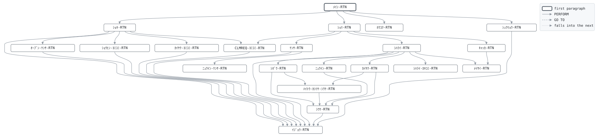

# GLD030

```text
GLD030: 給付支払

日次。支社からの給付請求ファイル CLMREQ を読み、死亡保険金、
入院給付金、解約返戻金を支払う。
検査は種別、契約の有無、事由発生日 (和暦で届く)、事由が契約
日以後であること、契約の状態: 死亡・入院は保障中 (有効・
猶予中)、解約は失効中でもよい。
死亡: 保険金額に配当累計を加え、貸付残高を引いた額。支払済
とする。
入院: 医療保険に限る。日数は 1 以上、120 日まで。契約日から
免責日数の間の入院は支払わない。日額は保険金額に入院日額率
を掛けて 1,000 で割った額。契約はそのまま。
解約: 解約返戻金係数 (商品・加入年齢区分・経過年数) を保険
金額 1,000 円あたりに掛け、貸付残高を引いた額。0 以下なら
支払なしで解約とする。
貸付残高は支払時に回収し、仕訳する。

復帰コード: 0 全件支払、4 却下あり、8 日付が日付でない、
            16 ファイル異常。

変更履歴
日付       担当 変更
1987-04-01 KT   GL-0001 初版。
2001-07-02 MS   GL-0271 死亡保険金に配当累計を加える。
2008-06-02 YN   GL-0455 入院給付金、免責期間。
```

Program [GLD030.cbl](../../../gondwana/programs/GLD030.cbl): 9 files, 21 paragraphs. Its business rules: [15 decision tables](../rules/GLD030.md).

- AUTHOR: ゴンドワナ生命 システム部.
- DATE-WRITTEN: 1987-04-01.

## Contents

- [Files](#files)
- [Flow](#flow)
- [Paragraphs](#paragraphs)
- [Calls](#calls)
- [Data flow](#data-flow)
- [Lineage](#lineage)
  - [Into CR-ｾｲｷｭｳ-ﾚｺｰﾄﾞ](#into-cr-ｾｲｷｭｳ-ﾚｺｰﾄﾞ)
  - [Into PM-ｹｲﾔｸ-ﾚｺｰﾄﾞ](#into-pm-ｹｲﾔｸ-ﾚｺｰﾄﾞ)
  - [Into PR-ｼｮｳﾋﾝ-ﾚｺｰﾄﾞ](#into-pr-ｼｮｳﾋﾝ-ﾚｺｰﾄﾞ)
  - [Into CV-ｶｲﾔｸﾍﾝﾚｲｷﾝ-ﾚｺｰﾄﾞ](#into-cv-ｶｲﾔｸﾍﾝﾚｲｷﾝ-ﾚｺｰﾄﾞ)
  - [Into CT-ｾｲｷﾞｮ-ﾚｺｰﾄﾞ](#into-ct-ｾｲｷﾞｮ-ﾚｺｰﾄﾞ)
  - [Into PY-ｼﾊﾗｲ-ﾚｺｰﾄﾞ](#into-py-ｼﾊﾗｲ-ﾚｺｰﾄﾞ)
  - [Into JR-ｼﾜｹ-ﾚｺｰﾄﾞ](#into-jr-ｼﾜｹ-ﾚｺｰﾄﾞ)
  - [Into ｷｬｯｶ-ﾚｺｰﾄﾞ](#into-ｷｬｯｶ-ﾚｺｰﾄﾞ)
  - [Into ﾎｳｺｸ-ｷﾞｮｳ](#into-ﾎｳｺｸ-ｷﾞｮｳ)
  - [Into WS-ｺﾏﾝﾄﾞｷﾞｮｳ](#into-ws-ｺﾏﾝﾄﾞｷﾞｮｳ)
  - [Into WS-ｴﾗｰﾌｧｲﾙ](#into-ws-ｴﾗｰﾌｧｲﾙ)
  - [Into WS-ｴﾗｰｽﾃｰﾀｽ](#into-ws-ｴﾗｰｽﾃｰﾀｽ)
  - [Into WS-ｷﾞｮｳﾑﾋﾂﾞｹ](#into-ws-ｷﾞｮｳﾑﾋﾂﾞｹ)
  - [Into WS-ｷﾞｮｳﾑﾋﾂﾞｹ-ﾜﾚｷ](#into-ws-ｷﾞｮｳﾑﾋﾂﾞｹ-ﾜﾚｷ)
  - [Into WS-ﾎｳｺｳ](#into-ws-ﾎｳｺｳ)
  - [Into WS-ﾍﾝｶﾝｹｯｶ](#into-ws-ﾍﾝｶﾝｹｯｶ)
  - [Into WS-ｼﾞﾕｳﾋﾞ](#into-ws-ｼﾞﾕｳﾋﾞ)
  - [Into WS-ｹｲﾔｸﾋﾞ](#into-ws-ｹｲﾔｸﾋﾞ)
  - [Into WS-ｹｲｶﾆｯｽｳ](#into-ws-ｹｲｶﾆｯｽｳ)
  - [Into WS-ﾆｯｽｳ](#into-ws-ﾆｯｽｳ)
  - [Into WS-ﾆﾁｶﾞｸ](#into-ws-ﾆﾁｶﾞｸ)
  - [Into WS-ｷﾝｶﾞｸ](#into-ws-ｷﾝｶﾞｸ)
  - [Into WS-ﾈﾝﾚｲｸﾌﾞﾝ](#into-ws-ﾈﾝﾚｲｸﾌﾞﾝ)
  - [Into WS-ｼｮｳﾋﾝ-TBL](#into-ws-ｼｮｳﾋﾝ-tbl)
  - [Into WS-ｶｲﾔｸ-TBL](#into-ws-ｶｲﾔｸ-tbl)
  - [Into WS-ｹﾝｽｳ](#into-ws-ｹﾝｽｳ)
  - [Into WS-ﾘﾕｳ](#into-ws-ﾘﾕｳ)
  - [Into WS-ｼｭﾍﾞﾂﾒｲ](#into-ws-ｼｭﾍﾞﾂﾒｲ)
  - [Into WS-ﾌｯｷｺｰﾄﾞ](#into-ws-ﾌｯｷｺｰﾄﾞ)
  - [Into WS-ﾎｳｺｸ](#into-ws-ﾎｳｺｸ)
  - [Out of the program](#out-of-the-program)
  - [Into other data items](#into-other-data-items)
- [Field origins](#field-origins)
  - [File REPORT-F](#file-report-f)
  - [File POLMST-F](#file-polmst-f)
  - [File GLJRNL-F](#file-gljrnl-f)
  - [File PAYOUT-F](#file-payout-f)
  - [File REJECT-F](#file-reject-f)
  - [File GLSCTL-F](#file-glsctl-f)
- [Links between records](#links-between-records)
- [Records](#records)
  - [CR-ｾｲｷｭｳ-ﾚｺｰﾄﾞ](#cr-ｾｲｷｭｳ-ﾚｺｰﾄﾞ)
  - [PM-ｹｲﾔｸ-ﾚｺｰﾄﾞ](#pm-ｹｲﾔｸ-ﾚｺｰﾄﾞ)
  - [PR-ｼｮｳﾋﾝ-ﾚｺｰﾄﾞ](#pr-ｼｮｳﾋﾝ-ﾚｺｰﾄﾞ)
  - [CV-ｶｲﾔｸﾍﾝﾚｲｷﾝ-ﾚｺｰﾄﾞ](#cv-ｶｲﾔｸﾍﾝﾚｲｷﾝ-ﾚｺｰﾄﾞ)
  - [CT-ｾｲｷﾞｮ-ﾚｺｰﾄﾞ](#ct-ｾｲｷﾞｮ-ﾚｺｰﾄﾞ)
  - [PY-ｼﾊﾗｲ-ﾚｺｰﾄﾞ](#py-ｼﾊﾗｲ-ﾚｺｰﾄﾞ)
  - [JR-ｼﾜｹ-ﾚｺｰﾄﾞ](#jr-ｼﾜｹ-ﾚｺｰﾄﾞ)
  - [ｷｬｯｶ-ﾚｺｰﾄﾞ](#ｷｬｯｶ-ﾚｺｰﾄﾞ)
  - [ﾎｳｺｸ-ｷﾞｮｳ](#ﾎｳｺｸ-ｷﾞｮｳ)
  - [WS-ｽﾃｰﾀｽ](#ws-ｽﾃｰﾀｽ)
  - [WS-ｺﾏﾝﾄﾞｷﾞｮｳ](#ws-ｺﾏﾝﾄﾞｷﾞｮｳ)
  - [WS-ｴﾗｰﾌｧｲﾙ](#ws-ｴﾗｰﾌｧｲﾙ)
  - [WS-ｴﾗｰｽﾃｰﾀｽ](#ws-ｴﾗｰｽﾃｰﾀｽ)
  - [WS-ｷﾞｮｳﾑﾋﾂﾞｹ](#ws-ｷﾞｮｳﾑﾋﾂﾞｹ)
  - [WS-ｷﾞｮｳﾑﾋﾂﾞｹ-ﾜﾚｷ](#ws-ｷﾞｮｳﾑﾋﾂﾞｹ-ﾜﾚｷ)
  - [WS-ﾎｳｺｳ](#ws-ﾎｳｺｳ)
  - [WS-ﾍﾝｶﾝｹｯｶ](#ws-ﾍﾝｶﾝｹｯｶ)
  - [WS-ｼﾞﾕｳﾋﾞ](#ws-ｼﾞﾕｳﾋﾞ)
  - [WS-ｹｲﾔｸﾋﾞ](#ws-ｹｲﾔｸﾋﾞ)
  - [WS-ｹｲｶﾆｯｽｳ](#ws-ｹｲｶﾆｯｽｳ)
  - [WS-ﾆｯｽｳ](#ws-ﾆｯｽｳ)
  - [WS-ﾆﾁｶﾞｸ](#ws-ﾆﾁｶﾞｸ)
  - [WS-ｷﾝｶﾞｸ](#ws-ｷﾝｶﾞｸ)
  - [WS-ﾈﾝﾚｲｸﾌﾞﾝ](#ws-ﾈﾝﾚｲｸﾌﾞﾝ)
  - [WS-ｼﾊﾗｲｼｭﾍﾞﾂ](#ws-ｼﾊﾗｲｼｭﾍﾞﾂ)
  - [WS-ｼｮｳﾋﾝ-TBL](#ws-ｼｮｳﾋﾝ-tbl)
  - [WS-ﾘｮｳﾘﾂ-TBL](#ws-ﾘｮｳﾘﾂ-tbl)
  - [WS-ﾈﾝﾚｲ-ｿｴｼﾞ](#ws-ﾈﾝﾚｲ-ｿｴｼﾞ)
  - [WS-ｶｲﾔｸ-TBL](#ws-ｶｲﾔｸ-tbl)
  - [WS-ｹﾝｽｳ](#ws-ｹﾝｽｳ)
  - [WS-ﾘﾕｳ](#ws-ﾘﾕｳ)
  - [WS-ﾘﾕｳ-ﾒｯｾｰｼﾞ](#ws-ﾘﾕｳ-ﾒｯｾｰｼﾞ)
  - [WS-ﾘﾕｳ-ﾒｯｾｰｼﾞ-TBL](#ws-ﾘﾕｳ-ﾒｯｾｰｼﾞ-tbl)
  - [WS-ｼｭﾍﾞﾂﾒｲ](#ws-ｼｭﾍﾞﾂﾒｲ)
  - [WS-ﾌｯｷｺｰﾄﾞ](#ws-ﾌｯｷｺｰﾄﾞ)
  - [WS-ﾎｳｺｸ](#ws-ﾎｳｺｸ)

## Files

| File | Kind | Assigned to | Organization | Status field | Opened | Records |
| --- | --- | --- | --- | --- | --- | --- |
| CLMREQ-F | FD | CLMREQ | LINE SEQUENTIAL | WS-CLMREQ-ST | INPUT | CR-ｾｲｷｭｳ-ﾚｺｰﾄﾞ |
| POLMST-F | FD | POLMST | INDEXED, key PM-ｼｮｳｹﾝﾊﾞﾝｺﾞｳ, RANDOM access | WS-POLMST-ST | I-O | PM-ｹｲﾔｸ-ﾚｺｰﾄﾞ |
| PRODTB-F | FD | PRODTB | LINE SEQUENTIAL | WS-PRODTB-ST | INPUT | PR-ｼｮｳﾋﾝ-ﾚｺｰﾄﾞ |
| CSVTB-F | FD | CSVTB | LINE SEQUENTIAL | WS-CSVTB-ST | INPUT | CV-ｶｲﾔｸﾍﾝﾚｲｷﾝ-ﾚｺｰﾄﾞ |
| GLSCTL-F | FD | GLSCTL | SEQUENTIAL | WS-GLSCTL-ST | I-O | CT-ｾｲｷﾞｮ-ﾚｺｰﾄﾞ |
| PAYOUT-F | FD | PAYOUT | LINE SEQUENTIAL | WS-PAYOUT-ST | EXTEND | PY-ｼﾊﾗｲ-ﾚｺｰﾄﾞ |
| GLJRNL-F | FD | GLJRNL | LINE SEQUENTIAL | WS-GLJRNL-ST | EXTEND | JR-ｼﾜｹ-ﾚｺｰﾄﾞ |
| REJECT-F | FD | CLMREJ | LINE SEQUENTIAL | WS-REJECT-ST | OUTPUT | ｷｬｯｶ-ﾚｺｰﾄﾞ |
| REPORT-F | FD | GLD030R | LINE SEQUENTIAL | WS-REPORT-ST | OUTPUT | ﾎｳｺｸ-ｷﾞｮｳ |

## Flow



## Paragraphs

| Paragraph | Description | Source | Performs | Goes to | Performed by | Reached by |
| --- | --- | --- | --- | --- | --- | --- |
| ﾒｲﾝ-RTN | ﾒｲﾝ-RTN: 準備、1件ずつの支払、報告、終了。 | [GLD030.cbl:187](../../../gondwana/programs/GLD030.cbl#L187) | ｼｮｷ-RTN, ｼｮﾘ-RTN, ﾎｳｺｸ-RTN, ｼｭｳﾘｮｳ-RTN | | | |
| ｼｮｷ-RTN | ｼｮｷ-RTN: 業務日付、ファイル、テーブル、制御レコード。 | [GLD030.cbl:198](../../../gondwana/programs/GLD030.cbl#L198) | ｵｰﾌﾟﾝ-ｹﾝｻ-RTN, ｼｮｳﾋﾝ-ﾖﾐｺﾐ-RTN, ｶｲﾔｸ-ﾖﾐｺﾐ-RTN, ｲｼﾞｮｳ-RTN, CLMREQ-ﾖﾐｺﾐ-RTN | | ﾒｲﾝ-RTN | |
| ｵｰﾌﾟﾝ-ｹﾝｻ-RTN | ｵｰﾌﾟﾝ-ｹﾝｻ-RTN: 開けなかったファイルがあれば異常終了。 | [GLD030.cbl:232](../../../gondwana/programs/GLD030.cbl#L232) | ｲｼﾞｮｳ-RTN | | ｼｮｷ-RTN | |
| ｶｲﾔｸ-ﾖﾐｺﾐ-RTN | ｶｲﾔｸ-ﾖﾐｺﾐ-RTN: 解約返戻金係数を商品・年齢区分・経過年数の テーブルに読み込む。商品テーブルにない商品は読み飛ばす。 | [GLD030.cbl:272](../../../gondwana/programs/GLD030.cbl#L272) | ｲｼﾞｮｳ-RTN | | ｼｮｷ-RTN | |
| CLMREQ-ﾖﾐｺﾐ-RTN | CLMREQ-ﾖﾐｺﾐ-RTN: 請求ファイルの次の行。 | [GLD030.cbl:294](../../../gondwana/programs/GLD030.cbl#L294) | ｲｼﾞｮｳ-RTN | | ｼｮｷ-RTN, ｼｮﾘ-RTN | |
| ｼｮﾘ-RTN | ｼｮﾘ-RTN: 1件を検査し、通れば支払、通らなければ却下。 | [GLD030.cbl:309](../../../gondwana/programs/GLD030.cbl#L309) | ｹﾝｻ-RTN, ｼﾊﾗｲ-RTN, ｷｬｯｶ-RTN, CLMREQ-ﾖﾐｺﾐ-RTN | | ﾒｲﾝ-RTN | |
| ｹﾝｻ-RTN | ｹﾝｻ-RTN: 請求に共通の検査、次いで種別ごとの検査。 | [GLD030.cbl:321](../../../gondwana/programs/GLD030.cbl#L321) | ｲｼﾞｮｳ-RTN, ﾆｭｳｲﾝ-ｹﾝｻ-RTN | | ｼｮﾘ-RTN | |
| ﾆｭｳｲﾝ-ｹﾝｻ-RTN | ﾆｭｳｲﾝ-ｹﾝｻ-RTN: 医療保険であること、日数、免責期間。 | [GLD030.cbl:377](../../../gondwana/programs/GLD030.cbl#L377) | | | ｹﾝｻ-RTN | |
| ｼﾊﾗｲ-RTN | ｼﾊﾗｲ-RTN: 種別ごとに金額を求め、支払を書き、契約を更新する。 | [GLD030.cbl:397](../../../gondwana/programs/GLD030.cbl#L397) | ｼﾎﾞｳ-RTN, ﾆｭｳｲﾝ-RTN, ｶｲﾔｸ-RTN, ｼﾊﾗｲ-ｶｷｺﾐ-RTN, ｲｼﾞｮｳ-RTN, ﾒｲｻｲ-RTN | | ｼｮﾘ-RTN | |
| ｼﾎﾞｳ-RTN | ｼﾎﾞｳ-RTN: 保険金額に配当累計を加え、貸付残高を引く。 | [GLD030.cbl:425](../../../gondwana/programs/GLD030.cbl#L425) | ｼﾜｹ-RTN, ﾊｲﾄｳ-ｶｼﾂｹ-ｼﾜｹ-RTN | | ｼﾊﾗｲ-RTN | |
| ﾆｭｳｲﾝ-RTN | ﾆｭｳｲﾝ-RTN: 日額に日数を掛ける。日数は 120 日まで。 | [GLD030.cbl:441](../../../gondwana/programs/GLD030.cbl#L441) | ｼﾜｹ-RTN | | ｼﾊﾗｲ-RTN | |
| ｶｲﾔｸ-RTN | ｶｲﾔｸ-RTN: 係数から解約返戻金を求め、貸付残高を引く。0 以下 なら支払なし。 | [GLD030.cbl:461](../../../gondwana/programs/GLD030.cbl#L461) | ｼﾜｹ-RTN, ﾊｲﾄｳ-ｶｼﾂｹ-ｼﾜｹ-RTN | | ｼﾊﾗｲ-RTN | |
| ﾊｲﾄｳ-ｶｼﾂｹ-ｼﾜｹ-RTN | ﾊｲﾄｳ-ｶｼﾂｹ-ｼﾜｹ-RTN: 配当累計の支払と貸付残高の回収の仕訳。 | [GLD030.cbl:500](../../../gondwana/programs/GLD030.cbl#L500) | ｼﾜｹ-RTN | | ｼﾎﾞｳ-RTN, ｶｲﾔｸ-RTN | |
| ｼﾜｹ-RTN | ｼﾜｹ-RTN: 仕訳1行。科目、貸借、金額、摘要は呼ぶ側が入れる。 | [GLD030.cbl:519](../../../gondwana/programs/GLD030.cbl#L519) | ｲｼﾞｮｳ-RTN | | ｼﾎﾞｳ-RTN, ﾆｭｳｲﾝ-RTN, ｶｲﾔｸ-RTN, ﾊｲﾄｳ-ｶｼﾂｹ-ｼﾜｹ-RTN | |
| ｼﾊﾗｲ-ｶｷｺﾐ-RTN | ｼﾊﾗｲ-ｶｷｺﾐ-RTN: 支払レコードを採番して書く。 | [GLD030.cbl:535](../../../gondwana/programs/GLD030.cbl#L535) | | | ｼﾊﾗｲ-RTN | |
| ｷｬｯｶ-RTN | ｷｬｯｶ-RTN: 却下ファイルに理由を付けて書き、明細を報告する。 | [GLD030.cbl:549](../../../gondwana/programs/GLD030.cbl#L549) | ﾒｲｻｲ-RTN | | ｼｮﾘ-RTN | |
| ﾒｲｻｲ-RTN | ﾒｲｻｲ-RTN: 1件の明細行。 | [GLD030.cbl:562](../../../gondwana/programs/GLD030.cbl#L562) | | | ｼﾊﾗｲ-RTN, ｷｬｯｶ-RTN | |
| ﾎｳｺｸ-RTN | ﾎｳｺｸ-RTN: 件数と合計。 | [GLD030.cbl:572](../../../gondwana/programs/GLD030.cbl#L572) | | | ﾒｲﾝ-RTN | |
| ｼｭｳﾘｮｳ-RTN | ｼｭｳﾘｮｳ-RTN: 制御レコードを書き戻し、ファイルを閉じる。 | [GLD030.cbl:591](../../../gondwana/programs/GLD030.cbl#L591) | ｲｼﾞｮｳ-RTN | | ﾒｲﾝ-RTN | |
| ｲｼﾞｮｳ-RTN | ｲｼﾞｮｳ-RTN: ファイル異常は 16 で終わる。 | [GLD030.cbl:606](../../../gondwana/programs/GLD030.cbl#L606) | | | ｼｮｷ-RTN, ｵｰﾌﾟﾝ-ｹﾝｻ-RTN, ｶｲﾔｸ-ﾖﾐｺﾐ-RTN, CLMREQ-ﾖﾐｺﾐ-RTN, ｹﾝｻ-RTN, ｼﾊﾗｲ-RTN, ｼﾜｹ-RTN, ｼｭｳﾘｮｳ-RTN, ｼｮｳﾋﾝ-ﾖﾐｺﾐ-RTN | |
| ｼｮｳﾋﾝ-ﾖﾐｺﾐ-RTN | ｼｮｳﾋﾝ-ﾖﾐｺﾐ-RTN: 商品テーブルを読み込む。 | [PRDLOD.cpy:16](../../../gondwana/copybooks/PRDLOD.cpy#L16) | ｲｼﾞｮｳ-RTN | | ｼｮｷ-RTN | |

## Calls

| Calls | Passing | Paragraph | Source |
| --- | --- | --- | --- |
| [GLC020](GLC020.md) | WS-ﾎｳｺｳ, WS-ｷﾞｮｳﾑﾋﾂﾞｹ, WS-ｷﾞｮｳﾑﾋﾂﾞｹ-ﾜﾚｷ, WS-ﾍﾝｶﾝｹｯｶ | ｼｮｷ-RTN | [GLD030.cbl:202](../../../gondwana/programs/GLD030.cbl#L202) |
| [GLC020](GLC020.md) | WS-ﾎｳｺｳ, WS-ｼﾞﾕｳﾋﾞ, CR-ｼﾞﾕｳﾊｯｾｲﾋﾞ, WS-ﾍﾝｶﾝｹｯｶ | ｹﾝｻ-RTN | [GLD030.cbl:350](../../../gondwana/programs/GLD030.cbl#L350) |
| [GLC020](GLC020.md) | WS-ﾎｳｺｳ, WS-ｹｲﾔｸﾋﾞ, PM-ｹｲﾔｸﾋﾞ, WS-ﾍﾝｶﾝｹｯｶ | ｹﾝｻ-RTN | [GLD030.cbl:357](../../../gondwana/programs/GLD030.cbl#L357) |

## Data flow

| Paragraph | Reads | Writes |
| --- | --- | --- |
| ﾒｲﾝ-RTN | WS-CLMREQ-ST, WS-ﾌｯｷｺｰﾄﾞ | RETURN-CODE |
| ｼｮｷ-RTN | WS-ｺﾏﾝﾄﾞｷﾞｮｳ, WS-ﾎｳｺｳ, WS-ｷﾞｮｳﾑﾋﾂﾞｹ, WS-ｷﾞｮｳﾑﾋﾂﾞｹ-ﾜﾚｷ, WS-ﾍﾝｶﾝｹｯｶ, WS-GLSCTL-ST, WS-ﾋｮｳﾀﾞｲ-ｷﾞｮｳ | WS-ｺﾏﾝﾄﾞｷﾞｮｳ, WS-ｷﾞｮｳﾑﾋﾂﾞｹ, WS-ﾎｳｺｳ, WS-ｷﾞｮｳﾑﾋﾂﾞｹ-ﾜﾚｷ, WS-ﾍﾝｶﾝｹｯｶ, RETURN-CODE, WS-CLMREQ-ST, WS-PRODTB-ST, WS-CSVTB-ST, WS-POLMST-ST, WS-GLSCTL-ST, WS-PAYOUT-ST, WS-GLJRNL-ST, WS-REJECT-ST, WS-REPORT-ST, PY-ｼﾊﾗｲ-ﾚｺｰﾄﾞ, JR-ｼﾜｹ-ﾚｺｰﾄﾞ, CT-ｾｲｷﾞｮ-ﾚｺｰﾄﾞ, WS-ｴﾗｰﾌｧｲﾙ, WS-ｴﾗｰｽﾃｰﾀｽ, WS-ﾋｮｳﾀﾞｲ-ﾋﾂﾞｹ, ﾎｳｺｸ-ｷﾞｮｳ |
| ｵｰﾌﾟﾝ-ｹﾝｻ-RTN | WS-CLMREQ-ST, WS-PRODTB-ST, WS-CSVTB-ST, WS-POLMST-ST, WS-GLSCTL-ST, WS-PAYOUT-ST, WS-GLJRNL-ST, WS-REJECT-ST, WS-REPORT-ST, WS-ｴﾗｰﾌｧｲﾙ | WS-ｴﾗｰﾌｧｲﾙ, WS-ｴﾗｰｽﾃｰﾀｽ |
| ｶｲﾔｸ-ﾖﾐｺﾐ-RTN | WS-CSVTB-ST, WS-ｼｮｳﾋﾝ, WS-ｼｮｳﾋﾝ-ｺｰﾄﾞ, WS-ｼｮｳﾋﾝ-IX, CV-ｼｮｳﾋﾝ, CV-ｹｲｽｳ, CV-ﾈﾝﾚｲｸﾌﾞﾝ, CV-ｹｲｶﾈﾝｽｳ | WS-ｶｲﾔｸ-TBL, CV-ｶｲﾔｸﾍﾝﾚｲｷﾝ-ﾚｺｰﾄﾞ, WS-CSVTB-ST, WS-ｼｮｳﾋﾝ-IX, WS-ｶｲﾔｸ-ｹｲｽｳ, WS-ｴﾗｰﾌｧｲﾙ, WS-ｴﾗｰｽﾃｰﾀｽ |
| CLMREQ-ﾖﾐｺﾐ-RTN | WS-CLMREQ-ST, WS-ﾖﾐｺﾐｹﾝｽｳ | CR-ｾｲｷｭｳ-ﾚｺｰﾄﾞ, WS-CLMREQ-ST, WS-ﾖﾐｺﾐｹﾝｽｳ, WS-ｴﾗｰﾌｧｲﾙ, WS-ｴﾗｰｽﾃｰﾀｽ |
| ｼｮﾘ-RTN | WS-ﾘﾕｳ | |
| ｹﾝｻ-RTN | CR-ｼｭﾍﾞﾂ, WS-ﾘﾕｳ, CR-ｼｮｳｹﾝﾊﾞﾝｺﾞｳ, WS-POLMST-ST, WS-ﾎｳｺｳ, WS-ｼﾞﾕｳﾋﾞ, CR-ｼﾞﾕｳﾊｯｾｲﾋﾞ, WS-ﾍﾝｶﾝｹｯｶ, WS-ｹｲﾔｸﾋﾞ, PM-ｹｲﾔｸﾋﾞ, PM-ｼﾞｮｳﾀｲ | WS-ﾘﾕｳ, WS-ｷﾝｶﾞｸ, WS-ｼｭﾍﾞﾂﾒｲ, PM-ｼｮｳｹﾝﾊﾞﾝｺﾞｳ, PM-ｹｲﾔｸ-ﾚｺｰﾄﾞ, WS-POLMST-ST, WS-ｴﾗｰﾌｧｲﾙ, WS-ｴﾗｰｽﾃｰﾀｽ, WS-ﾎｳｺｳ, WS-ｼﾞﾕｳﾋﾞ, CR-ｼﾞﾕｳﾊｯｾｲﾋﾞ, WS-ﾍﾝｶﾝｹｯｶ, WS-ｹｲﾔｸﾋﾞ, PM-ｹｲﾔｸﾋﾞ |
| ﾆｭｳｲﾝ-ｹﾝｻ-RTN | WS-ｼｮｳﾋﾝ, WS-ｼｮｳﾋﾝ-ｺｰﾄﾞ, WS-ｼｮｳﾋﾝ-IX, PM-ｼｮｳﾋﾝ, WS-ｼﾞﾕｳﾋﾞ, WS-ｹｲﾔｸﾋﾞ, WS-ｼｮｳﾋﾝ-ｼｭﾙｲ, CR-ﾆｯｽｳ, WS-ｹｲｶﾆｯｽｳ, WS-ｼｮｳﾋﾝ-ﾒﾝｾｷﾆｯｽｳ | WS-ｼｮｳﾋﾝ-IX, WS-ｹｲｶﾆｯｽｳ, WS-ﾘﾕｳ |
| ｼﾊﾗｲ-RTN | CR-ｼｭﾍﾞﾂ, WS-ｷﾝｶﾞｸ, WS-ｷﾞｮｳﾑﾋﾂﾞｹ-ﾜﾚｷ, WS-POLMST-ST, WS-ｼﾊﾗｲｹﾝｽｳ | PM-ｼﾞｮｳﾀｲﾋﾂﾞｹ, PM-ｹｲﾔｸ-ﾚｺｰﾄﾞ, WS-POLMST-ST, WS-ｴﾗｰﾌｧｲﾙ, WS-ｴﾗｰｽﾃｰﾀｽ, WS-ｼﾊﾗｲｹﾝｽｳ, WS-ﾒｲｻｲ-ｹｯｶ |
| ｼﾎﾞｳ-RTN | PM-ﾎｹﾝｷﾝｶﾞｸ, PM-ﾊｲﾄｳﾙｲｹｲ, PM-ｶｼﾂｹｻﾞﾝﾀﾞｶ | WS-ｷﾝｶﾞｸ, JR-ｶﾝｼﾞｮｳｶﾓｸ, JR-ｷﾝｶﾞｸ, JR-ﾀｲｼｬｸ, JR-ﾃｷﾖｳ, PM-ﾊｲﾄｳﾙｲｹｲ, PM-ｶｼﾂｹｻﾞﾝﾀﾞｶ, PM-ｼﾞｮｳﾀｲ, PY-ｼｭﾍﾞﾂ |
| ﾆｭｳｲﾝ-RTN | CR-ﾆｯｽｳ, PM-ﾎｹﾝｷﾝｶﾞｸ, WS-ｼｮｳﾋﾝ-ﾆｭｳｲﾝﾆﾁｶﾞｸﾘﾂ, WS-ｼｮｳﾋﾝ-IX, WS-ﾆﾁｶﾞｸ, WS-ﾆｯｽｳ, WS-ｷﾝｶﾞｸ | WS-ﾆｯｽｳ, WS-ﾆﾁｶﾞｸ, WS-ｷﾝｶﾞｸ, JR-ｶﾝｼﾞｮｳｶﾓｸ, JR-ｷﾝｶﾞｸ, JR-ﾀｲｼｬｸ, JR-ﾃｷﾖｳ, PY-ｼｭﾍﾞﾂ |
| ｶｲﾔｸ-RTN | WS-ｼｮｳﾋﾝ, WS-ｼｮｳﾋﾝ-ｺｰﾄﾞ, WS-ｼｮｳﾋﾝ-IX, PM-ｼｮｳﾋﾝ, PM-ｶﾆｭｳﾈﾝﾚｲ, PM-ｹｲｶﾈﾝｽｳ, PM-ﾎｹﾝｷﾝｶﾞｸ, WS-ｶｲﾔｸ-ｹｲｽｳ, WS-ﾈﾝﾚｲｸﾌﾞﾝ, WS-ﾆｯｽｳ, PM-ｶｼﾂｹｻﾞﾝﾀﾞｶ, WS-ｷﾝｶﾞｸ | WS-ｼｮｳﾋﾝ-IX, WS-ﾈﾝﾚｲｸﾌﾞﾝ, WS-ﾆｯｽｳ, WS-ｷﾝｶﾞｸ, JR-ｶﾝｼﾞｮｳｶﾓｸ, JR-ｷﾝｶﾞｸ, JR-ﾀｲｼｬｸ, JR-ﾃｷﾖｳ, PM-ｶｼﾂｹｻﾞﾝﾀﾞｶ, PM-ｼﾞｮｳﾀｲ, PY-ｼｭﾍﾞﾂ |
| ﾊｲﾄｳ-ｶｼﾂｹ-ｼﾜｹ-RTN | CR-ｼｭﾍﾞﾂ, PM-ﾊｲﾄｳﾙｲｹｲ, PM-ｶｼﾂｹｻﾞﾝﾀﾞｶ | JR-ｶﾝｼﾞｮｳｶﾓｸ, JR-ｷﾝｶﾞｸ, JR-ﾀｲｼｬｸ, JR-ﾃｷﾖｳ |
| ｼﾜｹ-RTN | CT-ｼﾞｶｲｼﾜｹﾊﾞﾝｺﾞｳ, WS-ｷﾞｮｳﾑﾋﾂﾞｹ-ﾜﾚｷ, PM-ｼｮｳｹﾝﾊﾞﾝｺﾞｳ, WS-GLJRNL-ST | JR-ｼﾜｹﾊﾞﾝｺﾞｳ, CT-ｼﾞｶｲｼﾜｹﾊﾞﾝｺﾞｳ, JR-ﾋﾂﾞｹ, JR-ﾌﾟﾛｸﾞﾗﾑ, JR-ｼｮｳｹﾝﾊﾞﾝｺﾞｳ, JR-ｼﾜｹ-ﾚｺｰﾄﾞ, WS-GLJRNL-ST, WS-ｴﾗｰﾌｧｲﾙ, WS-ｴﾗｰｽﾃｰﾀｽ |
| ｼﾊﾗｲ-ｶｷｺﾐ-RTN | CT-ｼﾞｶｲｼﾊﾗｲﾊﾞﾝｺﾞｳ, WS-ｷﾞｮｳﾑﾋﾂﾞｹ-ﾜﾚｷ, PM-ｼｮｳｹﾝﾊﾞﾝｺﾞｳ, WS-ｷﾝｶﾞｸ, CR-ｳｹﾄﾘﾆﾝｶﾅ, CR-ｾｲｷｭｳﾊﾞﾝｺﾞｳ, WS-ｼﾊﾗｲｷﾝｶﾞｸ | PY-ｼﾊﾗｲﾊﾞﾝｺﾞｳ, CT-ｼﾞｶｲｼﾊﾗｲﾊﾞﾝｺﾞｳ, PY-ｼﾊﾗｲﾋﾞ, PY-ｼｮｳｹﾝﾊﾞﾝｺﾞｳ, PY-ｷﾝｶﾞｸ, PY-ｳｹﾄﾘﾆﾝｶﾅ, PY-ｾｲｷｭｳﾊﾞﾝｺﾞｳ, PY-ｼﾊﾗｲ-ﾚｺｰﾄﾞ, WS-PAYOUT-ST, WS-ｼﾊﾗｲｷﾝｶﾞｸ |
| ｷｬｯｶ-RTN | CR-ｾｲｷｭｳ-ﾚｺｰﾄﾞ, WS-ﾘﾕｳ, WS-ﾒｯｾｰｼﾞ, WS-ｷｬｯｶｹﾝｽｳ | ｷｬｯｶ-ﾃﾞｰﾀ, ｷｬｯｶ-ﾘﾕｳ, ｷｬｯｶ-ﾒｯｾｰｼﾞ, ｷｬｯｶ-ﾚｺｰﾄﾞ, WS-REJECT-ST, WS-ｷｬｯｶｹﾝｽｳ, WS-ﾌｯｷｺｰﾄﾞ, WS-ﾒｲｻｲ-ｹｯｶ |
| ﾒｲｻｲ-RTN | CR-ｾｲｷｭｳﾊﾞﾝｺﾞｳ, CR-ｼｮｳｹﾝﾊﾞﾝｺﾞｳ, WS-ｼｭﾍﾞﾂﾒｲ, WS-ｷﾝｶﾞｸ, WS-ﾒｲｻｲ-ｷﾞｮｳ | WS-ﾒｲｻｲ-ｾｲｷｭｳ, WS-ﾒｲｻｲ-ｼｮｳｹﾝ, WS-ﾒｲｻｲ-ｼｭﾍﾞﾂ, WS-ﾒｲｻｲ-ｷﾝｶﾞｸ, ﾎｳｺｸ-ｷﾞｮｳ, WS-REPORT-ST |
| ﾎｳｺｸ-RTN | WS-ﾖﾐｺﾐｹﾝｽｳ, WS-ｹﾝｽｳ-ｷﾞｮｳ, WS-ｼﾊﾗｲｹﾝｽｳ, WS-ｷｬｯｶｹﾝｽｳ, WS-ｼﾊﾗｲｷﾝｶﾞｸ | ﾎｳｺｸ-ｷﾞｮｳ, WS-REPORT-ST, WS-ｹﾝｽｳ-ﾗﾍﾞﾙ, WS-ｹﾝｽｳ-ｱﾀｲ |
| ｼｭｳﾘｮｳ-RTN | WS-GLSCTL-ST, WS-ｼﾊﾗｲｹﾝｽｳ, WS-ｷｬｯｶｹﾝｽｳ | CT-ｾｲｷﾞｮ-ﾚｺｰﾄﾞ, WS-GLSCTL-ST, WS-ｴﾗｰﾌｧｲﾙ, WS-ｴﾗｰｽﾃｰﾀｽ, WS-CLMREQ-ST, WS-POLMST-ST, WS-PRODTB-ST, WS-CSVTB-ST, WS-PAYOUT-ST, WS-GLJRNL-ST, WS-REJECT-ST, WS-REPORT-ST |
| ｲｼﾞｮｳ-RTN | WS-ｴﾗｰﾌｧｲﾙ, WS-ｴﾗｰｽﾃｰﾀｽ | RETURN-CODE |
| ｼｮｳﾋﾝ-ﾖﾐｺﾐ-RTN | WS-PRODTB-ST, WS-ｼｮｳﾋﾝｹﾝｽｳ, PR-ｺｰﾄﾞ, WS-ｼｮｳﾋﾝ-IX, PR-ﾒｲｼｮｳ, PR-ｼｭﾙｲ, PR-ｻｲﾃｲﾈﾝﾚｲ, PR-ｻｲｺｳﾈﾝﾚｲ, PR-ﾎｹﾝｷｶﾝ, PR-ｻｲﾃｲﾎｹﾝｷﾝｶﾞｸ, PR-ｻｲｺｳﾎｹﾝｷﾝｶﾞｸ, PR-ﾆｭｳｲﾝﾆﾁｶﾞｸﾘﾂ, PR-ﾒﾝｾｷﾆｯｽｳ, PR-ﾊｲﾄｳﾘﾂ | PR-ｼｮｳﾋﾝ-ﾚｺｰﾄﾞ, WS-PRODTB-ST, WS-ｼｮｳﾋﾝｹﾝｽｳ, WS-ｼｮｳﾋﾝ-IX, WS-ｼｮｳﾋﾝ-ｺｰﾄﾞ, WS-ｼｮｳﾋﾝ-ﾒｲｼｮｳ, WS-ｼｮｳﾋﾝ-ｼｭﾙｲ, WS-ｼｮｳﾋﾝ-ｻｲﾃｲﾈﾝﾚｲ, WS-ｼｮｳﾋﾝ-ｻｲｺｳﾈﾝﾚｲ, WS-ｼｮｳﾋﾝ-ﾎｹﾝｷｶﾝ, WS-ｼｮｳﾋﾝ-ｻｲﾃｲｷﾝｶﾞｸ, WS-ｼｮｳﾋﾝ-ｻｲｺｳｷﾝｶﾞｸ, WS-ｼｮｳﾋﾝ-ﾆｭｳｲﾝﾆﾁｶﾞｸﾘﾂ, WS-ｼｮｳﾋﾝ-ﾒﾝｾｷﾆｯｽｳ, WS-ｼｮｳﾋﾝ-ﾊｲﾄｳﾘﾂ, WS-ｴﾗｰﾌｧｲﾙ, WS-ｴﾗｰｽﾃｰﾀｽ |

## Lineage

Where each data item's values come from, grouped by the record they go into. A data item links to the record it belongs to.

### Into CR-ｾｲｷｭｳ-ﾚｺｰﾄﾞ

Record [CR-ｾｲｷｭｳ-ﾚｺｰﾄﾞ](#cr-ｾｲｷｭｳ-ﾚｺｰﾄﾞ), from copybook [CLMREQ](../copybooks/CLMREQ.md).

| Into | From | Statement | Paragraph | Source |
| --- | --- | --- | --- | --- |
| CR-ｼﾞﾕｳﾊｯｾｲﾋﾞ | call GLC020 argument 3 | CALL | ｹﾝｻ-RTN | [GLD030.cbl:350](../../../gondwana/programs/GLD030.cbl#L350) |
| CR-ｾｲｷｭｳ-ﾚｺｰﾄﾞ | file CLMREQ-F | READ | CLMREQ-ﾖﾐｺﾐ-RTN | [GLD030.cbl:295](../../../gondwana/programs/GLD030.cbl#L295) |

### Into PM-ｹｲﾔｸ-ﾚｺｰﾄﾞ

Record [PM-ｹｲﾔｸ-ﾚｺｰﾄﾞ](#pm-ｹｲﾔｸ-ﾚｺｰﾄﾞ), from copybook [POLMST](../copybooks/POLMST.md).

| Into | From | Statement | Paragraph | Source |
| --- | --- | --- | --- | --- |
| PM-ｶｼﾂｹｻﾞﾝﾀﾞｶ | literal 0 | MOVE | ｼﾎﾞｳ-RTN | [GLD030.cbl:434](../../../gondwana/programs/GLD030.cbl#L434) |
| PM-ｶｼﾂｹｻﾞﾝﾀﾞｶ | literal 0 | MOVE | ｶｲﾔｸ-RTN | [GLD030.cbl:493](../../../gondwana/programs/GLD030.cbl#L493) |
| PM-ｹｲﾔｸ-ﾚｺｰﾄﾞ | file POLMST-F | READ | ｹﾝｻ-RTN | [GLD030.cbl:337](../../../gondwana/programs/GLD030.cbl#L337) |
| PM-ｹｲﾔｸﾋﾞ | call GLC020 argument 3 | CALL | ｹﾝｻ-RTN | [GLD030.cbl:357](../../../gondwana/programs/GLD030.cbl#L357) |
| PM-ｼｮｳｹﾝﾊﾞﾝｺﾞｳ | [CR-ｼｮｳｹﾝﾊﾞﾝｺﾞｳ](#cr-ｾｲｷｭｳ-ﾚｺｰﾄﾞ "in CR-ｾｲｷｭｳ-ﾚｺｰﾄﾞ") | MOVE | ｹﾝｻ-RTN | [GLD030.cbl:336](../../../gondwana/programs/GLD030.cbl#L336) |
| PM-ｼﾞｮｳﾀｲ | literal condition PM-ｼﾊﾗｲｽﾞﾐ | SET | ｼﾎﾞｳ-RTN | [GLD030.cbl:435](../../../gondwana/programs/GLD030.cbl#L435) |
| PM-ｼﾞｮｳﾀｲ | literal condition PM-ｶｲﾔｸ | SET | ｶｲﾔｸ-RTN | [GLD030.cbl:494](../../../gondwana/programs/GLD030.cbl#L494) |
| PM-ｼﾞｮｳﾀｲﾋﾂﾞｹ | [WS-ｷﾞｮｳﾑﾋﾂﾞｹ-ﾜﾚｷ](#ws-ｷﾞｮｳﾑﾋﾂﾞｹ-ﾜﾚｷ) | MOVE | ｼﾊﾗｲ-RTN | [GLD030.cbl:410](../../../gondwana/programs/GLD030.cbl#L410) |
| PM-ﾊｲﾄｳﾙｲｹｲ | literal 0 | MOVE | ｼﾎﾞｳ-RTN | [GLD030.cbl:434](../../../gondwana/programs/GLD030.cbl#L434) |

### Into PR-ｼｮｳﾋﾝ-ﾚｺｰﾄﾞ

Record [PR-ｼｮｳﾋﾝ-ﾚｺｰﾄﾞ](#pr-ｼｮｳﾋﾝ-ﾚｺｰﾄﾞ), from copybook [PRODTB](../copybooks/PRODTB.md).

| Into | From | Statement | Paragraph | Source |
| --- | --- | --- | --- | --- |
| PR-ｼｮｳﾋﾝ-ﾚｺｰﾄﾞ | file PRODTB-F | READ | ｼｮｳﾋﾝ-ﾖﾐｺﾐ-RTN | [PRDLOD.cpy:17](../../../gondwana/copybooks/PRDLOD.cpy#L17) |
| PR-ｼｮｳﾋﾝ-ﾚｺｰﾄﾞ | file PRODTB-F | READ | ｼｮｳﾋﾝ-ﾖﾐｺﾐ-RTN | [PRDLOD.cpy:35](../../../gondwana/copybooks/PRDLOD.cpy#L35) |

### Into CV-ｶｲﾔｸﾍﾝﾚｲｷﾝ-ﾚｺｰﾄﾞ

Record [CV-ｶｲﾔｸﾍﾝﾚｲｷﾝ-ﾚｺｰﾄﾞ](#cv-ｶｲﾔｸﾍﾝﾚｲｷﾝ-ﾚｺｰﾄﾞ), from copybook [CSVTB](../copybooks/CSVTB.md).

| Into | From | Statement | Paragraph | Source |
| --- | --- | --- | --- | --- |
| CV-ｶｲﾔｸﾍﾝﾚｲｷﾝ-ﾚｺｰﾄﾞ | file CSVTB-F | READ | ｶｲﾔｸ-ﾖﾐｺﾐ-RTN | [GLD030.cbl:274](../../../gondwana/programs/GLD030.cbl#L274) |
| CV-ｶｲﾔｸﾍﾝﾚｲｷﾝ-ﾚｺｰﾄﾞ | file CSVTB-F | READ | ｶｲﾔｸ-ﾖﾐｺﾐ-RTN | [GLD030.cbl:283](../../../gondwana/programs/GLD030.cbl#L283) |

### Into CT-ｾｲｷﾞｮ-ﾚｺｰﾄﾞ

Record [CT-ｾｲｷﾞｮ-ﾚｺｰﾄﾞ](#ct-ｾｲｷﾞｮ-ﾚｺｰﾄﾞ), from copybook [CTLREC](../copybooks/CTLREC.md).

| Into | From | Statement | Paragraph | Source |
| --- | --- | --- | --- | --- |
| CT-ｼﾞｶｲｼﾊﾗｲﾊﾞﾝｺﾞｳ | literal 1 | ADD | ｼﾊﾗｲ-ｶｷｺﾐ-RTN | [GLD030.cbl:537](../../../gondwana/programs/GLD030.cbl#L537) |
| CT-ｼﾞｶｲｼﾜｹﾊﾞﾝｺﾞｳ | literal 1 | ADD | ｼﾜｹ-RTN | [GLD030.cbl:521](../../../gondwana/programs/GLD030.cbl#L521) |
| CT-ｾｲｷﾞｮ-ﾚｺｰﾄﾞ | file GLSCTL-F | READ | ｼｮｷ-RTN | [GLD030.cbl:217](../../../gondwana/programs/GLD030.cbl#L217) |

### Into PY-ｼﾊﾗｲ-ﾚｺｰﾄﾞ

Record [PY-ｼﾊﾗｲ-ﾚｺｰﾄﾞ](#py-ｼﾊﾗｲ-ﾚｺｰﾄﾞ), from copybook [PAYOUT](../copybooks/PAYOUT.md).

| Into | From | Statement | Paragraph | Source |
| --- | --- | --- | --- | --- |
| PY-ｳｹﾄﾘﾆﾝｶﾅ | [CR-ｳｹﾄﾘﾆﾝｶﾅ](#cr-ｾｲｷｭｳ-ﾚｺｰﾄﾞ "in CR-ｾｲｷｭｳ-ﾚｺｰﾄﾞ") | MOVE | ｼﾊﾗｲ-ｶｷｺﾐ-RTN | [GLD030.cbl:541](../../../gondwana/programs/GLD030.cbl#L541) |
| PY-ｷﾝｶﾞｸ | [WS-ｷﾝｶﾞｸ](#ws-ｷﾝｶﾞｸ) | MOVE | ｼﾊﾗｲ-ｶｷｺﾐ-RTN | [GLD030.cbl:540](../../../gondwana/programs/GLD030.cbl#L540) |
| PY-ｼｭﾍﾞﾂ | literal condition PY-ｼﾎﾞｳ | SET | ｼﾎﾞｳ-RTN | [GLD030.cbl:436](../../../gondwana/programs/GLD030.cbl#L436) |
| PY-ｼｭﾍﾞﾂ | literal condition PY-ﾆｭｳｲﾝ | SET | ﾆｭｳｲﾝ-RTN | [GLD030.cbl:455](../../../gondwana/programs/GLD030.cbl#L455) |
| PY-ｼｭﾍﾞﾂ | literal condition PY-ｶｲﾔｸ | SET | ｶｲﾔｸ-RTN | [GLD030.cbl:495](../../../gondwana/programs/GLD030.cbl#L495) |
| PY-ｼｮｳｹﾝﾊﾞﾝｺﾞｳ | [PM-ｼｮｳｹﾝﾊﾞﾝｺﾞｳ](#pm-ｹｲﾔｸ-ﾚｺｰﾄﾞ "in PM-ｹｲﾔｸ-ﾚｺｰﾄﾞ") | MOVE | ｼﾊﾗｲ-ｶｷｺﾐ-RTN | [GLD030.cbl:539](../../../gondwana/programs/GLD030.cbl#L539) |
| PY-ｼﾊﾗｲ-ﾚｺｰﾄﾞ | literal SPACES | MOVE | ｼｮｷ-RTN | [GLD030.cbl:214](../../../gondwana/programs/GLD030.cbl#L214) |
| PY-ｼﾊﾗｲﾊﾞﾝｺﾞｳ | [CT-ｼﾞｶｲｼﾊﾗｲﾊﾞﾝｺﾞｳ](#ct-ｾｲｷﾞｮ-ﾚｺｰﾄﾞ "in CT-ｾｲｷﾞｮ-ﾚｺｰﾄﾞ") | MOVE | ｼﾊﾗｲ-ｶｷｺﾐ-RTN | [GLD030.cbl:536](../../../gondwana/programs/GLD030.cbl#L536) |
| PY-ｼﾊﾗｲﾋﾞ | [WS-ｷﾞｮｳﾑﾋﾂﾞｹ-ﾜﾚｷ](#ws-ｷﾞｮｳﾑﾋﾂﾞｹ-ﾜﾚｷ) | MOVE | ｼﾊﾗｲ-ｶｷｺﾐ-RTN | [GLD030.cbl:538](../../../gondwana/programs/GLD030.cbl#L538) |
| PY-ｾｲｷｭｳﾊﾞﾝｺﾞｳ | [CR-ｾｲｷｭｳﾊﾞﾝｺﾞｳ](#cr-ｾｲｷｭｳ-ﾚｺｰﾄﾞ "in CR-ｾｲｷｭｳ-ﾚｺｰﾄﾞ") | MOVE | ｼﾊﾗｲ-ｶｷｺﾐ-RTN | [GLD030.cbl:542](../../../gondwana/programs/GLD030.cbl#L542) |

### Into JR-ｼﾜｹ-ﾚｺｰﾄﾞ

Record [JR-ｼﾜｹ-ﾚｺｰﾄﾞ](#jr-ｼﾜｹ-ﾚｺｰﾄﾞ), from copybook [GLJRNL](../copybooks/GLJRNL.md).

| Into | From | Statement | Paragraph | Source |
| --- | --- | --- | --- | --- |
| JR-ｶﾝｼﾞｮｳｶﾓｸ | literal 5110 | MOVE | ｼﾎﾞｳ-RTN | [GLD030.cbl:428](../../../gondwana/programs/GLD030.cbl#L428) |
| JR-ｶﾝｼﾞｮｳｶﾓｸ | literal 5120 | MOVE | ﾆｭｳｲﾝ-RTN | [GLD030.cbl:450](../../../gondwana/programs/GLD030.cbl#L450) |
| JR-ｶﾝｼﾞｮｳｶﾓｸ | literal 5130 | MOVE | ｶｲﾔｸ-RTN | [GLD030.cbl:484](../../../gondwana/programs/GLD030.cbl#L484) |
| JR-ｶﾝｼﾞｮｳｶﾓｸ | literal 2310 | MOVE | ﾊｲﾄｳ-ｶｼﾂｹ-ｼﾜｹ-RTN | [GLD030.cbl:502](../../../gondwana/programs/GLD030.cbl#L502) |
| JR-ｶﾝｼﾞｮｳｶﾓｸ | literal 1210 | MOVE | ﾊｲﾄｳ-ｶｼﾂｹ-ｼﾜｹ-RTN | [GLD030.cbl:509](../../../gondwana/programs/GLD030.cbl#L509) |
| JR-ｷﾝｶﾞｸ | [PM-ﾎｹﾝｷﾝｶﾞｸ](#pm-ｹｲﾔｸ-ﾚｺｰﾄﾞ "in PM-ｹｲﾔｸ-ﾚｺｰﾄﾞ") | MOVE | ｼﾎﾞｳ-RTN | [GLD030.cbl:429](../../../gondwana/programs/GLD030.cbl#L429) |
| JR-ｷﾝｶﾞｸ | [WS-ｷﾝｶﾞｸ](#ws-ｷﾝｶﾞｸ) | MOVE | ﾆｭｳｲﾝ-RTN | [GLD030.cbl:451](../../../gondwana/programs/GLD030.cbl#L451) |
| JR-ｷﾝｶﾞｸ | [WS-ｷﾝｶﾞｸ](#ws-ｷﾝｶﾞｸ) | COMPUTE | ｶｲﾔｸ-RTN | [GLD030.cbl:485](../../../gondwana/programs/GLD030.cbl#L485) |
| JR-ｷﾝｶﾞｸ | [PM-ｶｼﾂｹｻﾞﾝﾀﾞｶ](#pm-ｹｲﾔｸ-ﾚｺｰﾄﾞ "in PM-ｹｲﾔｸ-ﾚｺｰﾄﾞ") | COMPUTE | ｶｲﾔｸ-RTN | [GLD030.cbl:485](../../../gondwana/programs/GLD030.cbl#L485) |
| JR-ｷﾝｶﾞｸ | [PM-ﾊｲﾄｳﾙｲｹｲ](#pm-ｹｲﾔｸ-ﾚｺｰﾄﾞ "in PM-ｹｲﾔｸ-ﾚｺｰﾄﾞ") | MOVE | ﾊｲﾄｳ-ｶｼﾂｹ-ｼﾜｹ-RTN | [GLD030.cbl:503](../../../gondwana/programs/GLD030.cbl#L503) |
| JR-ｷﾝｶﾞｸ | [PM-ｶｼﾂｹｻﾞﾝﾀﾞｶ](#pm-ｹｲﾔｸ-ﾚｺｰﾄﾞ "in PM-ｹｲﾔｸ-ﾚｺｰﾄﾞ") | MOVE | ﾊｲﾄｳ-ｶｼﾂｹ-ｼﾜｹ-RTN | [GLD030.cbl:510](../../../gondwana/programs/GLD030.cbl#L510) |
| JR-ｼｮｳｹﾝﾊﾞﾝｺﾞｳ | [PM-ｼｮｳｹﾝﾊﾞﾝｺﾞｳ](#pm-ｹｲﾔｸ-ﾚｺｰﾄﾞ "in PM-ｹｲﾔｸ-ﾚｺｰﾄﾞ") | MOVE | ｼﾜｹ-RTN | [GLD030.cbl:524](../../../gondwana/programs/GLD030.cbl#L524) |
| JR-ｼﾜｹ-ﾚｺｰﾄﾞ | literal SPACES | MOVE | ｼｮｷ-RTN | [GLD030.cbl:214](../../../gondwana/programs/GLD030.cbl#L214) |
| JR-ｼﾜｹﾊﾞﾝｺﾞｳ | [CT-ｼﾞｶｲｼﾜｹﾊﾞﾝｺﾞｳ](#ct-ｾｲｷﾞｮ-ﾚｺｰﾄﾞ "in CT-ｾｲｷﾞｮ-ﾚｺｰﾄﾞ") | MOVE | ｼﾜｹ-RTN | [GLD030.cbl:520](../../../gondwana/programs/GLD030.cbl#L520) |
| JR-ﾀｲｼｬｸ | literal condition JR-ｶﾘｶﾀ | SET | ｼﾎﾞｳ-RTN | [GLD030.cbl:430](../../../gondwana/programs/GLD030.cbl#L430) |
| JR-ﾀｲｼｬｸ | literal condition JR-ｶﾘｶﾀ | SET | ﾆｭｳｲﾝ-RTN | [GLD030.cbl:452](../../../gondwana/programs/GLD030.cbl#L452) |
| JR-ﾀｲｼｬｸ | literal condition JR-ｶﾘｶﾀ | SET | ｶｲﾔｸ-RTN | [GLD030.cbl:486](../../../gondwana/programs/GLD030.cbl#L486) |
| JR-ﾀｲｼｬｸ | literal condition JR-ｶﾘｶﾀ | SET | ﾊｲﾄｳ-ｶｼﾂｹ-ｼﾜｹ-RTN | [GLD030.cbl:504](../../../gondwana/programs/GLD030.cbl#L504) |
| JR-ﾀｲｼｬｸ | literal condition JR-ｶｼｶﾀ | SET | ﾊｲﾄｳ-ｶｼﾂｹ-ｼﾜｹ-RTN | [GLD030.cbl:511](../../../gondwana/programs/GLD030.cbl#L511) |
| JR-ﾃｷﾖｳ | literal '死亡保険金' | MOVE | ｼﾎﾞｳ-RTN | [GLD030.cbl:431](../../../gondwana/programs/GLD030.cbl#L431) |
| JR-ﾃｷﾖｳ | literal '入院給付金' | MOVE | ﾆｭｳｲﾝ-RTN | [GLD030.cbl:453](../../../gondwana/programs/GLD030.cbl#L453) |
| JR-ﾃｷﾖｳ | literal '解約返戻金' | MOVE | ｶｲﾔｸ-RTN | [GLD030.cbl:487](../../../gondwana/programs/GLD030.cbl#L487) |
| JR-ﾃｷﾖｳ | literal '配当金支払' | MOVE | ﾊｲﾄｳ-ｶｼﾂｹ-ｼﾜｹ-RTN | [GLD030.cbl:505](../../../gondwana/programs/GLD030.cbl#L505) |
| JR-ﾃｷﾖｳ | literal '貸付金回収' | MOVE | ﾊｲﾄｳ-ｶｼﾂｹ-ｼﾜｹ-RTN | [GLD030.cbl:512](../../../gondwana/programs/GLD030.cbl#L512) |
| JR-ﾋﾂﾞｹ | [WS-ｷﾞｮｳﾑﾋﾂﾞｹ-ﾜﾚｷ](#ws-ｷﾞｮｳﾑﾋﾂﾞｹ-ﾜﾚｷ) | MOVE | ｼﾜｹ-RTN | [GLD030.cbl:522](../../../gondwana/programs/GLD030.cbl#L522) |
| JR-ﾌﾟﾛｸﾞﾗﾑ | literal 'GLD030' | MOVE | ｼﾜｹ-RTN | [GLD030.cbl:523](../../../gondwana/programs/GLD030.cbl#L523) |

### Into ｷｬｯｶ-ﾚｺｰﾄﾞ

Record [ｷｬｯｶ-ﾚｺｰﾄﾞ](#ｷｬｯｶ-ﾚｺｰﾄﾞ).

| Into | From | Statement | Paragraph | Source |
| --- | --- | --- | --- | --- |
| ｷｬｯｶ-ﾃﾞｰﾀ | [CR-ｾｲｷｭｳ-ﾚｺｰﾄﾞ](#cr-ｾｲｷｭｳ-ﾚｺｰﾄﾞ) | MOVE | ｷｬｯｶ-RTN | [GLD030.cbl:550](../../../gondwana/programs/GLD030.cbl#L550) |
| ｷｬｯｶ-ﾒｯｾｰｼﾞ | [WS-ﾒｯｾｰｼﾞ](#ws-ﾘﾕｳ-ﾒｯｾｰｼﾞ-tbl "in WS-ﾘﾕｳ-ﾒｯｾｰｼﾞ-TBL") | MOVE | ｷｬｯｶ-RTN | [GLD030.cbl:552](../../../gondwana/programs/GLD030.cbl#L552) |
| ｷｬｯｶ-ﾘﾕｳ | [WS-ﾘﾕｳ](#ws-ﾘﾕｳ) | MOVE | ｷｬｯｶ-RTN | [GLD030.cbl:551](../../../gondwana/programs/GLD030.cbl#L551) |

### Into ﾎｳｺｸ-ｷﾞｮｳ

Record [ﾎｳｺｸ-ｷﾞｮｳ](#ﾎｳｺｸ-ｷﾞｮｳ).

| Into | From | Statement | Paragraph | Source |
| --- | --- | --- | --- | --- |
| ﾎｳｺｸ-ｷﾞｮｳ | [WS-ﾋｮｳﾀﾞｲ-ｷﾞｮｳ](#ws-ﾎｳｺｸ "in WS-ﾎｳｺｸ") | WRITE | ｼｮｷ-RTN | [GLD030.cbl:224](../../../gondwana/programs/GLD030.cbl#L224) |
| ﾎｳｺｸ-ｷﾞｮｳ | literal SPACES | MOVE | ｼｮｷ-RTN | [GLD030.cbl:225](../../../gondwana/programs/GLD030.cbl#L225) |
| ﾎｳｺｸ-ｷﾞｮｳ | [WS-ﾒｲｻｲ-ｷﾞｮｳ](#ws-ﾎｳｺｸ "in WS-ﾎｳｺｸ") | WRITE | ﾒｲｻｲ-RTN | [GLD030.cbl:567](../../../gondwana/programs/GLD030.cbl#L567) |
| ﾎｳｺｸ-ｷﾞｮｳ | literal SPACES | MOVE | ﾎｳｺｸ-RTN | [GLD030.cbl:573](../../../gondwana/programs/GLD030.cbl#L573) |
| ﾎｳｺｸ-ｷﾞｮｳ | [WS-ｹﾝｽｳ-ｷﾞｮｳ](#ws-ﾎｳｺｸ "in WS-ﾎｳｺｸ") | WRITE | ﾎｳｺｸ-RTN | [GLD030.cbl:577](../../../gondwana/programs/GLD030.cbl#L577) |
| ﾎｳｺｸ-ｷﾞｮｳ | [WS-ｹﾝｽｳ-ｷﾞｮｳ](#ws-ﾎｳｺｸ "in WS-ﾎｳｺｸ") | WRITE | ﾎｳｺｸ-RTN | [GLD030.cbl:580](../../../gondwana/programs/GLD030.cbl#L580) |
| ﾎｳｺｸ-ｷﾞｮｳ | [WS-ｹﾝｽｳ-ｷﾞｮｳ](#ws-ﾎｳｺｸ "in WS-ﾎｳｺｸ") | WRITE | ﾎｳｺｸ-RTN | [GLD030.cbl:583](../../../gondwana/programs/GLD030.cbl#L583) |
| ﾎｳｺｸ-ｷﾞｮｳ | [WS-ｹﾝｽｳ-ｷﾞｮｳ](#ws-ﾎｳｺｸ "in WS-ﾎｳｺｸ") | WRITE | ﾎｳｺｸ-RTN | [GLD030.cbl:586](../../../gondwana/programs/GLD030.cbl#L586) |

### Into WS-ｺﾏﾝﾄﾞｷﾞｮｳ

Record [WS-ｺﾏﾝﾄﾞｷﾞｮｳ](#ws-ｺﾏﾝﾄﾞｷﾞｮｳ).

| Into | From | Statement | Paragraph | Source |
| --- | --- | --- | --- | --- |
| WS-ｺﾏﾝﾄﾞｷﾞｮｳ | COMMAND-LINE | ACCEPT | ｼｮｷ-RTN | [GLD030.cbl:199](../../../gondwana/programs/GLD030.cbl#L199) |

### Into WS-ｴﾗｰﾌｧｲﾙ

Record [WS-ｴﾗｰﾌｧｲﾙ](#ws-ｴﾗｰﾌｧｲﾙ).

| Into | From | Statement | Paragraph | Source |
| --- | --- | --- | --- | --- |
| WS-ｴﾗｰﾌｧｲﾙ | literal 'GLSCTL' | MOVE | ｼｮｷ-RTN | [GLD030.cbl:219](../../../gondwana/programs/GLD030.cbl#L219) |
| WS-ｴﾗｰﾌｧｲﾙ | literal 'CLMREQ' | MOVE | ｵｰﾌﾟﾝ-ｹﾝｻ-RTN | [GLD030.cbl:235](../../../gondwana/programs/GLD030.cbl#L235) |
| WS-ｴﾗｰﾌｧｲﾙ | literal 'PRODTB' | MOVE | ｵｰﾌﾟﾝ-ｹﾝｻ-RTN | [GLD030.cbl:238](../../../gondwana/programs/GLD030.cbl#L238) |
| WS-ｴﾗｰﾌｧｲﾙ | literal 'CSVTB' | MOVE | ｵｰﾌﾟﾝ-ｹﾝｻ-RTN | [GLD030.cbl:241](../../../gondwana/programs/GLD030.cbl#L241) |
| WS-ｴﾗｰﾌｧｲﾙ | literal 'POLMST' | MOVE | ｵｰﾌﾟﾝ-ｹﾝｻ-RTN | [GLD030.cbl:244](../../../gondwana/programs/GLD030.cbl#L244) |
| WS-ｴﾗｰﾌｧｲﾙ | literal 'GLSCTL' | MOVE | ｵｰﾌﾟﾝ-ｹﾝｻ-RTN | [GLD030.cbl:247](../../../gondwana/programs/GLD030.cbl#L247) |
| WS-ｴﾗｰﾌｧｲﾙ | literal 'PAYOUT' | MOVE | ｵｰﾌﾟﾝ-ｹﾝｻ-RTN | [GLD030.cbl:250](../../../gondwana/programs/GLD030.cbl#L250) |
| WS-ｴﾗｰﾌｧｲﾙ | literal 'GLJRNL' | MOVE | ｵｰﾌﾟﾝ-ｹﾝｻ-RTN | [GLD030.cbl:253](../../../gondwana/programs/GLD030.cbl#L253) |
| WS-ｴﾗｰﾌｧｲﾙ | literal 'CLMREJ' | MOVE | ｵｰﾌﾟﾝ-ｹﾝｻ-RTN | [GLD030.cbl:256](../../../gondwana/programs/GLD030.cbl#L256) |
| WS-ｴﾗｰﾌｧｲﾙ | literal 'GLD030R' | MOVE | ｵｰﾌﾟﾝ-ｹﾝｻ-RTN | [GLD030.cbl:259](../../../gondwana/programs/GLD030.cbl#L259) |
| WS-ｴﾗｰﾌｧｲﾙ | literal SPACES | MOVE | ｵｰﾌﾟﾝ-ｹﾝｻ-RTN | [GLD030.cbl:262](../../../gondwana/programs/GLD030.cbl#L262) |
| WS-ｴﾗｰﾌｧｲﾙ | literal 'CSVTB' | MOVE | ｶｲﾔｸ-ﾖﾐｺﾐ-RTN | [GLD030.cbl:286](../../../gondwana/programs/GLD030.cbl#L286) |
| WS-ｴﾗｰﾌｧｲﾙ | literal 'CLMREQ' | MOVE | CLMREQ-ﾖﾐｺﾐ-RTN | [GLD030.cbl:300](../../../gondwana/programs/GLD030.cbl#L300) |
| WS-ｴﾗｰﾌｧｲﾙ | literal 'POLMST' | MOVE | ｹﾝｻ-RTN | [GLD030.cbl:342](../../../gondwana/programs/GLD030.cbl#L342) |
| WS-ｴﾗｰﾌｧｲﾙ | literal 'POLMST' | MOVE | ｼﾊﾗｲ-RTN | [GLD030.cbl:414](../../../gondwana/programs/GLD030.cbl#L414) |
| WS-ｴﾗｰﾌｧｲﾙ | literal 'GLJRNL' | MOVE | ｼﾜｹ-RTN | [GLD030.cbl:527](../../../gondwana/programs/GLD030.cbl#L527) |
| WS-ｴﾗｰﾌｧｲﾙ | literal 'GLSCTL' | MOVE | ｼｭｳﾘｮｳ-RTN | [GLD030.cbl:594](../../../gondwana/programs/GLD030.cbl#L594) |
| WS-ｴﾗｰﾌｧｲﾙ | literal 'PRODTB' | MOVE | ｼｮｳﾋﾝ-ﾖﾐｺﾐ-RTN | [PRDLOD.cpy:38](../../../gondwana/copybooks/PRDLOD.cpy#L38) |

### Into WS-ｴﾗｰｽﾃｰﾀｽ

Record [WS-ｴﾗｰｽﾃｰﾀｽ](#ws-ｴﾗｰｽﾃｰﾀｽ).

| Into | From | Statement | Paragraph | Source |
| --- | --- | --- | --- | --- |
| WS-ｴﾗｰｽﾃｰﾀｽ | [WS-GLSCTL-ST](#ws-ｽﾃｰﾀｽ "in WS-ｽﾃｰﾀｽ") | MOVE | ｼｮｷ-RTN | [GLD030.cbl:220](../../../gondwana/programs/GLD030.cbl#L220) |
| WS-ｴﾗｰｽﾃｰﾀｽ | [WS-CLMREQ-ST](#ws-ｽﾃｰﾀｽ "in WS-ｽﾃｰﾀｽ") | MOVE | ｵｰﾌﾟﾝ-ｹﾝｻ-RTN | [GLD030.cbl:236](../../../gondwana/programs/GLD030.cbl#L236) |
| WS-ｴﾗｰｽﾃｰﾀｽ | [WS-PRODTB-ST](#ws-ｽﾃｰﾀｽ "in WS-ｽﾃｰﾀｽ") | MOVE | ｵｰﾌﾟﾝ-ｹﾝｻ-RTN | [GLD030.cbl:239](../../../gondwana/programs/GLD030.cbl#L239) |
| WS-ｴﾗｰｽﾃｰﾀｽ | [WS-CSVTB-ST](#ws-ｽﾃｰﾀｽ "in WS-ｽﾃｰﾀｽ") | MOVE | ｵｰﾌﾟﾝ-ｹﾝｻ-RTN | [GLD030.cbl:242](../../../gondwana/programs/GLD030.cbl#L242) |
| WS-ｴﾗｰｽﾃｰﾀｽ | [WS-POLMST-ST](#ws-ｽﾃｰﾀｽ "in WS-ｽﾃｰﾀｽ") | MOVE | ｵｰﾌﾟﾝ-ｹﾝｻ-RTN | [GLD030.cbl:245](../../../gondwana/programs/GLD030.cbl#L245) |
| WS-ｴﾗｰｽﾃｰﾀｽ | [WS-GLSCTL-ST](#ws-ｽﾃｰﾀｽ "in WS-ｽﾃｰﾀｽ") | MOVE | ｵｰﾌﾟﾝ-ｹﾝｻ-RTN | [GLD030.cbl:248](../../../gondwana/programs/GLD030.cbl#L248) |
| WS-ｴﾗｰｽﾃｰﾀｽ | [WS-PAYOUT-ST](#ws-ｽﾃｰﾀｽ "in WS-ｽﾃｰﾀｽ") | MOVE | ｵｰﾌﾟﾝ-ｹﾝｻ-RTN | [GLD030.cbl:251](../../../gondwana/programs/GLD030.cbl#L251) |
| WS-ｴﾗｰｽﾃｰﾀｽ | [WS-GLJRNL-ST](#ws-ｽﾃｰﾀｽ "in WS-ｽﾃｰﾀｽ") | MOVE | ｵｰﾌﾟﾝ-ｹﾝｻ-RTN | [GLD030.cbl:254](../../../gondwana/programs/GLD030.cbl#L254) |
| WS-ｴﾗｰｽﾃｰﾀｽ | [WS-REJECT-ST](#ws-ｽﾃｰﾀｽ "in WS-ｽﾃｰﾀｽ") | MOVE | ｵｰﾌﾟﾝ-ｹﾝｻ-RTN | [GLD030.cbl:257](../../../gondwana/programs/GLD030.cbl#L257) |
| WS-ｴﾗｰｽﾃｰﾀｽ | [WS-REPORT-ST](#ws-ｽﾃｰﾀｽ "in WS-ｽﾃｰﾀｽ") | MOVE | ｵｰﾌﾟﾝ-ｹﾝｻ-RTN | [GLD030.cbl:260](../../../gondwana/programs/GLD030.cbl#L260) |
| WS-ｴﾗｰｽﾃｰﾀｽ | [WS-CSVTB-ST](#ws-ｽﾃｰﾀｽ "in WS-ｽﾃｰﾀｽ") | MOVE | ｶｲﾔｸ-ﾖﾐｺﾐ-RTN | [GLD030.cbl:287](../../../gondwana/programs/GLD030.cbl#L287) |
| WS-ｴﾗｰｽﾃｰﾀｽ | [WS-CLMREQ-ST](#ws-ｽﾃｰﾀｽ "in WS-ｽﾃｰﾀｽ") | MOVE | CLMREQ-ﾖﾐｺﾐ-RTN | [GLD030.cbl:301](../../../gondwana/programs/GLD030.cbl#L301) |
| WS-ｴﾗｰｽﾃｰﾀｽ | [WS-POLMST-ST](#ws-ｽﾃｰﾀｽ "in WS-ｽﾃｰﾀｽ") | MOVE | ｹﾝｻ-RTN | [GLD030.cbl:343](../../../gondwana/programs/GLD030.cbl#L343) |
| WS-ｴﾗｰｽﾃｰﾀｽ | [WS-POLMST-ST](#ws-ｽﾃｰﾀｽ "in WS-ｽﾃｰﾀｽ") | MOVE | ｼﾊﾗｲ-RTN | [GLD030.cbl:415](../../../gondwana/programs/GLD030.cbl#L415) |
| WS-ｴﾗｰｽﾃｰﾀｽ | [WS-GLJRNL-ST](#ws-ｽﾃｰﾀｽ "in WS-ｽﾃｰﾀｽ") | MOVE | ｼﾜｹ-RTN | [GLD030.cbl:528](../../../gondwana/programs/GLD030.cbl#L528) |
| WS-ｴﾗｰｽﾃｰﾀｽ | [WS-GLSCTL-ST](#ws-ｽﾃｰﾀｽ "in WS-ｽﾃｰﾀｽ") | MOVE | ｼｭｳﾘｮｳ-RTN | [GLD030.cbl:595](../../../gondwana/programs/GLD030.cbl#L595) |
| WS-ｴﾗｰｽﾃｰﾀｽ | [WS-PRODTB-ST](#ws-ｽﾃｰﾀｽ "in WS-ｽﾃｰﾀｽ") | MOVE | ｼｮｳﾋﾝ-ﾖﾐｺﾐ-RTN | [PRDLOD.cpy:39](../../../gondwana/copybooks/PRDLOD.cpy#L39) |

### Into WS-ｷﾞｮｳﾑﾋﾂﾞｹ

Record [WS-ｷﾞｮｳﾑﾋﾂﾞｹ](#ws-ｷﾞｮｳﾑﾋﾂﾞｹ).

| Into | From | Statement | Paragraph | Source |
| --- | --- | --- | --- | --- |
| WS-ｷﾞｮｳﾑﾋﾂﾞｹ | [WS-ｺﾏﾝﾄﾞｷﾞｮｳ](#ws-ｺﾏﾝﾄﾞｷﾞｮｳ) | MOVE | ｼｮｷ-RTN | [GLD030.cbl:200](../../../gondwana/programs/GLD030.cbl#L200) |
| WS-ｷﾞｮｳﾑﾋﾂﾞｹ | call GLC020 argument 2 | CALL | ｼｮｷ-RTN | [GLD030.cbl:202](../../../gondwana/programs/GLD030.cbl#L202) |

### Into WS-ｷﾞｮｳﾑﾋﾂﾞｹ-ﾜﾚｷ

Record [WS-ｷﾞｮｳﾑﾋﾂﾞｹ-ﾜﾚｷ](#ws-ｷﾞｮｳﾑﾋﾂﾞｹ-ﾜﾚｷ).

| Into | From | Statement | Paragraph | Source |
| --- | --- | --- | --- | --- |
| WS-ｷﾞｮｳﾑﾋﾂﾞｹ-ﾜﾚｷ | call GLC020 argument 3 | CALL | ｼｮｷ-RTN | [GLD030.cbl:202](../../../gondwana/programs/GLD030.cbl#L202) |

### Into WS-ﾎｳｺｳ

Record [WS-ﾎｳｺｳ](#ws-ﾎｳｺｳ).

| Into | From | Statement | Paragraph | Source |
| --- | --- | --- | --- | --- |
| WS-ﾎｳｺｳ | literal 'W' | MOVE | ｼｮｷ-RTN | [GLD030.cbl:201](../../../gondwana/programs/GLD030.cbl#L201) |
| WS-ﾎｳｺｳ | call GLC020 argument 1 | CALL | ｼｮｷ-RTN | [GLD030.cbl:202](../../../gondwana/programs/GLD030.cbl#L202) |
| WS-ﾎｳｺｳ | literal 'S' | MOVE | ｹﾝｻ-RTN | [GLD030.cbl:349](../../../gondwana/programs/GLD030.cbl#L349) |
| WS-ﾎｳｺｳ | call GLC020 argument 1 | CALL | ｹﾝｻ-RTN | [GLD030.cbl:350](../../../gondwana/programs/GLD030.cbl#L350) |
| WS-ﾎｳｺｳ | call GLC020 argument 1 | CALL | ｹﾝｻ-RTN | [GLD030.cbl:357](../../../gondwana/programs/GLD030.cbl#L357) |

### Into WS-ﾍﾝｶﾝｹｯｶ

Record [WS-ﾍﾝｶﾝｹｯｶ](#ws-ﾍﾝｶﾝｹｯｶ).

| Into | From | Statement | Paragraph | Source |
| --- | --- | --- | --- | --- |
| WS-ﾍﾝｶﾝｹｯｶ | call GLC020 argument 4 | CALL | ｼｮｷ-RTN | [GLD030.cbl:202](../../../gondwana/programs/GLD030.cbl#L202) |
| WS-ﾍﾝｶﾝｹｯｶ | call GLC020 argument 4 | CALL | ｹﾝｻ-RTN | [GLD030.cbl:350](../../../gondwana/programs/GLD030.cbl#L350) |
| WS-ﾍﾝｶﾝｹｯｶ | call GLC020 argument 4 | CALL | ｹﾝｻ-RTN | [GLD030.cbl:357](../../../gondwana/programs/GLD030.cbl#L357) |

### Into WS-ｼﾞﾕｳﾋﾞ

Record [WS-ｼﾞﾕｳﾋﾞ](#ws-ｼﾞﾕｳﾋﾞ).

| Into | From | Statement | Paragraph | Source |
| --- | --- | --- | --- | --- |
| WS-ｼﾞﾕｳﾋﾞ | call GLC020 argument 2 | CALL | ｹﾝｻ-RTN | [GLD030.cbl:350](../../../gondwana/programs/GLD030.cbl#L350) |

### Into WS-ｹｲﾔｸﾋﾞ

Record [WS-ｹｲﾔｸﾋﾞ](#ws-ｹｲﾔｸﾋﾞ).

| Into | From | Statement | Paragraph | Source |
| --- | --- | --- | --- | --- |
| WS-ｹｲﾔｸﾋﾞ | call GLC020 argument 2 | CALL | ｹﾝｻ-RTN | [GLD030.cbl:357](../../../gondwana/programs/GLD030.cbl#L357) |

### Into WS-ｹｲｶﾆｯｽｳ

Record [WS-ｹｲｶﾆｯｽｳ](#ws-ｹｲｶﾆｯｽｳ).

| Into | From | Statement | Paragraph | Source |
| --- | --- | --- | --- | --- |
| WS-ｹｲｶﾆｯｽｳ | [WS-ｼﾞﾕｳﾋﾞ](#ws-ｼﾞﾕｳﾋﾞ) | COMPUTE | ﾆｭｳｲﾝ-ｹﾝｻ-RTN | [GLD030.cbl:383](../../../gondwana/programs/GLD030.cbl#L383) |
| WS-ｹｲｶﾆｯｽｳ | [WS-ｹｲﾔｸﾋﾞ](#ws-ｹｲﾔｸﾋﾞ) | COMPUTE | ﾆｭｳｲﾝ-ｹﾝｻ-RTN | [GLD030.cbl:383](../../../gondwana/programs/GLD030.cbl#L383) |

### Into WS-ﾆｯｽｳ

Record [WS-ﾆｯｽｳ](#ws-ﾆｯｽｳ).

| Into | From | Statement | Paragraph | Source |
| --- | --- | --- | --- | --- |
| WS-ﾆｯｽｳ | literal 120 | MOVE | ﾆｭｳｲﾝ-RTN | [GLD030.cbl:443](../../../gondwana/programs/GLD030.cbl#L443) |
| WS-ﾆｯｽｳ | [CR-ﾆｯｽｳ](#cr-ｾｲｷｭｳ-ﾚｺｰﾄﾞ "in CR-ｾｲｷｭｳ-ﾚｺｰﾄﾞ") | MOVE | ﾆｭｳｲﾝ-RTN | [GLD030.cbl:445](../../../gondwana/programs/GLD030.cbl#L445) |
| WS-ﾆｯｽｳ | literal 40 | MOVE | ｶｲﾔｸ-RTN | [GLD030.cbl:476](../../../gondwana/programs/GLD030.cbl#L476) |
| WS-ﾆｯｽｳ | [PM-ｹｲｶﾈﾝｽｳ](#pm-ｹｲﾔｸ-ﾚｺｰﾄﾞ "in PM-ｹｲﾔｸ-ﾚｺｰﾄﾞ") | MOVE | ｶｲﾔｸ-RTN | [GLD030.cbl:478](../../../gondwana/programs/GLD030.cbl#L478) |

### Into WS-ﾆﾁｶﾞｸ

Record [WS-ﾆﾁｶﾞｸ](#ws-ﾆﾁｶﾞｸ).

| Into | From | Statement | Paragraph | Source |
| --- | --- | --- | --- | --- |
| WS-ﾆﾁｶﾞｸ | [PM-ﾎｹﾝｷﾝｶﾞｸ](#pm-ｹｲﾔｸ-ﾚｺｰﾄﾞ "in PM-ｹｲﾔｸ-ﾚｺｰﾄﾞ") | COMPUTE | ﾆｭｳｲﾝ-RTN | [GLD030.cbl:447](../../../gondwana/programs/GLD030.cbl#L447) |
| WS-ﾆﾁｶﾞｸ | [WS-ｼｮｳﾋﾝ-ﾆｭｳｲﾝﾆﾁｶﾞｸﾘﾂ](#ws-ｼｮｳﾋﾝ-tbl "in WS-ｼｮｳﾋﾝ-TBL") | COMPUTE | ﾆｭｳｲﾝ-RTN | [GLD030.cbl:447](../../../gondwana/programs/GLD030.cbl#L447) |
| WS-ﾆﾁｶﾞｸ | WS-ｼｮｳﾋﾝ-IX | COMPUTE | ﾆｭｳｲﾝ-RTN | [GLD030.cbl:447](../../../gondwana/programs/GLD030.cbl#L447) |

### Into WS-ｷﾝｶﾞｸ

Record [WS-ｷﾝｶﾞｸ](#ws-ｷﾝｶﾞｸ).

| Into | From | Statement | Paragraph | Source |
| --- | --- | --- | --- | --- |
| WS-ｷﾝｶﾞｸ | literal 0 | MOVE | ｹﾝｻ-RTN | [GLD030.cbl:323](../../../gondwana/programs/GLD030.cbl#L323) |
| WS-ｷﾝｶﾞｸ | [PM-ﾎｹﾝｷﾝｶﾞｸ](#pm-ｹｲﾔｸ-ﾚｺｰﾄﾞ "in PM-ｹｲﾔｸ-ﾚｺｰﾄﾞ") | COMPUTE | ｼﾎﾞｳ-RTN | [GLD030.cbl:426](../../../gondwana/programs/GLD030.cbl#L426) |
| WS-ｷﾝｶﾞｸ | [PM-ﾊｲﾄｳﾙｲｹｲ](#pm-ｹｲﾔｸ-ﾚｺｰﾄﾞ "in PM-ｹｲﾔｸ-ﾚｺｰﾄﾞ") | COMPUTE | ｼﾎﾞｳ-RTN | [GLD030.cbl:426](../../../gondwana/programs/GLD030.cbl#L426) |
| WS-ｷﾝｶﾞｸ | [PM-ｶｼﾂｹｻﾞﾝﾀﾞｶ](#pm-ｹｲﾔｸ-ﾚｺｰﾄﾞ "in PM-ｹｲﾔｸ-ﾚｺｰﾄﾞ") | COMPUTE | ｼﾎﾞｳ-RTN | [GLD030.cbl:426](../../../gondwana/programs/GLD030.cbl#L426) |
| WS-ｷﾝｶﾞｸ | [WS-ﾆﾁｶﾞｸ](#ws-ﾆﾁｶﾞｸ) | COMPUTE | ﾆｭｳｲﾝ-RTN | [GLD030.cbl:449](../../../gondwana/programs/GLD030.cbl#L449) |
| WS-ｷﾝｶﾞｸ | [WS-ﾆｯｽｳ](#ws-ﾆｯｽｳ) | COMPUTE | ﾆｭｳｲﾝ-RTN | [GLD030.cbl:449](../../../gondwana/programs/GLD030.cbl#L449) |
| WS-ｷﾝｶﾞｸ | [PM-ﾎｹﾝｷﾝｶﾞｸ](#pm-ｹｲﾔｸ-ﾚｺｰﾄﾞ "in PM-ｹｲﾔｸ-ﾚｺｰﾄﾞ") | COMPUTE | ｶｲﾔｸ-RTN | [GLD030.cbl:480](../../../gondwana/programs/GLD030.cbl#L480) |
| WS-ｷﾝｶﾞｸ | [WS-ｶｲﾔｸ-ｹｲｽｳ](#ws-ｶｲﾔｸ-tbl "in WS-ｶｲﾔｸ-TBL") | COMPUTE | ｶｲﾔｸ-RTN | [GLD030.cbl:480](../../../gondwana/programs/GLD030.cbl#L480) |
| WS-ｷﾝｶﾞｸ | WS-ｼｮｳﾋﾝ-IX | COMPUTE | ｶｲﾔｸ-RTN | [GLD030.cbl:480](../../../gondwana/programs/GLD030.cbl#L480) |
| WS-ｷﾝｶﾞｸ | [WS-ﾈﾝﾚｲｸﾌﾞﾝ](#ws-ﾈﾝﾚｲｸﾌﾞﾝ) | COMPUTE | ｶｲﾔｸ-RTN | [GLD030.cbl:480](../../../gondwana/programs/GLD030.cbl#L480) |
| WS-ｷﾝｶﾞｸ | [WS-ﾆｯｽｳ](#ws-ﾆｯｽｳ) | COMPUTE | ｶｲﾔｸ-RTN | [GLD030.cbl:480](../../../gondwana/programs/GLD030.cbl#L480) |
| WS-ｷﾝｶﾞｸ | [PM-ｶｼﾂｹｻﾞﾝﾀﾞｶ](#pm-ｹｲﾔｸ-ﾚｺｰﾄﾞ "in PM-ｹｲﾔｸ-ﾚｺｰﾄﾞ") | COMPUTE | ｶｲﾔｸ-RTN | [GLD030.cbl:480](../../../gondwana/programs/GLD030.cbl#L480) |
| WS-ｷﾝｶﾞｸ | literal 0 | MOVE | ｶｲﾔｸ-RTN | [GLD030.cbl:491](../../../gondwana/programs/GLD030.cbl#L491) |

### Into WS-ﾈﾝﾚｲｸﾌﾞﾝ

Record [WS-ﾈﾝﾚｲｸﾌﾞﾝ](#ws-ﾈﾝﾚｲｸﾌﾞﾝ).

| Into | From | Statement | Paragraph | Source |
| --- | --- | --- | --- | --- |
| WS-ﾈﾝﾚｲｸﾌﾞﾝ | literal 1 | MOVE | ｶｲﾔｸ-RTN | [GLD030.cbl:469](../../../gondwana/programs/GLD030.cbl#L469) |
| WS-ﾈﾝﾚｲｸﾌﾞﾝ | [PM-ｶﾆｭｳﾈﾝﾚｲ](#pm-ｹｲﾔｸ-ﾚｺｰﾄﾞ "in PM-ｹｲﾔｸ-ﾚｺｰﾄﾞ") | COMPUTE | ｶｲﾔｸ-RTN | [GLD030.cbl:471](../../../gondwana/programs/GLD030.cbl#L471) |
| WS-ﾈﾝﾚｲｸﾌﾞﾝ | literal 6 | MOVE | ｶｲﾔｸ-RTN | [GLD030.cbl:473](../../../gondwana/programs/GLD030.cbl#L473) |

### Into WS-ｼｮｳﾋﾝ-TBL

Record [WS-ｼｮｳﾋﾝ-TBL](#ws-ｼｮｳﾋﾝ-tbl), from copybook [TBLWS](../copybooks/TBLWS.md).

| Into | From | Statement | Paragraph | Source |
| --- | --- | --- | --- | --- |
| WS-ｼｮｳﾋﾝ-ｺｰﾄﾞ | [PR-ｺｰﾄﾞ](#pr-ｼｮｳﾋﾝ-ﾚｺｰﾄﾞ "in PR-ｼｮｳﾋﾝ-ﾚｺｰﾄﾞ") | MOVE | ｼｮｳﾋﾝ-ﾖﾐｺﾐ-RTN | [PRDLOD.cpy:21](../../../gondwana/copybooks/PRDLOD.cpy#L21) |
| WS-ｼｮｳﾋﾝ-ｻｲｺｳｷﾝｶﾞｸ | [PR-ｻｲｺｳﾎｹﾝｷﾝｶﾞｸ](#pr-ｼｮｳﾋﾝ-ﾚｺｰﾄﾞ "in PR-ｼｮｳﾋﾝ-ﾚｺｰﾄﾞ") | MOVE | ｼｮｳﾋﾝ-ﾖﾐｺﾐ-RTN | [PRDLOD.cpy:29](../../../gondwana/copybooks/PRDLOD.cpy#L29) |
| WS-ｼｮｳﾋﾝ-ｻｲｺｳﾈﾝﾚｲ | [PR-ｻｲｺｳﾈﾝﾚｲ](#pr-ｼｮｳﾋﾝ-ﾚｺｰﾄﾞ "in PR-ｼｮｳﾋﾝ-ﾚｺｰﾄﾞ") | MOVE | ｼｮｳﾋﾝ-ﾖﾐｺﾐ-RTN | [PRDLOD.cpy:25](../../../gondwana/copybooks/PRDLOD.cpy#L25) |
| WS-ｼｮｳﾋﾝ-ｻｲﾃｲｷﾝｶﾞｸ | [PR-ｻｲﾃｲﾎｹﾝｷﾝｶﾞｸ](#pr-ｼｮｳﾋﾝ-ﾚｺｰﾄﾞ "in PR-ｼｮｳﾋﾝ-ﾚｺｰﾄﾞ") | MOVE | ｼｮｳﾋﾝ-ﾖﾐｺﾐ-RTN | [PRDLOD.cpy:27](../../../gondwana/copybooks/PRDLOD.cpy#L27) |
| WS-ｼｮｳﾋﾝ-ｻｲﾃｲﾈﾝﾚｲ | [PR-ｻｲﾃｲﾈﾝﾚｲ](#pr-ｼｮｳﾋﾝ-ﾚｺｰﾄﾞ "in PR-ｼｮｳﾋﾝ-ﾚｺｰﾄﾞ") | MOVE | ｼｮｳﾋﾝ-ﾖﾐｺﾐ-RTN | [PRDLOD.cpy:24](../../../gondwana/copybooks/PRDLOD.cpy#L24) |
| WS-ｼｮｳﾋﾝ-ｼｭﾙｲ | [PR-ｼｭﾙｲ](#pr-ｼｮｳﾋﾝ-ﾚｺｰﾄﾞ "in PR-ｼｮｳﾋﾝ-ﾚｺｰﾄﾞ") | MOVE | ｼｮｳﾋﾝ-ﾖﾐｺﾐ-RTN | [PRDLOD.cpy:23](../../../gondwana/copybooks/PRDLOD.cpy#L23) |
| WS-ｼｮｳﾋﾝ-ﾆｭｳｲﾝﾆﾁｶﾞｸﾘﾂ | [PR-ﾆｭｳｲﾝﾆﾁｶﾞｸﾘﾂ](#pr-ｼｮｳﾋﾝ-ﾚｺｰﾄﾞ "in PR-ｼｮｳﾋﾝ-ﾚｺｰﾄﾞ") | MOVE | ｼｮｳﾋﾝ-ﾖﾐｺﾐ-RTN | [PRDLOD.cpy:31](../../../gondwana/copybooks/PRDLOD.cpy#L31) |
| WS-ｼｮｳﾋﾝ-ﾊｲﾄｳﾘﾂ | [PR-ﾊｲﾄｳﾘﾂ](#pr-ｼｮｳﾋﾝ-ﾚｺｰﾄﾞ "in PR-ｼｮｳﾋﾝ-ﾚｺｰﾄﾞ") | MOVE | ｼｮｳﾋﾝ-ﾖﾐｺﾐ-RTN | [PRDLOD.cpy:34](../../../gondwana/copybooks/PRDLOD.cpy#L34) |
| WS-ｼｮｳﾋﾝ-ﾎｹﾝｷｶﾝ | [PR-ﾎｹﾝｷｶﾝ](#pr-ｼｮｳﾋﾝ-ﾚｺｰﾄﾞ "in PR-ｼｮｳﾋﾝ-ﾚｺｰﾄﾞ") | MOVE | ｼｮｳﾋﾝ-ﾖﾐｺﾐ-RTN | [PRDLOD.cpy:26](../../../gondwana/copybooks/PRDLOD.cpy#L26) |
| WS-ｼｮｳﾋﾝ-ﾒｲｼｮｳ | [PR-ﾒｲｼｮｳ](#pr-ｼｮｳﾋﾝ-ﾚｺｰﾄﾞ "in PR-ｼｮｳﾋﾝ-ﾚｺｰﾄﾞ") | MOVE | ｼｮｳﾋﾝ-ﾖﾐｺﾐ-RTN | [PRDLOD.cpy:22](../../../gondwana/copybooks/PRDLOD.cpy#L22) |
| WS-ｼｮｳﾋﾝ-ﾒﾝｾｷﾆｯｽｳ | [PR-ﾒﾝｾｷﾆｯｽｳ](#pr-ｼｮｳﾋﾝ-ﾚｺｰﾄﾞ "in PR-ｼｮｳﾋﾝ-ﾚｺｰﾄﾞ") | MOVE | ｼｮｳﾋﾝ-ﾖﾐｺﾐ-RTN | [PRDLOD.cpy:33](../../../gondwana/copybooks/PRDLOD.cpy#L33) |
| WS-ｼｮｳﾋﾝｹﾝｽｳ | literal 1 | ADD | ｼｮｳﾋﾝ-ﾖﾐｺﾐ-RTN | [PRDLOD.cpy:19](../../../gondwana/copybooks/PRDLOD.cpy#L19) |

### Into WS-ｶｲﾔｸ-TBL

Record [WS-ｶｲﾔｸ-TBL](#ws-ｶｲﾔｸ-tbl).

| Into | From | Statement | Paragraph | Source |
| --- | --- | --- | --- | --- |
| WS-ｶｲﾔｸ-TBL | literal ZEROS | MOVE | ｶｲﾔｸ-ﾖﾐｺﾐ-RTN | [GLD030.cbl:273](../../../gondwana/programs/GLD030.cbl#L273) |
| WS-ｶｲﾔｸ-ｹｲｽｳ | [CV-ｹｲｽｳ](#cv-ｶｲﾔｸﾍﾝﾚｲｷﾝ-ﾚｺｰﾄﾞ "in CV-ｶｲﾔｸﾍﾝﾚｲｷﾝ-ﾚｺｰﾄﾞ") | MOVE | ｶｲﾔｸ-ﾖﾐｺﾐ-RTN | [GLD030.cbl:279](../../../gondwana/programs/GLD030.cbl#L279) |

### Into WS-ｹﾝｽｳ

Record [WS-ｹﾝｽｳ](#ws-ｹﾝｽｳ).

| Into | From | Statement | Paragraph | Source |
| --- | --- | --- | --- | --- |
| WS-ｷｬｯｶｹﾝｽｳ | literal 1 | ADD | ｷｬｯｶ-RTN | [GLD030.cbl:554](../../../gondwana/programs/GLD030.cbl#L554) |
| WS-ｼﾊﾗｲｷﾝｶﾞｸ | [WS-ｷﾝｶﾞｸ](#ws-ｷﾝｶﾞｸ) | ADD | ｼﾊﾗｲ-ｶｷｺﾐ-RTN | [GLD030.cbl:544](../../../gondwana/programs/GLD030.cbl#L544) |
| WS-ｼﾊﾗｲｹﾝｽｳ | literal 1 | ADD | ｼﾊﾗｲ-RTN | [GLD030.cbl:418](../../../gondwana/programs/GLD030.cbl#L418) |
| WS-ﾖﾐｺﾐｹﾝｽｳ | literal 1 | ADD | CLMREQ-ﾖﾐｺﾐ-RTN | [GLD030.cbl:297](../../../gondwana/programs/GLD030.cbl#L297) |

### Into WS-ﾘﾕｳ

Record [WS-ﾘﾕｳ](#ws-ﾘﾕｳ).

| Into | From | Statement | Paragraph | Source |
| --- | --- | --- | --- | --- |
| WS-ﾘﾕｳ | literal condition WS-ﾘﾕｳ-ﾅｼ | SET | ｹﾝｻ-RTN | [GLD030.cbl:322](../../../gondwana/programs/GLD030.cbl#L322) |
| WS-ﾘﾕｳ | literal condition WS-ｼｭﾍﾞﾂ-ﾌｾｲ | SET | ｹﾝｻ-RTN | [GLD030.cbl:333](../../../gondwana/programs/GLD030.cbl#L333) |
| WS-ﾘﾕｳ | literal condition WS-ｹｲﾔｸ-ﾅｼ | SET | ｹﾝｻ-RTN | [GLD030.cbl:339](../../../gondwana/programs/GLD030.cbl#L339) |
| WS-ﾘﾕｳ | literal condition WS-ｼﾞﾕｳﾋﾞ-ﾌｾｲ | SET | ｹﾝｻ-RTN | [GLD030.cbl:353](../../../gondwana/programs/GLD030.cbl#L353) |
| WS-ﾘﾕｳ | literal condition WS-ｹｲﾔｸﾋﾞ-ﾏｴ | SET | ｹﾝｻ-RTN | [GLD030.cbl:360](../../../gondwana/programs/GLD030.cbl#L360) |
| WS-ﾘﾕｳ | literal condition WS-ﾎｼｮｳｶﾞｲ | SET | ｹﾝｻ-RTN | [GLD030.cbl:366](../../../gondwana/programs/GLD030.cbl#L366) |
| WS-ﾘﾕｳ | literal condition WS-ﾎｼｮｳｶﾞｲ | SET | ｹﾝｻ-RTN | [GLD030.cbl:368](../../../gondwana/programs/GLD030.cbl#L368) |
| WS-ﾘﾕｳ | literal condition WS-ﾆｭｳｲﾝ-ﾀｲｼｮｳｶﾞｲ | SET | ﾆｭｳｲﾝ-ｹﾝｻ-RTN | [GLD030.cbl:387](../../../gondwana/programs/GLD030.cbl#L387) |
| WS-ﾘﾕｳ | literal condition WS-ﾆｯｽｳ-ﾌｾｲ | SET | ﾆｭｳｲﾝ-ｹﾝｻ-RTN | [GLD030.cbl:389](../../../gondwana/programs/GLD030.cbl#L389) |
| WS-ﾘﾕｳ | literal condition WS-ﾒﾝｾｷｷｶﾝ | SET | ﾆｭｳｲﾝ-ｹﾝｻ-RTN | [GLD030.cbl:391](../../../gondwana/programs/GLD030.cbl#L391) |

### Into WS-ｼｭﾍﾞﾂﾒｲ

Record [WS-ｼｭﾍﾞﾂﾒｲ](#ws-ｼｭﾍﾞﾂﾒｲ).

| Into | From | Statement | Paragraph | Source |
| --- | --- | --- | --- | --- |
| WS-ｼｭﾍﾞﾂﾒｲ | literal '死亡保険金' | MOVE | ｹﾝｻ-RTN | [GLD030.cbl:326](../../../gondwana/programs/GLD030.cbl#L326) |
| WS-ｼｭﾍﾞﾂﾒｲ | literal '入院給付金' | MOVE | ｹﾝｻ-RTN | [GLD030.cbl:328](../../../gondwana/programs/GLD030.cbl#L328) |
| WS-ｼｭﾍﾞﾂﾒｲ | literal '解約返戻金' | MOVE | ｹﾝｻ-RTN | [GLD030.cbl:330](../../../gondwana/programs/GLD030.cbl#L330) |
| WS-ｼｭﾍﾞﾂﾒｲ | literal '不明' | MOVE | ｹﾝｻ-RTN | [GLD030.cbl:332](../../../gondwana/programs/GLD030.cbl#L332) |

### Into WS-ﾌｯｷｺｰﾄﾞ

Record [WS-ﾌｯｷｺｰﾄﾞ](#ws-ﾌｯｷｺｰﾄﾞ).

| Into | From | Statement | Paragraph | Source |
| --- | --- | --- | --- | --- |
| WS-ﾌｯｷｺｰﾄﾞ | literal 4 | MOVE | ｷｬｯｶ-RTN | [GLD030.cbl:555](../../../gondwana/programs/GLD030.cbl#L555) |

### Into WS-ﾎｳｺｸ

Record [WS-ﾎｳｺｸ](#ws-ﾎｳｺｸ).

| Into | From | Statement | Paragraph | Source |
| --- | --- | --- | --- | --- |
| WS-ｹﾝｽｳ-ｱﾀｲ | [WS-ﾖﾐｺﾐｹﾝｽｳ](#ws-ｹﾝｽｳ "in WS-ｹﾝｽｳ") | MOVE | ﾎｳｺｸ-RTN | [GLD030.cbl:576](../../../gondwana/programs/GLD030.cbl#L576) |
| WS-ｹﾝｽｳ-ｱﾀｲ | [WS-ｼﾊﾗｲｹﾝｽｳ](#ws-ｹﾝｽｳ "in WS-ｹﾝｽｳ") | MOVE | ﾎｳｺｸ-RTN | [GLD030.cbl:579](../../../gondwana/programs/GLD030.cbl#L579) |
| WS-ｹﾝｽｳ-ｱﾀｲ | [WS-ｷｬｯｶｹﾝｽｳ](#ws-ｹﾝｽｳ "in WS-ｹﾝｽｳ") | MOVE | ﾎｳｺｸ-RTN | [GLD030.cbl:582](../../../gondwana/programs/GLD030.cbl#L582) |
| WS-ｹﾝｽｳ-ｱﾀｲ | [WS-ｼﾊﾗｲｷﾝｶﾞｸ](#ws-ｹﾝｽｳ "in WS-ｹﾝｽｳ") | MOVE | ﾎｳｺｸ-RTN | [GLD030.cbl:585](../../../gondwana/programs/GLD030.cbl#L585) |
| WS-ｹﾝｽｳ-ﾗﾍﾞﾙ | literal '読込件数' | MOVE | ﾎｳｺｸ-RTN | [GLD030.cbl:575](../../../gondwana/programs/GLD030.cbl#L575) |
| WS-ｹﾝｽｳ-ﾗﾍﾞﾙ | literal '支払件数' | MOVE | ﾎｳｺｸ-RTN | [GLD030.cbl:578](../../../gondwana/programs/GLD030.cbl#L578) |
| WS-ｹﾝｽｳ-ﾗﾍﾞﾙ | literal '却下件数' | MOVE | ﾎｳｺｸ-RTN | [GLD030.cbl:581](../../../gondwana/programs/GLD030.cbl#L581) |
| WS-ｹﾝｽｳ-ﾗﾍﾞﾙ | literal '支払金額' | MOVE | ﾎｳｺｸ-RTN | [GLD030.cbl:584](../../../gondwana/programs/GLD030.cbl#L584) |
| WS-ﾋｮｳﾀﾞｲ-ﾋﾂﾞｹ | [WS-ｷﾞｮｳﾑﾋﾂﾞｹ-ﾜﾚｷ](#ws-ｷﾞｮｳﾑﾋﾂﾞｹ-ﾜﾚｷ) | MOVE | ｼｮｷ-RTN | [GLD030.cbl:223](../../../gondwana/programs/GLD030.cbl#L223) |
| WS-ﾒｲｻｲ-ｷﾝｶﾞｸ | [WS-ｷﾝｶﾞｸ](#ws-ｷﾝｶﾞｸ) | MOVE | ﾒｲｻｲ-RTN | [GLD030.cbl:566](../../../gondwana/programs/GLD030.cbl#L566) |
| WS-ﾒｲｻｲ-ｹｯｶ | literal '支払' | MOVE | ｼﾊﾗｲ-RTN | [GLD030.cbl:419](../../../gondwana/programs/GLD030.cbl#L419) |
| WS-ﾒｲｻｲ-ｹｯｶ | [WS-ﾒｯｾｰｼﾞ](#ws-ﾘﾕｳ-ﾒｯｾｰｼﾞ-tbl "in WS-ﾘﾕｳ-ﾒｯｾｰｼﾞ-TBL") | MOVE | ｷｬｯｶ-RTN | [GLD030.cbl:556](../../../gondwana/programs/GLD030.cbl#L556) |
| WS-ﾒｲｻｲ-ｼｭﾍﾞﾂ | [WS-ｼｭﾍﾞﾂﾒｲ](#ws-ｼｭﾍﾞﾂﾒｲ) | MOVE | ﾒｲｻｲ-RTN | [GLD030.cbl:565](../../../gondwana/programs/GLD030.cbl#L565) |
| WS-ﾒｲｻｲ-ｼｮｳｹﾝ | [CR-ｼｮｳｹﾝﾊﾞﾝｺﾞｳ](#cr-ｾｲｷｭｳ-ﾚｺｰﾄﾞ "in CR-ｾｲｷｭｳ-ﾚｺｰﾄﾞ") | MOVE | ﾒｲｻｲ-RTN | [GLD030.cbl:564](../../../gondwana/programs/GLD030.cbl#L564) |
| WS-ﾒｲｻｲ-ｾｲｷｭｳ | [CR-ｾｲｷｭｳﾊﾞﾝｺﾞｳ](#cr-ｾｲｷｭｳ-ﾚｺｰﾄﾞ "in CR-ｾｲｷｭｳ-ﾚｺｰﾄﾞ") | MOVE | ﾒｲｻｲ-RTN | [GLD030.cbl:563](../../../gondwana/programs/GLD030.cbl#L563) |

### Out of the program

Records written to files, items passed to the programs called, and items displayed to the job's output.

| Into | From | Statement | Paragraph | Source |
| --- | --- | --- | --- | --- |
| call GLC020 argument 1 | [WS-ﾎｳｺｳ](#ws-ﾎｳｺｳ) | CALL | ｼｮｷ-RTN | [GLD030.cbl:202](../../../gondwana/programs/GLD030.cbl#L202) |
| call GLC020 argument 2 | [WS-ｷﾞｮｳﾑﾋﾂﾞｹ](#ws-ｷﾞｮｳﾑﾋﾂﾞｹ) | CALL | ｼｮｷ-RTN | [GLD030.cbl:202](../../../gondwana/programs/GLD030.cbl#L202) |
| call GLC020 argument 3 | [WS-ｷﾞｮｳﾑﾋﾂﾞｹ-ﾜﾚｷ](#ws-ｷﾞｮｳﾑﾋﾂﾞｹ-ﾜﾚｷ) | CALL | ｼｮｷ-RTN | [GLD030.cbl:202](../../../gondwana/programs/GLD030.cbl#L202) |
| call GLC020 argument 4 | [WS-ﾍﾝｶﾝｹｯｶ](#ws-ﾍﾝｶﾝｹｯｶ) | CALL | ｼｮｷ-RTN | [GLD030.cbl:202](../../../gondwana/programs/GLD030.cbl#L202) |
| call GLC020 argument 1 | [WS-ﾎｳｺｳ](#ws-ﾎｳｺｳ) | CALL | ｹﾝｻ-RTN | [GLD030.cbl:350](../../../gondwana/programs/GLD030.cbl#L350) |
| call GLC020 argument 2 | [WS-ｼﾞﾕｳﾋﾞ](#ws-ｼﾞﾕｳﾋﾞ) | CALL | ｹﾝｻ-RTN | [GLD030.cbl:350](../../../gondwana/programs/GLD030.cbl#L350) |
| call GLC020 argument 3 | [CR-ｼﾞﾕｳﾊｯｾｲﾋﾞ](#cr-ｾｲｷｭｳ-ﾚｺｰﾄﾞ "in CR-ｾｲｷｭｳ-ﾚｺｰﾄﾞ") | CALL | ｹﾝｻ-RTN | [GLD030.cbl:350](../../../gondwana/programs/GLD030.cbl#L350) |
| call GLC020 argument 4 | [WS-ﾍﾝｶﾝｹｯｶ](#ws-ﾍﾝｶﾝｹｯｶ) | CALL | ｹﾝｻ-RTN | [GLD030.cbl:350](../../../gondwana/programs/GLD030.cbl#L350) |
| call GLC020 argument 1 | [WS-ﾎｳｺｳ](#ws-ﾎｳｺｳ) | CALL | ｹﾝｻ-RTN | [GLD030.cbl:357](../../../gondwana/programs/GLD030.cbl#L357) |
| call GLC020 argument 2 | [WS-ｹｲﾔｸﾋﾞ](#ws-ｹｲﾔｸﾋﾞ) | CALL | ｹﾝｻ-RTN | [GLD030.cbl:357](../../../gondwana/programs/GLD030.cbl#L357) |
| call GLC020 argument 3 | [PM-ｹｲﾔｸﾋﾞ](#pm-ｹｲﾔｸ-ﾚｺｰﾄﾞ "in PM-ｹｲﾔｸ-ﾚｺｰﾄﾞ") | CALL | ｹﾝｻ-RTN | [GLD030.cbl:357](../../../gondwana/programs/GLD030.cbl#L357) |
| call GLC020 argument 4 | [WS-ﾍﾝｶﾝｹｯｶ](#ws-ﾍﾝｶﾝｹｯｶ) | CALL | ｹﾝｻ-RTN | [GLD030.cbl:357](../../../gondwana/programs/GLD030.cbl#L357) |
| file GLJRNL-F | [JR-ｼﾜｹ-ﾚｺｰﾄﾞ](#jr-ｼﾜｹ-ﾚｺｰﾄﾞ) | WRITE | ｼﾜｹ-RTN | [GLD030.cbl:525](../../../gondwana/programs/GLD030.cbl#L525) |
| file GLSCTL-F | [CT-ｾｲｷﾞｮ-ﾚｺｰﾄﾞ](#ct-ｾｲｷﾞｮ-ﾚｺｰﾄﾞ) | REWRITE | ｼｭｳﾘｮｳ-RTN | [GLD030.cbl:592](../../../gondwana/programs/GLD030.cbl#L592) |
| file PAYOUT-F | [PY-ｼﾊﾗｲ-ﾚｺｰﾄﾞ](#py-ｼﾊﾗｲ-ﾚｺｰﾄﾞ) | WRITE | ｼﾊﾗｲ-ｶｷｺﾐ-RTN | [GLD030.cbl:543](../../../gondwana/programs/GLD030.cbl#L543) |
| file POLMST-F | [PM-ｹｲﾔｸ-ﾚｺｰﾄﾞ](#pm-ｹｲﾔｸ-ﾚｺｰﾄﾞ) | REWRITE | ｼﾊﾗｲ-RTN | [GLD030.cbl:412](../../../gondwana/programs/GLD030.cbl#L412) |
| file REJECT-F | [ｷｬｯｶ-ﾚｺｰﾄﾞ](#ｷｬｯｶ-ﾚｺｰﾄﾞ) | WRITE | ｷｬｯｶ-RTN | [GLD030.cbl:553](../../../gondwana/programs/GLD030.cbl#L553) |
| file REPORT-F | [ﾎｳｺｸ-ｷﾞｮｳ](#ﾎｳｺｸ-ｷﾞｮｳ) | WRITE | ｼｮｷ-RTN | [GLD030.cbl:224](../../../gondwana/programs/GLD030.cbl#L224) |
| file REPORT-F | [ﾎｳｺｸ-ｷﾞｮｳ](#ﾎｳｺｸ-ｷﾞｮｳ) | WRITE | ｼｮｷ-RTN | [GLD030.cbl:226](../../../gondwana/programs/GLD030.cbl#L226) |
| file REPORT-F | [ﾎｳｺｸ-ｷﾞｮｳ](#ﾎｳｺｸ-ｷﾞｮｳ) | WRITE | ﾒｲｻｲ-RTN | [GLD030.cbl:567](../../../gondwana/programs/GLD030.cbl#L567) |
| file REPORT-F | [ﾎｳｺｸ-ｷﾞｮｳ](#ﾎｳｺｸ-ｷﾞｮｳ) | WRITE | ﾎｳｺｸ-RTN | [GLD030.cbl:574](../../../gondwana/programs/GLD030.cbl#L574) |
| file REPORT-F | [ﾎｳｺｸ-ｷﾞｮｳ](#ﾎｳｺｸ-ｷﾞｮｳ) | WRITE | ﾎｳｺｸ-RTN | [GLD030.cbl:577](../../../gondwana/programs/GLD030.cbl#L577) |
| file REPORT-F | [ﾎｳｺｸ-ｷﾞｮｳ](#ﾎｳｺｸ-ｷﾞｮｳ) | WRITE | ﾎｳｺｸ-RTN | [GLD030.cbl:580](../../../gondwana/programs/GLD030.cbl#L580) |
| file REPORT-F | [ﾎｳｺｸ-ｷﾞｮｳ](#ﾎｳｺｸ-ｷﾞｮｳ) | WRITE | ﾎｳｺｸ-RTN | [GLD030.cbl:583](../../../gondwana/programs/GLD030.cbl#L583) |
| file REPORT-F | [ﾎｳｺｸ-ｷﾞｮｳ](#ﾎｳｺｸ-ｷﾞｮｳ) | WRITE | ﾎｳｺｸ-RTN | [GLD030.cbl:586](../../../gondwana/programs/GLD030.cbl#L586) |
| SYSOUT | [WS-ｺﾏﾝﾄﾞｷﾞｮｳ](#ws-ｺﾏﾝﾄﾞｷﾞｮｳ) | DISPLAY | ｼｮｷ-RTN | [GLD030.cbl:205](../../../gondwana/programs/GLD030.cbl#L205) |
| SYSOUT | [WS-ｼﾊﾗｲｹﾝｽｳ](#ws-ｹﾝｽｳ "in WS-ｹﾝｽｳ") | DISPLAY | ｼｭｳﾘｮｳ-RTN | [GLD030.cbl:600](../../../gondwana/programs/GLD030.cbl#L600) |
| SYSOUT | [WS-ｷｬｯｶｹﾝｽｳ](#ws-ｹﾝｽｳ "in WS-ｹﾝｽｳ") | DISPLAY | ｼｭｳﾘｮｳ-RTN | [GLD030.cbl:600](../../../gondwana/programs/GLD030.cbl#L600) |
| SYSOUT | [WS-ｴﾗｰﾌｧｲﾙ](#ws-ｴﾗｰﾌｧｲﾙ) | DISPLAY | ｲｼﾞｮｳ-RTN | [GLD030.cbl:607](../../../gondwana/programs/GLD030.cbl#L607) |
| SYSOUT | [WS-ｴﾗｰｽﾃｰﾀｽ](#ws-ｴﾗｰｽﾃｰﾀｽ) | DISPLAY | ｲｼﾞｮｳ-RTN | [GLD030.cbl:607](../../../gondwana/programs/GLD030.cbl#L607) |

### Into other data items

Data items the program does not declare, such as special registers and index names.

| Into | From | Statement | Paragraph | Source |
| --- | --- | --- | --- | --- |
| RETURN-CODE | [WS-ﾌｯｷｺｰﾄﾞ](#ws-ﾌｯｷｺｰﾄﾞ) | MOVE | ﾒｲﾝ-RTN | [GLD030.cbl:192](../../../gondwana/programs/GLD030.cbl#L192) |
| RETURN-CODE | literal 8 | MOVE | ｼｮｷ-RTN | [GLD030.cbl:206](../../../gondwana/programs/GLD030.cbl#L206) |
| RETURN-CODE | literal 16 | MOVE | ｲｼﾞｮｳ-RTN | [GLD030.cbl:609](../../../gondwana/programs/GLD030.cbl#L609) |
| WS-ｼｮｳﾋﾝ-IX | literal 1 | SET | ｶｲﾔｸ-ﾖﾐｺﾐ-RTN | [GLD030.cbl:276](../../../gondwana/programs/GLD030.cbl#L276) |
| WS-ｼｮｳﾋﾝ-IX | literal 1 | SET | ﾆｭｳｲﾝ-ｹﾝｻ-RTN | [GLD030.cbl:378](../../../gondwana/programs/GLD030.cbl#L378) |
| WS-ｼｮｳﾋﾝ-IX | literal 1 | SET | ｶｲﾔｸ-RTN | [GLD030.cbl:462](../../../gondwana/programs/GLD030.cbl#L462) |
| WS-ｼｮｳﾋﾝ-IX | [WS-ｼｮｳﾋﾝｹﾝｽｳ](#ws-ｼｮｳﾋﾝ-tbl "in WS-ｼｮｳﾋﾝ-TBL") | SET | ｼｮｳﾋﾝ-ﾖﾐｺﾐ-RTN | [PRDLOD.cpy:20](../../../gondwana/copybooks/PRDLOD.cpy#L20) |

## Field origins

Where the values of each field the program writes to a file come from: the fields of the files it reads, literals, and initial values, followed through every statement that moves a value, and through groups and redefinitions by the bytes they share.

### File REPORT-F

Written from [ﾎｳｺｸ-ｷﾞｮｳ](#ﾎｳｺｸ-ｷﾞｮｳ).

| Field | Position | Origins |
| --- | --: | --- |
| ﾎｳｺｸ-ｷﾞｮｳ | 1-100 | literal SPACES |

### File POLMST-F

Written from [PM-ｹｲﾔｸ-ﾚｺｰﾄﾞ](#pm-ｹｲﾔｸ-ﾚｺｰﾄﾞ).

| Field | Position | Origins |
| --- | --: | --- |
| PM-ｼｮｳｹﾝﾊﾞﾝｺﾞｳ | 1-10 | file POLMST-F PM-ｼｮｳｹﾝﾊﾞﾝｺﾞｳ |
| PM-ｼﾞｮｳﾀｲ | 11 | file POLMST-F PM-ｼﾞｮｳﾀｲ; literal condition PM-ｶｲﾔｸ; literal condition PM-ｼﾊﾗｲｽﾞﾐ |
| PM-ｼｮｳﾋﾝ | 12-13 | file POLMST-F PM-ｼｮｳﾋﾝ |
| PM-ﾎｹﾝｷﾝｶﾞｸ | 14-22 | file POLMST-F PM-ﾎｹﾝｷﾝｶﾞｸ |
| PM-ﾎｹﾝﾘｮｳ | 23-29 | file POLMST-F PM-ﾎｹﾝﾘｮｳ |
| PM-ﾊﾗｲｺﾐﾎｳﾎｳ | 30 | file POLMST-F PM-ﾊﾗｲｺﾐﾎｳﾎｳ |
| PM-ｹｲﾔｸﾋﾞ | 31-37 | call GLC020 argument 3 PM-ｹｲﾔｸﾋﾞ; file POLMST-F PM-ｹｲﾔｸﾋﾞ |
| PM-ﾎｹﾝｷｶﾝ | 38-39 | file POLMST-F PM-ﾎｹﾝｷｶﾝ |
| PM-ﾏﾝｷﾋﾞ | 40-46 | file POLMST-F PM-ﾏﾝｷﾋﾞ |
| PM-ｹｲｶﾈﾝｽｳ | 47-48 | file POLMST-F PM-ｹｲｶﾈﾝｽｳ |
| PM-ﾊﾗｲｺﾐｽﾞﾐﾈﾝｹﾞﾂ | 49-54 | file POLMST-F PM-ﾊﾗｲｺﾐｽﾞﾐﾈﾝｹﾞﾂ |
| PM-ﾐﾉｳｶｲｽｳ | 55-56 | file POLMST-F PM-ﾐﾉｳｶｲｽｳ |
| PM-ﾕｳﾖｶｲｼﾋﾞ | 57-63 | file POLMST-F PM-ﾕｳﾖｶｲｼﾋﾞ |
| PM-ｼｯｺｳﾋﾞ | 64-70 | file POLMST-F PM-ｼｯｺｳﾋﾞ |
| PM-ｼﾞｮｳﾀｲﾋﾂﾞｹ | 71-77 | call GLC020 argument 3 WS-ｷﾞｮｳﾑﾋﾂﾞｹ-ﾜﾚｷ; file POLMST-F PM-ｼﾞｮｳﾀｲﾋﾂﾞｹ |
| PM-ｼﾒｲ | 78-97 | file POLMST-F PM-ｼﾒｲ |
| PM-ｼﾒｲｶﾅ | 98-117 | file POLMST-F PM-ｼﾒｲｶﾅ |
| PM-ｾｲﾈﾝｶﾞｯﾋﾟ | 118-124 | file POLMST-F PM-ｾｲﾈﾝｶﾞｯﾋﾟ |
| PM-ｾｲﾍﾞﾂ | 125 | file POLMST-F PM-ｾｲﾍﾞﾂ |
| PM-ｶﾆｭｳﾈﾝﾚｲ | 126-127 | file POLMST-F PM-ｶﾆｭｳﾈﾝﾚｲ |
| PM-ｼﾞｭｳｼｮ | 128-167 | file POLMST-F PM-ｼﾞｭｳｼｮ |
| PM-ｳｹﾄﾘﾆﾝ | 168-187 | file POLMST-F PM-ｳｹﾄﾘﾆﾝ |
| PM-ｷﾞﾝｺｳｺｰﾄﾞ | 188-191 | file POLMST-F PM-ｷﾞﾝｺｳｺｰﾄﾞ |
| PM-ｼﾃﾝｺｰﾄﾞ | 192-194 | file POLMST-F PM-ｼﾃﾝｺｰﾄﾞ |
| PM-ﾖｷﾝｼｭﾓｸ | 195 | file POLMST-F PM-ﾖｷﾝｼｭﾓｸ |
| PM-ｺｳｻﾞﾊﾞﾝｺﾞｳ | 196-202 | file POLMST-F PM-ｺｳｻﾞﾊﾞﾝｺﾞｳ |
| PM-ｺｳｻﾞﾒｲｷﾞ | 203-232 | file POLMST-F PM-ｺｳｻﾞﾒｲｷﾞ |
| PM-ﾀﾞｲﾘﾃﾝｺｰﾄﾞ | 233-238 | file POLMST-F PM-ﾀﾞｲﾘﾃﾝｺｰﾄﾞ |
| PM-ｶｼﾂｹｻﾞﾝﾀﾞｶ | 239-247 | file POLMST-F PM-ｶｼﾂｹｻﾞﾝﾀﾞｶ; literal 0 |
| PM-ｾｷﾆﾝｼﾞｭﾝﾋﾞｷﾝ | 248-256 | file POLMST-F PM-ｾｷﾆﾝｼﾞｭﾝﾋﾞｷﾝ |
| PM-ﾊｲﾄｳﾙｲｹｲ | 257-265 | file POLMST-F PM-ﾊｲﾄｳﾙｲｹｲ; literal 0 |
| PM-ｻｲｼｭｳﾆｭｳｷﾝﾈﾝｹﾞﾂ | 266-271 | file POLMST-F PM-ｻｲｼｭｳﾆｭｳｷﾝﾈﾝｹﾞﾂ |
| PM-ｻｲｼｭｳﾆｭｳｷﾝｶﾞｸ | 272-278 | file POLMST-F PM-ｻｲｼｭｳﾆｭｳｷﾝｶﾞｸ |

### File GLJRNL-F

Written from [JR-ｼﾜｹ-ﾚｺｰﾄﾞ](#jr-ｼﾜｹ-ﾚｺｰﾄﾞ).

| Field | Position | Origins |
| --- | --: | --- |
| JR-ｼﾜｹﾊﾞﾝｺﾞｳ | 1-9 | file GLSCTL-F CT-ｼﾞｶｲｼﾜｹﾊﾞﾝｺﾞｳ; literal 1 |
| JR-ﾋﾂﾞｹ | 10-16 | call GLC020 argument 3 WS-ｷﾞｮｳﾑﾋﾂﾞｹ-ﾜﾚｷ |
| JR-ﾌﾟﾛｸﾞﾗﾑ | 17-22 | literal 'GLD030' |
| JR-ｶﾝｼﾞｮｳｶﾓｸ | 23-26 | literal 1210; literal 2310; literal 5110; literal 5120; literal 5130 |
| JR-ﾀｲｼｬｸ | 27 | literal condition JR-ｶｼｶﾀ; literal condition JR-ｶﾘｶﾀ |
| JR-ｷﾝｶﾞｸ | 28-38 | file CLMREQ-F CR-ﾆｯｽｳ; file CSVTB-F CV-ｹｲｽｳ; file POLMST-F PM-ｶｼﾂｹｻﾞﾝﾀﾞｶ; file POLMST-F PM-ｶﾆｭｳﾈﾝﾚｲ; file POLMST-F PM-ｹｲｶﾈﾝｽｳ; file POLMST-F PM-ﾊｲﾄｳﾙｲｹｲ; file POLMST-F PM-ﾎｹﾝｷﾝｶﾞｸ; file PRODTB-F PR-ﾆｭｳｲﾝﾆﾁｶﾞｸﾘﾂ; literal 0; literal 1; literal 120; literal 40; literal 6 |
| JR-ｼｮｳｹﾝﾊﾞﾝｺﾞｳ | 39-48 | file POLMST-F PM-ｼｮｳｹﾝﾊﾞﾝｺﾞｳ |
| JR-ﾃｷﾖｳ | 49-68 | literal '入院給付金'; literal '死亡保険金'; literal '解約返戻金'; literal '貸付金回収'; literal '配当金支払' |

### File PAYOUT-F

Written from [PY-ｼﾊﾗｲ-ﾚｺｰﾄﾞ](#py-ｼﾊﾗｲ-ﾚｺｰﾄﾞ).

| Field | Position | Origins |
| --- | --: | --- |
| PY-ｼﾊﾗｲﾊﾞﾝｺﾞｳ | 1-9 | file GLSCTL-F CT-ｼﾞｶｲｼﾊﾗｲﾊﾞﾝｺﾞｳ; literal 1 |
| PY-ｼﾊﾗｲﾋﾞ | 10-16 | call GLC020 argument 3 WS-ｷﾞｮｳﾑﾋﾂﾞｹ-ﾜﾚｷ |
| PY-ｼｮｳｹﾝﾊﾞﾝｺﾞｳ | 17-26 | file POLMST-F PM-ｼｮｳｹﾝﾊﾞﾝｺﾞｳ |
| PY-ｼｭﾍﾞﾂ | 27 | literal condition PY-ｶｲﾔｸ; literal condition PY-ｼﾎﾞｳ; literal condition PY-ﾆｭｳｲﾝ |
| PY-ｷﾝｶﾞｸ | 28-36 | file CLMREQ-F CR-ﾆｯｽｳ; file CSVTB-F CV-ｹｲｽｳ; file POLMST-F PM-ｶｼﾂｹｻﾞﾝﾀﾞｶ; file POLMST-F PM-ｶﾆｭｳﾈﾝﾚｲ; file POLMST-F PM-ｹｲｶﾈﾝｽｳ; file POLMST-F PM-ﾊｲﾄｳﾙｲｹｲ; file POLMST-F PM-ﾎｹﾝｷﾝｶﾞｸ; file PRODTB-F PR-ﾆｭｳｲﾝﾆﾁｶﾞｸﾘﾂ; literal 0; literal 1; literal 120; literal 40; literal 6 |
| PY-ｳｹﾄﾘﾆﾝｶﾅ | 37-66 | file CLMREQ-F CR-ｳｹﾄﾘﾆﾝｶﾅ |
| PY-ｾｲｷｭｳﾊﾞﾝｺﾞｳ | 67-74 | file CLMREQ-F CR-ｾｲｷｭｳﾊﾞﾝｺﾞｳ |

### File REJECT-F

Written from [ｷｬｯｶ-ﾚｺｰﾄﾞ](#ｷｬｯｶ-ﾚｺｰﾄﾞ).

| Field | Position | Origins |
| --- | --: | --- |
| ｷｬｯｶ-ﾃﾞｰﾀ | 1-80 | call GLC020 argument 3 CR-ｾｲｷｭｳ-ﾚｺｰﾄﾞ; file CLMREQ-F CR-ｾｲｷｭｳ-ﾚｺｰﾄﾞ |
| ｷｬｯｶ-ﾘﾕｳ | 81-82 | literal condition WS-ｹｲﾔｸ-ﾅｼ; literal condition WS-ｹｲﾔｸﾋﾞ-ﾏｴ; literal condition WS-ｼｭﾍﾞﾂ-ﾌｾｲ; literal condition WS-ｼﾞﾕｳﾋﾞ-ﾌｾｲ; literal condition WS-ﾆｭｳｲﾝ-ﾀｲｼｮｳｶﾞｲ; literal condition WS-ﾆｯｽｳ-ﾌｾｲ; literal condition WS-ﾎｼｮｳｶﾞｲ; literal condition WS-ﾒﾝｾｷｷｶﾝ; literal condition WS-ﾘﾕｳ-ﾅｼ |
| ｷｬｯｶ-ﾒｯｾｰｼﾞ | 83-102 | |

### File GLSCTL-F

Written from [CT-ｾｲｷﾞｮ-ﾚｺｰﾄﾞ](#ct-ｾｲｷﾞｮ-ﾚｺｰﾄﾞ).

| Field | Position | Origins |
| --- | --: | --- |
| CT-ｷﾞｮｳﾑﾋﾂﾞｹ | 1-8 | file GLSCTL-F CT-ｷﾞｮｳﾑﾋﾂﾞｹ |
| CT-ｷﾞｮｳﾑﾋﾂﾞｹ-ﾜﾚｷ | 9-15 | file GLSCTL-F CT-ｷﾞｮｳﾑﾋﾂﾞｹ-ﾜﾚｷ |
| CT-ｻｲｼｭｳｾｲｷｭｳﾈﾝｹﾞﾂ | 17-22 | file GLSCTL-F CT-ｻｲｼｭｳｾｲｷｭｳﾈﾝｹﾞﾂ |
| CT-ｼﾞｶｲｼﾊﾗｲﾊﾞﾝｺﾞｳ | 25-28 | file GLSCTL-F CT-ｼﾞｶｲｼﾊﾗｲﾊﾞﾝｺﾞｳ; literal 1 |
| CT-ｼﾞｶｲｼﾜｹﾊﾞﾝｺﾞｳ | 29-32 | file GLSCTL-F CT-ｼﾞｶｲｼﾜｹﾊﾞﾝｺﾞｳ; literal 1 |
| CT-ﾕｳｺｳｹﾝｽｳ | 33-36 | file GLSCTL-F CT-ﾕｳｺｳｹﾝｽｳ |
| CT-ｿｳｹﾝｽｳ | 37-40 | file GLSCTL-F CT-ｿｳｹﾝｽｳ |
| CT-ﾕｳｺｳﾎｹﾝｷﾝｶﾞｸ | 41-48 | file GLSCTL-F CT-ﾕｳｺｳﾎｹﾝｷﾝｶﾞｸ |

## Links between records

Fields of one input the program relies on to find or match the records of another: moved into an indexed file's record key to read it by, compared for equality, or compared for order to merge the two in that order, each side's values from that field alone.

| Field | Of | Links to | Of | How | Source |
| --- | --- | --- | --- | --- | --- |
| CR-ｼｮｳｹﾝﾊﾞﾝｺﾞｳ | CLMREQ-F | PM-ｼｮｳｹﾝﾊﾞﾝｺﾞｳ | POLMST-F | key to read by | [GLD030.cbl:336](../../../gondwana/programs/GLD030.cbl#L336) |
| PR-ｺｰﾄﾞ | PRODTB-F | CV-ｼｮｳﾋﾝ | CSVTB-F | equal to | [GLD030.cbl:277](../../../gondwana/programs/GLD030.cbl#L277) |
| PR-ｺｰﾄﾞ | PRODTB-F | PM-ｼｮｳﾋﾝ | POLMST-F | equal to | [GLD030.cbl:379](../../../gondwana/programs/GLD030.cbl#L379) |

## Records

### CR-ｾｲｷｭｳ-ﾚｺｰﾄﾞ

File CLMREQ-F. 80 bytes, layout in copybook [CLMREQ](../copybooks/CLMREQ.md).

### PM-ｹｲﾔｸ-ﾚｺｰﾄﾞ

File POLMST-F. 300 bytes, layout in copybook [POLMST](../copybooks/POLMST.md).

### PR-ｼｮｳﾋﾝ-ﾚｺｰﾄﾞ

File PRODTB-F. 60 bytes, layout in copybook [PRODTB](../copybooks/PRODTB.md).

### CV-ｶｲﾔｸﾍﾝﾚｲｷﾝ-ﾚｺｰﾄﾞ

File CSVTB-F. 12 bytes, layout in copybook [CSVTB](../copybooks/CSVTB.md).

### CT-ｾｲｷﾞｮ-ﾚｺｰﾄﾞ

File GLSCTL-F. 64 bytes, layout in copybook [CTLREC](../copybooks/CTLREC.md).

### PY-ｼﾊﾗｲ-ﾚｺｰﾄﾞ

File PAYOUT-F. 100 bytes, layout in copybook [PAYOUT](../copybooks/PAYOUT.md).

### JR-ｼﾜｹ-ﾚｺｰﾄﾞ

File GLJRNL-F. 80 bytes, layout in copybook [GLJRNL](../copybooks/GLJRNL.md).

### ｷｬｯｶ-ﾚｺｰﾄﾞ

File REJECT-F. 102 bytes.

| Level | Field | Kind | Start | Length | Picture | Usage | Notes | Source |
| --: | --- | --- | --: | --: | --- | --- | --- | --- |
| 01 | ｷｬｯｶ-ﾚｺｰﾄﾞ | group | 1 | 102 | | | | [GLD030.cbl:84](../../../gondwana/programs/GLD030.cbl#L84) |
| 05 | ├ ｷｬｯｶ-ﾃﾞｰﾀ | text | 1 | 80 | X(80) | | | [GLD030.cbl:85](../../../gondwana/programs/GLD030.cbl#L85) |
| 05 | ├ ｷｬｯｶ-ﾘﾕｳ | number | 81 | 2 | 99 | | | [GLD030.cbl:86](../../../gondwana/programs/GLD030.cbl#L86) |
| 05 | └ ｷｬｯｶ-ﾒｯｾｰｼﾞ | text | 83 | 20 | X(20) | | | [GLD030.cbl:87](../../../gondwana/programs/GLD030.cbl#L87) |

### ﾎｳｺｸ-ｷﾞｮｳ

File REPORT-F. 100 bytes.

| Level | Field | Kind | Start | Length | Picture | Usage | Notes | Source |
| --: | --- | --- | --: | --: | --- | --- | --- | --- |
| 01 | ﾎｳｺｸ-ｷﾞｮｳ | text | 1 | 100 | X(100) | | | [GLD030.cbl:89](../../../gondwana/programs/GLD030.cbl#L89) |

### WS-ｽﾃｰﾀｽ

Working storage. 18 bytes.

| Level | Field | Kind | Start | Length | Picture | Usage | Notes | Source |
| --: | --- | --- | --: | --: | --- | --- | --- | --- |
| 01 | WS-ｽﾃｰﾀｽ | group | 1 | 18 | | | | [GLD030.cbl:92](../../../gondwana/programs/GLD030.cbl#L92) |
| 05 | ├ WS-CLMREQ-ST | code | 1 | 2 | XX | | | [GLD030.cbl:93](../../../gondwana/programs/GLD030.cbl#L93) |
| 88 | │ ├ WS-CLMREQ-OK | | | | | | VALUE '00' | [GLD030.cbl:94](../../../gondwana/programs/GLD030.cbl#L94) |
| 88 | │ └ WS-CLMREQ-ｵﾜﾘ | | | | | | VALUE '10' | [GLD030.cbl:95](../../../gondwana/programs/GLD030.cbl#L95) |
| 05 | ├ WS-POLMST-ST | code | 3 | 2 | XX | | | [GLD030.cbl:96](../../../gondwana/programs/GLD030.cbl#L96) |
| 88 | │ ├ WS-POLMST-OK | | | | | | VALUE '00' | [GLD030.cbl:97](../../../gondwana/programs/GLD030.cbl#L97) |
| 88 | │ └ WS-POLMST-ﾅｼ | | | | | | VALUE '23' | [GLD030.cbl:98](../../../gondwana/programs/GLD030.cbl#L98) |
| 05 | ├ WS-PRODTB-ST | code | 5 | 2 | XX | | | [GLD030.cbl:99](../../../gondwana/programs/GLD030.cbl#L99) |
| 88 | │ ├ WS-PRODTB-OK | | | | | | VALUE '00' | [GLD030.cbl:100](../../../gondwana/programs/GLD030.cbl#L100) |
| 88 | │ └ WS-PRODTB-ｵﾜﾘ | | | | | | VALUE '10' | [GLD030.cbl:101](../../../gondwana/programs/GLD030.cbl#L101) |
| 05 | ├ WS-CSVTB-ST | code | 7 | 2 | XX | | | [GLD030.cbl:102](../../../gondwana/programs/GLD030.cbl#L102) |
| 88 | │ ├ WS-CSVTB-OK | | | | | | VALUE '00' | [GLD030.cbl:103](../../../gondwana/programs/GLD030.cbl#L103) |
| 88 | │ └ WS-CSVTB-ｵﾜﾘ | | | | | | VALUE '10' | [GLD030.cbl:104](../../../gondwana/programs/GLD030.cbl#L104) |
| 05 | ├ WS-GLSCTL-ST | code | 9 | 2 | XX | | | [GLD030.cbl:105](../../../gondwana/programs/GLD030.cbl#L105) |
| 88 | │ └ WS-GLSCTL-OK | | | | | | VALUE '00' | [GLD030.cbl:106](../../../gondwana/programs/GLD030.cbl#L106) |
| 05 | ├ WS-PAYOUT-ST | code | 11 | 2 | XX | | | [GLD030.cbl:107](../../../gondwana/programs/GLD030.cbl#L107) |
| 88 | │ └ WS-PAYOUT-OK | | | | | | VALUE '00', '05' | [GLD030.cbl:108](../../../gondwana/programs/GLD030.cbl#L108) |
| 05 | ├ WS-GLJRNL-ST | code | 13 | 2 | XX | | | [GLD030.cbl:109](../../../gondwana/programs/GLD030.cbl#L109) |
| 88 | │ └ WS-GLJRNL-OK | | | | | | VALUE '00', '05' | [GLD030.cbl:110](../../../gondwana/programs/GLD030.cbl#L110) |
| 05 | ├ WS-REJECT-ST | code | 15 | 2 | XX | | | [GLD030.cbl:111](../../../gondwana/programs/GLD030.cbl#L111) |
| 88 | │ └ WS-REJECT-OK | | | | | | VALUE '00' | [GLD030.cbl:112](../../../gondwana/programs/GLD030.cbl#L112) |
| 05 | └ WS-REPORT-ST | code | 17 | 2 | XX | | | [GLD030.cbl:113](../../../gondwana/programs/GLD030.cbl#L113) |
| 88 |   └ WS-REPORT-OK | | | | | | VALUE '00' | [GLD030.cbl:114](../../../gondwana/programs/GLD030.cbl#L114) |

### WS-ｺﾏﾝﾄﾞｷﾞｮｳ

Working storage. 80 bytes.

| Level | Field | Kind | Start | Length | Picture | Usage | Notes | Source |
| --: | --- | --- | --: | --: | --- | --- | --- | --- |
| 01 | WS-ｺﾏﾝﾄﾞｷﾞｮｳ | text | 1 | 80 | X(80) | | | [GLD030.cbl:115](../../../gondwana/programs/GLD030.cbl#L115) |

### WS-ｴﾗｰﾌｧｲﾙ

Working storage. 8 bytes.

| Level | Field | Kind | Start | Length | Picture | Usage | Notes | Source |
| --: | --- | --- | --: | --: | --- | --- | --- | --- |
| 01 | WS-ｴﾗｰﾌｧｲﾙ | text | 1 | 8 | X(8) | | | [GLD030.cbl:116](../../../gondwana/programs/GLD030.cbl#L116) |

### WS-ｴﾗｰｽﾃｰﾀｽ

Working storage. 2 bytes.

| Level | Field | Kind | Start | Length | Picture | Usage | Notes | Source |
| --: | --- | --- | --: | --: | --- | --- | --- | --- |
| 01 | WS-ｴﾗｰｽﾃｰﾀｽ | text | 1 | 2 | XX | | | [GLD030.cbl:117](../../../gondwana/programs/GLD030.cbl#L117) |

### WS-ｷﾞｮｳﾑﾋﾂﾞｹ

Working storage. 8 bytes.

| Level | Field | Kind | Start | Length | Picture | Usage | Notes | Source |
| --: | --- | --- | --: | --: | --- | --- | --- | --- |
| 01 | WS-ｷﾞｮｳﾑﾋﾂﾞｹ | date | 1 | 8 | 9(8) | | | [GLD030.cbl:118](../../../gondwana/programs/GLD030.cbl#L118) |

### WS-ｷﾞｮｳﾑﾋﾂﾞｹ-ﾜﾚｷ

Working storage. 7 bytes.

| Level | Field | Kind | Start | Length | Picture | Usage | Notes | Source |
| --: | --- | --- | --: | --: | --- | --- | --- | --- |
| 01 | WS-ｷﾞｮｳﾑﾋﾂﾞｹ-ﾜﾚｷ | date | 1 | 7 | X(7) | | | [GLD030.cbl:119](../../../gondwana/programs/GLD030.cbl#L119) |

### WS-ﾎｳｺｳ

Working storage. 1 bytes.

| Level | Field | Kind | Start | Length | Picture | Usage | Notes | Source |
| --: | --- | --- | --: | --: | --- | --- | --- | --- |
| 01 | WS-ﾎｳｺｳ | text | 1 | 1 | X | | | [GLD030.cbl:120](../../../gondwana/programs/GLD030.cbl#L120) |

### WS-ﾍﾝｶﾝｹｯｶ

Working storage. 1 bytes.

| Level | Field | Kind | Start | Length | Picture | Usage | Notes | Source |
| --: | --- | --- | --: | --: | --- | --- | --- | --- |
| 01 | WS-ﾍﾝｶﾝｹｯｶ | number | 1 | 1 | 9 | | | [GLD030.cbl:121](../../../gondwana/programs/GLD030.cbl#L121) |

### WS-ｼﾞﾕｳﾋﾞ

Working storage. 8 bytes.

| Level | Field | Kind | Start | Length | Picture | Usage | Notes | Source |
| --: | --- | --- | --: | --: | --- | --- | --- | --- |
| 01 | WS-ｼﾞﾕｳﾋﾞ | date | 1 | 8 | 9(8) | | | [GLD030.cbl:122](../../../gondwana/programs/GLD030.cbl#L122) |

### WS-ｹｲﾔｸﾋﾞ

Working storage. 8 bytes.

| Level | Field | Kind | Start | Length | Picture | Usage | Notes | Source |
| --: | --- | --- | --: | --: | --- | --- | --- | --- |
| 01 | WS-ｹｲﾔｸﾋﾞ | date | 1 | 8 | 9(8) | | | [GLD030.cbl:123](../../../gondwana/programs/GLD030.cbl#L123) |

### WS-ｹｲｶﾆｯｽｳ

Working storage. 7 bytes.

| Level | Field | Kind | Start | Length | Picture | Usage | Notes | Source |
| --: | --- | --- | --: | --: | --- | --- | --- | --- |
| 01 | WS-ｹｲｶﾆｯｽｳ | number | 1 | 7 | S9(7) | | | [GLD030.cbl:124](../../../gondwana/programs/GLD030.cbl#L124) |

### WS-ﾆｯｽｳ

Working storage. 3 bytes.

| Level | Field | Kind | Start | Length | Picture | Usage | Notes | Source |
| --: | --- | --- | --: | --: | --- | --- | --- | --- |
| 01 | WS-ﾆｯｽｳ | number | 1 | 3 | 9(3) | | | [GLD030.cbl:125](../../../gondwana/programs/GLD030.cbl#L125) |

### WS-ﾆﾁｶﾞｸ

Working storage. 9 bytes.

| Level | Field | Kind | Start | Length | Picture | Usage | Notes | Source |
| --: | --- | --- | --: | --: | --- | --- | --- | --- |
| 01 | WS-ﾆﾁｶﾞｸ | amount | 1 | 9 | 9(9) | | | [GLD030.cbl:126](../../../gondwana/programs/GLD030.cbl#L126) |

### WS-ｷﾝｶﾞｸ

Working storage. 11 bytes.

| Level | Field | Kind | Start | Length | Picture | Usage | Notes | Source |
| --: | --- | --- | --: | --: | --- | --- | --- | --- |
| 01 | WS-ｷﾝｶﾞｸ | amount | 1 | 11 | S9(11) | | | [GLD030.cbl:127](../../../gondwana/programs/GLD030.cbl#L127) |

### WS-ﾈﾝﾚｲｸﾌﾞﾝ

Working storage. 1 bytes.

| Level | Field | Kind | Start | Length | Picture | Usage | Notes | Source |
| --: | --- | --- | --: | --: | --- | --- | --- | --- |
| 01 | WS-ﾈﾝﾚｲｸﾌﾞﾝ | number | 1 | 1 | 9 | | | [GLD030.cbl:128](../../../gondwana/programs/GLD030.cbl#L128) |

### WS-ｼﾊﾗｲｼｭﾍﾞﾂ

Working storage. 1 bytes.

| Level | Field | Kind | Start | Length | Picture | Usage | Notes | Source |
| --: | --- | --- | --: | --: | --- | --- | --- | --- |
| 01 | WS-ｼﾊﾗｲｼｭﾍﾞﾂ | text | 1 | 1 | X | | | [GLD030.cbl:129](../../../gondwana/programs/GLD030.cbl#L129) |

### WS-ｼｮｳﾋﾝ-TBL

Working storage. 592 bytes, layout in copybook [TBLWS](../copybooks/TBLWS.md).

### WS-ﾘｮｳﾘﾂ-TBL

Working storage. 8100 bytes, layout in copybook [TBLWS](../copybooks/TBLWS.md).

### WS-ﾈﾝﾚｲ-ｿｴｼﾞ

Working storage. 2 bytes, layout in copybook [TBLWS](../copybooks/TBLWS.md).

### WS-ｶｲﾔｸ-TBL

Working storage. 16800 bytes.

| Level | Field | Kind | Start | Length | Picture | Usage | Notes | Source |
| --: | --- | --- | --: | --: | --- | --- | --- | --- |
| 01 | WS-ｶｲﾔｸ-TBL | group | 1 | 16800 | | | | [GLD030.cbl:131](../../../gondwana/programs/GLD030.cbl#L131) |
| 05 | └ WS-ｶｲﾔｸ-ｼｮｳﾋﾝ | group | 1 | 1680 | | | OCCURS 10 | [GLD030.cbl:132](../../../gondwana/programs/GLD030.cbl#L132) |
| 10 |   └ WS-ｶｲﾔｸ-ｸﾌﾞﾝ | group | 1 | 280 | | | OCCURS 6 | [GLD030.cbl:133](../../../gondwana/programs/GLD030.cbl#L133) |
| 15 |     └ WS-ｶｲﾔｸ-ｹｲｽｳ | rate | 1 | 7 | 9(4)V9(3) | | OCCURS 40 | [GLD030.cbl:134](../../../gondwana/programs/GLD030.cbl#L134) |

### WS-ｹﾝｽｳ

Working storage. 34 bytes.

| Level | Field | Kind | Start | Length | Picture | Usage | Notes | Source |
| --: | --- | --- | --: | --: | --- | --- | --- | --- |
| 01 | WS-ｹﾝｽｳ | group | 1 | 34 | | | | [GLD030.cbl:136](../../../gondwana/programs/GLD030.cbl#L136) |
| 05 | ├ WS-ﾖﾐｺﾐｹﾝｽｳ | number | 1 | 7 | 9(7) | | VALUE 0 | [GLD030.cbl:137](../../../gondwana/programs/GLD030.cbl#L137) |
| 05 | ├ WS-ｼﾊﾗｲｹﾝｽｳ | number | 8 | 7 | 9(7) | | VALUE 0 | [GLD030.cbl:138](../../../gondwana/programs/GLD030.cbl#L138) |
| 05 | ├ WS-ｷｬｯｶｹﾝｽｳ | number | 15 | 7 | 9(7) | | VALUE 0 | [GLD030.cbl:139](../../../gondwana/programs/GLD030.cbl#L139) |
| 05 | └ WS-ｼﾊﾗｲｷﾝｶﾞｸ | amount | 22 | 13 | 9(13) | | VALUE 0 | [GLD030.cbl:140](../../../gondwana/programs/GLD030.cbl#L140) |

### WS-ﾘﾕｳ

Working storage. 2 bytes.

| Level | Field | Kind | Start | Length | Picture | Usage | Notes | Source |
| --: | --- | --- | --: | --: | --- | --- | --- | --- |
| 01 | WS-ﾘﾕｳ | code | 1 | 2 | 99 | | | [GLD030.cbl:141](../../../gondwana/programs/GLD030.cbl#L141) |
| 88 | ├ WS-ﾘﾕｳ-ﾅｼ | | | | | | VALUE 0 | [GLD030.cbl:142](../../../gondwana/programs/GLD030.cbl#L142) |
| 88 | ├ WS-ｼｭﾍﾞﾂ-ﾌｾｲ | | | | | | VALUE 1 | [GLD030.cbl:143](../../../gondwana/programs/GLD030.cbl#L143) |
| 88 | ├ WS-ｹｲﾔｸ-ﾅｼ | | | | | | VALUE 2 | [GLD030.cbl:144](../../../gondwana/programs/GLD030.cbl#L144) |
| 88 | ├ WS-ｼﾞﾕｳﾋﾞ-ﾌｾｲ | | | | | | VALUE 3 | [GLD030.cbl:145](../../../gondwana/programs/GLD030.cbl#L145) |
| 88 | ├ WS-ｹｲﾔｸﾋﾞ-ﾏｴ | | | | | | VALUE 4 | [GLD030.cbl:146](../../../gondwana/programs/GLD030.cbl#L146) |
| 88 | ├ WS-ﾎｼｮｳｶﾞｲ | | | | | | VALUE 5 | [GLD030.cbl:147](../../../gondwana/programs/GLD030.cbl#L147) |
| 88 | ├ WS-ﾆｭｳｲﾝ-ﾀｲｼｮｳｶﾞｲ | | | | | | VALUE 6 | [GLD030.cbl:148](../../../gondwana/programs/GLD030.cbl#L148) |
| 88 | ├ WS-ﾆｯｽｳ-ﾌｾｲ | | | | | | VALUE 7 | [GLD030.cbl:149](../../../gondwana/programs/GLD030.cbl#L149) |
| 88 | └ WS-ﾒﾝｾｷｷｶﾝ | | | | | | VALUE 8 | [GLD030.cbl:150](../../../gondwana/programs/GLD030.cbl#L150) |

### WS-ﾘﾕｳ-ﾒｯｾｰｼﾞ

Working storage. 160 bytes.

| Level | Field | Kind | Start | Length | Picture | Usage | Notes | Source |
| --: | --- | --- | --: | --: | --- | --- | --- | --- |
| 01 | WS-ﾘﾕｳ-ﾒｯｾｰｼﾞ | group | 1 | 160 | | | | [GLD030.cbl:151](../../../gondwana/programs/GLD030.cbl#L151) |
| 05 | ├ FILLER | filler | 1 | 20 | X(20) | | VALUE '種別不正' | [GLD030.cbl:152](../../../gondwana/programs/GLD030.cbl#L152) |
| 05 | ├ FILLER | filler | 21 | 20 | X(20) | | VALUE '契約なし' | [GLD030.cbl:153](../../../gondwana/programs/GLD030.cbl#L153) |
| 05 | ├ FILLER | filler | 41 | 20 | X(20) | | VALUE '事由発生日不正' | [GLD030.cbl:154](../../../gondwana/programs/GLD030.cbl#L154) |
| 05 | ├ FILLER | filler | 61 | 20 | X(20) | | VALUE '契約日前の事由' | [GLD030.cbl:155](../../../gondwana/programs/GLD030.cbl#L155) |
| 05 | ├ FILLER | filler | 81 | 20 | X(20) | | VALUE '保障外' | [GLD030.cbl:156](../../../gondwana/programs/GLD030.cbl#L156) |
| 05 | ├ FILLER | filler | 101 | 20 | X(20) | | VALUE '入院給付なし' | [GLD030.cbl:157](../../../gondwana/programs/GLD030.cbl#L157) |
| 05 | ├ FILLER | filler | 121 | 20 | X(20) | | VALUE '日数不正' | [GLD030.cbl:158](../../../gondwana/programs/GLD030.cbl#L158) |
| 05 | └ FILLER | filler | 141 | 20 | X(20) | | VALUE '免責期間内' | [GLD030.cbl:159](../../../gondwana/programs/GLD030.cbl#L159) |

### WS-ﾘﾕｳ-ﾒｯｾｰｼﾞ-TBL

Working storage. 160 bytes.

| Level | Field | Kind | Start | Length | Picture | Usage | Notes | Source |
| --: | --- | --- | --: | --: | --- | --- | --- | --- |
| 01 | WS-ﾘﾕｳ-ﾒｯｾｰｼﾞ-TBL | group | 1 | 160 | | | REDEFINES WS-ﾘﾕｳ-ﾒｯｾｰｼﾞ | [GLD030.cbl:160](../../../gondwana/programs/GLD030.cbl#L160) |
| 05 | └ WS-ﾒｯｾｰｼﾞ | text | 1 | 20 | X(20) | | OCCURS 8 | [GLD030.cbl:161](../../../gondwana/programs/GLD030.cbl#L161) |

### WS-ｼｭﾍﾞﾂﾒｲ

Working storage. 12 bytes.

| Level | Field | Kind | Start | Length | Picture | Usage | Notes | Source |
| --: | --- | --- | --: | --: | --- | --- | --- | --- |
| 01 | WS-ｼｭﾍﾞﾂﾒｲ | text | 1 | 12 | X(12) | | | [GLD030.cbl:162](../../../gondwana/programs/GLD030.cbl#L162) |

### WS-ﾌｯｷｺｰﾄﾞ

Working storage. 2 bytes.

| Level | Field | Kind | Start | Length | Picture | Usage | Notes | Source |
| --: | --- | --- | --: | --: | --- | --- | --- | --- |
| 01 | WS-ﾌｯｷｺｰﾄﾞ | number | 1 | 2 | 99 | | VALUE 0 | [GLD030.cbl:163](../../../gondwana/programs/GLD030.cbl#L163) |

### WS-ﾎｳｺｸ

Working storage. 133 bytes.

| Level | Field | Kind | Start | Length | Picture | Usage | Notes | Source |
| --: | --- | --- | --: | --: | --- | --- | --- | --- |
| 01 | WS-ﾎｳｺｸ | group | 1 | 133 | | | | [GLD030.cbl:164](../../../gondwana/programs/GLD030.cbl#L164) |
| 05 | ├ WS-ﾋｮｳﾀﾞｲ-ｷﾞｮｳ | group | 1 | 39 | | | | [GLD030.cbl:165](../../../gondwana/programs/GLD030.cbl#L165) |
| 10 | │ ├ FILLER | filler | 1 | 28 | X(28) | | VALUE 'ゴンドワナ生命  給付支払' | [GLD030.cbl:166](../../../gondwana/programs/GLD030.cbl#L166) |
| 10 | │ ├ FILLER | filler | 29 | 4 | X(4) | | VALUE SPACES | [GLD030.cbl:168](../../../gondwana/programs/GLD030.cbl#L168) |
| 10 | │ └ WS-ﾋｮｳﾀﾞｲ-ﾋﾂﾞｹ | date | 33 | 7 | X(7) | | | [GLD030.cbl:169](../../../gondwana/programs/GLD030.cbl#L169) |
| 05 | ├ WS-ﾒｲｻｲ-ｷﾞｮｳ | group | 40 | 67 | | | | [GLD030.cbl:170](../../../gondwana/programs/GLD030.cbl#L170) |
| 10 | │ ├ WS-ﾒｲｻｲ-ｾｲｷｭｳ | text | 40 | 8 | X(8) | | | [GLD030.cbl:171](../../../gondwana/programs/GLD030.cbl#L171) |
| 10 | │ ├ FILLER | filler | 48 | 2 | X(2) | | VALUE SPACES | [GLD030.cbl:172](../../../gondwana/programs/GLD030.cbl#L172) |
| 10 | │ ├ WS-ﾒｲｻｲ-ｼｮｳｹﾝ | text | 50 | 10 | X(10) | | | [GLD030.cbl:173](../../../gondwana/programs/GLD030.cbl#L173) |
| 10 | │ ├ FILLER | filler | 60 | 2 | X(2) | | VALUE SPACES | [GLD030.cbl:174](../../../gondwana/programs/GLD030.cbl#L174) |
| 10 | │ ├ WS-ﾒｲｻｲ-ｼｭﾍﾞﾂ | text | 62 | 12 | X(12) | | | [GLD030.cbl:175](../../../gondwana/programs/GLD030.cbl#L175) |
| 10 | │ ├ WS-ﾒｲｻｲ-ｷﾝｶﾞｸ | edited | 74 | 11 | ZZZ,ZZZ,ZZ9 | | | [GLD030.cbl:176](../../../gondwana/programs/GLD030.cbl#L176) |
| 10 | │ ├ FILLER | filler | 85 | 2 | X(2) | | VALUE SPACES | [GLD030.cbl:177](../../../gondwana/programs/GLD030.cbl#L177) |
| 10 | │ └ WS-ﾒｲｻｲ-ｹｯｶ | text | 87 | 20 | X(20) | | | [GLD030.cbl:178](../../../gondwana/programs/GLD030.cbl#L178) |
| 05 | └ WS-ｹﾝｽｳ-ｷﾞｮｳ | group | 107 | 27 | | | | [GLD030.cbl:179](../../../gondwana/programs/GLD030.cbl#L179) |
| 10 |   ├ WS-ｹﾝｽｳ-ﾗﾍﾞﾙ | text | 107 | 16 | X(16) | | | [GLD030.cbl:180](../../../gondwana/programs/GLD030.cbl#L180) |
| 10 |   └ WS-ｹﾝｽｳ-ｱﾀｲ | edited | 123 | 11 | ZZZ,ZZZ,ZZ9 | | | [GLD030.cbl:181](../../../gondwana/programs/GLD030.cbl#L181) |
