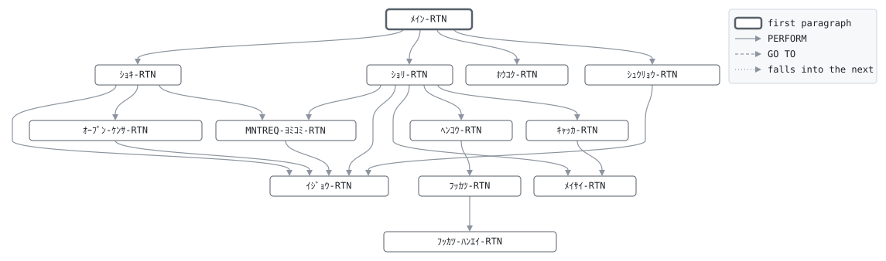

# GLD040

```text
GLD040: 契約変更

日次。支社からの契約変更依頼ファイル MNTREQ を読み、契約
マスタに反映する。住所変更、口座変更、氏名変更 (漢字とカナ)、
受取人変更は該当項目が埋まっていること。復活は契約が失効中
で、失効日から1年以内で、窓口で収納した額が未納保険料
(払込済年月の翌月から業務月までの月数に保険料を掛けた額)
以上であること。復活した契約は有効に戻り、払込済年月を業務
月とし、収納額を保険料収入に仕訳する。

復帰コード: 0 全件反映、4 却下あり、8 日付が日付でない、
            16 ファイル異常。

変更履歴
日付       担当 変更
1987-04-01 KT   GL-0001 初版。
2003-10-06 MS   GL-0310 口座変更。
2011-02-14 YN   GL-0520 窓口からの復活。
```

Program [GLD040.cbl](../../../gondwana/programs/GLD040.cbl): 6 files, 13 paragraphs. Its business rules: [7 decision tables](../rules/GLD040.md).

- AUTHOR: ゴンドワナ生命 システム部.
- DATE-WRITTEN: 1987-04-01.

## Contents

- [Files](#files)
- [Flow](#flow)
- [Paragraphs](#paragraphs)
- [Calls](#calls)
- [Data flow](#data-flow)
- [Lineage](#lineage)
  - [Into MR-ﾍﾝｺｳ-ﾚｺｰﾄﾞ](#into-mr-ﾍﾝｺｳ-ﾚｺｰﾄﾞ)
  - [Into PM-ｹｲﾔｸ-ﾚｺｰﾄﾞ](#into-pm-ｹｲﾔｸ-ﾚｺｰﾄﾞ)
  - [Into CT-ｾｲｷﾞｮ-ﾚｺｰﾄﾞ](#into-ct-ｾｲｷﾞｮ-ﾚｺｰﾄﾞ)
  - [Into JR-ｼﾜｹ-ﾚｺｰﾄﾞ](#into-jr-ｼﾜｹ-ﾚｺｰﾄﾞ)
  - [Into ｷｬｯｶ-ﾚｺｰﾄﾞ](#into-ｷｬｯｶ-ﾚｺｰﾄﾞ)
  - [Into ﾎｳｺｸ-ｷﾞｮｳ](#into-ﾎｳｺｸ-ｷﾞｮｳ)
  - [Into WS-ｺﾏﾝﾄﾞｷﾞｮｳ](#into-ws-ｺﾏﾝﾄﾞｷﾞｮｳ)
  - [Into WS-ｴﾗｰﾌｧｲﾙ](#into-ws-ｴﾗｰﾌｧｲﾙ)
  - [Into WS-ｴﾗｰｽﾃｰﾀｽ](#into-ws-ｴﾗｰｽﾃｰﾀｽ)
  - [Into WS-ｷﾞｮｳﾑﾋﾂﾞｹ](#into-ws-ｷﾞｮｳﾑﾋﾂﾞｹ)
  - [Into WS-ｷﾞｮｳﾑﾋﾂﾞｹ-ﾜﾚｷ](#into-ws-ｷﾞｮｳﾑﾋﾂﾞｹ-ﾜﾚｷ)
  - [Into WS-ﾎｳｺｳ](#into-ws-ﾎｳｺｳ)
  - [Into WS-ﾍﾝｶﾝｹｯｶ](#into-ws-ﾍﾝｶﾝｹｯｶ)
  - [Into WS-ｼｯｺｳﾋﾞ](#into-ws-ｼｯｺｳﾋﾞ)
  - [Into WS-ｹｲｶﾆｯｽｳ](#into-ws-ｹｲｶﾆｯｽｳ)
  - [Into WS-ﾊﾗｲｺﾐｽﾞﾐ-ﾌﾞﾝｶｲ](#into-ws-ﾊﾗｲｺﾐｽﾞﾐ-ﾌﾞﾝｶｲ)
  - [Into WS-ﾐﾉｳﾂｷｽｳ](#into-ws-ﾐﾉｳﾂｷｽｳ)
  - [Into WS-ﾐﾉｳｶﾞｸ](#into-ws-ﾐﾉｳｶﾞｸ)
  - [Into WS-ｹﾝｽｳ](#into-ws-ｹﾝｽｳ)
  - [Into WS-ﾘﾕｳ](#into-ws-ﾘﾕｳ)
  - [Into WS-ｼｭﾍﾞﾂﾒｲ](#into-ws-ｼｭﾍﾞﾂﾒｲ)
  - [Into WS-ﾌｯｷｺｰﾄﾞ](#into-ws-ﾌｯｷｺｰﾄﾞ)
  - [Into WS-ﾎｳｺｸ](#into-ws-ﾎｳｺｸ)
  - [Out of the program](#out-of-the-program)
  - [Into other data items](#into-other-data-items)
- [Field origins](#field-origins)
  - [File REPORT-F](#file-report-f)
  - [File POLMST-F](#file-polmst-f)
  - [File GLJRNL-F](#file-gljrnl-f)
  - [File REJECT-F](#file-reject-f)
  - [File GLSCTL-F](#file-glsctl-f)
- [Links between records](#links-between-records)
- [Records](#records)
  - [MR-ﾍﾝｺｳ-ﾚｺｰﾄﾞ](#mr-ﾍﾝｺｳ-ﾚｺｰﾄﾞ)
  - [PM-ｹｲﾔｸ-ﾚｺｰﾄﾞ](#pm-ｹｲﾔｸ-ﾚｺｰﾄﾞ)
  - [CT-ｾｲｷﾞｮ-ﾚｺｰﾄﾞ](#ct-ｾｲｷﾞｮ-ﾚｺｰﾄﾞ)
  - [JR-ｼﾜｹ-ﾚｺｰﾄﾞ](#jr-ｼﾜｹ-ﾚｺｰﾄﾞ)
  - [ｷｬｯｶ-ﾚｺｰﾄﾞ](#ｷｬｯｶ-ﾚｺｰﾄﾞ)
  - [ﾎｳｺｸ-ｷﾞｮｳ](#ﾎｳｺｸ-ｷﾞｮｳ)
  - [WS-ｽﾃｰﾀｽ](#ws-ｽﾃｰﾀｽ)
  - [WS-ｺﾏﾝﾄﾞｷﾞｮｳ](#ws-ｺﾏﾝﾄﾞｷﾞｮｳ)
  - [WS-ｴﾗｰﾌｧｲﾙ](#ws-ｴﾗｰﾌｧｲﾙ)
  - [WS-ｴﾗｰｽﾃｰﾀｽ](#ws-ｴﾗｰｽﾃｰﾀｽ)
  - [WS-ｷﾞｮｳﾑﾋﾂﾞｹ](#ws-ｷﾞｮｳﾑﾋﾂﾞｹ)
  - [WS-ｷﾞｮｳﾑﾋﾂﾞｹ-ﾌﾞﾝｶｲ](#ws-ｷﾞｮｳﾑﾋﾂﾞｹ-ﾌﾞﾝｶｲ)
  - [WS-ｷﾞｮｳﾑﾋﾂﾞｹ-ﾜﾚｷ](#ws-ｷﾞｮｳﾑﾋﾂﾞｹ-ﾜﾚｷ)
  - [WS-ﾎｳｺｳ](#ws-ﾎｳｺｳ)
  - [WS-ﾍﾝｶﾝｹｯｶ](#ws-ﾍﾝｶﾝｹｯｶ)
  - [WS-ｼｯｺｳﾋﾞ](#ws-ｼｯｺｳﾋﾞ)
  - [WS-ｹｲｶﾆｯｽｳ](#ws-ｹｲｶﾆｯｽｳ)
  - [WS-ﾊﾗｲｺﾐｽﾞﾐ-ﾌﾞﾝｶｲ](#ws-ﾊﾗｲｺﾐｽﾞﾐ-ﾌﾞﾝｶｲ)
  - [WS-ﾐﾉｳﾂｷｽｳ](#ws-ﾐﾉｳﾂｷｽｳ)
  - [WS-ﾐﾉｳｶﾞｸ](#ws-ﾐﾉｳｶﾞｸ)
  - [WS-ｹﾝｽｳ](#ws-ｹﾝｽｳ)
  - [WS-ﾘﾕｳ](#ws-ﾘﾕｳ)
  - [WS-ﾘﾕｳ-ﾒｯｾｰｼﾞ](#ws-ﾘﾕｳ-ﾒｯｾｰｼﾞ)
  - [WS-ﾘﾕｳ-ﾒｯｾｰｼﾞ-TBL](#ws-ﾘﾕｳ-ﾒｯｾｰｼﾞ-tbl)
  - [WS-ｼｭﾍﾞﾂﾒｲ](#ws-ｼｭﾍﾞﾂﾒｲ)
  - [WS-ﾌｯｷｺｰﾄﾞ](#ws-ﾌｯｷｺｰﾄﾞ)
  - [WS-ﾎｳｺｸ](#ws-ﾎｳｺｸ)

## Files

| File | Kind | Assigned to | Organization | Status field | Opened | Records |
| --- | --- | --- | --- | --- | --- | --- |
| MNTREQ-F | FD | MNTREQ | LINE SEQUENTIAL | WS-MNTREQ-ST | INPUT | MR-ﾍﾝｺｳ-ﾚｺｰﾄﾞ |
| POLMST-F | FD | POLMST | INDEXED, key PM-ｼｮｳｹﾝﾊﾞﾝｺﾞｳ, RANDOM access | WS-POLMST-ST | I-O | PM-ｹｲﾔｸ-ﾚｺｰﾄﾞ |
| GLSCTL-F | FD | GLSCTL | SEQUENTIAL | WS-GLSCTL-ST | I-O | CT-ｾｲｷﾞｮ-ﾚｺｰﾄﾞ |
| GLJRNL-F | FD | GLJRNL | LINE SEQUENTIAL | WS-GLJRNL-ST | EXTEND | JR-ｼﾜｹ-ﾚｺｰﾄﾞ |
| REJECT-F | FD | MNTREJ | LINE SEQUENTIAL | WS-REJECT-ST | OUTPUT | ｷｬｯｶ-ﾚｺｰﾄﾞ |
| REPORT-F | FD | GLD040R | LINE SEQUENTIAL | WS-REPORT-ST | OUTPUT | ﾎｳｺｸ-ｷﾞｮｳ |

## Flow



## Paragraphs

| Paragraph | Description | Source | Performs | Goes to | Performed by | Reached by |
| --- | --- | --- | --- | --- | --- | --- |
| ﾒｲﾝ-RTN | ﾒｲﾝ-RTN: 準備、1件ずつの反映、報告、終了。 | [GLD040.cbl:157](../../../gondwana/programs/GLD040.cbl#L157) | ｼｮｷ-RTN, ｼｮﾘ-RTN, ﾎｳｺｸ-RTN, ｼｭｳﾘｮｳ-RTN | | | |
| ｼｮｷ-RTN | ｼｮｷ-RTN: 業務日付、ファイル、制御レコード。 | [GLD040.cbl:168](../../../gondwana/programs/GLD040.cbl#L168) | ｵｰﾌﾟﾝ-ｹﾝｻ-RTN, ｲｼﾞｮｳ-RTN, MNTREQ-ﾖﾐｺﾐ-RTN | | ﾒｲﾝ-RTN | |
| ｵｰﾌﾟﾝ-ｹﾝｻ-RTN | ｵｰﾌﾟﾝ-ｹﾝｻ-RTN: 開けなかったファイルがあれば異常終了。 | [GLD040.cbl:199](../../../gondwana/programs/GLD040.cbl#L199) | ｲｼﾞｮｳ-RTN | | ｼｮｷ-RTN | |
| MNTREQ-ﾖﾐｺﾐ-RTN | MNTREQ-ﾖﾐｺﾐ-RTN: 依頼ファイルの次の行。 | [GLD040.cbl:229](../../../gondwana/programs/GLD040.cbl#L229) | ｲｼﾞｮｳ-RTN | | ｼｮｷ-RTN, ｼｮﾘ-RTN | |
| ｼｮﾘ-RTN | ｼｮﾘ-RTN: 契約を読み、種別ごとに検査して反映か却下。 | [GLD040.cbl:244](../../../gondwana/programs/GLD040.cbl#L244) | ｲｼﾞｮｳ-RTN, ﾍﾝｺｳ-RTN, ﾒｲｻｲ-RTN, ｷｬｯｶ-RTN, MNTREQ-ﾖﾐｺﾐ-RTN | | ﾒｲﾝ-RTN | |
| ﾍﾝｺｳ-RTN | ﾍﾝｺｳ-RTN: 種別ごとの検査と反映。 | [GLD040.cbl:293](../../../gondwana/programs/GLD040.cbl#L293) | ﾌｯｶﾂ-RTN | | ｼｮﾘ-RTN | |
| ﾌｯｶﾂ-RTN | ﾌｯｶﾂ-RTN: 失効中で、失効日から1年以内で、未納額が収納されて いれば有効に戻す。 | [GLD040.cbl:331](../../../gondwana/programs/GLD040.cbl#L331) | ﾌｯｶﾂ-ﾊﾝｴｲ-RTN | | ﾍﾝｺｳ-RTN | |
| ﾌｯｶﾂ-ﾊﾝｴｲ-RTN | ﾌｯｶﾂ-ﾊﾝｴｲ-RTN: 有効に戻し、払込済年月を業務月とし、収納額を 仕訳する。 | [GLD040.cbl:362](../../../gondwana/programs/GLD040.cbl#L362) | | | ﾌｯｶﾂ-RTN | |
| ｷｬｯｶ-RTN | ｷｬｯｶ-RTN: 却下ファイルに理由を付けて書き、明細を報告する。 | [GLD040.cbl:388](../../../gondwana/programs/GLD040.cbl#L388) | ﾒｲｻｲ-RTN | | ｼｮﾘ-RTN | |
| ﾒｲｻｲ-RTN | ﾒｲｻｲ-RTN: 1件の明細行。 | [GLD040.cbl:401](../../../gondwana/programs/GLD040.cbl#L401) | | | ｼｮﾘ-RTN, ｷｬｯｶ-RTN | |
| ﾎｳｺｸ-RTN | ﾎｳｺｸ-RTN: 件数と合計。 | [GLD040.cbl:410](../../../gondwana/programs/GLD040.cbl#L410) | | | ﾒｲﾝ-RTN | |
| ｼｭｳﾘｮｳ-RTN | ｼｭｳﾘｮｳ-RTN: 制御レコードを書き戻し、ファイルを閉じる。 | [GLD040.cbl:432](../../../gondwana/programs/GLD040.cbl#L432) | ｲｼﾞｮｳ-RTN | | ﾒｲﾝ-RTN | |
| ｲｼﾞｮｳ-RTN | ｲｼﾞｮｳ-RTN: ファイル異常は 16 で終わる。 | [GLD040.cbl:447](../../../gondwana/programs/GLD040.cbl#L447) | | | ｼｮｷ-RTN, ｵｰﾌﾟﾝ-ｹﾝｻ-RTN, MNTREQ-ﾖﾐｺﾐ-RTN, ｼｮﾘ-RTN, ｼｭｳﾘｮｳ-RTN | |

## Calls

| Calls | Passing | Paragraph | Source |
| --- | --- | --- | --- |
| [GLC020](GLC020.md) | WS-ﾎｳｺｳ, WS-ｷﾞｮｳﾑﾋﾂﾞｹ, WS-ｷﾞｮｳﾑﾋﾂﾞｹ-ﾜﾚｷ, WS-ﾍﾝｶﾝｹｯｶ | ｼｮｷ-RTN | [GLD040.cbl:172](../../../gondwana/programs/GLD040.cbl#L172) |
| [GLC020](GLC020.md) | WS-ﾎｳｺｳ, WS-ｼｯｺｳﾋﾞ, PM-ｼｯｺｳﾋﾞ, WS-ﾍﾝｶﾝｹｯｶ | ﾌｯｶﾂ-RTN | [GLD040.cbl:336](../../../gondwana/programs/GLD040.cbl#L336) |

## Data flow

| Paragraph | Reads | Writes |
| --- | --- | --- |
| ﾒｲﾝ-RTN | WS-MNTREQ-ST, WS-ﾌｯｷｺｰﾄﾞ | RETURN-CODE |
| ｼｮｷ-RTN | WS-ｺﾏﾝﾄﾞｷﾞｮｳ, WS-ﾎｳｺｳ, WS-ｷﾞｮｳﾑﾋﾂﾞｹ, WS-ｷﾞｮｳﾑﾋﾂﾞｹ-ﾜﾚｷ, WS-ﾍﾝｶﾝｹｯｶ, WS-GLSCTL-ST, WS-ﾋｮｳﾀﾞｲ-ｷﾞｮｳ | WS-ｺﾏﾝﾄﾞｷﾞｮｳ, WS-ｷﾞｮｳﾑﾋﾂﾞｹ, WS-ﾎｳｺｳ, WS-ｷﾞｮｳﾑﾋﾂﾞｹ-ﾜﾚｷ, WS-ﾍﾝｶﾝｹｯｶ, RETURN-CODE, WS-MNTREQ-ST, WS-POLMST-ST, WS-GLSCTL-ST, WS-GLJRNL-ST, WS-REJECT-ST, WS-REPORT-ST, CT-ｾｲｷﾞｮ-ﾚｺｰﾄﾞ, WS-ｴﾗｰﾌｧｲﾙ, WS-ｴﾗｰｽﾃｰﾀｽ, WS-ﾋｮｳﾀﾞｲ-ﾋﾂﾞｹ, ﾎｳｺｸ-ｷﾞｮｳ |
| ｵｰﾌﾟﾝ-ｹﾝｻ-RTN | WS-MNTREQ-ST, WS-POLMST-ST, WS-GLSCTL-ST, WS-GLJRNL-ST, WS-REJECT-ST, WS-REPORT-ST, WS-ｴﾗｰﾌｧｲﾙ | WS-ｴﾗｰﾌｧｲﾙ, WS-ｴﾗｰｽﾃｰﾀｽ |
| MNTREQ-ﾖﾐｺﾐ-RTN | WS-MNTREQ-ST, WS-ﾖﾐｺﾐｹﾝｽｳ | MR-ﾍﾝｺｳ-ﾚｺｰﾄﾞ, WS-MNTREQ-ST, WS-ﾖﾐｺﾐｹﾝｽｳ, WS-ｴﾗｰﾌｧｲﾙ, WS-ｴﾗｰｽﾃｰﾀｽ |
| ｼｮﾘ-RTN | MR-ｼｮｳｹﾝﾊﾞﾝｺﾞｳ, WS-POLMST-ST, MR-ｼｭﾍﾞﾂ, WS-ﾘﾕｳ, WS-ﾊﾝｴｲｹﾝｽｳ | WS-ﾘﾕｳ, WS-ﾒｲｻｲ-ｷﾝｶﾞｸ, PM-ｼｮｳｹﾝﾊﾞﾝｺﾞｳ, PM-ｹｲﾔｸ-ﾚｺｰﾄﾞ, WS-POLMST-ST, WS-ｴﾗｰﾌｧｲﾙ, WS-ｴﾗｰｽﾃｰﾀｽ, WS-ｼｭﾍﾞﾂﾒｲ, WS-ﾊﾝｴｲｹﾝｽｳ, WS-ﾒｲｻｲ-ｹｯｶ |
| ﾍﾝｺｳ-RTN | MR-ｼｭﾍﾞﾂ, MR-ｼﾞｭｳｼｮ, MR-ｷﾞﾝｺｳｺｰﾄﾞ, MR-ｺｳｻﾞﾊﾞﾝｺﾞｳ, MR-ｺｳｻﾞﾒｲｷﾞ, MR-ｺｳｻﾞ, MR-ｼﾒｲ, MR-ｼﾒｲｶﾅ, MR-ｳｹﾄﾘﾆﾝ | WS-ﾘﾕｳ, PM-ｼﾞｭｳｼｮ, PM-ｺｳｻﾞ, PM-ｼﾒｲ, PM-ｼﾒｲｶﾅ, PM-ｳｹﾄﾘﾆﾝ |
| ﾌｯｶﾂ-RTN | PM-ｼﾞｮｳﾀｲ, WS-ﾎｳｺｳ, WS-ｼｯｺｳﾋﾞ, PM-ｼｯｺｳﾋﾞ, WS-ﾍﾝｶﾝｹｯｶ, WS-ｷﾞｮｳﾑﾋﾂﾞｹ, PM-ﾊﾗｲｺﾐｽﾞﾐﾈﾝｹﾞﾂ, WS-ｷﾞｮｳﾑ-YYYY, WS-ﾊﾗｲｺﾐ-YYYY, WS-ｷﾞｮｳﾑ-MM, WS-ﾊﾗｲｺﾐ-MM, PM-ﾊﾗｲｺﾐﾎｳﾎｳ, WS-ﾐﾉｳﾂｷｽｳ, PM-ﾎｹﾝﾘｮｳ, WS-ｹｲｶﾆｯｽｳ, MR-ﾆｭｳｷﾝｶﾞｸ, WS-ﾐﾉｳｶﾞｸ | WS-ﾘﾕｳ, WS-ﾎｳｺｳ, WS-ｼｯｺｳﾋﾞ, PM-ｼｯｺｳﾋﾞ, WS-ﾍﾝｶﾝｹｯｶ, WS-ｹｲｶﾆｯｽｳ, WS-ﾊﾗｲｺﾐｽﾞﾐ-ﾌﾞﾝｶｲ, WS-ﾐﾉｳﾂｷｽｳ, WS-ﾐﾉｳｶﾞｸ |
| ﾌｯｶﾂ-ﾊﾝｴｲ-RTN | WS-ｷﾞｮｳﾑﾋﾂﾞｹ, WS-ｷﾞｮｳﾑﾋﾂﾞｹ-ﾜﾚｷ, MR-ﾆｭｳｷﾝｶﾞｸ, CT-ｼﾞｶｲｼﾜｹﾊﾞﾝｺﾞｳ, PM-ｼｮｳｹﾝﾊﾞﾝｺﾞｳ, WS-ﾌｯｶﾂｹﾝｽｳ, WS-ﾌｯｶﾂｷﾝｶﾞｸ | PM-ｼﾞｮｳﾀｲ, PM-ﾊﾗｲｺﾐｽﾞﾐﾈﾝｹﾞﾂ, PM-ﾐﾉｳｶｲｽｳ, PM-ﾕｳﾖｶｲｼﾋﾞ, PM-ｼｯｺｳﾋﾞ, PM-ｼﾞｮｳﾀｲﾋﾂﾞｹ, PM-ｻｲｼｭｳﾆｭｳｷﾝﾈﾝｹﾞﾂ, PM-ｻｲｼｭｳﾆｭｳｷﾝｶﾞｸ, JR-ｼﾜｹ-ﾚｺｰﾄﾞ, JR-ｼﾜｹﾊﾞﾝｺﾞｳ, CT-ｼﾞｶｲｼﾜｹﾊﾞﾝｺﾞｳ, JR-ﾋﾂﾞｹ, JR-ﾌﾟﾛｸﾞﾗﾑ, JR-ｶﾝｼﾞｮｳｶﾓｸ, JR-ﾀｲｼｬｸ, JR-ｷﾝｶﾞｸ, JR-ｼｮｳｹﾝﾊﾞﾝｺﾞｳ, JR-ﾃｷﾖｳ, WS-GLJRNL-ST, WS-ﾌｯｶﾂｹﾝｽｳ, WS-ﾌｯｶﾂｷﾝｶﾞｸ, WS-ﾒｲｻｲ-ｷﾝｶﾞｸ |
| ｷｬｯｶ-RTN | MR-ﾍﾝｺｳ-ﾚｺｰﾄﾞ, WS-ﾘﾕｳ, WS-ﾒｯｾｰｼﾞ, WS-ｷｬｯｶｹﾝｽｳ | ｷｬｯｶ-ﾃﾞｰﾀ, ｷｬｯｶ-ﾘﾕｳ, ｷｬｯｶ-ﾒｯｾｰｼﾞ, ｷｬｯｶ-ﾚｺｰﾄﾞ, WS-REJECT-ST, WS-ｷｬｯｶｹﾝｽｳ, WS-ﾌｯｷｺｰﾄﾞ, WS-ﾒｲｻｲ-ｹｯｶ |
| ﾒｲｻｲ-RTN | MR-ｲﾗｲﾊﾞﾝｺﾞｳ, MR-ｼｮｳｹﾝﾊﾞﾝｺﾞｳ, WS-ｼｭﾍﾞﾂﾒｲ, WS-ﾒｲｻｲ-ｷﾞｮｳ | WS-ﾒｲｻｲ-ｲﾗｲ, WS-ﾒｲｻｲ-ｼｮｳｹﾝ, WS-ﾒｲｻｲ-ｼｭﾍﾞﾂ, ﾎｳｺｸ-ｷﾞｮｳ, WS-REPORT-ST |
| ﾎｳｺｸ-RTN | WS-ﾖﾐｺﾐｹﾝｽｳ, WS-ｹﾝｽｳ-ｷﾞｮｳ, WS-ﾊﾝｴｲｹﾝｽｳ, WS-ｷｬｯｶｹﾝｽｳ, WS-ﾌｯｶﾂｹﾝｽｳ, WS-ﾌｯｶﾂｷﾝｶﾞｸ | ﾎｳｺｸ-ｷﾞｮｳ, WS-REPORT-ST, WS-ｹﾝｽｳ-ﾗﾍﾞﾙ, WS-ｹﾝｽｳ-ｱﾀｲ |
| ｼｭｳﾘｮｳ-RTN | WS-GLSCTL-ST, WS-ﾊﾝｴｲｹﾝｽｳ, WS-ｷｬｯｶｹﾝｽｳ | CT-ｾｲｷﾞｮ-ﾚｺｰﾄﾞ, WS-GLSCTL-ST, WS-ｴﾗｰﾌｧｲﾙ, WS-ｴﾗｰｽﾃｰﾀｽ, WS-MNTREQ-ST, WS-POLMST-ST, WS-GLJRNL-ST, WS-REJECT-ST, WS-REPORT-ST |
| ｲｼﾞｮｳ-RTN | WS-ｴﾗｰﾌｧｲﾙ, WS-ｴﾗｰｽﾃｰﾀｽ | RETURN-CODE |

## Lineage

Where each data item's values come from, grouped by the record they go into. A data item links to the record it belongs to.

### Into MR-ﾍﾝｺｳ-ﾚｺｰﾄﾞ

Record [MR-ﾍﾝｺｳ-ﾚｺｰﾄﾞ](#mr-ﾍﾝｺｳ-ﾚｺｰﾄﾞ), from copybook [MNTREQ](../copybooks/MNTREQ.md).

| Into | From | Statement | Paragraph | Source |
| --- | --- | --- | --- | --- |
| MR-ﾍﾝｺｳ-ﾚｺｰﾄﾞ | file MNTREQ-F | READ | MNTREQ-ﾖﾐｺﾐ-RTN | [GLD040.cbl:230](../../../gondwana/programs/GLD040.cbl#L230) |

### Into PM-ｹｲﾔｸ-ﾚｺｰﾄﾞ

Record [PM-ｹｲﾔｸ-ﾚｺｰﾄﾞ](#pm-ｹｲﾔｸ-ﾚｺｰﾄﾞ), from copybook [POLMST](../copybooks/POLMST.md).

| Into | From | Statement | Paragraph | Source |
| --- | --- | --- | --- | --- |
| PM-ｳｹﾄﾘﾆﾝ | [MR-ｳｹﾄﾘﾆﾝ](#mr-ﾍﾝｺｳ-ﾚｺｰﾄﾞ "in MR-ﾍﾝｺｳ-ﾚｺｰﾄﾞ") | MOVE | ﾍﾝｺｳ-RTN | [GLD040.cbl:319](../../../gondwana/programs/GLD040.cbl#L319) |
| PM-ｹｲﾔｸ-ﾚｺｰﾄﾞ | file POLMST-F | READ | ｼｮﾘ-RTN | [GLD040.cbl:248](../../../gondwana/programs/GLD040.cbl#L248) |
| PM-ｺｳｻﾞ | [MR-ｺｳｻﾞ](#mr-ﾍﾝｺｳ-ﾚｺｰﾄﾞ "in MR-ﾍﾝｺｳ-ﾚｺｰﾄﾞ") | MOVE | ﾍﾝｺｳ-RTN | [GLD040.cbl:306](../../../gondwana/programs/GLD040.cbl#L306) |
| PM-ｻｲｼｭｳﾆｭｳｷﾝｶﾞｸ | [MR-ﾆｭｳｷﾝｶﾞｸ](#mr-ﾍﾝｺｳ-ﾚｺｰﾄﾞ "in MR-ﾍﾝｺｳ-ﾚｺｰﾄﾞ") | MOVE | ﾌｯｶﾂ-ﾊﾝｴｲ-RTN | [GLD040.cbl:369](../../../gondwana/programs/GLD040.cbl#L369) |
| PM-ｻｲｼｭｳﾆｭｳｷﾝﾈﾝｹﾞﾂ | [WS-ｷﾞｮｳﾑﾋﾂﾞｹ](#ws-ｷﾞｮｳﾑﾋﾂﾞｹ) | MOVE | ﾌｯｶﾂ-ﾊﾝｴｲ-RTN | [GLD040.cbl:368](../../../gondwana/programs/GLD040.cbl#L368) |
| PM-ｼｮｳｹﾝﾊﾞﾝｺﾞｳ | [MR-ｼｮｳｹﾝﾊﾞﾝｺﾞｳ](#mr-ﾍﾝｺｳ-ﾚｺｰﾄﾞ "in MR-ﾍﾝｺｳ-ﾚｺｰﾄﾞ") | MOVE | ｼｮﾘ-RTN | [GLD040.cbl:247](../../../gondwana/programs/GLD040.cbl#L247) |
| PM-ｼｯｺｳﾋﾞ | call GLC020 argument 3 | CALL | ﾌｯｶﾂ-RTN | [GLD040.cbl:336](../../../gondwana/programs/GLD040.cbl#L336) |
| PM-ｼｯｺｳﾋﾞ | literal SPACES | MOVE | ﾌｯｶﾂ-ﾊﾝｴｲ-RTN | [GLD040.cbl:366](../../../gondwana/programs/GLD040.cbl#L366) |
| PM-ｼﾒｲ | [MR-ｼﾒｲ](#mr-ﾍﾝｺｳ-ﾚｺｰﾄﾞ "in MR-ﾍﾝｺｳ-ﾚｺｰﾄﾞ") | MOVE | ﾍﾝｺｳ-RTN | [GLD040.cbl:312](../../../gondwana/programs/GLD040.cbl#L312) |
| PM-ｼﾒｲｶﾅ | [MR-ｼﾒｲｶﾅ](#mr-ﾍﾝｺｳ-ﾚｺｰﾄﾞ "in MR-ﾍﾝｺｳ-ﾚｺｰﾄﾞ") | MOVE | ﾍﾝｺｳ-RTN | [GLD040.cbl:313](../../../gondwana/programs/GLD040.cbl#L313) |
| PM-ｼﾞｭｳｼｮ | [MR-ｼﾞｭｳｼｮ](#mr-ﾍﾝｺｳ-ﾚｺｰﾄﾞ "in MR-ﾍﾝｺｳ-ﾚｺｰﾄﾞ") | MOVE | ﾍﾝｺｳ-RTN | [GLD040.cbl:299](../../../gondwana/programs/GLD040.cbl#L299) |
| PM-ｼﾞｮｳﾀｲ | literal condition PM-ﾕｳｺｳ | SET | ﾌｯｶﾂ-ﾊﾝｴｲ-RTN | [GLD040.cbl:363](../../../gondwana/programs/GLD040.cbl#L363) |
| PM-ｼﾞｮｳﾀｲﾋﾂﾞｹ | [WS-ｷﾞｮｳﾑﾋﾂﾞｹ-ﾜﾚｷ](#ws-ｷﾞｮｳﾑﾋﾂﾞｹ-ﾜﾚｷ) | MOVE | ﾌｯｶﾂ-ﾊﾝｴｲ-RTN | [GLD040.cbl:367](../../../gondwana/programs/GLD040.cbl#L367) |
| PM-ﾊﾗｲｺﾐｽﾞﾐﾈﾝｹﾞﾂ | [WS-ｷﾞｮｳﾑﾋﾂﾞｹ](#ws-ｷﾞｮｳﾑﾋﾂﾞｹ) | MOVE | ﾌｯｶﾂ-ﾊﾝｴｲ-RTN | [GLD040.cbl:364](../../../gondwana/programs/GLD040.cbl#L364) |
| PM-ﾐﾉｳｶｲｽｳ | literal 0 | MOVE | ﾌｯｶﾂ-ﾊﾝｴｲ-RTN | [GLD040.cbl:365](../../../gondwana/programs/GLD040.cbl#L365) |
| PM-ﾕｳﾖｶｲｼﾋﾞ | literal SPACES | MOVE | ﾌｯｶﾂ-ﾊﾝｴｲ-RTN | [GLD040.cbl:366](../../../gondwana/programs/GLD040.cbl#L366) |

### Into CT-ｾｲｷﾞｮ-ﾚｺｰﾄﾞ

Record [CT-ｾｲｷﾞｮ-ﾚｺｰﾄﾞ](#ct-ｾｲｷﾞｮ-ﾚｺｰﾄﾞ), from copybook [CTLREC](../copybooks/CTLREC.md).

| Into | From | Statement | Paragraph | Source |
| --- | --- | --- | --- | --- |
| CT-ｼﾞｶｲｼﾜｹﾊﾞﾝｺﾞｳ | literal 1 | ADD | ﾌｯｶﾂ-ﾊﾝｴｲ-RTN | [GLD040.cbl:372](../../../gondwana/programs/GLD040.cbl#L372) |
| CT-ｾｲｷﾞｮ-ﾚｺｰﾄﾞ | file GLSCTL-F | READ | ｼｮｷ-RTN | [GLD040.cbl:184](../../../gondwana/programs/GLD040.cbl#L184) |

### Into JR-ｼﾜｹ-ﾚｺｰﾄﾞ

Record [JR-ｼﾜｹ-ﾚｺｰﾄﾞ](#jr-ｼﾜｹ-ﾚｺｰﾄﾞ), from copybook [GLJRNL](../copybooks/GLJRNL.md).

| Into | From | Statement | Paragraph | Source |
| --- | --- | --- | --- | --- |
| JR-ｶﾝｼﾞｮｳｶﾓｸ | literal 4110 | MOVE | ﾌｯｶﾂ-ﾊﾝｴｲ-RTN | [GLD040.cbl:375](../../../gondwana/programs/GLD040.cbl#L375) |
| JR-ｷﾝｶﾞｸ | [MR-ﾆｭｳｷﾝｶﾞｸ](#mr-ﾍﾝｺｳ-ﾚｺｰﾄﾞ "in MR-ﾍﾝｺｳ-ﾚｺｰﾄﾞ") | MOVE | ﾌｯｶﾂ-ﾊﾝｴｲ-RTN | [GLD040.cbl:377](../../../gondwana/programs/GLD040.cbl#L377) |
| JR-ｼｮｳｹﾝﾊﾞﾝｺﾞｳ | [PM-ｼｮｳｹﾝﾊﾞﾝｺﾞｳ](#pm-ｹｲﾔｸ-ﾚｺｰﾄﾞ "in PM-ｹｲﾔｸ-ﾚｺｰﾄﾞ") | MOVE | ﾌｯｶﾂ-ﾊﾝｴｲ-RTN | [GLD040.cbl:378](../../../gondwana/programs/GLD040.cbl#L378) |
| JR-ｼﾜｹ-ﾚｺｰﾄﾞ | literal SPACES | MOVE | ﾌｯｶﾂ-ﾊﾝｴｲ-RTN | [GLD040.cbl:370](../../../gondwana/programs/GLD040.cbl#L370) |
| JR-ｼﾜｹﾊﾞﾝｺﾞｳ | [CT-ｼﾞｶｲｼﾜｹﾊﾞﾝｺﾞｳ](#ct-ｾｲｷﾞｮ-ﾚｺｰﾄﾞ "in CT-ｾｲｷﾞｮ-ﾚｺｰﾄﾞ") | MOVE | ﾌｯｶﾂ-ﾊﾝｴｲ-RTN | [GLD040.cbl:371](../../../gondwana/programs/GLD040.cbl#L371) |
| JR-ﾀｲｼｬｸ | literal condition JR-ｶｼｶﾀ | SET | ﾌｯｶﾂ-ﾊﾝｴｲ-RTN | [GLD040.cbl:376](../../../gondwana/programs/GLD040.cbl#L376) |
| JR-ﾃｷﾖｳ | literal '復活時保険料' | MOVE | ﾌｯｶﾂ-ﾊﾝｴｲ-RTN | [GLD040.cbl:379](../../../gondwana/programs/GLD040.cbl#L379) |
| JR-ﾋﾂﾞｹ | [WS-ｷﾞｮｳﾑﾋﾂﾞｹ-ﾜﾚｷ](#ws-ｷﾞｮｳﾑﾋﾂﾞｹ-ﾜﾚｷ) | MOVE | ﾌｯｶﾂ-ﾊﾝｴｲ-RTN | [GLD040.cbl:373](../../../gondwana/programs/GLD040.cbl#L373) |
| JR-ﾌﾟﾛｸﾞﾗﾑ | literal 'GLD040' | MOVE | ﾌｯｶﾂ-ﾊﾝｴｲ-RTN | [GLD040.cbl:374](../../../gondwana/programs/GLD040.cbl#L374) |

### Into ｷｬｯｶ-ﾚｺｰﾄﾞ

Record [ｷｬｯｶ-ﾚｺｰﾄﾞ](#ｷｬｯｶ-ﾚｺｰﾄﾞ).

| Into | From | Statement | Paragraph | Source |
| --- | --- | --- | --- | --- |
| ｷｬｯｶ-ﾃﾞｰﾀ | [MR-ﾍﾝｺｳ-ﾚｺｰﾄﾞ](#mr-ﾍﾝｺｳ-ﾚｺｰﾄﾞ) | MOVE | ｷｬｯｶ-RTN | [GLD040.cbl:389](../../../gondwana/programs/GLD040.cbl#L389) |
| ｷｬｯｶ-ﾒｯｾｰｼﾞ | [WS-ﾒｯｾｰｼﾞ](#ws-ﾘﾕｳ-ﾒｯｾｰｼﾞ-tbl "in WS-ﾘﾕｳ-ﾒｯｾｰｼﾞ-TBL") | MOVE | ｷｬｯｶ-RTN | [GLD040.cbl:391](../../../gondwana/programs/GLD040.cbl#L391) |
| ｷｬｯｶ-ﾘﾕｳ | [WS-ﾘﾕｳ](#ws-ﾘﾕｳ) | MOVE | ｷｬｯｶ-RTN | [GLD040.cbl:390](../../../gondwana/programs/GLD040.cbl#L390) |

### Into ﾎｳｺｸ-ｷﾞｮｳ

Record [ﾎｳｺｸ-ｷﾞｮｳ](#ﾎｳｺｸ-ｷﾞｮｳ).

| Into | From | Statement | Paragraph | Source |
| --- | --- | --- | --- | --- |
| ﾎｳｺｸ-ｷﾞｮｳ | [WS-ﾋｮｳﾀﾞｲ-ｷﾞｮｳ](#ws-ﾎｳｺｸ "in WS-ﾎｳｺｸ") | WRITE | ｼｮｷ-RTN | [GLD040.cbl:191](../../../gondwana/programs/GLD040.cbl#L191) |
| ﾎｳｺｸ-ｷﾞｮｳ | literal SPACES | MOVE | ｼｮｷ-RTN | [GLD040.cbl:192](../../../gondwana/programs/GLD040.cbl#L192) |
| ﾎｳｺｸ-ｷﾞｮｳ | [WS-ﾒｲｻｲ-ｷﾞｮｳ](#ws-ﾎｳｺｸ "in WS-ﾎｳｺｸ") | WRITE | ﾒｲｻｲ-RTN | [GLD040.cbl:405](../../../gondwana/programs/GLD040.cbl#L405) |
| ﾎｳｺｸ-ｷﾞｮｳ | literal SPACES | MOVE | ﾎｳｺｸ-RTN | [GLD040.cbl:411](../../../gondwana/programs/GLD040.cbl#L411) |
| ﾎｳｺｸ-ｷﾞｮｳ | [WS-ｹﾝｽｳ-ｷﾞｮｳ](#ws-ﾎｳｺｸ "in WS-ﾎｳｺｸ") | WRITE | ﾎｳｺｸ-RTN | [GLD040.cbl:415](../../../gondwana/programs/GLD040.cbl#L415) |
| ﾎｳｺｸ-ｷﾞｮｳ | [WS-ｹﾝｽｳ-ｷﾞｮｳ](#ws-ﾎｳｺｸ "in WS-ﾎｳｺｸ") | WRITE | ﾎｳｺｸ-RTN | [GLD040.cbl:418](../../../gondwana/programs/GLD040.cbl#L418) |
| ﾎｳｺｸ-ｷﾞｮｳ | [WS-ｹﾝｽｳ-ｷﾞｮｳ](#ws-ﾎｳｺｸ "in WS-ﾎｳｺｸ") | WRITE | ﾎｳｺｸ-RTN | [GLD040.cbl:421](../../../gondwana/programs/GLD040.cbl#L421) |
| ﾎｳｺｸ-ｷﾞｮｳ | [WS-ｹﾝｽｳ-ｷﾞｮｳ](#ws-ﾎｳｺｸ "in WS-ﾎｳｺｸ") | WRITE | ﾎｳｺｸ-RTN | [GLD040.cbl:424](../../../gondwana/programs/GLD040.cbl#L424) |
| ﾎｳｺｸ-ｷﾞｮｳ | [WS-ｹﾝｽｳ-ｷﾞｮｳ](#ws-ﾎｳｺｸ "in WS-ﾎｳｺｸ") | WRITE | ﾎｳｺｸ-RTN | [GLD040.cbl:427](../../../gondwana/programs/GLD040.cbl#L427) |

### Into WS-ｺﾏﾝﾄﾞｷﾞｮｳ

Record [WS-ｺﾏﾝﾄﾞｷﾞｮｳ](#ws-ｺﾏﾝﾄﾞｷﾞｮｳ).

| Into | From | Statement | Paragraph | Source |
| --- | --- | --- | --- | --- |
| WS-ｺﾏﾝﾄﾞｷﾞｮｳ | COMMAND-LINE | ACCEPT | ｼｮｷ-RTN | [GLD040.cbl:169](../../../gondwana/programs/GLD040.cbl#L169) |

### Into WS-ｴﾗｰﾌｧｲﾙ

Record [WS-ｴﾗｰﾌｧｲﾙ](#ws-ｴﾗｰﾌｧｲﾙ).

| Into | From | Statement | Paragraph | Source |
| --- | --- | --- | --- | --- |
| WS-ｴﾗｰﾌｧｲﾙ | literal 'GLSCTL' | MOVE | ｼｮｷ-RTN | [GLD040.cbl:186](../../../gondwana/programs/GLD040.cbl#L186) |
| WS-ｴﾗｰﾌｧｲﾙ | literal 'MNTREQ' | MOVE | ｵｰﾌﾟﾝ-ｹﾝｻ-RTN | [GLD040.cbl:202](../../../gondwana/programs/GLD040.cbl#L202) |
| WS-ｴﾗｰﾌｧｲﾙ | literal 'POLMST' | MOVE | ｵｰﾌﾟﾝ-ｹﾝｻ-RTN | [GLD040.cbl:205](../../../gondwana/programs/GLD040.cbl#L205) |
| WS-ｴﾗｰﾌｧｲﾙ | literal 'GLSCTL' | MOVE | ｵｰﾌﾟﾝ-ｹﾝｻ-RTN | [GLD040.cbl:208](../../../gondwana/programs/GLD040.cbl#L208) |
| WS-ｴﾗｰﾌｧｲﾙ | literal 'GLJRNL' | MOVE | ｵｰﾌﾟﾝ-ｹﾝｻ-RTN | [GLD040.cbl:211](../../../gondwana/programs/GLD040.cbl#L211) |
| WS-ｴﾗｰﾌｧｲﾙ | literal 'MNTREJ' | MOVE | ｵｰﾌﾟﾝ-ｹﾝｻ-RTN | [GLD040.cbl:214](../../../gondwana/programs/GLD040.cbl#L214) |
| WS-ｴﾗｰﾌｧｲﾙ | literal 'GLD040R' | MOVE | ｵｰﾌﾟﾝ-ｹﾝｻ-RTN | [GLD040.cbl:217](../../../gondwana/programs/GLD040.cbl#L217) |
| WS-ｴﾗｰﾌｧｲﾙ | literal SPACES | MOVE | ｵｰﾌﾟﾝ-ｹﾝｻ-RTN | [GLD040.cbl:220](../../../gondwana/programs/GLD040.cbl#L220) |
| WS-ｴﾗｰﾌｧｲﾙ | literal 'MNTREQ' | MOVE | MNTREQ-ﾖﾐｺﾐ-RTN | [GLD040.cbl:235](../../../gondwana/programs/GLD040.cbl#L235) |
| WS-ｴﾗｰﾌｧｲﾙ | literal 'POLMST' | MOVE | ｼｮﾘ-RTN | [GLD040.cbl:253](../../../gondwana/programs/GLD040.cbl#L253) |
| WS-ｴﾗｰﾌｧｲﾙ | literal 'POLMST' | MOVE | ｼｮﾘ-RTN | [GLD040.cbl:278](../../../gondwana/programs/GLD040.cbl#L278) |
| WS-ｴﾗｰﾌｧｲﾙ | literal 'GLSCTL' | MOVE | ｼｭｳﾘｮｳ-RTN | [GLD040.cbl:435](../../../gondwana/programs/GLD040.cbl#L435) |

### Into WS-ｴﾗｰｽﾃｰﾀｽ

Record [WS-ｴﾗｰｽﾃｰﾀｽ](#ws-ｴﾗｰｽﾃｰﾀｽ).

| Into | From | Statement | Paragraph | Source |
| --- | --- | --- | --- | --- |
| WS-ｴﾗｰｽﾃｰﾀｽ | [WS-GLSCTL-ST](#ws-ｽﾃｰﾀｽ "in WS-ｽﾃｰﾀｽ") | MOVE | ｼｮｷ-RTN | [GLD040.cbl:187](../../../gondwana/programs/GLD040.cbl#L187) |
| WS-ｴﾗｰｽﾃｰﾀｽ | [WS-MNTREQ-ST](#ws-ｽﾃｰﾀｽ "in WS-ｽﾃｰﾀｽ") | MOVE | ｵｰﾌﾟﾝ-ｹﾝｻ-RTN | [GLD040.cbl:203](../../../gondwana/programs/GLD040.cbl#L203) |
| WS-ｴﾗｰｽﾃｰﾀｽ | [WS-POLMST-ST](#ws-ｽﾃｰﾀｽ "in WS-ｽﾃｰﾀｽ") | MOVE | ｵｰﾌﾟﾝ-ｹﾝｻ-RTN | [GLD040.cbl:206](../../../gondwana/programs/GLD040.cbl#L206) |
| WS-ｴﾗｰｽﾃｰﾀｽ | [WS-GLSCTL-ST](#ws-ｽﾃｰﾀｽ "in WS-ｽﾃｰﾀｽ") | MOVE | ｵｰﾌﾟﾝ-ｹﾝｻ-RTN | [GLD040.cbl:209](../../../gondwana/programs/GLD040.cbl#L209) |
| WS-ｴﾗｰｽﾃｰﾀｽ | [WS-GLJRNL-ST](#ws-ｽﾃｰﾀｽ "in WS-ｽﾃｰﾀｽ") | MOVE | ｵｰﾌﾟﾝ-ｹﾝｻ-RTN | [GLD040.cbl:212](../../../gondwana/programs/GLD040.cbl#L212) |
| WS-ｴﾗｰｽﾃｰﾀｽ | [WS-REJECT-ST](#ws-ｽﾃｰﾀｽ "in WS-ｽﾃｰﾀｽ") | MOVE | ｵｰﾌﾟﾝ-ｹﾝｻ-RTN | [GLD040.cbl:215](../../../gondwana/programs/GLD040.cbl#L215) |
| WS-ｴﾗｰｽﾃｰﾀｽ | [WS-REPORT-ST](#ws-ｽﾃｰﾀｽ "in WS-ｽﾃｰﾀｽ") | MOVE | ｵｰﾌﾟﾝ-ｹﾝｻ-RTN | [GLD040.cbl:218](../../../gondwana/programs/GLD040.cbl#L218) |
| WS-ｴﾗｰｽﾃｰﾀｽ | [WS-MNTREQ-ST](#ws-ｽﾃｰﾀｽ "in WS-ｽﾃｰﾀｽ") | MOVE | MNTREQ-ﾖﾐｺﾐ-RTN | [GLD040.cbl:236](../../../gondwana/programs/GLD040.cbl#L236) |
| WS-ｴﾗｰｽﾃｰﾀｽ | [WS-POLMST-ST](#ws-ｽﾃｰﾀｽ "in WS-ｽﾃｰﾀｽ") | MOVE | ｼｮﾘ-RTN | [GLD040.cbl:254](../../../gondwana/programs/GLD040.cbl#L254) |
| WS-ｴﾗｰｽﾃｰﾀｽ | [WS-POLMST-ST](#ws-ｽﾃｰﾀｽ "in WS-ｽﾃｰﾀｽ") | MOVE | ｼｮﾘ-RTN | [GLD040.cbl:279](../../../gondwana/programs/GLD040.cbl#L279) |
| WS-ｴﾗｰｽﾃｰﾀｽ | [WS-GLSCTL-ST](#ws-ｽﾃｰﾀｽ "in WS-ｽﾃｰﾀｽ") | MOVE | ｼｭｳﾘｮｳ-RTN | [GLD040.cbl:436](../../../gondwana/programs/GLD040.cbl#L436) |

### Into WS-ｷﾞｮｳﾑﾋﾂﾞｹ

Record [WS-ｷﾞｮｳﾑﾋﾂﾞｹ](#ws-ｷﾞｮｳﾑﾋﾂﾞｹ).

| Into | From | Statement | Paragraph | Source |
| --- | --- | --- | --- | --- |
| WS-ｷﾞｮｳﾑﾋﾂﾞｹ | [WS-ｺﾏﾝﾄﾞｷﾞｮｳ](#ws-ｺﾏﾝﾄﾞｷﾞｮｳ) | MOVE | ｼｮｷ-RTN | [GLD040.cbl:170](../../../gondwana/programs/GLD040.cbl#L170) |
| WS-ｷﾞｮｳﾑﾋﾂﾞｹ | call GLC020 argument 2 | CALL | ｼｮｷ-RTN | [GLD040.cbl:172](../../../gondwana/programs/GLD040.cbl#L172) |

### Into WS-ｷﾞｮｳﾑﾋﾂﾞｹ-ﾜﾚｷ

Record [WS-ｷﾞｮｳﾑﾋﾂﾞｹ-ﾜﾚｷ](#ws-ｷﾞｮｳﾑﾋﾂﾞｹ-ﾜﾚｷ).

| Into | From | Statement | Paragraph | Source |
| --- | --- | --- | --- | --- |
| WS-ｷﾞｮｳﾑﾋﾂﾞｹ-ﾜﾚｷ | call GLC020 argument 3 | CALL | ｼｮｷ-RTN | [GLD040.cbl:172](../../../gondwana/programs/GLD040.cbl#L172) |

### Into WS-ﾎｳｺｳ

Record [WS-ﾎｳｺｳ](#ws-ﾎｳｺｳ).

| Into | From | Statement | Paragraph | Source |
| --- | --- | --- | --- | --- |
| WS-ﾎｳｺｳ | literal 'W' | MOVE | ｼｮｷ-RTN | [GLD040.cbl:171](../../../gondwana/programs/GLD040.cbl#L171) |
| WS-ﾎｳｺｳ | call GLC020 argument 1 | CALL | ｼｮｷ-RTN | [GLD040.cbl:172](../../../gondwana/programs/GLD040.cbl#L172) |
| WS-ﾎｳｺｳ | literal 'S' | MOVE | ﾌｯｶﾂ-RTN | [GLD040.cbl:335](../../../gondwana/programs/GLD040.cbl#L335) |
| WS-ﾎｳｺｳ | call GLC020 argument 1 | CALL | ﾌｯｶﾂ-RTN | [GLD040.cbl:336](../../../gondwana/programs/GLD040.cbl#L336) |

### Into WS-ﾍﾝｶﾝｹｯｶ

Record [WS-ﾍﾝｶﾝｹｯｶ](#ws-ﾍﾝｶﾝｹｯｶ).

| Into | From | Statement | Paragraph | Source |
| --- | --- | --- | --- | --- |
| WS-ﾍﾝｶﾝｹｯｶ | call GLC020 argument 4 | CALL | ｼｮｷ-RTN | [GLD040.cbl:172](../../../gondwana/programs/GLD040.cbl#L172) |
| WS-ﾍﾝｶﾝｹｯｶ | call GLC020 argument 4 | CALL | ﾌｯｶﾂ-RTN | [GLD040.cbl:336](../../../gondwana/programs/GLD040.cbl#L336) |

### Into WS-ｼｯｺｳﾋﾞ

Record [WS-ｼｯｺｳﾋﾞ](#ws-ｼｯｺｳﾋﾞ).

| Into | From | Statement | Paragraph | Source |
| --- | --- | --- | --- | --- |
| WS-ｼｯｺｳﾋﾞ | call GLC020 argument 2 | CALL | ﾌｯｶﾂ-RTN | [GLD040.cbl:336](../../../gondwana/programs/GLD040.cbl#L336) |

### Into WS-ｹｲｶﾆｯｽｳ

Record [WS-ｹｲｶﾆｯｽｳ](#ws-ｹｲｶﾆｯｽｳ).

| Into | From | Statement | Paragraph | Source |
| --- | --- | --- | --- | --- |
| WS-ｹｲｶﾆｯｽｳ | [WS-ｷﾞｮｳﾑﾋﾂﾞｹ](#ws-ｷﾞｮｳﾑﾋﾂﾞｹ) | COMPUTE | ﾌｯｶﾂ-RTN | [GLD040.cbl:338](../../../gondwana/programs/GLD040.cbl#L338) |
| WS-ｹｲｶﾆｯｽｳ | [WS-ｼｯｺｳﾋﾞ](#ws-ｼｯｺｳﾋﾞ) | COMPUTE | ﾌｯｶﾂ-RTN | [GLD040.cbl:338](../../../gondwana/programs/GLD040.cbl#L338) |

### Into WS-ﾊﾗｲｺﾐｽﾞﾐ-ﾌﾞﾝｶｲ

Record [WS-ﾊﾗｲｺﾐｽﾞﾐ-ﾌﾞﾝｶｲ](#ws-ﾊﾗｲｺﾐｽﾞﾐ-ﾌﾞﾝｶｲ).

| Into | From | Statement | Paragraph | Source |
| --- | --- | --- | --- | --- |
| WS-ﾊﾗｲｺﾐｽﾞﾐ-ﾌﾞﾝｶｲ | [PM-ﾊﾗｲｺﾐｽﾞﾐﾈﾝｹﾞﾂ](#pm-ｹｲﾔｸ-ﾚｺｰﾄﾞ "in PM-ｹｲﾔｸ-ﾚｺｰﾄﾞ") | MOVE | ﾌｯｶﾂ-RTN | [GLD040.cbl:341](../../../gondwana/programs/GLD040.cbl#L341) |

### Into WS-ﾐﾉｳﾂｷｽｳ

Record [WS-ﾐﾉｳﾂｷｽｳ](#ws-ﾐﾉｳﾂｷｽｳ).

| Into | From | Statement | Paragraph | Source |
| --- | --- | --- | --- | --- |
| WS-ﾐﾉｳﾂｷｽｳ | [WS-ｷﾞｮｳﾑ-YYYY](#ws-ｷﾞｮｳﾑﾋﾂﾞｹ-ﾌﾞﾝｶｲ "in WS-ｷﾞｮｳﾑﾋﾂﾞｹ-ﾌﾞﾝｶｲ") | COMPUTE | ﾌｯｶﾂ-RTN | [GLD040.cbl:342](../../../gondwana/programs/GLD040.cbl#L342) |
| WS-ﾐﾉｳﾂｷｽｳ | [WS-ﾊﾗｲｺﾐ-YYYY](#ws-ﾊﾗｲｺﾐｽﾞﾐ-ﾌﾞﾝｶｲ "in WS-ﾊﾗｲｺﾐｽﾞﾐ-ﾌﾞﾝｶｲ") | COMPUTE | ﾌｯｶﾂ-RTN | [GLD040.cbl:342](../../../gondwana/programs/GLD040.cbl#L342) |
| WS-ﾐﾉｳﾂｷｽｳ | [WS-ｷﾞｮｳﾑ-MM](#ws-ｷﾞｮｳﾑﾋﾂﾞｹ-ﾌﾞﾝｶｲ "in WS-ｷﾞｮｳﾑﾋﾂﾞｹ-ﾌﾞﾝｶｲ") | COMPUTE | ﾌｯｶﾂ-RTN | [GLD040.cbl:342](../../../gondwana/programs/GLD040.cbl#L342) |
| WS-ﾐﾉｳﾂｷｽｳ | [WS-ﾊﾗｲｺﾐ-MM](#ws-ﾊﾗｲｺﾐｽﾞﾐ-ﾌﾞﾝｶｲ "in WS-ﾊﾗｲｺﾐｽﾞﾐ-ﾌﾞﾝｶｲ") | COMPUTE | ﾌｯｶﾂ-RTN | [GLD040.cbl:342](../../../gondwana/programs/GLD040.cbl#L342) |

### Into WS-ﾐﾉｳｶﾞｸ

Record [WS-ﾐﾉｳｶﾞｸ](#ws-ﾐﾉｳｶﾞｸ).

| Into | From | Statement | Paragraph | Source |
| --- | --- | --- | --- | --- |
| WS-ﾐﾉｳｶﾞｸ | [WS-ﾐﾉｳﾂｷｽｳ](#ws-ﾐﾉｳﾂｷｽｳ) | COMPUTE | ﾌｯｶﾂ-RTN | [GLD040.cbl:347](../../../gondwana/programs/GLD040.cbl#L347) |
| WS-ﾐﾉｳｶﾞｸ | [PM-ﾎｹﾝﾘｮｳ](#pm-ｹｲﾔｸ-ﾚｺｰﾄﾞ "in PM-ｹｲﾔｸ-ﾚｺｰﾄﾞ") | COMPUTE | ﾌｯｶﾂ-RTN | [GLD040.cbl:347](../../../gondwana/programs/GLD040.cbl#L347) |

### Into WS-ｹﾝｽｳ

Record [WS-ｹﾝｽｳ](#ws-ｹﾝｽｳ).

| Into | From | Statement | Paragraph | Source |
| --- | --- | --- | --- | --- |
| WS-ｷｬｯｶｹﾝｽｳ | literal 1 | ADD | ｷｬｯｶ-RTN | [GLD040.cbl:393](../../../gondwana/programs/GLD040.cbl#L393) |
| WS-ﾊﾝｴｲｹﾝｽｳ | literal 1 | ADD | ｼｮﾘ-RTN | [GLD040.cbl:282](../../../gondwana/programs/GLD040.cbl#L282) |
| WS-ﾌｯｶﾂｷﾝｶﾞｸ | [MR-ﾆｭｳｷﾝｶﾞｸ](#mr-ﾍﾝｺｳ-ﾚｺｰﾄﾞ "in MR-ﾍﾝｺｳ-ﾚｺｰﾄﾞ") | ADD | ﾌｯｶﾂ-ﾊﾝｴｲ-RTN | [GLD040.cbl:382](../../../gondwana/programs/GLD040.cbl#L382) |
| WS-ﾌｯｶﾂｹﾝｽｳ | literal 1 | ADD | ﾌｯｶﾂ-ﾊﾝｴｲ-RTN | [GLD040.cbl:381](../../../gondwana/programs/GLD040.cbl#L381) |
| WS-ﾖﾐｺﾐｹﾝｽｳ | literal 1 | ADD | MNTREQ-ﾖﾐｺﾐ-RTN | [GLD040.cbl:232](../../../gondwana/programs/GLD040.cbl#L232) |

### Into WS-ﾘﾕｳ

Record [WS-ﾘﾕｳ](#ws-ﾘﾕｳ).

| Into | From | Statement | Paragraph | Source |
| --- | --- | --- | --- | --- |
| WS-ﾘﾕｳ | literal condition WS-ﾘﾕｳ-ﾅｼ | SET | ｼｮﾘ-RTN | [GLD040.cbl:245](../../../gondwana/programs/GLD040.cbl#L245) |
| WS-ﾘﾕｳ | literal condition WS-ｹｲﾔｸ-ﾅｼ | SET | ｼｮﾘ-RTN | [GLD040.cbl:250](../../../gondwana/programs/GLD040.cbl#L250) |
| WS-ﾘﾕｳ | literal condition WS-ｼﾞｭｳｼｮ-ﾅｼ | SET | ﾍﾝｺｳ-RTN | [GLD040.cbl:297](../../../gondwana/programs/GLD040.cbl#L297) |
| WS-ﾘﾕｳ | literal condition WS-ｺｳｻﾞ-ﾌｾｲ | SET | ﾍﾝｺｳ-RTN | [GLD040.cbl:304](../../../gondwana/programs/GLD040.cbl#L304) |
| WS-ﾘﾕｳ | literal condition WS-ｼﾒｲ-ﾅｼ | SET | ﾍﾝｺｳ-RTN | [GLD040.cbl:310](../../../gondwana/programs/GLD040.cbl#L310) |
| WS-ﾘﾕｳ | literal condition WS-ｳｹﾄﾘﾆﾝ-ﾅｼ | SET | ﾍﾝｺｳ-RTN | [GLD040.cbl:317](../../../gondwana/programs/GLD040.cbl#L317) |
| WS-ﾘﾕｳ | literal condition WS-ｼｭﾍﾞﾂ-ﾌｾｲ | SET | ﾍﾝｺｳ-RTN | [GLD040.cbl:324](../../../gondwana/programs/GLD040.cbl#L324) |
| WS-ﾘﾕｳ | literal condition WS-ｼｯｺｳﾁｭｳ-ﾃﾞﾅｲ | SET | ﾌｯｶﾂ-RTN | [GLD040.cbl:333](../../../gondwana/programs/GLD040.cbl#L333) |
| WS-ﾘﾕｳ | literal condition WS-ﾌｯｶﾂｷｶﾝ-ｹｲｶ | SET | ﾌｯｶﾂ-RTN | [GLD040.cbl:350](../../../gondwana/programs/GLD040.cbl#L350) |
| WS-ﾘﾕｳ | literal condition WS-ﾐﾉｳｶﾞｸ-ﾌｿｸ | SET | ﾌｯｶﾂ-RTN | [GLD040.cbl:352](../../../gondwana/programs/GLD040.cbl#L352) |

### Into WS-ｼｭﾍﾞﾂﾒｲ

Record [WS-ｼｭﾍﾞﾂﾒｲ](#ws-ｼｭﾍﾞﾂﾒｲ).

| Into | From | Statement | Paragraph | Source |
| --- | --- | --- | --- | --- |
| WS-ｼｭﾍﾞﾂﾒｲ | literal '住所変更' | MOVE | ｼｮﾘ-RTN | [GLD040.cbl:260](../../../gondwana/programs/GLD040.cbl#L260) |
| WS-ｼｭﾍﾞﾂﾒｲ | literal '口座変更' | MOVE | ｼｮﾘ-RTN | [GLD040.cbl:262](../../../gondwana/programs/GLD040.cbl#L262) |
| WS-ｼｭﾍﾞﾂﾒｲ | literal '氏名変更' | MOVE | ｼｮﾘ-RTN | [GLD040.cbl:264](../../../gondwana/programs/GLD040.cbl#L264) |
| WS-ｼｭﾍﾞﾂﾒｲ | literal '受取人変更' | MOVE | ｼｮﾘ-RTN | [GLD040.cbl:266](../../../gondwana/programs/GLD040.cbl#L266) |
| WS-ｼｭﾍﾞﾂﾒｲ | literal '復活' | MOVE | ｼｮﾘ-RTN | [GLD040.cbl:268](../../../gondwana/programs/GLD040.cbl#L268) |
| WS-ｼｭﾍﾞﾂﾒｲ | literal '不明' | MOVE | ｼｮﾘ-RTN | [GLD040.cbl:270](../../../gondwana/programs/GLD040.cbl#L270) |

### Into WS-ﾌｯｷｺｰﾄﾞ

Record [WS-ﾌｯｷｺｰﾄﾞ](#ws-ﾌｯｷｺｰﾄﾞ).

| Into | From | Statement | Paragraph | Source |
| --- | --- | --- | --- | --- |
| WS-ﾌｯｷｺｰﾄﾞ | literal 4 | MOVE | ｷｬｯｶ-RTN | [GLD040.cbl:394](../../../gondwana/programs/GLD040.cbl#L394) |

### Into WS-ﾎｳｺｸ

Record [WS-ﾎｳｺｸ](#ws-ﾎｳｺｸ).

| Into | From | Statement | Paragraph | Source |
| --- | --- | --- | --- | --- |
| WS-ｹﾝｽｳ-ｱﾀｲ | [WS-ﾖﾐｺﾐｹﾝｽｳ](#ws-ｹﾝｽｳ "in WS-ｹﾝｽｳ") | MOVE | ﾎｳｺｸ-RTN | [GLD040.cbl:414](../../../gondwana/programs/GLD040.cbl#L414) |
| WS-ｹﾝｽｳ-ｱﾀｲ | [WS-ﾊﾝｴｲｹﾝｽｳ](#ws-ｹﾝｽｳ "in WS-ｹﾝｽｳ") | MOVE | ﾎｳｺｸ-RTN | [GLD040.cbl:417](../../../gondwana/programs/GLD040.cbl#L417) |
| WS-ｹﾝｽｳ-ｱﾀｲ | [WS-ｷｬｯｶｹﾝｽｳ](#ws-ｹﾝｽｳ "in WS-ｹﾝｽｳ") | MOVE | ﾎｳｺｸ-RTN | [GLD040.cbl:420](../../../gondwana/programs/GLD040.cbl#L420) |
| WS-ｹﾝｽｳ-ｱﾀｲ | [WS-ﾌｯｶﾂｹﾝｽｳ](#ws-ｹﾝｽｳ "in WS-ｹﾝｽｳ") | MOVE | ﾎｳｺｸ-RTN | [GLD040.cbl:423](../../../gondwana/programs/GLD040.cbl#L423) |
| WS-ｹﾝｽｳ-ｱﾀｲ | [WS-ﾌｯｶﾂｷﾝｶﾞｸ](#ws-ｹﾝｽｳ "in WS-ｹﾝｽｳ") | MOVE | ﾎｳｺｸ-RTN | [GLD040.cbl:426](../../../gondwana/programs/GLD040.cbl#L426) |
| WS-ｹﾝｽｳ-ﾗﾍﾞﾙ | literal '読込件数' | MOVE | ﾎｳｺｸ-RTN | [GLD040.cbl:413](../../../gondwana/programs/GLD040.cbl#L413) |
| WS-ｹﾝｽｳ-ﾗﾍﾞﾙ | literal '反映件数' | MOVE | ﾎｳｺｸ-RTN | [GLD040.cbl:416](../../../gondwana/programs/GLD040.cbl#L416) |
| WS-ｹﾝｽｳ-ﾗﾍﾞﾙ | literal '却下件数' | MOVE | ﾎｳｺｸ-RTN | [GLD040.cbl:419](../../../gondwana/programs/GLD040.cbl#L419) |
| WS-ｹﾝｽｳ-ﾗﾍﾞﾙ | literal '復活件数' | MOVE | ﾎｳｺｸ-RTN | [GLD040.cbl:422](../../../gondwana/programs/GLD040.cbl#L422) |
| WS-ｹﾝｽｳ-ﾗﾍﾞﾙ | literal '復活時収納額' | MOVE | ﾎｳｺｸ-RTN | [GLD040.cbl:425](../../../gondwana/programs/GLD040.cbl#L425) |
| WS-ﾋｮｳﾀﾞｲ-ﾋﾂﾞｹ | [WS-ｷﾞｮｳﾑﾋﾂﾞｹ-ﾜﾚｷ](#ws-ｷﾞｮｳﾑﾋﾂﾞｹ-ﾜﾚｷ) | MOVE | ｼｮｷ-RTN | [GLD040.cbl:190](../../../gondwana/programs/GLD040.cbl#L190) |
| WS-ﾒｲｻｲ-ｲﾗｲ | [MR-ｲﾗｲﾊﾞﾝｺﾞｳ](#mr-ﾍﾝｺｳ-ﾚｺｰﾄﾞ "in MR-ﾍﾝｺｳ-ﾚｺｰﾄﾞ") | MOVE | ﾒｲｻｲ-RTN | [GLD040.cbl:402](../../../gondwana/programs/GLD040.cbl#L402) |
| WS-ﾒｲｻｲ-ｷﾝｶﾞｸ | literal 0 | MOVE | ｼｮﾘ-RTN | [GLD040.cbl:246](../../../gondwana/programs/GLD040.cbl#L246) |
| WS-ﾒｲｻｲ-ｷﾝｶﾞｸ | [MR-ﾆｭｳｷﾝｶﾞｸ](#mr-ﾍﾝｺｳ-ﾚｺｰﾄﾞ "in MR-ﾍﾝｺｳ-ﾚｺｰﾄﾞ") | MOVE | ﾌｯｶﾂ-ﾊﾝｴｲ-RTN | [GLD040.cbl:383](../../../gondwana/programs/GLD040.cbl#L383) |
| WS-ﾒｲｻｲ-ｹｯｶ | literal '反映' | MOVE | ｼｮﾘ-RTN | [GLD040.cbl:283](../../../gondwana/programs/GLD040.cbl#L283) |
| WS-ﾒｲｻｲ-ｹｯｶ | [WS-ﾒｯｾｰｼﾞ](#ws-ﾘﾕｳ-ﾒｯｾｰｼﾞ-tbl "in WS-ﾘﾕｳ-ﾒｯｾｰｼﾞ-TBL") | MOVE | ｷｬｯｶ-RTN | [GLD040.cbl:395](../../../gondwana/programs/GLD040.cbl#L395) |
| WS-ﾒｲｻｲ-ｼｭﾍﾞﾂ | [WS-ｼｭﾍﾞﾂﾒｲ](#ws-ｼｭﾍﾞﾂﾒｲ) | MOVE | ﾒｲｻｲ-RTN | [GLD040.cbl:404](../../../gondwana/programs/GLD040.cbl#L404) |
| WS-ﾒｲｻｲ-ｼｮｳｹﾝ | [MR-ｼｮｳｹﾝﾊﾞﾝｺﾞｳ](#mr-ﾍﾝｺｳ-ﾚｺｰﾄﾞ "in MR-ﾍﾝｺｳ-ﾚｺｰﾄﾞ") | MOVE | ﾒｲｻｲ-RTN | [GLD040.cbl:403](../../../gondwana/programs/GLD040.cbl#L403) |

### Out of the program

Records written to files, items passed to the programs called, and items displayed to the job's output.

| Into | From | Statement | Paragraph | Source |
| --- | --- | --- | --- | --- |
| call GLC020 argument 1 | [WS-ﾎｳｺｳ](#ws-ﾎｳｺｳ) | CALL | ｼｮｷ-RTN | [GLD040.cbl:172](../../../gondwana/programs/GLD040.cbl#L172) |
| call GLC020 argument 2 | [WS-ｷﾞｮｳﾑﾋﾂﾞｹ](#ws-ｷﾞｮｳﾑﾋﾂﾞｹ) | CALL | ｼｮｷ-RTN | [GLD040.cbl:172](../../../gondwana/programs/GLD040.cbl#L172) |
| call GLC020 argument 3 | [WS-ｷﾞｮｳﾑﾋﾂﾞｹ-ﾜﾚｷ](#ws-ｷﾞｮｳﾑﾋﾂﾞｹ-ﾜﾚｷ) | CALL | ｼｮｷ-RTN | [GLD040.cbl:172](../../../gondwana/programs/GLD040.cbl#L172) |
| call GLC020 argument 4 | [WS-ﾍﾝｶﾝｹｯｶ](#ws-ﾍﾝｶﾝｹｯｶ) | CALL | ｼｮｷ-RTN | [GLD040.cbl:172](../../../gondwana/programs/GLD040.cbl#L172) |
| call GLC020 argument 1 | [WS-ﾎｳｺｳ](#ws-ﾎｳｺｳ) | CALL | ﾌｯｶﾂ-RTN | [GLD040.cbl:336](../../../gondwana/programs/GLD040.cbl#L336) |
| call GLC020 argument 2 | [WS-ｼｯｺｳﾋﾞ](#ws-ｼｯｺｳﾋﾞ) | CALL | ﾌｯｶﾂ-RTN | [GLD040.cbl:336](../../../gondwana/programs/GLD040.cbl#L336) |
| call GLC020 argument 3 | [PM-ｼｯｺｳﾋﾞ](#pm-ｹｲﾔｸ-ﾚｺｰﾄﾞ "in PM-ｹｲﾔｸ-ﾚｺｰﾄﾞ") | CALL | ﾌｯｶﾂ-RTN | [GLD040.cbl:336](../../../gondwana/programs/GLD040.cbl#L336) |
| call GLC020 argument 4 | [WS-ﾍﾝｶﾝｹｯｶ](#ws-ﾍﾝｶﾝｹｯｶ) | CALL | ﾌｯｶﾂ-RTN | [GLD040.cbl:336](../../../gondwana/programs/GLD040.cbl#L336) |
| file GLJRNL-F | [JR-ｼﾜｹ-ﾚｺｰﾄﾞ](#jr-ｼﾜｹ-ﾚｺｰﾄﾞ) | WRITE | ﾌｯｶﾂ-ﾊﾝｴｲ-RTN | [GLD040.cbl:380](../../../gondwana/programs/GLD040.cbl#L380) |
| file GLSCTL-F | [CT-ｾｲｷﾞｮ-ﾚｺｰﾄﾞ](#ct-ｾｲｷﾞｮ-ﾚｺｰﾄﾞ) | REWRITE | ｼｭｳﾘｮｳ-RTN | [GLD040.cbl:433](../../../gondwana/programs/GLD040.cbl#L433) |
| file POLMST-F | [PM-ｹｲﾔｸ-ﾚｺｰﾄﾞ](#pm-ｹｲﾔｸ-ﾚｺｰﾄﾞ) | REWRITE | ｼｮﾘ-RTN | [GLD040.cbl:276](../../../gondwana/programs/GLD040.cbl#L276) |
| file REJECT-F | [ｷｬｯｶ-ﾚｺｰﾄﾞ](#ｷｬｯｶ-ﾚｺｰﾄﾞ) | WRITE | ｷｬｯｶ-RTN | [GLD040.cbl:392](../../../gondwana/programs/GLD040.cbl#L392) |
| file REPORT-F | [ﾎｳｺｸ-ｷﾞｮｳ](#ﾎｳｺｸ-ｷﾞｮｳ) | WRITE | ｼｮｷ-RTN | [GLD040.cbl:191](../../../gondwana/programs/GLD040.cbl#L191) |
| file REPORT-F | [ﾎｳｺｸ-ｷﾞｮｳ](#ﾎｳｺｸ-ｷﾞｮｳ) | WRITE | ｼｮｷ-RTN | [GLD040.cbl:193](../../../gondwana/programs/GLD040.cbl#L193) |
| file REPORT-F | [ﾎｳｺｸ-ｷﾞｮｳ](#ﾎｳｺｸ-ｷﾞｮｳ) | WRITE | ﾒｲｻｲ-RTN | [GLD040.cbl:405](../../../gondwana/programs/GLD040.cbl#L405) |
| file REPORT-F | [ﾎｳｺｸ-ｷﾞｮｳ](#ﾎｳｺｸ-ｷﾞｮｳ) | WRITE | ﾎｳｺｸ-RTN | [GLD040.cbl:412](../../../gondwana/programs/GLD040.cbl#L412) |
| file REPORT-F | [ﾎｳｺｸ-ｷﾞｮｳ](#ﾎｳｺｸ-ｷﾞｮｳ) | WRITE | ﾎｳｺｸ-RTN | [GLD040.cbl:415](../../../gondwana/programs/GLD040.cbl#L415) |
| file REPORT-F | [ﾎｳｺｸ-ｷﾞｮｳ](#ﾎｳｺｸ-ｷﾞｮｳ) | WRITE | ﾎｳｺｸ-RTN | [GLD040.cbl:418](../../../gondwana/programs/GLD040.cbl#L418) |
| file REPORT-F | [ﾎｳｺｸ-ｷﾞｮｳ](#ﾎｳｺｸ-ｷﾞｮｳ) | WRITE | ﾎｳｺｸ-RTN | [GLD040.cbl:421](../../../gondwana/programs/GLD040.cbl#L421) |
| file REPORT-F | [ﾎｳｺｸ-ｷﾞｮｳ](#ﾎｳｺｸ-ｷﾞｮｳ) | WRITE | ﾎｳｺｸ-RTN | [GLD040.cbl:424](../../../gondwana/programs/GLD040.cbl#L424) |
| file REPORT-F | [ﾎｳｺｸ-ｷﾞｮｳ](#ﾎｳｺｸ-ｷﾞｮｳ) | WRITE | ﾎｳｺｸ-RTN | [GLD040.cbl:427](../../../gondwana/programs/GLD040.cbl#L427) |
| SYSOUT | [WS-ｺﾏﾝﾄﾞｷﾞｮｳ](#ws-ｺﾏﾝﾄﾞｷﾞｮｳ) | DISPLAY | ｼｮｷ-RTN | [GLD040.cbl:175](../../../gondwana/programs/GLD040.cbl#L175) |
| SYSOUT | [WS-ﾊﾝｴｲｹﾝｽｳ](#ws-ｹﾝｽｳ "in WS-ｹﾝｽｳ") | DISPLAY | ｼｭｳﾘｮｳ-RTN | [GLD040.cbl:441](../../../gondwana/programs/GLD040.cbl#L441) |
| SYSOUT | [WS-ｷｬｯｶｹﾝｽｳ](#ws-ｹﾝｽｳ "in WS-ｹﾝｽｳ") | DISPLAY | ｼｭｳﾘｮｳ-RTN | [GLD040.cbl:441](../../../gondwana/programs/GLD040.cbl#L441) |
| SYSOUT | [WS-ｴﾗｰﾌｧｲﾙ](#ws-ｴﾗｰﾌｧｲﾙ) | DISPLAY | ｲｼﾞｮｳ-RTN | [GLD040.cbl:448](../../../gondwana/programs/GLD040.cbl#L448) |
| SYSOUT | [WS-ｴﾗｰｽﾃｰﾀｽ](#ws-ｴﾗｰｽﾃｰﾀｽ) | DISPLAY | ｲｼﾞｮｳ-RTN | [GLD040.cbl:448](../../../gondwana/programs/GLD040.cbl#L448) |

### Into other data items

Data items the program does not declare, such as special registers and index names.

| Into | From | Statement | Paragraph | Source |
| --- | --- | --- | --- | --- |
| RETURN-CODE | [WS-ﾌｯｷｺｰﾄﾞ](#ws-ﾌｯｷｺｰﾄﾞ) | MOVE | ﾒｲﾝ-RTN | [GLD040.cbl:162](../../../gondwana/programs/GLD040.cbl#L162) |
| RETURN-CODE | literal 8 | MOVE | ｼｮｷ-RTN | [GLD040.cbl:176](../../../gondwana/programs/GLD040.cbl#L176) |
| RETURN-CODE | literal 16 | MOVE | ｲｼﾞｮｳ-RTN | [GLD040.cbl:450](../../../gondwana/programs/GLD040.cbl#L450) |

## Field origins

Where the values of each field the program writes to a file come from: the fields of the files it reads, literals, and initial values, followed through every statement that moves a value, and through groups and redefinitions by the bytes they share.

### File REPORT-F

Written from [ﾎｳｺｸ-ｷﾞｮｳ](#ﾎｳｺｸ-ｷﾞｮｳ).

| Field | Position | Origins |
| --- | --: | --- |
| ﾎｳｺｸ-ｷﾞｮｳ | 1-100 | literal SPACES |

### File POLMST-F

Written from [PM-ｹｲﾔｸ-ﾚｺｰﾄﾞ](#pm-ｹｲﾔｸ-ﾚｺｰﾄﾞ).

| Field | Position | Origins |
| --- | --: | --- |
| PM-ｼｮｳｹﾝﾊﾞﾝｺﾞｳ | 1-10 | file POLMST-F PM-ｼｮｳｹﾝﾊﾞﾝｺﾞｳ |
| PM-ｼﾞｮｳﾀｲ | 11 | file POLMST-F PM-ｼﾞｮｳﾀｲ; literal condition PM-ﾕｳｺｳ |
| PM-ｼｮｳﾋﾝ | 12-13 | file POLMST-F PM-ｼｮｳﾋﾝ |
| PM-ﾎｹﾝｷﾝｶﾞｸ | 14-22 | file POLMST-F PM-ﾎｹﾝｷﾝｶﾞｸ |
| PM-ﾎｹﾝﾘｮｳ | 23-29 | file POLMST-F PM-ﾎｹﾝﾘｮｳ |
| PM-ﾊﾗｲｺﾐﾎｳﾎｳ | 30 | file POLMST-F PM-ﾊﾗｲｺﾐﾎｳﾎｳ |
| PM-ｹｲﾔｸﾋﾞ | 31-37 | file POLMST-F PM-ｹｲﾔｸﾋﾞ |
| PM-ﾎｹﾝｷｶﾝ | 38-39 | file POLMST-F PM-ﾎｹﾝｷｶﾝ |
| PM-ﾏﾝｷﾋﾞ | 40-46 | file POLMST-F PM-ﾏﾝｷﾋﾞ |
| PM-ｹｲｶﾈﾝｽｳ | 47-48 | file POLMST-F PM-ｹｲｶﾈﾝｽｳ |
| PM-ﾊﾗｲｺﾐｽﾞﾐﾈﾝｹﾞﾂ | 49-54 | call GLC020 argument 2 WS-ｷﾞｮｳﾑﾋﾂﾞｹ; file POLMST-F PM-ﾊﾗｲｺﾐｽﾞﾐﾈﾝｹﾞﾂ; stream COMMAND-LINE WS-ｺﾏﾝﾄﾞｷﾞｮｳ 1-6 |
| PM-ﾐﾉｳｶｲｽｳ | 55-56 | file POLMST-F PM-ﾐﾉｳｶｲｽｳ; literal 0 |
| PM-ﾕｳﾖｶｲｼﾋﾞ | 57-63 | file POLMST-F PM-ﾕｳﾖｶｲｼﾋﾞ; literal SPACES |
| PM-ｼｯｺｳﾋﾞ | 64-70 | call GLC020 argument 3 PM-ｼｯｺｳﾋﾞ; file POLMST-F PM-ｼｯｺｳﾋﾞ; literal SPACES |
| PM-ｼﾞｮｳﾀｲﾋﾂﾞｹ | 71-77 | call GLC020 argument 3 WS-ｷﾞｮｳﾑﾋﾂﾞｹ-ﾜﾚｷ; file POLMST-F PM-ｼﾞｮｳﾀｲﾋﾂﾞｹ; stream COMMAND-LINE WS-ｺﾏﾝﾄﾞｷﾞｮｳ 1-8 |
| PM-ｼﾒｲ | 78-97 | file MNTREQ-F MR-ｼﾒｲ; file POLMST-F PM-ｼﾒｲ |
| PM-ｼﾒｲｶﾅ | 98-117 | file MNTREQ-F MR-ｼﾒｲｶﾅ; file POLMST-F PM-ｼﾒｲｶﾅ |
| PM-ｾｲﾈﾝｶﾞｯﾋﾟ | 118-124 | file POLMST-F PM-ｾｲﾈﾝｶﾞｯﾋﾟ |
| PM-ｾｲﾍﾞﾂ | 125 | file POLMST-F PM-ｾｲﾍﾞﾂ |
| PM-ｶﾆｭｳﾈﾝﾚｲ | 126-127 | file POLMST-F PM-ｶﾆｭｳﾈﾝﾚｲ |
| PM-ｼﾞｭｳｼｮ | 128-167 | file MNTREQ-F MR-ｼﾞｭｳｼｮ; file POLMST-F PM-ｼﾞｭｳｼｮ |
| PM-ｳｹﾄﾘﾆﾝ | 168-187 | file MNTREQ-F MR-ｳｹﾄﾘﾆﾝ; file POLMST-F PM-ｳｹﾄﾘﾆﾝ |
| PM-ｷﾞﾝｺｳｺｰﾄﾞ | 188-191 | file MNTREQ-F MR-ｷﾞﾝｺｳｺｰﾄﾞ; file POLMST-F PM-ｷﾞﾝｺｳｺｰﾄﾞ |
| PM-ｼﾃﾝｺｰﾄﾞ | 192-194 | file MNTREQ-F MR-ｼﾃﾝｺｰﾄﾞ; file POLMST-F PM-ｼﾃﾝｺｰﾄﾞ |
| PM-ﾖｷﾝｼｭﾓｸ | 195 | file MNTREQ-F MR-ﾖｷﾝｼｭﾓｸ; file POLMST-F PM-ﾖｷﾝｼｭﾓｸ |
| PM-ｺｳｻﾞﾊﾞﾝｺﾞｳ | 196-202 | file MNTREQ-F MR-ｺｳｻﾞﾊﾞﾝｺﾞｳ; file POLMST-F PM-ｺｳｻﾞﾊﾞﾝｺﾞｳ |
| PM-ｺｳｻﾞﾒｲｷﾞ | 203-232 | file MNTREQ-F MR-ｺｳｻﾞﾒｲｷﾞ; file POLMST-F PM-ｺｳｻﾞﾒｲｷﾞ |
| PM-ﾀﾞｲﾘﾃﾝｺｰﾄﾞ | 233-238 | file POLMST-F PM-ﾀﾞｲﾘﾃﾝｺｰﾄﾞ |
| PM-ｶｼﾂｹｻﾞﾝﾀﾞｶ | 239-247 | file POLMST-F PM-ｶｼﾂｹｻﾞﾝﾀﾞｶ |
| PM-ｾｷﾆﾝｼﾞｭﾝﾋﾞｷﾝ | 248-256 | file POLMST-F PM-ｾｷﾆﾝｼﾞｭﾝﾋﾞｷﾝ |
| PM-ﾊｲﾄｳﾙｲｹｲ | 257-265 | file POLMST-F PM-ﾊｲﾄｳﾙｲｹｲ |
| PM-ｻｲｼｭｳﾆｭｳｷﾝﾈﾝｹﾞﾂ | 266-271 | call GLC020 argument 2 WS-ｷﾞｮｳﾑﾋﾂﾞｹ; file POLMST-F PM-ｻｲｼｭｳﾆｭｳｷﾝﾈﾝｹﾞﾂ; stream COMMAND-LINE WS-ｺﾏﾝﾄﾞｷﾞｮｳ 1-6 |
| PM-ｻｲｼｭｳﾆｭｳｷﾝｶﾞｸ | 272-278 | file MNTREQ-F MR-ﾆｭｳｷﾝｶﾞｸ; file POLMST-F PM-ｻｲｼｭｳﾆｭｳｷﾝｶﾞｸ |

### File GLJRNL-F

Written from [JR-ｼﾜｹ-ﾚｺｰﾄﾞ](#jr-ｼﾜｹ-ﾚｺｰﾄﾞ).

| Field | Position | Origins |
| --- | --: | --- |
| JR-ｼﾜｹﾊﾞﾝｺﾞｳ | 1-9 | file GLSCTL-F CT-ｼﾞｶｲｼﾜｹﾊﾞﾝｺﾞｳ; literal 1 |
| JR-ﾋﾂﾞｹ | 10-16 | call GLC020 argument 3 WS-ｷﾞｮｳﾑﾋﾂﾞｹ-ﾜﾚｷ; stream COMMAND-LINE WS-ｺﾏﾝﾄﾞｷﾞｮｳ 1-8 |
| JR-ﾌﾟﾛｸﾞﾗﾑ | 17-22 | literal 'GLD040' |
| JR-ｶﾝｼﾞｮｳｶﾓｸ | 23-26 | literal 4110 |
| JR-ﾀｲｼｬｸ | 27 | literal condition JR-ｶｼｶﾀ |
| JR-ｷﾝｶﾞｸ | 28-38 | file MNTREQ-F MR-ﾆｭｳｷﾝｶﾞｸ |
| JR-ｼｮｳｹﾝﾊﾞﾝｺﾞｳ | 39-48 | file POLMST-F PM-ｼｮｳｹﾝﾊﾞﾝｺﾞｳ |
| JR-ﾃｷﾖｳ | 49-68 | literal '復活時保険料' |

### File REJECT-F

Written from [ｷｬｯｶ-ﾚｺｰﾄﾞ](#ｷｬｯｶ-ﾚｺｰﾄﾞ).

| Field | Position | Origins |
| --- | --: | --- |
| ｷｬｯｶ-ﾃﾞｰﾀ | 1-180 | file MNTREQ-F MR-ﾍﾝｺｳ-ﾚｺｰﾄﾞ |
| ｷｬｯｶ-ﾘﾕｳ | 181-182 | literal condition WS-ｳｹﾄﾘﾆﾝ-ﾅｼ; literal condition WS-ｹｲﾔｸ-ﾅｼ; literal condition WS-ｺｳｻﾞ-ﾌｾｲ; literal condition WS-ｼｭﾍﾞﾂ-ﾌｾｲ; literal condition WS-ｼｯｺｳﾁｭｳ-ﾃﾞﾅｲ; literal condition WS-ｼﾒｲ-ﾅｼ; literal condition WS-ｼﾞｭｳｼｮ-ﾅｼ; literal condition WS-ﾌｯｶﾂｷｶﾝ-ｹｲｶ; literal condition WS-ﾐﾉｳｶﾞｸ-ﾌｿｸ; literal condition WS-ﾘﾕｳ-ﾅｼ |
| ｷｬｯｶ-ﾒｯｾｰｼﾞ | 183-202 | |

### File GLSCTL-F

Written from [CT-ｾｲｷﾞｮ-ﾚｺｰﾄﾞ](#ct-ｾｲｷﾞｮ-ﾚｺｰﾄﾞ).

| Field | Position | Origins |
| --- | --: | --- |
| CT-ｷﾞｮｳﾑﾋﾂﾞｹ | 1-8 | file GLSCTL-F CT-ｷﾞｮｳﾑﾋﾂﾞｹ |
| CT-ｷﾞｮｳﾑﾋﾂﾞｹ-ﾜﾚｷ | 9-15 | file GLSCTL-F CT-ｷﾞｮｳﾑﾋﾂﾞｹ-ﾜﾚｷ |
| CT-ｻｲｼｭｳｾｲｷｭｳﾈﾝｹﾞﾂ | 17-22 | file GLSCTL-F CT-ｻｲｼｭｳｾｲｷｭｳﾈﾝｹﾞﾂ |
| CT-ｼﾞｶｲｼﾊﾗｲﾊﾞﾝｺﾞｳ | 25-28 | file GLSCTL-F CT-ｼﾞｶｲｼﾊﾗｲﾊﾞﾝｺﾞｳ |
| CT-ｼﾞｶｲｼﾜｹﾊﾞﾝｺﾞｳ | 29-32 | file GLSCTL-F CT-ｼﾞｶｲｼﾜｹﾊﾞﾝｺﾞｳ; literal 1 |
| CT-ﾕｳｺｳｹﾝｽｳ | 33-36 | file GLSCTL-F CT-ﾕｳｺｳｹﾝｽｳ |
| CT-ｿｳｹﾝｽｳ | 37-40 | file GLSCTL-F CT-ｿｳｹﾝｽｳ |
| CT-ﾕｳｺｳﾎｹﾝｷﾝｶﾞｸ | 41-48 | file GLSCTL-F CT-ﾕｳｺｳﾎｹﾝｷﾝｶﾞｸ |

## Links between records

Fields of one input the program relies on to find or match the records of another: moved into an indexed file's record key to read it by, compared for equality, or compared for order to merge the two in that order, each side's values from that field alone.

| Field | Of | Links to | Of | How | Source |
| --- | --- | --- | --- | --- | --- |
| MR-ｼｮｳｹﾝﾊﾞﾝｺﾞｳ | MNTREQ-F | PM-ｼｮｳｹﾝﾊﾞﾝｺﾞｳ | POLMST-F | key to read by | [GLD040.cbl:247](../../../gondwana/programs/GLD040.cbl#L247) |

## Records

### MR-ﾍﾝｺｳ-ﾚｺｰﾄﾞ

File MNTREQ-F. 180 bytes, layout in copybook [MNTREQ](../copybooks/MNTREQ.md).

### PM-ｹｲﾔｸ-ﾚｺｰﾄﾞ

File POLMST-F. 300 bytes, layout in copybook [POLMST](../copybooks/POLMST.md).

### CT-ｾｲｷﾞｮ-ﾚｺｰﾄﾞ

File GLSCTL-F. 64 bytes, layout in copybook [CTLREC](../copybooks/CTLREC.md).

### JR-ｼﾜｹ-ﾚｺｰﾄﾞ

File GLJRNL-F. 80 bytes, layout in copybook [GLJRNL](../copybooks/GLJRNL.md).

### ｷｬｯｶ-ﾚｺｰﾄﾞ

File REJECT-F. 202 bytes.

| Level | Field | Kind | Start | Length | Picture | Usage | Notes | Source |
| --: | --- | --- | --: | --: | --- | --- | --- | --- |
| 01 | ｷｬｯｶ-ﾚｺｰﾄﾞ | group | 1 | 202 | | | | [GLD040.cbl:62](../../../gondwana/programs/GLD040.cbl#L62) |
| 05 | ├ ｷｬｯｶ-ﾃﾞｰﾀ | text | 1 | 180 | X(180) | | | [GLD040.cbl:63](../../../gondwana/programs/GLD040.cbl#L63) |
| 05 | ├ ｷｬｯｶ-ﾘﾕｳ | number | 181 | 2 | 99 | | | [GLD040.cbl:64](../../../gondwana/programs/GLD040.cbl#L64) |
| 05 | └ ｷｬｯｶ-ﾒｯｾｰｼﾞ | text | 183 | 20 | X(20) | | | [GLD040.cbl:65](../../../gondwana/programs/GLD040.cbl#L65) |

### ﾎｳｺｸ-ｷﾞｮｳ

File REPORT-F. 100 bytes.

| Level | Field | Kind | Start | Length | Picture | Usage | Notes | Source |
| --: | --- | --- | --: | --: | --- | --- | --- | --- |
| 01 | ﾎｳｺｸ-ｷﾞｮｳ | text | 1 | 100 | X(100) | | | [GLD040.cbl:67](../../../gondwana/programs/GLD040.cbl#L67) |

### WS-ｽﾃｰﾀｽ

Working storage. 12 bytes.

| Level | Field | Kind | Start | Length | Picture | Usage | Notes | Source |
| --: | --- | --- | --: | --: | --- | --- | --- | --- |
| 01 | WS-ｽﾃｰﾀｽ | group | 1 | 12 | | | | [GLD040.cbl:70](../../../gondwana/programs/GLD040.cbl#L70) |
| 05 | ├ WS-MNTREQ-ST | code | 1 | 2 | XX | | | [GLD040.cbl:71](../../../gondwana/programs/GLD040.cbl#L71) |
| 88 | │ ├ WS-MNTREQ-OK | | | | | | VALUE '00' | [GLD040.cbl:72](../../../gondwana/programs/GLD040.cbl#L72) |
| 88 | │ └ WS-MNTREQ-ｵﾜﾘ | | | | | | VALUE '10' | [GLD040.cbl:73](../../../gondwana/programs/GLD040.cbl#L73) |
| 05 | ├ WS-POLMST-ST | code | 3 | 2 | XX | | | [GLD040.cbl:74](../../../gondwana/programs/GLD040.cbl#L74) |
| 88 | │ ├ WS-POLMST-OK | | | | | | VALUE '00' | [GLD040.cbl:75](../../../gondwana/programs/GLD040.cbl#L75) |
| 88 | │ └ WS-POLMST-ﾅｼ | | | | | | VALUE '23' | [GLD040.cbl:76](../../../gondwana/programs/GLD040.cbl#L76) |
| 05 | ├ WS-GLSCTL-ST | code | 5 | 2 | XX | | | [GLD040.cbl:77](../../../gondwana/programs/GLD040.cbl#L77) |
| 88 | │ └ WS-GLSCTL-OK | | | | | | VALUE '00' | [GLD040.cbl:78](../../../gondwana/programs/GLD040.cbl#L78) |
| 05 | ├ WS-GLJRNL-ST | code | 7 | 2 | XX | | | [GLD040.cbl:79](../../../gondwana/programs/GLD040.cbl#L79) |
| 88 | │ └ WS-GLJRNL-OK | | | | | | VALUE '00', '05' | [GLD040.cbl:80](../../../gondwana/programs/GLD040.cbl#L80) |
| 05 | ├ WS-REJECT-ST | code | 9 | 2 | XX | | | [GLD040.cbl:81](../../../gondwana/programs/GLD040.cbl#L81) |
| 88 | │ └ WS-REJECT-OK | | | | | | VALUE '00' | [GLD040.cbl:82](../../../gondwana/programs/GLD040.cbl#L82) |
| 05 | └ WS-REPORT-ST | code | 11 | 2 | XX | | | [GLD040.cbl:83](../../../gondwana/programs/GLD040.cbl#L83) |
| 88 |   └ WS-REPORT-OK | | | | | | VALUE '00' | [GLD040.cbl:84](../../../gondwana/programs/GLD040.cbl#L84) |

### WS-ｺﾏﾝﾄﾞｷﾞｮｳ

Working storage. 80 bytes.

| Level | Field | Kind | Start | Length | Picture | Usage | Notes | Source |
| --: | --- | --- | --: | --: | --- | --- | --- | --- |
| 01 | WS-ｺﾏﾝﾄﾞｷﾞｮｳ | text | 1 | 80 | X(80) | | | [GLD040.cbl:85](../../../gondwana/programs/GLD040.cbl#L85) |

### WS-ｴﾗｰﾌｧｲﾙ

Working storage. 8 bytes.

| Level | Field | Kind | Start | Length | Picture | Usage | Notes | Source |
| --: | --- | --- | --: | --: | --- | --- | --- | --- |
| 01 | WS-ｴﾗｰﾌｧｲﾙ | text | 1 | 8 | X(8) | | | [GLD040.cbl:86](../../../gondwana/programs/GLD040.cbl#L86) |

### WS-ｴﾗｰｽﾃｰﾀｽ

Working storage. 2 bytes.

| Level | Field | Kind | Start | Length | Picture | Usage | Notes | Source |
| --: | --- | --- | --: | --: | --- | --- | --- | --- |
| 01 | WS-ｴﾗｰｽﾃｰﾀｽ | text | 1 | 2 | XX | | | [GLD040.cbl:87](../../../gondwana/programs/GLD040.cbl#L87) |

### WS-ｷﾞｮｳﾑﾋﾂﾞｹ

Working storage. 8 bytes.

| Level | Field | Kind | Start | Length | Picture | Usage | Notes | Source |
| --: | --- | --- | --: | --: | --- | --- | --- | --- |
| 01 | WS-ｷﾞｮｳﾑﾋﾂﾞｹ | date | 1 | 8 | 9(8) | | | [GLD040.cbl:88](../../../gondwana/programs/GLD040.cbl#L88) |

### WS-ｷﾞｮｳﾑﾋﾂﾞｹ-ﾌﾞﾝｶｲ

Working storage. 8 bytes.

| Level | Field | Kind | Start | Length | Picture | Usage | Notes | Source |
| --: | --- | --- | --: | --: | --- | --- | --- | --- |
| 01 | WS-ｷﾞｮｳﾑﾋﾂﾞｹ-ﾌﾞﾝｶｲ | group | 1 | 8 | | | REDEFINES WS-ｷﾞｮｳﾑﾋﾂﾞｹ | [GLD040.cbl:89](../../../gondwana/programs/GLD040.cbl#L89) |
| 05 | ├ WS-ｷﾞｮｳﾑ-YYYY | number | 1 | 4 | 9(4) | | | [GLD040.cbl:90](../../../gondwana/programs/GLD040.cbl#L90) |
| 05 | ├ WS-ｷﾞｮｳﾑ-MM | number | 5 | 2 | 99 | | | [GLD040.cbl:91](../../../gondwana/programs/GLD040.cbl#L91) |
| 05 | └ WS-ｷﾞｮｳﾑ-DD | number | 7 | 2 | 99 | | | [GLD040.cbl:92](../../../gondwana/programs/GLD040.cbl#L92) |

### WS-ｷﾞｮｳﾑﾋﾂﾞｹ-ﾜﾚｷ

Working storage. 7 bytes.

| Level | Field | Kind | Start | Length | Picture | Usage | Notes | Source |
| --: | --- | --- | --: | --: | --- | --- | --- | --- |
| 01 | WS-ｷﾞｮｳﾑﾋﾂﾞｹ-ﾜﾚｷ | date | 1 | 7 | X(7) | | | [GLD040.cbl:93](../../../gondwana/programs/GLD040.cbl#L93) |

### WS-ﾎｳｺｳ

Working storage. 1 bytes.

| Level | Field | Kind | Start | Length | Picture | Usage | Notes | Source |
| --: | --- | --- | --: | --: | --- | --- | --- | --- |
| 01 | WS-ﾎｳｺｳ | text | 1 | 1 | X | | | [GLD040.cbl:94](../../../gondwana/programs/GLD040.cbl#L94) |

### WS-ﾍﾝｶﾝｹｯｶ

Working storage. 1 bytes.

| Level | Field | Kind | Start | Length | Picture | Usage | Notes | Source |
| --: | --- | --- | --: | --: | --- | --- | --- | --- |
| 01 | WS-ﾍﾝｶﾝｹｯｶ | number | 1 | 1 | 9 | | | [GLD040.cbl:95](../../../gondwana/programs/GLD040.cbl#L95) |

### WS-ｼｯｺｳﾋﾞ

Working storage. 8 bytes.

| Level | Field | Kind | Start | Length | Picture | Usage | Notes | Source |
| --: | --- | --- | --: | --: | --- | --- | --- | --- |
| 01 | WS-ｼｯｺｳﾋﾞ | date | 1 | 8 | 9(8) | | | [GLD040.cbl:96](../../../gondwana/programs/GLD040.cbl#L96) |

### WS-ｹｲｶﾆｯｽｳ

Working storage. 7 bytes.

| Level | Field | Kind | Start | Length | Picture | Usage | Notes | Source |
| --: | --- | --- | --: | --: | --- | --- | --- | --- |
| 01 | WS-ｹｲｶﾆｯｽｳ | number | 1 | 7 | S9(7) | | | [GLD040.cbl:97](../../../gondwana/programs/GLD040.cbl#L97) |

### WS-ﾊﾗｲｺﾐｽﾞﾐ-ﾌﾞﾝｶｲ

Working storage. 6 bytes.

| Level | Field | Kind | Start | Length | Picture | Usage | Notes | Source |
| --: | --- | --- | --: | --: | --- | --- | --- | --- |
| 01 | WS-ﾊﾗｲｺﾐｽﾞﾐ-ﾌﾞﾝｶｲ | group | 1 | 6 | | | | [GLD040.cbl:98](../../../gondwana/programs/GLD040.cbl#L98) |
| 05 | ├ WS-ﾊﾗｲｺﾐ-YYYY | number | 1 | 4 | 9(4) | | | [GLD040.cbl:99](../../../gondwana/programs/GLD040.cbl#L99) |
| 05 | └ WS-ﾊﾗｲｺﾐ-MM | number | 5 | 2 | 99 | | | [GLD040.cbl:100](../../../gondwana/programs/GLD040.cbl#L100) |

### WS-ﾐﾉｳﾂｷｽｳ

Working storage. 5 bytes.

| Level | Field | Kind | Start | Length | Picture | Usage | Notes | Source |
| --: | --- | --- | --: | --: | --- | --- | --- | --- |
| 01 | WS-ﾐﾉｳﾂｷｽｳ | number | 1 | 5 | S9(5) | | | [GLD040.cbl:101](../../../gondwana/programs/GLD040.cbl#L101) |

### WS-ﾐﾉｳｶﾞｸ

Working storage. 11 bytes.

| Level | Field | Kind | Start | Length | Picture | Usage | Notes | Source |
| --: | --- | --- | --: | --: | --- | --- | --- | --- |
| 01 | WS-ﾐﾉｳｶﾞｸ | amount | 1 | 11 | 9(11) | | | [GLD040.cbl:102](../../../gondwana/programs/GLD040.cbl#L102) |

### WS-ｹﾝｽｳ

Working storage. 41 bytes.

| Level | Field | Kind | Start | Length | Picture | Usage | Notes | Source |
| --: | --- | --- | --: | --: | --- | --- | --- | --- |
| 01 | WS-ｹﾝｽｳ | group | 1 | 41 | | | | [GLD040.cbl:103](../../../gondwana/programs/GLD040.cbl#L103) |
| 05 | ├ WS-ﾖﾐｺﾐｹﾝｽｳ | number | 1 | 7 | 9(7) | | VALUE 0 | [GLD040.cbl:104](../../../gondwana/programs/GLD040.cbl#L104) |
| 05 | ├ WS-ﾊﾝｴｲｹﾝｽｳ | number | 8 | 7 | 9(7) | | VALUE 0 | [GLD040.cbl:105](../../../gondwana/programs/GLD040.cbl#L105) |
| 05 | ├ WS-ｷｬｯｶｹﾝｽｳ | number | 15 | 7 | 9(7) | | VALUE 0 | [GLD040.cbl:106](../../../gondwana/programs/GLD040.cbl#L106) |
| 05 | ├ WS-ﾌｯｶﾂｹﾝｽｳ | number | 22 | 7 | 9(7) | | VALUE 0 | [GLD040.cbl:107](../../../gondwana/programs/GLD040.cbl#L107) |
| 05 | └ WS-ﾌｯｶﾂｷﾝｶﾞｸ | amount | 29 | 13 | 9(13) | | VALUE 0 | [GLD040.cbl:108](../../../gondwana/programs/GLD040.cbl#L108) |

### WS-ﾘﾕｳ

Working storage. 2 bytes.

| Level | Field | Kind | Start | Length | Picture | Usage | Notes | Source |
| --: | --- | --- | --: | --: | --- | --- | --- | --- |
| 01 | WS-ﾘﾕｳ | code | 1 | 2 | 99 | | | [GLD040.cbl:109](../../../gondwana/programs/GLD040.cbl#L109) |
| 88 | ├ WS-ﾘﾕｳ-ﾅｼ | | | | | | VALUE 0 | [GLD040.cbl:110](../../../gondwana/programs/GLD040.cbl#L110) |
| 88 | ├ WS-ｹｲﾔｸ-ﾅｼ | | | | | | VALUE 1 | [GLD040.cbl:111](../../../gondwana/programs/GLD040.cbl#L111) |
| 88 | ├ WS-ｼﾞｭｳｼｮ-ﾅｼ | | | | | | VALUE 2 | [GLD040.cbl:112](../../../gondwana/programs/GLD040.cbl#L112) |
| 88 | ├ WS-ｺｳｻﾞ-ﾌｾｲ | | | | | | VALUE 3 | [GLD040.cbl:113](../../../gondwana/programs/GLD040.cbl#L113) |
| 88 | ├ WS-ｼﾒｲ-ﾅｼ | | | | | | VALUE 4 | [GLD040.cbl:114](../../../gondwana/programs/GLD040.cbl#L114) |
| 88 | ├ WS-ｳｹﾄﾘﾆﾝ-ﾅｼ | | | | | | VALUE 5 | [GLD040.cbl:115](../../../gondwana/programs/GLD040.cbl#L115) |
| 88 | ├ WS-ｼｯｺｳﾁｭｳ-ﾃﾞﾅｲ | | | | | | VALUE 6 | [GLD040.cbl:116](../../../gondwana/programs/GLD040.cbl#L116) |
| 88 | ├ WS-ﾌｯｶﾂｷｶﾝ-ｹｲｶ | | | | | | VALUE 7 | [GLD040.cbl:117](../../../gondwana/programs/GLD040.cbl#L117) |
| 88 | ├ WS-ﾐﾉｳｶﾞｸ-ﾌｿｸ | | | | | | VALUE 8 | [GLD040.cbl:118](../../../gondwana/programs/GLD040.cbl#L118) |
| 88 | └ WS-ｼｭﾍﾞﾂ-ﾌｾｲ | | | | | | VALUE 9 | [GLD040.cbl:119](../../../gondwana/programs/GLD040.cbl#L119) |

### WS-ﾘﾕｳ-ﾒｯｾｰｼﾞ

Working storage. 180 bytes.

| Level | Field | Kind | Start | Length | Picture | Usage | Notes | Source |
| --: | --- | --- | --: | --: | --- | --- | --- | --- |
| 01 | WS-ﾘﾕｳ-ﾒｯｾｰｼﾞ | group | 1 | 180 | | | | [GLD040.cbl:120](../../../gondwana/programs/GLD040.cbl#L120) |
| 05 | ├ FILLER | filler | 1 | 20 | X(20) | | VALUE '契約なし' | [GLD040.cbl:121](../../../gondwana/programs/GLD040.cbl#L121) |
| 05 | ├ FILLER | filler | 21 | 20 | X(20) | | VALUE '住所なし' | [GLD040.cbl:122](../../../gondwana/programs/GLD040.cbl#L122) |
| 05 | ├ FILLER | filler | 41 | 20 | X(20) | | VALUE '口座不正' | [GLD040.cbl:123](../../../gondwana/programs/GLD040.cbl#L123) |
| 05 | ├ FILLER | filler | 61 | 20 | X(20) | | VALUE '氏名なし' | [GLD040.cbl:124](../../../gondwana/programs/GLD040.cbl#L124) |
| 05 | ├ FILLER | filler | 81 | 20 | X(20) | | VALUE '受取人なし' | [GLD040.cbl:125](../../../gondwana/programs/GLD040.cbl#L125) |
| 05 | ├ FILLER | filler | 101 | 20 | X(20) | | VALUE '失効中でない' | [GLD040.cbl:126](../../../gondwana/programs/GLD040.cbl#L126) |
| 05 | ├ FILLER | filler | 121 | 20 | X(20) | | VALUE '復活期間経過' | [GLD040.cbl:127](../../../gondwana/programs/GLD040.cbl#L127) |
| 05 | ├ FILLER | filler | 141 | 20 | X(20) | | VALUE '未納額不足' | [GLD040.cbl:128](../../../gondwana/programs/GLD040.cbl#L128) |
| 05 | └ FILLER | filler | 161 | 20 | X(20) | | VALUE '種別不正' | [GLD040.cbl:129](../../../gondwana/programs/GLD040.cbl#L129) |

### WS-ﾘﾕｳ-ﾒｯｾｰｼﾞ-TBL

Working storage. 180 bytes.

| Level | Field | Kind | Start | Length | Picture | Usage | Notes | Source |
| --: | --- | --- | --: | --: | --- | --- | --- | --- |
| 01 | WS-ﾘﾕｳ-ﾒｯｾｰｼﾞ-TBL | group | 1 | 180 | | | REDEFINES WS-ﾘﾕｳ-ﾒｯｾｰｼﾞ | [GLD040.cbl:130](../../../gondwana/programs/GLD040.cbl#L130) |
| 05 | └ WS-ﾒｯｾｰｼﾞ | text | 1 | 20 | X(20) | | OCCURS 9 | [GLD040.cbl:131](../../../gondwana/programs/GLD040.cbl#L131) |

### WS-ｼｭﾍﾞﾂﾒｲ

Working storage. 12 bytes.

| Level | Field | Kind | Start | Length | Picture | Usage | Notes | Source |
| --: | --- | --- | --: | --: | --- | --- | --- | --- |
| 01 | WS-ｼｭﾍﾞﾂﾒｲ | text | 1 | 12 | X(12) | | | [GLD040.cbl:132](../../../gondwana/programs/GLD040.cbl#L132) |

### WS-ﾌｯｷｺｰﾄﾞ

Working storage. 2 bytes.

| Level | Field | Kind | Start | Length | Picture | Usage | Notes | Source |
| --: | --- | --- | --: | --: | --- | --- | --- | --- |
| 01 | WS-ﾌｯｷｺｰﾄﾞ | number | 1 | 2 | 99 | | VALUE 0 | [GLD040.cbl:133](../../../gondwana/programs/GLD040.cbl#L133) |

### WS-ﾎｳｺｸ

Working storage. 133 bytes.

| Level | Field | Kind | Start | Length | Picture | Usage | Notes | Source |
| --: | --- | --- | --: | --: | --- | --- | --- | --- |
| 01 | WS-ﾎｳｺｸ | group | 1 | 133 | | | | [GLD040.cbl:134](../../../gondwana/programs/GLD040.cbl#L134) |
| 05 | ├ WS-ﾋｮｳﾀﾞｲ-ｷﾞｮｳ | group | 1 | 39 | | | | [GLD040.cbl:135](../../../gondwana/programs/GLD040.cbl#L135) |
| 10 | │ ├ FILLER | filler | 1 | 28 | X(28) | | VALUE 'ゴンドワナ生命  契約変更' | [GLD040.cbl:136](../../../gondwana/programs/GLD040.cbl#L136) |
| 10 | │ ├ FILLER | filler | 29 | 4 | X(4) | | VALUE SPACES | [GLD040.cbl:138](../../../gondwana/programs/GLD040.cbl#L138) |
| 10 | │ └ WS-ﾋｮｳﾀﾞｲ-ﾋﾂﾞｹ | date | 33 | 7 | X(7) | | | [GLD040.cbl:139](../../../gondwana/programs/GLD040.cbl#L139) |
| 05 | ├ WS-ﾒｲｻｲ-ｷﾞｮｳ | group | 40 | 67 | | | | [GLD040.cbl:140](../../../gondwana/programs/GLD040.cbl#L140) |
| 10 | │ ├ WS-ﾒｲｻｲ-ｲﾗｲ | text | 40 | 8 | X(8) | | | [GLD040.cbl:141](../../../gondwana/programs/GLD040.cbl#L141) |
| 10 | │ ├ FILLER | filler | 48 | 2 | X(2) | | VALUE SPACES | [GLD040.cbl:142](../../../gondwana/programs/GLD040.cbl#L142) |
| 10 | │ ├ WS-ﾒｲｻｲ-ｼｮｳｹﾝ | text | 50 | 10 | X(10) | | | [GLD040.cbl:143](../../../gondwana/programs/GLD040.cbl#L143) |
| 10 | │ ├ FILLER | filler | 60 | 2 | X(2) | | VALUE SPACES | [GLD040.cbl:144](../../../gondwana/programs/GLD040.cbl#L144) |
| 10 | │ ├ WS-ﾒｲｻｲ-ｼｭﾍﾞﾂ | text | 62 | 12 | X(12) | | | [GLD040.cbl:145](../../../gondwana/programs/GLD040.cbl#L145) |
| 10 | │ ├ WS-ﾒｲｻｲ-ｷﾝｶﾞｸ | edited | 74 | 11 | ZZZ,ZZZ,ZZ9 | | | [GLD040.cbl:146](../../../gondwana/programs/GLD040.cbl#L146) |
| 10 | │ ├ FILLER | filler | 85 | 2 | X(2) | | VALUE SPACES | [GLD040.cbl:147](../../../gondwana/programs/GLD040.cbl#L147) |
| 10 | │ └ WS-ﾒｲｻｲ-ｹｯｶ | text | 87 | 20 | X(20) | | | [GLD040.cbl:148](../../../gondwana/programs/GLD040.cbl#L148) |
| 05 | └ WS-ｹﾝｽｳ-ｷﾞｮｳ | group | 107 | 27 | | | | [GLD040.cbl:149](../../../gondwana/programs/GLD040.cbl#L149) |
| 10 |   ├ WS-ｹﾝｽｳ-ﾗﾍﾞﾙ | text | 107 | 16 | X(16) | | | [GLD040.cbl:150](../../../gondwana/programs/GLD040.cbl#L150) |
| 10 |   └ WS-ｹﾝｽｳ-ｱﾀｲ | edited | 123 | 11 | ZZZ,ZZZ,ZZ9 | | | [GLD040.cbl:151](../../../gondwana/programs/GLD040.cbl#L151) |
