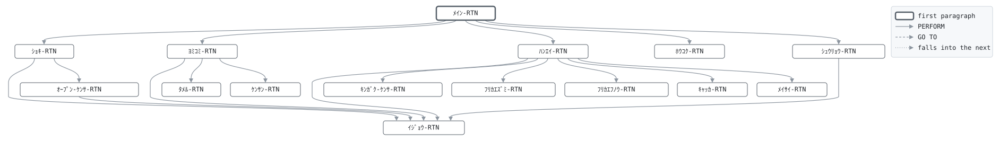

# GLD050

```text
GLD050: 口座振替結果処理

振替日の数日後。収納代行から戻った振替結果ファイル PRMRES
(銀行間の固定長レイアウト) を読み、契約マスタに反映する。
ヘッダが先頭で種別コード 91 であること、データはトレーラ
まで表に溜め、トレーラの件数と金額が合えば反映する。合わなけ
れば何も反映せず 8 で終わる。
振替済 (結果 0): 払込済年月を1か月 (年払は12か月) 進め、未納
回数を 0 にし、猶予中なら有効に戻し、保険料収入を仕訳する。
振替不能: 未納回数を1つ増やし、有効なら猶予中にして猶予開始
日を業務日付とする。失効は GLD060 が猶予期間の満了で行う。
顧客番号の契約がない、払込中 (有効・猶予中) でない、金額が
保険料の1回分でも未納分を合わせた2回分でもない記録は却下
する。

復帰コード: 0 全件反映、4 却下あり、8 ファイル不正、
            16 ファイル異常。

変更履歴
日付       担当 変更
2003-10-06 MS   GL-0310 初版、口座振替の開始。
```

Program [GLD050.cbl](../../../gondwana/programs/GLD050.cbl): 6 files, 15 paragraphs. Its business rules: [11 decision tables](../rules/GLD050.md).

- AUTHOR: ゴンドワナ生命 システム部.
- DATE-WRITTEN: 2003-10-06.

## Contents

- [Files](#files)
- [Flow](#flow)
- [Paragraphs](#paragraphs)
- [Calls](#calls)
- [Data flow](#data-flow)
- [Lineage](#lineage)
  - [Into ZG-ﾌﾘｶｴ-ﾚｺｰﾄﾞ](#into-zg-ﾌﾘｶｴ-ﾚｺｰﾄﾞ)
  - [Into PM-ｹｲﾔｸ-ﾚｺｰﾄﾞ](#into-pm-ｹｲﾔｸ-ﾚｺｰﾄﾞ)
  - [Into CT-ｾｲｷﾞｮ-ﾚｺｰﾄﾞ](#into-ct-ｾｲｷﾞｮ-ﾚｺｰﾄﾞ)
  - [Into JR-ｼﾜｹ-ﾚｺｰﾄﾞ](#into-jr-ｼﾜｹ-ﾚｺｰﾄﾞ)
  - [Into ｷｬｯｶ-ﾚｺｰﾄﾞ](#into-ｷｬｯｶ-ﾚｺｰﾄﾞ)
  - [Into ﾎｳｺｸ-ｷﾞｮｳ](#into-ﾎｳｺｸ-ｷﾞｮｳ)
  - [Into WS-ｺﾏﾝﾄﾞｷﾞｮｳ](#into-ws-ｺﾏﾝﾄﾞｷﾞｮｳ)
  - [Into WS-ｴﾗｰﾌｧｲﾙ](#into-ws-ｴﾗｰﾌｧｲﾙ)
  - [Into WS-ｴﾗｰｽﾃｰﾀｽ](#into-ws-ｴﾗｰｽﾃｰﾀｽ)
  - [Into WS-ｷﾞｮｳﾑﾋﾂﾞｹ](#into-ws-ｷﾞｮｳﾑﾋﾂﾞｹ)
  - [Into WS-ｷﾞｮｳﾑﾋﾂﾞｹ-ﾜﾚｷ](#into-ws-ｷﾞｮｳﾑﾋﾂﾞｹ-ﾜﾚｷ)
  - [Into WS-ﾎｳｺｳ](#into-ws-ﾎｳｺｳ)
  - [Into WS-ﾍﾝｶﾝｹｯｶ](#into-ws-ﾍﾝｶﾝｹｯｶ)
  - [Into WS-ﾊﾗｲｺﾐｽﾞﾐ](#into-ws-ﾊﾗｲｺﾐｽﾞﾐ)
  - [Into WS-ｶｲｽｳ](#into-ws-ｶｲｽｳ)
  - [Into WS-ｹｯｶ-TBL](#into-ws-ｹｯｶ-tbl)
  - [Into WS-ﾌｧｲﾙ-ｼﾞｮｳﾀｲ](#into-ws-ﾌｧｲﾙ-ｼﾞｮｳﾀｲ)
  - [Into WS-ｹﾝｻ](#into-ws-ｹﾝｻ)
  - [Into WS-ｹﾝｽｳ](#into-ws-ｹﾝｽｳ)
  - [Into WS-ﾘﾕｳ](#into-ws-ﾘﾕｳ)
  - [Into WS-ﾌｯｷｺｰﾄﾞ](#into-ws-ﾌｯｷｺｰﾄﾞ)
  - [Into WS-ﾎｳｺｸ](#into-ws-ﾎｳｺｸ)
  - [Out of the program](#out-of-the-program)
  - [Into other data items](#into-other-data-items)
- [Field origins](#field-origins)
  - [File REPORT-F](#file-report-f)
  - [File POLMST-F](#file-polmst-f)
  - [File GLJRNL-F](#file-gljrnl-f)
  - [File REJECT-F](#file-reject-f)
  - [File GLSCTL-F](#file-glsctl-f)
- [Links between records](#links-between-records)
- [Control totals](#control-totals)
- [Records](#records)
  - [ZG-ﾌﾘｶｴ-ﾚｺｰﾄﾞ](#zg-ﾌﾘｶｴ-ﾚｺｰﾄﾞ)
  - [PM-ｹｲﾔｸ-ﾚｺｰﾄﾞ](#pm-ｹｲﾔｸ-ﾚｺｰﾄﾞ)
  - [CT-ｾｲｷﾞｮ-ﾚｺｰﾄﾞ](#ct-ｾｲｷﾞｮ-ﾚｺｰﾄﾞ)
  - [JR-ｼﾜｹ-ﾚｺｰﾄﾞ](#jr-ｼﾜｹ-ﾚｺｰﾄﾞ)
  - [ｷｬｯｶ-ﾚｺｰﾄﾞ](#ｷｬｯｶ-ﾚｺｰﾄﾞ)
  - [ﾎｳｺｸ-ｷﾞｮｳ](#ﾎｳｺｸ-ｷﾞｮｳ)
  - [WS-ｽﾃｰﾀｽ](#ws-ｽﾃｰﾀｽ)
  - [WS-ｺﾏﾝﾄﾞｷﾞｮｳ](#ws-ｺﾏﾝﾄﾞｷﾞｮｳ)
  - [WS-ｴﾗｰﾌｧｲﾙ](#ws-ｴﾗｰﾌｧｲﾙ)
  - [WS-ｴﾗｰｽﾃｰﾀｽ](#ws-ｴﾗｰｽﾃｰﾀｽ)
  - [WS-ｷﾞｮｳﾑﾋﾂﾞｹ](#ws-ｷﾞｮｳﾑﾋﾂﾞｹ)
  - [WS-ｷﾞｮｳﾑﾋﾂﾞｹ-ﾜﾚｷ](#ws-ｷﾞｮｳﾑﾋﾂﾞｹ-ﾜﾚｷ)
  - [WS-ﾎｳｺｳ](#ws-ﾎｳｺｳ)
  - [WS-ﾍﾝｶﾝｹｯｶ](#ws-ﾍﾝｶﾝｹｯｶ)
  - [WS-ﾊﾗｲｺﾐｽﾞﾐ](#ws-ﾊﾗｲｺﾐｽﾞﾐ)
  - [WS-ｶｲｽｳ](#ws-ｶｲｽｳ)
  - [WS-ｹｯｶ-TBL](#ws-ｹｯｶ-tbl)
  - [WS-ｹｯｶ-IX](#ws-ｹｯｶ-ix)
  - [WS-ﾌｧｲﾙ-ｼﾞｮｳﾀｲ](#ws-ﾌｧｲﾙ-ｼﾞｮｳﾀｲ)
  - [WS-ｹﾝｻ](#ws-ｹﾝｻ)
  - [WS-ｹﾝｽｳ](#ws-ｹﾝｽｳ)
  - [WS-ﾘﾕｳ](#ws-ﾘﾕｳ)
  - [WS-ﾘﾕｳ-ﾒｯｾｰｼﾞ](#ws-ﾘﾕｳ-ﾒｯｾｰｼﾞ)
  - [WS-ﾘﾕｳ-ﾒｯｾｰｼﾞ-TBL](#ws-ﾘﾕｳ-ﾒｯｾｰｼﾞ-tbl)
  - [WS-ﾌｯｷｺｰﾄﾞ](#ws-ﾌｯｷｺｰﾄﾞ)
  - [WS-ﾎｳｺｸ](#ws-ﾎｳｺｸ)

## Files

| File | Kind | Assigned to | Organization | Status field | Opened | Records |
| --- | --- | --- | --- | --- | --- | --- |
| PRMRES-F | FD | PRMRES | SEQUENTIAL | WS-PRMRES-ST | INPUT | ZG-ﾌﾘｶｴ-ﾚｺｰﾄﾞ |
| POLMST-F | FD | POLMST | INDEXED, key PM-ｼｮｳｹﾝﾊﾞﾝｺﾞｳ, RANDOM access | WS-POLMST-ST | I-O | PM-ｹｲﾔｸ-ﾚｺｰﾄﾞ |
| GLSCTL-F | FD | GLSCTL | SEQUENTIAL | WS-GLSCTL-ST | I-O | CT-ｾｲｷﾞｮ-ﾚｺｰﾄﾞ |
| GLJRNL-F | FD | GLJRNL | LINE SEQUENTIAL | WS-GLJRNL-ST | EXTEND | JR-ｼﾜｹ-ﾚｺｰﾄﾞ |
| REJECT-F | FD | RESREJ | LINE SEQUENTIAL | WS-REJECT-ST | OUTPUT | ｷｬｯｶ-ﾚｺｰﾄﾞ |
| REPORT-F | FD | GLD050R | LINE SEQUENTIAL | WS-REPORT-ST | OUTPUT | ﾎｳｺｸ-ｷﾞｮｳ |

## Flow



## Paragraphs

| Paragraph | Description | Source | Performs | Goes to | Performed by | Reached by |
| --- | --- | --- | --- | --- | --- | --- |
| ﾒｲﾝ-RTN | ﾒｲﾝ-RTN: 準備、ファイルの読み込みと検算、反映、報告、終了。 | [GLD050.cbl:163](../../../gondwana/programs/GLD050.cbl#L163) | ｼｮｷ-RTN, ﾖﾐｺﾐ-RTN, ﾊﾝｴｲ-RTN, ﾎｳｺｸ-RTN, ｼｭｳﾘｮｳ-RTN | | | |
| ｼｮｷ-RTN | ｼｮｷ-RTN: 業務日付、ファイル、制御レコード。 | [GLD050.cbl:181](../../../gondwana/programs/GLD050.cbl#L181) | ｵｰﾌﾟﾝ-ｹﾝｻ-RTN, ｲｼﾞｮｳ-RTN | | ﾒｲﾝ-RTN | |
| ｵｰﾌﾟﾝ-ｹﾝｻ-RTN | ｵｰﾌﾟﾝ-ｹﾝｻ-RTN: 開けなかったファイルがあれば異常終了。 | [GLD050.cbl:212](../../../gondwana/programs/GLD050.cbl#L212) | ｲｼﾞｮｳ-RTN | | ｼｮｷ-RTN | |
| ﾖﾐｺﾐ-RTN | ﾖﾐｺﾐ-RTN: 次の記録を読み、順序とデータ区分で振り分ける。 ヘッダ、データ、トレーラ、エンドの順でなければファイル不正。 | [GLD050.cbl:243](../../../gondwana/programs/GLD050.cbl#L243) | ｲｼﾞｮｳ-RTN, ﾀﾒﾙ-RTN, ｹﾝｻﾝ-RTN | | ﾒｲﾝ-RTN | |
| ﾀﾒﾙ-RTN | ﾀﾒﾙ-RTN: データ記録を表に溜め、検算の件数と金額を足す。 | [GLD050.cbl:272](../../../gondwana/programs/GLD050.cbl#L272) | | | ﾖﾐｺﾐ-RTN | |
| ｹﾝｻﾝ-RTN | ｹﾝｻﾝ-RTN: トレーラの件数と金額を溜めたものと突き合わせる。 | [GLD050.cbl:288](../../../gondwana/programs/GLD050.cbl#L288) | | | ﾖﾐｺﾐ-RTN | |
| ﾊﾝｴｲ-RTN | ﾊﾝｴｲ-RTN: 溜めた1件を契約に反映する。 | [GLD050.cbl:309](../../../gondwana/programs/GLD050.cbl#L309) | ｲｼﾞｮｳ-RTN, ｷﾝｶﾞｸ-ｹﾝｻ-RTN, ﾌﾘｶｴｽﾞﾐ-RTN, ﾌﾘｶｴﾌﾉｳ-RTN, ｷｬｯｶ-RTN, ﾒｲｻｲ-RTN | | ﾒｲﾝ-RTN | |
| ｷﾝｶﾞｸ-ｹﾝｻ-RTN | ｷﾝｶﾞｸ-ｹﾝｻ-RTN: 振替額は保険料の1回分か、未納分を合わせた 2回分 (年払は1回分のみ)。それ以外は金額相違。 | [GLD050.cbl:348](../../../gondwana/programs/GLD050.cbl#L348) | | | ﾊﾝｴｲ-RTN | |
| ﾌﾘｶｴｽﾞﾐ-RTN | ﾌﾘｶｴｽﾞﾐ-RTN: 払込済年月を回数分進め、猶予中なら有効に戻し、 仕訳。 | [GLD050.cbl:362](../../../gondwana/programs/GLD050.cbl#L362) | | | ﾊﾝｴｲ-RTN | |
| ﾌﾘｶｴﾌﾉｳ-RTN | ﾌﾘｶｴﾌﾉｳ-RTN: 未納回数を増やし、有効なら猶予中にする。 | [GLD050.cbl:400](../../../gondwana/programs/GLD050.cbl#L400) | | | ﾊﾝｴｲ-RTN | |
| ｷｬｯｶ-RTN | ｷｬｯｶ-RTN: 却下ファイルに理由を付けて書く。 | [GLD050.cbl:425](../../../gondwana/programs/GLD050.cbl#L425) | | | ﾊﾝｴｲ-RTN | |
| ﾒｲｻｲ-RTN | ﾒｲｻｲ-RTN: 1件の明細行。 | [GLD050.cbl:437](../../../gondwana/programs/GLD050.cbl#L437) | | | ﾊﾝｴｲ-RTN | |
| ﾎｳｺｸ-RTN | ﾎｳｺｸ-RTN: 件数と合計。 | [GLD050.cbl:446](../../../gondwana/programs/GLD050.cbl#L446) | | | ﾒｲﾝ-RTN | |
| ｼｭｳﾘｮｳ-RTN | ｼｭｳﾘｮｳ-RTN: 制御レコードを書き戻し、ファイルを閉じる。 | [GLD050.cbl:471](../../../gondwana/programs/GLD050.cbl#L471) | ｲｼﾞｮｳ-RTN | | ﾒｲﾝ-RTN | |
| ｲｼﾞｮｳ-RTN | ｲｼﾞｮｳ-RTN: ファイル異常は 16 で終わる。 | [GLD050.cbl:486](../../../gondwana/programs/GLD050.cbl#L486) | | | ｼｮｷ-RTN, ｵｰﾌﾟﾝ-ｹﾝｻ-RTN, ﾖﾐｺﾐ-RTN, ﾊﾝｴｲ-RTN, ｼｭｳﾘｮｳ-RTN | |

## Calls

| Calls | Passing | Paragraph | Source |
| --- | --- | --- | --- |
| [GLC020](GLC020.md) | WS-ﾎｳｺｳ, WS-ｷﾞｮｳﾑﾋﾂﾞｹ, WS-ｷﾞｮｳﾑﾋﾂﾞｹ-ﾜﾚｷ, WS-ﾍﾝｶﾝｹｯｶ | ｼｮｷ-RTN | [GLD050.cbl:185](../../../gondwana/programs/GLD050.cbl#L185) |

## Data flow

| Paragraph | Reads | Writes |
| --- | --- | --- |
| ﾒｲﾝ-RTN | WS-ﾌｧｲﾙ-ｼﾞｮｳﾀｲ, WS-ｹｯｶ-IX, WS-ｹｯｶｹﾝｽｳ, WS-ﾌｾｲ-ｷﾞｮｳ, WS-ﾌｯｷｺｰﾄﾞ | WS-ｹｯｶ-IX, ﾎｳｺｸ-ｷﾞｮｳ, WS-REPORT-ST, WS-ﾌｯｷｺｰﾄﾞ, RETURN-CODE |
| ｼｮｷ-RTN | WS-ｺﾏﾝﾄﾞｷﾞｮｳ, WS-ﾎｳｺｳ, WS-ｷﾞｮｳﾑﾋﾂﾞｹ, WS-ｷﾞｮｳﾑﾋﾂﾞｹ-ﾜﾚｷ, WS-ﾍﾝｶﾝｹｯｶ, WS-GLSCTL-ST, WS-ﾋｮｳﾀﾞｲ-ｷﾞｮｳ | WS-ｺﾏﾝﾄﾞｷﾞｮｳ, WS-ｷﾞｮｳﾑﾋﾂﾞｹ, WS-ﾎｳｺｳ, WS-ｷﾞｮｳﾑﾋﾂﾞｹ-ﾜﾚｷ, WS-ﾍﾝｶﾝｹｯｶ, RETURN-CODE, WS-PRMRES-ST, WS-POLMST-ST, WS-GLSCTL-ST, WS-GLJRNL-ST, WS-REJECT-ST, WS-REPORT-ST, CT-ｾｲｷﾞｮ-ﾚｺｰﾄﾞ, WS-ｴﾗｰﾌｧｲﾙ, WS-ｴﾗｰｽﾃｰﾀｽ, WS-ﾋｮｳﾀﾞｲ-ﾋﾂﾞｹ, ﾎｳｺｸ-ｷﾞｮｳ, WS-ﾌｧｲﾙ-ｼﾞｮｳﾀｲ |
| ｵｰﾌﾟﾝ-ｹﾝｻ-RTN | WS-PRMRES-ST, WS-POLMST-ST, WS-GLSCTL-ST, WS-GLJRNL-ST, WS-REJECT-ST, WS-REPORT-ST, WS-ｴﾗｰﾌｧｲﾙ | WS-ｴﾗｰﾌｧｲﾙ, WS-ｴﾗｰｽﾃｰﾀｽ |
| ﾖﾐｺﾐ-RTN | WS-PRMRES-ST, WS-ﾌｧｲﾙ-ｼﾞｮｳﾀｲ, ZG-ﾃﾞｰﾀｸﾌﾞﾝ, ZG-H-ｼｭﾍﾞﾂｺｰﾄﾞ | ZG-ﾌﾘｶｴ-ﾚｺｰﾄﾞ, WS-PRMRES-ST, WS-ﾌｾｲ-ﾘﾕｳ, WS-ﾌｧｲﾙ-ｼﾞｮｳﾀｲ, WS-ｴﾗｰﾌｧｲﾙ, WS-ｴﾗｰｽﾃｰﾀｽ |
| ﾀﾒﾙ-RTN | WS-ｹｯｶｹﾝｽｳ, ZG-ﾌﾘｶｴ-ﾚｺｰﾄﾞ, WS-ｹﾝｻ-ｹﾝｽｳ, ZG-D-ｷﾝｶﾞｸ, WS-ｹﾝｻ-ｷﾝｶﾞｸ, ZG-D-ﾌﾘｶｴｹｯｶ, WS-ｹﾝｻ-ｽﾞﾐｹﾝｽｳ, WS-ｹﾝｻ-ｽﾞﾐｷﾝｶﾞｸ, WS-ｹﾝｻ-ﾌﾉｳｹﾝｽｳ, WS-ｹﾝｻ-ﾌﾉｳｷﾝｶﾞｸ | WS-ｹｯｶｹﾝｽｳ, WS-ｹｯｶ-ﾚｺｰﾄﾞ, WS-ｹﾝｻ-ｹﾝｽｳ, WS-ｹﾝｻ-ｷﾝｶﾞｸ, WS-ｹﾝｻ-ｽﾞﾐｹﾝｽｳ, WS-ｹﾝｻ-ｽﾞﾐｷﾝｶﾞｸ, WS-ｹﾝｻ-ﾌﾉｳｹﾝｽｳ, WS-ｹﾝｻ-ﾌﾉｳｷﾝｶﾞｸ |
| ｹﾝｻﾝ-RTN | ZG-T-ｺﾞｳｹｲｹﾝｽｳ, WS-ｹﾝｻ-ｹﾝｽｳ, ZG-T-ｺﾞｳｹｲｷﾝｶﾞｸ, WS-ｹﾝｻ-ｷﾝｶﾞｸ, ZG-T-ﾌﾘｶｴｽﾞﾐｹﾝｽｳ, WS-ｹﾝｻ-ｽﾞﾐｹﾝｽｳ, ZG-T-ﾌﾘｶｴｽﾞﾐｷﾝｶﾞｸ, WS-ｹﾝｻ-ｽﾞﾐｷﾝｶﾞｸ, ZG-T-ﾌﾘｶｴﾌﾉｳｹﾝｽｳ, WS-ｹﾝｻ-ﾌﾉｳｹﾝｽｳ, ZG-T-ﾌﾘｶｴﾌﾉｳｷﾝｶﾞｸ, WS-ｹﾝｻ-ﾌﾉｳｷﾝｶﾞｸ | WS-ﾌｾｲ-ﾘﾕｳ, WS-ﾌｧｲﾙ-ｼﾞｮｳﾀｲ |
| ﾊﾝｴｲ-RTN | WS-ｹｯｶ-ﾚｺｰﾄﾞ, WS-ｹｯｶ-IX, ZG-D-ｺｷｬｸﾊﾞﾝｺﾞｳ, WS-POLMST-ST, PM-ｼﾞｮｳﾀｲ, WS-ﾘﾕｳ, ZG-D-ﾌﾘｶｴｹｯｶ, WS-ﾊﾝｴｲｹﾝｽｳ | ZG-ﾌﾘｶｴ-ﾚｺｰﾄﾞ, WS-ﾘﾕｳ, PM-ｼｮｳｹﾝﾊﾞﾝｺﾞｳ, PM-ｹｲﾔｸ-ﾚｺｰﾄﾞ, WS-POLMST-ST, WS-ｴﾗｰﾌｧｲﾙ, WS-ｴﾗｰｽﾃｰﾀｽ, WS-ﾊﾝｴｲｹﾝｽｳ |
| ｷﾝｶﾞｸ-ｹﾝｻ-RTN | ZG-D-ｷﾝｶﾞｸ, PM-ﾎｹﾝﾘｮｳ, PM-ﾊﾗｲｺﾐﾎｳﾎｳ | WS-ｶｲｽｳ, WS-ﾘﾕｳ |
| ﾌﾘｶｴｽﾞﾐ-RTN | PM-ﾊﾗｲｺﾐｽﾞﾐﾈﾝｹﾞﾂ, PM-ﾊﾗｲｺﾐﾎｳﾎｳ, WS-ﾊﾗｲｺﾐ-YYYY, WS-ｶｲｽｳ, WS-ﾊﾗｲｺﾐ-MM, WS-ﾊﾗｲｺﾐｽﾞﾐ, PM-ｼﾞｮｳﾀｲ, WS-ｷﾞｮｳﾑﾋﾂﾞｹ-ﾜﾚｷ, WS-ｷﾞｮｳﾑﾋﾂﾞｹ, ZG-D-ｷﾝｶﾞｸ, CT-ｼﾞｶｲｼﾜｹﾊﾞﾝｺﾞｳ, PM-ｼｮｳｹﾝﾊﾞﾝｺﾞｳ, WS-ｽﾞﾐｹﾝｽｳ, WS-ｽﾞﾐｷﾝｶﾞｸ | WS-ﾊﾗｲｺﾐｽﾞﾐ, WS-ﾊﾗｲｺﾐ-YYYY, WS-ﾊﾗｲｺﾐ-MM, PM-ﾊﾗｲｺﾐｽﾞﾐﾈﾝｹﾞﾂ, PM-ﾐﾉｳｶｲｽｳ, PM-ｼﾞｮｳﾀｲ, PM-ﾕｳﾖｶｲｼﾋﾞ, PM-ｼﾞｮｳﾀｲﾋﾂﾞｹ, PM-ｻｲｼｭｳﾆｭｳｷﾝﾈﾝｹﾞﾂ, PM-ｻｲｼｭｳﾆｭｳｷﾝｶﾞｸ, JR-ｼﾜｹ-ﾚｺｰﾄﾞ, JR-ｼﾜｹﾊﾞﾝｺﾞｳ, CT-ｼﾞｶｲｼﾜｹﾊﾞﾝｺﾞｳ, JR-ﾋﾂﾞｹ, JR-ﾌﾟﾛｸﾞﾗﾑ, JR-ｶﾝｼﾞｮｳｶﾓｸ, JR-ﾀｲｼｬｸ, JR-ｷﾝｶﾞｸ, JR-ｼｮｳｹﾝﾊﾞﾝｺﾞｳ, JR-ﾃｷﾖｳ, WS-GLJRNL-ST, WS-ｽﾞﾐｹﾝｽｳ, WS-ｽﾞﾐｷﾝｶﾞｸ, WS-ﾒｲｻｲ-ｹｯｶ |
| ﾌﾘｶｴﾌﾉｳ-RTN | PM-ﾐﾉｳｶｲｽｳ, PM-ｼﾞｮｳﾀｲ, WS-ｷﾞｮｳﾑﾋﾂﾞｹ-ﾜﾚｷ, WS-ﾌﾉｳｹﾝｽｳ, ZG-D-ｷﾝｶﾞｸ, WS-ﾌﾉｳｷﾝｶﾞｸ, ZG-D-ﾌﾘｶｴｹｯｶ | PM-ﾐﾉｳｶｲｽｳ, PM-ｼﾞｮｳﾀｲ, PM-ﾕｳﾖｶｲｼﾋﾞ, PM-ｼﾞｮｳﾀｲﾋﾂﾞｹ, WS-ﾌﾉｳｹﾝｽｳ, WS-ﾌﾉｳｷﾝｶﾞｸ, WS-ﾒｲｻｲ-ｹｯｶ |
| ｷｬｯｶ-RTN | ZG-ﾌﾘｶｴ-ﾚｺｰﾄﾞ, WS-ﾘﾕｳ, WS-ﾒｯｾｰｼﾞ, WS-ｷｬｯｶｹﾝｽｳ | ｷｬｯｶ-ﾃﾞｰﾀ, ｷｬｯｶ-ﾘﾕｳ, ｷｬｯｶ-ﾒｯｾｰｼﾞ, ｷｬｯｶ-ﾚｺｰﾄﾞ, WS-REJECT-ST, WS-ｷｬｯｶｹﾝｽｳ, WS-ﾌｯｷｺｰﾄﾞ, WS-ﾒｲｻｲ-ｹｯｶ |
| ﾒｲｻｲ-RTN | ZG-D-ｺｷｬｸﾊﾞﾝｺﾞｳ, ZG-D-ｺｳｻﾞﾒｲｷﾞ, ZG-D-ｷﾝｶﾞｸ, WS-ﾒｲｻｲ-ｷﾞｮｳ | WS-ﾒｲｻｲ-ｼｮｳｹﾝ, WS-ﾒｲｻｲ-ﾒｲｷﾞ, WS-ﾒｲｻｲ-ｷﾝｶﾞｸ, ﾎｳｺｸ-ｷﾞｮｳ, WS-REPORT-ST |
| ﾎｳｺｸ-RTN | WS-ｹｯｶｹﾝｽｳ, WS-ｹﾝｽｳ-ｷﾞｮｳ, WS-ｽﾞﾐｹﾝｽｳ, WS-ｽﾞﾐｷﾝｶﾞｸ, WS-ﾌﾉｳｹﾝｽｳ, WS-ﾌﾉｳｷﾝｶﾞｸ, WS-ｷｬｯｶｹﾝｽｳ | ﾎｳｺｸ-ｷﾞｮｳ, WS-REPORT-ST, WS-ｹﾝｽｳ-ﾗﾍﾞﾙ, WS-ｹﾝｽｳ-ｱﾀｲ |
| ｼｭｳﾘｮｳ-RTN | WS-GLSCTL-ST, WS-ｽﾞﾐｹﾝｽｳ, WS-ﾌﾉｳｹﾝｽｳ, WS-ｷｬｯｶｹﾝｽｳ | CT-ｾｲｷﾞｮ-ﾚｺｰﾄﾞ, WS-GLSCTL-ST, WS-ｴﾗｰﾌｧｲﾙ, WS-ｴﾗｰｽﾃｰﾀｽ, WS-PRMRES-ST, WS-POLMST-ST, WS-GLJRNL-ST, WS-REJECT-ST, WS-REPORT-ST |
| ｲｼﾞｮｳ-RTN | WS-ｴﾗｰﾌｧｲﾙ, WS-ｴﾗｰｽﾃｰﾀｽ | RETURN-CODE |

## Lineage

Where each data item's values come from, grouped by the record they go into. A data item links to the record it belongs to.

### Into ZG-ﾌﾘｶｴ-ﾚｺｰﾄﾞ

Record [ZG-ﾌﾘｶｴ-ﾚｺｰﾄﾞ](#zg-ﾌﾘｶｴ-ﾚｺｰﾄﾞ), from copybook [ZENGIN](../copybooks/ZENGIN.md).

| Into | From | Statement | Paragraph | Source |
| --- | --- | --- | --- | --- |
| ZG-ﾌﾘｶｴ-ﾚｺｰﾄﾞ | file PRMRES-F | READ | ﾖﾐｺﾐ-RTN | [GLD050.cbl:244](../../../gondwana/programs/GLD050.cbl#L244) |
| ZG-ﾌﾘｶｴ-ﾚｺｰﾄﾞ | [WS-ｹｯｶ-ﾚｺｰﾄﾞ](#ws-ｹｯｶ-tbl "in WS-ｹｯｶ-TBL") | MOVE | ﾊﾝｴｲ-RTN | [GLD050.cbl:310](../../../gondwana/programs/GLD050.cbl#L310) |

### Into PM-ｹｲﾔｸ-ﾚｺｰﾄﾞ

Record [PM-ｹｲﾔｸ-ﾚｺｰﾄﾞ](#pm-ｹｲﾔｸ-ﾚｺｰﾄﾞ), from copybook [POLMST](../copybooks/POLMST.md).

| Into | From | Statement | Paragraph | Source |
| --- | --- | --- | --- | --- |
| PM-ｹｲﾔｸ-ﾚｺｰﾄﾞ | file POLMST-F | READ | ﾊﾝｴｲ-RTN | [GLD050.cbl:313](../../../gondwana/programs/GLD050.cbl#L313) |
| PM-ｻｲｼｭｳﾆｭｳｷﾝｶﾞｸ | [ZG-D-ｷﾝｶﾞｸ](#zg-ﾌﾘｶｴ-ﾚｺｰﾄﾞ "in ZG-ﾌﾘｶｴ-ﾚｺｰﾄﾞ") | MOVE | ﾌﾘｶｴｽﾞﾐ-RTN | [GLD050.cbl:381](../../../gondwana/programs/GLD050.cbl#L381) |
| PM-ｻｲｼｭｳﾆｭｳｷﾝﾈﾝｹﾞﾂ | [WS-ｷﾞｮｳﾑﾋﾂﾞｹ](#ws-ｷﾞｮｳﾑﾋﾂﾞｹ) | MOVE | ﾌﾘｶｴｽﾞﾐ-RTN | [GLD050.cbl:380](../../../gondwana/programs/GLD050.cbl#L380) |
| PM-ｼｮｳｹﾝﾊﾞﾝｺﾞｳ | [ZG-D-ｺｷｬｸﾊﾞﾝｺﾞｳ](#zg-ﾌﾘｶｴ-ﾚｺｰﾄﾞ "in ZG-ﾌﾘｶｴ-ﾚｺｰﾄﾞ") | MOVE | ﾊﾝｴｲ-RTN | [GLD050.cbl:312](../../../gondwana/programs/GLD050.cbl#L312) |
| PM-ｼﾞｮｳﾀｲ | literal condition PM-ﾕｳｺｳ | SET | ﾌﾘｶｴｽﾞﾐ-RTN | [GLD050.cbl:376](../../../gondwana/programs/GLD050.cbl#L376) |
| PM-ｼﾞｮｳﾀｲ | literal condition PM-ﾕｳﾖﾁｭｳ | SET | ﾌﾘｶｴﾌﾉｳ-RTN | [GLD050.cbl:403](../../../gondwana/programs/GLD050.cbl#L403) |
| PM-ｼﾞｮｳﾀｲﾋﾂﾞｹ | [WS-ｷﾞｮｳﾑﾋﾂﾞｹ-ﾜﾚｷ](#ws-ｷﾞｮｳﾑﾋﾂﾞｹ-ﾜﾚｷ) | MOVE | ﾌﾘｶｴｽﾞﾐ-RTN | [GLD050.cbl:378](../../../gondwana/programs/GLD050.cbl#L378) |
| PM-ｼﾞｮｳﾀｲﾋﾂﾞｹ | [WS-ｷﾞｮｳﾑﾋﾂﾞｹ-ﾜﾚｷ](#ws-ｷﾞｮｳﾑﾋﾂﾞｹ-ﾜﾚｷ) | MOVE | ﾌﾘｶｴﾌﾉｳ-RTN | [GLD050.cbl:405](../../../gondwana/programs/GLD050.cbl#L405) |
| PM-ﾊﾗｲｺﾐｽﾞﾐﾈﾝｹﾞﾂ | [WS-ﾊﾗｲｺﾐｽﾞﾐ](#ws-ﾊﾗｲｺﾐｽﾞﾐ) | MOVE | ﾌﾘｶｴｽﾞﾐ-RTN | [GLD050.cbl:373](../../../gondwana/programs/GLD050.cbl#L373) |
| PM-ﾐﾉｳｶｲｽｳ | literal 0 | MOVE | ﾌﾘｶｴｽﾞﾐ-RTN | [GLD050.cbl:374](../../../gondwana/programs/GLD050.cbl#L374) |
| PM-ﾐﾉｳｶｲｽｳ | literal 1 | ADD | ﾌﾘｶｴﾌﾉｳ-RTN | [GLD050.cbl:401](../../../gondwana/programs/GLD050.cbl#L401) |
| PM-ﾕｳﾖｶｲｼﾋﾞ | literal SPACES | MOVE | ﾌﾘｶｴｽﾞﾐ-RTN | [GLD050.cbl:377](../../../gondwana/programs/GLD050.cbl#L377) |
| PM-ﾕｳﾖｶｲｼﾋﾞ | [WS-ｷﾞｮｳﾑﾋﾂﾞｹ-ﾜﾚｷ](#ws-ｷﾞｮｳﾑﾋﾂﾞｹ-ﾜﾚｷ) | MOVE | ﾌﾘｶｴﾌﾉｳ-RTN | [GLD050.cbl:404](../../../gondwana/programs/GLD050.cbl#L404) |

### Into CT-ｾｲｷﾞｮ-ﾚｺｰﾄﾞ

Record [CT-ｾｲｷﾞｮ-ﾚｺｰﾄﾞ](#ct-ｾｲｷﾞｮ-ﾚｺｰﾄﾞ), from copybook [CTLREC](../copybooks/CTLREC.md).

| Into | From | Statement | Paragraph | Source |
| --- | --- | --- | --- | --- |
| CT-ｼﾞｶｲｼﾜｹﾊﾞﾝｺﾞｳ | literal 1 | ADD | ﾌﾘｶｴｽﾞﾐ-RTN | [GLD050.cbl:384](../../../gondwana/programs/GLD050.cbl#L384) |
| CT-ｾｲｷﾞｮ-ﾚｺｰﾄﾞ | file GLSCTL-F | READ | ｼｮｷ-RTN | [GLD050.cbl:197](../../../gondwana/programs/GLD050.cbl#L197) |

### Into JR-ｼﾜｹ-ﾚｺｰﾄﾞ

Record [JR-ｼﾜｹ-ﾚｺｰﾄﾞ](#jr-ｼﾜｹ-ﾚｺｰﾄﾞ), from copybook [GLJRNL](../copybooks/GLJRNL.md).

| Into | From | Statement | Paragraph | Source |
| --- | --- | --- | --- | --- |
| JR-ｶﾝｼﾞｮｳｶﾓｸ | literal 4110 | MOVE | ﾌﾘｶｴｽﾞﾐ-RTN | [GLD050.cbl:387](../../../gondwana/programs/GLD050.cbl#L387) |
| JR-ｷﾝｶﾞｸ | [ZG-D-ｷﾝｶﾞｸ](#zg-ﾌﾘｶｴ-ﾚｺｰﾄﾞ "in ZG-ﾌﾘｶｴ-ﾚｺｰﾄﾞ") | MOVE | ﾌﾘｶｴｽﾞﾐ-RTN | [GLD050.cbl:389](../../../gondwana/programs/GLD050.cbl#L389) |
| JR-ｼｮｳｹﾝﾊﾞﾝｺﾞｳ | [PM-ｼｮｳｹﾝﾊﾞﾝｺﾞｳ](#pm-ｹｲﾔｸ-ﾚｺｰﾄﾞ "in PM-ｹｲﾔｸ-ﾚｺｰﾄﾞ") | MOVE | ﾌﾘｶｴｽﾞﾐ-RTN | [GLD050.cbl:390](../../../gondwana/programs/GLD050.cbl#L390) |
| JR-ｼﾜｹ-ﾚｺｰﾄﾞ | literal SPACES | MOVE | ﾌﾘｶｴｽﾞﾐ-RTN | [GLD050.cbl:382](../../../gondwana/programs/GLD050.cbl#L382) |
| JR-ｼﾜｹﾊﾞﾝｺﾞｳ | [CT-ｼﾞｶｲｼﾜｹﾊﾞﾝｺﾞｳ](#ct-ｾｲｷﾞｮ-ﾚｺｰﾄﾞ "in CT-ｾｲｷﾞｮ-ﾚｺｰﾄﾞ") | MOVE | ﾌﾘｶｴｽﾞﾐ-RTN | [GLD050.cbl:383](../../../gondwana/programs/GLD050.cbl#L383) |
| JR-ﾀｲｼｬｸ | literal condition JR-ｶｼｶﾀ | SET | ﾌﾘｶｴｽﾞﾐ-RTN | [GLD050.cbl:388](../../../gondwana/programs/GLD050.cbl#L388) |
| JR-ﾃｷﾖｳ | literal '口座振替保険料' | MOVE | ﾌﾘｶｴｽﾞﾐ-RTN | [GLD050.cbl:391](../../../gondwana/programs/GLD050.cbl#L391) |
| JR-ﾋﾂﾞｹ | [WS-ｷﾞｮｳﾑﾋﾂﾞｹ-ﾜﾚｷ](#ws-ｷﾞｮｳﾑﾋﾂﾞｹ-ﾜﾚｷ) | MOVE | ﾌﾘｶｴｽﾞﾐ-RTN | [GLD050.cbl:385](../../../gondwana/programs/GLD050.cbl#L385) |
| JR-ﾌﾟﾛｸﾞﾗﾑ | literal 'GLD050' | MOVE | ﾌﾘｶｴｽﾞﾐ-RTN | [GLD050.cbl:386](../../../gondwana/programs/GLD050.cbl#L386) |

### Into ｷｬｯｶ-ﾚｺｰﾄﾞ

Record [ｷｬｯｶ-ﾚｺｰﾄﾞ](#ｷｬｯｶ-ﾚｺｰﾄﾞ).

| Into | From | Statement | Paragraph | Source |
| --- | --- | --- | --- | --- |
| ｷｬｯｶ-ﾃﾞｰﾀ | [ZG-ﾌﾘｶｴ-ﾚｺｰﾄﾞ](#zg-ﾌﾘｶｴ-ﾚｺｰﾄﾞ) | MOVE | ｷｬｯｶ-RTN | [GLD050.cbl:426](../../../gondwana/programs/GLD050.cbl#L426) |
| ｷｬｯｶ-ﾒｯｾｰｼﾞ | [WS-ﾒｯｾｰｼﾞ](#ws-ﾘﾕｳ-ﾒｯｾｰｼﾞ-tbl "in WS-ﾘﾕｳ-ﾒｯｾｰｼﾞ-TBL") | MOVE | ｷｬｯｶ-RTN | [GLD050.cbl:428](../../../gondwana/programs/GLD050.cbl#L428) |
| ｷｬｯｶ-ﾘﾕｳ | [WS-ﾘﾕｳ](#ws-ﾘﾕｳ) | MOVE | ｷｬｯｶ-RTN | [GLD050.cbl:427](../../../gondwana/programs/GLD050.cbl#L427) |

### Into ﾎｳｺｸ-ｷﾞｮｳ

Record [ﾎｳｺｸ-ｷﾞｮｳ](#ﾎｳｺｸ-ｷﾞｮｳ).

| Into | From | Statement | Paragraph | Source |
| --- | --- | --- | --- | --- |
| ﾎｳｺｸ-ｷﾞｮｳ | [WS-ﾌｾｲ-ｷﾞｮｳ](#ws-ﾎｳｺｸ "in WS-ﾎｳｺｸ") | WRITE | ﾒｲﾝ-RTN | [GLD050.cbl:170](../../../gondwana/programs/GLD050.cbl#L170) |
| ﾎｳｺｸ-ｷﾞｮｳ | [WS-ﾋｮｳﾀﾞｲ-ｷﾞｮｳ](#ws-ﾎｳｺｸ "in WS-ﾎｳｺｸ") | WRITE | ｼｮｷ-RTN | [GLD050.cbl:204](../../../gondwana/programs/GLD050.cbl#L204) |
| ﾎｳｺｸ-ｷﾞｮｳ | literal SPACES | MOVE | ｼｮｷ-RTN | [GLD050.cbl:205](../../../gondwana/programs/GLD050.cbl#L205) |
| ﾎｳｺｸ-ｷﾞｮｳ | [WS-ﾒｲｻｲ-ｷﾞｮｳ](#ws-ﾎｳｺｸ "in WS-ﾎｳｺｸ") | WRITE | ﾒｲｻｲ-RTN | [GLD050.cbl:441](../../../gondwana/programs/GLD050.cbl#L441) |
| ﾎｳｺｸ-ｷﾞｮｳ | literal SPACES | MOVE | ﾎｳｺｸ-RTN | [GLD050.cbl:447](../../../gondwana/programs/GLD050.cbl#L447) |
| ﾎｳｺｸ-ｷﾞｮｳ | [WS-ｹﾝｽｳ-ｷﾞｮｳ](#ws-ﾎｳｺｸ "in WS-ﾎｳｺｸ") | WRITE | ﾎｳｺｸ-RTN | [GLD050.cbl:451](../../../gondwana/programs/GLD050.cbl#L451) |
| ﾎｳｺｸ-ｷﾞｮｳ | [WS-ｹﾝｽｳ-ｷﾞｮｳ](#ws-ﾎｳｺｸ "in WS-ﾎｳｺｸ") | WRITE | ﾎｳｺｸ-RTN | [GLD050.cbl:454](../../../gondwana/programs/GLD050.cbl#L454) |
| ﾎｳｺｸ-ｷﾞｮｳ | [WS-ｹﾝｽｳ-ｷﾞｮｳ](#ws-ﾎｳｺｸ "in WS-ﾎｳｺｸ") | WRITE | ﾎｳｺｸ-RTN | [GLD050.cbl:457](../../../gondwana/programs/GLD050.cbl#L457) |
| ﾎｳｺｸ-ｷﾞｮｳ | [WS-ｹﾝｽｳ-ｷﾞｮｳ](#ws-ﾎｳｺｸ "in WS-ﾎｳｺｸ") | WRITE | ﾎｳｺｸ-RTN | [GLD050.cbl:460](../../../gondwana/programs/GLD050.cbl#L460) |
| ﾎｳｺｸ-ｷﾞｮｳ | [WS-ｹﾝｽｳ-ｷﾞｮｳ](#ws-ﾎｳｺｸ "in WS-ﾎｳｺｸ") | WRITE | ﾎｳｺｸ-RTN | [GLD050.cbl:463](../../../gondwana/programs/GLD050.cbl#L463) |
| ﾎｳｺｸ-ｷﾞｮｳ | [WS-ｹﾝｽｳ-ｷﾞｮｳ](#ws-ﾎｳｺｸ "in WS-ﾎｳｺｸ") | WRITE | ﾎｳｺｸ-RTN | [GLD050.cbl:466](../../../gondwana/programs/GLD050.cbl#L466) |

### Into WS-ｺﾏﾝﾄﾞｷﾞｮｳ

Record [WS-ｺﾏﾝﾄﾞｷﾞｮｳ](#ws-ｺﾏﾝﾄﾞｷﾞｮｳ).

| Into | From | Statement | Paragraph | Source |
| --- | --- | --- | --- | --- |
| WS-ｺﾏﾝﾄﾞｷﾞｮｳ | COMMAND-LINE | ACCEPT | ｼｮｷ-RTN | [GLD050.cbl:182](../../../gondwana/programs/GLD050.cbl#L182) |

### Into WS-ｴﾗｰﾌｧｲﾙ

Record [WS-ｴﾗｰﾌｧｲﾙ](#ws-ｴﾗｰﾌｧｲﾙ).

| Into | From | Statement | Paragraph | Source |
| --- | --- | --- | --- | --- |
| WS-ｴﾗｰﾌｧｲﾙ | literal 'GLSCTL' | MOVE | ｼｮｷ-RTN | [GLD050.cbl:199](../../../gondwana/programs/GLD050.cbl#L199) |
| WS-ｴﾗｰﾌｧｲﾙ | literal 'PRMRES' | MOVE | ｵｰﾌﾟﾝ-ｹﾝｻ-RTN | [GLD050.cbl:215](../../../gondwana/programs/GLD050.cbl#L215) |
| WS-ｴﾗｰﾌｧｲﾙ | literal 'POLMST' | MOVE | ｵｰﾌﾟﾝ-ｹﾝｻ-RTN | [GLD050.cbl:218](../../../gondwana/programs/GLD050.cbl#L218) |
| WS-ｴﾗｰﾌｧｲﾙ | literal 'GLSCTL' | MOVE | ｵｰﾌﾟﾝ-ｹﾝｻ-RTN | [GLD050.cbl:221](../../../gondwana/programs/GLD050.cbl#L221) |
| WS-ｴﾗｰﾌｧｲﾙ | literal 'GLJRNL' | MOVE | ｵｰﾌﾟﾝ-ｹﾝｻ-RTN | [GLD050.cbl:224](../../../gondwana/programs/GLD050.cbl#L224) |
| WS-ｴﾗｰﾌｧｲﾙ | literal 'RESREJ' | MOVE | ｵｰﾌﾟﾝ-ｹﾝｻ-RTN | [GLD050.cbl:227](../../../gondwana/programs/GLD050.cbl#L227) |
| WS-ｴﾗｰﾌｧｲﾙ | literal 'GLD050R' | MOVE | ｵｰﾌﾟﾝ-ｹﾝｻ-RTN | [GLD050.cbl:230](../../../gondwana/programs/GLD050.cbl#L230) |
| WS-ｴﾗｰﾌｧｲﾙ | literal SPACES | MOVE | ｵｰﾌﾟﾝ-ｹﾝｻ-RTN | [GLD050.cbl:233](../../../gondwana/programs/GLD050.cbl#L233) |
| WS-ｴﾗｰﾌｧｲﾙ | literal 'PRMRES' | MOVE | ﾖﾐｺﾐ-RTN | [GLD050.cbl:250](../../../gondwana/programs/GLD050.cbl#L250) |
| WS-ｴﾗｰﾌｧｲﾙ | literal 'POLMST' | MOVE | ﾊﾝｴｲ-RTN | [GLD050.cbl:318](../../../gondwana/programs/GLD050.cbl#L318) |
| WS-ｴﾗｰﾌｧｲﾙ | literal 'POLMST' | MOVE | ﾊﾝｴｲ-RTN | [GLD050.cbl:334](../../../gondwana/programs/GLD050.cbl#L334) |
| WS-ｴﾗｰﾌｧｲﾙ | literal 'GLSCTL' | MOVE | ｼｭｳﾘｮｳ-RTN | [GLD050.cbl:474](../../../gondwana/programs/GLD050.cbl#L474) |

### Into WS-ｴﾗｰｽﾃｰﾀｽ

Record [WS-ｴﾗｰｽﾃｰﾀｽ](#ws-ｴﾗｰｽﾃｰﾀｽ).

| Into | From | Statement | Paragraph | Source |
| --- | --- | --- | --- | --- |
| WS-ｴﾗｰｽﾃｰﾀｽ | [WS-GLSCTL-ST](#ws-ｽﾃｰﾀｽ "in WS-ｽﾃｰﾀｽ") | MOVE | ｼｮｷ-RTN | [GLD050.cbl:200](../../../gondwana/programs/GLD050.cbl#L200) |
| WS-ｴﾗｰｽﾃｰﾀｽ | [WS-PRMRES-ST](#ws-ｽﾃｰﾀｽ "in WS-ｽﾃｰﾀｽ") | MOVE | ｵｰﾌﾟﾝ-ｹﾝｻ-RTN | [GLD050.cbl:216](../../../gondwana/programs/GLD050.cbl#L216) |
| WS-ｴﾗｰｽﾃｰﾀｽ | [WS-POLMST-ST](#ws-ｽﾃｰﾀｽ "in WS-ｽﾃｰﾀｽ") | MOVE | ｵｰﾌﾟﾝ-ｹﾝｻ-RTN | [GLD050.cbl:219](../../../gondwana/programs/GLD050.cbl#L219) |
| WS-ｴﾗｰｽﾃｰﾀｽ | [WS-GLSCTL-ST](#ws-ｽﾃｰﾀｽ "in WS-ｽﾃｰﾀｽ") | MOVE | ｵｰﾌﾟﾝ-ｹﾝｻ-RTN | [GLD050.cbl:222](../../../gondwana/programs/GLD050.cbl#L222) |
| WS-ｴﾗｰｽﾃｰﾀｽ | [WS-GLJRNL-ST](#ws-ｽﾃｰﾀｽ "in WS-ｽﾃｰﾀｽ") | MOVE | ｵｰﾌﾟﾝ-ｹﾝｻ-RTN | [GLD050.cbl:225](../../../gondwana/programs/GLD050.cbl#L225) |
| WS-ｴﾗｰｽﾃｰﾀｽ | [WS-REJECT-ST](#ws-ｽﾃｰﾀｽ "in WS-ｽﾃｰﾀｽ") | MOVE | ｵｰﾌﾟﾝ-ｹﾝｻ-RTN | [GLD050.cbl:228](../../../gondwana/programs/GLD050.cbl#L228) |
| WS-ｴﾗｰｽﾃｰﾀｽ | [WS-REPORT-ST](#ws-ｽﾃｰﾀｽ "in WS-ｽﾃｰﾀｽ") | MOVE | ｵｰﾌﾟﾝ-ｹﾝｻ-RTN | [GLD050.cbl:231](../../../gondwana/programs/GLD050.cbl#L231) |
| WS-ｴﾗｰｽﾃｰﾀｽ | [WS-PRMRES-ST](#ws-ｽﾃｰﾀｽ "in WS-ｽﾃｰﾀｽ") | MOVE | ﾖﾐｺﾐ-RTN | [GLD050.cbl:251](../../../gondwana/programs/GLD050.cbl#L251) |
| WS-ｴﾗｰｽﾃｰﾀｽ | [WS-POLMST-ST](#ws-ｽﾃｰﾀｽ "in WS-ｽﾃｰﾀｽ") | MOVE | ﾊﾝｴｲ-RTN | [GLD050.cbl:319](../../../gondwana/programs/GLD050.cbl#L319) |
| WS-ｴﾗｰｽﾃｰﾀｽ | [WS-POLMST-ST](#ws-ｽﾃｰﾀｽ "in WS-ｽﾃｰﾀｽ") | MOVE | ﾊﾝｴｲ-RTN | [GLD050.cbl:335](../../../gondwana/programs/GLD050.cbl#L335) |
| WS-ｴﾗｰｽﾃｰﾀｽ | [WS-GLSCTL-ST](#ws-ｽﾃｰﾀｽ "in WS-ｽﾃｰﾀｽ") | MOVE | ｼｭｳﾘｮｳ-RTN | [GLD050.cbl:475](../../../gondwana/programs/GLD050.cbl#L475) |

### Into WS-ｷﾞｮｳﾑﾋﾂﾞｹ

Record [WS-ｷﾞｮｳﾑﾋﾂﾞｹ](#ws-ｷﾞｮｳﾑﾋﾂﾞｹ).

| Into | From | Statement | Paragraph | Source |
| --- | --- | --- | --- | --- |
| WS-ｷﾞｮｳﾑﾋﾂﾞｹ | [WS-ｺﾏﾝﾄﾞｷﾞｮｳ](#ws-ｺﾏﾝﾄﾞｷﾞｮｳ) | MOVE | ｼｮｷ-RTN | [GLD050.cbl:183](../../../gondwana/programs/GLD050.cbl#L183) |
| WS-ｷﾞｮｳﾑﾋﾂﾞｹ | call GLC020 argument 2 | CALL | ｼｮｷ-RTN | [GLD050.cbl:185](../../../gondwana/programs/GLD050.cbl#L185) |

### Into WS-ｷﾞｮｳﾑﾋﾂﾞｹ-ﾜﾚｷ

Record [WS-ｷﾞｮｳﾑﾋﾂﾞｹ-ﾜﾚｷ](#ws-ｷﾞｮｳﾑﾋﾂﾞｹ-ﾜﾚｷ).

| Into | From | Statement | Paragraph | Source |
| --- | --- | --- | --- | --- |
| WS-ｷﾞｮｳﾑﾋﾂﾞｹ-ﾜﾚｷ | call GLC020 argument 3 | CALL | ｼｮｷ-RTN | [GLD050.cbl:185](../../../gondwana/programs/GLD050.cbl#L185) |

### Into WS-ﾎｳｺｳ

Record [WS-ﾎｳｺｳ](#ws-ﾎｳｺｳ).

| Into | From | Statement | Paragraph | Source |
| --- | --- | --- | --- | --- |
| WS-ﾎｳｺｳ | literal 'W' | MOVE | ｼｮｷ-RTN | [GLD050.cbl:184](../../../gondwana/programs/GLD050.cbl#L184) |
| WS-ﾎｳｺｳ | call GLC020 argument 1 | CALL | ｼｮｷ-RTN | [GLD050.cbl:185](../../../gondwana/programs/GLD050.cbl#L185) |

### Into WS-ﾍﾝｶﾝｹｯｶ

Record [WS-ﾍﾝｶﾝｹｯｶ](#ws-ﾍﾝｶﾝｹｯｶ).

| Into | From | Statement | Paragraph | Source |
| --- | --- | --- | --- | --- |
| WS-ﾍﾝｶﾝｹｯｶ | call GLC020 argument 4 | CALL | ｼｮｷ-RTN | [GLD050.cbl:185](../../../gondwana/programs/GLD050.cbl#L185) |

### Into WS-ﾊﾗｲｺﾐｽﾞﾐ

Record [WS-ﾊﾗｲｺﾐｽﾞﾐ](#ws-ﾊﾗｲｺﾐｽﾞﾐ).

| Into | From | Statement | Paragraph | Source |
| --- | --- | --- | --- | --- |
| WS-ﾊﾗｲｺﾐ-MM | [WS-ｶｲｽｳ](#ws-ｶｲｽｳ) | ADD | ﾌﾘｶｴｽﾞﾐ-RTN | [GLD050.cbl:367](../../../gondwana/programs/GLD050.cbl#L367) |
| WS-ﾊﾗｲｺﾐ-MM | literal 12 | SUBTRACT | ﾌﾘｶｴｽﾞﾐ-RTN | [GLD050.cbl:369](../../../gondwana/programs/GLD050.cbl#L369) |
| WS-ﾊﾗｲｺﾐ-YYYY | literal 1 | ADD | ﾌﾘｶｴｽﾞﾐ-RTN | [GLD050.cbl:365](../../../gondwana/programs/GLD050.cbl#L365) |
| WS-ﾊﾗｲｺﾐ-YYYY | literal 1 | ADD | ﾌﾘｶｴｽﾞﾐ-RTN | [GLD050.cbl:370](../../../gondwana/programs/GLD050.cbl#L370) |
| WS-ﾊﾗｲｺﾐｽﾞﾐ | [PM-ﾊﾗｲｺﾐｽﾞﾐﾈﾝｹﾞﾂ](#pm-ｹｲﾔｸ-ﾚｺｰﾄﾞ "in PM-ｹｲﾔｸ-ﾚｺｰﾄﾞ") | MOVE | ﾌﾘｶｴｽﾞﾐ-RTN | [GLD050.cbl:363](../../../gondwana/programs/GLD050.cbl#L363) |

### Into WS-ｶｲｽｳ

Record [WS-ｶｲｽｳ](#ws-ｶｲｽｳ).

| Into | From | Statement | Paragraph | Source |
| --- | --- | --- | --- | --- |
| WS-ｶｲｽｳ | literal 1 | MOVE | ｷﾝｶﾞｸ-ｹﾝｻ-RTN | [GLD050.cbl:351](../../../gondwana/programs/GLD050.cbl#L351) |
| WS-ｶｲｽｳ | literal 2 | MOVE | ｷﾝｶﾞｸ-ｹﾝｻ-RTN | [GLD050.cbl:353](../../../gondwana/programs/GLD050.cbl#L353) |

### Into WS-ｹｯｶ-TBL

Record [WS-ｹｯｶ-TBL](#ws-ｹｯｶ-tbl).

| Into | From | Statement | Paragraph | Source |
| --- | --- | --- | --- | --- |
| WS-ｹｯｶ-ﾚｺｰﾄﾞ | [ZG-ﾌﾘｶｴ-ﾚｺｰﾄﾞ](#zg-ﾌﾘｶｴ-ﾚｺｰﾄﾞ) | MOVE | ﾀﾒﾙ-RTN | [GLD050.cbl:274](../../../gondwana/programs/GLD050.cbl#L274) |
| WS-ｹｯｶｹﾝｽｳ | literal 1 | ADD | ﾀﾒﾙ-RTN | [GLD050.cbl:273](../../../gondwana/programs/GLD050.cbl#L273) |

### Into WS-ﾌｧｲﾙ-ｼﾞｮｳﾀｲ

Record [WS-ﾌｧｲﾙ-ｼﾞｮｳﾀｲ](#ws-ﾌｧｲﾙ-ｼﾞｮｳﾀｲ).

| Into | From | Statement | Paragraph | Source |
| --- | --- | --- | --- | --- |
| WS-ﾌｧｲﾙ-ｼﾞｮｳﾀｲ | literal condition WS-ﾍｯﾀﾞ-ﾏﾁ | SET | ｼｮｷ-RTN | [GLD050.cbl:207](../../../gondwana/programs/GLD050.cbl#L207) |
| WS-ﾌｧｲﾙ-ｼﾞｮｳﾀｲ | literal condition WS-ﾌｧｲﾙ-ﾌｾｲ | SET | ﾖﾐｺﾐ-RTN | [GLD050.cbl:248](../../../gondwana/programs/GLD050.cbl#L248) |
| WS-ﾌｧｲﾙ-ｼﾞｮｳﾀｲ | literal condition WS-ﾃﾞｰﾀ-ﾏﾁ | SET | ﾖﾐｺﾐ-RTN | [GLD050.cbl:254](../../../gondwana/programs/GLD050.cbl#L254) |
| WS-ﾌｧｲﾙ-ｼﾞｮｳﾀｲ | literal condition WS-ﾌｧｲﾙ-ﾌｾｲ | SET | ﾖﾐｺﾐ-RTN | [GLD050.cbl:257](../../../gondwana/programs/GLD050.cbl#L257) |
| WS-ﾌｧｲﾙ-ｼﾞｮｳﾀｲ | literal condition WS-ﾌｧｲﾙ-ｶﾝﾘｮｳ | SET | ﾖﾐｺﾐ-RTN | [GLD050.cbl:263](../../../gondwana/programs/GLD050.cbl#L263) |
| WS-ﾌｧｲﾙ-ｼﾞｮｳﾀｲ | literal condition WS-ﾌｧｲﾙ-ﾌｾｲ | SET | ﾖﾐｺﾐ-RTN | [GLD050.cbl:266](../../../gondwana/programs/GLD050.cbl#L266) |
| WS-ﾌｧｲﾙ-ｼﾞｮｳﾀｲ | literal condition WS-ﾌｧｲﾙ-ﾌｾｲ | SET | ｹﾝｻﾝ-RTN | [GLD050.cbl:293](../../../gondwana/programs/GLD050.cbl#L293) |
| WS-ﾌｧｲﾙ-ｼﾞｮｳﾀｲ | literal condition WS-ﾌｧｲﾙ-ﾌｾｲ | SET | ｹﾝｻﾝ-RTN | [GLD050.cbl:297](../../../gondwana/programs/GLD050.cbl#L297) |
| WS-ﾌｧｲﾙ-ｼﾞｮｳﾀｲ | literal condition WS-ﾌｧｲﾙ-ﾌｾｲ | SET | ｹﾝｻﾝ-RTN | [GLD050.cbl:301](../../../gondwana/programs/GLD050.cbl#L301) |
| WS-ﾌｧｲﾙ-ｼﾞｮｳﾀｲ | literal condition WS-ｴﾝﾄﾞ-ﾏﾁ | SET | ｹﾝｻﾝ-RTN | [GLD050.cbl:303](../../../gondwana/programs/GLD050.cbl#L303) |

### Into WS-ｹﾝｻ

Record [WS-ｹﾝｻ](#ws-ｹﾝｻ).

| Into | From | Statement | Paragraph | Source |
| --- | --- | --- | --- | --- |
| WS-ｹﾝｻ-ｷﾝｶﾞｸ | [ZG-D-ｷﾝｶﾞｸ](#zg-ﾌﾘｶｴ-ﾚｺｰﾄﾞ "in ZG-ﾌﾘｶｴ-ﾚｺｰﾄﾞ") | ADD | ﾀﾒﾙ-RTN | [GLD050.cbl:276](../../../gondwana/programs/GLD050.cbl#L276) |
| WS-ｹﾝｻ-ｹﾝｽｳ | literal 1 | ADD | ﾀﾒﾙ-RTN | [GLD050.cbl:275](../../../gondwana/programs/GLD050.cbl#L275) |
| WS-ｹﾝｻ-ｽﾞﾐｷﾝｶﾞｸ | [ZG-D-ｷﾝｶﾞｸ](#zg-ﾌﾘｶｴ-ﾚｺｰﾄﾞ "in ZG-ﾌﾘｶｴ-ﾚｺｰﾄﾞ") | ADD | ﾀﾒﾙ-RTN | [GLD050.cbl:279](../../../gondwana/programs/GLD050.cbl#L279) |
| WS-ｹﾝｻ-ｽﾞﾐｹﾝｽｳ | literal 1 | ADD | ﾀﾒﾙ-RTN | [GLD050.cbl:278](../../../gondwana/programs/GLD050.cbl#L278) |
| WS-ｹﾝｻ-ﾌﾉｳｷﾝｶﾞｸ | [ZG-D-ｷﾝｶﾞｸ](#zg-ﾌﾘｶｴ-ﾚｺｰﾄﾞ "in ZG-ﾌﾘｶｴ-ﾚｺｰﾄﾞ") | ADD | ﾀﾒﾙ-RTN | [GLD050.cbl:282](../../../gondwana/programs/GLD050.cbl#L282) |
| WS-ｹﾝｻ-ﾌﾉｳｹﾝｽｳ | literal 1 | ADD | ﾀﾒﾙ-RTN | [GLD050.cbl:281](../../../gondwana/programs/GLD050.cbl#L281) |

### Into WS-ｹﾝｽｳ

Record [WS-ｹﾝｽｳ](#ws-ｹﾝｽｳ).

| Into | From | Statement | Paragraph | Source |
| --- | --- | --- | --- | --- |
| WS-ｷｬｯｶｹﾝｽｳ | literal 1 | ADD | ｷｬｯｶ-RTN | [GLD050.cbl:430](../../../gondwana/programs/GLD050.cbl#L430) |
| WS-ｽﾞﾐｷﾝｶﾞｸ | [ZG-D-ｷﾝｶﾞｸ](#zg-ﾌﾘｶｴ-ﾚｺｰﾄﾞ "in ZG-ﾌﾘｶｴ-ﾚｺｰﾄﾞ") | ADD | ﾌﾘｶｴｽﾞﾐ-RTN | [GLD050.cbl:394](../../../gondwana/programs/GLD050.cbl#L394) |
| WS-ｽﾞﾐｹﾝｽｳ | literal 1 | ADD | ﾌﾘｶｴｽﾞﾐ-RTN | [GLD050.cbl:393](../../../gondwana/programs/GLD050.cbl#L393) |
| WS-ﾊﾝｴｲｹﾝｽｳ | literal 1 | ADD | ﾊﾝｴｲ-RTN | [GLD050.cbl:338](../../../gondwana/programs/GLD050.cbl#L338) |
| WS-ﾌﾉｳｷﾝｶﾞｸ | [ZG-D-ｷﾝｶﾞｸ](#zg-ﾌﾘｶｴ-ﾚｺｰﾄﾞ "in ZG-ﾌﾘｶｴ-ﾚｺｰﾄﾞ") | ADD | ﾌﾘｶｴﾌﾉｳ-RTN | [GLD050.cbl:408](../../../gondwana/programs/GLD050.cbl#L408) |
| WS-ﾌﾉｳｹﾝｽｳ | literal 1 | ADD | ﾌﾘｶｴﾌﾉｳ-RTN | [GLD050.cbl:407](../../../gondwana/programs/GLD050.cbl#L407) |

### Into WS-ﾘﾕｳ

Record [WS-ﾘﾕｳ](#ws-ﾘﾕｳ).

| Into | From | Statement | Paragraph | Source |
| --- | --- | --- | --- | --- |
| WS-ﾘﾕｳ | literal condition WS-ﾘﾕｳ-ﾅｼ | SET | ﾊﾝｴｲ-RTN | [GLD050.cbl:311](../../../gondwana/programs/GLD050.cbl#L311) |
| WS-ﾘﾕｳ | literal condition WS-ｹｲﾔｸ-ﾅｼ | SET | ﾊﾝｴｲ-RTN | [GLD050.cbl:316](../../../gondwana/programs/GLD050.cbl#L316) |
| WS-ﾘﾕｳ | literal condition WS-ﾊﾗｲｺﾐﾁｭｳ-ﾃﾞﾅｲ | SET | ﾊﾝｴｲ-RTN | [GLD050.cbl:322](../../../gondwana/programs/GLD050.cbl#L322) |
| WS-ﾘﾕｳ | literal condition WS-ｷﾝｶﾞｸ-ｿｳｲ | SET | ｷﾝｶﾞｸ-ｹﾝｻ-RTN | [GLD050.cbl:355](../../../gondwana/programs/GLD050.cbl#L355) |

### Into WS-ﾌｯｷｺｰﾄﾞ

Record [WS-ﾌｯｷｺｰﾄﾞ](#ws-ﾌｯｷｺｰﾄﾞ).

| Into | From | Statement | Paragraph | Source |
| --- | --- | --- | --- | --- |
| WS-ﾌｯｷｺｰﾄﾞ | literal 8 | MOVE | ﾒｲﾝ-RTN | [GLD050.cbl:171](../../../gondwana/programs/GLD050.cbl#L171) |
| WS-ﾌｯｷｺｰﾄﾞ | literal 4 | MOVE | ｷｬｯｶ-RTN | [GLD050.cbl:431](../../../gondwana/programs/GLD050.cbl#L431) |

### Into WS-ﾎｳｺｸ

Record [WS-ﾎｳｺｸ](#ws-ﾎｳｺｸ).

| Into | From | Statement | Paragraph | Source |
| --- | --- | --- | --- | --- |
| WS-ｹﾝｽｳ-ｱﾀｲ | [WS-ｹｯｶｹﾝｽｳ](#ws-ｹｯｶ-tbl "in WS-ｹｯｶ-TBL") | MOVE | ﾎｳｺｸ-RTN | [GLD050.cbl:450](../../../gondwana/programs/GLD050.cbl#L450) |
| WS-ｹﾝｽｳ-ｱﾀｲ | [WS-ｽﾞﾐｹﾝｽｳ](#ws-ｹﾝｽｳ "in WS-ｹﾝｽｳ") | MOVE | ﾎｳｺｸ-RTN | [GLD050.cbl:453](../../../gondwana/programs/GLD050.cbl#L453) |
| WS-ｹﾝｽｳ-ｱﾀｲ | [WS-ｽﾞﾐｷﾝｶﾞｸ](#ws-ｹﾝｽｳ "in WS-ｹﾝｽｳ") | MOVE | ﾎｳｺｸ-RTN | [GLD050.cbl:456](../../../gondwana/programs/GLD050.cbl#L456) |
| WS-ｹﾝｽｳ-ｱﾀｲ | [WS-ﾌﾉｳｹﾝｽｳ](#ws-ｹﾝｽｳ "in WS-ｹﾝｽｳ") | MOVE | ﾎｳｺｸ-RTN | [GLD050.cbl:459](../../../gondwana/programs/GLD050.cbl#L459) |
| WS-ｹﾝｽｳ-ｱﾀｲ | [WS-ﾌﾉｳｷﾝｶﾞｸ](#ws-ｹﾝｽｳ "in WS-ｹﾝｽｳ") | MOVE | ﾎｳｺｸ-RTN | [GLD050.cbl:462](../../../gondwana/programs/GLD050.cbl#L462) |
| WS-ｹﾝｽｳ-ｱﾀｲ | [WS-ｷｬｯｶｹﾝｽｳ](#ws-ｹﾝｽｳ "in WS-ｹﾝｽｳ") | MOVE | ﾎｳｺｸ-RTN | [GLD050.cbl:465](../../../gondwana/programs/GLD050.cbl#L465) |
| WS-ｹﾝｽｳ-ﾗﾍﾞﾙ | literal '読込件数' | MOVE | ﾎｳｺｸ-RTN | [GLD050.cbl:449](../../../gondwana/programs/GLD050.cbl#L449) |
| WS-ｹﾝｽｳ-ﾗﾍﾞﾙ | literal '振替済件数' | MOVE | ﾎｳｺｸ-RTN | [GLD050.cbl:452](../../../gondwana/programs/GLD050.cbl#L452) |
| WS-ｹﾝｽｳ-ﾗﾍﾞﾙ | literal '振替済金額' | MOVE | ﾎｳｺｸ-RTN | [GLD050.cbl:455](../../../gondwana/programs/GLD050.cbl#L455) |
| WS-ｹﾝｽｳ-ﾗﾍﾞﾙ | literal '振替不能件数' | MOVE | ﾎｳｺｸ-RTN | [GLD050.cbl:458](../../../gondwana/programs/GLD050.cbl#L458) |
| WS-ｹﾝｽｳ-ﾗﾍﾞﾙ | literal '振替不能金額' | MOVE | ﾎｳｺｸ-RTN | [GLD050.cbl:461](../../../gondwana/programs/GLD050.cbl#L461) |
| WS-ｹﾝｽｳ-ﾗﾍﾞﾙ | literal '却下件数' | MOVE | ﾎｳｺｸ-RTN | [GLD050.cbl:464](../../../gondwana/programs/GLD050.cbl#L464) |
| WS-ﾋｮｳﾀﾞｲ-ﾋﾂﾞｹ | [WS-ｷﾞｮｳﾑﾋﾂﾞｹ-ﾜﾚｷ](#ws-ｷﾞｮｳﾑﾋﾂﾞｹ-ﾜﾚｷ) | MOVE | ｼｮｷ-RTN | [GLD050.cbl:203](../../../gondwana/programs/GLD050.cbl#L203) |
| WS-ﾌｾｲ-ﾘﾕｳ | literal 'エンド記録なし' | MOVE | ﾖﾐｺﾐ-RTN | [GLD050.cbl:247](../../../gondwana/programs/GLD050.cbl#L247) |
| WS-ﾌｾｲ-ﾘﾕｳ | literal 'ヘッダ不正' | MOVE | ﾖﾐｺﾐ-RTN | [GLD050.cbl:256](../../../gondwana/programs/GLD050.cbl#L256) |
| WS-ﾌｾｲ-ﾘﾕｳ | literal '記録の順序不正' | MOVE | ﾖﾐｺﾐ-RTN | [GLD050.cbl:265](../../../gondwana/programs/GLD050.cbl#L265) |
| WS-ﾌｾｲ-ﾘﾕｳ | literal 'トレーラの合計不一致' | MOVE | ｹﾝｻﾝ-RTN | [GLD050.cbl:292](../../../gondwana/programs/GLD050.cbl#L292) |
| WS-ﾌｾｲ-ﾘﾕｳ | literal 'トレーラの振替済不一致' | MOVE | ｹﾝｻﾝ-RTN | [GLD050.cbl:296](../../../gondwana/programs/GLD050.cbl#L296) |
| WS-ﾌｾｲ-ﾘﾕｳ | literal 'トレーラの振替不能不一致' | MOVE | ｹﾝｻﾝ-RTN | [GLD050.cbl:300](../../../gondwana/programs/GLD050.cbl#L300) |
| WS-ﾒｲｻｲ-ｷﾝｶﾞｸ | [ZG-D-ｷﾝｶﾞｸ](#zg-ﾌﾘｶｴ-ﾚｺｰﾄﾞ "in ZG-ﾌﾘｶｴ-ﾚｺｰﾄﾞ") | MOVE | ﾒｲｻｲ-RTN | [GLD050.cbl:440](../../../gondwana/programs/GLD050.cbl#L440) |
| WS-ﾒｲｻｲ-ｹｯｶ | literal '振替済' | MOVE | ﾌﾘｶｴｽﾞﾐ-RTN | [GLD050.cbl:395](../../../gondwana/programs/GLD050.cbl#L395) |
| WS-ﾒｲｻｲ-ｹｯｶ | literal '振替不能: 資金不足' | MOVE | ﾌﾘｶｴﾌﾉｳ-RTN | [GLD050.cbl:411](../../../gondwana/programs/GLD050.cbl#L411) |
| WS-ﾒｲｻｲ-ｹｯｶ | literal '振替不能: 取引なし' | MOVE | ﾌﾘｶｴﾌﾉｳ-RTN | [GLD050.cbl:413](../../../gondwana/programs/GLD050.cbl#L413) |
| WS-ﾒｲｻｲ-ｹｯｶ | literal '振替不能: 預金者都合' | MOVE | ﾌﾘｶｴﾌﾉｳ-RTN | [GLD050.cbl:415](../../../gondwana/programs/GLD050.cbl#L415) |
| WS-ﾒｲｻｲ-ｹｯｶ | literal '振替不能: 依頼書なし' | MOVE | ﾌﾘｶｴﾌﾉｳ-RTN | [GLD050.cbl:417](../../../gondwana/programs/GLD050.cbl#L417) |
| WS-ﾒｲｻｲ-ｹｯｶ | literal '振替不能: その他' | MOVE | ﾌﾘｶｴﾌﾉｳ-RTN | [GLD050.cbl:419](../../../gondwana/programs/GLD050.cbl#L419) |
| WS-ﾒｲｻｲ-ｹｯｶ | [WS-ﾒｯｾｰｼﾞ](#ws-ﾘﾕｳ-ﾒｯｾｰｼﾞ-tbl "in WS-ﾘﾕｳ-ﾒｯｾｰｼﾞ-TBL") | MOVE | ｷｬｯｶ-RTN | [GLD050.cbl:432](../../../gondwana/programs/GLD050.cbl#L432) |
| WS-ﾒｲｻｲ-ｼｮｳｹﾝ | [ZG-D-ｺｷｬｸﾊﾞﾝｺﾞｳ](#zg-ﾌﾘｶｴ-ﾚｺｰﾄﾞ "in ZG-ﾌﾘｶｴ-ﾚｺｰﾄﾞ") | MOVE | ﾒｲｻｲ-RTN | [GLD050.cbl:438](../../../gondwana/programs/GLD050.cbl#L438) |
| WS-ﾒｲｻｲ-ﾒｲｷﾞ | [ZG-D-ｺｳｻﾞﾒｲｷﾞ](#zg-ﾌﾘｶｴ-ﾚｺｰﾄﾞ "in ZG-ﾌﾘｶｴ-ﾚｺｰﾄﾞ") | MOVE | ﾒｲｻｲ-RTN | [GLD050.cbl:439](../../../gondwana/programs/GLD050.cbl#L439) |

### Out of the program

Records written to files, items passed to the programs called, and items displayed to the job's output.

| Into | From | Statement | Paragraph | Source |
| --- | --- | --- | --- | --- |
| call GLC020 argument 1 | [WS-ﾎｳｺｳ](#ws-ﾎｳｺｳ) | CALL | ｼｮｷ-RTN | [GLD050.cbl:185](../../../gondwana/programs/GLD050.cbl#L185) |
| call GLC020 argument 2 | [WS-ｷﾞｮｳﾑﾋﾂﾞｹ](#ws-ｷﾞｮｳﾑﾋﾂﾞｹ) | CALL | ｼｮｷ-RTN | [GLD050.cbl:185](../../../gondwana/programs/GLD050.cbl#L185) |
| call GLC020 argument 3 | [WS-ｷﾞｮｳﾑﾋﾂﾞｹ-ﾜﾚｷ](#ws-ｷﾞｮｳﾑﾋﾂﾞｹ-ﾜﾚｷ) | CALL | ｼｮｷ-RTN | [GLD050.cbl:185](../../../gondwana/programs/GLD050.cbl#L185) |
| call GLC020 argument 4 | [WS-ﾍﾝｶﾝｹｯｶ](#ws-ﾍﾝｶﾝｹｯｶ) | CALL | ｼｮｷ-RTN | [GLD050.cbl:185](../../../gondwana/programs/GLD050.cbl#L185) |
| file GLJRNL-F | [JR-ｼﾜｹ-ﾚｺｰﾄﾞ](#jr-ｼﾜｹ-ﾚｺｰﾄﾞ) | WRITE | ﾌﾘｶｴｽﾞﾐ-RTN | [GLD050.cbl:392](../../../gondwana/programs/GLD050.cbl#L392) |
| file GLSCTL-F | [CT-ｾｲｷﾞｮ-ﾚｺｰﾄﾞ](#ct-ｾｲｷﾞｮ-ﾚｺｰﾄﾞ) | REWRITE | ｼｭｳﾘｮｳ-RTN | [GLD050.cbl:472](../../../gondwana/programs/GLD050.cbl#L472) |
| file POLMST-F | [PM-ｹｲﾔｸ-ﾚｺｰﾄﾞ](#pm-ｹｲﾔｸ-ﾚｺｰﾄﾞ) | REWRITE | ﾊﾝｴｲ-RTN | [GLD050.cbl:332](../../../gondwana/programs/GLD050.cbl#L332) |
| file REJECT-F | [ｷｬｯｶ-ﾚｺｰﾄﾞ](#ｷｬｯｶ-ﾚｺｰﾄﾞ) | WRITE | ｷｬｯｶ-RTN | [GLD050.cbl:429](../../../gondwana/programs/GLD050.cbl#L429) |
| file REPORT-F | [ﾎｳｺｸ-ｷﾞｮｳ](#ﾎｳｺｸ-ｷﾞｮｳ) | WRITE | ﾒｲﾝ-RTN | [GLD050.cbl:170](../../../gondwana/programs/GLD050.cbl#L170) |
| file REPORT-F | [ﾎｳｺｸ-ｷﾞｮｳ](#ﾎｳｺｸ-ｷﾞｮｳ) | WRITE | ｼｮｷ-RTN | [GLD050.cbl:204](../../../gondwana/programs/GLD050.cbl#L204) |
| file REPORT-F | [ﾎｳｺｸ-ｷﾞｮｳ](#ﾎｳｺｸ-ｷﾞｮｳ) | WRITE | ｼｮｷ-RTN | [GLD050.cbl:206](../../../gondwana/programs/GLD050.cbl#L206) |
| file REPORT-F | [ﾎｳｺｸ-ｷﾞｮｳ](#ﾎｳｺｸ-ｷﾞｮｳ) | WRITE | ﾒｲｻｲ-RTN | [GLD050.cbl:441](../../../gondwana/programs/GLD050.cbl#L441) |
| file REPORT-F | [ﾎｳｺｸ-ｷﾞｮｳ](#ﾎｳｺｸ-ｷﾞｮｳ) | WRITE | ﾎｳｺｸ-RTN | [GLD050.cbl:448](../../../gondwana/programs/GLD050.cbl#L448) |
| file REPORT-F | [ﾎｳｺｸ-ｷﾞｮｳ](#ﾎｳｺｸ-ｷﾞｮｳ) | WRITE | ﾎｳｺｸ-RTN | [GLD050.cbl:451](../../../gondwana/programs/GLD050.cbl#L451) |
| file REPORT-F | [ﾎｳｺｸ-ｷﾞｮｳ](#ﾎｳｺｸ-ｷﾞｮｳ) | WRITE | ﾎｳｺｸ-RTN | [GLD050.cbl:454](../../../gondwana/programs/GLD050.cbl#L454) |
| file REPORT-F | [ﾎｳｺｸ-ｷﾞｮｳ](#ﾎｳｺｸ-ｷﾞｮｳ) | WRITE | ﾎｳｺｸ-RTN | [GLD050.cbl:457](../../../gondwana/programs/GLD050.cbl#L457) |
| file REPORT-F | [ﾎｳｺｸ-ｷﾞｮｳ](#ﾎｳｺｸ-ｷﾞｮｳ) | WRITE | ﾎｳｺｸ-RTN | [GLD050.cbl:460](../../../gondwana/programs/GLD050.cbl#L460) |
| file REPORT-F | [ﾎｳｺｸ-ｷﾞｮｳ](#ﾎｳｺｸ-ｷﾞｮｳ) | WRITE | ﾎｳｺｸ-RTN | [GLD050.cbl:463](../../../gondwana/programs/GLD050.cbl#L463) |
| file REPORT-F | [ﾎｳｺｸ-ｷﾞｮｳ](#ﾎｳｺｸ-ｷﾞｮｳ) | WRITE | ﾎｳｺｸ-RTN | [GLD050.cbl:466](../../../gondwana/programs/GLD050.cbl#L466) |
| SYSOUT | [WS-ｺﾏﾝﾄﾞｷﾞｮｳ](#ws-ｺﾏﾝﾄﾞｷﾞｮｳ) | DISPLAY | ｼｮｷ-RTN | [GLD050.cbl:188](../../../gondwana/programs/GLD050.cbl#L188) |
| SYSOUT | [WS-ｽﾞﾐｹﾝｽｳ](#ws-ｹﾝｽｳ "in WS-ｹﾝｽｳ") | DISPLAY | ｼｭｳﾘｮｳ-RTN | [GLD050.cbl:480](../../../gondwana/programs/GLD050.cbl#L480) |
| SYSOUT | [WS-ﾌﾉｳｹﾝｽｳ](#ws-ｹﾝｽｳ "in WS-ｹﾝｽｳ") | DISPLAY | ｼｭｳﾘｮｳ-RTN | [GLD050.cbl:480](../../../gondwana/programs/GLD050.cbl#L480) |
| SYSOUT | [WS-ｷｬｯｶｹﾝｽｳ](#ws-ｹﾝｽｳ "in WS-ｹﾝｽｳ") | DISPLAY | ｼｭｳﾘｮｳ-RTN | [GLD050.cbl:480](../../../gondwana/programs/GLD050.cbl#L480) |
| SYSOUT | [WS-ｴﾗｰﾌｧｲﾙ](#ws-ｴﾗｰﾌｧｲﾙ) | DISPLAY | ｲｼﾞｮｳ-RTN | [GLD050.cbl:487](../../../gondwana/programs/GLD050.cbl#L487) |
| SYSOUT | [WS-ｴﾗｰｽﾃｰﾀｽ](#ws-ｴﾗｰｽﾃｰﾀｽ) | DISPLAY | ｲｼﾞｮｳ-RTN | [GLD050.cbl:487](../../../gondwana/programs/GLD050.cbl#L487) |

### Into other data items

Data items the program does not declare, such as special registers and index names.

| Into | From | Statement | Paragraph | Source |
| --- | --- | --- | --- | --- |
| RETURN-CODE | [WS-ﾌｯｷｺｰﾄﾞ](#ws-ﾌｯｷｺｰﾄﾞ) | MOVE | ﾒｲﾝ-RTN | [GLD050.cbl:175](../../../gondwana/programs/GLD050.cbl#L175) |
| RETURN-CODE | literal 8 | MOVE | ｼｮｷ-RTN | [GLD050.cbl:189](../../../gondwana/programs/GLD050.cbl#L189) |
| RETURN-CODE | literal 16 | MOVE | ｲｼﾞｮｳ-RTN | [GLD050.cbl:489](../../../gondwana/programs/GLD050.cbl#L489) |

## Field origins

Where the values of each field the program writes to a file come from: the fields of the files it reads, literals, and initial values, followed through every statement that moves a value, and through groups and redefinitions by the bytes they share.

### File REPORT-F

Written from [ﾎｳｺｸ-ｷﾞｮｳ](#ﾎｳｺｸ-ｷﾞｮｳ).

| Field | Position | Origins |
| --- | --: | --- |
| ﾎｳｺｸ-ｷﾞｮｳ | 1-100 | literal SPACES |

### File POLMST-F

Written from [PM-ｹｲﾔｸ-ﾚｺｰﾄﾞ](#pm-ｹｲﾔｸ-ﾚｺｰﾄﾞ).

| Field | Position | Origins |
| --- | --: | --- |
| PM-ｼｮｳｹﾝﾊﾞﾝｺﾞｳ | 1-10 | file POLMST-F PM-ｼｮｳｹﾝﾊﾞﾝｺﾞｳ |
| PM-ｼﾞｮｳﾀｲ | 11 | file POLMST-F PM-ｼﾞｮｳﾀｲ; literal condition PM-ﾕｳｺｳ; literal condition PM-ﾕｳﾖﾁｭｳ |
| PM-ｼｮｳﾋﾝ | 12-13 | file POLMST-F PM-ｼｮｳﾋﾝ |
| PM-ﾎｹﾝｷﾝｶﾞｸ | 14-22 | file POLMST-F PM-ﾎｹﾝｷﾝｶﾞｸ |
| PM-ﾎｹﾝﾘｮｳ | 23-29 | file POLMST-F PM-ﾎｹﾝﾘｮｳ |
| PM-ﾊﾗｲｺﾐﾎｳﾎｳ | 30 | file POLMST-F PM-ﾊﾗｲｺﾐﾎｳﾎｳ |
| PM-ｹｲﾔｸﾋﾞ | 31-37 | file POLMST-F PM-ｹｲﾔｸﾋﾞ |
| PM-ﾎｹﾝｷｶﾝ | 38-39 | file POLMST-F PM-ﾎｹﾝｷｶﾝ |
| PM-ﾏﾝｷﾋﾞ | 40-46 | file POLMST-F PM-ﾏﾝｷﾋﾞ |
| PM-ｹｲｶﾈﾝｽｳ | 47-48 | file POLMST-F PM-ｹｲｶﾈﾝｽｳ |
| PM-ﾊﾗｲｺﾐｽﾞﾐﾈﾝｹﾞﾂ | 49-54 | file POLMST-F PM-ﾊﾗｲｺﾐｽﾞﾐﾈﾝｹﾞﾂ; literal 1; literal 12; literal 2 |
| PM-ﾐﾉｳｶｲｽｳ | 55-56 | file POLMST-F PM-ﾐﾉｳｶｲｽｳ; literal 0; literal 1 |
| PM-ﾕｳﾖｶｲｼﾋﾞ | 57-63 | call GLC020 argument 3 WS-ｷﾞｮｳﾑﾋﾂﾞｹ-ﾜﾚｷ; file POLMST-F PM-ﾕｳﾖｶｲｼﾋﾞ; literal SPACES |
| PM-ｼｯｺｳﾋﾞ | 64-70 | file POLMST-F PM-ｼｯｺｳﾋﾞ |
| PM-ｼﾞｮｳﾀｲﾋﾂﾞｹ | 71-77 | call GLC020 argument 3 WS-ｷﾞｮｳﾑﾋﾂﾞｹ-ﾜﾚｷ; file POLMST-F PM-ｼﾞｮｳﾀｲﾋﾂﾞｹ |
| PM-ｼﾒｲ | 78-97 | file POLMST-F PM-ｼﾒｲ |
| PM-ｼﾒｲｶﾅ | 98-117 | file POLMST-F PM-ｼﾒｲｶﾅ |
| PM-ｾｲﾈﾝｶﾞｯﾋﾟ | 118-124 | file POLMST-F PM-ｾｲﾈﾝｶﾞｯﾋﾟ |
| PM-ｾｲﾍﾞﾂ | 125 | file POLMST-F PM-ｾｲﾍﾞﾂ |
| PM-ｶﾆｭｳﾈﾝﾚｲ | 126-127 | file POLMST-F PM-ｶﾆｭｳﾈﾝﾚｲ |
| PM-ｼﾞｭｳｼｮ | 128-167 | file POLMST-F PM-ｼﾞｭｳｼｮ |
| PM-ｳｹﾄﾘﾆﾝ | 168-187 | file POLMST-F PM-ｳｹﾄﾘﾆﾝ |
| PM-ｷﾞﾝｺｳｺｰﾄﾞ | 188-191 | file POLMST-F PM-ｷﾞﾝｺｳｺｰﾄﾞ |
| PM-ｼﾃﾝｺｰﾄﾞ | 192-194 | file POLMST-F PM-ｼﾃﾝｺｰﾄﾞ |
| PM-ﾖｷﾝｼｭﾓｸ | 195 | file POLMST-F PM-ﾖｷﾝｼｭﾓｸ |
| PM-ｺｳｻﾞﾊﾞﾝｺﾞｳ | 196-202 | file POLMST-F PM-ｺｳｻﾞﾊﾞﾝｺﾞｳ |
| PM-ｺｳｻﾞﾒｲｷﾞ | 203-232 | file POLMST-F PM-ｺｳｻﾞﾒｲｷﾞ |
| PM-ﾀﾞｲﾘﾃﾝｺｰﾄﾞ | 233-238 | file POLMST-F PM-ﾀﾞｲﾘﾃﾝｺｰﾄﾞ |
| PM-ｶｼﾂｹｻﾞﾝﾀﾞｶ | 239-247 | file POLMST-F PM-ｶｼﾂｹｻﾞﾝﾀﾞｶ |
| PM-ｾｷﾆﾝｼﾞｭﾝﾋﾞｷﾝ | 248-256 | file POLMST-F PM-ｾｷﾆﾝｼﾞｭﾝﾋﾞｷﾝ |
| PM-ﾊｲﾄｳﾙｲｹｲ | 257-265 | file POLMST-F PM-ﾊｲﾄｳﾙｲｹｲ |
| PM-ｻｲｼｭｳﾆｭｳｷﾝﾈﾝｹﾞﾂ | 266-271 | call GLC020 argument 2 WS-ｷﾞｮｳﾑﾋﾂﾞｹ; file POLMST-F PM-ｻｲｼｭｳﾆｭｳｷﾝﾈﾝｹﾞﾂ; stream COMMAND-LINE WS-ｺﾏﾝﾄﾞｷﾞｮｳ |
| PM-ｻｲｼｭｳﾆｭｳｷﾝｶﾞｸ | 272-278 | file POLMST-F PM-ｻｲｼｭｳﾆｭｳｷﾝｶﾞｸ; file PRMRES-F ZG-D-ｷﾝｶﾞｸ |

### File GLJRNL-F

Written from [JR-ｼﾜｹ-ﾚｺｰﾄﾞ](#jr-ｼﾜｹ-ﾚｺｰﾄﾞ).

| Field | Position | Origins |
| --- | --: | --- |
| JR-ｼﾜｹﾊﾞﾝｺﾞｳ | 1-9 | file GLSCTL-F CT-ｼﾞｶｲｼﾜｹﾊﾞﾝｺﾞｳ; literal 1 |
| JR-ﾋﾂﾞｹ | 10-16 | call GLC020 argument 3 WS-ｷﾞｮｳﾑﾋﾂﾞｹ-ﾜﾚｷ |
| JR-ﾌﾟﾛｸﾞﾗﾑ | 17-22 | literal 'GLD050' |
| JR-ｶﾝｼﾞｮｳｶﾓｸ | 23-26 | literal 4110 |
| JR-ﾀｲｼｬｸ | 27 | literal condition JR-ｶｼｶﾀ |
| JR-ｷﾝｶﾞｸ | 28-38 | file PRMRES-F ZG-D-ｷﾝｶﾞｸ |
| JR-ｼｮｳｹﾝﾊﾞﾝｺﾞｳ | 39-48 | file POLMST-F PM-ｼｮｳｹﾝﾊﾞﾝｺﾞｳ |
| JR-ﾃｷﾖｳ | 49-68 | literal '口座振替保険料' |

### File REJECT-F

Written from [ｷｬｯｶ-ﾚｺｰﾄﾞ](#ｷｬｯｶ-ﾚｺｰﾄﾞ).

| Field | Position | Origins |
| --- | --: | --- |
| ｷｬｯｶ-ﾃﾞｰﾀ | 1-120 | file PRMRES-F ZG-ﾌﾘｶｴ-ﾚｺｰﾄﾞ |
| ｷｬｯｶ-ﾘﾕｳ | 121-122 | literal condition WS-ｷﾝｶﾞｸ-ｿｳｲ; literal condition WS-ｹｲﾔｸ-ﾅｼ; literal condition WS-ﾊﾗｲｺﾐﾁｭｳ-ﾃﾞﾅｲ; literal condition WS-ﾘﾕｳ-ﾅｼ |
| ｷｬｯｶ-ﾒｯｾｰｼﾞ | 123-142 | |

### File GLSCTL-F

Written from [CT-ｾｲｷﾞｮ-ﾚｺｰﾄﾞ](#ct-ｾｲｷﾞｮ-ﾚｺｰﾄﾞ).

| Field | Position | Origins |
| --- | --: | --- |
| CT-ｷﾞｮｳﾑﾋﾂﾞｹ | 1-8 | file GLSCTL-F CT-ｷﾞｮｳﾑﾋﾂﾞｹ |
| CT-ｷﾞｮｳﾑﾋﾂﾞｹ-ﾜﾚｷ | 9-15 | file GLSCTL-F CT-ｷﾞｮｳﾑﾋﾂﾞｹ-ﾜﾚｷ |
| CT-ｻｲｼｭｳｾｲｷｭｳﾈﾝｹﾞﾂ | 17-22 | file GLSCTL-F CT-ｻｲｼｭｳｾｲｷｭｳﾈﾝｹﾞﾂ |
| CT-ｼﾞｶｲｼﾊﾗｲﾊﾞﾝｺﾞｳ | 25-28 | file GLSCTL-F CT-ｼﾞｶｲｼﾊﾗｲﾊﾞﾝｺﾞｳ |
| CT-ｼﾞｶｲｼﾜｹﾊﾞﾝｺﾞｳ | 29-32 | file GLSCTL-F CT-ｼﾞｶｲｼﾜｹﾊﾞﾝｺﾞｳ; literal 1 |
| CT-ﾕｳｺｳｹﾝｽｳ | 33-36 | file GLSCTL-F CT-ﾕｳｺｳｹﾝｽｳ |
| CT-ｿｳｹﾝｽｳ | 37-40 | file GLSCTL-F CT-ｿｳｹﾝｽｳ |
| CT-ﾕｳｺｳﾎｹﾝｷﾝｶﾞｸ | 41-48 | file GLSCTL-F CT-ﾕｳｺｳﾎｹﾝｷﾝｶﾞｸ |

## Links between records

Fields of one input the program relies on to find or match the records of another: moved into an indexed file's record key to read it by, compared for equality, or compared for order to merge the two in that order, each side's values from that field alone.

| Field | Of | Links to | Of | How | Source |
| --- | --- | --- | --- | --- | --- |
| ZG-D-ｺｷｬｸﾊﾞﾝｺﾞｳ | PRMRES-F | PM-ｼｮｳｹﾝﾊﾞﾝｺﾞｳ | POLMST-F | key to read by | [GLD050.cbl:312](../../../gondwana/programs/GLD050.cbl#L312) |
| ZG-D-ｷﾝｶﾞｸ | PRMRES-F | PM-ﾎｹﾝﾘｮｳ | POLMST-F | equal to | [GLD050.cbl:349](../../../gondwana/programs/GLD050.cbl#L349) |

## Control totals

Fields of an input the program checks against what it adds up from the input's other records.

| Field | Of | Is | Over the records of type | Source |
| --- | --- | --- | --- | --- |
| ZG-T-ｺﾞｳｹｲｹﾝｽｳ | PRMRES-F | their count | ZG-ﾃﾞｰﾀ | [GLD050.cbl:289](../../../gondwana/programs/GLD050.cbl#L289) |
| ZG-T-ｺﾞｳｹｲｷﾝｶﾞｸ | PRMRES-F | the sum of ZG-D-ｷﾝｶﾞｸ | ZG-ﾃﾞｰﾀ | [GLD050.cbl:289](../../../gondwana/programs/GLD050.cbl#L289) |
| ZG-T-ﾌﾘｶｴｽﾞﾐｹﾝｽｳ | PRMRES-F | their count | ZG-ﾃﾞｰﾀ | [GLD050.cbl:289](../../../gondwana/programs/GLD050.cbl#L289) |
| ZG-T-ﾌﾘｶｴｽﾞﾐｷﾝｶﾞｸ | PRMRES-F | the sum of ZG-D-ｷﾝｶﾞｸ | ZG-ﾃﾞｰﾀ | [GLD050.cbl:289](../../../gondwana/programs/GLD050.cbl#L289) |
| ZG-T-ﾌﾘｶｴﾌﾉｳｹﾝｽｳ | PRMRES-F | their count | ZG-ﾃﾞｰﾀ | [GLD050.cbl:289](../../../gondwana/programs/GLD050.cbl#L289) |
| ZG-T-ﾌﾘｶｴﾌﾉｳｷﾝｶﾞｸ | PRMRES-F | the sum of ZG-D-ｷﾝｶﾞｸ | ZG-ﾃﾞｰﾀ | [GLD050.cbl:289](../../../gondwana/programs/GLD050.cbl#L289) |

## Records

### ZG-ﾌﾘｶｴ-ﾚｺｰﾄﾞ

File PRMRES-F. 120 bytes, layout in copybook [ZENGIN](../copybooks/ZENGIN.md). Its types, told apart by ZG-ﾃﾞｰﾀｸﾌﾞﾝ: `ZG-ﾍｯﾀﾞ`, 1, its fields in ZG-ﾍｯﾀﾞﾌﾞ; `ZG-ﾃﾞｰﾀ`, 2, its fields in ZG-ﾃﾞｰﾀﾌﾞ; `ZG-ﾄﾚｰﾗ`, 8, its fields in ZG-ﾄﾚｰﾗﾌﾞ; `ZG-ｴﾝﾄﾞ`, 9.

### PM-ｹｲﾔｸ-ﾚｺｰﾄﾞ

File POLMST-F. 300 bytes, layout in copybook [POLMST](../copybooks/POLMST.md).

### CT-ｾｲｷﾞｮ-ﾚｺｰﾄﾞ

File GLSCTL-F. 64 bytes, layout in copybook [CTLREC](../copybooks/CTLREC.md).

### JR-ｼﾜｹ-ﾚｺｰﾄﾞ

File GLJRNL-F. 80 bytes, layout in copybook [GLJRNL](../copybooks/GLJRNL.md).

### ｷｬｯｶ-ﾚｺｰﾄﾞ

File REJECT-F. 142 bytes.

| Level | Field | Kind | Start | Length | Picture | Usage | Notes | Source |
| --: | --- | --- | --: | --: | --- | --- | --- | --- |
| 01 | ｷｬｯｶ-ﾚｺｰﾄﾞ | group | 1 | 142 | | | | [GLD050.cbl:66](../../../gondwana/programs/GLD050.cbl#L66) |
| 05 | ├ ｷｬｯｶ-ﾃﾞｰﾀ | text | 1 | 120 | X(120) | | | [GLD050.cbl:67](../../../gondwana/programs/GLD050.cbl#L67) |
| 05 | ├ ｷｬｯｶ-ﾘﾕｳ | number | 121 | 2 | 99 | | | [GLD050.cbl:68](../../../gondwana/programs/GLD050.cbl#L68) |
| 05 | └ ｷｬｯｶ-ﾒｯｾｰｼﾞ | text | 123 | 20 | X(20) | | | [GLD050.cbl:69](../../../gondwana/programs/GLD050.cbl#L69) |

### ﾎｳｺｸ-ｷﾞｮｳ

File REPORT-F. 100 bytes.

| Level | Field | Kind | Start | Length | Picture | Usage | Notes | Source |
| --: | --- | --- | --: | --: | --- | --- | --- | --- |
| 01 | ﾎｳｺｸ-ｷﾞｮｳ | text | 1 | 100 | X(100) | | | [GLD050.cbl:71](../../../gondwana/programs/GLD050.cbl#L71) |

### WS-ｽﾃｰﾀｽ

Working storage. 12 bytes.

| Level | Field | Kind | Start | Length | Picture | Usage | Notes | Source |
| --: | --- | --- | --: | --: | --- | --- | --- | --- |
| 01 | WS-ｽﾃｰﾀｽ | group | 1 | 12 | | | | [GLD050.cbl:74](../../../gondwana/programs/GLD050.cbl#L74) |
| 05 | ├ WS-PRMRES-ST | code | 1 | 2 | XX | | | [GLD050.cbl:75](../../../gondwana/programs/GLD050.cbl#L75) |
| 88 | │ ├ WS-PRMRES-OK | | | | | | VALUE '00' | [GLD050.cbl:76](../../../gondwana/programs/GLD050.cbl#L76) |
| 88 | │ └ WS-PRMRES-ｵﾜﾘ | | | | | | VALUE '10' | [GLD050.cbl:77](../../../gondwana/programs/GLD050.cbl#L77) |
| 05 | ├ WS-POLMST-ST | code | 3 | 2 | XX | | | [GLD050.cbl:78](../../../gondwana/programs/GLD050.cbl#L78) |
| 88 | │ ├ WS-POLMST-OK | | | | | | VALUE '00' | [GLD050.cbl:79](../../../gondwana/programs/GLD050.cbl#L79) |
| 88 | │ └ WS-POLMST-ﾅｼ | | | | | | VALUE '23' | [GLD050.cbl:80](../../../gondwana/programs/GLD050.cbl#L80) |
| 05 | ├ WS-GLSCTL-ST | code | 5 | 2 | XX | | | [GLD050.cbl:81](../../../gondwana/programs/GLD050.cbl#L81) |
| 88 | │ └ WS-GLSCTL-OK | | | | | | VALUE '00' | [GLD050.cbl:82](../../../gondwana/programs/GLD050.cbl#L82) |
| 05 | ├ WS-GLJRNL-ST | code | 7 | 2 | XX | | | [GLD050.cbl:83](../../../gondwana/programs/GLD050.cbl#L83) |
| 88 | │ └ WS-GLJRNL-OK | | | | | | VALUE '00', '05' | [GLD050.cbl:84](../../../gondwana/programs/GLD050.cbl#L84) |
| 05 | ├ WS-REJECT-ST | code | 9 | 2 | XX | | | [GLD050.cbl:85](../../../gondwana/programs/GLD050.cbl#L85) |
| 88 | │ └ WS-REJECT-OK | | | | | | VALUE '00' | [GLD050.cbl:86](../../../gondwana/programs/GLD050.cbl#L86) |
| 05 | └ WS-REPORT-ST | code | 11 | 2 | XX | | | [GLD050.cbl:87](../../../gondwana/programs/GLD050.cbl#L87) |
| 88 |   └ WS-REPORT-OK | | | | | | VALUE '00' | [GLD050.cbl:88](../../../gondwana/programs/GLD050.cbl#L88) |

### WS-ｺﾏﾝﾄﾞｷﾞｮｳ

Working storage. 80 bytes.

| Level | Field | Kind | Start | Length | Picture | Usage | Notes | Source |
| --: | --- | --- | --: | --: | --- | --- | --- | --- |
| 01 | WS-ｺﾏﾝﾄﾞｷﾞｮｳ | text | 1 | 80 | X(80) | | | [GLD050.cbl:89](../../../gondwana/programs/GLD050.cbl#L89) |

### WS-ｴﾗｰﾌｧｲﾙ

Working storage. 8 bytes.

| Level | Field | Kind | Start | Length | Picture | Usage | Notes | Source |
| --: | --- | --- | --: | --: | --- | --- | --- | --- |
| 01 | WS-ｴﾗｰﾌｧｲﾙ | text | 1 | 8 | X(8) | | | [GLD050.cbl:90](../../../gondwana/programs/GLD050.cbl#L90) |

### WS-ｴﾗｰｽﾃｰﾀｽ

Working storage. 2 bytes.

| Level | Field | Kind | Start | Length | Picture | Usage | Notes | Source |
| --: | --- | --- | --: | --: | --- | --- | --- | --- |
| 01 | WS-ｴﾗｰｽﾃｰﾀｽ | text | 1 | 2 | XX | | | [GLD050.cbl:91](../../../gondwana/programs/GLD050.cbl#L91) |

### WS-ｷﾞｮｳﾑﾋﾂﾞｹ

Working storage. 8 bytes.

| Level | Field | Kind | Start | Length | Picture | Usage | Notes | Source |
| --: | --- | --- | --: | --: | --- | --- | --- | --- |
| 01 | WS-ｷﾞｮｳﾑﾋﾂﾞｹ | date | 1 | 8 | 9(8) | | | [GLD050.cbl:92](../../../gondwana/programs/GLD050.cbl#L92) |

### WS-ｷﾞｮｳﾑﾋﾂﾞｹ-ﾜﾚｷ

Working storage. 7 bytes.

| Level | Field | Kind | Start | Length | Picture | Usage | Notes | Source |
| --: | --- | --- | --: | --: | --- | --- | --- | --- |
| 01 | WS-ｷﾞｮｳﾑﾋﾂﾞｹ-ﾜﾚｷ | date | 1 | 7 | X(7) | | | [GLD050.cbl:93](../../../gondwana/programs/GLD050.cbl#L93) |

### WS-ﾎｳｺｳ

Working storage. 1 bytes.

| Level | Field | Kind | Start | Length | Picture | Usage | Notes | Source |
| --: | --- | --- | --: | --: | --- | --- | --- | --- |
| 01 | WS-ﾎｳｺｳ | text | 1 | 1 | X | | | [GLD050.cbl:94](../../../gondwana/programs/GLD050.cbl#L94) |

### WS-ﾍﾝｶﾝｹｯｶ

Working storage. 1 bytes.

| Level | Field | Kind | Start | Length | Picture | Usage | Notes | Source |
| --: | --- | --- | --: | --: | --- | --- | --- | --- |
| 01 | WS-ﾍﾝｶﾝｹｯｶ | number | 1 | 1 | 9 | | | [GLD050.cbl:95](../../../gondwana/programs/GLD050.cbl#L95) |

### WS-ﾊﾗｲｺﾐｽﾞﾐ

Working storage. 6 bytes.

| Level | Field | Kind | Start | Length | Picture | Usage | Notes | Source |
| --: | --- | --- | --: | --: | --- | --- | --- | --- |
| 01 | WS-ﾊﾗｲｺﾐｽﾞﾐ | group | 1 | 6 | | | | [GLD050.cbl:96](../../../gondwana/programs/GLD050.cbl#L96) |
| 05 | ├ WS-ﾊﾗｲｺﾐ-YYYY | number | 1 | 4 | 9(4) | | | [GLD050.cbl:97](../../../gondwana/programs/GLD050.cbl#L97) |
| 05 | └ WS-ﾊﾗｲｺﾐ-MM | number | 5 | 2 | 99 | | | [GLD050.cbl:98](../../../gondwana/programs/GLD050.cbl#L98) |

### WS-ｶｲｽｳ

Working storage. 1 bytes.

| Level | Field | Kind | Start | Length | Picture | Usage | Notes | Source |
| --: | --- | --- | --: | --: | --- | --- | --- | --- |
| 01 | WS-ｶｲｽｳ | number | 1 | 1 | 9 | | | [GLD050.cbl:99](../../../gondwana/programs/GLD050.cbl#L99) |

### WS-ｹｯｶ-TBL

Working storage. 600005 bytes. 振替結果の表: トレーラで検算するまで溜める。

| Level | Field | Kind | Start | Length | Picture | Usage | Notes | Source |
| --: | --- | --- | --: | --: | --- | --- | --- | --- |
| 01 | WS-ｹｯｶ-TBL | group | 1 | 600005 | | | | [GLD050.cbl:101](../../../gondwana/programs/GLD050.cbl#L101) |
| 05 | ├ WS-ｹｯｶｹﾝｽｳ | number | 1 | 5 | 9(5) | | VALUE 0 | [GLD050.cbl:102](../../../gondwana/programs/GLD050.cbl#L102) |
| 05 | └ WS-ｹｯｶ | group | 6 | 120 | | | OCCURS 5000 | [GLD050.cbl:103](../../../gondwana/programs/GLD050.cbl#L103) |
| 10 |   └ WS-ｹｯｶ-ﾚｺｰﾄﾞ | text | 6 | 120 | X(120) | | | [GLD050.cbl:104](../../../gondwana/programs/GLD050.cbl#L104) |

### WS-ｹｯｶ-IX

Working storage. 5 bytes.

| Level | Field | Kind | Start | Length | Picture | Usage | Notes | Source |
| --: | --- | --- | --: | --: | --- | --- | --- | --- |
| 01 | WS-ｹｯｶ-IX | number | 1 | 5 | 9(5) | | | [GLD050.cbl:105](../../../gondwana/programs/GLD050.cbl#L105) |

### WS-ﾌｧｲﾙ-ｼﾞｮｳﾀｲ

Working storage. 1 bytes.

| Level | Field | Kind | Start | Length | Picture | Usage | Notes | Source |
| --: | --- | --- | --: | --: | --- | --- | --- | --- |
| 01 | WS-ﾌｧｲﾙ-ｼﾞｮｳﾀｲ | code | 1 | 1 | X | | | [GLD050.cbl:106](../../../gondwana/programs/GLD050.cbl#L106) |
| 88 | ├ WS-ﾍｯﾀﾞ-ﾏﾁ | | | | | | VALUE 'H' | [GLD050.cbl:107](../../../gondwana/programs/GLD050.cbl#L107) |
| 88 | ├ WS-ﾃﾞｰﾀ-ﾏﾁ | | | | | | VALUE 'D' | [GLD050.cbl:108](../../../gondwana/programs/GLD050.cbl#L108) |
| 88 | ├ WS-ｴﾝﾄﾞ-ﾏﾁ | | | | | | VALUE 'E' | [GLD050.cbl:109](../../../gondwana/programs/GLD050.cbl#L109) |
| 88 | ├ WS-ﾌｧｲﾙ-ｶﾝﾘｮｳ | | | | | | VALUE 'F' | [GLD050.cbl:110](../../../gondwana/programs/GLD050.cbl#L110) |
| 88 | └ WS-ﾌｧｲﾙ-ﾌｾｲ | | | | | | VALUE 'X' | [GLD050.cbl:111](../../../gondwana/programs/GLD050.cbl#L111) |

### WS-ｹﾝｻ

Working storage. 54 bytes.

| Level | Field | Kind | Start | Length | Picture | Usage | Notes | Source |
| --: | --- | --- | --: | --: | --- | --- | --- | --- |
| 01 | WS-ｹﾝｻ | group | 1 | 54 | | | | [GLD050.cbl:112](../../../gondwana/programs/GLD050.cbl#L112) |
| 05 | ├ WS-ｹﾝｻ-ｹﾝｽｳ | number | 1 | 6 | 9(6) | | VALUE 0 | [GLD050.cbl:113](../../../gondwana/programs/GLD050.cbl#L113) |
| 05 | ├ WS-ｹﾝｻ-ｷﾝｶﾞｸ | amount | 7 | 12 | 9(12) | | VALUE 0 | [GLD050.cbl:114](../../../gondwana/programs/GLD050.cbl#L114) |
| 05 | ├ WS-ｹﾝｻ-ｽﾞﾐｹﾝｽｳ | number | 19 | 6 | 9(6) | | VALUE 0 | [GLD050.cbl:115](../../../gondwana/programs/GLD050.cbl#L115) |
| 05 | ├ WS-ｹﾝｻ-ｽﾞﾐｷﾝｶﾞｸ | amount | 25 | 12 | 9(12) | | VALUE 0 | [GLD050.cbl:116](../../../gondwana/programs/GLD050.cbl#L116) |
| 05 | ├ WS-ｹﾝｻ-ﾌﾉｳｹﾝｽｳ | number | 37 | 6 | 9(6) | | VALUE 0 | [GLD050.cbl:117](../../../gondwana/programs/GLD050.cbl#L117) |
| 05 | └ WS-ｹﾝｻ-ﾌﾉｳｷﾝｶﾞｸ | amount | 43 | 12 | 9(12) | | VALUE 0 | [GLD050.cbl:118](../../../gondwana/programs/GLD050.cbl#L118) |

### WS-ｹﾝｽｳ

Working storage. 54 bytes.

| Level | Field | Kind | Start | Length | Picture | Usage | Notes | Source |
| --: | --- | --- | --: | --: | --- | --- | --- | --- |
| 01 | WS-ｹﾝｽｳ | group | 1 | 54 | | | | [GLD050.cbl:119](../../../gondwana/programs/GLD050.cbl#L119) |
| 05 | ├ WS-ﾊﾝｴｲｹﾝｽｳ | number | 1 | 7 | 9(7) | | VALUE 0 | [GLD050.cbl:120](../../../gondwana/programs/GLD050.cbl#L120) |
| 05 | ├ WS-ｽﾞﾐｹﾝｽｳ | number | 8 | 7 | 9(7) | | VALUE 0 | [GLD050.cbl:121](../../../gondwana/programs/GLD050.cbl#L121) |
| 05 | ├ WS-ｽﾞﾐｷﾝｶﾞｸ | amount | 15 | 13 | 9(13) | | VALUE 0 | [GLD050.cbl:122](../../../gondwana/programs/GLD050.cbl#L122) |
| 05 | ├ WS-ﾌﾉｳｹﾝｽｳ | number | 28 | 7 | 9(7) | | VALUE 0 | [GLD050.cbl:123](../../../gondwana/programs/GLD050.cbl#L123) |
| 05 | ├ WS-ﾌﾉｳｷﾝｶﾞｸ | amount | 35 | 13 | 9(13) | | VALUE 0 | [GLD050.cbl:124](../../../gondwana/programs/GLD050.cbl#L124) |
| 05 | └ WS-ｷｬｯｶｹﾝｽｳ | number | 48 | 7 | 9(7) | | VALUE 0 | [GLD050.cbl:125](../../../gondwana/programs/GLD050.cbl#L125) |

### WS-ﾘﾕｳ

Working storage. 2 bytes.

| Level | Field | Kind | Start | Length | Picture | Usage | Notes | Source |
| --: | --- | --- | --: | --: | --- | --- | --- | --- |
| 01 | WS-ﾘﾕｳ | code | 1 | 2 | 99 | | | [GLD050.cbl:126](../../../gondwana/programs/GLD050.cbl#L126) |
| 88 | ├ WS-ﾘﾕｳ-ﾅｼ | | | | | | VALUE 0 | [GLD050.cbl:127](../../../gondwana/programs/GLD050.cbl#L127) |
| 88 | ├ WS-ｹｲﾔｸ-ﾅｼ | | | | | | VALUE 1 | [GLD050.cbl:128](../../../gondwana/programs/GLD050.cbl#L128) |
| 88 | ├ WS-ﾊﾗｲｺﾐﾁｭｳ-ﾃﾞﾅｲ | | | | | | VALUE 2 | [GLD050.cbl:129](../../../gondwana/programs/GLD050.cbl#L129) |
| 88 | └ WS-ｷﾝｶﾞｸ-ｿｳｲ | | | | | | VALUE 3 | [GLD050.cbl:130](../../../gondwana/programs/GLD050.cbl#L130) |

### WS-ﾘﾕｳ-ﾒｯｾｰｼﾞ

Working storage. 60 bytes.

| Level | Field | Kind | Start | Length | Picture | Usage | Notes | Source |
| --: | --- | --- | --: | --: | --- | --- | --- | --- |
| 01 | WS-ﾘﾕｳ-ﾒｯｾｰｼﾞ | group | 1 | 60 | | | | [GLD050.cbl:131](../../../gondwana/programs/GLD050.cbl#L131) |
| 05 | ├ FILLER | filler | 1 | 20 | X(20) | | VALUE '契約なし' | [GLD050.cbl:132](../../../gondwana/programs/GLD050.cbl#L132) |
| 05 | ├ FILLER | filler | 21 | 20 | X(20) | | VALUE '払込中でない' | [GLD050.cbl:133](../../../gondwana/programs/GLD050.cbl#L133) |
| 05 | └ FILLER | filler | 41 | 20 | X(20) | | VALUE '金額相違' | [GLD050.cbl:134](../../../gondwana/programs/GLD050.cbl#L134) |

### WS-ﾘﾕｳ-ﾒｯｾｰｼﾞ-TBL

Working storage. 60 bytes.

| Level | Field | Kind | Start | Length | Picture | Usage | Notes | Source |
| --: | --- | --- | --: | --: | --- | --- | --- | --- |
| 01 | WS-ﾘﾕｳ-ﾒｯｾｰｼﾞ-TBL | group | 1 | 60 | | | REDEFINES WS-ﾘﾕｳ-ﾒｯｾｰｼﾞ | [GLD050.cbl:135](../../../gondwana/programs/GLD050.cbl#L135) |
| 05 | └ WS-ﾒｯｾｰｼﾞ | text | 1 | 20 | X(20) | | OCCURS 3 | [GLD050.cbl:136](../../../gondwana/programs/GLD050.cbl#L136) |

### WS-ﾌｯｷｺｰﾄﾞ

Working storage. 2 bytes.

| Level | Field | Kind | Start | Length | Picture | Usage | Notes | Source |
| --: | --- | --- | --: | --: | --- | --- | --- | --- |
| 01 | WS-ﾌｯｷｺｰﾄﾞ | number | 1 | 2 | 99 | | VALUE 0 | [GLD050.cbl:137](../../../gondwana/programs/GLD050.cbl#L137) |

### WS-ﾎｳｺｸ

Working storage. 197 bytes.

| Level | Field | Kind | Start | Length | Picture | Usage | Notes | Source |
| --: | --- | --- | --: | --: | --- | --- | --- | --- |
| 01 | WS-ﾎｳｺｸ | group | 1 | 197 | | | | [GLD050.cbl:138](../../../gondwana/programs/GLD050.cbl#L138) |
| 05 | ├ WS-ﾋｮｳﾀﾞｲ-ｷﾞｮｳ | group | 1 | 41 | | | | [GLD050.cbl:139](../../../gondwana/programs/GLD050.cbl#L139) |
| 10 | │ ├ FILLER | filler | 1 | 32 | X(32) | | VALUE 'ゴンドワナ生命  口座振替結果処理' | [GLD050.cbl:140](../../../gondwana/programs/GLD050.cbl#L140) |
| 10 | │ ├ FILLER | filler | 33 | 2 | X(2) | | VALUE SPACES | [GLD050.cbl:142](../../../gondwana/programs/GLD050.cbl#L142) |
| 10 | │ └ WS-ﾋｮｳﾀﾞｲ-ﾋﾂﾞｹ | date | 35 | 7 | X(7) | | | [GLD050.cbl:143](../../../gondwana/programs/GLD050.cbl#L143) |
| 05 | ├ WS-ﾒｲｻｲ-ｷﾞｮｳ | group | 42 | 75 | | | | [GLD050.cbl:144](../../../gondwana/programs/GLD050.cbl#L144) |
| 10 | │ ├ WS-ﾒｲｻｲ-ｼｮｳｹﾝ | text | 42 | 10 | X(10) | | | [GLD050.cbl:145](../../../gondwana/programs/GLD050.cbl#L145) |
| 10 | │ ├ FILLER | filler | 52 | 2 | X(2) | | VALUE SPACES | [GLD050.cbl:146](../../../gondwana/programs/GLD050.cbl#L146) |
| 10 | │ ├ WS-ﾒｲｻｲ-ﾒｲｷﾞ | text | 54 | 30 | X(30) | | | [GLD050.cbl:147](../../../gondwana/programs/GLD050.cbl#L147) |
| 10 | │ ├ WS-ﾒｲｻｲ-ｷﾝｶﾞｸ | edited | 84 | 11 | ZZZ,ZZZ,ZZ9 | | | [GLD050.cbl:148](../../../gondwana/programs/GLD050.cbl#L148) |
| 10 | │ ├ FILLER | filler | 95 | 2 | X(2) | | VALUE SPACES | [GLD050.cbl:149](../../../gondwana/programs/GLD050.cbl#L149) |
| 10 | │ └ WS-ﾒｲｻｲ-ｹｯｶ | text | 97 | 20 | X(20) | | | [GLD050.cbl:150](../../../gondwana/programs/GLD050.cbl#L150) |
| 05 | ├ WS-ｹﾝｽｳ-ｷﾞｮｳ | group | 117 | 27 | | | | [GLD050.cbl:151](../../../gondwana/programs/GLD050.cbl#L151) |
| 10 | │ ├ WS-ｹﾝｽｳ-ﾗﾍﾞﾙ | text | 117 | 16 | X(16) | | | [GLD050.cbl:152](../../../gondwana/programs/GLD050.cbl#L152) |
| 10 | │ └ WS-ｹﾝｽｳ-ｱﾀｲ | edited | 133 | 11 | ZZZ,ZZZ,ZZ9 | | | [GLD050.cbl:153](../../../gondwana/programs/GLD050.cbl#L153) |
| 05 | └ WS-ﾌｾｲ-ｷﾞｮｳ | group | 144 | 54 | | | | [GLD050.cbl:154](../../../gondwana/programs/GLD050.cbl#L154) |
| 10 |   ├ FILLER | filler | 144 | 24 | X(24) | | VALUE 'ファイル不正: 反映せず' | [GLD050.cbl:155](../../../gondwana/programs/GLD050.cbl#L155) |
| 10 |   └ WS-ﾌｾｲ-ﾘﾕｳ | text | 168 | 30 | X(30) | | | [GLD050.cbl:157](../../../gondwana/programs/GLD050.cbl#L157) |
