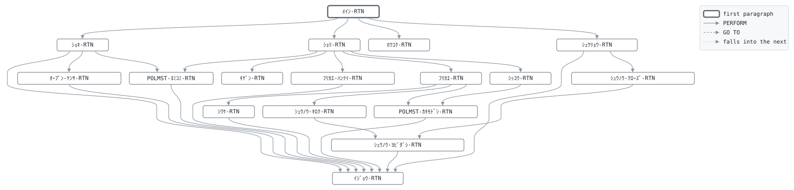

# GLD060

```text
GLD060: 失効処理

日次。猶予中の契約のうち、払込猶予期間を過ぎたものを失効
させる。猶予期間は猶予開始日 (振替不能となった日) の属する
月の翌月末まで: 業務月が猶予開始月の翌月より後なら失効。
失効した契約は失効日を業務日付とし、1年以内なら GLD040 の
復活で戻せる。
ただし、未納保険料 (月払は払込済年月の翌月から猶予期限の
月まで、年払と半年払は1回分) を貸し付けても貸付残高が解約返戻金
(GLC030) 以内に収まる契約は失効させず、未納保険料を自動
振替貸付として残高に加え、払込済年月を進めて有効に戻す。
残高には先に業務日付までの利息 (GLC040) を繰り入れる。

復帰コード: 0 処理済、8 日付が日付でない、16 ファイル異常。

変更履歴
日付       担当 変更
1987-04-01 KT   GL-0001 初版。
2003-10-06 MS   GL-0310 猶予開始日を振替不能日から。
2014-04-07 YN   GL-0598 自動振替貸付。
2026-11-16 YN   GL-0823 半年払。
2026-11-19 YN   GL-0827 収納を収納履歴に残す。
```

Program [GLD060.cbl](../../../gondwana/programs/GLD060.cbl): 4 files, 17 paragraphs. Its business rules: [11 decision tables](../rules/GLD060.md).

- AUTHOR: ゴンドワナ生命 システム部.
- DATE-WRITTEN: 1987-04-01.

## Contents

- [Files](#files)
- [Flow](#flow)
- [Paragraphs](#paragraphs)
- [Calls](#calls)
- [Data flow](#data-flow)
- [Lineage](#lineage)
  - [Into PM-ｹｲﾔｸ-ﾚｺｰﾄﾞ](#into-pm-ｹｲﾔｸ-ﾚｺｰﾄﾞ)
  - [Into CT-ｾｲｷﾞｮ-ﾚｺｰﾄﾞ](#into-ct-ｾｲｷﾞｮ-ﾚｺｰﾄﾞ)
  - [Into JR-ｼﾜｹ-ﾚｺｰﾄﾞ](#into-jr-ｼﾜｹ-ﾚｺｰﾄﾞ)
  - [Into ﾎｳｺｸ-ｷﾞｮｳ](#into-ﾎｳｺｸ-ｷﾞｮｳ)
  - [Into WS-ｽﾃｰﾀｽ](#into-ws-ｽﾃｰﾀｽ)
  - [Into WS-ｼｭｳﾉｳ-ｷﾉｳ](#into-ws-ｼｭｳﾉｳ-ｷﾉｳ)
  - [Into WS-ｼｭｳﾉｳ](#into-ws-ｼｭｳﾉｳ)
  - [Into WS-PRMHST-ST](#into-ws-prmhst-st)
  - [Into WS-ｺﾏﾝﾄﾞｷﾞｮｳ](#into-ws-ｺﾏﾝﾄﾞｷﾞｮｳ)
  - [Into WS-ｴﾗｰﾌｧｲﾙ](#into-ws-ｴﾗｰﾌｧｲﾙ)
  - [Into WS-ｴﾗｰｽﾃｰﾀｽ](#into-ws-ｴﾗｰｽﾃｰﾀｽ)
  - [Into WS-ｷﾞｮｳﾑﾋﾂﾞｹ](#into-ws-ｷﾞｮｳﾑﾋﾂﾞｹ)
  - [Into WS-ｷﾞｮｳﾑﾋﾂﾞｹ-ﾜﾚｷ](#into-ws-ｷﾞｮｳﾑﾋﾂﾞｹ-ﾜﾚｷ)
  - [Into WS-ﾎｳｺｳ](#into-ws-ﾎｳｺｳ)
  - [Into WS-ﾍﾝｶﾝｹｯｶ](#into-ws-ﾍﾝｶﾝｹｯｶ)
  - [Into WS-ﾕｳﾖｶｲｼﾋﾞ](#into-ws-ﾕｳﾖｶｲｼﾋﾞ)
  - [Into WS-ｷｹﾞﾝ](#into-ws-ｷｹﾞﾝ)
  - [Into WS-ﾊﾗｲｺﾐｽﾞﾐ](#into-ws-ﾊﾗｲｺﾐｽﾞﾐ)
  - [Into WS-ﾌﾘｶｴ-ｶｲｽｳ](#into-ws-ﾌﾘｶｴ-ｶｲｽｳ)
  - [Into WS-ﾌﾘｶｴ-ｶﾞｸ](#into-ws-ﾌﾘｶｴ-ｶﾞｸ)
  - [Into WS-ﾘｿｸ](#into-ws-ﾘｿｸ)
  - [Into WS-ﾍﾝﾚｲｷﾝ](#into-ws-ﾍﾝﾚｲｷﾝ)
  - [Into WS-ｻﾞﾝﾀﾞｶ](#into-ws-ｻﾞﾝﾀﾞｶ)
  - [Into WS-ﾌﾘｶｴ-ﾊﾝﾃｲ](#into-ws-ﾌﾘｶｴ-ﾊﾝﾃｲ)
  - [Into WS-ｹﾝｽｳ](#into-ws-ｹﾝｽｳ)
  - [Into WS-ﾎｳｺｸ](#into-ws-ﾎｳｺｸ)
  - [Out of the program](#out-of-the-program)
  - [Into other data items](#into-other-data-items)
- [Field origins](#field-origins)
  - [File REPORT-F](#file-report-f)
  - [File POLMST-F](#file-polmst-f)
  - [File GLJRNL-F](#file-gljrnl-f)
  - [File GLSCTL-F](#file-glsctl-f)
- [Records](#records)
  - [PM-ｹｲﾔｸ-ﾚｺｰﾄﾞ](#pm-ｹｲﾔｸ-ﾚｺｰﾄﾞ)
  - [CT-ｾｲｷﾞｮ-ﾚｺｰﾄﾞ](#ct-ｾｲｷﾞｮ-ﾚｺｰﾄﾞ)
  - [JR-ｼﾜｹ-ﾚｺｰﾄﾞ](#jr-ｼﾜｹ-ﾚｺｰﾄﾞ)
  - [ﾎｳｺｸ-ｷﾞｮｳ](#ﾎｳｺｸ-ｷﾞｮｳ)
  - [WS-ｽﾃｰﾀｽ](#ws-ｽﾃｰﾀｽ)
  - [WS-ｼｭｳﾉｳ-ｷﾉｳ](#ws-ｼｭｳﾉｳ-ｷﾉｳ)
  - [WS-ｼｭｳﾉｳ](#ws-ｼｭｳﾉｳ)
  - [WS-PRMHST-ST](#ws-prmhst-st)
  - [WS-ｺﾏﾝﾄﾞｷﾞｮｳ](#ws-ｺﾏﾝﾄﾞｷﾞｮｳ)
  - [WS-ｴﾗｰﾌｧｲﾙ](#ws-ｴﾗｰﾌｧｲﾙ)
  - [WS-ｴﾗｰｽﾃｰﾀｽ](#ws-ｴﾗｰｽﾃｰﾀｽ)
  - [WS-ｷﾞｮｳﾑﾋﾂﾞｹ](#ws-ｷﾞｮｳﾑﾋﾂﾞｹ)
  - [WS-ｷﾞｮｳﾑﾋﾂﾞｹ-ﾌﾞﾝｶｲ](#ws-ｷﾞｮｳﾑﾋﾂﾞｹ-ﾌﾞﾝｶｲ)
  - [WS-ｷﾞｮｳﾑﾋﾂﾞｹ-ﾜﾚｷ](#ws-ｷﾞｮｳﾑﾋﾂﾞｹ-ﾜﾚｷ)
  - [WS-ﾎｳｺｳ](#ws-ﾎｳｺｳ)
  - [WS-ﾍﾝｶﾝｹｯｶ](#ws-ﾍﾝｶﾝｹｯｶ)
  - [WS-ﾕｳﾖｶｲｼﾋﾞ](#ws-ﾕｳﾖｶｲｼﾋﾞ)
  - [WS-ﾕｳﾖ-ﾌﾞﾝｶｲ](#ws-ﾕｳﾖ-ﾌﾞﾝｶｲ)
  - [WS-ｷｹﾞﾝ](#ws-ｷｹﾞﾝ)
  - [WS-ｷｹﾞﾝ-YYYYMM](#ws-ｷｹﾞﾝ-yyyymm)
  - [WS-ﾊﾗｲｺﾐｽﾞﾐ](#ws-ﾊﾗｲｺﾐｽﾞﾐ)
  - [WS-ﾌﾘｶｴ-ｶｲｽｳ](#ws-ﾌﾘｶｴ-ｶｲｽｳ)
  - [WS-ﾌﾘｶｴ-ｶﾞｸ](#ws-ﾌﾘｶｴ-ｶﾞｸ)
  - [WS-ﾘｿｸ](#ws-ﾘｿｸ)
  - [WS-ﾍﾝﾚｲｷﾝ](#ws-ﾍﾝﾚｲｷﾝ)
  - [WS-ｻﾞﾝﾀﾞｶ](#ws-ｻﾞﾝﾀﾞｶ)
  - [WS-ﾌﾘｶｴ-ﾊﾝﾃｲ](#ws-ﾌﾘｶｴ-ﾊﾝﾃｲ)
  - [WS-ｹﾝｽｳ](#ws-ｹﾝｽｳ)
  - [WS-ﾎｳｺｸ](#ws-ﾎｳｺｸ)

## Files

| File | Kind | Assigned to | Organization | Status field | Opened | Records |
| --- | --- | --- | --- | --- | --- | --- |
| POLMST-F | FD | POLMST | INDEXED, key PM-ｼｮｳｹﾝﾊﾞﾝｺﾞｳ, DYNAMIC access | WS-POLMST-ST | I-O | PM-ｹｲﾔｸ-ﾚｺｰﾄﾞ |
| GLSCTL-F | FD | GLSCTL | SEQUENTIAL | WS-GLSCTL-ST | I-O | CT-ｾｲｷﾞｮ-ﾚｺｰﾄﾞ |
| GLJRNL-F | FD | GLJRNL | LINE SEQUENTIAL | WS-GLJRNL-ST | EXTEND | JR-ｼﾜｹ-ﾚｺｰﾄﾞ |
| REPORT-F | FD | GLD060R | LINE SEQUENTIAL | WS-REPORT-ST | OUTPUT | ﾎｳｺｸ-ｷﾞｮｳ |

## Flow



## Paragraphs

| Paragraph | Description | Source | Performs | Goes to | Performed by | Reached by |
| --- | --- | --- | --- | --- | --- | --- |
| ﾒｲﾝ-RTN | ﾒｲﾝ-RTN: 準備、マスタ全件の走査、報告、終了。 | [GLD060.cbl:134](../../../gondwana/programs/GLD060.cbl#L134) | ｼｮｷ-RTN, ｼｮﾘ-RTN, ﾎｳｺｸ-RTN, ｼｭｳﾘｮｳ-RTN | | | |
| ｼｮｷ-RTN | ｼｮｷ-RTN: 業務日付とファイル。 | [GLD060.cbl:145](../../../gondwana/programs/GLD060.cbl#L145) | ｵｰﾌﾟﾝ-ｹﾝｻ-RTN, ｲｼﾞｮｳ-RTN, POLMST-ﾖﾐｺﾐ-RTN | | ﾒｲﾝ-RTN | |
| ｵｰﾌﾟﾝ-ｹﾝｻ-RTN | ｵｰﾌﾟﾝ-ｹﾝｻ-RTN: 開けなかったファイルがあれば異常終了。 | [GLD060.cbl:176](../../../gondwana/programs/GLD060.cbl#L176) | ｲｼﾞｮｳ-RTN | | ｼｮｷ-RTN | |
| POLMST-ﾖﾐｺﾐ-RTN | POLMST-ﾖﾐｺﾐ-RTN: マスタの次の契約。 | [GLD060.cbl:200](../../../gondwana/programs/GLD060.cbl#L200) | ｲｼﾞｮｳ-RTN | | ｼｮｷ-RTN, ｼｮﾘ-RTN | |
| ｼｮﾘ-RTN | ｼｮﾘ-RTN: 猶予中の契約の猶予期限を求め、過ぎていれば自動 振替貸付、できなければ失効。 | [GLD060.cbl:212](../../../gondwana/programs/GLD060.cbl#L212) | ｷｹﾞﾝ-RTN, ﾌﾘｶｴ-ﾊﾝﾃｲ-RTN, ﾌﾘｶｴ-RTN, ｼｯｺｳ-RTN, POLMST-ﾖﾐｺﾐ-RTN | | ﾒｲﾝ-RTN | |
| ｷｹﾞﾝ-RTN | ｷｹﾞﾝ-RTN: 猶予開始月の翌月が猶予期限の月。 | [GLD060.cbl:237](../../../gondwana/programs/GLD060.cbl#L237) | | | ｼｮﾘ-RTN | |
| ﾌﾘｶｴ-ﾊﾝﾃｲ-RTN | ﾌﾘｶｴ-ﾊﾝﾃｲ-RTN: 未納保険料を求め、利息を繰り入れた貸付残高 に加えても解約返戻金以内なら自動振替貸付ができる。 | [GLD060.cbl:254](../../../gondwana/programs/GLD060.cbl#L254) | ｲｼﾞｮｳ-RTN | | ｼｮﾘ-RTN | |
| ﾌﾘｶｴ-RTN | ﾌﾘｶｴ-RTN: 未納保険料を貸付残高に加え、払込済年月を月払は 猶予期限の月まで、年払は1年、半年払は半年進め、有効に 戻して書き戻す。 | [GLD060.cbl:287](../../../gondwana/programs/GLD060.cbl#L287) | ｼﾜｹ-RTN, ｼｭｳﾉｳ-ｷﾛｸ-RTN, POLMST-ｶｷﾓﾄﾞｼ-RTN | | ｼｮﾘ-RTN | |
| ｼｯｺｳ-RTN | ｼｯｺｳ-RTN: 失効にして書き戻す。 | [GLD060.cbl:338](../../../gondwana/programs/GLD060.cbl#L338) | POLMST-ｶｷﾓﾄﾞｼ-RTN | | ｼｮﾘ-RTN | |
| POLMST-ｶｷﾓﾄﾞｼ-RTN | POLMST-ｶｷﾓﾄﾞｼ-RTN: 契約を書き戻す。 | [GLD060.cbl:349](../../../gondwana/programs/GLD060.cbl#L349) | ｲｼﾞｮｳ-RTN | | ﾌﾘｶｴ-RTN, ｼｯｺｳ-RTN | |
| ｼﾜｹ-RTN | ｼﾜｹ-RTN: 仕訳1行。科目、貸借、金額、摘要は呼ぶ側が入れる。 | [GLD060.cbl:360](../../../gondwana/programs/GLD060.cbl#L360) | ｲｼﾞｮｳ-RTN | | ﾌﾘｶｴ-RTN | |
| ﾎｳｺｸ-RTN | ﾎｳｺｸ-RTN: 件数。 | [GLD060.cbl:376](../../../gondwana/programs/GLD060.cbl#L376) | | | ﾒｲﾝ-RTN | |
| ｼｭｳﾘｮｳ-RTN | ｼｭｳﾘｮｳ-RTN: 制御レコードを書き戻し、ファイルを閉じ、件数を 表示する。 | [GLD060.cbl:399](../../../gondwana/programs/GLD060.cbl#L399) | ｲｼﾞｮｳ-RTN, ｼｭｳﾉｳ-ｸﾛｰｽﾞ-RTN | | ﾒｲﾝ-RTN | |
| ｲｼﾞｮｳ-RTN | ｲｼﾞｮｳ-RTN: ファイル異常は 16 で終わる。 | [GLD060.cbl:414](../../../gondwana/programs/GLD060.cbl#L414) | | | ｼｮｷ-RTN, ｵｰﾌﾟﾝ-ｹﾝｻ-RTN, POLMST-ﾖﾐｺﾐ-RTN, ﾌﾘｶｴ-ﾊﾝﾃｲ-RTN, POLMST-ｶｷﾓﾄﾞｼ-RTN, ｼﾜｹ-RTN, ｼｭｳﾘｮｳ-RTN, ｼｭｳﾉｳ-ﾖﾋﾞﾀﾞｼ-RTN | |
| ｼｭｳﾉｳ-ｷﾛｸ-RTN | PRMLOG: 収納履歴に残す手続き PROCEDURE DIVISION に COPY する。作業領域は PRMCAL。 ｼｭｳﾉｳ-ｷﾛｸ-RTN は、種別、金額、回数を入れた後、契約マスタの 払込済年月を進めてから PERFORM する。証券番号、業務日付、 払込済年月を加えて GLC050 を呼ぶ。ｼｭｳﾉｳ-ｸﾛｰｽﾞ-RTN は終了時 に PERFORM する。書けなければ ｲｼﾞｮｳ-RTN へ。 変更履歴 日付       担当 変更 2026-11-19 YN   GL-0827 初版。 | [PRMLOG.cpy:14](../../../gondwana/copybooks/PRMLOG.cpy#L14) | ｼｭｳﾉｳ-ﾖﾋﾞﾀﾞｼ-RTN | | ﾌﾘｶｴ-RTN | |
| ｼｭｳﾉｳ-ｸﾛｰｽﾞ-RTN | | [PRMLOG.cpy:21](../../../gondwana/copybooks/PRMLOG.cpy#L21) | ｼｭｳﾉｳ-ﾖﾋﾞﾀﾞｼ-RTN | | ｼｭｳﾘｮｳ-RTN | |
| ｼｭｳﾉｳ-ﾖﾋﾞﾀﾞｼ-RTN | | [PRMLOG.cpy:25](../../../gondwana/copybooks/PRMLOG.cpy#L25) | ｲｼﾞｮｳ-RTN | | ｼｭｳﾉｳ-ｷﾛｸ-RTN, ｼｭｳﾉｳ-ｸﾛｰｽﾞ-RTN | |

## Calls

| Calls | Passing | Paragraph | Source |
| --- | --- | --- | --- |
| [GLC020](GLC020.md) | WS-ﾎｳｺｳ, WS-ｷﾞｮｳﾑﾋﾂﾞｹ, WS-ｷﾞｮｳﾑﾋﾂﾞｹ-ﾜﾚｷ, WS-ﾍﾝｶﾝｹｯｶ | ｼｮｷ-RTN | [GLD060.cbl:149](../../../gondwana/programs/GLD060.cbl#L149) |
| [GLC020](GLC020.md) | WS-ﾎｳｺｳ, WS-ﾕｳﾖｶｲｼﾋﾞ, PM-ﾕｳﾖｶｲｼﾋﾞ, WS-ﾍﾝｶﾝｹｯｶ | ｷｹﾞﾝ-RTN | [GLD060.cbl:239](../../../gondwana/programs/GLD060.cbl#L239) |
| [GLC040](GLC040.md) | PM-ｶｼﾂｹｻﾞﾝﾀﾞｶ, PM-ｶｼﾂｹｷｻﾝﾋﾞ, WS-ｷﾞｮｳﾑﾋﾂﾞｹ, WS-ﾘｿｸ | ﾌﾘｶｴ-ﾊﾝﾃｲ-RTN | [GLD060.cbl:263](../../../gondwana/programs/GLD060.cbl#L263) |
| [GLC030](GLC030.md) | PM-ｼｮｳﾋﾝ, PM-ｶﾆｭｳﾈﾝﾚｲ, PM-ｹｲｶﾈﾝｽｳ, PM-ﾎｹﾝｷﾝｶﾞｸ, WS-ﾍﾝﾚｲｷﾝ, WS-CSVTB-ST | ﾌﾘｶｴ-ﾊﾝﾃｲ-RTN | [GLD060.cbl:265](../../../gondwana/programs/GLD060.cbl#L265) |
| [GLC050](GLC050.md) | WS-ｼｭｳﾉｳ-ｷﾉｳ, WS-ｼｭｳﾉｳ, WS-PRMHST-ST | ｼｭｳﾉｳ-ﾖﾋﾞﾀﾞｼ-RTN | [PRMLOG.cpy:26](../../../gondwana/copybooks/PRMLOG.cpy#L26) |

## Data flow

| Paragraph | Reads | Writes |
| --- | --- | --- |
| ﾒｲﾝ-RTN | WS-POLMST-ST | RETURN-CODE |
| ｼｮｷ-RTN | WS-ｺﾏﾝﾄﾞｷﾞｮｳ, WS-ﾎｳｺｳ, WS-ｷﾞｮｳﾑﾋﾂﾞｹ, WS-ｷﾞｮｳﾑﾋﾂﾞｹ-ﾜﾚｷ, WS-ﾍﾝｶﾝｹｯｶ, WS-GLSCTL-ST, WS-ﾋｮｳﾀﾞｲ-ｷﾞｮｳ | WS-ｺﾏﾝﾄﾞｷﾞｮｳ, WS-ｷﾞｮｳﾑﾋﾂﾞｹ, WS-ﾎｳｺｳ, WS-ｷﾞｮｳﾑﾋﾂﾞｹ-ﾜﾚｷ, WS-ﾍﾝｶﾝｹｯｶ, RETURN-CODE, WS-POLMST-ST, WS-GLSCTL-ST, WS-GLJRNL-ST, WS-REPORT-ST, JR-ｼﾜｹ-ﾚｺｰﾄﾞ, CT-ｾｲｷﾞｮ-ﾚｺｰﾄﾞ, WS-ｴﾗｰﾌｧｲﾙ, WS-ｴﾗｰｽﾃｰﾀｽ, WS-ﾋｮｳﾀﾞｲ-ﾋﾂﾞｹ, ﾎｳｺｸ-ｷﾞｮｳ |
| ｵｰﾌﾟﾝ-ｹﾝｻ-RTN | WS-POLMST-ST, WS-GLSCTL-ST, WS-GLJRNL-ST, WS-REPORT-ST, WS-ｴﾗｰﾌｧｲﾙ | WS-ｴﾗｰﾌｧｲﾙ, WS-ｴﾗｰｽﾃｰﾀｽ |
| POLMST-ﾖﾐｺﾐ-RTN | WS-POLMST-ST | PM-ｹｲﾔｸ-ﾚｺｰﾄﾞ, WS-POLMST-ST, WS-ｴﾗｰﾌｧｲﾙ, WS-ｴﾗｰｽﾃｰﾀｽ |
| ｼｮﾘ-RTN | PM-ｼﾞｮｳﾀｲ, WS-ﾕｳﾖｹﾝｽｳ, PM-ｼｮｳｹﾝﾊﾞﾝｺﾞｳ, PM-ｼﾒｲ, PM-ﾕｳﾖｶｲｼﾋﾞ, WS-ｷﾞｮｳﾑ-YYYYMM, WS-ｷｹﾞﾝ-YYYYMM, WS-ﾌﾘｶｴ-ﾊﾝﾃｲ, WS-ﾒｲｻｲ-ｷﾞｮｳ | WS-ﾕｳﾖｹﾝｽｳ, WS-ﾒｲｻｲ-ｼｮｳｹﾝ, WS-ﾒｲｻｲ-ｼﾒｲ, WS-ﾒｲｻｲ-ﾕｳﾖ, WS-ﾒｲｻｲ-ｷﾝｶﾞｸ, WS-ﾒｲｻｲ-ｹｯｶ, ﾎｳｺｸ-ｷﾞｮｳ, WS-REPORT-ST |
| ｷｹﾞﾝ-RTN | WS-ﾎｳｺｳ, WS-ﾕｳﾖｶｲｼﾋﾞ, PM-ﾕｳﾖｶｲｼﾋﾞ, WS-ﾍﾝｶﾝｹｯｶ, WS-ﾕｳﾖ-YYYY, WS-ﾕｳﾖ-MM, WS-ｷｹﾞﾝ-MM, WS-ｷｹﾞﾝ-YYYY | WS-ﾎｳｺｳ, WS-ﾕｳﾖｶｲｼﾋﾞ, PM-ﾕｳﾖｶｲｼﾋﾞ, WS-ﾍﾝｶﾝｹｯｶ, WS-ｷｹﾞﾝ-YYYY, WS-ｷｹﾞﾝ-MM |
| ﾌﾘｶｴ-ﾊﾝﾃｲ-RTN | PM-ﾊﾗｲｺﾐｽﾞﾐﾈﾝｹﾞﾂ, PM-ﾊﾗｲｺﾐﾎｳﾎｳ, WS-ｷｹﾞﾝ-YYYY, WS-ﾊﾗｲｺﾐ-YYYY, WS-ｷｹﾞﾝ-MM, WS-ﾊﾗｲｺﾐ-MM, PM-ｶｼﾂｹｻﾞﾝﾀﾞｶ, PM-ｶｼﾂｹｷｻﾝﾋﾞ, WS-ｷﾞｮｳﾑﾋﾂﾞｹ, WS-ﾘｿｸ, PM-ｼｮｳﾋﾝ, PM-ｶﾆｭｳﾈﾝﾚｲ, PM-ｹｲｶﾈﾝｽｳ, PM-ﾎｹﾝｷﾝｶﾞｸ, WS-ﾍﾝﾚｲｷﾝ, WS-CSVTB-ST, WS-ﾌﾘｶｴ-ｶｲｽｳ, PM-ﾎｹﾝﾘｮｳ, WS-ﾌﾘｶｴ-ｶﾞｸ, WS-ｻﾞﾝﾀﾞｶ | WS-ﾊﾗｲｺﾐｽﾞﾐ, WS-ﾌﾘｶｴ-ｶｲｽｳ, PM-ｶｼﾂｹｻﾞﾝﾀﾞｶ, PM-ｶｼﾂｹｷｻﾝﾋﾞ, WS-ｷﾞｮｳﾑﾋﾂﾞｹ, WS-ﾘｿｸ, PM-ｼｮｳﾋﾝ, PM-ｶﾆｭｳﾈﾝﾚｲ, PM-ｹｲｶﾈﾝｽｳ, PM-ﾎｹﾝｷﾝｶﾞｸ, WS-ﾍﾝﾚｲｷﾝ, WS-CSVTB-ST, WS-ｴﾗｰﾌｧｲﾙ, WS-ｴﾗｰｽﾃｰﾀｽ, WS-ﾌﾘｶｴ-ﾊﾝﾃｲ, WS-ﾌﾘｶｴ-ｶﾞｸ, WS-ｻﾞﾝﾀﾞｶ |
| ﾌﾘｶｴ-RTN | WS-ﾘｿｸ, WS-ﾌﾘｶｴ-ｶﾞｸ, WS-ｻﾞﾝﾀﾞｶ, WS-ｷﾞｮｳﾑﾋﾂﾞｹ-ﾜﾚｷ, PM-ﾊﾗｲｺﾐﾎｳﾎｳ, PM-ﾊﾗｲｺﾐｽﾞﾐﾈﾝｹﾞﾂ, WS-ﾊﾗｲｺﾐ-MM, WS-ﾊﾗｲｺﾐ-YYYY, WS-ﾊﾗｲｺﾐｽﾞﾐ, WS-ｷｹﾞﾝ-YYYYMM, WS-ｷﾞｮｳﾑ-YYYYMM, WS-ﾌﾘｶｴ-ｶｲｽｳ, WS-ﾌﾘｶｴｹﾝｽｳ, WS-ﾌﾘｶｴｷﾝｶﾞｸ | JR-ｶﾝｼﾞｮｳｶﾓｸ, JR-ﾀｲｼｬｸ, JR-ｷﾝｶﾞｸ, JR-ﾃｷﾖｳ, PM-ｶｼﾂｹｻﾞﾝﾀﾞｶ, PM-ｶｼﾂｹｷｻﾝﾋﾞ, PM-ｼﾞｮｳﾀｲﾋﾂﾞｹ, PM-ﾊﾗｲｺﾐｽﾞﾐﾈﾝｹﾞﾂ, WS-ﾊﾗｲｺﾐ-MM, WS-ﾊﾗｲｺﾐ-YYYY, PM-ﾐﾉｳｶｲｽｳ, PM-ﾕｳﾖｶｲｼﾋﾞ, PM-ｼﾞｮｳﾀｲ, PM-ｻｲｼｭｳﾆｭｳｷﾝﾈﾝｹﾞﾂ, PM-ｻｲｼｭｳﾆｭｳｷﾝｶﾞｸ, WS-ｼｭｳﾉｳ-ｼｭﾍﾞﾂ, WS-ｼｭｳﾉｳ-ｷﾝｶﾞｸ, WS-ｼｭｳﾉｳ-ｶｲｽｳ, WS-ﾌﾘｶｴｹﾝｽｳ, WS-ﾌﾘｶｴｷﾝｶﾞｸ, WS-ﾒｲｻｲ-ｷﾝｶﾞｸ, WS-ﾒｲｻｲ-ｹｯｶ |
| ｼｯｺｳ-RTN | WS-ｷﾞｮｳﾑﾋﾂﾞｹ-ﾜﾚｷ, WS-ｼｯｺｳｹﾝｽｳ, PM-ﾎｹﾝｷﾝｶﾞｸ, WS-ｼｯｺｳｷﾝｶﾞｸ | PM-ｼﾞｮｳﾀｲ, PM-ｼｯｺｳﾋﾞ, PM-ｼﾞｮｳﾀｲﾋﾂﾞｹ, WS-ｼｯｺｳｹﾝｽｳ, WS-ｼｯｺｳｷﾝｶﾞｸ, WS-ﾒｲｻｲ-ｹｯｶ |
| POLMST-ｶｷﾓﾄﾞｼ-RTN | WS-POLMST-ST | PM-ｹｲﾔｸ-ﾚｺｰﾄﾞ, WS-POLMST-ST, WS-ｴﾗｰﾌｧｲﾙ, WS-ｴﾗｰｽﾃｰﾀｽ |
| ｼﾜｹ-RTN | CT-ｼﾞｶｲｼﾜｹﾊﾞﾝｺﾞｳ, WS-ｷﾞｮｳﾑﾋﾂﾞｹ-ﾜﾚｷ, PM-ｼｮｳｹﾝﾊﾞﾝｺﾞｳ, WS-GLJRNL-ST | JR-ｼﾜｹﾊﾞﾝｺﾞｳ, CT-ｼﾞｶｲｼﾜｹﾊﾞﾝｺﾞｳ, JR-ﾋﾂﾞｹ, JR-ﾌﾟﾛｸﾞﾗﾑ, JR-ｼｮｳｹﾝﾊﾞﾝｺﾞｳ, JR-ｼﾜｹ-ﾚｺｰﾄﾞ, WS-GLJRNL-ST, WS-ｴﾗｰﾌｧｲﾙ, WS-ｴﾗｰｽﾃｰﾀｽ |
| ﾎｳｺｸ-RTN | WS-ﾕｳﾖｹﾝｽｳ, WS-ｹﾝｽｳ-ｷﾞｮｳ, WS-ｼｯｺｳｹﾝｽｳ, WS-ｼｯｺｳｷﾝｶﾞｸ, WS-ﾌﾘｶｴｹﾝｽｳ, WS-ﾌﾘｶｴｷﾝｶﾞｸ | ﾎｳｺｸ-ｷﾞｮｳ, WS-REPORT-ST, WS-ｹﾝｽｳ-ﾗﾍﾞﾙ, WS-ｹﾝｽｳ-ｱﾀｲ |
| ｼｭｳﾘｮｳ-RTN | WS-GLSCTL-ST, WS-ﾕｳﾖｹﾝｽｳ, WS-ｼｯｺｳｹﾝｽｳ, WS-ﾌﾘｶｴｹﾝｽｳ | CT-ｾｲｷﾞｮ-ﾚｺｰﾄﾞ, WS-GLSCTL-ST, WS-ｴﾗｰﾌｧｲﾙ, WS-ｴﾗｰｽﾃｰﾀｽ, WS-POLMST-ST, WS-GLJRNL-ST, WS-REPORT-ST |
| ｲｼﾞｮｳ-RTN | WS-ｴﾗｰﾌｧｲﾙ, WS-ｴﾗｰｽﾃｰﾀｽ | RETURN-CODE |
| ｼｭｳﾉｳ-ｷﾛｸ-RTN | PM-ｼｮｳｹﾝﾊﾞﾝｺﾞｳ, WS-ｷﾞｮｳﾑﾋﾂﾞｹ, PM-ﾊﾗｲｺﾐｽﾞﾐﾈﾝｹﾞﾂ | WS-ｼｭｳﾉｳ-ｷﾉｳ, WS-ｼｭｳﾉｳ-ｼｮｳｹﾝﾊﾞﾝｺﾞｳ, WS-ｼｭｳﾉｳ-ﾋﾂﾞｹ, WS-ｼｭｳﾉｳ-ﾈﾝｹﾞﾂ |
| ｼｭｳﾉｳ-ｸﾛｰｽﾞ-RTN | | WS-ｼｭｳﾉｳ-ｷﾉｳ |
| ｼｭｳﾉｳ-ﾖﾋﾞﾀﾞｼ-RTN | WS-ｼｭｳﾉｳ-ｷﾉｳ, WS-ｼｭｳﾉｳ, WS-PRMHST-ST | WS-ｼｭｳﾉｳ-ｷﾉｳ, WS-ｼｭｳﾉｳ, WS-PRMHST-ST, WS-ｴﾗｰﾌｧｲﾙ, WS-ｴﾗｰｽﾃｰﾀｽ |

## Lineage

Where each data item's values come from, grouped by the record they go into. A data item links to the record it belongs to.

### Into PM-ｹｲﾔｸ-ﾚｺｰﾄﾞ

Record [PM-ｹｲﾔｸ-ﾚｺｰﾄﾞ](#pm-ｹｲﾔｸ-ﾚｺｰﾄﾞ), from copybook [POLMST](../copybooks/POLMST.md).

| Into | From | Statement | Paragraph | Source |
| --- | --- | --- | --- | --- |
| PM-ｶｼﾂｹｷｻﾝﾋﾞ | call GLC040 argument 2 | CALL | ﾌﾘｶｴ-ﾊﾝﾃｲ-RTN | [GLD060.cbl:263](../../../gondwana/programs/GLD060.cbl#L263) |
| PM-ｶｼﾂｹｷｻﾝﾋﾞ | [WS-ｷﾞｮｳﾑﾋﾂﾞｹ-ﾜﾚｷ](#ws-ｷﾞｮｳﾑﾋﾂﾞｹ-ﾜﾚｷ) | MOVE | ﾌﾘｶｴ-RTN | [GLD060.cbl:306](../../../gondwana/programs/GLD060.cbl#L306) |
| PM-ｶｼﾂｹｻﾞﾝﾀﾞｶ | call GLC040 argument 1 | CALL | ﾌﾘｶｴ-ﾊﾝﾃｲ-RTN | [GLD060.cbl:263](../../../gondwana/programs/GLD060.cbl#L263) |
| PM-ｶｼﾂｹｻﾞﾝﾀﾞｶ | [WS-ｻﾞﾝﾀﾞｶ](#ws-ｻﾞﾝﾀﾞｶ) | MOVE | ﾌﾘｶｴ-RTN | [GLD060.cbl:305](../../../gondwana/programs/GLD060.cbl#L305) |
| PM-ｶﾆｭｳﾈﾝﾚｲ | call GLC030 argument 2 | CALL | ﾌﾘｶｴ-ﾊﾝﾃｲ-RTN | [GLD060.cbl:265](../../../gondwana/programs/GLD060.cbl#L265) |
| PM-ｹｲｶﾈﾝｽｳ | call GLC030 argument 3 | CALL | ﾌﾘｶｴ-ﾊﾝﾃｲ-RTN | [GLD060.cbl:265](../../../gondwana/programs/GLD060.cbl#L265) |
| PM-ｹｲﾔｸ-ﾚｺｰﾄﾞ | file POLMST-F | READ | POLMST-ﾖﾐｺﾐ-RTN | [GLD060.cbl:201](../../../gondwana/programs/GLD060.cbl#L201) |
| PM-ｻｲｼｭｳﾆｭｳｷﾝｶﾞｸ | [WS-ﾌﾘｶｴ-ｶﾞｸ](#ws-ﾌﾘｶｴ-ｶﾞｸ) | MOVE | ﾌﾘｶｴ-RTN | [GLD060.cbl:324](../../../gondwana/programs/GLD060.cbl#L324) |
| PM-ｻｲｼｭｳﾆｭｳｷﾝﾈﾝｹﾞﾂ | [WS-ｷﾞｮｳﾑ-YYYYMM](#ws-ｷﾞｮｳﾑﾋﾂﾞｹ-ﾌﾞﾝｶｲ "in WS-ｷﾞｮｳﾑﾋﾂﾞｹ-ﾌﾞﾝｶｲ") | MOVE | ﾌﾘｶｴ-RTN | [GLD060.cbl:323](../../../gondwana/programs/GLD060.cbl#L323) |
| PM-ｼｮｳﾋﾝ | call GLC030 argument 1 | CALL | ﾌﾘｶｴ-ﾊﾝﾃｲ-RTN | [GLD060.cbl:265](../../../gondwana/programs/GLD060.cbl#L265) |
| PM-ｼｯｺｳﾋﾞ | [WS-ｷﾞｮｳﾑﾋﾂﾞｹ-ﾜﾚｷ](#ws-ｷﾞｮｳﾑﾋﾂﾞｹ-ﾜﾚｷ) | MOVE | ｼｯｺｳ-RTN | [GLD060.cbl:340](../../../gondwana/programs/GLD060.cbl#L340) |
| PM-ｼﾞｮｳﾀｲ | literal condition PM-ﾕｳｺｳ | SET | ﾌﾘｶｴ-RTN | [GLD060.cbl:322](../../../gondwana/programs/GLD060.cbl#L322) |
| PM-ｼﾞｮｳﾀｲ | literal condition PM-ｼｯｺｳ | SET | ｼｯｺｳ-RTN | [GLD060.cbl:339](../../../gondwana/programs/GLD060.cbl#L339) |
| PM-ｼﾞｮｳﾀｲﾋﾂﾞｹ | [WS-ｷﾞｮｳﾑﾋﾂﾞｹ-ﾜﾚｷ](#ws-ｷﾞｮｳﾑﾋﾂﾞｹ-ﾜﾚｷ) | MOVE | ﾌﾘｶｴ-RTN | [GLD060.cbl:306](../../../gondwana/programs/GLD060.cbl#L306) |
| PM-ｼﾞｮｳﾀｲﾋﾂﾞｹ | [WS-ｷﾞｮｳﾑﾋﾂﾞｹ-ﾜﾚｷ](#ws-ｷﾞｮｳﾑﾋﾂﾞｹ-ﾜﾚｷ) | MOVE | ｼｯｺｳ-RTN | [GLD060.cbl:340](../../../gondwana/programs/GLD060.cbl#L340) |
| PM-ﾊﾗｲｺﾐｽﾞﾐﾈﾝｹﾞﾂ | literal 100 | ADD | ﾌﾘｶｴ-RTN | [GLD060.cbl:309](../../../gondwana/programs/GLD060.cbl#L309) |
| PM-ﾊﾗｲｺﾐｽﾞﾐﾈﾝｹﾞﾂ | [WS-ﾊﾗｲｺﾐｽﾞﾐ](#ws-ﾊﾗｲｺﾐｽﾞﾐ) | MOVE | ﾌﾘｶｴ-RTN | [GLD060.cbl:316](../../../gondwana/programs/GLD060.cbl#L316) |
| PM-ﾊﾗｲｺﾐｽﾞﾐﾈﾝｹﾞﾂ | [WS-ｷｹﾞﾝ-YYYYMM](#ws-ｷｹﾞﾝ-yyyymm) | MOVE | ﾌﾘｶｴ-RTN | [GLD060.cbl:318](../../../gondwana/programs/GLD060.cbl#L318) |
| PM-ﾎｹﾝｷﾝｶﾞｸ | call GLC030 argument 4 | CALL | ﾌﾘｶｴ-ﾊﾝﾃｲ-RTN | [GLD060.cbl:265](../../../gondwana/programs/GLD060.cbl#L265) |
| PM-ﾐﾉｳｶｲｽｳ | literal 0 | MOVE | ﾌﾘｶｴ-RTN | [GLD060.cbl:320](../../../gondwana/programs/GLD060.cbl#L320) |
| PM-ﾕｳﾖｶｲｼﾋﾞ | call GLC020 argument 3 | CALL | ｷｹﾞﾝ-RTN | [GLD060.cbl:239](../../../gondwana/programs/GLD060.cbl#L239) |
| PM-ﾕｳﾖｶｲｼﾋﾞ | literal SPACES | MOVE | ﾌﾘｶｴ-RTN | [GLD060.cbl:321](../../../gondwana/programs/GLD060.cbl#L321) |

### Into CT-ｾｲｷﾞｮ-ﾚｺｰﾄﾞ

Record [CT-ｾｲｷﾞｮ-ﾚｺｰﾄﾞ](#ct-ｾｲｷﾞｮ-ﾚｺｰﾄﾞ), from copybook [CTLREC](../copybooks/CTLREC.md).

| Into | From | Statement | Paragraph | Source |
| --- | --- | --- | --- | --- |
| CT-ｼﾞｶｲｼﾜｹﾊﾞﾝｺﾞｳ | literal 1 | ADD | ｼﾜｹ-RTN | [GLD060.cbl:362](../../../gondwana/programs/GLD060.cbl#L362) |
| CT-ｾｲｷﾞｮ-ﾚｺｰﾄﾞ | file GLSCTL-F | READ | ｼｮｷ-RTN | [GLD060.cbl:161](../../../gondwana/programs/GLD060.cbl#L161) |

### Into JR-ｼﾜｹ-ﾚｺｰﾄﾞ

Record [JR-ｼﾜｹ-ﾚｺｰﾄﾞ](#jr-ｼﾜｹ-ﾚｺｰﾄﾞ), from copybook [GLJRNL](../copybooks/GLJRNL.md).

| Into | From | Statement | Paragraph | Source |
| --- | --- | --- | --- | --- |
| JR-ｶﾝｼﾞｮｳｶﾓｸ | literal 4310 | MOVE | ﾌﾘｶｴ-RTN | [GLD060.cbl:289](../../../gondwana/programs/GLD060.cbl#L289) |
| JR-ｶﾝｼﾞｮｳｶﾓｸ | literal 1210 | MOVE | ﾌﾘｶｴ-RTN | [GLD060.cbl:295](../../../gondwana/programs/GLD060.cbl#L295) |
| JR-ｶﾝｼﾞｮｳｶﾓｸ | literal 4110 | MOVE | ﾌﾘｶｴ-RTN | [GLD060.cbl:300](../../../gondwana/programs/GLD060.cbl#L300) |
| JR-ｷﾝｶﾞｸ | [WS-ﾘｿｸ](#ws-ﾘｿｸ) | MOVE | ﾌﾘｶｴ-RTN | [GLD060.cbl:291](../../../gondwana/programs/GLD060.cbl#L291) |
| JR-ｷﾝｶﾞｸ | [WS-ﾌﾘｶｴ-ｶﾞｸ](#ws-ﾌﾘｶｴ-ｶﾞｸ) | MOVE | ﾌﾘｶｴ-RTN | [GLD060.cbl:297](../../../gondwana/programs/GLD060.cbl#L297) |
| JR-ｷﾝｶﾞｸ | [WS-ﾌﾘｶｴ-ｶﾞｸ](#ws-ﾌﾘｶｴ-ｶﾞｸ) | MOVE | ﾌﾘｶｴ-RTN | [GLD060.cbl:302](../../../gondwana/programs/GLD060.cbl#L302) |
| JR-ｼｮｳｹﾝﾊﾞﾝｺﾞｳ | [PM-ｼｮｳｹﾝﾊﾞﾝｺﾞｳ](#pm-ｹｲﾔｸ-ﾚｺｰﾄﾞ "in PM-ｹｲﾔｸ-ﾚｺｰﾄﾞ") | MOVE | ｼﾜｹ-RTN | [GLD060.cbl:365](../../../gondwana/programs/GLD060.cbl#L365) |
| JR-ｼﾜｹ-ﾚｺｰﾄﾞ | literal SPACES | MOVE | ｼｮｷ-RTN | [GLD060.cbl:160](../../../gondwana/programs/GLD060.cbl#L160) |
| JR-ｼﾜｹﾊﾞﾝｺﾞｳ | [CT-ｼﾞｶｲｼﾜｹﾊﾞﾝｺﾞｳ](#ct-ｾｲｷﾞｮ-ﾚｺｰﾄﾞ "in CT-ｾｲｷﾞｮ-ﾚｺｰﾄﾞ") | MOVE | ｼﾜｹ-RTN | [GLD060.cbl:361](../../../gondwana/programs/GLD060.cbl#L361) |
| JR-ﾀｲｼｬｸ | literal condition JR-ｶｼｶﾀ | SET | ﾌﾘｶｴ-RTN | [GLD060.cbl:290](../../../gondwana/programs/GLD060.cbl#L290) |
| JR-ﾀｲｼｬｸ | literal condition JR-ｶﾘｶﾀ | SET | ﾌﾘｶｴ-RTN | [GLD060.cbl:296](../../../gondwana/programs/GLD060.cbl#L296) |
| JR-ﾀｲｼｬｸ | literal condition JR-ｶｼｶﾀ | SET | ﾌﾘｶｴ-RTN | [GLD060.cbl:301](../../../gondwana/programs/GLD060.cbl#L301) |
| JR-ﾃｷﾖｳ | literal '貸付金利息' | MOVE | ﾌﾘｶｴ-RTN | [GLD060.cbl:292](../../../gondwana/programs/GLD060.cbl#L292) |
| JR-ﾃｷﾖｳ | literal '自動振替貸付' | MOVE | ﾌﾘｶｴ-RTN | [GLD060.cbl:298](../../../gondwana/programs/GLD060.cbl#L298) |
| JR-ﾃｷﾖｳ | literal '振替貸付保険料' | MOVE | ﾌﾘｶｴ-RTN | [GLD060.cbl:303](../../../gondwana/programs/GLD060.cbl#L303) |
| JR-ﾋﾂﾞｹ | [WS-ｷﾞｮｳﾑﾋﾂﾞｹ-ﾜﾚｷ](#ws-ｷﾞｮｳﾑﾋﾂﾞｹ-ﾜﾚｷ) | MOVE | ｼﾜｹ-RTN | [GLD060.cbl:363](../../../gondwana/programs/GLD060.cbl#L363) |
| JR-ﾌﾟﾛｸﾞﾗﾑ | literal 'GLD060' | MOVE | ｼﾜｹ-RTN | [GLD060.cbl:364](../../../gondwana/programs/GLD060.cbl#L364) |

### Into ﾎｳｺｸ-ｷﾞｮｳ

Record [ﾎｳｺｸ-ｷﾞｮｳ](#ﾎｳｺｸ-ｷﾞｮｳ).

| Into | From | Statement | Paragraph | Source |
| --- | --- | --- | --- | --- |
| ﾎｳｺｸ-ｷﾞｮｳ | [WS-ﾋｮｳﾀﾞｲ-ｷﾞｮｳ](#ws-ﾎｳｺｸ "in WS-ﾎｳｺｸ") | WRITE | ｼｮｷ-RTN | [GLD060.cbl:168](../../../gondwana/programs/GLD060.cbl#L168) |
| ﾎｳｺｸ-ｷﾞｮｳ | literal SPACES | MOVE | ｼｮｷ-RTN | [GLD060.cbl:169](../../../gondwana/programs/GLD060.cbl#L169) |
| ﾎｳｺｸ-ｷﾞｮｳ | [WS-ﾒｲｻｲ-ｷﾞｮｳ](#ws-ﾎｳｺｸ "in WS-ﾎｳｺｸ") | WRITE | ｼｮﾘ-RTN | [GLD060.cbl:230](../../../gondwana/programs/GLD060.cbl#L230) |
| ﾎｳｺｸ-ｷﾞｮｳ | literal SPACES | MOVE | ﾎｳｺｸ-RTN | [GLD060.cbl:377](../../../gondwana/programs/GLD060.cbl#L377) |
| ﾎｳｺｸ-ｷﾞｮｳ | [WS-ｹﾝｽｳ-ｷﾞｮｳ](#ws-ﾎｳｺｸ "in WS-ﾎｳｺｸ") | WRITE | ﾎｳｺｸ-RTN | [GLD060.cbl:381](../../../gondwana/programs/GLD060.cbl#L381) |
| ﾎｳｺｸ-ｷﾞｮｳ | [WS-ｹﾝｽｳ-ｷﾞｮｳ](#ws-ﾎｳｺｸ "in WS-ﾎｳｺｸ") | WRITE | ﾎｳｺｸ-RTN | [GLD060.cbl:384](../../../gondwana/programs/GLD060.cbl#L384) |
| ﾎｳｺｸ-ｷﾞｮｳ | [WS-ｹﾝｽｳ-ｷﾞｮｳ](#ws-ﾎｳｺｸ "in WS-ﾎｳｺｸ") | WRITE | ﾎｳｺｸ-RTN | [GLD060.cbl:387](../../../gondwana/programs/GLD060.cbl#L387) |
| ﾎｳｺｸ-ｷﾞｮｳ | [WS-ｹﾝｽｳ-ｷﾞｮｳ](#ws-ﾎｳｺｸ "in WS-ﾎｳｺｸ") | WRITE | ﾎｳｺｸ-RTN | [GLD060.cbl:390](../../../gondwana/programs/GLD060.cbl#L390) |
| ﾎｳｺｸ-ｷﾞｮｳ | [WS-ｹﾝｽｳ-ｷﾞｮｳ](#ws-ﾎｳｺｸ "in WS-ﾎｳｺｸ") | WRITE | ﾎｳｺｸ-RTN | [GLD060.cbl:393](../../../gondwana/programs/GLD060.cbl#L393) |

### Into WS-ｽﾃｰﾀｽ

Record [WS-ｽﾃｰﾀｽ](#ws-ｽﾃｰﾀｽ).

| Into | From | Statement | Paragraph | Source |
| --- | --- | --- | --- | --- |
| WS-CSVTB-ST | call GLC030 argument 6 | CALL | ﾌﾘｶｴ-ﾊﾝﾃｲ-RTN | [GLD060.cbl:265](../../../gondwana/programs/GLD060.cbl#L265) |

### Into WS-ｼｭｳﾉｳ-ｷﾉｳ

Record [WS-ｼｭｳﾉｳ-ｷﾉｳ](#ws-ｼｭｳﾉｳ-ｷﾉｳ), from copybook [PRMCAL](../copybooks/PRMCAL.md).

| Into | From | Statement | Paragraph | Source |
| --- | --- | --- | --- | --- |
| WS-ｼｭｳﾉｳ-ｷﾉｳ | literal 'W' | MOVE | ｼｭｳﾉｳ-ｷﾛｸ-RTN | [PRMLOG.cpy:15](../../../gondwana/copybooks/PRMLOG.cpy#L15) |
| WS-ｼｭｳﾉｳ-ｷﾉｳ | literal 'C' | MOVE | ｼｭｳﾉｳ-ｸﾛｰｽﾞ-RTN | [PRMLOG.cpy:22](../../../gondwana/copybooks/PRMLOG.cpy#L22) |
| WS-ｼｭｳﾉｳ-ｷﾉｳ | call GLC050 argument 1 | CALL | ｼｭｳﾉｳ-ﾖﾋﾞﾀﾞｼ-RTN | [PRMLOG.cpy:26](../../../gondwana/copybooks/PRMLOG.cpy#L26) |

### Into WS-ｼｭｳﾉｳ

Record [WS-ｼｭｳﾉｳ](#ws-ｼｭｳﾉｳ), from copybook [PRMCAL](../copybooks/PRMCAL.md).

| Into | From | Statement | Paragraph | Source |
| --- | --- | --- | --- | --- |
| WS-ｼｭｳﾉｳ | call GLC050 argument 2 | CALL | ｼｭｳﾉｳ-ﾖﾋﾞﾀﾞｼ-RTN | [PRMLOG.cpy:26](../../../gondwana/copybooks/PRMLOG.cpy#L26) |
| WS-ｼｭｳﾉｳ-ｶｲｽｳ | [WS-ﾌﾘｶｴ-ｶｲｽｳ](#ws-ﾌﾘｶｴ-ｶｲｽｳ) | MOVE | ﾌﾘｶｴ-RTN | [GLD060.cbl:327](../../../gondwana/programs/GLD060.cbl#L327) |
| WS-ｼｭｳﾉｳ-ｷﾝｶﾞｸ | [WS-ﾌﾘｶｴ-ｶﾞｸ](#ws-ﾌﾘｶｴ-ｶﾞｸ) | MOVE | ﾌﾘｶｴ-RTN | [GLD060.cbl:326](../../../gondwana/programs/GLD060.cbl#L326) |
| WS-ｼｭｳﾉｳ-ｼｭﾍﾞﾂ | literal condition WS-ｼｭｳﾉｳ-ｶｼﾂｹ | SET | ﾌﾘｶｴ-RTN | [GLD060.cbl:325](../../../gondwana/programs/GLD060.cbl#L325) |
| WS-ｼｭｳﾉｳ-ｼｮｳｹﾝﾊﾞﾝｺﾞｳ | [PM-ｼｮｳｹﾝﾊﾞﾝｺﾞｳ](#pm-ｹｲﾔｸ-ﾚｺｰﾄﾞ "in PM-ｹｲﾔｸ-ﾚｺｰﾄﾞ") | MOVE | ｼｭｳﾉｳ-ｷﾛｸ-RTN | [PRMLOG.cpy:16](../../../gondwana/copybooks/PRMLOG.cpy#L16) |
| WS-ｼｭｳﾉｳ-ﾈﾝｹﾞﾂ | [PM-ﾊﾗｲｺﾐｽﾞﾐﾈﾝｹﾞﾂ](#pm-ｹｲﾔｸ-ﾚｺｰﾄﾞ "in PM-ｹｲﾔｸ-ﾚｺｰﾄﾞ") | MOVE | ｼｭｳﾉｳ-ｷﾛｸ-RTN | [PRMLOG.cpy:18](../../../gondwana/copybooks/PRMLOG.cpy#L18) |
| WS-ｼｭｳﾉｳ-ﾋﾂﾞｹ | [WS-ｷﾞｮｳﾑﾋﾂﾞｹ](#ws-ｷﾞｮｳﾑﾋﾂﾞｹ) | MOVE | ｼｭｳﾉｳ-ｷﾛｸ-RTN | [PRMLOG.cpy:17](../../../gondwana/copybooks/PRMLOG.cpy#L17) |

### Into WS-PRMHST-ST

Record [WS-PRMHST-ST](#ws-prmhst-st), from copybook [PRMCAL](../copybooks/PRMCAL.md).

| Into | From | Statement | Paragraph | Source |
| --- | --- | --- | --- | --- |
| WS-PRMHST-ST | call GLC050 argument 3 | CALL | ｼｭｳﾉｳ-ﾖﾋﾞﾀﾞｼ-RTN | [PRMLOG.cpy:26](../../../gondwana/copybooks/PRMLOG.cpy#L26) |

### Into WS-ｺﾏﾝﾄﾞｷﾞｮｳ

Record [WS-ｺﾏﾝﾄﾞｷﾞｮｳ](#ws-ｺﾏﾝﾄﾞｷﾞｮｳ).

| Into | From | Statement | Paragraph | Source |
| --- | --- | --- | --- | --- |
| WS-ｺﾏﾝﾄﾞｷﾞｮｳ | COMMAND-LINE | ACCEPT | ｼｮｷ-RTN | [GLD060.cbl:146](../../../gondwana/programs/GLD060.cbl#L146) |

### Into WS-ｴﾗｰﾌｧｲﾙ

Record [WS-ｴﾗｰﾌｧｲﾙ](#ws-ｴﾗｰﾌｧｲﾙ).

| Into | From | Statement | Paragraph | Source |
| --- | --- | --- | --- | --- |
| WS-ｴﾗｰﾌｧｲﾙ | literal 'GLSCTL' | MOVE | ｼｮｷ-RTN | [GLD060.cbl:163](../../../gondwana/programs/GLD060.cbl#L163) |
| WS-ｴﾗｰﾌｧｲﾙ | literal 'POLMST' | MOVE | ｵｰﾌﾟﾝ-ｹﾝｻ-RTN | [GLD060.cbl:179](../../../gondwana/programs/GLD060.cbl#L179) |
| WS-ｴﾗｰﾌｧｲﾙ | literal 'GLSCTL' | MOVE | ｵｰﾌﾟﾝ-ｹﾝｻ-RTN | [GLD060.cbl:182](../../../gondwana/programs/GLD060.cbl#L182) |
| WS-ｴﾗｰﾌｧｲﾙ | literal 'GLJRNL' | MOVE | ｵｰﾌﾟﾝ-ｹﾝｻ-RTN | [GLD060.cbl:185](../../../gondwana/programs/GLD060.cbl#L185) |
| WS-ｴﾗｰﾌｧｲﾙ | literal 'GLD060R' | MOVE | ｵｰﾌﾟﾝ-ｹﾝｻ-RTN | [GLD060.cbl:188](../../../gondwana/programs/GLD060.cbl#L188) |
| WS-ｴﾗｰﾌｧｲﾙ | literal SPACES | MOVE | ｵｰﾌﾟﾝ-ｹﾝｻ-RTN | [GLD060.cbl:191](../../../gondwana/programs/GLD060.cbl#L191) |
| WS-ｴﾗｰﾌｧｲﾙ | literal 'POLMST' | MOVE | POLMST-ﾖﾐｺﾐ-RTN | [GLD060.cbl:203](../../../gondwana/programs/GLD060.cbl#L203) |
| WS-ｴﾗｰﾌｧｲﾙ | literal 'CSVTB' | MOVE | ﾌﾘｶｴ-ﾊﾝﾃｲ-RTN | [GLD060.cbl:268](../../../gondwana/programs/GLD060.cbl#L268) |
| WS-ｴﾗｰﾌｧｲﾙ | literal 'POLMST' | MOVE | POLMST-ｶｷﾓﾄﾞｼ-RTN | [GLD060.cbl:352](../../../gondwana/programs/GLD060.cbl#L352) |
| WS-ｴﾗｰﾌｧｲﾙ | literal 'GLJRNL' | MOVE | ｼﾜｹ-RTN | [GLD060.cbl:368](../../../gondwana/programs/GLD060.cbl#L368) |
| WS-ｴﾗｰﾌｧｲﾙ | literal 'GLSCTL' | MOVE | ｼｭｳﾘｮｳ-RTN | [GLD060.cbl:402](../../../gondwana/programs/GLD060.cbl#L402) |
| WS-ｴﾗｰﾌｧｲﾙ | literal 'PRMHST' | MOVE | ｼｭｳﾉｳ-ﾖﾋﾞﾀﾞｼ-RTN | [PRMLOG.cpy:28](../../../gondwana/copybooks/PRMLOG.cpy#L28) |

### Into WS-ｴﾗｰｽﾃｰﾀｽ

Record [WS-ｴﾗｰｽﾃｰﾀｽ](#ws-ｴﾗｰｽﾃｰﾀｽ).

| Into | From | Statement | Paragraph | Source |
| --- | --- | --- | --- | --- |
| WS-ｴﾗｰｽﾃｰﾀｽ | [WS-GLSCTL-ST](#ws-ｽﾃｰﾀｽ "in WS-ｽﾃｰﾀｽ") | MOVE | ｼｮｷ-RTN | [GLD060.cbl:164](../../../gondwana/programs/GLD060.cbl#L164) |
| WS-ｴﾗｰｽﾃｰﾀｽ | [WS-POLMST-ST](#ws-ｽﾃｰﾀｽ "in WS-ｽﾃｰﾀｽ") | MOVE | ｵｰﾌﾟﾝ-ｹﾝｻ-RTN | [GLD060.cbl:180](../../../gondwana/programs/GLD060.cbl#L180) |
| WS-ｴﾗｰｽﾃｰﾀｽ | [WS-GLSCTL-ST](#ws-ｽﾃｰﾀｽ "in WS-ｽﾃｰﾀｽ") | MOVE | ｵｰﾌﾟﾝ-ｹﾝｻ-RTN | [GLD060.cbl:183](../../../gondwana/programs/GLD060.cbl#L183) |
| WS-ｴﾗｰｽﾃｰﾀｽ | [WS-GLJRNL-ST](#ws-ｽﾃｰﾀｽ "in WS-ｽﾃｰﾀｽ") | MOVE | ｵｰﾌﾟﾝ-ｹﾝｻ-RTN | [GLD060.cbl:186](../../../gondwana/programs/GLD060.cbl#L186) |
| WS-ｴﾗｰｽﾃｰﾀｽ | [WS-REPORT-ST](#ws-ｽﾃｰﾀｽ "in WS-ｽﾃｰﾀｽ") | MOVE | ｵｰﾌﾟﾝ-ｹﾝｻ-RTN | [GLD060.cbl:189](../../../gondwana/programs/GLD060.cbl#L189) |
| WS-ｴﾗｰｽﾃｰﾀｽ | [WS-POLMST-ST](#ws-ｽﾃｰﾀｽ "in WS-ｽﾃｰﾀｽ") | MOVE | POLMST-ﾖﾐｺﾐ-RTN | [GLD060.cbl:204](../../../gondwana/programs/GLD060.cbl#L204) |
| WS-ｴﾗｰｽﾃｰﾀｽ | [WS-CSVTB-ST](#ws-ｽﾃｰﾀｽ "in WS-ｽﾃｰﾀｽ") | MOVE | ﾌﾘｶｴ-ﾊﾝﾃｲ-RTN | [GLD060.cbl:269](../../../gondwana/programs/GLD060.cbl#L269) |
| WS-ｴﾗｰｽﾃｰﾀｽ | [WS-POLMST-ST](#ws-ｽﾃｰﾀｽ "in WS-ｽﾃｰﾀｽ") | MOVE | POLMST-ｶｷﾓﾄﾞｼ-RTN | [GLD060.cbl:353](../../../gondwana/programs/GLD060.cbl#L353) |
| WS-ｴﾗｰｽﾃｰﾀｽ | [WS-GLJRNL-ST](#ws-ｽﾃｰﾀｽ "in WS-ｽﾃｰﾀｽ") | MOVE | ｼﾜｹ-RTN | [GLD060.cbl:369](../../../gondwana/programs/GLD060.cbl#L369) |
| WS-ｴﾗｰｽﾃｰﾀｽ | [WS-GLSCTL-ST](#ws-ｽﾃｰﾀｽ "in WS-ｽﾃｰﾀｽ") | MOVE | ｼｭｳﾘｮｳ-RTN | [GLD060.cbl:403](../../../gondwana/programs/GLD060.cbl#L403) |
| WS-ｴﾗｰｽﾃｰﾀｽ | [WS-PRMHST-ST](#ws-prmhst-st) | MOVE | ｼｭｳﾉｳ-ﾖﾋﾞﾀﾞｼ-RTN | [PRMLOG.cpy:29](../../../gondwana/copybooks/PRMLOG.cpy#L29) |

### Into WS-ｷﾞｮｳﾑﾋﾂﾞｹ

Record [WS-ｷﾞｮｳﾑﾋﾂﾞｹ](#ws-ｷﾞｮｳﾑﾋﾂﾞｹ).

| Into | From | Statement | Paragraph | Source |
| --- | --- | --- | --- | --- |
| WS-ｷﾞｮｳﾑﾋﾂﾞｹ | [WS-ｺﾏﾝﾄﾞｷﾞｮｳ](#ws-ｺﾏﾝﾄﾞｷﾞｮｳ) | MOVE | ｼｮｷ-RTN | [GLD060.cbl:147](../../../gondwana/programs/GLD060.cbl#L147) |
| WS-ｷﾞｮｳﾑﾋﾂﾞｹ | call GLC020 argument 2 | CALL | ｼｮｷ-RTN | [GLD060.cbl:149](../../../gondwana/programs/GLD060.cbl#L149) |
| WS-ｷﾞｮｳﾑﾋﾂﾞｹ | call GLC040 argument 3 | CALL | ﾌﾘｶｴ-ﾊﾝﾃｲ-RTN | [GLD060.cbl:263](../../../gondwana/programs/GLD060.cbl#L263) |

### Into WS-ｷﾞｮｳﾑﾋﾂﾞｹ-ﾜﾚｷ

Record [WS-ｷﾞｮｳﾑﾋﾂﾞｹ-ﾜﾚｷ](#ws-ｷﾞｮｳﾑﾋﾂﾞｹ-ﾜﾚｷ).

| Into | From | Statement | Paragraph | Source |
| --- | --- | --- | --- | --- |
| WS-ｷﾞｮｳﾑﾋﾂﾞｹ-ﾜﾚｷ | call GLC020 argument 3 | CALL | ｼｮｷ-RTN | [GLD060.cbl:149](../../../gondwana/programs/GLD060.cbl#L149) |

### Into WS-ﾎｳｺｳ

Record [WS-ﾎｳｺｳ](#ws-ﾎｳｺｳ).

| Into | From | Statement | Paragraph | Source |
| --- | --- | --- | --- | --- |
| WS-ﾎｳｺｳ | literal 'W' | MOVE | ｼｮｷ-RTN | [GLD060.cbl:148](../../../gondwana/programs/GLD060.cbl#L148) |
| WS-ﾎｳｺｳ | call GLC020 argument 1 | CALL | ｼｮｷ-RTN | [GLD060.cbl:149](../../../gondwana/programs/GLD060.cbl#L149) |
| WS-ﾎｳｺｳ | literal 'S' | MOVE | ｷｹﾞﾝ-RTN | [GLD060.cbl:238](../../../gondwana/programs/GLD060.cbl#L238) |
| WS-ﾎｳｺｳ | call GLC020 argument 1 | CALL | ｷｹﾞﾝ-RTN | [GLD060.cbl:239](../../../gondwana/programs/GLD060.cbl#L239) |

### Into WS-ﾍﾝｶﾝｹｯｶ

Record [WS-ﾍﾝｶﾝｹｯｶ](#ws-ﾍﾝｶﾝｹｯｶ).

| Into | From | Statement | Paragraph | Source |
| --- | --- | --- | --- | --- |
| WS-ﾍﾝｶﾝｹｯｶ | call GLC020 argument 4 | CALL | ｼｮｷ-RTN | [GLD060.cbl:149](../../../gondwana/programs/GLD060.cbl#L149) |
| WS-ﾍﾝｶﾝｹｯｶ | call GLC020 argument 4 | CALL | ｷｹﾞﾝ-RTN | [GLD060.cbl:239](../../../gondwana/programs/GLD060.cbl#L239) |

### Into WS-ﾕｳﾖｶｲｼﾋﾞ

Record [WS-ﾕｳﾖｶｲｼﾋﾞ](#ws-ﾕｳﾖｶｲｼﾋﾞ).

| Into | From | Statement | Paragraph | Source |
| --- | --- | --- | --- | --- |
| WS-ﾕｳﾖｶｲｼﾋﾞ | call GLC020 argument 2 | CALL | ｷｹﾞﾝ-RTN | [GLD060.cbl:239](../../../gondwana/programs/GLD060.cbl#L239) |

### Into WS-ｷｹﾞﾝ

Record [WS-ｷｹﾞﾝ](#ws-ｷｹﾞﾝ).

| Into | From | Statement | Paragraph | Source |
| --- | --- | --- | --- | --- |
| WS-ｷｹﾞﾝ-MM | [WS-ﾕｳﾖ-MM](#ws-ﾕｳﾖ-ﾌﾞﾝｶｲ "in WS-ﾕｳﾖ-ﾌﾞﾝｶｲ") | MOVE | ｷｹﾞﾝ-RTN | [GLD060.cbl:242](../../../gondwana/programs/GLD060.cbl#L242) |
| WS-ｷｹﾞﾝ-MM | literal 1 | MOVE | ｷｹﾞﾝ-RTN | [GLD060.cbl:244](../../../gondwana/programs/GLD060.cbl#L244) |
| WS-ｷｹﾞﾝ-MM | literal 1 | ADD | ｷｹﾞﾝ-RTN | [GLD060.cbl:247](../../../gondwana/programs/GLD060.cbl#L247) |
| WS-ｷｹﾞﾝ-YYYY | [WS-ﾕｳﾖ-YYYY](#ws-ﾕｳﾖ-ﾌﾞﾝｶｲ "in WS-ﾕｳﾖ-ﾌﾞﾝｶｲ") | MOVE | ｷｹﾞﾝ-RTN | [GLD060.cbl:241](../../../gondwana/programs/GLD060.cbl#L241) |
| WS-ｷｹﾞﾝ-YYYY | literal 1 | ADD | ｷｹﾞﾝ-RTN | [GLD060.cbl:245](../../../gondwana/programs/GLD060.cbl#L245) |

### Into WS-ﾊﾗｲｺﾐｽﾞﾐ

Record [WS-ﾊﾗｲｺﾐｽﾞﾐ](#ws-ﾊﾗｲｺﾐｽﾞﾐ).

| Into | From | Statement | Paragraph | Source |
| --- | --- | --- | --- | --- |
| WS-ﾊﾗｲｺﾐ-MM | literal 6 | ADD | ﾌﾘｶｴ-RTN | [GLD060.cbl:311](../../../gondwana/programs/GLD060.cbl#L311) |
| WS-ﾊﾗｲｺﾐ-MM | literal 12 | SUBTRACT | ﾌﾘｶｴ-RTN | [GLD060.cbl:313](../../../gondwana/programs/GLD060.cbl#L313) |
| WS-ﾊﾗｲｺﾐ-YYYY | literal 1 | ADD | ﾌﾘｶｴ-RTN | [GLD060.cbl:314](../../../gondwana/programs/GLD060.cbl#L314) |
| WS-ﾊﾗｲｺﾐｽﾞﾐ | [PM-ﾊﾗｲｺﾐｽﾞﾐﾈﾝｹﾞﾂ](#pm-ｹｲﾔｸ-ﾚｺｰﾄﾞ "in PM-ｹｲﾔｸ-ﾚｺｰﾄﾞ") | MOVE | ﾌﾘｶｴ-ﾊﾝﾃｲ-RTN | [GLD060.cbl:255](../../../gondwana/programs/GLD060.cbl#L255) |

### Into WS-ﾌﾘｶｴ-ｶｲｽｳ

Record [WS-ﾌﾘｶｴ-ｶｲｽｳ](#ws-ﾌﾘｶｴ-ｶｲｽｳ).

| Into | From | Statement | Paragraph | Source |
| --- | --- | --- | --- | --- |
| WS-ﾌﾘｶｴ-ｶｲｽｳ | literal 1 | MOVE | ﾌﾘｶｴ-ﾊﾝﾃｲ-RTN | [GLD060.cbl:257](../../../gondwana/programs/GLD060.cbl#L257) |
| WS-ﾌﾘｶｴ-ｶｲｽｳ | [WS-ｷｹﾞﾝ-YYYY](#ws-ｷｹﾞﾝ "in WS-ｷｹﾞﾝ") | COMPUTE | ﾌﾘｶｴ-ﾊﾝﾃｲ-RTN | [GLD060.cbl:259](../../../gondwana/programs/GLD060.cbl#L259) |
| WS-ﾌﾘｶｴ-ｶｲｽｳ | [WS-ﾊﾗｲｺﾐ-YYYY](#ws-ﾊﾗｲｺﾐｽﾞﾐ "in WS-ﾊﾗｲｺﾐｽﾞﾐ") | COMPUTE | ﾌﾘｶｴ-ﾊﾝﾃｲ-RTN | [GLD060.cbl:259](../../../gondwana/programs/GLD060.cbl#L259) |
| WS-ﾌﾘｶｴ-ｶｲｽｳ | [WS-ｷｹﾞﾝ-MM](#ws-ｷｹﾞﾝ "in WS-ｷｹﾞﾝ") | COMPUTE | ﾌﾘｶｴ-ﾊﾝﾃｲ-RTN | [GLD060.cbl:259](../../../gondwana/programs/GLD060.cbl#L259) |
| WS-ﾌﾘｶｴ-ｶｲｽｳ | [WS-ﾊﾗｲｺﾐ-MM](#ws-ﾊﾗｲｺﾐｽﾞﾐ "in WS-ﾊﾗｲｺﾐｽﾞﾐ") | COMPUTE | ﾌﾘｶｴ-ﾊﾝﾃｲ-RTN | [GLD060.cbl:259](../../../gondwana/programs/GLD060.cbl#L259) |

### Into WS-ﾌﾘｶｴ-ｶﾞｸ

Record [WS-ﾌﾘｶｴ-ｶﾞｸ](#ws-ﾌﾘｶｴ-ｶﾞｸ).

| Into | From | Statement | Paragraph | Source |
| --- | --- | --- | --- | --- |
| WS-ﾌﾘｶｴ-ｶﾞｸ | [PM-ﾎｹﾝﾘｮｳ](#pm-ｹｲﾔｸ-ﾚｺｰﾄﾞ "in PM-ｹｲﾔｸ-ﾚｺｰﾄﾞ") | COMPUTE | ﾌﾘｶｴ-ﾊﾝﾃｲ-RTN | [GLD060.cbl:274](../../../gondwana/programs/GLD060.cbl#L274) |
| WS-ﾌﾘｶｴ-ｶﾞｸ | [WS-ﾌﾘｶｴ-ｶｲｽｳ](#ws-ﾌﾘｶｴ-ｶｲｽｳ) | COMPUTE | ﾌﾘｶｴ-ﾊﾝﾃｲ-RTN | [GLD060.cbl:274](../../../gondwana/programs/GLD060.cbl#L274) |

### Into WS-ﾘｿｸ

Record [WS-ﾘｿｸ](#ws-ﾘｿｸ).

| Into | From | Statement | Paragraph | Source |
| --- | --- | --- | --- | --- |
| WS-ﾘｿｸ | call GLC040 argument 4 | CALL | ﾌﾘｶｴ-ﾊﾝﾃｲ-RTN | [GLD060.cbl:263](../../../gondwana/programs/GLD060.cbl#L263) |

### Into WS-ﾍﾝﾚｲｷﾝ

Record [WS-ﾍﾝﾚｲｷﾝ](#ws-ﾍﾝﾚｲｷﾝ).

| Into | From | Statement | Paragraph | Source |
| --- | --- | --- | --- | --- |
| WS-ﾍﾝﾚｲｷﾝ | call GLC030 argument 5 | CALL | ﾌﾘｶｴ-ﾊﾝﾃｲ-RTN | [GLD060.cbl:265](../../../gondwana/programs/GLD060.cbl#L265) |

### Into WS-ｻﾞﾝﾀﾞｶ

Record [WS-ｻﾞﾝﾀﾞｶ](#ws-ｻﾞﾝﾀﾞｶ).

| Into | From | Statement | Paragraph | Source |
| --- | --- | --- | --- | --- |
| WS-ｻﾞﾝﾀﾞｶ | [PM-ｶｼﾂｹｻﾞﾝﾀﾞｶ](#pm-ｹｲﾔｸ-ﾚｺｰﾄﾞ "in PM-ｹｲﾔｸ-ﾚｺｰﾄﾞ") | COMPUTE | ﾌﾘｶｴ-ﾊﾝﾃｲ-RTN | [GLD060.cbl:275](../../../gondwana/programs/GLD060.cbl#L275) |
| WS-ｻﾞﾝﾀﾞｶ | [WS-ﾘｿｸ](#ws-ﾘｿｸ) | COMPUTE | ﾌﾘｶｴ-ﾊﾝﾃｲ-RTN | [GLD060.cbl:275](../../../gondwana/programs/GLD060.cbl#L275) |
| WS-ｻﾞﾝﾀﾞｶ | [WS-ﾌﾘｶｴ-ｶﾞｸ](#ws-ﾌﾘｶｴ-ｶﾞｸ) | COMPUTE | ﾌﾘｶｴ-ﾊﾝﾃｲ-RTN | [GLD060.cbl:275](../../../gondwana/programs/GLD060.cbl#L275) |

### Into WS-ﾌﾘｶｴ-ﾊﾝﾃｲ

Record [WS-ﾌﾘｶｴ-ﾊﾝﾃｲ](#ws-ﾌﾘｶｴ-ﾊﾝﾃｲ).

| Into | From | Statement | Paragraph | Source |
| --- | --- | --- | --- | --- |
| WS-ﾌﾘｶｴ-ﾊﾝﾃｲ | literal condition WS-ﾌﾘｶｴ-ﾌｶ | SET | ﾌﾘｶｴ-ﾊﾝﾃｲ-RTN | [GLD060.cbl:272](../../../gondwana/programs/GLD060.cbl#L272) |
| WS-ﾌﾘｶｴ-ﾊﾝﾃｲ | literal condition WS-ﾌﾘｶｴ-ｶ | SET | ﾌﾘｶｴ-ﾊﾝﾃｲ-RTN | [GLD060.cbl:278](../../../gondwana/programs/GLD060.cbl#L278) |

### Into WS-ｹﾝｽｳ

Record [WS-ｹﾝｽｳ](#ws-ｹﾝｽｳ).

| Into | From | Statement | Paragraph | Source |
| --- | --- | --- | --- | --- |
| WS-ｼｯｺｳｷﾝｶﾞｸ | [PM-ﾎｹﾝｷﾝｶﾞｸ](#pm-ｹｲﾔｸ-ﾚｺｰﾄﾞ "in PM-ｹｲﾔｸ-ﾚｺｰﾄﾞ") | ADD | ｼｯｺｳ-RTN | [GLD060.cbl:343](../../../gondwana/programs/GLD060.cbl#L343) |
| WS-ｼｯｺｳｹﾝｽｳ | literal 1 | ADD | ｼｯｺｳ-RTN | [GLD060.cbl:342](../../../gondwana/programs/GLD060.cbl#L342) |
| WS-ﾌﾘｶｴｷﾝｶﾞｸ | [WS-ﾌﾘｶｴ-ｶﾞｸ](#ws-ﾌﾘｶｴ-ｶﾞｸ) | ADD | ﾌﾘｶｴ-RTN | [GLD060.cbl:331](../../../gondwana/programs/GLD060.cbl#L331) |
| WS-ﾌﾘｶｴｹﾝｽｳ | literal 1 | ADD | ﾌﾘｶｴ-RTN | [GLD060.cbl:330](../../../gondwana/programs/GLD060.cbl#L330) |
| WS-ﾕｳﾖｹﾝｽｳ | literal 1 | ADD | ｼｮﾘ-RTN | [GLD060.cbl:214](../../../gondwana/programs/GLD060.cbl#L214) |

### Into WS-ﾎｳｺｸ

Record [WS-ﾎｳｺｸ](#ws-ﾎｳｺｸ).

| Into | From | Statement | Paragraph | Source |
| --- | --- | --- | --- | --- |
| WS-ｹﾝｽｳ-ｱﾀｲ | [WS-ﾕｳﾖｹﾝｽｳ](#ws-ｹﾝｽｳ "in WS-ｹﾝｽｳ") | MOVE | ﾎｳｺｸ-RTN | [GLD060.cbl:380](../../../gondwana/programs/GLD060.cbl#L380) |
| WS-ｹﾝｽｳ-ｱﾀｲ | [WS-ｼｯｺｳｹﾝｽｳ](#ws-ｹﾝｽｳ "in WS-ｹﾝｽｳ") | MOVE | ﾎｳｺｸ-RTN | [GLD060.cbl:383](../../../gondwana/programs/GLD060.cbl#L383) |
| WS-ｹﾝｽｳ-ｱﾀｲ | [WS-ｼｯｺｳｷﾝｶﾞｸ](#ws-ｹﾝｽｳ "in WS-ｹﾝｽｳ") | MOVE | ﾎｳｺｸ-RTN | [GLD060.cbl:386](../../../gondwana/programs/GLD060.cbl#L386) |
| WS-ｹﾝｽｳ-ｱﾀｲ | [WS-ﾌﾘｶｴｹﾝｽｳ](#ws-ｹﾝｽｳ "in WS-ｹﾝｽｳ") | MOVE | ﾎｳｺｸ-RTN | [GLD060.cbl:389](../../../gondwana/programs/GLD060.cbl#L389) |
| WS-ｹﾝｽｳ-ｱﾀｲ | [WS-ﾌﾘｶｴｷﾝｶﾞｸ](#ws-ｹﾝｽｳ "in WS-ｹﾝｽｳ") | MOVE | ﾎｳｺｸ-RTN | [GLD060.cbl:392](../../../gondwana/programs/GLD060.cbl#L392) |
| WS-ｹﾝｽｳ-ﾗﾍﾞﾙ | literal '猶予中件数' | MOVE | ﾎｳｺｸ-RTN | [GLD060.cbl:379](../../../gondwana/programs/GLD060.cbl#L379) |
| WS-ｹﾝｽｳ-ﾗﾍﾞﾙ | literal '失効件数' | MOVE | ﾎｳｺｸ-RTN | [GLD060.cbl:382](../../../gondwana/programs/GLD060.cbl#L382) |
| WS-ｹﾝｽｳ-ﾗﾍﾞﾙ | literal '失効保険金額' | MOVE | ﾎｳｺｸ-RTN | [GLD060.cbl:385](../../../gondwana/programs/GLD060.cbl#L385) |
| WS-ｹﾝｽｳ-ﾗﾍﾞﾙ | literal '振替貸付件数' | MOVE | ﾎｳｺｸ-RTN | [GLD060.cbl:388](../../../gondwana/programs/GLD060.cbl#L388) |
| WS-ｹﾝｽｳ-ﾗﾍﾞﾙ | literal '振替貸付金額' | MOVE | ﾎｳｺｸ-RTN | [GLD060.cbl:391](../../../gondwana/programs/GLD060.cbl#L391) |
| WS-ﾋｮｳﾀﾞｲ-ﾋﾂﾞｹ | [WS-ｷﾞｮｳﾑﾋﾂﾞｹ-ﾜﾚｷ](#ws-ｷﾞｮｳﾑﾋﾂﾞｹ-ﾜﾚｷ) | MOVE | ｼｮｷ-RTN | [GLD060.cbl:167](../../../gondwana/programs/GLD060.cbl#L167) |
| WS-ﾒｲｻｲ-ｷﾝｶﾞｸ | literal 0 | MOVE | ｼｮﾘ-RTN | [GLD060.cbl:218](../../../gondwana/programs/GLD060.cbl#L218) |
| WS-ﾒｲｻｲ-ｷﾝｶﾞｸ | [WS-ﾌﾘｶｴ-ｶﾞｸ](#ws-ﾌﾘｶｴ-ｶﾞｸ) | MOVE | ﾌﾘｶｴ-RTN | [GLD060.cbl:332](../../../gondwana/programs/GLD060.cbl#L332) |
| WS-ﾒｲｻｲ-ｹｯｶ | literal '猶予中' | MOVE | ｼｮﾘ-RTN | [GLD060.cbl:228](../../../gondwana/programs/GLD060.cbl#L228) |
| WS-ﾒｲｻｲ-ｹｯｶ | literal '振替貸付' | MOVE | ﾌﾘｶｴ-RTN | [GLD060.cbl:333](../../../gondwana/programs/GLD060.cbl#L333) |
| WS-ﾒｲｻｲ-ｹｯｶ | literal '失効' | MOVE | ｼｯｺｳ-RTN | [GLD060.cbl:344](../../../gondwana/programs/GLD060.cbl#L344) |
| WS-ﾒｲｻｲ-ｼｮｳｹﾝ | [PM-ｼｮｳｹﾝﾊﾞﾝｺﾞｳ](#pm-ｹｲﾔｸ-ﾚｺｰﾄﾞ "in PM-ｹｲﾔｸ-ﾚｺｰﾄﾞ") | MOVE | ｼｮﾘ-RTN | [GLD060.cbl:215](../../../gondwana/programs/GLD060.cbl#L215) |
| WS-ﾒｲｻｲ-ｼﾒｲ | [PM-ｼﾒｲ](#pm-ｹｲﾔｸ-ﾚｺｰﾄﾞ "in PM-ｹｲﾔｸ-ﾚｺｰﾄﾞ") | MOVE | ｼｮﾘ-RTN | [GLD060.cbl:216](../../../gondwana/programs/GLD060.cbl#L216) |
| WS-ﾒｲｻｲ-ﾕｳﾖ | [PM-ﾕｳﾖｶｲｼﾋﾞ](#pm-ｹｲﾔｸ-ﾚｺｰﾄﾞ "in PM-ｹｲﾔｸ-ﾚｺｰﾄﾞ") | MOVE | ｼｮﾘ-RTN | [GLD060.cbl:217](../../../gondwana/programs/GLD060.cbl#L217) |

### Out of the program

Records written to files, items passed to the programs called, and items displayed to the job's output.

| Into | From | Statement | Paragraph | Source |
| --- | --- | --- | --- | --- |
| call GLC020 argument 1 | [WS-ﾎｳｺｳ](#ws-ﾎｳｺｳ) | CALL | ｼｮｷ-RTN | [GLD060.cbl:149](../../../gondwana/programs/GLD060.cbl#L149) |
| call GLC020 argument 2 | [WS-ｷﾞｮｳﾑﾋﾂﾞｹ](#ws-ｷﾞｮｳﾑﾋﾂﾞｹ) | CALL | ｼｮｷ-RTN | [GLD060.cbl:149](../../../gondwana/programs/GLD060.cbl#L149) |
| call GLC020 argument 3 | [WS-ｷﾞｮｳﾑﾋﾂﾞｹ-ﾜﾚｷ](#ws-ｷﾞｮｳﾑﾋﾂﾞｹ-ﾜﾚｷ) | CALL | ｼｮｷ-RTN | [GLD060.cbl:149](../../../gondwana/programs/GLD060.cbl#L149) |
| call GLC020 argument 4 | [WS-ﾍﾝｶﾝｹｯｶ](#ws-ﾍﾝｶﾝｹｯｶ) | CALL | ｼｮｷ-RTN | [GLD060.cbl:149](../../../gondwana/programs/GLD060.cbl#L149) |
| call GLC020 argument 1 | [WS-ﾎｳｺｳ](#ws-ﾎｳｺｳ) | CALL | ｷｹﾞﾝ-RTN | [GLD060.cbl:239](../../../gondwana/programs/GLD060.cbl#L239) |
| call GLC020 argument 2 | [WS-ﾕｳﾖｶｲｼﾋﾞ](#ws-ﾕｳﾖｶｲｼﾋﾞ) | CALL | ｷｹﾞﾝ-RTN | [GLD060.cbl:239](../../../gondwana/programs/GLD060.cbl#L239) |
| call GLC020 argument 3 | [PM-ﾕｳﾖｶｲｼﾋﾞ](#pm-ｹｲﾔｸ-ﾚｺｰﾄﾞ "in PM-ｹｲﾔｸ-ﾚｺｰﾄﾞ") | CALL | ｷｹﾞﾝ-RTN | [GLD060.cbl:239](../../../gondwana/programs/GLD060.cbl#L239) |
| call GLC020 argument 4 | [WS-ﾍﾝｶﾝｹｯｶ](#ws-ﾍﾝｶﾝｹｯｶ) | CALL | ｷｹﾞﾝ-RTN | [GLD060.cbl:239](../../../gondwana/programs/GLD060.cbl#L239) |
| call GLC030 argument 1 | [PM-ｼｮｳﾋﾝ](#pm-ｹｲﾔｸ-ﾚｺｰﾄﾞ "in PM-ｹｲﾔｸ-ﾚｺｰﾄﾞ") | CALL | ﾌﾘｶｴ-ﾊﾝﾃｲ-RTN | [GLD060.cbl:265](../../../gondwana/programs/GLD060.cbl#L265) |
| call GLC030 argument 2 | [PM-ｶﾆｭｳﾈﾝﾚｲ](#pm-ｹｲﾔｸ-ﾚｺｰﾄﾞ "in PM-ｹｲﾔｸ-ﾚｺｰﾄﾞ") | CALL | ﾌﾘｶｴ-ﾊﾝﾃｲ-RTN | [GLD060.cbl:265](../../../gondwana/programs/GLD060.cbl#L265) |
| call GLC030 argument 3 | [PM-ｹｲｶﾈﾝｽｳ](#pm-ｹｲﾔｸ-ﾚｺｰﾄﾞ "in PM-ｹｲﾔｸ-ﾚｺｰﾄﾞ") | CALL | ﾌﾘｶｴ-ﾊﾝﾃｲ-RTN | [GLD060.cbl:265](../../../gondwana/programs/GLD060.cbl#L265) |
| call GLC030 argument 4 | [PM-ﾎｹﾝｷﾝｶﾞｸ](#pm-ｹｲﾔｸ-ﾚｺｰﾄﾞ "in PM-ｹｲﾔｸ-ﾚｺｰﾄﾞ") | CALL | ﾌﾘｶｴ-ﾊﾝﾃｲ-RTN | [GLD060.cbl:265](../../../gondwana/programs/GLD060.cbl#L265) |
| call GLC030 argument 5 | [WS-ﾍﾝﾚｲｷﾝ](#ws-ﾍﾝﾚｲｷﾝ) | CALL | ﾌﾘｶｴ-ﾊﾝﾃｲ-RTN | [GLD060.cbl:265](../../../gondwana/programs/GLD060.cbl#L265) |
| call GLC030 argument 6 | [WS-CSVTB-ST](#ws-ｽﾃｰﾀｽ "in WS-ｽﾃｰﾀｽ") | CALL | ﾌﾘｶｴ-ﾊﾝﾃｲ-RTN | [GLD060.cbl:265](../../../gondwana/programs/GLD060.cbl#L265) |
| call GLC040 argument 1 | [PM-ｶｼﾂｹｻﾞﾝﾀﾞｶ](#pm-ｹｲﾔｸ-ﾚｺｰﾄﾞ "in PM-ｹｲﾔｸ-ﾚｺｰﾄﾞ") | CALL | ﾌﾘｶｴ-ﾊﾝﾃｲ-RTN | [GLD060.cbl:263](../../../gondwana/programs/GLD060.cbl#L263) |
| call GLC040 argument 2 | [PM-ｶｼﾂｹｷｻﾝﾋﾞ](#pm-ｹｲﾔｸ-ﾚｺｰﾄﾞ "in PM-ｹｲﾔｸ-ﾚｺｰﾄﾞ") | CALL | ﾌﾘｶｴ-ﾊﾝﾃｲ-RTN | [GLD060.cbl:263](../../../gondwana/programs/GLD060.cbl#L263) |
| call GLC040 argument 3 | [WS-ｷﾞｮｳﾑﾋﾂﾞｹ](#ws-ｷﾞｮｳﾑﾋﾂﾞｹ) | CALL | ﾌﾘｶｴ-ﾊﾝﾃｲ-RTN | [GLD060.cbl:263](../../../gondwana/programs/GLD060.cbl#L263) |
| call GLC040 argument 4 | [WS-ﾘｿｸ](#ws-ﾘｿｸ) | CALL | ﾌﾘｶｴ-ﾊﾝﾃｲ-RTN | [GLD060.cbl:263](../../../gondwana/programs/GLD060.cbl#L263) |
| call GLC050 argument 1 | [WS-ｼｭｳﾉｳ-ｷﾉｳ](#ws-ｼｭｳﾉｳ-ｷﾉｳ) | CALL | ｼｭｳﾉｳ-ﾖﾋﾞﾀﾞｼ-RTN | [PRMLOG.cpy:26](../../../gondwana/copybooks/PRMLOG.cpy#L26) |
| call GLC050 argument 2 | [WS-ｼｭｳﾉｳ](#ws-ｼｭｳﾉｳ) | CALL | ｼｭｳﾉｳ-ﾖﾋﾞﾀﾞｼ-RTN | [PRMLOG.cpy:26](../../../gondwana/copybooks/PRMLOG.cpy#L26) |
| call GLC050 argument 3 | [WS-PRMHST-ST](#ws-prmhst-st) | CALL | ｼｭｳﾉｳ-ﾖﾋﾞﾀﾞｼ-RTN | [PRMLOG.cpy:26](../../../gondwana/copybooks/PRMLOG.cpy#L26) |
| file GLJRNL-F | [JR-ｼﾜｹ-ﾚｺｰﾄﾞ](#jr-ｼﾜｹ-ﾚｺｰﾄﾞ) | WRITE | ｼﾜｹ-RTN | [GLD060.cbl:366](../../../gondwana/programs/GLD060.cbl#L366) |
| file GLSCTL-F | [CT-ｾｲｷﾞｮ-ﾚｺｰﾄﾞ](#ct-ｾｲｷﾞｮ-ﾚｺｰﾄﾞ) | REWRITE | ｼｭｳﾘｮｳ-RTN | [GLD060.cbl:400](../../../gondwana/programs/GLD060.cbl#L400) |
| file POLMST-F | [PM-ｹｲﾔｸ-ﾚｺｰﾄﾞ](#pm-ｹｲﾔｸ-ﾚｺｰﾄﾞ) | REWRITE | POLMST-ｶｷﾓﾄﾞｼ-RTN | [GLD060.cbl:350](../../../gondwana/programs/GLD060.cbl#L350) |
| file REPORT-F | [ﾎｳｺｸ-ｷﾞｮｳ](#ﾎｳｺｸ-ｷﾞｮｳ) | WRITE | ｼｮｷ-RTN | [GLD060.cbl:168](../../../gondwana/programs/GLD060.cbl#L168) |
| file REPORT-F | [ﾎｳｺｸ-ｷﾞｮｳ](#ﾎｳｺｸ-ｷﾞｮｳ) | WRITE | ｼｮｷ-RTN | [GLD060.cbl:170](../../../gondwana/programs/GLD060.cbl#L170) |
| file REPORT-F | [ﾎｳｺｸ-ｷﾞｮｳ](#ﾎｳｺｸ-ｷﾞｮｳ) | WRITE | ｼｮﾘ-RTN | [GLD060.cbl:230](../../../gondwana/programs/GLD060.cbl#L230) |
| file REPORT-F | [ﾎｳｺｸ-ｷﾞｮｳ](#ﾎｳｺｸ-ｷﾞｮｳ) | WRITE | ﾎｳｺｸ-RTN | [GLD060.cbl:378](../../../gondwana/programs/GLD060.cbl#L378) |
| file REPORT-F | [ﾎｳｺｸ-ｷﾞｮｳ](#ﾎｳｺｸ-ｷﾞｮｳ) | WRITE | ﾎｳｺｸ-RTN | [GLD060.cbl:381](../../../gondwana/programs/GLD060.cbl#L381) |
| file REPORT-F | [ﾎｳｺｸ-ｷﾞｮｳ](#ﾎｳｺｸ-ｷﾞｮｳ) | WRITE | ﾎｳｺｸ-RTN | [GLD060.cbl:384](../../../gondwana/programs/GLD060.cbl#L384) |
| file REPORT-F | [ﾎｳｺｸ-ｷﾞｮｳ](#ﾎｳｺｸ-ｷﾞｮｳ) | WRITE | ﾎｳｺｸ-RTN | [GLD060.cbl:387](../../../gondwana/programs/GLD060.cbl#L387) |
| file REPORT-F | [ﾎｳｺｸ-ｷﾞｮｳ](#ﾎｳｺｸ-ｷﾞｮｳ) | WRITE | ﾎｳｺｸ-RTN | [GLD060.cbl:390](../../../gondwana/programs/GLD060.cbl#L390) |
| file REPORT-F | [ﾎｳｺｸ-ｷﾞｮｳ](#ﾎｳｺｸ-ｷﾞｮｳ) | WRITE | ﾎｳｺｸ-RTN | [GLD060.cbl:393](../../../gondwana/programs/GLD060.cbl#L393) |
| SYSOUT | [WS-ｺﾏﾝﾄﾞｷﾞｮｳ](#ws-ｺﾏﾝﾄﾞｷﾞｮｳ) | DISPLAY | ｼｮｷ-RTN | [GLD060.cbl:152](../../../gondwana/programs/GLD060.cbl#L152) |
| SYSOUT | [WS-ﾕｳﾖｹﾝｽｳ](#ws-ｹﾝｽｳ "in WS-ｹﾝｽｳ") | DISPLAY | ｼｭｳﾘｮｳ-RTN | [GLD060.cbl:408](../../../gondwana/programs/GLD060.cbl#L408) |
| SYSOUT | [WS-ｼｯｺｳｹﾝｽｳ](#ws-ｹﾝｽｳ "in WS-ｹﾝｽｳ") | DISPLAY | ｼｭｳﾘｮｳ-RTN | [GLD060.cbl:408](../../../gondwana/programs/GLD060.cbl#L408) |
| SYSOUT | [WS-ﾌﾘｶｴｹﾝｽｳ](#ws-ｹﾝｽｳ "in WS-ｹﾝｽｳ") | DISPLAY | ｼｭｳﾘｮｳ-RTN | [GLD060.cbl:408](../../../gondwana/programs/GLD060.cbl#L408) |
| SYSOUT | [WS-ｴﾗｰﾌｧｲﾙ](#ws-ｴﾗｰﾌｧｲﾙ) | DISPLAY | ｲｼﾞｮｳ-RTN | [GLD060.cbl:415](../../../gondwana/programs/GLD060.cbl#L415) |
| SYSOUT | [WS-ｴﾗｰｽﾃｰﾀｽ](#ws-ｴﾗｰｽﾃｰﾀｽ) | DISPLAY | ｲｼﾞｮｳ-RTN | [GLD060.cbl:415](../../../gondwana/programs/GLD060.cbl#L415) |

### Into other data items

Data items the program does not declare, such as special registers and index names.

| Into | From | Statement | Paragraph | Source |
| --- | --- | --- | --- | --- |
| RETURN-CODE | literal 0 | MOVE | ﾒｲﾝ-RTN | [GLD060.cbl:139](../../../gondwana/programs/GLD060.cbl#L139) |
| RETURN-CODE | literal 8 | MOVE | ｼｮｷ-RTN | [GLD060.cbl:153](../../../gondwana/programs/GLD060.cbl#L153) |
| RETURN-CODE | literal 16 | MOVE | ｲｼﾞｮｳ-RTN | [GLD060.cbl:417](../../../gondwana/programs/GLD060.cbl#L417) |

## Field origins

Where the values of each field the program writes to a file come from: the fields of the files it reads, literals, and initial values, followed through every statement that moves a value, and through groups and redefinitions by the bytes they share.

### File REPORT-F

Written from [ﾎｳｺｸ-ｷﾞｮｳ](#ﾎｳｺｸ-ｷﾞｮｳ).

| Field | Position | Origins |
| --- | --: | --- |
| ﾎｳｺｸ-ｷﾞｮｳ | 1-100 | literal SPACES |

### File POLMST-F

Written from [PM-ｹｲﾔｸ-ﾚｺｰﾄﾞ](#pm-ｹｲﾔｸ-ﾚｺｰﾄﾞ).

| Field | Position | Origins |
| --- | --: | --- |
| PM-ｼｮｳｹﾝﾊﾞﾝｺﾞｳ | 1-10 | file POLMST-F PM-ｼｮｳｹﾝﾊﾞﾝｺﾞｳ |
| PM-ｼﾞｮｳﾀｲ | 11 | literal condition PM-ｼｯｺｳ; literal condition PM-ﾕｳｺｳ |
| PM-ｼｮｳﾋﾝ | 12-13 | call GLC030 argument 1 PM-ｼｮｳﾋﾝ; file POLMST-F PM-ｼｮｳﾋﾝ |
| PM-ﾎｹﾝｷﾝｶﾞｸ | 14-22 | call GLC030 argument 4 PM-ﾎｹﾝｷﾝｶﾞｸ; file POLMST-F PM-ﾎｹﾝｷﾝｶﾞｸ |
| PM-ﾎｹﾝﾘｮｳ | 23-29 | file POLMST-F PM-ﾎｹﾝﾘｮｳ |
| PM-ﾊﾗｲｺﾐﾎｳﾎｳ | 30 | file POLMST-F PM-ﾊﾗｲｺﾐﾎｳﾎｳ |
| PM-ｹｲﾔｸﾋﾞ | 31-37 | file POLMST-F PM-ｹｲﾔｸﾋﾞ |
| PM-ﾎｹﾝｷｶﾝ | 38-39 | file POLMST-F PM-ﾎｹﾝｷｶﾝ |
| PM-ﾏﾝｷﾋﾞ | 40-46 | file POLMST-F PM-ﾏﾝｷﾋﾞ |
| PM-ｹｲｶﾈﾝｽｳ | 47-48 | call GLC030 argument 3 PM-ｹｲｶﾈﾝｽｳ; file POLMST-F PM-ｹｲｶﾈﾝｽｳ |
| PM-ﾊﾗｲｺﾐｽﾞﾐﾈﾝｹﾞﾂ | 49-54 | call GLC020 argument 2 WS-ﾕｳﾖ-MM; call GLC020 argument 2 WS-ﾕｳﾖ-YYYY; file POLMST-F PM-ﾊﾗｲｺﾐｽﾞﾐﾈﾝｹﾞﾂ; literal 1; literal 100; literal 12; literal 6 |
| PM-ﾐﾉｳｶｲｽｳ | 55-56 | file POLMST-F PM-ﾐﾉｳｶｲｽｳ; literal 0 |
| PM-ﾕｳﾖｶｲｼﾋﾞ | 57-63 | call GLC020 argument 3 PM-ﾕｳﾖｶｲｼﾋﾞ; file POLMST-F PM-ﾕｳﾖｶｲｼﾋﾞ; literal SPACES |
| PM-ｼｯｺｳﾋﾞ | 64-70 | call GLC020 argument 3 WS-ｷﾞｮｳﾑﾋﾂﾞｹ-ﾜﾚｷ; file POLMST-F PM-ｼｯｺｳﾋﾞ; stream COMMAND-LINE WS-ｺﾏﾝﾄﾞｷﾞｮｳ 1-8 |
| PM-ｼﾞｮｳﾀｲﾋﾂﾞｹ | 71-77 | call GLC020 argument 3 WS-ｷﾞｮｳﾑﾋﾂﾞｹ-ﾜﾚｷ; stream COMMAND-LINE WS-ｺﾏﾝﾄﾞｷﾞｮｳ 1-8 |
| PM-ｼﾒｲ | 78-97 | file POLMST-F PM-ｼﾒｲ |
| PM-ｼﾒｲｶﾅ | 98-117 | file POLMST-F PM-ｼﾒｲｶﾅ |
| PM-ｾｲﾈﾝｶﾞｯﾋﾟ | 118-124 | file POLMST-F PM-ｾｲﾈﾝｶﾞｯﾋﾟ |
| PM-ｾｲﾍﾞﾂ | 125 | file POLMST-F PM-ｾｲﾍﾞﾂ |
| PM-ｶﾆｭｳﾈﾝﾚｲ | 126-127 | call GLC030 argument 2 PM-ｶﾆｭｳﾈﾝﾚｲ; file POLMST-F PM-ｶﾆｭｳﾈﾝﾚｲ |
| PM-ｼﾞｭｳｼｮ | 128-167 | file POLMST-F PM-ｼﾞｭｳｼｮ |
| PM-ｳｹﾄﾘﾆﾝ | 168-187 | file POLMST-F PM-ｳｹﾄﾘﾆﾝ |
| PM-ｷﾞﾝｺｳｺｰﾄﾞ | 188-191 | file POLMST-F PM-ｷﾞﾝｺｳｺｰﾄﾞ |
| PM-ｼﾃﾝｺｰﾄﾞ | 192-194 | file POLMST-F PM-ｼﾃﾝｺｰﾄﾞ |
| PM-ﾖｷﾝｼｭﾓｸ | 195 | file POLMST-F PM-ﾖｷﾝｼｭﾓｸ |
| PM-ｺｳｻﾞﾊﾞﾝｺﾞｳ | 196-202 | file POLMST-F PM-ｺｳｻﾞﾊﾞﾝｺﾞｳ |
| PM-ｺｳｻﾞﾒｲｷﾞ | 203-232 | file POLMST-F PM-ｺｳｻﾞﾒｲｷﾞ |
| PM-ﾀﾞｲﾘﾃﾝｺｰﾄﾞ | 233-238 | file POLMST-F PM-ﾀﾞｲﾘﾃﾝｺｰﾄﾞ |
| PM-ｶｼﾂｹｻﾞﾝﾀﾞｶ | 239-247 | call GLC020 argument 2 WS-ﾕｳﾖ-MM; call GLC020 argument 2 WS-ﾕｳﾖ-YYYY; call GLC040 argument 1 PM-ｶｼﾂｹｻﾞﾝﾀﾞｶ; call GLC040 argument 4 WS-ﾘｿｸ; file POLMST-F PM-ｶｼﾂｹｻﾞﾝﾀﾞｶ; file POLMST-F PM-ﾊﾗｲｺﾐｽﾞﾐﾈﾝｹﾞﾂ 49-52; file POLMST-F PM-ﾊﾗｲｺﾐｽﾞﾐﾈﾝｹﾞﾂ 53-54; file POLMST-F PM-ﾎｹﾝﾘｮｳ; literal 1; in GLC040, literal 0; in GLC040, initial value of WS-ﾈﾝﾘ; in GLC040, call GLC020 argument 2 WS-ｷｻﾝﾋﾞ; call GLC020 argument 2 WS-ｷﾞｮｳﾑﾋﾂﾞｹ; stream COMMAND-LINE WS-ｺﾏﾝﾄﾞｷﾞｮｳ 1-8; file POLMST-F PM-ｶｼﾂｹｷｻﾝﾋﾞ |
| PM-ｾｷﾆﾝｼﾞｭﾝﾋﾞｷﾝ | 248-256 | file POLMST-F PM-ｾｷﾆﾝｼﾞｭﾝﾋﾞｷﾝ |
| PM-ﾊｲﾄｳﾙｲｹｲ | 257-265 | file POLMST-F PM-ﾊｲﾄｳﾙｲｹｲ |
| PM-ｻｲｼｭｳﾆｭｳｷﾝﾈﾝｹﾞﾂ | 266-271 | call GLC020 argument 2 WS-ｷﾞｮｳﾑ-YYYYMM; call GLC040 argument 3 WS-ｷﾞｮｳﾑ-YYYYMM; file POLMST-F PM-ｻｲｼｭｳﾆｭｳｷﾝﾈﾝｹﾞﾂ; stream COMMAND-LINE WS-ｺﾏﾝﾄﾞｷﾞｮｳ 1-6 |
| PM-ｻｲｼｭｳﾆｭｳｷﾝｶﾞｸ | 272-278 | call GLC020 argument 2 WS-ﾕｳﾖ-MM; call GLC020 argument 2 WS-ﾕｳﾖ-YYYY; file POLMST-F PM-ｻｲｼｭｳﾆｭｳｷﾝｶﾞｸ; file POLMST-F PM-ﾊﾗｲｺﾐｽﾞﾐﾈﾝｹﾞﾂ 49-52; file POLMST-F PM-ﾊﾗｲｺﾐｽﾞﾐﾈﾝｹﾞﾂ 53-54; file POLMST-F PM-ﾎｹﾝﾘｮｳ; literal 1 |
| PM-ｶｼﾂｹｷｻﾝﾋﾞ | 279-285 | call GLC020 argument 3 WS-ｷﾞｮｳﾑﾋﾂﾞｹ-ﾜﾚｷ; call GLC040 argument 2 PM-ｶｼﾂｹｷｻﾝﾋﾞ; file POLMST-F PM-ｶｼﾂｹｷｻﾝﾋﾞ; stream COMMAND-LINE WS-ｺﾏﾝﾄﾞｷﾞｮｳ 1-8; in GLC040, call GLC020 argument 3 LK-ｷｻﾝﾋﾞ |
| PM-ﾌｯｶﾂﾋﾞ | 286-292 | file POLMST-F PM-ﾌｯｶﾂﾋﾞ |
| PM-ｾｲｷｭｳｶｲｽｳ | 293 | file POLMST-F PM-ｾｲｷｭｳｶｲｽｳ |
| PM-ｾｲｷｭｳﾎｹﾝﾘｮｳ | 294-300 | file POLMST-F PM-ｾｲｷｭｳﾎｹﾝﾘｮｳ |

### File GLJRNL-F

Written from [JR-ｼﾜｹ-ﾚｺｰﾄﾞ](#jr-ｼﾜｹ-ﾚｺｰﾄﾞ).

| Field | Position | Origins |
| --- | --: | --- |
| JR-ｼﾜｹﾊﾞﾝｺﾞｳ | 1-9 | file GLSCTL-F CT-ｼﾞｶｲｼﾜｹﾊﾞﾝｺﾞｳ; literal 1 |
| JR-ﾋﾂﾞｹ | 10-16 | call GLC020 argument 3 WS-ｷﾞｮｳﾑﾋﾂﾞｹ-ﾜﾚｷ; stream COMMAND-LINE WS-ｺﾏﾝﾄﾞｷﾞｮｳ 1-8 |
| JR-ﾌﾟﾛｸﾞﾗﾑ | 17-22 | literal 'GLD060' |
| JR-ｶﾝｼﾞｮｳｶﾓｸ | 23-26 | literal 1210; literal 4110; literal 4310 |
| JR-ﾀｲｼｬｸ | 27 | literal condition JR-ｶｼｶﾀ; literal condition JR-ｶﾘｶﾀ |
| JR-ｷﾝｶﾞｸ | 28-38 | call GLC020 argument 2 WS-ﾕｳﾖ-MM; call GLC020 argument 2 WS-ﾕｳﾖ-YYYY; call GLC040 argument 4 WS-ﾘｿｸ; file POLMST-F PM-ﾊﾗｲｺﾐｽﾞﾐﾈﾝｹﾞﾂ 49-52; file POLMST-F PM-ﾊﾗｲｺﾐｽﾞﾐﾈﾝｹﾞﾂ 53-54; file POLMST-F PM-ﾎｹﾝﾘｮｳ; literal 1; in GLC040, literal 0; file POLMST-F PM-ｶｼﾂｹｻﾞﾝﾀﾞｶ; in GLC040, initial value of WS-ﾈﾝﾘ; in GLC040, call GLC020 argument 2 WS-ｷｻﾝﾋﾞ; call GLC020 argument 2 WS-ｷﾞｮｳﾑﾋﾂﾞｹ; stream COMMAND-LINE WS-ｺﾏﾝﾄﾞｷﾞｮｳ 1-8; file POLMST-F PM-ｶｼﾂｹｷｻﾝﾋﾞ |
| JR-ｼｮｳｹﾝﾊﾞﾝｺﾞｳ | 39-48 | file POLMST-F PM-ｼｮｳｹﾝﾊﾞﾝｺﾞｳ |
| JR-ﾃｷﾖｳ | 49-68 | literal '振替貸付保険料'; literal '自動振替貸付'; literal '貸付金利息' |

### File GLSCTL-F

Written from [CT-ｾｲｷﾞｮ-ﾚｺｰﾄﾞ](#ct-ｾｲｷﾞｮ-ﾚｺｰﾄﾞ).

| Field | Position | Origins |
| --- | --: | --- |
| CT-ｷﾞｮｳﾑﾋﾂﾞｹ | 1-8 | file GLSCTL-F CT-ｷﾞｮｳﾑﾋﾂﾞｹ |
| CT-ｷﾞｮｳﾑﾋﾂﾞｹ-ﾜﾚｷ | 9-15 | file GLSCTL-F CT-ｷﾞｮｳﾑﾋﾂﾞｹ-ﾜﾚｷ |
| CT-ｻｲｼｭｳｾｲｷｭｳﾈﾝｹﾞﾂ | 17-22 | file GLSCTL-F CT-ｻｲｼｭｳｾｲｷｭｳﾈﾝｹﾞﾂ |
| CT-ｼﾞｶｲｼﾊﾗｲﾊﾞﾝｺﾞｳ | 25-28 | file GLSCTL-F CT-ｼﾞｶｲｼﾊﾗｲﾊﾞﾝｺﾞｳ |
| CT-ｼﾞｶｲｼﾜｹﾊﾞﾝｺﾞｳ | 29-32 | file GLSCTL-F CT-ｼﾞｶｲｼﾜｹﾊﾞﾝｺﾞｳ; literal 1 |
| CT-ﾕｳｺｳｹﾝｽｳ | 33-36 | file GLSCTL-F CT-ﾕｳｺｳｹﾝｽｳ |
| CT-ｿｳｹﾝｽｳ | 37-40 | file GLSCTL-F CT-ｿｳｹﾝｽｳ |
| CT-ﾕｳｺｳﾎｹﾝｷﾝｶﾞｸ | 41-48 | file GLSCTL-F CT-ﾕｳｺｳﾎｹﾝｷﾝｶﾞｸ |

## Records

### PM-ｹｲﾔｸ-ﾚｺｰﾄﾞ

File POLMST-F. 300 bytes, layout in copybook [POLMST](../copybooks/POLMST.md).

### CT-ｾｲｷﾞｮ-ﾚｺｰﾄﾞ

File GLSCTL-F. 64 bytes, layout in copybook [CTLREC](../copybooks/CTLREC.md).

### JR-ｼﾜｹ-ﾚｺｰﾄﾞ

File GLJRNL-F. 80 bytes, layout in copybook [GLJRNL](../copybooks/GLJRNL.md).

### ﾎｳｺｸ-ｷﾞｮｳ

File REPORT-F. 100 bytes.

| Level | Field | Kind | Start | Length | Picture | Usage | Notes | Source |
| --: | --- | --- | --: | --: | --- | --- | --- | --- |
| 01 | ﾎｳｺｸ-ｷﾞｮｳ | text | 1 | 100 | X(100) | | | [GLD060.cbl:58](../../../gondwana/programs/GLD060.cbl#L58) |

### WS-ｽﾃｰﾀｽ

Working storage. 10 bytes.

| Level | Field | Kind | Start | Length | Picture | Usage | Notes | Source |
| --: | --- | --- | --: | --: | --- | --- | --- | --- |
| 01 | WS-ｽﾃｰﾀｽ | group | 1 | 10 | | | | [GLD060.cbl:61](../../../gondwana/programs/GLD060.cbl#L61) |
| 05 | ├ WS-POLMST-ST | code | 1 | 2 | XX | | | [GLD060.cbl:62](../../../gondwana/programs/GLD060.cbl#L62) |
| 88 | │ ├ WS-POLMST-OK | | | | | | VALUE '00' | [GLD060.cbl:63](../../../gondwana/programs/GLD060.cbl#L63) |
| 88 | │ └ WS-POLMST-ｵﾜﾘ | | | | | | VALUE '10' | [GLD060.cbl:64](../../../gondwana/programs/GLD060.cbl#L64) |
| 05 | ├ WS-GLSCTL-ST | code | 3 | 2 | XX | | | [GLD060.cbl:65](../../../gondwana/programs/GLD060.cbl#L65) |
| 88 | │ └ WS-GLSCTL-OK | | | | | | VALUE '00' | [GLD060.cbl:66](../../../gondwana/programs/GLD060.cbl#L66) |
| 05 | ├ WS-GLJRNL-ST | code | 5 | 2 | XX | | | [GLD060.cbl:67](../../../gondwana/programs/GLD060.cbl#L67) |
| 88 | │ └ WS-GLJRNL-OK | | | | | | VALUE '00', '05' | [GLD060.cbl:68](../../../gondwana/programs/GLD060.cbl#L68) |
| 05 | ├ WS-REPORT-ST | code | 7 | 2 | XX | | | [GLD060.cbl:69](../../../gondwana/programs/GLD060.cbl#L69) |
| 88 | │ └ WS-REPORT-OK | | | | | | VALUE '00' | [GLD060.cbl:70](../../../gondwana/programs/GLD060.cbl#L70) |
| 05 | └ WS-CSVTB-ST | code | 9 | 2 | XX | | | [GLD060.cbl:71](../../../gondwana/programs/GLD060.cbl#L71) |
| 88 |   └ WS-CSVTB-OK | | | | | | VALUE '00' | [GLD060.cbl:72](../../../gondwana/programs/GLD060.cbl#L72) |

### WS-ｼｭｳﾉｳ-ｷﾉｳ

Working storage. 1 bytes, layout in copybook [PRMCAL](../copybooks/PRMCAL.md).

### WS-ｼｭｳﾉｳ

Working storage. 36 bytes, layout in copybook [PRMCAL](../copybooks/PRMCAL.md).

### WS-PRMHST-ST

Working storage. 2 bytes, layout in copybook [PRMCAL](../copybooks/PRMCAL.md).

### WS-ｺﾏﾝﾄﾞｷﾞｮｳ

Working storage. 80 bytes.

| Level | Field | Kind | Start | Length | Picture | Usage | Notes | Source |
| --: | --- | --- | --: | --: | --- | --- | --- | --- |
| 01 | WS-ｺﾏﾝﾄﾞｷﾞｮｳ | text | 1 | 80 | X(80) | | | [GLD060.cbl:74](../../../gondwana/programs/GLD060.cbl#L74) |

### WS-ｴﾗｰﾌｧｲﾙ

Working storage. 8 bytes.

| Level | Field | Kind | Start | Length | Picture | Usage | Notes | Source |
| --: | --- | --- | --: | --: | --- | --- | --- | --- |
| 01 | WS-ｴﾗｰﾌｧｲﾙ | text | 1 | 8 | X(8) | | | [GLD060.cbl:75](../../../gondwana/programs/GLD060.cbl#L75) |

### WS-ｴﾗｰｽﾃｰﾀｽ

Working storage. 2 bytes.

| Level | Field | Kind | Start | Length | Picture | Usage | Notes | Source |
| --: | --- | --- | --: | --: | --- | --- | --- | --- |
| 01 | WS-ｴﾗｰｽﾃｰﾀｽ | text | 1 | 2 | XX | | | [GLD060.cbl:76](../../../gondwana/programs/GLD060.cbl#L76) |

### WS-ｷﾞｮｳﾑﾋﾂﾞｹ

Working storage. 8 bytes.

| Level | Field | Kind | Start | Length | Picture | Usage | Notes | Source |
| --: | --- | --- | --: | --: | --- | --- | --- | --- |
| 01 | WS-ｷﾞｮｳﾑﾋﾂﾞｹ | date | 1 | 8 | 9(8) | | | [GLD060.cbl:77](../../../gondwana/programs/GLD060.cbl#L77) |

### WS-ｷﾞｮｳﾑﾋﾂﾞｹ-ﾌﾞﾝｶｲ

Working storage. 8 bytes.

| Level | Field | Kind | Start | Length | Picture | Usage | Notes | Source |
| --: | --- | --- | --: | --: | --- | --- | --- | --- |
| 01 | WS-ｷﾞｮｳﾑﾋﾂﾞｹ-ﾌﾞﾝｶｲ | group | 1 | 8 | | | REDEFINES WS-ｷﾞｮｳﾑﾋﾂﾞｹ | [GLD060.cbl:78](../../../gondwana/programs/GLD060.cbl#L78) |
| 05 | ├ WS-ｷﾞｮｳﾑ-YYYYMM | date | 1 | 6 | 9(6) | | | [GLD060.cbl:79](../../../gondwana/programs/GLD060.cbl#L79) |
| 05 | └ WS-ｷﾞｮｳﾑ-DD | number | 7 | 2 | 99 | | | [GLD060.cbl:80](../../../gondwana/programs/GLD060.cbl#L80) |

### WS-ｷﾞｮｳﾑﾋﾂﾞｹ-ﾜﾚｷ

Working storage. 7 bytes.

| Level | Field | Kind | Start | Length | Picture | Usage | Notes | Source |
| --: | --- | --- | --: | --: | --- | --- | --- | --- |
| 01 | WS-ｷﾞｮｳﾑﾋﾂﾞｹ-ﾜﾚｷ | date | 1 | 7 | X(7) | | | [GLD060.cbl:81](../../../gondwana/programs/GLD060.cbl#L81) |

### WS-ﾎｳｺｳ

Working storage. 1 bytes.

| Level | Field | Kind | Start | Length | Picture | Usage | Notes | Source |
| --: | --- | --- | --: | --: | --- | --- | --- | --- |
| 01 | WS-ﾎｳｺｳ | text | 1 | 1 | X | | | [GLD060.cbl:82](../../../gondwana/programs/GLD060.cbl#L82) |

### WS-ﾍﾝｶﾝｹｯｶ

Working storage. 1 bytes.

| Level | Field | Kind | Start | Length | Picture | Usage | Notes | Source |
| --: | --- | --- | --: | --: | --- | --- | --- | --- |
| 01 | WS-ﾍﾝｶﾝｹｯｶ | number | 1 | 1 | 9 | | | [GLD060.cbl:83](../../../gondwana/programs/GLD060.cbl#L83) |

### WS-ﾕｳﾖｶｲｼﾋﾞ

Working storage. 8 bytes.

| Level | Field | Kind | Start | Length | Picture | Usage | Notes | Source |
| --: | --- | --- | --: | --: | --- | --- | --- | --- |
| 01 | WS-ﾕｳﾖｶｲｼﾋﾞ | date | 1 | 8 | 9(8) | | | [GLD060.cbl:84](../../../gondwana/programs/GLD060.cbl#L84) |

### WS-ﾕｳﾖ-ﾌﾞﾝｶｲ

Working storage. 8 bytes.

| Level | Field | Kind | Start | Length | Picture | Usage | Notes | Source |
| --: | --- | --- | --: | --: | --- | --- | --- | --- |
| 01 | WS-ﾕｳﾖ-ﾌﾞﾝｶｲ | group | 1 | 8 | | | REDEFINES WS-ﾕｳﾖｶｲｼﾋﾞ | [GLD060.cbl:85](../../../gondwana/programs/GLD060.cbl#L85) |
| 05 | ├ WS-ﾕｳﾖ-YYYY | number | 1 | 4 | 9(4) | | | [GLD060.cbl:86](../../../gondwana/programs/GLD060.cbl#L86) |
| 05 | ├ WS-ﾕｳﾖ-MM | number | 5 | 2 | 99 | | | [GLD060.cbl:87](../../../gondwana/programs/GLD060.cbl#L87) |
| 05 | └ WS-ﾕｳﾖ-DD | number | 7 | 2 | 99 | | | [GLD060.cbl:88](../../../gondwana/programs/GLD060.cbl#L88) |

### WS-ｷｹﾞﾝ

Working storage. 6 bytes.

| Level | Field | Kind | Start | Length | Picture | Usage | Notes | Source |
| --: | --- | --- | --: | --: | --- | --- | --- | --- |
| 01 | WS-ｷｹﾞﾝ | group | 1 | 6 | | | | [GLD060.cbl:89](../../../gondwana/programs/GLD060.cbl#L89) |
| 05 | ├ WS-ｷｹﾞﾝ-YYYY | number | 1 | 4 | 9(4) | | | [GLD060.cbl:90](../../../gondwana/programs/GLD060.cbl#L90) |
| 05 | └ WS-ｷｹﾞﾝ-MM | number | 5 | 2 | 99 | | | [GLD060.cbl:91](../../../gondwana/programs/GLD060.cbl#L91) |

### WS-ｷｹﾞﾝ-YYYYMM

Working storage. 6 bytes.

| Level | Field | Kind | Start | Length | Picture | Usage | Notes | Source |
| --: | --- | --- | --: | --: | --- | --- | --- | --- |
| 01 | WS-ｷｹﾞﾝ-YYYYMM | date | 1 | 6 | 9(6) | | REDEFINES WS-ｷｹﾞﾝ | [GLD060.cbl:92](../../../gondwana/programs/GLD060.cbl#L92) |

### WS-ﾊﾗｲｺﾐｽﾞﾐ

Working storage. 6 bytes.

| Level | Field | Kind | Start | Length | Picture | Usage | Notes | Source |
| --: | --- | --- | --: | --: | --- | --- | --- | --- |
| 01 | WS-ﾊﾗｲｺﾐｽﾞﾐ | group | 1 | 6 | | | | [GLD060.cbl:93](../../../gondwana/programs/GLD060.cbl#L93) |
| 05 | ├ WS-ﾊﾗｲｺﾐ-YYYY | number | 1 | 4 | 9(4) | | | [GLD060.cbl:94](../../../gondwana/programs/GLD060.cbl#L94) |
| 05 | └ WS-ﾊﾗｲｺﾐ-MM | number | 5 | 2 | 99 | | | [GLD060.cbl:95](../../../gondwana/programs/GLD060.cbl#L95) |

### WS-ﾌﾘｶｴ-ｶｲｽｳ

Working storage. 5 bytes.

| Level | Field | Kind | Start | Length | Picture | Usage | Notes | Source |
| --: | --- | --- | --: | --: | --- | --- | --- | --- |
| 01 | WS-ﾌﾘｶｴ-ｶｲｽｳ | number | 1 | 5 | S9(5) | | | [GLD060.cbl:96](../../../gondwana/programs/GLD060.cbl#L96) |

### WS-ﾌﾘｶｴ-ｶﾞｸ

Working storage. 9 bytes.

| Level | Field | Kind | Start | Length | Picture | Usage | Notes | Source |
| --: | --- | --- | --: | --: | --- | --- | --- | --- |
| 01 | WS-ﾌﾘｶｴ-ｶﾞｸ | amount | 1 | 9 | 9(9) | | | [GLD060.cbl:97](../../../gondwana/programs/GLD060.cbl#L97) |

### WS-ﾘｿｸ

Working storage. 9 bytes.

| Level | Field | Kind | Start | Length | Picture | Usage | Notes | Source |
| --: | --- | --- | --: | --: | --- | --- | --- | --- |
| 01 | WS-ﾘｿｸ | number | 1 | 9 | 9(9) | | | [GLD060.cbl:98](../../../gondwana/programs/GLD060.cbl#L98) |

### WS-ﾍﾝﾚｲｷﾝ

Working storage. 9 bytes.

| Level | Field | Kind | Start | Length | Picture | Usage | Notes | Source |
| --: | --- | --- | --: | --: | --- | --- | --- | --- |
| 01 | WS-ﾍﾝﾚｲｷﾝ | amount | 1 | 9 | 9(9) | | | [GLD060.cbl:99](../../../gondwana/programs/GLD060.cbl#L99) |

### WS-ｻﾞﾝﾀﾞｶ

Working storage. 10 bytes.

| Level | Field | Kind | Start | Length | Picture | Usage | Notes | Source |
| --: | --- | --- | --: | --: | --- | --- | --- | --- |
| 01 | WS-ｻﾞﾝﾀﾞｶ | amount | 1 | 10 | 9(10) | | | [GLD060.cbl:100](../../../gondwana/programs/GLD060.cbl#L100) |

### WS-ﾌﾘｶｴ-ﾊﾝﾃｲ

Working storage. 1 bytes.

| Level | Field | Kind | Start | Length | Picture | Usage | Notes | Source |
| --: | --- | --- | --: | --: | --- | --- | --- | --- |
| 01 | WS-ﾌﾘｶｴ-ﾊﾝﾃｲ | code | 1 | 1 | X | | | [GLD060.cbl:101](../../../gondwana/programs/GLD060.cbl#L101) |
| 88 | ├ WS-ﾌﾘｶｴ-ｶ | | | | | | VALUE 'Y' | [GLD060.cbl:102](../../../gondwana/programs/GLD060.cbl#L102) |
| 88 | └ WS-ﾌﾘｶｴ-ﾌｶ | | | | | | VALUE 'N' | [GLD060.cbl:103](../../../gondwana/programs/GLD060.cbl#L103) |

### WS-ｹﾝｽｳ

Working storage. 47 bytes.

| Level | Field | Kind | Start | Length | Picture | Usage | Notes | Source |
| --: | --- | --- | --: | --: | --- | --- | --- | --- |
| 01 | WS-ｹﾝｽｳ | group | 1 | 47 | | | | [GLD060.cbl:104](../../../gondwana/programs/GLD060.cbl#L104) |
| 05 | ├ WS-ﾕｳﾖｹﾝｽｳ | number | 1 | 7 | 9(7) | | VALUE 0 | [GLD060.cbl:105](../../../gondwana/programs/GLD060.cbl#L105) |
| 05 | ├ WS-ｼｯｺｳｹﾝｽｳ | number | 8 | 7 | 9(7) | | VALUE 0 | [GLD060.cbl:106](../../../gondwana/programs/GLD060.cbl#L106) |
| 05 | ├ WS-ｼｯｺｳｷﾝｶﾞｸ | amount | 15 | 13 | 9(13) | | VALUE 0 | [GLD060.cbl:107](../../../gondwana/programs/GLD060.cbl#L107) |
| 05 | ├ WS-ﾌﾘｶｴｹﾝｽｳ | number | 28 | 7 | 9(7) | | VALUE 0 | [GLD060.cbl:108](../../../gondwana/programs/GLD060.cbl#L108) |
| 05 | └ WS-ﾌﾘｶｴｷﾝｶﾞｸ | amount | 35 | 13 | 9(13) | | VALUE 0 | [GLD060.cbl:109](../../../gondwana/programs/GLD060.cbl#L109) |

### WS-ﾎｳｺｸ

Working storage. 140 bytes.

| Level | Field | Kind | Start | Length | Picture | Usage | Notes | Source |
| --: | --- | --- | --: | --: | --- | --- | --- | --- |
| 01 | WS-ﾎｳｺｸ | group | 1 | 140 | | | | [GLD060.cbl:110](../../../gondwana/programs/GLD060.cbl#L110) |
| 05 | ├ WS-ﾋｮｳﾀﾞｲ-ｷﾞｮｳ | group | 1 | 39 | | | | [GLD060.cbl:111](../../../gondwana/programs/GLD060.cbl#L111) |
| 10 | │ ├ FILLER | filler | 1 | 28 | X(28) | | VALUE 'ゴンドワナ生命  失効処理' | [GLD060.cbl:112](../../../gondwana/programs/GLD060.cbl#L112) |
| 10 | │ ├ FILLER | filler | 29 | 4 | X(4) | | VALUE SPACES | [GLD060.cbl:114](../../../gondwana/programs/GLD060.cbl#L114) |
| 10 | │ └ WS-ﾋｮｳﾀﾞｲ-ﾋﾂﾞｹ | date | 33 | 7 | X(7) | | | [GLD060.cbl:115](../../../gondwana/programs/GLD060.cbl#L115) |
| 05 | ├ WS-ﾒｲｻｲ-ｷﾞｮｳ | group | 40 | 74 | | | | [GLD060.cbl:116](../../../gondwana/programs/GLD060.cbl#L116) |
| 10 | │ ├ WS-ﾒｲｻｲ-ｼｮｳｹﾝ | text | 40 | 10 | X(10) | | | [GLD060.cbl:117](../../../gondwana/programs/GLD060.cbl#L117) |
| 10 | │ ├ FILLER | filler | 50 | 2 | X(2) | | VALUE SPACES | [GLD060.cbl:118](../../../gondwana/programs/GLD060.cbl#L118) |
| 10 | │ ├ WS-ﾒｲｻｲ-ｼﾒｲ | text | 52 | 20 | X(20) | | | [GLD060.cbl:119](../../../gondwana/programs/GLD060.cbl#L119) |
| 10 | │ ├ FILLER | filler | 72 | 2 | X(2) | | VALUE SPACES | [GLD060.cbl:120](../../../gondwana/programs/GLD060.cbl#L120) |
| 10 | │ ├ FILLER | filler | 74 | 8 | X(8) | | VALUE '猶予開始' | [GLD060.cbl:121](../../../gondwana/programs/GLD060.cbl#L121) |
| 10 | │ ├ WS-ﾒｲｻｲ-ﾕｳﾖ | date | 82 | 7 | X(7) | | | [GLD060.cbl:122](../../../gondwana/programs/GLD060.cbl#L122) |
| 10 | │ ├ FILLER | filler | 89 | 2 | X(2) | | VALUE SPACES | [GLD060.cbl:123](../../../gondwana/programs/GLD060.cbl#L123) |
| 10 | │ ├ WS-ﾒｲｻｲ-ｹｯｶ | text | 91 | 12 | X(12) | | | [GLD060.cbl:124](../../../gondwana/programs/GLD060.cbl#L124) |
| 10 | │ └ WS-ﾒｲｻｲ-ｷﾝｶﾞｸ | edited | 103 | 11 | ZZZ,ZZZ,ZZ9 | | | [GLD060.cbl:125](../../../gondwana/programs/GLD060.cbl#L125) |
| 05 | └ WS-ｹﾝｽｳ-ｷﾞｮｳ | group | 114 | 27 | | | | [GLD060.cbl:126](../../../gondwana/programs/GLD060.cbl#L126) |
| 10 |   ├ WS-ｹﾝｽｳ-ﾗﾍﾞﾙ | text | 114 | 16 | X(16) | | | [GLD060.cbl:127](../../../gondwana/programs/GLD060.cbl#L127) |
| 10 |   └ WS-ｹﾝｽｳ-ｱﾀｲ | edited | 130 | 11 | ZZZ,ZZZ,ZZ9 | | | [GLD060.cbl:128](../../../gondwana/programs/GLD060.cbl#L128) |
