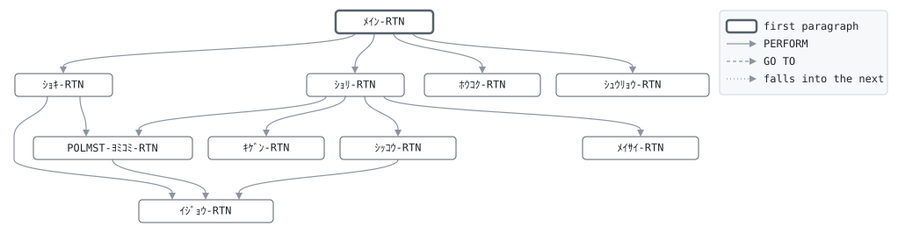

# GLD060

```text
GLD060: 失効処理

日次。猶予中の契約のうち、払込猶予期間を過ぎたものを失効
させる。猶予期間は猶予開始日 (振替不能となった日) の属する
月の翌月末まで: 業務月が猶予開始月の翌月より後なら失効。
失効した契約は失効日を業務日付とし、1年以内なら GLD040 の
復活で戻せる。

復帰コード: 0 処理済、8 日付が日付でない、16 ファイル異常。

変更履歴
日付       担当 変更
1987-04-01 KT   GL-0001 初版。
2003-10-06 MS   GL-0310 猶予開始日を振替不能日から。
```

Program [GLD060.cbl](../../../gondwana/programs/GLD060.cbl): 2 files, 10 paragraphs. Its business rules: [5 decision tables](../rules/GLD060.md).

- AUTHOR: ゴンドワナ生命 システム部.
- DATE-WRITTEN: 1987-04-01.

## Contents

- [Files](#files)
- [Flow](#flow)
- [Paragraphs](#paragraphs)
- [Calls](#calls)
- [Data flow](#data-flow)
- [Lineage](#lineage)
  - [Into PM-ｹｲﾔｸ-ﾚｺｰﾄﾞ](#into-pm-ｹｲﾔｸ-ﾚｺｰﾄﾞ)
  - [Into ﾎｳｺｸ-ｷﾞｮｳ](#into-ﾎｳｺｸ-ｷﾞｮｳ)
  - [Into WS-ｺﾏﾝﾄﾞｷﾞｮｳ](#into-ws-ｺﾏﾝﾄﾞｷﾞｮｳ)
  - [Into WS-ｴﾗｰﾌｧｲﾙ](#into-ws-ｴﾗｰﾌｧｲﾙ)
  - [Into WS-ｴﾗｰｽﾃｰﾀｽ](#into-ws-ｴﾗｰｽﾃｰﾀｽ)
  - [Into WS-ｷﾞｮｳﾑﾋﾂﾞｹ](#into-ws-ｷﾞｮｳﾑﾋﾂﾞｹ)
  - [Into WS-ｷﾞｮｳﾑﾋﾂﾞｹ-ﾜﾚｷ](#into-ws-ｷﾞｮｳﾑﾋﾂﾞｹ-ﾜﾚｷ)
  - [Into WS-ﾎｳｺｳ](#into-ws-ﾎｳｺｳ)
  - [Into WS-ﾍﾝｶﾝｹｯｶ](#into-ws-ﾍﾝｶﾝｹｯｶ)
  - [Into WS-ﾕｳﾖｶｲｼﾋﾞ](#into-ws-ﾕｳﾖｶｲｼﾋﾞ)
  - [Into WS-ｷｹﾞﾝ](#into-ws-ｷｹﾞﾝ)
  - [Into WS-ｹﾝｽｳ](#into-ws-ｹﾝｽｳ)
  - [Into WS-ﾎｳｺｸ](#into-ws-ﾎｳｺｸ)
  - [Out of the program](#out-of-the-program)
  - [Into other data items](#into-other-data-items)
- [Field origins](#field-origins)
  - [File REPORT-F](#file-report-f)
  - [File POLMST-F](#file-polmst-f)
- [Records](#records)
  - [PM-ｹｲﾔｸ-ﾚｺｰﾄﾞ](#pm-ｹｲﾔｸ-ﾚｺｰﾄﾞ)
  - [ﾎｳｺｸ-ｷﾞｮｳ](#ﾎｳｺｸ-ｷﾞｮｳ)
  - [WS-ｽﾃｰﾀｽ](#ws-ｽﾃｰﾀｽ)
  - [WS-ｺﾏﾝﾄﾞｷﾞｮｳ](#ws-ｺﾏﾝﾄﾞｷﾞｮｳ)
  - [WS-ｴﾗｰﾌｧｲﾙ](#ws-ｴﾗｰﾌｧｲﾙ)
  - [WS-ｴﾗｰｽﾃｰﾀｽ](#ws-ｴﾗｰｽﾃｰﾀｽ)
  - [WS-ｷﾞｮｳﾑﾋﾂﾞｹ](#ws-ｷﾞｮｳﾑﾋﾂﾞｹ)
  - [WS-ｷﾞｮｳﾑﾋﾂﾞｹ-ﾌﾞﾝｶｲ](#ws-ｷﾞｮｳﾑﾋﾂﾞｹ-ﾌﾞﾝｶｲ)
  - [WS-ｷﾞｮｳﾑﾋﾂﾞｹ-ﾜﾚｷ](#ws-ｷﾞｮｳﾑﾋﾂﾞｹ-ﾜﾚｷ)
  - [WS-ﾎｳｺｳ](#ws-ﾎｳｺｳ)
  - [WS-ﾍﾝｶﾝｹｯｶ](#ws-ﾍﾝｶﾝｹｯｶ)
  - [WS-ﾕｳﾖｶｲｼﾋﾞ](#ws-ﾕｳﾖｶｲｼﾋﾞ)
  - [WS-ﾕｳﾖ-ﾌﾞﾝｶｲ](#ws-ﾕｳﾖ-ﾌﾞﾝｶｲ)
  - [WS-ｷｹﾞﾝ](#ws-ｷｹﾞﾝ)
  - [WS-ｷｹﾞﾝ-YYYYMM](#ws-ｷｹﾞﾝ-yyyymm)
  - [WS-ｹﾝｽｳ](#ws-ｹﾝｽｳ)
  - [WS-ﾎｳｺｸ](#ws-ﾎｳｺｸ)

## Files

| File | Kind | Assigned to | Organization | Status field | Opened | Records |
| --- | --- | --- | --- | --- | --- | --- |
| POLMST-F | FD | POLMST | INDEXED, key PM-ｼｮｳｹﾝﾊﾞﾝｺﾞｳ, DYNAMIC access | WS-POLMST-ST | I-O | PM-ｹｲﾔｸ-ﾚｺｰﾄﾞ |
| REPORT-F | FD | GLD060R | LINE SEQUENTIAL | WS-REPORT-ST | OUTPUT | ﾎｳｺｸ-ｷﾞｮｳ |

## Flow



## Paragraphs

| Paragraph | Description | Source | Performs | Goes to | Performed by | Reached by |
| --- | --- | --- | --- | --- | --- | --- |
| ﾒｲﾝ-RTN | ﾒｲﾝ-RTN: 準備、マスタ全件の走査、報告、終了。 | [GLD060.cbl:94](../../../gondwana/programs/GLD060.cbl#L94) | ｼｮｷ-RTN, ｼｮﾘ-RTN, ﾎｳｺｸ-RTN, ｼｭｳﾘｮｳ-RTN | | | |
| ｼｮｷ-RTN | ｼｮｷ-RTN: 業務日付とファイル。 | [GLD060.cbl:105](../../../gondwana/programs/GLD060.cbl#L105) | ｲｼﾞｮｳ-RTN, POLMST-ﾖﾐｺﾐ-RTN | | ﾒｲﾝ-RTN | |
| POLMST-ﾖﾐｺﾐ-RTN | POLMST-ﾖﾐｺﾐ-RTN: マスタの次の契約。 | [GLD060.cbl:137](../../../gondwana/programs/GLD060.cbl#L137) | ｲｼﾞｮｳ-RTN | | ｼｮｷ-RTN, ｼｮﾘ-RTN | |
| ｼｮﾘ-RTN | ｼｮﾘ-RTN: 猶予中の契約の猶予期限を求め、過ぎていれば失効。 | [GLD060.cbl:148](../../../gondwana/programs/GLD060.cbl#L148) | ｷｹﾞﾝ-RTN, ｼｯｺｳ-RTN, ﾒｲｻｲ-RTN, POLMST-ﾖﾐｺﾐ-RTN | | ﾒｲﾝ-RTN | |
| ｷｹﾞﾝ-RTN | ｷｹﾞﾝ-RTN: 猶予開始月の翌月が猶予期限の月。 | [GLD060.cbl:164](../../../gondwana/programs/GLD060.cbl#L164) | | | ｼｮﾘ-RTN | |
| ｼｯｺｳ-RTN | ｼｯｺｳ-RTN: 失効にして書き戻す。 | [GLD060.cbl:180](../../../gondwana/programs/GLD060.cbl#L180) | ｲｼﾞｮｳ-RTN | | ｼｮﾘ-RTN | |
| ﾒｲｻｲ-RTN | ﾒｲｻｲ-RTN: 1件の明細行。 | [GLD060.cbl:196](../../../gondwana/programs/GLD060.cbl#L196) | | | ｼｮﾘ-RTN | |
| ﾎｳｺｸ-RTN | ﾎｳｺｸ-RTN: 件数。 | [GLD060.cbl:205](../../../gondwana/programs/GLD060.cbl#L205) | | | ﾒｲﾝ-RTN | |
| ｼｭｳﾘｮｳ-RTN | ｼｭｳﾘｮｳ-RTN: ファイルを閉じ、件数を表示する。 | [GLD060.cbl:221](../../../gondwana/programs/GLD060.cbl#L221) | | | ﾒｲﾝ-RTN | |
| ｲｼﾞｮｳ-RTN | ｲｼﾞｮｳ-RTN: ファイル異常は 16 で終わる。 | [GLD060.cbl:228](../../../gondwana/programs/GLD060.cbl#L228) | | | ｼｮｷ-RTN, POLMST-ﾖﾐｺﾐ-RTN, ｼｯｺｳ-RTN | |

## Calls

| Calls | Passing | Paragraph | Source |
| --- | --- | --- | --- |
| [GLC020](GLC020.md) | WS-ﾎｳｺｳ, WS-ｷﾞｮｳﾑﾋﾂﾞｹ, WS-ｷﾞｮｳﾑﾋﾂﾞｹ-ﾜﾚｷ, WS-ﾍﾝｶﾝｹｯｶ | ｼｮｷ-RTN | [GLD060.cbl:109](../../../gondwana/programs/GLD060.cbl#L109) |
| [GLC020](GLC020.md) | WS-ﾎｳｺｳ, WS-ﾕｳﾖｶｲｼﾋﾞ, PM-ﾕｳﾖｶｲｼﾋﾞ, WS-ﾍﾝｶﾝｹｯｶ | ｷｹﾞﾝ-RTN | [GLD060.cbl:166](../../../gondwana/programs/GLD060.cbl#L166) |

## Data flow

| Paragraph | Reads | Writes |
| --- | --- | --- |
| ﾒｲﾝ-RTN | WS-POLMST-ST | RETURN-CODE |
| ｼｮｷ-RTN | WS-ｺﾏﾝﾄﾞｷﾞｮｳ, WS-ﾎｳｺｳ, WS-ｷﾞｮｳﾑﾋﾂﾞｹ, WS-ｷﾞｮｳﾑﾋﾂﾞｹ-ﾜﾚｷ, WS-ﾍﾝｶﾝｹｯｶ, WS-POLMST-ST, WS-REPORT-ST, WS-ﾋｮｳﾀﾞｲ-ｷﾞｮｳ | WS-ｺﾏﾝﾄﾞｷﾞｮｳ, WS-ｷﾞｮｳﾑﾋﾂﾞｹ, WS-ﾎｳｺｳ, WS-ｷﾞｮｳﾑﾋﾂﾞｹ-ﾜﾚｷ, WS-ﾍﾝｶﾝｹｯｶ, RETURN-CODE, WS-POLMST-ST, WS-ｴﾗｰﾌｧｲﾙ, WS-ｴﾗｰｽﾃｰﾀｽ, WS-REPORT-ST, WS-ﾋｮｳﾀﾞｲ-ﾋﾂﾞｹ, ﾎｳｺｸ-ｷﾞｮｳ |
| POLMST-ﾖﾐｺﾐ-RTN | WS-POLMST-ST | PM-ｹｲﾔｸ-ﾚｺｰﾄﾞ, WS-POLMST-ST, WS-ｴﾗｰﾌｧｲﾙ, WS-ｴﾗｰｽﾃｰﾀｽ |
| ｼｮﾘ-RTN | PM-ｼﾞｮｳﾀｲ, WS-ﾕｳﾖｹﾝｽｳ, WS-ｷﾞｮｳﾑ-YYYYMM, WS-ｷｹﾞﾝ-YYYYMM | WS-ﾕｳﾖｹﾝｽｳ, WS-ﾒｲｻｲ-ｹｯｶ |
| ｷｹﾞﾝ-RTN | WS-ﾎｳｺｳ, WS-ﾕｳﾖｶｲｼﾋﾞ, PM-ﾕｳﾖｶｲｼﾋﾞ, WS-ﾍﾝｶﾝｹｯｶ, WS-ﾕｳﾖ-YYYY, WS-ﾕｳﾖ-MM, WS-ｷｹﾞﾝ-MM, WS-ｷｹﾞﾝ-YYYY | WS-ﾎｳｺｳ, WS-ﾕｳﾖｶｲｼﾋﾞ, PM-ﾕｳﾖｶｲｼﾋﾞ, WS-ﾍﾝｶﾝｹｯｶ, WS-ｷｹﾞﾝ-YYYY, WS-ｷｹﾞﾝ-MM |
| ｼｯｺｳ-RTN | WS-ｷﾞｮｳﾑﾋﾂﾞｹ-ﾜﾚｷ, WS-POLMST-ST, WS-ｼｯｺｳｹﾝｽｳ, PM-ﾎｹﾝｷﾝｶﾞｸ, WS-ｼｯｺｳｷﾝｶﾞｸ | PM-ｼﾞｮｳﾀｲ, PM-ｼｯｺｳﾋﾞ, PM-ｼﾞｮｳﾀｲﾋﾂﾞｹ, PM-ｹｲﾔｸ-ﾚｺｰﾄﾞ, WS-POLMST-ST, WS-ｴﾗｰﾌｧｲﾙ, WS-ｴﾗｰｽﾃｰﾀｽ, WS-ｼｯｺｳｹﾝｽｳ, WS-ｼｯｺｳｷﾝｶﾞｸ, WS-ﾒｲｻｲ-ｹｯｶ |
| ﾒｲｻｲ-RTN | PM-ｼｮｳｹﾝﾊﾞﾝｺﾞｳ, PM-ｼﾒｲ, PM-ﾕｳﾖｶｲｼﾋﾞ, WS-ﾒｲｻｲ-ｷﾞｮｳ | WS-ﾒｲｻｲ-ｼｮｳｹﾝ, WS-ﾒｲｻｲ-ｼﾒｲ, WS-ﾒｲｻｲ-ﾕｳﾖ, ﾎｳｺｸ-ｷﾞｮｳ, WS-REPORT-ST |
| ﾎｳｺｸ-RTN | WS-ﾕｳﾖｹﾝｽｳ, WS-ｹﾝｽｳ-ｷﾞｮｳ, WS-ｼｯｺｳｹﾝｽｳ, WS-ｼｯｺｳｷﾝｶﾞｸ | ﾎｳｺｸ-ｷﾞｮｳ, WS-REPORT-ST, WS-ｹﾝｽｳ-ﾗﾍﾞﾙ, WS-ｹﾝｽｳ-ｱﾀｲ |
| ｼｭｳﾘｮｳ-RTN | WS-ﾕｳﾖｹﾝｽｳ, WS-ｼｯｺｳｹﾝｽｳ | WS-POLMST-ST, WS-REPORT-ST |
| ｲｼﾞｮｳ-RTN | WS-ｴﾗｰﾌｧｲﾙ, WS-ｴﾗｰｽﾃｰﾀｽ | RETURN-CODE |

## Lineage

Where each data item's values come from, grouped by the record they go into. A data item links to the record it belongs to.

### Into PM-ｹｲﾔｸ-ﾚｺｰﾄﾞ

Record [PM-ｹｲﾔｸ-ﾚｺｰﾄﾞ](#pm-ｹｲﾔｸ-ﾚｺｰﾄﾞ), from copybook [POLMST](../copybooks/POLMST.md).

| Into | From | Statement | Paragraph | Source |
| --- | --- | --- | --- | --- |
| PM-ｹｲﾔｸ-ﾚｺｰﾄﾞ | file POLMST-F | READ | POLMST-ﾖﾐｺﾐ-RTN | [GLD060.cbl:138](../../../gondwana/programs/GLD060.cbl#L138) |
| PM-ｼｯｺｳﾋﾞ | [WS-ｷﾞｮｳﾑﾋﾂﾞｹ-ﾜﾚｷ](#ws-ｷﾞｮｳﾑﾋﾂﾞｹ-ﾜﾚｷ) | MOVE | ｼｯｺｳ-RTN | [GLD060.cbl:182](../../../gondwana/programs/GLD060.cbl#L182) |
| PM-ｼﾞｮｳﾀｲ | literal condition PM-ｼｯｺｳ | SET | ｼｯｺｳ-RTN | [GLD060.cbl:181](../../../gondwana/programs/GLD060.cbl#L181) |
| PM-ｼﾞｮｳﾀｲﾋﾂﾞｹ | [WS-ｷﾞｮｳﾑﾋﾂﾞｹ-ﾜﾚｷ](#ws-ｷﾞｮｳﾑﾋﾂﾞｹ-ﾜﾚｷ) | MOVE | ｼｯｺｳ-RTN | [GLD060.cbl:182](../../../gondwana/programs/GLD060.cbl#L182) |
| PM-ﾕｳﾖｶｲｼﾋﾞ | call GLC020 argument 3 | CALL | ｷｹﾞﾝ-RTN | [GLD060.cbl:166](../../../gondwana/programs/GLD060.cbl#L166) |

### Into ﾎｳｺｸ-ｷﾞｮｳ

Record [ﾎｳｺｸ-ｷﾞｮｳ](#ﾎｳｺｸ-ｷﾞｮｳ).

| Into | From | Statement | Paragraph | Source |
| --- | --- | --- | --- | --- |
| ﾎｳｺｸ-ｷﾞｮｳ | [WS-ﾋｮｳﾀﾞｲ-ｷﾞｮｳ](#ws-ﾎｳｺｸ "in WS-ﾎｳｺｸ") | WRITE | ｼｮｷ-RTN | [GLD060.cbl:129](../../../gondwana/programs/GLD060.cbl#L129) |
| ﾎｳｺｸ-ｷﾞｮｳ | literal SPACES | MOVE | ｼｮｷ-RTN | [GLD060.cbl:130](../../../gondwana/programs/GLD060.cbl#L130) |
| ﾎｳｺｸ-ｷﾞｮｳ | [WS-ﾒｲｻｲ-ｷﾞｮｳ](#ws-ﾎｳｺｸ "in WS-ﾎｳｺｸ") | WRITE | ﾒｲｻｲ-RTN | [GLD060.cbl:200](../../../gondwana/programs/GLD060.cbl#L200) |
| ﾎｳｺｸ-ｷﾞｮｳ | literal SPACES | MOVE | ﾎｳｺｸ-RTN | [GLD060.cbl:206](../../../gondwana/programs/GLD060.cbl#L206) |
| ﾎｳｺｸ-ｷﾞｮｳ | [WS-ｹﾝｽｳ-ｷﾞｮｳ](#ws-ﾎｳｺｸ "in WS-ﾎｳｺｸ") | WRITE | ﾎｳｺｸ-RTN | [GLD060.cbl:210](../../../gondwana/programs/GLD060.cbl#L210) |
| ﾎｳｺｸ-ｷﾞｮｳ | [WS-ｹﾝｽｳ-ｷﾞｮｳ](#ws-ﾎｳｺｸ "in WS-ﾎｳｺｸ") | WRITE | ﾎｳｺｸ-RTN | [GLD060.cbl:213](../../../gondwana/programs/GLD060.cbl#L213) |
| ﾎｳｺｸ-ｷﾞｮｳ | [WS-ｹﾝｽｳ-ｷﾞｮｳ](#ws-ﾎｳｺｸ "in WS-ﾎｳｺｸ") | WRITE | ﾎｳｺｸ-RTN | [GLD060.cbl:216](../../../gondwana/programs/GLD060.cbl#L216) |

### Into WS-ｺﾏﾝﾄﾞｷﾞｮｳ

Record [WS-ｺﾏﾝﾄﾞｷﾞｮｳ](#ws-ｺﾏﾝﾄﾞｷﾞｮｳ).

| Into | From | Statement | Paragraph | Source |
| --- | --- | --- | --- | --- |
| WS-ｺﾏﾝﾄﾞｷﾞｮｳ | COMMAND-LINE | ACCEPT | ｼｮｷ-RTN | [GLD060.cbl:106](../../../gondwana/programs/GLD060.cbl#L106) |

### Into WS-ｴﾗｰﾌｧｲﾙ

Record [WS-ｴﾗｰﾌｧｲﾙ](#ws-ｴﾗｰﾌｧｲﾙ).

| Into | From | Statement | Paragraph | Source |
| --- | --- | --- | --- | --- |
| WS-ｴﾗｰﾌｧｲﾙ | literal 'POLMST' | MOVE | ｼｮｷ-RTN | [GLD060.cbl:118](../../../gondwana/programs/GLD060.cbl#L118) |
| WS-ｴﾗｰﾌｧｲﾙ | literal 'GLD060R' | MOVE | ｼｮｷ-RTN | [GLD060.cbl:124](../../../gondwana/programs/GLD060.cbl#L124) |
| WS-ｴﾗｰﾌｧｲﾙ | literal 'POLMST' | MOVE | POLMST-ﾖﾐｺﾐ-RTN | [GLD060.cbl:140](../../../gondwana/programs/GLD060.cbl#L140) |
| WS-ｴﾗｰﾌｧｲﾙ | literal 'POLMST' | MOVE | ｼｯｺｳ-RTN | [GLD060.cbl:185](../../../gondwana/programs/GLD060.cbl#L185) |

### Into WS-ｴﾗｰｽﾃｰﾀｽ

Record [WS-ｴﾗｰｽﾃｰﾀｽ](#ws-ｴﾗｰｽﾃｰﾀｽ).

| Into | From | Statement | Paragraph | Source |
| --- | --- | --- | --- | --- |
| WS-ｴﾗｰｽﾃｰﾀｽ | [WS-POLMST-ST](#ws-ｽﾃｰﾀｽ "in WS-ｽﾃｰﾀｽ") | MOVE | ｼｮｷ-RTN | [GLD060.cbl:119](../../../gondwana/programs/GLD060.cbl#L119) |
| WS-ｴﾗｰｽﾃｰﾀｽ | [WS-REPORT-ST](#ws-ｽﾃｰﾀｽ "in WS-ｽﾃｰﾀｽ") | MOVE | ｼｮｷ-RTN | [GLD060.cbl:125](../../../gondwana/programs/GLD060.cbl#L125) |
| WS-ｴﾗｰｽﾃｰﾀｽ | [WS-POLMST-ST](#ws-ｽﾃｰﾀｽ "in WS-ｽﾃｰﾀｽ") | MOVE | POLMST-ﾖﾐｺﾐ-RTN | [GLD060.cbl:141](../../../gondwana/programs/GLD060.cbl#L141) |
| WS-ｴﾗｰｽﾃｰﾀｽ | [WS-POLMST-ST](#ws-ｽﾃｰﾀｽ "in WS-ｽﾃｰﾀｽ") | MOVE | ｼｯｺｳ-RTN | [GLD060.cbl:186](../../../gondwana/programs/GLD060.cbl#L186) |

### Into WS-ｷﾞｮｳﾑﾋﾂﾞｹ

Record [WS-ｷﾞｮｳﾑﾋﾂﾞｹ](#ws-ｷﾞｮｳﾑﾋﾂﾞｹ).

| Into | From | Statement | Paragraph | Source |
| --- | --- | --- | --- | --- |
| WS-ｷﾞｮｳﾑﾋﾂﾞｹ | [WS-ｺﾏﾝﾄﾞｷﾞｮｳ](#ws-ｺﾏﾝﾄﾞｷﾞｮｳ) | MOVE | ｼｮｷ-RTN | [GLD060.cbl:107](../../../gondwana/programs/GLD060.cbl#L107) |
| WS-ｷﾞｮｳﾑﾋﾂﾞｹ | call GLC020 argument 2 | CALL | ｼｮｷ-RTN | [GLD060.cbl:109](../../../gondwana/programs/GLD060.cbl#L109) |

### Into WS-ｷﾞｮｳﾑﾋﾂﾞｹ-ﾜﾚｷ

Record [WS-ｷﾞｮｳﾑﾋﾂﾞｹ-ﾜﾚｷ](#ws-ｷﾞｮｳﾑﾋﾂﾞｹ-ﾜﾚｷ).

| Into | From | Statement | Paragraph | Source |
| --- | --- | --- | --- | --- |
| WS-ｷﾞｮｳﾑﾋﾂﾞｹ-ﾜﾚｷ | call GLC020 argument 3 | CALL | ｼｮｷ-RTN | [GLD060.cbl:109](../../../gondwana/programs/GLD060.cbl#L109) |

### Into WS-ﾎｳｺｳ

Record [WS-ﾎｳｺｳ](#ws-ﾎｳｺｳ).

| Into | From | Statement | Paragraph | Source |
| --- | --- | --- | --- | --- |
| WS-ﾎｳｺｳ | literal 'W' | MOVE | ｼｮｷ-RTN | [GLD060.cbl:108](../../../gondwana/programs/GLD060.cbl#L108) |
| WS-ﾎｳｺｳ | call GLC020 argument 1 | CALL | ｼｮｷ-RTN | [GLD060.cbl:109](../../../gondwana/programs/GLD060.cbl#L109) |
| WS-ﾎｳｺｳ | literal 'S' | MOVE | ｷｹﾞﾝ-RTN | [GLD060.cbl:165](../../../gondwana/programs/GLD060.cbl#L165) |
| WS-ﾎｳｺｳ | call GLC020 argument 1 | CALL | ｷｹﾞﾝ-RTN | [GLD060.cbl:166](../../../gondwana/programs/GLD060.cbl#L166) |

### Into WS-ﾍﾝｶﾝｹｯｶ

Record [WS-ﾍﾝｶﾝｹｯｶ](#ws-ﾍﾝｶﾝｹｯｶ).

| Into | From | Statement | Paragraph | Source |
| --- | --- | --- | --- | --- |
| WS-ﾍﾝｶﾝｹｯｶ | call GLC020 argument 4 | CALL | ｼｮｷ-RTN | [GLD060.cbl:109](../../../gondwana/programs/GLD060.cbl#L109) |
| WS-ﾍﾝｶﾝｹｯｶ | call GLC020 argument 4 | CALL | ｷｹﾞﾝ-RTN | [GLD060.cbl:166](../../../gondwana/programs/GLD060.cbl#L166) |

### Into WS-ﾕｳﾖｶｲｼﾋﾞ

Record [WS-ﾕｳﾖｶｲｼﾋﾞ](#ws-ﾕｳﾖｶｲｼﾋﾞ).

| Into | From | Statement | Paragraph | Source |
| --- | --- | --- | --- | --- |
| WS-ﾕｳﾖｶｲｼﾋﾞ | call GLC020 argument 2 | CALL | ｷｹﾞﾝ-RTN | [GLD060.cbl:166](../../../gondwana/programs/GLD060.cbl#L166) |

### Into WS-ｷｹﾞﾝ

Record [WS-ｷｹﾞﾝ](#ws-ｷｹﾞﾝ).

| Into | From | Statement | Paragraph | Source |
| --- | --- | --- | --- | --- |
| WS-ｷｹﾞﾝ-MM | [WS-ﾕｳﾖ-MM](#ws-ﾕｳﾖ-ﾌﾞﾝｶｲ "in WS-ﾕｳﾖ-ﾌﾞﾝｶｲ") | MOVE | ｷｹﾞﾝ-RTN | [GLD060.cbl:169](../../../gondwana/programs/GLD060.cbl#L169) |
| WS-ｷｹﾞﾝ-MM | literal 1 | MOVE | ｷｹﾞﾝ-RTN | [GLD060.cbl:171](../../../gondwana/programs/GLD060.cbl#L171) |
| WS-ｷｹﾞﾝ-MM | literal 1 | ADD | ｷｹﾞﾝ-RTN | [GLD060.cbl:174](../../../gondwana/programs/GLD060.cbl#L174) |
| WS-ｷｹﾞﾝ-YYYY | [WS-ﾕｳﾖ-YYYY](#ws-ﾕｳﾖ-ﾌﾞﾝｶｲ "in WS-ﾕｳﾖ-ﾌﾞﾝｶｲ") | MOVE | ｷｹﾞﾝ-RTN | [GLD060.cbl:168](../../../gondwana/programs/GLD060.cbl#L168) |
| WS-ｷｹﾞﾝ-YYYY | literal 1 | ADD | ｷｹﾞﾝ-RTN | [GLD060.cbl:172](../../../gondwana/programs/GLD060.cbl#L172) |

### Into WS-ｹﾝｽｳ

Record [WS-ｹﾝｽｳ](#ws-ｹﾝｽｳ).

| Into | From | Statement | Paragraph | Source |
| --- | --- | --- | --- | --- |
| WS-ｼｯｺｳｷﾝｶﾞｸ | [PM-ﾎｹﾝｷﾝｶﾞｸ](#pm-ｹｲﾔｸ-ﾚｺｰﾄﾞ "in PM-ｹｲﾔｸ-ﾚｺｰﾄﾞ") | ADD | ｼｯｺｳ-RTN | [GLD060.cbl:190](../../../gondwana/programs/GLD060.cbl#L190) |
| WS-ｼｯｺｳｹﾝｽｳ | literal 1 | ADD | ｼｯｺｳ-RTN | [GLD060.cbl:189](../../../gondwana/programs/GLD060.cbl#L189) |
| WS-ﾕｳﾖｹﾝｽｳ | literal 1 | ADD | ｼｮﾘ-RTN | [GLD060.cbl:150](../../../gondwana/programs/GLD060.cbl#L150) |

### Into WS-ﾎｳｺｸ

Record [WS-ﾎｳｺｸ](#ws-ﾎｳｺｸ).

| Into | From | Statement | Paragraph | Source |
| --- | --- | --- | --- | --- |
| WS-ｹﾝｽｳ-ｱﾀｲ | [WS-ﾕｳﾖｹﾝｽｳ](#ws-ｹﾝｽｳ "in WS-ｹﾝｽｳ") | MOVE | ﾎｳｺｸ-RTN | [GLD060.cbl:209](../../../gondwana/programs/GLD060.cbl#L209) |
| WS-ｹﾝｽｳ-ｱﾀｲ | [WS-ｼｯｺｳｹﾝｽｳ](#ws-ｹﾝｽｳ "in WS-ｹﾝｽｳ") | MOVE | ﾎｳｺｸ-RTN | [GLD060.cbl:212](../../../gondwana/programs/GLD060.cbl#L212) |
| WS-ｹﾝｽｳ-ｱﾀｲ | [WS-ｼｯｺｳｷﾝｶﾞｸ](#ws-ｹﾝｽｳ "in WS-ｹﾝｽｳ") | MOVE | ﾎｳｺｸ-RTN | [GLD060.cbl:215](../../../gondwana/programs/GLD060.cbl#L215) |
| WS-ｹﾝｽｳ-ﾗﾍﾞﾙ | literal '猶予中件数' | MOVE | ﾎｳｺｸ-RTN | [GLD060.cbl:208](../../../gondwana/programs/GLD060.cbl#L208) |
| WS-ｹﾝｽｳ-ﾗﾍﾞﾙ | literal '失効件数' | MOVE | ﾎｳｺｸ-RTN | [GLD060.cbl:211](../../../gondwana/programs/GLD060.cbl#L211) |
| WS-ｹﾝｽｳ-ﾗﾍﾞﾙ | literal '失効保険金額' | MOVE | ﾎｳｺｸ-RTN | [GLD060.cbl:214](../../../gondwana/programs/GLD060.cbl#L214) |
| WS-ﾋｮｳﾀﾞｲ-ﾋﾂﾞｹ | [WS-ｷﾞｮｳﾑﾋﾂﾞｹ-ﾜﾚｷ](#ws-ｷﾞｮｳﾑﾋﾂﾞｹ-ﾜﾚｷ) | MOVE | ｼｮｷ-RTN | [GLD060.cbl:128](../../../gondwana/programs/GLD060.cbl#L128) |
| WS-ﾒｲｻｲ-ｹｯｶ | literal '猶予中' | MOVE | ｼｮﾘ-RTN | [GLD060.cbl:155](../../../gondwana/programs/GLD060.cbl#L155) |
| WS-ﾒｲｻｲ-ｹｯｶ | literal '失効' | MOVE | ｼｯｺｳ-RTN | [GLD060.cbl:191](../../../gondwana/programs/GLD060.cbl#L191) |
| WS-ﾒｲｻｲ-ｼｮｳｹﾝ | [PM-ｼｮｳｹﾝﾊﾞﾝｺﾞｳ](#pm-ｹｲﾔｸ-ﾚｺｰﾄﾞ "in PM-ｹｲﾔｸ-ﾚｺｰﾄﾞ") | MOVE | ﾒｲｻｲ-RTN | [GLD060.cbl:197](../../../gondwana/programs/GLD060.cbl#L197) |
| WS-ﾒｲｻｲ-ｼﾒｲ | [PM-ｼﾒｲ](#pm-ｹｲﾔｸ-ﾚｺｰﾄﾞ "in PM-ｹｲﾔｸ-ﾚｺｰﾄﾞ") | MOVE | ﾒｲｻｲ-RTN | [GLD060.cbl:198](../../../gondwana/programs/GLD060.cbl#L198) |
| WS-ﾒｲｻｲ-ﾕｳﾖ | [PM-ﾕｳﾖｶｲｼﾋﾞ](#pm-ｹｲﾔｸ-ﾚｺｰﾄﾞ "in PM-ｹｲﾔｸ-ﾚｺｰﾄﾞ") | MOVE | ﾒｲｻｲ-RTN | [GLD060.cbl:199](../../../gondwana/programs/GLD060.cbl#L199) |

### Out of the program

Records written to files, items passed to the programs called, and items displayed to the job's output.

| Into | From | Statement | Paragraph | Source |
| --- | --- | --- | --- | --- |
| call GLC020 argument 1 | [WS-ﾎｳｺｳ](#ws-ﾎｳｺｳ) | CALL | ｼｮｷ-RTN | [GLD060.cbl:109](../../../gondwana/programs/GLD060.cbl#L109) |
| call GLC020 argument 2 | [WS-ｷﾞｮｳﾑﾋﾂﾞｹ](#ws-ｷﾞｮｳﾑﾋﾂﾞｹ) | CALL | ｼｮｷ-RTN | [GLD060.cbl:109](../../../gondwana/programs/GLD060.cbl#L109) |
| call GLC020 argument 3 | [WS-ｷﾞｮｳﾑﾋﾂﾞｹ-ﾜﾚｷ](#ws-ｷﾞｮｳﾑﾋﾂﾞｹ-ﾜﾚｷ) | CALL | ｼｮｷ-RTN | [GLD060.cbl:109](../../../gondwana/programs/GLD060.cbl#L109) |
| call GLC020 argument 4 | [WS-ﾍﾝｶﾝｹｯｶ](#ws-ﾍﾝｶﾝｹｯｶ) | CALL | ｼｮｷ-RTN | [GLD060.cbl:109](../../../gondwana/programs/GLD060.cbl#L109) |
| call GLC020 argument 1 | [WS-ﾎｳｺｳ](#ws-ﾎｳｺｳ) | CALL | ｷｹﾞﾝ-RTN | [GLD060.cbl:166](../../../gondwana/programs/GLD060.cbl#L166) |
| call GLC020 argument 2 | [WS-ﾕｳﾖｶｲｼﾋﾞ](#ws-ﾕｳﾖｶｲｼﾋﾞ) | CALL | ｷｹﾞﾝ-RTN | [GLD060.cbl:166](../../../gondwana/programs/GLD060.cbl#L166) |
| call GLC020 argument 3 | [PM-ﾕｳﾖｶｲｼﾋﾞ](#pm-ｹｲﾔｸ-ﾚｺｰﾄﾞ "in PM-ｹｲﾔｸ-ﾚｺｰﾄﾞ") | CALL | ｷｹﾞﾝ-RTN | [GLD060.cbl:166](../../../gondwana/programs/GLD060.cbl#L166) |
| call GLC020 argument 4 | [WS-ﾍﾝｶﾝｹｯｶ](#ws-ﾍﾝｶﾝｹｯｶ) | CALL | ｷｹﾞﾝ-RTN | [GLD060.cbl:166](../../../gondwana/programs/GLD060.cbl#L166) |
| file POLMST-F | [PM-ｹｲﾔｸ-ﾚｺｰﾄﾞ](#pm-ｹｲﾔｸ-ﾚｺｰﾄﾞ) | REWRITE | ｼｯｺｳ-RTN | [GLD060.cbl:183](../../../gondwana/programs/GLD060.cbl#L183) |
| file REPORT-F | [ﾎｳｺｸ-ｷﾞｮｳ](#ﾎｳｺｸ-ｷﾞｮｳ) | WRITE | ｼｮｷ-RTN | [GLD060.cbl:129](../../../gondwana/programs/GLD060.cbl#L129) |
| file REPORT-F | [ﾎｳｺｸ-ｷﾞｮｳ](#ﾎｳｺｸ-ｷﾞｮｳ) | WRITE | ｼｮｷ-RTN | [GLD060.cbl:131](../../../gondwana/programs/GLD060.cbl#L131) |
| file REPORT-F | [ﾎｳｺｸ-ｷﾞｮｳ](#ﾎｳｺｸ-ｷﾞｮｳ) | WRITE | ﾒｲｻｲ-RTN | [GLD060.cbl:200](../../../gondwana/programs/GLD060.cbl#L200) |
| file REPORT-F | [ﾎｳｺｸ-ｷﾞｮｳ](#ﾎｳｺｸ-ｷﾞｮｳ) | WRITE | ﾎｳｺｸ-RTN | [GLD060.cbl:207](../../../gondwana/programs/GLD060.cbl#L207) |
| file REPORT-F | [ﾎｳｺｸ-ｷﾞｮｳ](#ﾎｳｺｸ-ｷﾞｮｳ) | WRITE | ﾎｳｺｸ-RTN | [GLD060.cbl:210](../../../gondwana/programs/GLD060.cbl#L210) |
| file REPORT-F | [ﾎｳｺｸ-ｷﾞｮｳ](#ﾎｳｺｸ-ｷﾞｮｳ) | WRITE | ﾎｳｺｸ-RTN | [GLD060.cbl:213](../../../gondwana/programs/GLD060.cbl#L213) |
| file REPORT-F | [ﾎｳｺｸ-ｷﾞｮｳ](#ﾎｳｺｸ-ｷﾞｮｳ) | WRITE | ﾎｳｺｸ-RTN | [GLD060.cbl:216](../../../gondwana/programs/GLD060.cbl#L216) |
| SYSOUT | [WS-ｺﾏﾝﾄﾞｷﾞｮｳ](#ws-ｺﾏﾝﾄﾞｷﾞｮｳ) | DISPLAY | ｼｮｷ-RTN | [GLD060.cbl:112](../../../gondwana/programs/GLD060.cbl#L112) |
| SYSOUT | [WS-ﾕｳﾖｹﾝｽｳ](#ws-ｹﾝｽｳ "in WS-ｹﾝｽｳ") | DISPLAY | ｼｭｳﾘｮｳ-RTN | [GLD060.cbl:223](../../../gondwana/programs/GLD060.cbl#L223) |
| SYSOUT | [WS-ｼｯｺｳｹﾝｽｳ](#ws-ｹﾝｽｳ "in WS-ｹﾝｽｳ") | DISPLAY | ｼｭｳﾘｮｳ-RTN | [GLD060.cbl:223](../../../gondwana/programs/GLD060.cbl#L223) |
| SYSOUT | [WS-ｴﾗｰﾌｧｲﾙ](#ws-ｴﾗｰﾌｧｲﾙ) | DISPLAY | ｲｼﾞｮｳ-RTN | [GLD060.cbl:229](../../../gondwana/programs/GLD060.cbl#L229) |
| SYSOUT | [WS-ｴﾗｰｽﾃｰﾀｽ](#ws-ｴﾗｰｽﾃｰﾀｽ) | DISPLAY | ｲｼﾞｮｳ-RTN | [GLD060.cbl:229](../../../gondwana/programs/GLD060.cbl#L229) |

### Into other data items

Data items the program does not declare, such as special registers and index names.

| Into | From | Statement | Paragraph | Source |
| --- | --- | --- | --- | --- |
| RETURN-CODE | literal 0 | MOVE | ﾒｲﾝ-RTN | [GLD060.cbl:99](../../../gondwana/programs/GLD060.cbl#L99) |
| RETURN-CODE | literal 8 | MOVE | ｼｮｷ-RTN | [GLD060.cbl:113](../../../gondwana/programs/GLD060.cbl#L113) |
| RETURN-CODE | literal 16 | MOVE | ｲｼﾞｮｳ-RTN | [GLD060.cbl:231](../../../gondwana/programs/GLD060.cbl#L231) |

## Field origins

Where the values of each field the program writes to a file come from: the fields of the files it reads, literals, and initial values, followed through every statement that moves a value, and through groups and redefinitions by the bytes they share.

### File REPORT-F

Written from [ﾎｳｺｸ-ｷﾞｮｳ](#ﾎｳｺｸ-ｷﾞｮｳ).

| Field | Position | Origins |
| --- | --: | --- |
| ﾎｳｺｸ-ｷﾞｮｳ | 1-100 | literal SPACES |

### File POLMST-F

Written from [PM-ｹｲﾔｸ-ﾚｺｰﾄﾞ](#pm-ｹｲﾔｸ-ﾚｺｰﾄﾞ).

| Field | Position | Origins |
| --- | --: | --- |
| PM-ｼｮｳｹﾝﾊﾞﾝｺﾞｳ | 1-10 | file POLMST-F PM-ｼｮｳｹﾝﾊﾞﾝｺﾞｳ |
| PM-ｼﾞｮｳﾀｲ | 11 | literal condition PM-ｼｯｺｳ |
| PM-ｼｮｳﾋﾝ | 12-13 | file POLMST-F PM-ｼｮｳﾋﾝ |
| PM-ﾎｹﾝｷﾝｶﾞｸ | 14-22 | file POLMST-F PM-ﾎｹﾝｷﾝｶﾞｸ |
| PM-ﾎｹﾝﾘｮｳ | 23-29 | file POLMST-F PM-ﾎｹﾝﾘｮｳ |
| PM-ﾊﾗｲｺﾐﾎｳﾎｳ | 30 | file POLMST-F PM-ﾊﾗｲｺﾐﾎｳﾎｳ |
| PM-ｹｲﾔｸﾋﾞ | 31-37 | file POLMST-F PM-ｹｲﾔｸﾋﾞ |
| PM-ﾎｹﾝｷｶﾝ | 38-39 | file POLMST-F PM-ﾎｹﾝｷｶﾝ |
| PM-ﾏﾝｷﾋﾞ | 40-46 | file POLMST-F PM-ﾏﾝｷﾋﾞ |
| PM-ｹｲｶﾈﾝｽｳ | 47-48 | file POLMST-F PM-ｹｲｶﾈﾝｽｳ |
| PM-ﾊﾗｲｺﾐｽﾞﾐﾈﾝｹﾞﾂ | 49-54 | file POLMST-F PM-ﾊﾗｲｺﾐｽﾞﾐﾈﾝｹﾞﾂ |
| PM-ﾐﾉｳｶｲｽｳ | 55-56 | file POLMST-F PM-ﾐﾉｳｶｲｽｳ |
| PM-ﾕｳﾖｶｲｼﾋﾞ | 57-63 | call GLC020 argument 3 PM-ﾕｳﾖｶｲｼﾋﾞ; file POLMST-F PM-ﾕｳﾖｶｲｼﾋﾞ |
| PM-ｼｯｺｳﾋﾞ | 64-70 | call GLC020 argument 3 WS-ｷﾞｮｳﾑﾋﾂﾞｹ-ﾜﾚｷ; stream COMMAND-LINE WS-ｺﾏﾝﾄﾞｷﾞｮｳ 1-8 |
| PM-ｼﾞｮｳﾀｲﾋﾂﾞｹ | 71-77 | call GLC020 argument 3 WS-ｷﾞｮｳﾑﾋﾂﾞｹ-ﾜﾚｷ; stream COMMAND-LINE WS-ｺﾏﾝﾄﾞｷﾞｮｳ 1-8 |
| PM-ｼﾒｲ | 78-97 | file POLMST-F PM-ｼﾒｲ |
| PM-ｼﾒｲｶﾅ | 98-117 | file POLMST-F PM-ｼﾒｲｶﾅ |
| PM-ｾｲﾈﾝｶﾞｯﾋﾟ | 118-124 | file POLMST-F PM-ｾｲﾈﾝｶﾞｯﾋﾟ |
| PM-ｾｲﾍﾞﾂ | 125 | file POLMST-F PM-ｾｲﾍﾞﾂ |
| PM-ｶﾆｭｳﾈﾝﾚｲ | 126-127 | file POLMST-F PM-ｶﾆｭｳﾈﾝﾚｲ |
| PM-ｼﾞｭｳｼｮ | 128-167 | file POLMST-F PM-ｼﾞｭｳｼｮ |
| PM-ｳｹﾄﾘﾆﾝ | 168-187 | file POLMST-F PM-ｳｹﾄﾘﾆﾝ |
| PM-ｷﾞﾝｺｳｺｰﾄﾞ | 188-191 | file POLMST-F PM-ｷﾞﾝｺｳｺｰﾄﾞ |
| PM-ｼﾃﾝｺｰﾄﾞ | 192-194 | file POLMST-F PM-ｼﾃﾝｺｰﾄﾞ |
| PM-ﾖｷﾝｼｭﾓｸ | 195 | file POLMST-F PM-ﾖｷﾝｼｭﾓｸ |
| PM-ｺｳｻﾞﾊﾞﾝｺﾞｳ | 196-202 | file POLMST-F PM-ｺｳｻﾞﾊﾞﾝｺﾞｳ |
| PM-ｺｳｻﾞﾒｲｷﾞ | 203-232 | file POLMST-F PM-ｺｳｻﾞﾒｲｷﾞ |
| PM-ﾀﾞｲﾘﾃﾝｺｰﾄﾞ | 233-238 | file POLMST-F PM-ﾀﾞｲﾘﾃﾝｺｰﾄﾞ |
| PM-ｶｼﾂｹｻﾞﾝﾀﾞｶ | 239-247 | file POLMST-F PM-ｶｼﾂｹｻﾞﾝﾀﾞｶ |
| PM-ｾｷﾆﾝｼﾞｭﾝﾋﾞｷﾝ | 248-256 | file POLMST-F PM-ｾｷﾆﾝｼﾞｭﾝﾋﾞｷﾝ |
| PM-ﾊｲﾄｳﾙｲｹｲ | 257-265 | file POLMST-F PM-ﾊｲﾄｳﾙｲｹｲ |
| PM-ｻｲｼｭｳﾆｭｳｷﾝﾈﾝｹﾞﾂ | 266-271 | file POLMST-F PM-ｻｲｼｭｳﾆｭｳｷﾝﾈﾝｹﾞﾂ |
| PM-ｻｲｼｭｳﾆｭｳｷﾝｶﾞｸ | 272-278 | file POLMST-F PM-ｻｲｼｭｳﾆｭｳｷﾝｶﾞｸ |

## Records

### PM-ｹｲﾔｸ-ﾚｺｰﾄﾞ

File POLMST-F. 300 bytes, layout in copybook [POLMST](../copybooks/POLMST.md).

### ﾎｳｺｸ-ｷﾞｮｳ

File REPORT-F. 100 bytes.

| Level | Field | Kind | Start | Length | Picture | Usage | Notes | Source |
| --: | --- | --- | --: | --: | --- | --- | --- | --- |
| 01 | ﾎｳｺｸ-ｷﾞｮｳ | text | 1 | 100 | X(100) | | | [GLD060.cbl:39](../../../gondwana/programs/GLD060.cbl#L39) |

### WS-ｽﾃｰﾀｽ

Working storage. 4 bytes.

| Level | Field | Kind | Start | Length | Picture | Usage | Notes | Source |
| --: | --- | --- | --: | --: | --- | --- | --- | --- |
| 01 | WS-ｽﾃｰﾀｽ | group | 1 | 4 | | | | [GLD060.cbl:42](../../../gondwana/programs/GLD060.cbl#L42) |
| 05 | ├ WS-POLMST-ST | code | 1 | 2 | XX | | | [GLD060.cbl:43](../../../gondwana/programs/GLD060.cbl#L43) |
| 88 | │ ├ WS-POLMST-OK | | | | | | VALUE '00' | [GLD060.cbl:44](../../../gondwana/programs/GLD060.cbl#L44) |
| 88 | │ └ WS-POLMST-ｵﾜﾘ | | | | | | VALUE '10' | [GLD060.cbl:45](../../../gondwana/programs/GLD060.cbl#L45) |
| 05 | └ WS-REPORT-ST | code | 3 | 2 | XX | | | [GLD060.cbl:46](../../../gondwana/programs/GLD060.cbl#L46) |
| 88 |   └ WS-REPORT-OK | | | | | | VALUE '00' | [GLD060.cbl:47](../../../gondwana/programs/GLD060.cbl#L47) |

### WS-ｺﾏﾝﾄﾞｷﾞｮｳ

Working storage. 80 bytes.

| Level | Field | Kind | Start | Length | Picture | Usage | Notes | Source |
| --: | --- | --- | --: | --: | --- | --- | --- | --- |
| 01 | WS-ｺﾏﾝﾄﾞｷﾞｮｳ | text | 1 | 80 | X(80) | | | [GLD060.cbl:48](../../../gondwana/programs/GLD060.cbl#L48) |

### WS-ｴﾗｰﾌｧｲﾙ

Working storage. 8 bytes.

| Level | Field | Kind | Start | Length | Picture | Usage | Notes | Source |
| --: | --- | --- | --: | --: | --- | --- | --- | --- |
| 01 | WS-ｴﾗｰﾌｧｲﾙ | text | 1 | 8 | X(8) | | | [GLD060.cbl:49](../../../gondwana/programs/GLD060.cbl#L49) |

### WS-ｴﾗｰｽﾃｰﾀｽ

Working storage. 2 bytes.

| Level | Field | Kind | Start | Length | Picture | Usage | Notes | Source |
| --: | --- | --- | --: | --: | --- | --- | --- | --- |
| 01 | WS-ｴﾗｰｽﾃｰﾀｽ | text | 1 | 2 | XX | | | [GLD060.cbl:50](../../../gondwana/programs/GLD060.cbl#L50) |

### WS-ｷﾞｮｳﾑﾋﾂﾞｹ

Working storage. 8 bytes.

| Level | Field | Kind | Start | Length | Picture | Usage | Notes | Source |
| --: | --- | --- | --: | --: | --- | --- | --- | --- |
| 01 | WS-ｷﾞｮｳﾑﾋﾂﾞｹ | date | 1 | 8 | 9(8) | | | [GLD060.cbl:51](../../../gondwana/programs/GLD060.cbl#L51) |

### WS-ｷﾞｮｳﾑﾋﾂﾞｹ-ﾌﾞﾝｶｲ

Working storage. 8 bytes.

| Level | Field | Kind | Start | Length | Picture | Usage | Notes | Source |
| --: | --- | --- | --: | --: | --- | --- | --- | --- |
| 01 | WS-ｷﾞｮｳﾑﾋﾂﾞｹ-ﾌﾞﾝｶｲ | group | 1 | 8 | | | REDEFINES WS-ｷﾞｮｳﾑﾋﾂﾞｹ | [GLD060.cbl:52](../../../gondwana/programs/GLD060.cbl#L52) |
| 05 | ├ WS-ｷﾞｮｳﾑ-YYYYMM | date | 1 | 6 | 9(6) | | | [GLD060.cbl:53](../../../gondwana/programs/GLD060.cbl#L53) |
| 05 | └ WS-ｷﾞｮｳﾑ-DD | number | 7 | 2 | 99 | | | [GLD060.cbl:54](../../../gondwana/programs/GLD060.cbl#L54) |

### WS-ｷﾞｮｳﾑﾋﾂﾞｹ-ﾜﾚｷ

Working storage. 7 bytes.

| Level | Field | Kind | Start | Length | Picture | Usage | Notes | Source |
| --: | --- | --- | --: | --: | --- | --- | --- | --- |
| 01 | WS-ｷﾞｮｳﾑﾋﾂﾞｹ-ﾜﾚｷ | date | 1 | 7 | X(7) | | | [GLD060.cbl:55](../../../gondwana/programs/GLD060.cbl#L55) |

### WS-ﾎｳｺｳ

Working storage. 1 bytes.

| Level | Field | Kind | Start | Length | Picture | Usage | Notes | Source |
| --: | --- | --- | --: | --: | --- | --- | --- | --- |
| 01 | WS-ﾎｳｺｳ | text | 1 | 1 | X | | | [GLD060.cbl:56](../../../gondwana/programs/GLD060.cbl#L56) |

### WS-ﾍﾝｶﾝｹｯｶ

Working storage. 1 bytes.

| Level | Field | Kind | Start | Length | Picture | Usage | Notes | Source |
| --: | --- | --- | --: | --: | --- | --- | --- | --- |
| 01 | WS-ﾍﾝｶﾝｹｯｶ | number | 1 | 1 | 9 | | | [GLD060.cbl:57](../../../gondwana/programs/GLD060.cbl#L57) |

### WS-ﾕｳﾖｶｲｼﾋﾞ

Working storage. 8 bytes.

| Level | Field | Kind | Start | Length | Picture | Usage | Notes | Source |
| --: | --- | --- | --: | --: | --- | --- | --- | --- |
| 01 | WS-ﾕｳﾖｶｲｼﾋﾞ | date | 1 | 8 | 9(8) | | | [GLD060.cbl:58](../../../gondwana/programs/GLD060.cbl#L58) |

### WS-ﾕｳﾖ-ﾌﾞﾝｶｲ

Working storage. 8 bytes.

| Level | Field | Kind | Start | Length | Picture | Usage | Notes | Source |
| --: | --- | --- | --: | --: | --- | --- | --- | --- |
| 01 | WS-ﾕｳﾖ-ﾌﾞﾝｶｲ | group | 1 | 8 | | | REDEFINES WS-ﾕｳﾖｶｲｼﾋﾞ | [GLD060.cbl:59](../../../gondwana/programs/GLD060.cbl#L59) |
| 05 | ├ WS-ﾕｳﾖ-YYYY | number | 1 | 4 | 9(4) | | | [GLD060.cbl:60](../../../gondwana/programs/GLD060.cbl#L60) |
| 05 | ├ WS-ﾕｳﾖ-MM | number | 5 | 2 | 99 | | | [GLD060.cbl:61](../../../gondwana/programs/GLD060.cbl#L61) |
| 05 | └ WS-ﾕｳﾖ-DD | number | 7 | 2 | 99 | | | [GLD060.cbl:62](../../../gondwana/programs/GLD060.cbl#L62) |

### WS-ｷｹﾞﾝ

Working storage. 6 bytes.

| Level | Field | Kind | Start | Length | Picture | Usage | Notes | Source |
| --: | --- | --- | --: | --: | --- | --- | --- | --- |
| 01 | WS-ｷｹﾞﾝ | group | 1 | 6 | | | | [GLD060.cbl:63](../../../gondwana/programs/GLD060.cbl#L63) |
| 05 | ├ WS-ｷｹﾞﾝ-YYYY | number | 1 | 4 | 9(4) | | | [GLD060.cbl:64](../../../gondwana/programs/GLD060.cbl#L64) |
| 05 | └ WS-ｷｹﾞﾝ-MM | number | 5 | 2 | 99 | | | [GLD060.cbl:65](../../../gondwana/programs/GLD060.cbl#L65) |

### WS-ｷｹﾞﾝ-YYYYMM

Working storage. 6 bytes.

| Level | Field | Kind | Start | Length | Picture | Usage | Notes | Source |
| --: | --- | --- | --: | --: | --- | --- | --- | --- |
| 01 | WS-ｷｹﾞﾝ-YYYYMM | date | 1 | 6 | 9(6) | | REDEFINES WS-ｷｹﾞﾝ | [GLD060.cbl:66](../../../gondwana/programs/GLD060.cbl#L66) |

### WS-ｹﾝｽｳ

Working storage. 27 bytes.

| Level | Field | Kind | Start | Length | Picture | Usage | Notes | Source |
| --: | --- | --- | --: | --: | --- | --- | --- | --- |
| 01 | WS-ｹﾝｽｳ | group | 1 | 27 | | | | [GLD060.cbl:67](../../../gondwana/programs/GLD060.cbl#L67) |
| 05 | ├ WS-ﾕｳﾖｹﾝｽｳ | number | 1 | 7 | 9(7) | | VALUE 0 | [GLD060.cbl:68](../../../gondwana/programs/GLD060.cbl#L68) |
| 05 | ├ WS-ｼｯｺｳｹﾝｽｳ | number | 8 | 7 | 9(7) | | VALUE 0 | [GLD060.cbl:69](../../../gondwana/programs/GLD060.cbl#L69) |
| 05 | └ WS-ｼｯｺｳｷﾝｶﾞｸ | amount | 15 | 13 | 9(13) | | VALUE 0 | [GLD060.cbl:70](../../../gondwana/programs/GLD060.cbl#L70) |

### WS-ﾎｳｺｸ

Working storage. 129 bytes.

| Level | Field | Kind | Start | Length | Picture | Usage | Notes | Source |
| --: | --- | --- | --: | --: | --- | --- | --- | --- |
| 01 | WS-ﾎｳｺｸ | group | 1 | 129 | | | | [GLD060.cbl:71](../../../gondwana/programs/GLD060.cbl#L71) |
| 05 | ├ WS-ﾋｮｳﾀﾞｲ-ｷﾞｮｳ | group | 1 | 39 | | | | [GLD060.cbl:72](../../../gondwana/programs/GLD060.cbl#L72) |
| 10 | │ ├ FILLER | filler | 1 | 28 | X(28) | | VALUE 'ゴンドワナ生命  失効処理' | [GLD060.cbl:73](../../../gondwana/programs/GLD060.cbl#L73) |
| 10 | │ ├ FILLER | filler | 29 | 4 | X(4) | | VALUE SPACES | [GLD060.cbl:75](../../../gondwana/programs/GLD060.cbl#L75) |
| 10 | │ └ WS-ﾋｮｳﾀﾞｲ-ﾋﾂﾞｹ | date | 33 | 7 | X(7) | | | [GLD060.cbl:76](../../../gondwana/programs/GLD060.cbl#L76) |
| 05 | ├ WS-ﾒｲｻｲ-ｷﾞｮｳ | group | 40 | 63 | | | | [GLD060.cbl:77](../../../gondwana/programs/GLD060.cbl#L77) |
| 10 | │ ├ WS-ﾒｲｻｲ-ｼｮｳｹﾝ | text | 40 | 10 | X(10) | | | [GLD060.cbl:78](../../../gondwana/programs/GLD060.cbl#L78) |
| 10 | │ ├ FILLER | filler | 50 | 2 | X(2) | | VALUE SPACES | [GLD060.cbl:79](../../../gondwana/programs/GLD060.cbl#L79) |
| 10 | │ ├ WS-ﾒｲｻｲ-ｼﾒｲ | text | 52 | 20 | X(20) | | | [GLD060.cbl:80](../../../gondwana/programs/GLD060.cbl#L80) |
| 10 | │ ├ FILLER | filler | 72 | 2 | X(2) | | VALUE SPACES | [GLD060.cbl:81](../../../gondwana/programs/GLD060.cbl#L81) |
| 10 | │ ├ FILLER | filler | 74 | 8 | X(8) | | VALUE '猶予開始' | [GLD060.cbl:82](../../../gondwana/programs/GLD060.cbl#L82) |
| 10 | │ ├ WS-ﾒｲｻｲ-ﾕｳﾖ | date | 82 | 7 | X(7) | | | [GLD060.cbl:83](../../../gondwana/programs/GLD060.cbl#L83) |
| 10 | │ ├ FILLER | filler | 89 | 2 | X(2) | | VALUE SPACES | [GLD060.cbl:84](../../../gondwana/programs/GLD060.cbl#L84) |
| 10 | │ └ WS-ﾒｲｻｲ-ｹｯｶ | text | 91 | 12 | X(12) | | | [GLD060.cbl:85](../../../gondwana/programs/GLD060.cbl#L85) |
| 05 | └ WS-ｹﾝｽｳ-ｷﾞｮｳ | group | 103 | 27 | | | | [GLD060.cbl:86](../../../gondwana/programs/GLD060.cbl#L86) |
| 10 |   ├ WS-ｹﾝｽｳ-ﾗﾍﾞﾙ | text | 103 | 16 | X(16) | | | [GLD060.cbl:87](../../../gondwana/programs/GLD060.cbl#L87) |
| 10 |   └ WS-ｹﾝｽｳ-ｱﾀｲ | edited | 119 | 11 | ZZZ,ZZZ,ZZ9 | | | [GLD060.cbl:88](../../../gondwana/programs/GLD060.cbl#L88) |
