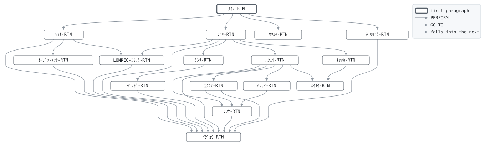

# GLD070

```text
GLD070: 契約者貸付

日次。支社からの契約者貸付依頼ファイル LONREQ を読み、貸付
と返済を契約マスタの貸付残高に反映する。
どちらも、まず残高に業務日付までの利息 (GLC040) を繰り入れ
る。
貸付: 契約が有効で、貸付後の残高が解約返戻金 (GLC030) の
8割以内であること。貸付金を契約者の口座に支払う。
返済: 契約が保障中 (有効・猶予中) で、返済額が残高以内で
あること。
残高が 0 になれば利息起算日を空白にし、残れば業務日付と
する。支払番号と仕訳番号は制御レコードから採番する。

復帰コード: 0 全件反映、4 却下あり、8 日付が日付でない、
            16 ファイル異常。

変更履歴
日付       担当 変更
2012-09-03 YN   GL-0561 初版、支社の貸付台帳をシステム化。
2026-11-19 YN   GL-0828 仕訳に相手科目。
```

Program [GLD070.cbl](../../../gondwana/programs/GLD070.cbl): 7 files, 16 paragraphs. Its business rules: [11 decision tables](../rules/GLD070.md).

- AUTHOR: ゴンドワナ生命 システム部.
- DATE-WRITTEN: 2012-09-03.

## Contents

- [Files](#files)
- [Flow](#flow)
- [Paragraphs](#paragraphs)
- [Calls](#calls)
- [Data flow](#data-flow)
- [Lineage](#lineage)
  - [Into LR-ｶｼﾂｹ-ﾚｺｰﾄﾞ](#into-lr-ｶｼﾂｹ-ﾚｺｰﾄﾞ)
  - [Into PM-ｹｲﾔｸ-ﾚｺｰﾄﾞ](#into-pm-ｹｲﾔｸ-ﾚｺｰﾄﾞ)
  - [Into CT-ｾｲｷﾞｮ-ﾚｺｰﾄﾞ](#into-ct-ｾｲｷﾞｮ-ﾚｺｰﾄﾞ)
  - [Into PY-ｼﾊﾗｲ-ﾚｺｰﾄﾞ](#into-py-ｼﾊﾗｲ-ﾚｺｰﾄﾞ)
  - [Into JR-ｼﾜｹ-ﾚｺｰﾄﾞ](#into-jr-ｼﾜｹ-ﾚｺｰﾄﾞ)
  - [Into ｷｬｯｶ-ﾚｺｰﾄﾞ](#into-ｷｬｯｶ-ﾚｺｰﾄﾞ)
  - [Into ﾎｳｺｸ-ｷﾞｮｳ](#into-ﾎｳｺｸ-ｷﾞｮｳ)
  - [Into WS-ｽﾃｰﾀｽ](#into-ws-ｽﾃｰﾀｽ)
  - [Into WS-ｺﾏﾝﾄﾞｷﾞｮｳ](#into-ws-ｺﾏﾝﾄﾞｷﾞｮｳ)
  - [Into WS-ｴﾗｰﾌｧｲﾙ](#into-ws-ｴﾗｰﾌｧｲﾙ)
  - [Into WS-ｴﾗｰｽﾃｰﾀｽ](#into-ws-ｴﾗｰｽﾃｰﾀｽ)
  - [Into WS-ｷﾞｮｳﾑﾋﾂﾞｹ](#into-ws-ｷﾞｮｳﾑﾋﾂﾞｹ)
  - [Into WS-ｷﾞｮｳﾑﾋﾂﾞｹ-ﾜﾚｷ](#into-ws-ｷﾞｮｳﾑﾋﾂﾞｹ-ﾜﾚｷ)
  - [Into WS-ﾎｳｺｳ](#into-ws-ﾎｳｺｳ)
  - [Into WS-ﾍﾝｶﾝｹｯｶ](#into-ws-ﾍﾝｶﾝｹｯｶ)
  - [Into WS-ﾍﾝﾚｲｷﾝ](#into-ws-ﾍﾝﾚｲｷﾝ)
  - [Into WS-ｹﾞﾝﾄﾞｶﾞｸ](#into-ws-ｹﾞﾝﾄﾞｶﾞｸ)
  - [Into WS-ﾘｿｸ](#into-ws-ﾘｿｸ)
  - [Into WS-ｻﾞﾝﾀﾞｶ](#into-ws-ｻﾞﾝﾀﾞｶ)
  - [Into WS-ｹﾝｽｳ](#into-ws-ｹﾝｽｳ)
  - [Into WS-ﾘﾕｳ](#into-ws-ﾘﾕｳ)
  - [Into WS-ｼｭﾍﾞﾂﾒｲ](#into-ws-ｼｭﾍﾞﾂﾒｲ)
  - [Into WS-ﾌｯｷｺｰﾄﾞ](#into-ws-ﾌｯｷｺｰﾄﾞ)
  - [Into WS-ﾎｳｺｸ](#into-ws-ﾎｳｺｸ)
  - [Out of the program](#out-of-the-program)
  - [Into other data items](#into-other-data-items)
- [Field origins](#field-origins)
  - [File REPORT-F](#file-report-f)
  - [File POLMST-F](#file-polmst-f)
  - [File PAYOUT-F](#file-payout-f)
  - [File GLJRNL-F](#file-gljrnl-f)
  - [File REJECT-F](#file-reject-f)
  - [File GLSCTL-F](#file-glsctl-f)
- [Links between records](#links-between-records)
- [Records](#records)
  - [LR-ｶｼﾂｹ-ﾚｺｰﾄﾞ](#lr-ｶｼﾂｹ-ﾚｺｰﾄﾞ)
  - [PM-ｹｲﾔｸ-ﾚｺｰﾄﾞ](#pm-ｹｲﾔｸ-ﾚｺｰﾄﾞ)
  - [CT-ｾｲｷﾞｮ-ﾚｺｰﾄﾞ](#ct-ｾｲｷﾞｮ-ﾚｺｰﾄﾞ)
  - [PY-ｼﾊﾗｲ-ﾚｺｰﾄﾞ](#py-ｼﾊﾗｲ-ﾚｺｰﾄﾞ)
  - [JR-ｼﾜｹ-ﾚｺｰﾄﾞ](#jr-ｼﾜｹ-ﾚｺｰﾄﾞ)
  - [ｷｬｯｶ-ﾚｺｰﾄﾞ](#ｷｬｯｶ-ﾚｺｰﾄﾞ)
  - [ﾎｳｺｸ-ｷﾞｮｳ](#ﾎｳｺｸ-ｷﾞｮｳ)
  - [WS-ｽﾃｰﾀｽ](#ws-ｽﾃｰﾀｽ)
  - [WS-ｺﾏﾝﾄﾞｷﾞｮｳ](#ws-ｺﾏﾝﾄﾞｷﾞｮｳ)
  - [WS-ｴﾗｰﾌｧｲﾙ](#ws-ｴﾗｰﾌｧｲﾙ)
  - [WS-ｴﾗｰｽﾃｰﾀｽ](#ws-ｴﾗｰｽﾃｰﾀｽ)
  - [WS-ｷﾞｮｳﾑﾋﾂﾞｹ](#ws-ｷﾞｮｳﾑﾋﾂﾞｹ)
  - [WS-ｷﾞｮｳﾑﾋﾂﾞｹ-ﾜﾚｷ](#ws-ｷﾞｮｳﾑﾋﾂﾞｹ-ﾜﾚｷ)
  - [WS-ﾎｳｺｳ](#ws-ﾎｳｺｳ)
  - [WS-ﾍﾝｶﾝｹｯｶ](#ws-ﾍﾝｶﾝｹｯｶ)
  - [WS-ｹﾞﾝﾄﾞﾘﾂ](#ws-ｹﾞﾝﾄﾞﾘﾂ)
  - [WS-ﾍﾝﾚｲｷﾝ](#ws-ﾍﾝﾚｲｷﾝ)
  - [WS-ｹﾞﾝﾄﾞｶﾞｸ](#ws-ｹﾞﾝﾄﾞｶﾞｸ)
  - [WS-ﾘｿｸ](#ws-ﾘｿｸ)
  - [WS-ｻﾞﾝﾀﾞｶ](#ws-ｻﾞﾝﾀﾞｶ)
  - [WS-ｹﾝｽｳ](#ws-ｹﾝｽｳ)
  - [WS-ﾘﾕｳ](#ws-ﾘﾕｳ)
  - [WS-ﾘﾕｳ-ﾒｯｾｰｼﾞ](#ws-ﾘﾕｳ-ﾒｯｾｰｼﾞ)
  - [WS-ﾘﾕｳ-ﾒｯｾｰｼﾞ-TBL](#ws-ﾘﾕｳ-ﾒｯｾｰｼﾞ-tbl)
  - [WS-ｼｭﾍﾞﾂﾒｲ](#ws-ｼｭﾍﾞﾂﾒｲ)
  - [WS-ﾌｯｷｺｰﾄﾞ](#ws-ﾌｯｷｺｰﾄﾞ)
  - [WS-ﾎｳｺｸ](#ws-ﾎｳｺｸ)

## Files

| File | Kind | Assigned to | Organization | Status field | Opened | Records |
| --- | --- | --- | --- | --- | --- | --- |
| LONREQ-F | FD | LONREQ | LINE SEQUENTIAL | WS-LONREQ-ST | INPUT | LR-ｶｼﾂｹ-ﾚｺｰﾄﾞ |
| POLMST-F | FD | POLMST | INDEXED, key PM-ｼｮｳｹﾝﾊﾞﾝｺﾞｳ, RANDOM access | WS-POLMST-ST | I-O | PM-ｹｲﾔｸ-ﾚｺｰﾄﾞ |
| GLSCTL-F | FD | GLSCTL | SEQUENTIAL | WS-GLSCTL-ST | I-O | CT-ｾｲｷﾞｮ-ﾚｺｰﾄﾞ |
| PAYOUT-F | FD | PAYOUT | LINE SEQUENTIAL | WS-PAYOUT-ST | EXTEND | PY-ｼﾊﾗｲ-ﾚｺｰﾄﾞ |
| GLJRNL-F | FD | GLJRNL | LINE SEQUENTIAL | WS-GLJRNL-ST | EXTEND | JR-ｼﾜｹ-ﾚｺｰﾄﾞ |
| REJECT-F | FD | LONREJ | LINE SEQUENTIAL | WS-REJECT-ST | OUTPUT | ｷｬｯｶ-ﾚｺｰﾄﾞ |
| REPORT-F | FD | GLD070R | LINE SEQUENTIAL | WS-REPORT-ST | OUTPUT | ﾎｳｺｸ-ｷﾞｮｳ |

## Flow



## Paragraphs

| Paragraph | Description | Source | Performs | Goes to | Performed by | Reached by |
| --- | --- | --- | --- | --- | --- | --- |
| ﾒｲﾝ-RTN | ﾒｲﾝ-RTN: 準備、1件ずつの反映、報告、終了。 | [GLD070.cbl:160](../../../gondwana/programs/GLD070.cbl#L160) | ｼｮｷ-RTN, ｼｮﾘ-RTN, ﾎｳｺｸ-RTN, ｼｭｳﾘｮｳ-RTN | | | |
| ｼｮｷ-RTN | ｼｮｷ-RTN: 業務日付、ファイル、制御レコード。 | [GLD070.cbl:171](../../../gondwana/programs/GLD070.cbl#L171) | ｵｰﾌﾟﾝ-ｹﾝｻ-RTN, ｲｼﾞｮｳ-RTN, LONREQ-ﾖﾐｺﾐ-RTN | | ﾒｲﾝ-RTN | |
| ｵｰﾌﾟﾝ-ｹﾝｻ-RTN | ｵｰﾌﾟﾝ-ｹﾝｻ-RTN: 開けなかったファイルがあれば異常終了。 | [GLD070.cbl:203](../../../gondwana/programs/GLD070.cbl#L203) | ｲｼﾞｮｳ-RTN | | ｼｮｷ-RTN | |
| LONREQ-ﾖﾐｺﾐ-RTN | LONREQ-ﾖﾐｺﾐ-RTN: 依頼ファイルの次の行。 | [GLD070.cbl:236](../../../gondwana/programs/GLD070.cbl#L236) | ｲｼﾞｮｳ-RTN | | ｼｮｷ-RTN, ｼｮﾘ-RTN | |
| ｼｮﾘ-RTN | ｼｮﾘ-RTN: 契約を読み、検査して反映か却下。 | [GLD070.cbl:251](../../../gondwana/programs/GLD070.cbl#L251) | ｲｼﾞｮｳ-RTN, ｹﾝｻ-RTN, ﾊﾝｴｲ-RTN, ｷｬｯｶ-RTN, LONREQ-ﾖﾐｺﾐ-RTN | | ﾒｲﾝ-RTN | |
| ｹﾝｻ-RTN | ｹﾝｻ-RTN: 種別、金額、契約の状態、次いで利息を繰り入れた残高 に対する限度。 | [GLD070.cbl:287](../../../gondwana/programs/GLD070.cbl#L287) | ｹﾞﾝﾄﾞ-RTN | | ｼｮﾘ-RTN | |
| ｹﾞﾝﾄﾞ-RTN | ｹﾞﾝﾄﾞ-RTN: 業務日付までの利息を加えた残高を求め、貸付は 解約返戻金の8割、返済はその残高を限度とする。 | [GLD070.cbl:305](../../../gondwana/programs/GLD070.cbl#L305) | ｲｼﾞｮｳ-RTN | | ｹﾝｻ-RTN | |
| ﾊﾝｴｲ-RTN | ﾊﾝｴｲ-RTN: 利息を繰り入れ、貸付か返済を残高に反映して書き 戻す。 | [GLD070.cbl:331](../../../gondwana/programs/GLD070.cbl#L331) | ｼﾜｹ-RTN, ｶｼﾂｹ-RTN, ﾍﾝｻｲ-RTN, ｲｼﾞｮｳ-RTN, ﾒｲｻｲ-RTN | | ｼｮﾘ-RTN | |
| ｶｼﾂｹ-RTN | ｶｼﾂｹ-RTN: 貸付金を残高に加え、契約者の口座への支払を書く。 | [GLD070.cbl:364](../../../gondwana/programs/GLD070.cbl#L364) | ｲｼﾞｮｳ-RTN, ｼﾜｹ-RTN | | ﾊﾝｴｲ-RTN | |
| ﾍﾝｻｲ-RTN | ﾍﾝｻｲ-RTN: 返済額を残高から引く。 | [GLD070.cbl:392](../../../gondwana/programs/GLD070.cbl#L392) | ｼﾜｹ-RTN | | ﾊﾝｴｲ-RTN | |
| ｼﾜｹ-RTN | ｼﾜｹ-RTN: 仕訳1行。科目、貸借、金額、摘要は呼ぶ側が入れる。 | [GLD070.cbl:406](../../../gondwana/programs/GLD070.cbl#L406) | ｲｼﾞｮｳ-RTN | | ﾊﾝｴｲ-RTN, ｶｼﾂｹ-RTN, ﾍﾝｻｲ-RTN | |
| ｷｬｯｶ-RTN | ｷｬｯｶ-RTN: 却下ファイルに理由を付けて書き、明細を報告する。 | [GLD070.cbl:422](../../../gondwana/programs/GLD070.cbl#L422) | ﾒｲｻｲ-RTN | | ｼｮﾘ-RTN | |
| ﾒｲｻｲ-RTN | ﾒｲｻｲ-RTN: 1件の明細行。 | [GLD070.cbl:435](../../../gondwana/programs/GLD070.cbl#L435) | | | ﾊﾝｴｲ-RTN, ｷｬｯｶ-RTN | |
| ﾎｳｺｸ-RTN | ﾎｳｺｸ-RTN: 件数と合計。 | [GLD070.cbl:450](../../../gondwana/programs/GLD070.cbl#L450) | | | ﾒｲﾝ-RTN | |
| ｼｭｳﾘｮｳ-RTN | ｼｭｳﾘｮｳ-RTN: 制御レコードを書き戻し、ファイルを閉じる。 | [GLD070.cbl:478](../../../gondwana/programs/GLD070.cbl#L478) | ｲｼﾞｮｳ-RTN | | ﾒｲﾝ-RTN | |
| ｲｼﾞｮｳ-RTN | ｲｼﾞｮｳ-RTN: ファイル異常は 16 で終わる。 | [GLD070.cbl:494](../../../gondwana/programs/GLD070.cbl#L494) | | | ｼｮｷ-RTN, ｵｰﾌﾟﾝ-ｹﾝｻ-RTN, LONREQ-ﾖﾐｺﾐ-RTN, ｼｮﾘ-RTN, ｹﾞﾝﾄﾞ-RTN, ﾊﾝｴｲ-RTN, ｶｼﾂｹ-RTN, ｼﾜｹ-RTN, ｼｭｳﾘｮｳ-RTN | |

## Calls

| Calls | Passing | Paragraph | Source |
| --- | --- | --- | --- |
| [GLC020](GLC020.md) | WS-ﾎｳｺｳ, WS-ｷﾞｮｳﾑﾋﾂﾞｹ, WS-ｷﾞｮｳﾑﾋﾂﾞｹ-ﾜﾚｷ, WS-ﾍﾝｶﾝｹｯｶ | ｼｮｷ-RTN | [GLD070.cbl:175](../../../gondwana/programs/GLD070.cbl#L175) |
| [GLC040](GLC040.md) | PM-ｶｼﾂｹｻﾞﾝﾀﾞｶ, PM-ｶｼﾂｹｷｻﾝﾋﾞ, WS-ｷﾞｮｳﾑﾋﾂﾞｹ, WS-ﾘｿｸ | ｹﾞﾝﾄﾞ-RTN | [GLD070.cbl:306](../../../gondwana/programs/GLD070.cbl#L306) |
| [GLC030](GLC030.md) | PM-ｼｮｳﾋﾝ, PM-ｶﾆｭｳﾈﾝﾚｲ, PM-ｹｲｶﾈﾝｽｳ, PM-ﾎｹﾝｷﾝｶﾞｸ, WS-ﾍﾝﾚｲｷﾝ, WS-CSVTB-ST | ｹﾞﾝﾄﾞ-RTN | [GLD070.cbl:310](../../../gondwana/programs/GLD070.cbl#L310) |

## Data flow

| Paragraph | Reads | Writes |
| --- | --- | --- |
| ﾒｲﾝ-RTN | WS-LONREQ-ST, WS-ﾌｯｷｺｰﾄﾞ | RETURN-CODE |
| ｼｮｷ-RTN | WS-ｺﾏﾝﾄﾞｷﾞｮｳ, WS-ﾎｳｺｳ, WS-ｷﾞｮｳﾑﾋﾂﾞｹ, WS-ｷﾞｮｳﾑﾋﾂﾞｹ-ﾜﾚｷ, WS-ﾍﾝｶﾝｹｯｶ, WS-GLSCTL-ST, WS-ﾋｮｳﾀﾞｲ-ｷﾞｮｳ | WS-ｺﾏﾝﾄﾞｷﾞｮｳ, WS-ｷﾞｮｳﾑﾋﾂﾞｹ, WS-ﾎｳｺｳ, WS-ｷﾞｮｳﾑﾋﾂﾞｹ-ﾜﾚｷ, WS-ﾍﾝｶﾝｹｯｶ, RETURN-CODE, WS-LONREQ-ST, WS-POLMST-ST, WS-GLSCTL-ST, WS-PAYOUT-ST, WS-GLJRNL-ST, WS-REJECT-ST, WS-REPORT-ST, PY-ｼﾊﾗｲ-ﾚｺｰﾄﾞ, JR-ｼﾜｹ-ﾚｺｰﾄﾞ, CT-ｾｲｷﾞｮ-ﾚｺｰﾄﾞ, WS-ｴﾗｰﾌｧｲﾙ, WS-ｴﾗｰｽﾃｰﾀｽ, WS-ﾋｮｳﾀﾞｲ-ﾋﾂﾞｹ, ﾎｳｺｸ-ｷﾞｮｳ |
| ｵｰﾌﾟﾝ-ｹﾝｻ-RTN | WS-LONREQ-ST, WS-POLMST-ST, WS-GLSCTL-ST, WS-PAYOUT-ST, WS-GLJRNL-ST, WS-REJECT-ST, WS-REPORT-ST, WS-ｴﾗｰﾌｧｲﾙ | WS-ｴﾗｰﾌｧｲﾙ, WS-ｴﾗｰｽﾃｰﾀｽ |
| LONREQ-ﾖﾐｺﾐ-RTN | WS-LONREQ-ST, WS-ﾖﾐｺﾐｹﾝｽｳ | LR-ｶｼﾂｹ-ﾚｺｰﾄﾞ, WS-LONREQ-ST, WS-ﾖﾐｺﾐｹﾝｽｳ, WS-ｴﾗｰﾌｧｲﾙ, WS-ｴﾗｰｽﾃｰﾀｽ |
| ｼｮﾘ-RTN | LR-ｼｮｳｹﾝﾊﾞﾝｺﾞｳ, WS-POLMST-ST, LR-ｼｭﾍﾞﾂ, WS-ﾘﾕｳ | WS-ﾘﾕｳ, WS-ｻﾞﾝﾀﾞｶ, PM-ｼｮｳｹﾝﾊﾞﾝｺﾞｳ, PM-ｹｲﾔｸ-ﾚｺｰﾄﾞ, WS-POLMST-ST, WS-ｴﾗｰﾌｧｲﾙ, WS-ｴﾗｰｽﾃｰﾀｽ, WS-ｼｭﾍﾞﾂﾒｲ |
| ｹﾝｻ-RTN | LR-ｼｭﾍﾞﾂ, LR-ｷﾝｶﾞｸ, PM-ｼﾞｮｳﾀｲ | WS-ﾘﾕｳ |
| ｹﾞﾝﾄﾞ-RTN | PM-ｶｼﾂｹｻﾞﾝﾀﾞｶ, PM-ｶｼﾂｹｷｻﾝﾋﾞ, WS-ｷﾞｮｳﾑﾋﾂﾞｹ, WS-ﾘｿｸ, LR-ｼｭﾍﾞﾂ, PM-ｼｮｳﾋﾝ, PM-ｶﾆｭｳﾈﾝﾚｲ, PM-ｹｲｶﾈﾝｽｳ, PM-ﾎｹﾝｷﾝｶﾞｸ, WS-ﾍﾝﾚｲｷﾝ, WS-CSVTB-ST, WS-ｹﾞﾝﾄﾞﾘﾂ, WS-ｻﾞﾝﾀﾞｶ, LR-ｷﾝｶﾞｸ, WS-ｹﾞﾝﾄﾞｶﾞｸ | PM-ｶｼﾂｹｻﾞﾝﾀﾞｶ, PM-ｶｼﾂｹｷｻﾝﾋﾞ, WS-ｷﾞｮｳﾑﾋﾂﾞｹ, WS-ﾘｿｸ, WS-ｻﾞﾝﾀﾞｶ, PM-ｼｮｳﾋﾝ, PM-ｶﾆｭｳﾈﾝﾚｲ, PM-ｹｲｶﾈﾝｽｳ, PM-ﾎｹﾝｷﾝｶﾞｸ, WS-ﾍﾝﾚｲｷﾝ, WS-CSVTB-ST, WS-ｴﾗｰﾌｧｲﾙ, WS-ｴﾗｰｽﾃｰﾀｽ, WS-ｹﾞﾝﾄﾞｶﾞｸ, WS-ﾘﾕｳ |
| ﾊﾝｴｲ-RTN | WS-ﾘｿｸ, WS-ﾘｿｸｷﾝｶﾞｸ, LR-ｼｭﾍﾞﾂ, WS-ｻﾞﾝﾀﾞｶ, PM-ｶｼﾂｹｻﾞﾝﾀﾞｶ, WS-ｷﾞｮｳﾑﾋﾂﾞｹ-ﾜﾚｷ, WS-POLMST-ST | JR-ｶﾝｼﾞｮｳｶﾓｸ, JR-ｱｲﾃｶﾓｸ, JR-ﾀｲｼｬｸ, JR-ｷﾝｶﾞｸ, JR-ﾃｷﾖｳ, WS-ﾘｿｸｷﾝｶﾞｸ, PM-ｶｼﾂｹｻﾞﾝﾀﾞｶ, PM-ｶｼﾂｹｷｻﾝﾋﾞ, PM-ｹｲﾔｸ-ﾚｺｰﾄﾞ, WS-POLMST-ST, WS-ｴﾗｰﾌｧｲﾙ, WS-ｴﾗｰｽﾃｰﾀｽ, WS-ﾒｲｻｲ-ｹｯｶ |
| ｶｼﾂｹ-RTN | LR-ｷﾝｶﾞｸ, WS-ｻﾞﾝﾀﾞｶ, CT-ｼﾞｶｲｼﾊﾗｲﾊﾞﾝｺﾞｳ, WS-ｷﾞｮｳﾑﾋﾂﾞｹ-ﾜﾚｷ, PM-ｼｮｳｹﾝﾊﾞﾝｺﾞｳ, PM-ｺｳｻﾞﾒｲｷﾞ, LR-ｲﾗｲﾊﾞﾝｺﾞｳ, WS-PAYOUT-ST, WS-ｶｼﾂｹｹﾝｽｳ, WS-ｶｼﾂｹｷﾝｶﾞｸ | WS-ｻﾞﾝﾀﾞｶ, PY-ｼﾊﾗｲﾊﾞﾝｺﾞｳ, CT-ｼﾞｶｲｼﾊﾗｲﾊﾞﾝｺﾞｳ, PY-ｼﾊﾗｲﾋﾞ, PY-ｼｮｳｹﾝﾊﾞﾝｺﾞｳ, PY-ｼｭﾍﾞﾂ, PY-ｷﾝｶﾞｸ, PY-ｳｹﾄﾘﾆﾝｶﾅ, PY-ｾｲｷｭｳﾊﾞﾝｺﾞｳ, PY-ｼﾊﾗｲ-ﾚｺｰﾄﾞ, WS-PAYOUT-ST, WS-ｴﾗｰﾌｧｲﾙ, WS-ｴﾗｰｽﾃｰﾀｽ, JR-ｶﾝｼﾞｮｳｶﾓｸ, JR-ｱｲﾃｶﾓｸ, JR-ﾀｲｼｬｸ, JR-ｷﾝｶﾞｸ, JR-ﾃｷﾖｳ, WS-ｶｼﾂｹｹﾝｽｳ, WS-ｶｼﾂｹｷﾝｶﾞｸ |
| ﾍﾝｻｲ-RTN | LR-ｷﾝｶﾞｸ, WS-ｻﾞﾝﾀﾞｶ, WS-ﾍﾝｻｲｹﾝｽｳ, WS-ﾍﾝｻｲｷﾝｶﾞｸ | WS-ｻﾞﾝﾀﾞｶ, JR-ｶﾝｼﾞｮｳｶﾓｸ, JR-ｱｲﾃｶﾓｸ, JR-ﾀｲｼｬｸ, JR-ｷﾝｶﾞｸ, JR-ﾃｷﾖｳ, WS-ﾍﾝｻｲｹﾝｽｳ, WS-ﾍﾝｻｲｷﾝｶﾞｸ |
| ｼﾜｹ-RTN | CT-ｼﾞｶｲｼﾜｹﾊﾞﾝｺﾞｳ, WS-ｷﾞｮｳﾑﾋﾂﾞｹ-ﾜﾚｷ, PM-ｼｮｳｹﾝﾊﾞﾝｺﾞｳ, WS-GLJRNL-ST | JR-ｼﾜｹﾊﾞﾝｺﾞｳ, CT-ｼﾞｶｲｼﾜｹﾊﾞﾝｺﾞｳ, JR-ﾋﾂﾞｹ, JR-ﾌﾟﾛｸﾞﾗﾑ, JR-ｼｮｳｹﾝﾊﾞﾝｺﾞｳ, JR-ｼﾜｹ-ﾚｺｰﾄﾞ, WS-GLJRNL-ST, WS-ｴﾗｰﾌｧｲﾙ, WS-ｴﾗｰｽﾃｰﾀｽ |
| ｷｬｯｶ-RTN | LR-ｶｼﾂｹ-ﾚｺｰﾄﾞ, WS-ﾘﾕｳ, WS-ﾒｯｾｰｼﾞ, WS-ｷｬｯｶｹﾝｽｳ | ｷｬｯｶ-ﾃﾞｰﾀ, ｷｬｯｶ-ﾘﾕｳ, ｷｬｯｶ-ﾒｯｾｰｼﾞ, ｷｬｯｶ-ﾚｺｰﾄﾞ, WS-REJECT-ST, WS-ｷｬｯｶｹﾝｽｳ, WS-ﾌｯｷｺｰﾄﾞ, WS-ﾒｲｻｲ-ｹｯｶ |
| ﾒｲｻｲ-RTN | LR-ｲﾗｲﾊﾞﾝｺﾞｳ, LR-ｼｮｳｹﾝﾊﾞﾝｺﾞｳ, WS-ｼｭﾍﾞﾂﾒｲ, LR-ｷﾝｶﾞｸ, WS-ｻﾞﾝﾀﾞｶ, WS-ﾒｲｻｲ-ｷﾞｮｳ | WS-ﾒｲｻｲ-ｲﾗｲ, WS-ﾒｲｻｲ-ｼｮｳｹﾝ, WS-ﾒｲｻｲ-ｼｭﾍﾞﾂ, WS-ﾒｲｻｲ-ｷﾝｶﾞｸ, WS-ﾒｲｻｲ-ｻﾞﾝﾀﾞｶ, ﾎｳｺｸ-ｷﾞｮｳ, WS-REPORT-ST |
| ﾎｳｺｸ-RTN | WS-ﾖﾐｺﾐｹﾝｽｳ, WS-ｹﾝｽｳ-ｷﾞｮｳ, WS-ｶｼﾂｹｹﾝｽｳ, WS-ｶｼﾂｹｷﾝｶﾞｸ, WS-ﾍﾝｻｲｹﾝｽｳ, WS-ﾍﾝｻｲｷﾝｶﾞｸ, WS-ﾘｿｸｷﾝｶﾞｸ, WS-ｷｬｯｶｹﾝｽｳ | ﾎｳｺｸ-ｷﾞｮｳ, WS-REPORT-ST, WS-ｹﾝｽｳ-ﾗﾍﾞﾙ, WS-ｹﾝｽｳ-ｱﾀｲ |
| ｼｭｳﾘｮｳ-RTN | WS-GLSCTL-ST, WS-ｶｼﾂｹｹﾝｽｳ, WS-ﾍﾝｻｲｹﾝｽｳ, WS-ｷｬｯｶｹﾝｽｳ | CT-ｾｲｷﾞｮ-ﾚｺｰﾄﾞ, WS-GLSCTL-ST, WS-ｴﾗｰﾌｧｲﾙ, WS-ｴﾗｰｽﾃｰﾀｽ, WS-LONREQ-ST, WS-POLMST-ST, WS-PAYOUT-ST, WS-GLJRNL-ST, WS-REJECT-ST, WS-REPORT-ST |
| ｲｼﾞｮｳ-RTN | WS-ｴﾗｰﾌｧｲﾙ, WS-ｴﾗｰｽﾃｰﾀｽ | RETURN-CODE |

## Lineage

Where each data item's values come from, grouped by the record they go into. A data item links to the record it belongs to.

### Into LR-ｶｼﾂｹ-ﾚｺｰﾄﾞ

Record [LR-ｶｼﾂｹ-ﾚｺｰﾄﾞ](#lr-ｶｼﾂｹ-ﾚｺｰﾄﾞ), from copybook [LONREQ](../copybooks/LONREQ.md).

| Into | From | Statement | Paragraph | Source |
| --- | --- | --- | --- | --- |
| LR-ｶｼﾂｹ-ﾚｺｰﾄﾞ | file LONREQ-F | READ | LONREQ-ﾖﾐｺﾐ-RTN | [GLD070.cbl:237](../../../gondwana/programs/GLD070.cbl#L237) |

### Into PM-ｹｲﾔｸ-ﾚｺｰﾄﾞ

Record [PM-ｹｲﾔｸ-ﾚｺｰﾄﾞ](#pm-ｹｲﾔｸ-ﾚｺｰﾄﾞ), from copybook [POLMST](../copybooks/POLMST.md).

| Into | From | Statement | Paragraph | Source |
| --- | --- | --- | --- | --- |
| PM-ｶｼﾂｹｷｻﾝﾋﾞ | call GLC040 argument 2 | CALL | ｹﾞﾝﾄﾞ-RTN | [GLD070.cbl:306](../../../gondwana/programs/GLD070.cbl#L306) |
| PM-ｶｼﾂｹｷｻﾝﾋﾞ | literal SPACES | MOVE | ﾊﾝｴｲ-RTN | [GLD070.cbl:348](../../../gondwana/programs/GLD070.cbl#L348) |
| PM-ｶｼﾂｹｷｻﾝﾋﾞ | [WS-ｷﾞｮｳﾑﾋﾂﾞｹ-ﾜﾚｷ](#ws-ｷﾞｮｳﾑﾋﾂﾞｹ-ﾜﾚｷ) | MOVE | ﾊﾝｴｲ-RTN | [GLD070.cbl:350](../../../gondwana/programs/GLD070.cbl#L350) |
| PM-ｶｼﾂｹｻﾞﾝﾀﾞｶ | call GLC040 argument 1 | CALL | ｹﾞﾝﾄﾞ-RTN | [GLD070.cbl:306](../../../gondwana/programs/GLD070.cbl#L306) |
| PM-ｶｼﾂｹｻﾞﾝﾀﾞｶ | [WS-ｻﾞﾝﾀﾞｶ](#ws-ｻﾞﾝﾀﾞｶ) | MOVE | ﾊﾝｴｲ-RTN | [GLD070.cbl:346](../../../gondwana/programs/GLD070.cbl#L346) |
| PM-ｶﾆｭｳﾈﾝﾚｲ | call GLC030 argument 2 | CALL | ｹﾞﾝﾄﾞ-RTN | [GLD070.cbl:310](../../../gondwana/programs/GLD070.cbl#L310) |
| PM-ｹｲｶﾈﾝｽｳ | call GLC030 argument 3 | CALL | ｹﾞﾝﾄﾞ-RTN | [GLD070.cbl:310](../../../gondwana/programs/GLD070.cbl#L310) |
| PM-ｹｲﾔｸ-ﾚｺｰﾄﾞ | file POLMST-F | READ | ｼｮﾘ-RTN | [GLD070.cbl:255](../../../gondwana/programs/GLD070.cbl#L255) |
| PM-ｼｮｳｹﾝﾊﾞﾝｺﾞｳ | [LR-ｼｮｳｹﾝﾊﾞﾝｺﾞｳ](#lr-ｶｼﾂｹ-ﾚｺｰﾄﾞ "in LR-ｶｼﾂｹ-ﾚｺｰﾄﾞ") | MOVE | ｼｮﾘ-RTN | [GLD070.cbl:254](../../../gondwana/programs/GLD070.cbl#L254) |
| PM-ｼｮｳﾋﾝ | call GLC030 argument 1 | CALL | ｹﾞﾝﾄﾞ-RTN | [GLD070.cbl:310](../../../gondwana/programs/GLD070.cbl#L310) |
| PM-ﾎｹﾝｷﾝｶﾞｸ | call GLC030 argument 4 | CALL | ｹﾞﾝﾄﾞ-RTN | [GLD070.cbl:310](../../../gondwana/programs/GLD070.cbl#L310) |

### Into CT-ｾｲｷﾞｮ-ﾚｺｰﾄﾞ

Record [CT-ｾｲｷﾞｮ-ﾚｺｰﾄﾞ](#ct-ｾｲｷﾞｮ-ﾚｺｰﾄﾞ), from copybook [CTLREC](../copybooks/CTLREC.md).

| Into | From | Statement | Paragraph | Source |
| --- | --- | --- | --- | --- |
| CT-ｼﾞｶｲｼﾊﾗｲﾊﾞﾝｺﾞｳ | literal 1 | ADD | ｶｼﾂｹ-RTN | [GLD070.cbl:367](../../../gondwana/programs/GLD070.cbl#L367) |
| CT-ｼﾞｶｲｼﾜｹﾊﾞﾝｺﾞｳ | literal 1 | ADD | ｼﾜｹ-RTN | [GLD070.cbl:408](../../../gondwana/programs/GLD070.cbl#L408) |
| CT-ｾｲｷﾞｮ-ﾚｺｰﾄﾞ | file GLSCTL-F | READ | ｼｮｷ-RTN | [GLD070.cbl:188](../../../gondwana/programs/GLD070.cbl#L188) |

### Into PY-ｼﾊﾗｲ-ﾚｺｰﾄﾞ

Record [PY-ｼﾊﾗｲ-ﾚｺｰﾄﾞ](#py-ｼﾊﾗｲ-ﾚｺｰﾄﾞ), from copybook [PAYOUT](../copybooks/PAYOUT.md).

| Into | From | Statement | Paragraph | Source |
| --- | --- | --- | --- | --- |
| PY-ｳｹﾄﾘﾆﾝｶﾅ | [PM-ｺｳｻﾞﾒｲｷﾞ](#pm-ｹｲﾔｸ-ﾚｺｰﾄﾞ "in PM-ｹｲﾔｸ-ﾚｺｰﾄﾞ") | MOVE | ｶｼﾂｹ-RTN | [GLD070.cbl:372](../../../gondwana/programs/GLD070.cbl#L372) |
| PY-ｷﾝｶﾞｸ | [LR-ｷﾝｶﾞｸ](#lr-ｶｼﾂｹ-ﾚｺｰﾄﾞ "in LR-ｶｼﾂｹ-ﾚｺｰﾄﾞ") | MOVE | ｶｼﾂｹ-RTN | [GLD070.cbl:371](../../../gondwana/programs/GLD070.cbl#L371) |
| PY-ｼｭﾍﾞﾂ | literal condition PY-ｶｼﾂｹ | SET | ｶｼﾂｹ-RTN | [GLD070.cbl:370](../../../gondwana/programs/GLD070.cbl#L370) |
| PY-ｼｮｳｹﾝﾊﾞﾝｺﾞｳ | [PM-ｼｮｳｹﾝﾊﾞﾝｺﾞｳ](#pm-ｹｲﾔｸ-ﾚｺｰﾄﾞ "in PM-ｹｲﾔｸ-ﾚｺｰﾄﾞ") | MOVE | ｶｼﾂｹ-RTN | [GLD070.cbl:369](../../../gondwana/programs/GLD070.cbl#L369) |
| PY-ｼﾊﾗｲ-ﾚｺｰﾄﾞ | literal SPACES | MOVE | ｼｮｷ-RTN | [GLD070.cbl:187](../../../gondwana/programs/GLD070.cbl#L187) |
| PY-ｼﾊﾗｲﾊﾞﾝｺﾞｳ | [CT-ｼﾞｶｲｼﾊﾗｲﾊﾞﾝｺﾞｳ](#ct-ｾｲｷﾞｮ-ﾚｺｰﾄﾞ "in CT-ｾｲｷﾞｮ-ﾚｺｰﾄﾞ") | MOVE | ｶｼﾂｹ-RTN | [GLD070.cbl:366](../../../gondwana/programs/GLD070.cbl#L366) |
| PY-ｼﾊﾗｲﾋﾞ | [WS-ｷﾞｮｳﾑﾋﾂﾞｹ-ﾜﾚｷ](#ws-ｷﾞｮｳﾑﾋﾂﾞｹ-ﾜﾚｷ) | MOVE | ｶｼﾂｹ-RTN | [GLD070.cbl:368](../../../gondwana/programs/GLD070.cbl#L368) |
| PY-ｾｲｷｭｳﾊﾞﾝｺﾞｳ | [LR-ｲﾗｲﾊﾞﾝｺﾞｳ](#lr-ｶｼﾂｹ-ﾚｺｰﾄﾞ "in LR-ｶｼﾂｹ-ﾚｺｰﾄﾞ") | MOVE | ｶｼﾂｹ-RTN | [GLD070.cbl:373](../../../gondwana/programs/GLD070.cbl#L373) |

### Into JR-ｼﾜｹ-ﾚｺｰﾄﾞ

Record [JR-ｼﾜｹ-ﾚｺｰﾄﾞ](#jr-ｼﾜｹ-ﾚｺｰﾄﾞ), from copybook [GLJRNL](../copybooks/GLJRNL.md).

| Into | From | Statement | Paragraph | Source |
| --- | --- | --- | --- | --- |
| JR-ｱｲﾃｶﾓｸ | literal 1210 | MOVE | ﾊﾝｴｲ-RTN | [GLD070.cbl:334](../../../gondwana/programs/GLD070.cbl#L334) |
| JR-ｱｲﾃｶﾓｸ | literal 1110 | MOVE | ｶｼﾂｹ-RTN | [GLD070.cbl:381](../../../gondwana/programs/GLD070.cbl#L381) |
| JR-ｱｲﾃｶﾓｸ | literal 1110 | MOVE | ﾍﾝｻｲ-RTN | [GLD070.cbl:395](../../../gondwana/programs/GLD070.cbl#L395) |
| JR-ｶﾝｼﾞｮｳｶﾓｸ | literal 4310 | MOVE | ﾊﾝｴｲ-RTN | [GLD070.cbl:333](../../../gondwana/programs/GLD070.cbl#L333) |
| JR-ｶﾝｼﾞｮｳｶﾓｸ | literal 1210 | MOVE | ｶｼﾂｹ-RTN | [GLD070.cbl:380](../../../gondwana/programs/GLD070.cbl#L380) |
| JR-ｶﾝｼﾞｮｳｶﾓｸ | literal 1210 | MOVE | ﾍﾝｻｲ-RTN | [GLD070.cbl:394](../../../gondwana/programs/GLD070.cbl#L394) |
| JR-ｷﾝｶﾞｸ | [WS-ﾘｿｸ](#ws-ﾘｿｸ) | MOVE | ﾊﾝｴｲ-RTN | [GLD070.cbl:336](../../../gondwana/programs/GLD070.cbl#L336) |
| JR-ｷﾝｶﾞｸ | [LR-ｷﾝｶﾞｸ](#lr-ｶｼﾂｹ-ﾚｺｰﾄﾞ "in LR-ｶｼﾂｹ-ﾚｺｰﾄﾞ") | MOVE | ｶｼﾂｹ-RTN | [GLD070.cbl:383](../../../gondwana/programs/GLD070.cbl#L383) |
| JR-ｷﾝｶﾞｸ | [LR-ｷﾝｶﾞｸ](#lr-ｶｼﾂｹ-ﾚｺｰﾄﾞ "in LR-ｶｼﾂｹ-ﾚｺｰﾄﾞ") | MOVE | ﾍﾝｻｲ-RTN | [GLD070.cbl:397](../../../gondwana/programs/GLD070.cbl#L397) |
| JR-ｼｮｳｹﾝﾊﾞﾝｺﾞｳ | [PM-ｼｮｳｹﾝﾊﾞﾝｺﾞｳ](#pm-ｹｲﾔｸ-ﾚｺｰﾄﾞ "in PM-ｹｲﾔｸ-ﾚｺｰﾄﾞ") | MOVE | ｼﾜｹ-RTN | [GLD070.cbl:411](../../../gondwana/programs/GLD070.cbl#L411) |
| JR-ｼﾜｹ-ﾚｺｰﾄﾞ | literal SPACES | MOVE | ｼｮｷ-RTN | [GLD070.cbl:187](../../../gondwana/programs/GLD070.cbl#L187) |
| JR-ｼﾜｹﾊﾞﾝｺﾞｳ | [CT-ｼﾞｶｲｼﾜｹﾊﾞﾝｺﾞｳ](#ct-ｾｲｷﾞｮ-ﾚｺｰﾄﾞ "in CT-ｾｲｷﾞｮ-ﾚｺｰﾄﾞ") | MOVE | ｼﾜｹ-RTN | [GLD070.cbl:407](../../../gondwana/programs/GLD070.cbl#L407) |
| JR-ﾀｲｼｬｸ | literal condition JR-ｶｼｶﾀ | SET | ﾊﾝｴｲ-RTN | [GLD070.cbl:335](../../../gondwana/programs/GLD070.cbl#L335) |
| JR-ﾀｲｼｬｸ | literal condition JR-ｶﾘｶﾀ | SET | ｶｼﾂｹ-RTN | [GLD070.cbl:382](../../../gondwana/programs/GLD070.cbl#L382) |
| JR-ﾀｲｼｬｸ | literal condition JR-ｶｼｶﾀ | SET | ﾍﾝｻｲ-RTN | [GLD070.cbl:396](../../../gondwana/programs/GLD070.cbl#L396) |
| JR-ﾃｷﾖｳ | literal '貸付金利息' | MOVE | ﾊﾝｴｲ-RTN | [GLD070.cbl:337](../../../gondwana/programs/GLD070.cbl#L337) |
| JR-ﾃｷﾖｳ | literal '契約者貸付' | MOVE | ｶｼﾂｹ-RTN | [GLD070.cbl:384](../../../gondwana/programs/GLD070.cbl#L384) |
| JR-ﾃｷﾖｳ | literal '貸付金返済' | MOVE | ﾍﾝｻｲ-RTN | [GLD070.cbl:398](../../../gondwana/programs/GLD070.cbl#L398) |
| JR-ﾋﾂﾞｹ | [WS-ｷﾞｮｳﾑﾋﾂﾞｹ-ﾜﾚｷ](#ws-ｷﾞｮｳﾑﾋﾂﾞｹ-ﾜﾚｷ) | MOVE | ｼﾜｹ-RTN | [GLD070.cbl:409](../../../gondwana/programs/GLD070.cbl#L409) |
| JR-ﾌﾟﾛｸﾞﾗﾑ | literal 'GLD070' | MOVE | ｼﾜｹ-RTN | [GLD070.cbl:410](../../../gondwana/programs/GLD070.cbl#L410) |

### Into ｷｬｯｶ-ﾚｺｰﾄﾞ

Record [ｷｬｯｶ-ﾚｺｰﾄﾞ](#ｷｬｯｶ-ﾚｺｰﾄﾞ).

| Into | From | Statement | Paragraph | Source |
| --- | --- | --- | --- | --- |
| ｷｬｯｶ-ﾃﾞｰﾀ | [LR-ｶｼﾂｹ-ﾚｺｰﾄﾞ](#lr-ｶｼﾂｹ-ﾚｺｰﾄﾞ) | MOVE | ｷｬｯｶ-RTN | [GLD070.cbl:423](../../../gondwana/programs/GLD070.cbl#L423) |
| ｷｬｯｶ-ﾒｯｾｰｼﾞ | [WS-ﾒｯｾｰｼﾞ](#ws-ﾘﾕｳ-ﾒｯｾｰｼﾞ-tbl "in WS-ﾘﾕｳ-ﾒｯｾｰｼﾞ-TBL") | MOVE | ｷｬｯｶ-RTN | [GLD070.cbl:425](../../../gondwana/programs/GLD070.cbl#L425) |
| ｷｬｯｶ-ﾘﾕｳ | [WS-ﾘﾕｳ](#ws-ﾘﾕｳ) | MOVE | ｷｬｯｶ-RTN | [GLD070.cbl:424](../../../gondwana/programs/GLD070.cbl#L424) |

### Into ﾎｳｺｸ-ｷﾞｮｳ

Record [ﾎｳｺｸ-ｷﾞｮｳ](#ﾎｳｺｸ-ｷﾞｮｳ).

| Into | From | Statement | Paragraph | Source |
| --- | --- | --- | --- | --- |
| ﾎｳｺｸ-ｷﾞｮｳ | [WS-ﾋｮｳﾀﾞｲ-ｷﾞｮｳ](#ws-ﾎｳｺｸ "in WS-ﾎｳｺｸ") | WRITE | ｼｮｷ-RTN | [GLD070.cbl:195](../../../gondwana/programs/GLD070.cbl#L195) |
| ﾎｳｺｸ-ｷﾞｮｳ | literal SPACES | MOVE | ｼｮｷ-RTN | [GLD070.cbl:196](../../../gondwana/programs/GLD070.cbl#L196) |
| ﾎｳｺｸ-ｷﾞｮｳ | [WS-ﾒｲｻｲ-ｷﾞｮｳ](#ws-ﾎｳｺｸ "in WS-ﾎｳｺｸ") | WRITE | ﾒｲｻｲ-RTN | [GLD070.cbl:445](../../../gondwana/programs/GLD070.cbl#L445) |
| ﾎｳｺｸ-ｷﾞｮｳ | literal SPACES | MOVE | ﾎｳｺｸ-RTN | [GLD070.cbl:451](../../../gondwana/programs/GLD070.cbl#L451) |
| ﾎｳｺｸ-ｷﾞｮｳ | [WS-ｹﾝｽｳ-ｷﾞｮｳ](#ws-ﾎｳｺｸ "in WS-ﾎｳｺｸ") | WRITE | ﾎｳｺｸ-RTN | [GLD070.cbl:455](../../../gondwana/programs/GLD070.cbl#L455) |
| ﾎｳｺｸ-ｷﾞｮｳ | [WS-ｹﾝｽｳ-ｷﾞｮｳ](#ws-ﾎｳｺｸ "in WS-ﾎｳｺｸ") | WRITE | ﾎｳｺｸ-RTN | [GLD070.cbl:458](../../../gondwana/programs/GLD070.cbl#L458) |
| ﾎｳｺｸ-ｷﾞｮｳ | [WS-ｹﾝｽｳ-ｷﾞｮｳ](#ws-ﾎｳｺｸ "in WS-ﾎｳｺｸ") | WRITE | ﾎｳｺｸ-RTN | [GLD070.cbl:461](../../../gondwana/programs/GLD070.cbl#L461) |
| ﾎｳｺｸ-ｷﾞｮｳ | [WS-ｹﾝｽｳ-ｷﾞｮｳ](#ws-ﾎｳｺｸ "in WS-ﾎｳｺｸ") | WRITE | ﾎｳｺｸ-RTN | [GLD070.cbl:464](../../../gondwana/programs/GLD070.cbl#L464) |
| ﾎｳｺｸ-ｷﾞｮｳ | [WS-ｹﾝｽｳ-ｷﾞｮｳ](#ws-ﾎｳｺｸ "in WS-ﾎｳｺｸ") | WRITE | ﾎｳｺｸ-RTN | [GLD070.cbl:467](../../../gondwana/programs/GLD070.cbl#L467) |
| ﾎｳｺｸ-ｷﾞｮｳ | [WS-ｹﾝｽｳ-ｷﾞｮｳ](#ws-ﾎｳｺｸ "in WS-ﾎｳｺｸ") | WRITE | ﾎｳｺｸ-RTN | [GLD070.cbl:470](../../../gondwana/programs/GLD070.cbl#L470) |
| ﾎｳｺｸ-ｷﾞｮｳ | [WS-ｹﾝｽｳ-ｷﾞｮｳ](#ws-ﾎｳｺｸ "in WS-ﾎｳｺｸ") | WRITE | ﾎｳｺｸ-RTN | [GLD070.cbl:473](../../../gondwana/programs/GLD070.cbl#L473) |

### Into WS-ｽﾃｰﾀｽ

Record [WS-ｽﾃｰﾀｽ](#ws-ｽﾃｰﾀｽ).

| Into | From | Statement | Paragraph | Source |
| --- | --- | --- | --- | --- |
| WS-CSVTB-ST | call GLC030 argument 6 | CALL | ｹﾞﾝﾄﾞ-RTN | [GLD070.cbl:310](../../../gondwana/programs/GLD070.cbl#L310) |

### Into WS-ｺﾏﾝﾄﾞｷﾞｮｳ

Record [WS-ｺﾏﾝﾄﾞｷﾞｮｳ](#ws-ｺﾏﾝﾄﾞｷﾞｮｳ).

| Into | From | Statement | Paragraph | Source |
| --- | --- | --- | --- | --- |
| WS-ｺﾏﾝﾄﾞｷﾞｮｳ | COMMAND-LINE | ACCEPT | ｼｮｷ-RTN | [GLD070.cbl:172](../../../gondwana/programs/GLD070.cbl#L172) |

### Into WS-ｴﾗｰﾌｧｲﾙ

Record [WS-ｴﾗｰﾌｧｲﾙ](#ws-ｴﾗｰﾌｧｲﾙ).

| Into | From | Statement | Paragraph | Source |
| --- | --- | --- | --- | --- |
| WS-ｴﾗｰﾌｧｲﾙ | literal 'GLSCTL' | MOVE | ｼｮｷ-RTN | [GLD070.cbl:190](../../../gondwana/programs/GLD070.cbl#L190) |
| WS-ｴﾗｰﾌｧｲﾙ | literal 'LONREQ' | MOVE | ｵｰﾌﾟﾝ-ｹﾝｻ-RTN | [GLD070.cbl:206](../../../gondwana/programs/GLD070.cbl#L206) |
| WS-ｴﾗｰﾌｧｲﾙ | literal 'POLMST' | MOVE | ｵｰﾌﾟﾝ-ｹﾝｻ-RTN | [GLD070.cbl:209](../../../gondwana/programs/GLD070.cbl#L209) |
| WS-ｴﾗｰﾌｧｲﾙ | literal 'GLSCTL' | MOVE | ｵｰﾌﾟﾝ-ｹﾝｻ-RTN | [GLD070.cbl:212](../../../gondwana/programs/GLD070.cbl#L212) |
| WS-ｴﾗｰﾌｧｲﾙ | literal 'PAYOUT' | MOVE | ｵｰﾌﾟﾝ-ｹﾝｻ-RTN | [GLD070.cbl:215](../../../gondwana/programs/GLD070.cbl#L215) |
| WS-ｴﾗｰﾌｧｲﾙ | literal 'GLJRNL' | MOVE | ｵｰﾌﾟﾝ-ｹﾝｻ-RTN | [GLD070.cbl:218](../../../gondwana/programs/GLD070.cbl#L218) |
| WS-ｴﾗｰﾌｧｲﾙ | literal 'LONREJ' | MOVE | ｵｰﾌﾟﾝ-ｹﾝｻ-RTN | [GLD070.cbl:221](../../../gondwana/programs/GLD070.cbl#L221) |
| WS-ｴﾗｰﾌｧｲﾙ | literal 'GLD070R' | MOVE | ｵｰﾌﾟﾝ-ｹﾝｻ-RTN | [GLD070.cbl:224](../../../gondwana/programs/GLD070.cbl#L224) |
| WS-ｴﾗｰﾌｧｲﾙ | literal SPACES | MOVE | ｵｰﾌﾟﾝ-ｹﾝｻ-RTN | [GLD070.cbl:227](../../../gondwana/programs/GLD070.cbl#L227) |
| WS-ｴﾗｰﾌｧｲﾙ | literal 'LONREQ' | MOVE | LONREQ-ﾖﾐｺﾐ-RTN | [GLD070.cbl:242](../../../gondwana/programs/GLD070.cbl#L242) |
| WS-ｴﾗｰﾌｧｲﾙ | literal 'POLMST' | MOVE | ｼｮﾘ-RTN | [GLD070.cbl:260](../../../gondwana/programs/GLD070.cbl#L260) |
| WS-ｴﾗｰﾌｧｲﾙ | literal 'CSVTB' | MOVE | ｹﾞﾝﾄﾞ-RTN | [GLD070.cbl:313](../../../gondwana/programs/GLD070.cbl#L313) |
| WS-ｴﾗｰﾌｧｲﾙ | literal 'POLMST' | MOVE | ﾊﾝｴｲ-RTN | [GLD070.cbl:354](../../../gondwana/programs/GLD070.cbl#L354) |
| WS-ｴﾗｰﾌｧｲﾙ | literal 'PAYOUT' | MOVE | ｶｼﾂｹ-RTN | [GLD070.cbl:376](../../../gondwana/programs/GLD070.cbl#L376) |
| WS-ｴﾗｰﾌｧｲﾙ | literal 'GLJRNL' | MOVE | ｼﾜｹ-RTN | [GLD070.cbl:414](../../../gondwana/programs/GLD070.cbl#L414) |
| WS-ｴﾗｰﾌｧｲﾙ | literal 'GLSCTL' | MOVE | ｼｭｳﾘｮｳ-RTN | [GLD070.cbl:481](../../../gondwana/programs/GLD070.cbl#L481) |

### Into WS-ｴﾗｰｽﾃｰﾀｽ

Record [WS-ｴﾗｰｽﾃｰﾀｽ](#ws-ｴﾗｰｽﾃｰﾀｽ).

| Into | From | Statement | Paragraph | Source |
| --- | --- | --- | --- | --- |
| WS-ｴﾗｰｽﾃｰﾀｽ | [WS-GLSCTL-ST](#ws-ｽﾃｰﾀｽ "in WS-ｽﾃｰﾀｽ") | MOVE | ｼｮｷ-RTN | [GLD070.cbl:191](../../../gondwana/programs/GLD070.cbl#L191) |
| WS-ｴﾗｰｽﾃｰﾀｽ | [WS-LONREQ-ST](#ws-ｽﾃｰﾀｽ "in WS-ｽﾃｰﾀｽ") | MOVE | ｵｰﾌﾟﾝ-ｹﾝｻ-RTN | [GLD070.cbl:207](../../../gondwana/programs/GLD070.cbl#L207) |
| WS-ｴﾗｰｽﾃｰﾀｽ | [WS-POLMST-ST](#ws-ｽﾃｰﾀｽ "in WS-ｽﾃｰﾀｽ") | MOVE | ｵｰﾌﾟﾝ-ｹﾝｻ-RTN | [GLD070.cbl:210](../../../gondwana/programs/GLD070.cbl#L210) |
| WS-ｴﾗｰｽﾃｰﾀｽ | [WS-GLSCTL-ST](#ws-ｽﾃｰﾀｽ "in WS-ｽﾃｰﾀｽ") | MOVE | ｵｰﾌﾟﾝ-ｹﾝｻ-RTN | [GLD070.cbl:213](../../../gondwana/programs/GLD070.cbl#L213) |
| WS-ｴﾗｰｽﾃｰﾀｽ | [WS-PAYOUT-ST](#ws-ｽﾃｰﾀｽ "in WS-ｽﾃｰﾀｽ") | MOVE | ｵｰﾌﾟﾝ-ｹﾝｻ-RTN | [GLD070.cbl:216](../../../gondwana/programs/GLD070.cbl#L216) |
| WS-ｴﾗｰｽﾃｰﾀｽ | [WS-GLJRNL-ST](#ws-ｽﾃｰﾀｽ "in WS-ｽﾃｰﾀｽ") | MOVE | ｵｰﾌﾟﾝ-ｹﾝｻ-RTN | [GLD070.cbl:219](../../../gondwana/programs/GLD070.cbl#L219) |
| WS-ｴﾗｰｽﾃｰﾀｽ | [WS-REJECT-ST](#ws-ｽﾃｰﾀｽ "in WS-ｽﾃｰﾀｽ") | MOVE | ｵｰﾌﾟﾝ-ｹﾝｻ-RTN | [GLD070.cbl:222](../../../gondwana/programs/GLD070.cbl#L222) |
| WS-ｴﾗｰｽﾃｰﾀｽ | [WS-REPORT-ST](#ws-ｽﾃｰﾀｽ "in WS-ｽﾃｰﾀｽ") | MOVE | ｵｰﾌﾟﾝ-ｹﾝｻ-RTN | [GLD070.cbl:225](../../../gondwana/programs/GLD070.cbl#L225) |
| WS-ｴﾗｰｽﾃｰﾀｽ | [WS-LONREQ-ST](#ws-ｽﾃｰﾀｽ "in WS-ｽﾃｰﾀｽ") | MOVE | LONREQ-ﾖﾐｺﾐ-RTN | [GLD070.cbl:243](../../../gondwana/programs/GLD070.cbl#L243) |
| WS-ｴﾗｰｽﾃｰﾀｽ | [WS-POLMST-ST](#ws-ｽﾃｰﾀｽ "in WS-ｽﾃｰﾀｽ") | MOVE | ｼｮﾘ-RTN | [GLD070.cbl:261](../../../gondwana/programs/GLD070.cbl#L261) |
| WS-ｴﾗｰｽﾃｰﾀｽ | [WS-CSVTB-ST](#ws-ｽﾃｰﾀｽ "in WS-ｽﾃｰﾀｽ") | MOVE | ｹﾞﾝﾄﾞ-RTN | [GLD070.cbl:314](../../../gondwana/programs/GLD070.cbl#L314) |
| WS-ｴﾗｰｽﾃｰﾀｽ | [WS-POLMST-ST](#ws-ｽﾃｰﾀｽ "in WS-ｽﾃｰﾀｽ") | MOVE | ﾊﾝｴｲ-RTN | [GLD070.cbl:355](../../../gondwana/programs/GLD070.cbl#L355) |
| WS-ｴﾗｰｽﾃｰﾀｽ | [WS-PAYOUT-ST](#ws-ｽﾃｰﾀｽ "in WS-ｽﾃｰﾀｽ") | MOVE | ｶｼﾂｹ-RTN | [GLD070.cbl:377](../../../gondwana/programs/GLD070.cbl#L377) |
| WS-ｴﾗｰｽﾃｰﾀｽ | [WS-GLJRNL-ST](#ws-ｽﾃｰﾀｽ "in WS-ｽﾃｰﾀｽ") | MOVE | ｼﾜｹ-RTN | [GLD070.cbl:415](../../../gondwana/programs/GLD070.cbl#L415) |
| WS-ｴﾗｰｽﾃｰﾀｽ | [WS-GLSCTL-ST](#ws-ｽﾃｰﾀｽ "in WS-ｽﾃｰﾀｽ") | MOVE | ｼｭｳﾘｮｳ-RTN | [GLD070.cbl:482](../../../gondwana/programs/GLD070.cbl#L482) |

### Into WS-ｷﾞｮｳﾑﾋﾂﾞｹ

Record [WS-ｷﾞｮｳﾑﾋﾂﾞｹ](#ws-ｷﾞｮｳﾑﾋﾂﾞｹ).

| Into | From | Statement | Paragraph | Source |
| --- | --- | --- | --- | --- |
| WS-ｷﾞｮｳﾑﾋﾂﾞｹ | [WS-ｺﾏﾝﾄﾞｷﾞｮｳ](#ws-ｺﾏﾝﾄﾞｷﾞｮｳ) | MOVE | ｼｮｷ-RTN | [GLD070.cbl:173](../../../gondwana/programs/GLD070.cbl#L173) |
| WS-ｷﾞｮｳﾑﾋﾂﾞｹ | call GLC020 argument 2 | CALL | ｼｮｷ-RTN | [GLD070.cbl:175](../../../gondwana/programs/GLD070.cbl#L175) |
| WS-ｷﾞｮｳﾑﾋﾂﾞｹ | call GLC040 argument 3 | CALL | ｹﾞﾝﾄﾞ-RTN | [GLD070.cbl:306](../../../gondwana/programs/GLD070.cbl#L306) |

### Into WS-ｷﾞｮｳﾑﾋﾂﾞｹ-ﾜﾚｷ

Record [WS-ｷﾞｮｳﾑﾋﾂﾞｹ-ﾜﾚｷ](#ws-ｷﾞｮｳﾑﾋﾂﾞｹ-ﾜﾚｷ).

| Into | From | Statement | Paragraph | Source |
| --- | --- | --- | --- | --- |
| WS-ｷﾞｮｳﾑﾋﾂﾞｹ-ﾜﾚｷ | call GLC020 argument 3 | CALL | ｼｮｷ-RTN | [GLD070.cbl:175](../../../gondwana/programs/GLD070.cbl#L175) |

### Into WS-ﾎｳｺｳ

Record [WS-ﾎｳｺｳ](#ws-ﾎｳｺｳ).

| Into | From | Statement | Paragraph | Source |
| --- | --- | --- | --- | --- |
| WS-ﾎｳｺｳ | literal 'W' | MOVE | ｼｮｷ-RTN | [GLD070.cbl:174](../../../gondwana/programs/GLD070.cbl#L174) |
| WS-ﾎｳｺｳ | call GLC020 argument 1 | CALL | ｼｮｷ-RTN | [GLD070.cbl:175](../../../gondwana/programs/GLD070.cbl#L175) |

### Into WS-ﾍﾝｶﾝｹｯｶ

Record [WS-ﾍﾝｶﾝｹｯｶ](#ws-ﾍﾝｶﾝｹｯｶ).

| Into | From | Statement | Paragraph | Source |
| --- | --- | --- | --- | --- |
| WS-ﾍﾝｶﾝｹｯｶ | call GLC020 argument 4 | CALL | ｼｮｷ-RTN | [GLD070.cbl:175](../../../gondwana/programs/GLD070.cbl#L175) |

### Into WS-ﾍﾝﾚｲｷﾝ

Record [WS-ﾍﾝﾚｲｷﾝ](#ws-ﾍﾝﾚｲｷﾝ).

| Into | From | Statement | Paragraph | Source |
| --- | --- | --- | --- | --- |
| WS-ﾍﾝﾚｲｷﾝ | call GLC030 argument 5 | CALL | ｹﾞﾝﾄﾞ-RTN | [GLD070.cbl:310](../../../gondwana/programs/GLD070.cbl#L310) |

### Into WS-ｹﾞﾝﾄﾞｶﾞｸ

Record [WS-ｹﾞﾝﾄﾞｶﾞｸ](#ws-ｹﾞﾝﾄﾞｶﾞｸ).

| Into | From | Statement | Paragraph | Source |
| --- | --- | --- | --- | --- |
| WS-ｹﾞﾝﾄﾞｶﾞｸ | [WS-ﾍﾝﾚｲｷﾝ](#ws-ﾍﾝﾚｲｷﾝ) | COMPUTE | ｹﾞﾝﾄﾞ-RTN | [GLD070.cbl:317](../../../gondwana/programs/GLD070.cbl#L317) |
| WS-ｹﾞﾝﾄﾞｶﾞｸ | [WS-ｹﾞﾝﾄﾞﾘﾂ](#ws-ｹﾞﾝﾄﾞﾘﾂ) | COMPUTE | ｹﾞﾝﾄﾞ-RTN | [GLD070.cbl:317](../../../gondwana/programs/GLD070.cbl#L317) |

### Into WS-ﾘｿｸ

Record [WS-ﾘｿｸ](#ws-ﾘｿｸ).

| Into | From | Statement | Paragraph | Source |
| --- | --- | --- | --- | --- |
| WS-ﾘｿｸ | call GLC040 argument 4 | CALL | ｹﾞﾝﾄﾞ-RTN | [GLD070.cbl:306](../../../gondwana/programs/GLD070.cbl#L306) |

### Into WS-ｻﾞﾝﾀﾞｶ

Record [WS-ｻﾞﾝﾀﾞｶ](#ws-ｻﾞﾝﾀﾞｶ).

| Into | From | Statement | Paragraph | Source |
| --- | --- | --- | --- | --- |
| WS-ｻﾞﾝﾀﾞｶ | literal 0 | MOVE | ｼｮﾘ-RTN | [GLD070.cbl:253](../../../gondwana/programs/GLD070.cbl#L253) |
| WS-ｻﾞﾝﾀﾞｶ | [PM-ｶｼﾂｹｻﾞﾝﾀﾞｶ](#pm-ｹｲﾔｸ-ﾚｺｰﾄﾞ "in PM-ｹｲﾔｸ-ﾚｺｰﾄﾞ") | COMPUTE | ｹﾞﾝﾄﾞ-RTN | [GLD070.cbl:308](../../../gondwana/programs/GLD070.cbl#L308) |
| WS-ｻﾞﾝﾀﾞｶ | [WS-ﾘｿｸ](#ws-ﾘｿｸ) | COMPUTE | ｹﾞﾝﾄﾞ-RTN | [GLD070.cbl:308](../../../gondwana/programs/GLD070.cbl#L308) |
| WS-ｻﾞﾝﾀﾞｶ | [LR-ｷﾝｶﾞｸ](#lr-ｶｼﾂｹ-ﾚｺｰﾄﾞ "in LR-ｶｼﾂｹ-ﾚｺｰﾄﾞ") | ADD | ｶｼﾂｹ-RTN | [GLD070.cbl:365](../../../gondwana/programs/GLD070.cbl#L365) |
| WS-ｻﾞﾝﾀﾞｶ | [LR-ｷﾝｶﾞｸ](#lr-ｶｼﾂｹ-ﾚｺｰﾄﾞ "in LR-ｶｼﾂｹ-ﾚｺｰﾄﾞ") | SUBTRACT | ﾍﾝｻｲ-RTN | [GLD070.cbl:393](../../../gondwana/programs/GLD070.cbl#L393) |

### Into WS-ｹﾝｽｳ

Record [WS-ｹﾝｽｳ](#ws-ｹﾝｽｳ).

| Into | From | Statement | Paragraph | Source |
| --- | --- | --- | --- | --- |
| WS-ｶｼﾂｹｷﾝｶﾞｸ | [LR-ｷﾝｶﾞｸ](#lr-ｶｼﾂｹ-ﾚｺｰﾄﾞ "in LR-ｶｼﾂｹ-ﾚｺｰﾄﾞ") | ADD | ｶｼﾂｹ-RTN | [GLD070.cbl:387](../../../gondwana/programs/GLD070.cbl#L387) |
| WS-ｶｼﾂｹｹﾝｽｳ | literal 1 | ADD | ｶｼﾂｹ-RTN | [GLD070.cbl:386](../../../gondwana/programs/GLD070.cbl#L386) |
| WS-ｷｬｯｶｹﾝｽｳ | literal 1 | ADD | ｷｬｯｶ-RTN | [GLD070.cbl:427](../../../gondwana/programs/GLD070.cbl#L427) |
| WS-ﾍﾝｻｲｷﾝｶﾞｸ | [LR-ｷﾝｶﾞｸ](#lr-ｶｼﾂｹ-ﾚｺｰﾄﾞ "in LR-ｶｼﾂｹ-ﾚｺｰﾄﾞ") | ADD | ﾍﾝｻｲ-RTN | [GLD070.cbl:401](../../../gondwana/programs/GLD070.cbl#L401) |
| WS-ﾍﾝｻｲｹﾝｽｳ | literal 1 | ADD | ﾍﾝｻｲ-RTN | [GLD070.cbl:400](../../../gondwana/programs/GLD070.cbl#L400) |
| WS-ﾖﾐｺﾐｹﾝｽｳ | literal 1 | ADD | LONREQ-ﾖﾐｺﾐ-RTN | [GLD070.cbl:239](../../../gondwana/programs/GLD070.cbl#L239) |
| WS-ﾘｿｸｷﾝｶﾞｸ | [WS-ﾘｿｸ](#ws-ﾘｿｸ) | ADD | ﾊﾝｴｲ-RTN | [GLD070.cbl:339](../../../gondwana/programs/GLD070.cbl#L339) |

### Into WS-ﾘﾕｳ

Record [WS-ﾘﾕｳ](#ws-ﾘﾕｳ).

| Into | From | Statement | Paragraph | Source |
| --- | --- | --- | --- | --- |
| WS-ﾘﾕｳ | literal condition WS-ﾘﾕｳ-ﾅｼ | SET | ｼｮﾘ-RTN | [GLD070.cbl:252](../../../gondwana/programs/GLD070.cbl#L252) |
| WS-ﾘﾕｳ | literal condition WS-ｹｲﾔｸ-ﾅｼ | SET | ｼｮﾘ-RTN | [GLD070.cbl:257](../../../gondwana/programs/GLD070.cbl#L257) |
| WS-ﾘﾕｳ | literal condition WS-ｼｭﾍﾞﾂ-ﾌｾｲ | SET | ｹﾝｻ-RTN | [GLD070.cbl:290](../../../gondwana/programs/GLD070.cbl#L290) |
| WS-ﾘﾕｳ | literal condition WS-ｷﾝｶﾞｸ-ﾌｾｲ | SET | ｹﾝｻ-RTN | [GLD070.cbl:292](../../../gondwana/programs/GLD070.cbl#L292) |
| WS-ﾘﾕｳ | literal condition WS-ｼﾞｮｳﾀｲ-ﾌｶ | SET | ｹﾝｻ-RTN | [GLD070.cbl:294](../../../gondwana/programs/GLD070.cbl#L294) |
| WS-ﾘﾕｳ | literal condition WS-ｼﾞｮｳﾀｲ-ﾌｶ | SET | ｹﾝｻ-RTN | [GLD070.cbl:296](../../../gondwana/programs/GLD070.cbl#L296) |
| WS-ﾘﾕｳ | literal condition WS-ｹﾞﾝﾄﾞ-ﾁｮｳｶ | SET | ｹﾞﾝﾄﾞ-RTN | [GLD070.cbl:319](../../../gondwana/programs/GLD070.cbl#L319) |
| WS-ﾘﾕｳ | literal condition WS-ﾍﾝｻｲ-ﾁｮｳｶ | SET | ｹﾞﾝﾄﾞ-RTN | [GLD070.cbl:323](../../../gondwana/programs/GLD070.cbl#L323) |

### Into WS-ｼｭﾍﾞﾂﾒｲ

Record [WS-ｼｭﾍﾞﾂﾒｲ](#ws-ｼｭﾍﾞﾂﾒｲ).

| Into | From | Statement | Paragraph | Source |
| --- | --- | --- | --- | --- |
| WS-ｼｭﾍﾞﾂﾒｲ | literal '貸付' | MOVE | ｼｮﾘ-RTN | [GLD070.cbl:267](../../../gondwana/programs/GLD070.cbl#L267) |
| WS-ｼｭﾍﾞﾂﾒｲ | literal '返済' | MOVE | ｼｮﾘ-RTN | [GLD070.cbl:269](../../../gondwana/programs/GLD070.cbl#L269) |
| WS-ｼｭﾍﾞﾂﾒｲ | literal '不明' | MOVE | ｼｮﾘ-RTN | [GLD070.cbl:271](../../../gondwana/programs/GLD070.cbl#L271) |

### Into WS-ﾌｯｷｺｰﾄﾞ

Record [WS-ﾌｯｷｺｰﾄﾞ](#ws-ﾌｯｷｺｰﾄﾞ).

| Into | From | Statement | Paragraph | Source |
| --- | --- | --- | --- | --- |
| WS-ﾌｯｷｺｰﾄﾞ | literal 4 | MOVE | ｷｬｯｶ-RTN | [GLD070.cbl:428](../../../gondwana/programs/GLD070.cbl#L428) |

### Into WS-ﾎｳｺｸ

Record [WS-ﾎｳｺｸ](#ws-ﾎｳｺｸ).

| Into | From | Statement | Paragraph | Source |
| --- | --- | --- | --- | --- |
| WS-ｹﾝｽｳ-ｱﾀｲ | [WS-ﾖﾐｺﾐｹﾝｽｳ](#ws-ｹﾝｽｳ "in WS-ｹﾝｽｳ") | MOVE | ﾎｳｺｸ-RTN | [GLD070.cbl:454](../../../gondwana/programs/GLD070.cbl#L454) |
| WS-ｹﾝｽｳ-ｱﾀｲ | [WS-ｶｼﾂｹｹﾝｽｳ](#ws-ｹﾝｽｳ "in WS-ｹﾝｽｳ") | MOVE | ﾎｳｺｸ-RTN | [GLD070.cbl:457](../../../gondwana/programs/GLD070.cbl#L457) |
| WS-ｹﾝｽｳ-ｱﾀｲ | [WS-ｶｼﾂｹｷﾝｶﾞｸ](#ws-ｹﾝｽｳ "in WS-ｹﾝｽｳ") | MOVE | ﾎｳｺｸ-RTN | [GLD070.cbl:460](../../../gondwana/programs/GLD070.cbl#L460) |
| WS-ｹﾝｽｳ-ｱﾀｲ | [WS-ﾍﾝｻｲｹﾝｽｳ](#ws-ｹﾝｽｳ "in WS-ｹﾝｽｳ") | MOVE | ﾎｳｺｸ-RTN | [GLD070.cbl:463](../../../gondwana/programs/GLD070.cbl#L463) |
| WS-ｹﾝｽｳ-ｱﾀｲ | [WS-ﾍﾝｻｲｷﾝｶﾞｸ](#ws-ｹﾝｽｳ "in WS-ｹﾝｽｳ") | MOVE | ﾎｳｺｸ-RTN | [GLD070.cbl:466](../../../gondwana/programs/GLD070.cbl#L466) |
| WS-ｹﾝｽｳ-ｱﾀｲ | [WS-ﾘｿｸｷﾝｶﾞｸ](#ws-ｹﾝｽｳ "in WS-ｹﾝｽｳ") | MOVE | ﾎｳｺｸ-RTN | [GLD070.cbl:469](../../../gondwana/programs/GLD070.cbl#L469) |
| WS-ｹﾝｽｳ-ｱﾀｲ | [WS-ｷｬｯｶｹﾝｽｳ](#ws-ｹﾝｽｳ "in WS-ｹﾝｽｳ") | MOVE | ﾎｳｺｸ-RTN | [GLD070.cbl:472](../../../gondwana/programs/GLD070.cbl#L472) |
| WS-ｹﾝｽｳ-ﾗﾍﾞﾙ | literal '読込件数' | MOVE | ﾎｳｺｸ-RTN | [GLD070.cbl:453](../../../gondwana/programs/GLD070.cbl#L453) |
| WS-ｹﾝｽｳ-ﾗﾍﾞﾙ | literal '貸付件数' | MOVE | ﾎｳｺｸ-RTN | [GLD070.cbl:456](../../../gondwana/programs/GLD070.cbl#L456) |
| WS-ｹﾝｽｳ-ﾗﾍﾞﾙ | literal '貸付金額' | MOVE | ﾎｳｺｸ-RTN | [GLD070.cbl:459](../../../gondwana/programs/GLD070.cbl#L459) |
| WS-ｹﾝｽｳ-ﾗﾍﾞﾙ | literal '返済件数' | MOVE | ﾎｳｺｸ-RTN | [GLD070.cbl:462](../../../gondwana/programs/GLD070.cbl#L462) |
| WS-ｹﾝｽｳ-ﾗﾍﾞﾙ | literal '返済金額' | MOVE | ﾎｳｺｸ-RTN | [GLD070.cbl:465](../../../gondwana/programs/GLD070.cbl#L465) |
| WS-ｹﾝｽｳ-ﾗﾍﾞﾙ | literal '繰入利息' | MOVE | ﾎｳｺｸ-RTN | [GLD070.cbl:468](../../../gondwana/programs/GLD070.cbl#L468) |
| WS-ｹﾝｽｳ-ﾗﾍﾞﾙ | literal '却下件数' | MOVE | ﾎｳｺｸ-RTN | [GLD070.cbl:471](../../../gondwana/programs/GLD070.cbl#L471) |
| WS-ﾋｮｳﾀﾞｲ-ﾋﾂﾞｹ | [WS-ｷﾞｮｳﾑﾋﾂﾞｹ-ﾜﾚｷ](#ws-ｷﾞｮｳﾑﾋﾂﾞｹ-ﾜﾚｷ) | MOVE | ｼｮｷ-RTN | [GLD070.cbl:194](../../../gondwana/programs/GLD070.cbl#L194) |
| WS-ﾒｲｻｲ-ｲﾗｲ | [LR-ｲﾗｲﾊﾞﾝｺﾞｳ](#lr-ｶｼﾂｹ-ﾚｺｰﾄﾞ "in LR-ｶｼﾂｹ-ﾚｺｰﾄﾞ") | MOVE | ﾒｲｻｲ-RTN | [GLD070.cbl:436](../../../gondwana/programs/GLD070.cbl#L436) |
| WS-ﾒｲｻｲ-ｷﾝｶﾞｸ | [LR-ｷﾝｶﾞｸ](#lr-ｶｼﾂｹ-ﾚｺｰﾄﾞ "in LR-ｶｼﾂｹ-ﾚｺｰﾄﾞ") | MOVE | ﾒｲｻｲ-RTN | [GLD070.cbl:440](../../../gondwana/programs/GLD070.cbl#L440) |
| WS-ﾒｲｻｲ-ｷﾝｶﾞｸ | literal 0 | MOVE | ﾒｲｻｲ-RTN | [GLD070.cbl:442](../../../gondwana/programs/GLD070.cbl#L442) |
| WS-ﾒｲｻｲ-ｹｯｶ | literal '反映' | MOVE | ﾊﾝｴｲ-RTN | [GLD070.cbl:358](../../../gondwana/programs/GLD070.cbl#L358) |
| WS-ﾒｲｻｲ-ｹｯｶ | [WS-ﾒｯｾｰｼﾞ](#ws-ﾘﾕｳ-ﾒｯｾｰｼﾞ-tbl "in WS-ﾘﾕｳ-ﾒｯｾｰｼﾞ-TBL") | MOVE | ｷｬｯｶ-RTN | [GLD070.cbl:429](../../../gondwana/programs/GLD070.cbl#L429) |
| WS-ﾒｲｻｲ-ｻﾞﾝﾀﾞｶ | [WS-ｻﾞﾝﾀﾞｶ](#ws-ｻﾞﾝﾀﾞｶ) | MOVE | ﾒｲｻｲ-RTN | [GLD070.cbl:444](../../../gondwana/programs/GLD070.cbl#L444) |
| WS-ﾒｲｻｲ-ｼｭﾍﾞﾂ | [WS-ｼｭﾍﾞﾂﾒｲ](#ws-ｼｭﾍﾞﾂﾒｲ) | MOVE | ﾒｲｻｲ-RTN | [GLD070.cbl:438](../../../gondwana/programs/GLD070.cbl#L438) |
| WS-ﾒｲｻｲ-ｼｮｳｹﾝ | [LR-ｼｮｳｹﾝﾊﾞﾝｺﾞｳ](#lr-ｶｼﾂｹ-ﾚｺｰﾄﾞ "in LR-ｶｼﾂｹ-ﾚｺｰﾄﾞ") | MOVE | ﾒｲｻｲ-RTN | [GLD070.cbl:437](../../../gondwana/programs/GLD070.cbl#L437) |

### Out of the program

Records written to files, items passed to the programs called, and items displayed to the job's output.

| Into | From | Statement | Paragraph | Source |
| --- | --- | --- | --- | --- |
| call GLC020 argument 1 | [WS-ﾎｳｺｳ](#ws-ﾎｳｺｳ) | CALL | ｼｮｷ-RTN | [GLD070.cbl:175](../../../gondwana/programs/GLD070.cbl#L175) |
| call GLC020 argument 2 | [WS-ｷﾞｮｳﾑﾋﾂﾞｹ](#ws-ｷﾞｮｳﾑﾋﾂﾞｹ) | CALL | ｼｮｷ-RTN | [GLD070.cbl:175](../../../gondwana/programs/GLD070.cbl#L175) |
| call GLC020 argument 3 | [WS-ｷﾞｮｳﾑﾋﾂﾞｹ-ﾜﾚｷ](#ws-ｷﾞｮｳﾑﾋﾂﾞｹ-ﾜﾚｷ) | CALL | ｼｮｷ-RTN | [GLD070.cbl:175](../../../gondwana/programs/GLD070.cbl#L175) |
| call GLC020 argument 4 | [WS-ﾍﾝｶﾝｹｯｶ](#ws-ﾍﾝｶﾝｹｯｶ) | CALL | ｼｮｷ-RTN | [GLD070.cbl:175](../../../gondwana/programs/GLD070.cbl#L175) |
| call GLC030 argument 1 | [PM-ｼｮｳﾋﾝ](#pm-ｹｲﾔｸ-ﾚｺｰﾄﾞ "in PM-ｹｲﾔｸ-ﾚｺｰﾄﾞ") | CALL | ｹﾞﾝﾄﾞ-RTN | [GLD070.cbl:310](../../../gondwana/programs/GLD070.cbl#L310) |
| call GLC030 argument 2 | [PM-ｶﾆｭｳﾈﾝﾚｲ](#pm-ｹｲﾔｸ-ﾚｺｰﾄﾞ "in PM-ｹｲﾔｸ-ﾚｺｰﾄﾞ") | CALL | ｹﾞﾝﾄﾞ-RTN | [GLD070.cbl:310](../../../gondwana/programs/GLD070.cbl#L310) |
| call GLC030 argument 3 | [PM-ｹｲｶﾈﾝｽｳ](#pm-ｹｲﾔｸ-ﾚｺｰﾄﾞ "in PM-ｹｲﾔｸ-ﾚｺｰﾄﾞ") | CALL | ｹﾞﾝﾄﾞ-RTN | [GLD070.cbl:310](../../../gondwana/programs/GLD070.cbl#L310) |
| call GLC030 argument 4 | [PM-ﾎｹﾝｷﾝｶﾞｸ](#pm-ｹｲﾔｸ-ﾚｺｰﾄﾞ "in PM-ｹｲﾔｸ-ﾚｺｰﾄﾞ") | CALL | ｹﾞﾝﾄﾞ-RTN | [GLD070.cbl:310](../../../gondwana/programs/GLD070.cbl#L310) |
| call GLC030 argument 5 | [WS-ﾍﾝﾚｲｷﾝ](#ws-ﾍﾝﾚｲｷﾝ) | CALL | ｹﾞﾝﾄﾞ-RTN | [GLD070.cbl:310](../../../gondwana/programs/GLD070.cbl#L310) |
| call GLC030 argument 6 | [WS-CSVTB-ST](#ws-ｽﾃｰﾀｽ "in WS-ｽﾃｰﾀｽ") | CALL | ｹﾞﾝﾄﾞ-RTN | [GLD070.cbl:310](../../../gondwana/programs/GLD070.cbl#L310) |
| call GLC040 argument 1 | [PM-ｶｼﾂｹｻﾞﾝﾀﾞｶ](#pm-ｹｲﾔｸ-ﾚｺｰﾄﾞ "in PM-ｹｲﾔｸ-ﾚｺｰﾄﾞ") | CALL | ｹﾞﾝﾄﾞ-RTN | [GLD070.cbl:306](../../../gondwana/programs/GLD070.cbl#L306) |
| call GLC040 argument 2 | [PM-ｶｼﾂｹｷｻﾝﾋﾞ](#pm-ｹｲﾔｸ-ﾚｺｰﾄﾞ "in PM-ｹｲﾔｸ-ﾚｺｰﾄﾞ") | CALL | ｹﾞﾝﾄﾞ-RTN | [GLD070.cbl:306](../../../gondwana/programs/GLD070.cbl#L306) |
| call GLC040 argument 3 | [WS-ｷﾞｮｳﾑﾋﾂﾞｹ](#ws-ｷﾞｮｳﾑﾋﾂﾞｹ) | CALL | ｹﾞﾝﾄﾞ-RTN | [GLD070.cbl:306](../../../gondwana/programs/GLD070.cbl#L306) |
| call GLC040 argument 4 | [WS-ﾘｿｸ](#ws-ﾘｿｸ) | CALL | ｹﾞﾝﾄﾞ-RTN | [GLD070.cbl:306](../../../gondwana/programs/GLD070.cbl#L306) |
| file GLJRNL-F | [JR-ｼﾜｹ-ﾚｺｰﾄﾞ](#jr-ｼﾜｹ-ﾚｺｰﾄﾞ) | WRITE | ｼﾜｹ-RTN | [GLD070.cbl:412](../../../gondwana/programs/GLD070.cbl#L412) |
| file GLSCTL-F | [CT-ｾｲｷﾞｮ-ﾚｺｰﾄﾞ](#ct-ｾｲｷﾞｮ-ﾚｺｰﾄﾞ) | REWRITE | ｼｭｳﾘｮｳ-RTN | [GLD070.cbl:479](../../../gondwana/programs/GLD070.cbl#L479) |
| file PAYOUT-F | [PY-ｼﾊﾗｲ-ﾚｺｰﾄﾞ](#py-ｼﾊﾗｲ-ﾚｺｰﾄﾞ) | WRITE | ｶｼﾂｹ-RTN | [GLD070.cbl:374](../../../gondwana/programs/GLD070.cbl#L374) |
| file POLMST-F | [PM-ｹｲﾔｸ-ﾚｺｰﾄﾞ](#pm-ｹｲﾔｸ-ﾚｺｰﾄﾞ) | REWRITE | ﾊﾝｴｲ-RTN | [GLD070.cbl:352](../../../gondwana/programs/GLD070.cbl#L352) |
| file REJECT-F | [ｷｬｯｶ-ﾚｺｰﾄﾞ](#ｷｬｯｶ-ﾚｺｰﾄﾞ) | WRITE | ｷｬｯｶ-RTN | [GLD070.cbl:426](../../../gondwana/programs/GLD070.cbl#L426) |
| file REPORT-F | [ﾎｳｺｸ-ｷﾞｮｳ](#ﾎｳｺｸ-ｷﾞｮｳ) | WRITE | ｼｮｷ-RTN | [GLD070.cbl:195](../../../gondwana/programs/GLD070.cbl#L195) |
| file REPORT-F | [ﾎｳｺｸ-ｷﾞｮｳ](#ﾎｳｺｸ-ｷﾞｮｳ) | WRITE | ｼｮｷ-RTN | [GLD070.cbl:197](../../../gondwana/programs/GLD070.cbl#L197) |
| file REPORT-F | [ﾎｳｺｸ-ｷﾞｮｳ](#ﾎｳｺｸ-ｷﾞｮｳ) | WRITE | ﾒｲｻｲ-RTN | [GLD070.cbl:445](../../../gondwana/programs/GLD070.cbl#L445) |
| file REPORT-F | [ﾎｳｺｸ-ｷﾞｮｳ](#ﾎｳｺｸ-ｷﾞｮｳ) | WRITE | ﾎｳｺｸ-RTN | [GLD070.cbl:452](../../../gondwana/programs/GLD070.cbl#L452) |
| file REPORT-F | [ﾎｳｺｸ-ｷﾞｮｳ](#ﾎｳｺｸ-ｷﾞｮｳ) | WRITE | ﾎｳｺｸ-RTN | [GLD070.cbl:455](../../../gondwana/programs/GLD070.cbl#L455) |
| file REPORT-F | [ﾎｳｺｸ-ｷﾞｮｳ](#ﾎｳｺｸ-ｷﾞｮｳ) | WRITE | ﾎｳｺｸ-RTN | [GLD070.cbl:458](../../../gondwana/programs/GLD070.cbl#L458) |
| file REPORT-F | [ﾎｳｺｸ-ｷﾞｮｳ](#ﾎｳｺｸ-ｷﾞｮｳ) | WRITE | ﾎｳｺｸ-RTN | [GLD070.cbl:461](../../../gondwana/programs/GLD070.cbl#L461) |
| file REPORT-F | [ﾎｳｺｸ-ｷﾞｮｳ](#ﾎｳｺｸ-ｷﾞｮｳ) | WRITE | ﾎｳｺｸ-RTN | [GLD070.cbl:464](../../../gondwana/programs/GLD070.cbl#L464) |
| file REPORT-F | [ﾎｳｺｸ-ｷﾞｮｳ](#ﾎｳｺｸ-ｷﾞｮｳ) | WRITE | ﾎｳｺｸ-RTN | [GLD070.cbl:467](../../../gondwana/programs/GLD070.cbl#L467) |
| file REPORT-F | [ﾎｳｺｸ-ｷﾞｮｳ](#ﾎｳｺｸ-ｷﾞｮｳ) | WRITE | ﾎｳｺｸ-RTN | [GLD070.cbl:470](../../../gondwana/programs/GLD070.cbl#L470) |
| file REPORT-F | [ﾎｳｺｸ-ｷﾞｮｳ](#ﾎｳｺｸ-ｷﾞｮｳ) | WRITE | ﾎｳｺｸ-RTN | [GLD070.cbl:473](../../../gondwana/programs/GLD070.cbl#L473) |
| SYSOUT | [WS-ｺﾏﾝﾄﾞｷﾞｮｳ](#ws-ｺﾏﾝﾄﾞｷﾞｮｳ) | DISPLAY | ｼｮｷ-RTN | [GLD070.cbl:178](../../../gondwana/programs/GLD070.cbl#L178) |
| SYSOUT | [WS-ｶｼﾂｹｹﾝｽｳ](#ws-ｹﾝｽｳ "in WS-ｹﾝｽｳ") | DISPLAY | ｼｭｳﾘｮｳ-RTN | [GLD070.cbl:487](../../../gondwana/programs/GLD070.cbl#L487) |
| SYSOUT | [WS-ﾍﾝｻｲｹﾝｽｳ](#ws-ｹﾝｽｳ "in WS-ｹﾝｽｳ") | DISPLAY | ｼｭｳﾘｮｳ-RTN | [GLD070.cbl:487](../../../gondwana/programs/GLD070.cbl#L487) |
| SYSOUT | [WS-ｷｬｯｶｹﾝｽｳ](#ws-ｹﾝｽｳ "in WS-ｹﾝｽｳ") | DISPLAY | ｼｭｳﾘｮｳ-RTN | [GLD070.cbl:487](../../../gondwana/programs/GLD070.cbl#L487) |
| SYSOUT | [WS-ｴﾗｰﾌｧｲﾙ](#ws-ｴﾗｰﾌｧｲﾙ) | DISPLAY | ｲｼﾞｮｳ-RTN | [GLD070.cbl:495](../../../gondwana/programs/GLD070.cbl#L495) |
| SYSOUT | [WS-ｴﾗｰｽﾃｰﾀｽ](#ws-ｴﾗｰｽﾃｰﾀｽ) | DISPLAY | ｲｼﾞｮｳ-RTN | [GLD070.cbl:495](../../../gondwana/programs/GLD070.cbl#L495) |

### Into other data items

Data items the program does not declare, such as special registers and index names.

| Into | From | Statement | Paragraph | Source |
| --- | --- | --- | --- | --- |
| RETURN-CODE | [WS-ﾌｯｷｺｰﾄﾞ](#ws-ﾌｯｷｺｰﾄﾞ) | MOVE | ﾒｲﾝ-RTN | [GLD070.cbl:165](../../../gondwana/programs/GLD070.cbl#L165) |
| RETURN-CODE | literal 8 | MOVE | ｼｮｷ-RTN | [GLD070.cbl:179](../../../gondwana/programs/GLD070.cbl#L179) |
| RETURN-CODE | literal 16 | MOVE | ｲｼﾞｮｳ-RTN | [GLD070.cbl:497](../../../gondwana/programs/GLD070.cbl#L497) |

## Field origins

Where the values of each field the program writes to a file come from: the fields of the files it reads, literals, and initial values, followed through every statement that moves a value, and through groups and redefinitions by the bytes they share.

### File REPORT-F

Written from [ﾎｳｺｸ-ｷﾞｮｳ](#ﾎｳｺｸ-ｷﾞｮｳ).

| Field | Position | Origins |
| --- | --: | --- |
| ﾎｳｺｸ-ｷﾞｮｳ | 1-100 | literal SPACES |

### File POLMST-F

Written from [PM-ｹｲﾔｸ-ﾚｺｰﾄﾞ](#pm-ｹｲﾔｸ-ﾚｺｰﾄﾞ).

| Field | Position | Origins |
| --- | --: | --- |
| PM-ｼｮｳｹﾝﾊﾞﾝｺﾞｳ | 1-10 | file POLMST-F PM-ｼｮｳｹﾝﾊﾞﾝｺﾞｳ |
| PM-ｼﾞｮｳﾀｲ | 11 | file POLMST-F PM-ｼﾞｮｳﾀｲ |
| PM-ｼｮｳﾋﾝ | 12-13 | call GLC030 argument 1 PM-ｼｮｳﾋﾝ; file POLMST-F PM-ｼｮｳﾋﾝ |
| PM-ﾎｹﾝｷﾝｶﾞｸ | 14-22 | call GLC030 argument 4 PM-ﾎｹﾝｷﾝｶﾞｸ; file POLMST-F PM-ﾎｹﾝｷﾝｶﾞｸ |
| PM-ﾎｹﾝﾘｮｳ | 23-29 | file POLMST-F PM-ﾎｹﾝﾘｮｳ |
| PM-ﾊﾗｲｺﾐﾎｳﾎｳ | 30 | file POLMST-F PM-ﾊﾗｲｺﾐﾎｳﾎｳ |
| PM-ｹｲﾔｸﾋﾞ | 31-37 | file POLMST-F PM-ｹｲﾔｸﾋﾞ |
| PM-ﾎｹﾝｷｶﾝ | 38-39 | file POLMST-F PM-ﾎｹﾝｷｶﾝ |
| PM-ﾏﾝｷﾋﾞ | 40-46 | file POLMST-F PM-ﾏﾝｷﾋﾞ |
| PM-ｹｲｶﾈﾝｽｳ | 47-48 | call GLC030 argument 3 PM-ｹｲｶﾈﾝｽｳ; file POLMST-F PM-ｹｲｶﾈﾝｽｳ |
| PM-ﾊﾗｲｺﾐｽﾞﾐﾈﾝｹﾞﾂ | 49-54 | file POLMST-F PM-ﾊﾗｲｺﾐｽﾞﾐﾈﾝｹﾞﾂ |
| PM-ﾐﾉｳｶｲｽｳ | 55-56 | file POLMST-F PM-ﾐﾉｳｶｲｽｳ |
| PM-ﾕｳﾖｶｲｼﾋﾞ | 57-63 | file POLMST-F PM-ﾕｳﾖｶｲｼﾋﾞ |
| PM-ｼｯｺｳﾋﾞ | 64-70 | file POLMST-F PM-ｼｯｺｳﾋﾞ |
| PM-ｼﾞｮｳﾀｲﾋﾂﾞｹ | 71-77 | file POLMST-F PM-ｼﾞｮｳﾀｲﾋﾂﾞｹ |
| PM-ｼﾒｲ | 78-97 | file POLMST-F PM-ｼﾒｲ |
| PM-ｼﾒｲｶﾅ | 98-117 | file POLMST-F PM-ｼﾒｲｶﾅ |
| PM-ｾｲﾈﾝｶﾞｯﾋﾟ | 118-124 | file POLMST-F PM-ｾｲﾈﾝｶﾞｯﾋﾟ |
| PM-ｾｲﾍﾞﾂ | 125 | file POLMST-F PM-ｾｲﾍﾞﾂ |
| PM-ｶﾆｭｳﾈﾝﾚｲ | 126-127 | call GLC030 argument 2 PM-ｶﾆｭｳﾈﾝﾚｲ; file POLMST-F PM-ｶﾆｭｳﾈﾝﾚｲ |
| PM-ｼﾞｭｳｼｮ | 128-167 | file POLMST-F PM-ｼﾞｭｳｼｮ |
| PM-ｳｹﾄﾘﾆﾝ | 168-187 | file POLMST-F PM-ｳｹﾄﾘﾆﾝ |
| PM-ｷﾞﾝｺｳｺｰﾄﾞ | 188-191 | file POLMST-F PM-ｷﾞﾝｺｳｺｰﾄﾞ |
| PM-ｼﾃﾝｺｰﾄﾞ | 192-194 | file POLMST-F PM-ｼﾃﾝｺｰﾄﾞ |
| PM-ﾖｷﾝｼｭﾓｸ | 195 | file POLMST-F PM-ﾖｷﾝｼｭﾓｸ |
| PM-ｺｳｻﾞﾊﾞﾝｺﾞｳ | 196-202 | file POLMST-F PM-ｺｳｻﾞﾊﾞﾝｺﾞｳ |
| PM-ｺｳｻﾞﾒｲｷﾞ | 203-232 | file POLMST-F PM-ｺｳｻﾞﾒｲｷﾞ |
| PM-ﾀﾞｲﾘﾃﾝｺｰﾄﾞ | 233-238 | file POLMST-F PM-ﾀﾞｲﾘﾃﾝｺｰﾄﾞ |
| PM-ｶｼﾂｹｻﾞﾝﾀﾞｶ | 239-247 | call GLC040 argument 1 PM-ｶｼﾂｹｻﾞﾝﾀﾞｶ; call GLC040 argument 4 WS-ﾘｿｸ; file LONREQ-F LR-ｷﾝｶﾞｸ; file POLMST-F PM-ｶｼﾂｹｻﾞﾝﾀﾞｶ; literal 0; in GLC040, literal 0; in GLC040, initial value of WS-ﾈﾝﾘ; in GLC040, call GLC020 argument 2 WS-ｷｻﾝﾋﾞ; call GLC020 argument 2 WS-ｷﾞｮｳﾑﾋﾂﾞｹ; stream COMMAND-LINE WS-ｺﾏﾝﾄﾞｷﾞｮｳ 1-8; file POLMST-F PM-ｶｼﾂｹｷｻﾝﾋﾞ |
| PM-ｾｷﾆﾝｼﾞｭﾝﾋﾞｷﾝ | 248-256 | file POLMST-F PM-ｾｷﾆﾝｼﾞｭﾝﾋﾞｷﾝ |
| PM-ﾊｲﾄｳﾙｲｹｲ | 257-265 | file POLMST-F PM-ﾊｲﾄｳﾙｲｹｲ |
| PM-ｻｲｼｭｳﾆｭｳｷﾝﾈﾝｹﾞﾂ | 266-271 | file POLMST-F PM-ｻｲｼｭｳﾆｭｳｷﾝﾈﾝｹﾞﾂ |
| PM-ｻｲｼｭｳﾆｭｳｷﾝｶﾞｸ | 272-278 | file POLMST-F PM-ｻｲｼｭｳﾆｭｳｷﾝｶﾞｸ |
| PM-ｶｼﾂｹｷｻﾝﾋﾞ | 279-285 | call GLC020 argument 3 WS-ｷﾞｮｳﾑﾋﾂﾞｹ-ﾜﾚｷ; literal SPACES; stream COMMAND-LINE WS-ｺﾏﾝﾄﾞｷﾞｮｳ 1-8 |
| PM-ﾌｯｶﾂﾋﾞ | 286-292 | file POLMST-F PM-ﾌｯｶﾂﾋﾞ |
| PM-ｾｲｷｭｳｶｲｽｳ | 293 | file POLMST-F PM-ｾｲｷｭｳｶｲｽｳ |
| PM-ｾｲｷｭｳﾎｹﾝﾘｮｳ | 294-300 | file POLMST-F PM-ｾｲｷｭｳﾎｹﾝﾘｮｳ |

### File PAYOUT-F

Written from [PY-ｼﾊﾗｲ-ﾚｺｰﾄﾞ](#py-ｼﾊﾗｲ-ﾚｺｰﾄﾞ).

| Field | Position | Origins |
| --- | --: | --- |
| PY-ｼﾊﾗｲﾊﾞﾝｺﾞｳ | 1-9 | file GLSCTL-F CT-ｼﾞｶｲｼﾊﾗｲﾊﾞﾝｺﾞｳ; literal 1 |
| PY-ｼﾊﾗｲﾋﾞ | 10-16 | call GLC020 argument 3 WS-ｷﾞｮｳﾑﾋﾂﾞｹ-ﾜﾚｷ; stream COMMAND-LINE WS-ｺﾏﾝﾄﾞｷﾞｮｳ 1-8 |
| PY-ｼｮｳｹﾝﾊﾞﾝｺﾞｳ | 17-26 | file POLMST-F PM-ｼｮｳｹﾝﾊﾞﾝｺﾞｳ |
| PY-ｼｭﾍﾞﾂ | 27 | literal condition PY-ｶｼﾂｹ |
| PY-ｷﾝｶﾞｸ | 28-36 | file LONREQ-F LR-ｷﾝｶﾞｸ |
| PY-ｳｹﾄﾘﾆﾝｶﾅ | 37-66 | file POLMST-F PM-ｺｳｻﾞﾒｲｷﾞ |
| PY-ｾｲｷｭｳﾊﾞﾝｺﾞｳ | 67-74 | file LONREQ-F LR-ｲﾗｲﾊﾞﾝｺﾞｳ |

### File GLJRNL-F

Written from [JR-ｼﾜｹ-ﾚｺｰﾄﾞ](#jr-ｼﾜｹ-ﾚｺｰﾄﾞ).

| Field | Position | Origins |
| --- | --: | --- |
| JR-ｼﾜｹﾊﾞﾝｺﾞｳ | 1-9 | file GLSCTL-F CT-ｼﾞｶｲｼﾜｹﾊﾞﾝｺﾞｳ; literal 1 |
| JR-ﾋﾂﾞｹ | 10-16 | call GLC020 argument 3 WS-ｷﾞｮｳﾑﾋﾂﾞｹ-ﾜﾚｷ; stream COMMAND-LINE WS-ｺﾏﾝﾄﾞｷﾞｮｳ 1-8 |
| JR-ﾌﾟﾛｸﾞﾗﾑ | 17-22 | literal 'GLD070' |
| JR-ｶﾝｼﾞｮｳｶﾓｸ | 23-26 | literal 1210; literal 4310 |
| JR-ﾀｲｼｬｸ | 27 | literal condition JR-ｶｼｶﾀ; literal condition JR-ｶﾘｶﾀ |
| JR-ｷﾝｶﾞｸ | 28-38 | call GLC040 argument 4 WS-ﾘｿｸ; file LONREQ-F LR-ｷﾝｶﾞｸ; in GLC040, literal 0; file POLMST-F PM-ｶｼﾂｹｻﾞﾝﾀﾞｶ; in GLC040, initial value of WS-ﾈﾝﾘ; in GLC040, call GLC020 argument 2 WS-ｷｻﾝﾋﾞ; call GLC020 argument 2 WS-ｷﾞｮｳﾑﾋﾂﾞｹ; stream COMMAND-LINE WS-ｺﾏﾝﾄﾞｷﾞｮｳ 1-8; file POLMST-F PM-ｶｼﾂｹｷｻﾝﾋﾞ |
| JR-ｼｮｳｹﾝﾊﾞﾝｺﾞｳ | 39-48 | file POLMST-F PM-ｼｮｳｹﾝﾊﾞﾝｺﾞｳ |
| JR-ﾃｷﾖｳ | 49-68 | literal '契約者貸付'; literal '貸付金利息'; literal '貸付金返済' |
| JR-ｱｲﾃｶﾓｸ | 69-72 | literal 1110; literal 1210 |

### File REJECT-F

Written from [ｷｬｯｶ-ﾚｺｰﾄﾞ](#ｷｬｯｶ-ﾚｺｰﾄﾞ).

| Field | Position | Origins |
| --- | --: | --- |
| ｷｬｯｶ-ﾃﾞｰﾀ | 1-60 | file LONREQ-F LR-ｶｼﾂｹ-ﾚｺｰﾄﾞ |
| ｷｬｯｶ-ﾘﾕｳ | 61-62 | literal condition WS-ｷﾝｶﾞｸ-ﾌｾｲ; literal condition WS-ｹｲﾔｸ-ﾅｼ; literal condition WS-ｹﾞﾝﾄﾞ-ﾁｮｳｶ; literal condition WS-ｼｭﾍﾞﾂ-ﾌｾｲ; literal condition WS-ｼﾞｮｳﾀｲ-ﾌｶ; literal condition WS-ﾍﾝｻｲ-ﾁｮｳｶ; literal condition WS-ﾘﾕｳ-ﾅｼ |
| ｷｬｯｶ-ﾒｯｾｰｼﾞ | 63-82 | |

### File GLSCTL-F

Written from [CT-ｾｲｷﾞｮ-ﾚｺｰﾄﾞ](#ct-ｾｲｷﾞｮ-ﾚｺｰﾄﾞ).

| Field | Position | Origins |
| --- | --: | --- |
| CT-ｷﾞｮｳﾑﾋﾂﾞｹ | 1-8 | file GLSCTL-F CT-ｷﾞｮｳﾑﾋﾂﾞｹ |
| CT-ｷﾞｮｳﾑﾋﾂﾞｹ-ﾜﾚｷ | 9-15 | file GLSCTL-F CT-ｷﾞｮｳﾑﾋﾂﾞｹ-ﾜﾚｷ |
| CT-ｻｲｼｭｳｾｲｷｭｳﾈﾝｹﾞﾂ | 17-22 | file GLSCTL-F CT-ｻｲｼｭｳｾｲｷｭｳﾈﾝｹﾞﾂ |
| CT-ｼﾞｶｲｼﾊﾗｲﾊﾞﾝｺﾞｳ | 25-28 | file GLSCTL-F CT-ｼﾞｶｲｼﾊﾗｲﾊﾞﾝｺﾞｳ; literal 1 |
| CT-ｼﾞｶｲｼﾜｹﾊﾞﾝｺﾞｳ | 29-32 | file GLSCTL-F CT-ｼﾞｶｲｼﾜｹﾊﾞﾝｺﾞｳ; literal 1 |
| CT-ﾕｳｺｳｹﾝｽｳ | 33-36 | file GLSCTL-F CT-ﾕｳｺｳｹﾝｽｳ |
| CT-ｿｳｹﾝｽｳ | 37-40 | file GLSCTL-F CT-ｿｳｹﾝｽｳ |
| CT-ﾕｳｺｳﾎｹﾝｷﾝｶﾞｸ | 41-48 | file GLSCTL-F CT-ﾕｳｺｳﾎｹﾝｷﾝｶﾞｸ |

## Links between records

Fields of one input the program relies on to find or match the records of another: moved into an indexed file's record key to read it by, compared for equality, or compared for order to merge the two in that order, each side's values from that field alone.

| Field | Of | Links to | Of | How | Source |
| --- | --- | --- | --- | --- | --- |
| LR-ｼｮｳｹﾝﾊﾞﾝｺﾞｳ | LONREQ-F | PM-ｼｮｳｹﾝﾊﾞﾝｺﾞｳ | POLMST-F | key to read by | [GLD070.cbl:254](../../../gondwana/programs/GLD070.cbl#L254) |

## Records

### LR-ｶｼﾂｹ-ﾚｺｰﾄﾞ

File LONREQ-F. 60 bytes, layout in copybook [LONREQ](../copybooks/LONREQ.md).

### PM-ｹｲﾔｸ-ﾚｺｰﾄﾞ

File POLMST-F. 300 bytes, layout in copybook [POLMST](../copybooks/POLMST.md).

### CT-ｾｲｷﾞｮ-ﾚｺｰﾄﾞ

File GLSCTL-F. 64 bytes, layout in copybook [CTLREC](../copybooks/CTLREC.md).

### PY-ｼﾊﾗｲ-ﾚｺｰﾄﾞ

File PAYOUT-F. 100 bytes, layout in copybook [PAYOUT](../copybooks/PAYOUT.md).

### JR-ｼﾜｹ-ﾚｺｰﾄﾞ

File GLJRNL-F. 80 bytes, layout in copybook [GLJRNL](../copybooks/GLJRNL.md).

### ｷｬｯｶ-ﾚｺｰﾄﾞ

File REJECT-F. 82 bytes.

| Level | Field | Kind | Start | Length | Picture | Usage | Notes | Source |
| --: | --- | --- | --: | --: | --- | --- | --- | --- |
| 01 | ｷｬｯｶ-ﾚｺｰﾄﾞ | group | 1 | 82 | | | | [GLD070.cbl:69](../../../gondwana/programs/GLD070.cbl#L69) |
| 05 | ├ ｷｬｯｶ-ﾃﾞｰﾀ | text | 1 | 60 | X(60) | | | [GLD070.cbl:70](../../../gondwana/programs/GLD070.cbl#L70) |
| 05 | ├ ｷｬｯｶ-ﾘﾕｳ | number | 61 | 2 | 99 | | | [GLD070.cbl:71](../../../gondwana/programs/GLD070.cbl#L71) |
| 05 | └ ｷｬｯｶ-ﾒｯｾｰｼﾞ | text | 63 | 20 | X(20) | | | [GLD070.cbl:72](../../../gondwana/programs/GLD070.cbl#L72) |

### ﾎｳｺｸ-ｷﾞｮｳ

File REPORT-F. 100 bytes.

| Level | Field | Kind | Start | Length | Picture | Usage | Notes | Source |
| --: | --- | --- | --: | --: | --- | --- | --- | --- |
| 01 | ﾎｳｺｸ-ｷﾞｮｳ | text | 1 | 100 | X(100) | | | [GLD070.cbl:74](../../../gondwana/programs/GLD070.cbl#L74) |

### WS-ｽﾃｰﾀｽ

Working storage. 16 bytes.

| Level | Field | Kind | Start | Length | Picture | Usage | Notes | Source |
| --: | --- | --- | --: | --: | --- | --- | --- | --- |
| 01 | WS-ｽﾃｰﾀｽ | group | 1 | 16 | | | | [GLD070.cbl:77](../../../gondwana/programs/GLD070.cbl#L77) |
| 05 | ├ WS-LONREQ-ST | code | 1 | 2 | XX | | | [GLD070.cbl:78](../../../gondwana/programs/GLD070.cbl#L78) |
| 88 | │ ├ WS-LONREQ-OK | | | | | | VALUE '00' | [GLD070.cbl:79](../../../gondwana/programs/GLD070.cbl#L79) |
| 88 | │ └ WS-LONREQ-ｵﾜﾘ | | | | | | VALUE '10' | [GLD070.cbl:80](../../../gondwana/programs/GLD070.cbl#L80) |
| 05 | ├ WS-POLMST-ST | code | 3 | 2 | XX | | | [GLD070.cbl:81](../../../gondwana/programs/GLD070.cbl#L81) |
| 88 | │ ├ WS-POLMST-OK | | | | | | VALUE '00' | [GLD070.cbl:82](../../../gondwana/programs/GLD070.cbl#L82) |
| 88 | │ └ WS-POLMST-ﾅｼ | | | | | | VALUE '23' | [GLD070.cbl:83](../../../gondwana/programs/GLD070.cbl#L83) |
| 05 | ├ WS-GLSCTL-ST | code | 5 | 2 | XX | | | [GLD070.cbl:84](../../../gondwana/programs/GLD070.cbl#L84) |
| 88 | │ └ WS-GLSCTL-OK | | | | | | VALUE '00' | [GLD070.cbl:85](../../../gondwana/programs/GLD070.cbl#L85) |
| 05 | ├ WS-PAYOUT-ST | code | 7 | 2 | XX | | | [GLD070.cbl:86](../../../gondwana/programs/GLD070.cbl#L86) |
| 88 | │ └ WS-PAYOUT-OK | | | | | | VALUE '00', '05' | [GLD070.cbl:87](../../../gondwana/programs/GLD070.cbl#L87) |
| 05 | ├ WS-GLJRNL-ST | code | 9 | 2 | XX | | | [GLD070.cbl:88](../../../gondwana/programs/GLD070.cbl#L88) |
| 88 | │ └ WS-GLJRNL-OK | | | | | | VALUE '00', '05' | [GLD070.cbl:89](../../../gondwana/programs/GLD070.cbl#L89) |
| 05 | ├ WS-REJECT-ST | code | 11 | 2 | XX | | | [GLD070.cbl:90](../../../gondwana/programs/GLD070.cbl#L90) |
| 88 | │ └ WS-REJECT-OK | | | | | | VALUE '00' | [GLD070.cbl:91](../../../gondwana/programs/GLD070.cbl#L91) |
| 05 | ├ WS-REPORT-ST | code | 13 | 2 | XX | | | [GLD070.cbl:92](../../../gondwana/programs/GLD070.cbl#L92) |
| 88 | │ └ WS-REPORT-OK | | | | | | VALUE '00' | [GLD070.cbl:93](../../../gondwana/programs/GLD070.cbl#L93) |
| 05 | └ WS-CSVTB-ST | code | 15 | 2 | XX | | | [GLD070.cbl:94](../../../gondwana/programs/GLD070.cbl#L94) |
| 88 |   └ WS-CSVTB-OK | | | | | | VALUE '00' | [GLD070.cbl:95](../../../gondwana/programs/GLD070.cbl#L95) |

### WS-ｺﾏﾝﾄﾞｷﾞｮｳ

Working storage. 80 bytes.

| Level | Field | Kind | Start | Length | Picture | Usage | Notes | Source |
| --: | --- | --- | --: | --: | --- | --- | --- | --- |
| 01 | WS-ｺﾏﾝﾄﾞｷﾞｮｳ | text | 1 | 80 | X(80) | | | [GLD070.cbl:96](../../../gondwana/programs/GLD070.cbl#L96) |

### WS-ｴﾗｰﾌｧｲﾙ

Working storage. 8 bytes.

| Level | Field | Kind | Start | Length | Picture | Usage | Notes | Source |
| --: | --- | --- | --: | --: | --- | --- | --- | --- |
| 01 | WS-ｴﾗｰﾌｧｲﾙ | text | 1 | 8 | X(8) | | | [GLD070.cbl:97](../../../gondwana/programs/GLD070.cbl#L97) |

### WS-ｴﾗｰｽﾃｰﾀｽ

Working storage. 2 bytes.

| Level | Field | Kind | Start | Length | Picture | Usage | Notes | Source |
| --: | --- | --- | --: | --: | --- | --- | --- | --- |
| 01 | WS-ｴﾗｰｽﾃｰﾀｽ | text | 1 | 2 | XX | | | [GLD070.cbl:98](../../../gondwana/programs/GLD070.cbl#L98) |

### WS-ｷﾞｮｳﾑﾋﾂﾞｹ

Working storage. 8 bytes.

| Level | Field | Kind | Start | Length | Picture | Usage | Notes | Source |
| --: | --- | --- | --: | --: | --- | --- | --- | --- |
| 01 | WS-ｷﾞｮｳﾑﾋﾂﾞｹ | date | 1 | 8 | 9(8) | | | [GLD070.cbl:99](../../../gondwana/programs/GLD070.cbl#L99) |

### WS-ｷﾞｮｳﾑﾋﾂﾞｹ-ﾜﾚｷ

Working storage. 7 bytes.

| Level | Field | Kind | Start | Length | Picture | Usage | Notes | Source |
| --: | --- | --- | --: | --: | --- | --- | --- | --- |
| 01 | WS-ｷﾞｮｳﾑﾋﾂﾞｹ-ﾜﾚｷ | date | 1 | 7 | X(7) | | | [GLD070.cbl:100](../../../gondwana/programs/GLD070.cbl#L100) |

### WS-ﾎｳｺｳ

Working storage. 1 bytes.

| Level | Field | Kind | Start | Length | Picture | Usage | Notes | Source |
| --: | --- | --- | --: | --: | --- | --- | --- | --- |
| 01 | WS-ﾎｳｺｳ | text | 1 | 1 | X | | | [GLD070.cbl:101](../../../gondwana/programs/GLD070.cbl#L101) |

### WS-ﾍﾝｶﾝｹｯｶ

Working storage. 1 bytes.

| Level | Field | Kind | Start | Length | Picture | Usage | Notes | Source |
| --: | --- | --- | --: | --: | --- | --- | --- | --- |
| 01 | WS-ﾍﾝｶﾝｹｯｶ | number | 1 | 1 | 9 | | | [GLD070.cbl:102](../../../gondwana/programs/GLD070.cbl#L102) |

### WS-ｹﾞﾝﾄﾞﾘﾂ

Working storage. 2 bytes.

| Level | Field | Kind | Start | Length | Picture | Usage | Notes | Source |
| --: | --- | --- | --: | --: | --- | --- | --- | --- |
| 01 | WS-ｹﾞﾝﾄﾞﾘﾂ | rate | 1 | 2 | V99 | | VALUE 0.80 | [GLD070.cbl:103](../../../gondwana/programs/GLD070.cbl#L103) |

### WS-ﾍﾝﾚｲｷﾝ

Working storage. 9 bytes.

| Level | Field | Kind | Start | Length | Picture | Usage | Notes | Source |
| --: | --- | --- | --: | --: | --- | --- | --- | --- |
| 01 | WS-ﾍﾝﾚｲｷﾝ | amount | 1 | 9 | 9(9) | | | [GLD070.cbl:104](../../../gondwana/programs/GLD070.cbl#L104) |

### WS-ｹﾞﾝﾄﾞｶﾞｸ

Working storage. 9 bytes.

| Level | Field | Kind | Start | Length | Picture | Usage | Notes | Source |
| --: | --- | --- | --: | --: | --- | --- | --- | --- |
| 01 | WS-ｹﾞﾝﾄﾞｶﾞｸ | amount | 1 | 9 | 9(9) | | | [GLD070.cbl:105](../../../gondwana/programs/GLD070.cbl#L105) |

### WS-ﾘｿｸ

Working storage. 9 bytes.

| Level | Field | Kind | Start | Length | Picture | Usage | Notes | Source |
| --: | --- | --- | --: | --: | --- | --- | --- | --- |
| 01 | WS-ﾘｿｸ | number | 1 | 9 | 9(9) | | | [GLD070.cbl:106](../../../gondwana/programs/GLD070.cbl#L106) |

### WS-ｻﾞﾝﾀﾞｶ

Working storage. 10 bytes.

| Level | Field | Kind | Start | Length | Picture | Usage | Notes | Source |
| --: | --- | --- | --: | --: | --- | --- | --- | --- |
| 01 | WS-ｻﾞﾝﾀﾞｶ | amount | 1 | 10 | 9(10) | | | [GLD070.cbl:107](../../../gondwana/programs/GLD070.cbl#L107) |

### WS-ｹﾝｽｳ

Working storage. 67 bytes.

| Level | Field | Kind | Start | Length | Picture | Usage | Notes | Source |
| --: | --- | --- | --: | --: | --- | --- | --- | --- |
| 01 | WS-ｹﾝｽｳ | group | 1 | 67 | | | | [GLD070.cbl:108](../../../gondwana/programs/GLD070.cbl#L108) |
| 05 | ├ WS-ﾖﾐｺﾐｹﾝｽｳ | number | 1 | 7 | 9(7) | | VALUE 0 | [GLD070.cbl:109](../../../gondwana/programs/GLD070.cbl#L109) |
| 05 | ├ WS-ｶｼﾂｹｹﾝｽｳ | number | 8 | 7 | 9(7) | | VALUE 0 | [GLD070.cbl:110](../../../gondwana/programs/GLD070.cbl#L110) |
| 05 | ├ WS-ｶｼﾂｹｷﾝｶﾞｸ | amount | 15 | 13 | 9(13) | | VALUE 0 | [GLD070.cbl:111](../../../gondwana/programs/GLD070.cbl#L111) |
| 05 | ├ WS-ﾍﾝｻｲｹﾝｽｳ | number | 28 | 7 | 9(7) | | VALUE 0 | [GLD070.cbl:112](../../../gondwana/programs/GLD070.cbl#L112) |
| 05 | ├ WS-ﾍﾝｻｲｷﾝｶﾞｸ | amount | 35 | 13 | 9(13) | | VALUE 0 | [GLD070.cbl:113](../../../gondwana/programs/GLD070.cbl#L113) |
| 05 | ├ WS-ﾘｿｸｷﾝｶﾞｸ | amount | 48 | 13 | 9(13) | | VALUE 0 | [GLD070.cbl:114](../../../gondwana/programs/GLD070.cbl#L114) |
| 05 | └ WS-ｷｬｯｶｹﾝｽｳ | number | 61 | 7 | 9(7) | | VALUE 0 | [GLD070.cbl:115](../../../gondwana/programs/GLD070.cbl#L115) |

### WS-ﾘﾕｳ

Working storage. 2 bytes.

| Level | Field | Kind | Start | Length | Picture | Usage | Notes | Source |
| --: | --- | --- | --: | --: | --- | --- | --- | --- |
| 01 | WS-ﾘﾕｳ | code | 1 | 2 | 99 | | | [GLD070.cbl:116](../../../gondwana/programs/GLD070.cbl#L116) |
| 88 | ├ WS-ﾘﾕｳ-ﾅｼ | | | | | | VALUE 0 | [GLD070.cbl:117](../../../gondwana/programs/GLD070.cbl#L117) |
| 88 | ├ WS-ｹｲﾔｸ-ﾅｼ | | | | | | VALUE 1 | [GLD070.cbl:118](../../../gondwana/programs/GLD070.cbl#L118) |
| 88 | ├ WS-ｼｭﾍﾞﾂ-ﾌｾｲ | | | | | | VALUE 2 | [GLD070.cbl:119](../../../gondwana/programs/GLD070.cbl#L119) |
| 88 | ├ WS-ｷﾝｶﾞｸ-ﾌｾｲ | | | | | | VALUE 3 | [GLD070.cbl:120](../../../gondwana/programs/GLD070.cbl#L120) |
| 88 | ├ WS-ｼﾞｮｳﾀｲ-ﾌｶ | | | | | | VALUE 4 | [GLD070.cbl:121](../../../gondwana/programs/GLD070.cbl#L121) |
| 88 | ├ WS-ｹﾞﾝﾄﾞ-ﾁｮｳｶ | | | | | | VALUE 5 | [GLD070.cbl:122](../../../gondwana/programs/GLD070.cbl#L122) |
| 88 | └ WS-ﾍﾝｻｲ-ﾁｮｳｶ | | | | | | VALUE 6 | [GLD070.cbl:123](../../../gondwana/programs/GLD070.cbl#L123) |

### WS-ﾘﾕｳ-ﾒｯｾｰｼﾞ

Working storage. 120 bytes.

| Level | Field | Kind | Start | Length | Picture | Usage | Notes | Source |
| --: | --- | --- | --: | --: | --- | --- | --- | --- |
| 01 | WS-ﾘﾕｳ-ﾒｯｾｰｼﾞ | group | 1 | 120 | | | | [GLD070.cbl:124](../../../gondwana/programs/GLD070.cbl#L124) |
| 05 | ├ FILLER | filler | 1 | 20 | X(20) | | VALUE '契約なし' | [GLD070.cbl:125](../../../gondwana/programs/GLD070.cbl#L125) |
| 05 | ├ FILLER | filler | 21 | 20 | X(20) | | VALUE '種別不正' | [GLD070.cbl:126](../../../gondwana/programs/GLD070.cbl#L126) |
| 05 | ├ FILLER | filler | 41 | 20 | X(20) | | VALUE '金額不正' | [GLD070.cbl:127](../../../gondwana/programs/GLD070.cbl#L127) |
| 05 | ├ FILLER | filler | 61 | 20 | X(20) | | VALUE '対象外の状態' | [GLD070.cbl:128](../../../gondwana/programs/GLD070.cbl#L128) |
| 05 | ├ FILLER | filler | 81 | 20 | X(20) | | VALUE '貸付限度超過' | [GLD070.cbl:129](../../../gondwana/programs/GLD070.cbl#L129) |
| 05 | └ FILLER | filler | 101 | 20 | X(20) | | VALUE '返済額超過' | [GLD070.cbl:130](../../../gondwana/programs/GLD070.cbl#L130) |

### WS-ﾘﾕｳ-ﾒｯｾｰｼﾞ-TBL

Working storage. 120 bytes.

| Level | Field | Kind | Start | Length | Picture | Usage | Notes | Source |
| --: | --- | --- | --: | --: | --- | --- | --- | --- |
| 01 | WS-ﾘﾕｳ-ﾒｯｾｰｼﾞ-TBL | group | 1 | 120 | | | REDEFINES WS-ﾘﾕｳ-ﾒｯｾｰｼﾞ | [GLD070.cbl:131](../../../gondwana/programs/GLD070.cbl#L131) |
| 05 | └ WS-ﾒｯｾｰｼﾞ | text | 1 | 20 | X(20) | | OCCURS 6 | [GLD070.cbl:132](../../../gondwana/programs/GLD070.cbl#L132) |

### WS-ｼｭﾍﾞﾂﾒｲ

Working storage. 6 bytes.

| Level | Field | Kind | Start | Length | Picture | Usage | Notes | Source |
| --: | --- | --- | --: | --: | --- | --- | --- | --- |
| 01 | WS-ｼｭﾍﾞﾂﾒｲ | text | 1 | 6 | X(6) | | | [GLD070.cbl:133](../../../gondwana/programs/GLD070.cbl#L133) |

### WS-ﾌｯｷｺｰﾄﾞ

Working storage. 2 bytes.

| Level | Field | Kind | Start | Length | Picture | Usage | Notes | Source |
| --: | --- | --- | --: | --: | --- | --- | --- | --- |
| 01 | WS-ﾌｯｷｺｰﾄﾞ | number | 1 | 2 | 99 | | VALUE 0 | [GLD070.cbl:134](../../../gondwana/programs/GLD070.cbl#L134) |

### WS-ﾎｳｺｸ

Working storage. 144 bytes.

| Level | Field | Kind | Start | Length | Picture | Usage | Notes | Source |
| --: | --- | --- | --: | --: | --- | --- | --- | --- |
| 01 | WS-ﾎｳｺｸ | group | 1 | 144 | | | | [GLD070.cbl:135](../../../gondwana/programs/GLD070.cbl#L135) |
| 05 | ├ WS-ﾋｮｳﾀﾞｲ-ｷﾞｮｳ | group | 1 | 39 | | | | [GLD070.cbl:136](../../../gondwana/programs/GLD070.cbl#L136) |
| 10 | │ ├ FILLER | filler | 1 | 28 | X(28) | | VALUE 'ゴンドワナ生命  契約者貸付' | [GLD070.cbl:137](../../../gondwana/programs/GLD070.cbl#L137) |
| 10 | │ ├ FILLER | filler | 29 | 4 | X(4) | | VALUE SPACES | [GLD070.cbl:139](../../../gondwana/programs/GLD070.cbl#L139) |
| 10 | │ └ WS-ﾋｮｳﾀﾞｲ-ﾋﾂﾞｹ | date | 33 | 7 | X(7) | | | [GLD070.cbl:140](../../../gondwana/programs/GLD070.cbl#L140) |
| 05 | ├ WS-ﾒｲｻｲ-ｷﾞｮｳ | group | 40 | 78 | | | | [GLD070.cbl:141](../../../gondwana/programs/GLD070.cbl#L141) |
| 10 | │ ├ WS-ﾒｲｻｲ-ｲﾗｲ | text | 40 | 8 | X(8) | | | [GLD070.cbl:142](../../../gondwana/programs/GLD070.cbl#L142) |
| 10 | │ ├ FILLER | filler | 48 | 2 | X(2) | | VALUE SPACES | [GLD070.cbl:143](../../../gondwana/programs/GLD070.cbl#L143) |
| 10 | │ ├ WS-ﾒｲｻｲ-ｼｮｳｹﾝ | text | 50 | 10 | X(10) | | | [GLD070.cbl:144](../../../gondwana/programs/GLD070.cbl#L144) |
| 10 | │ ├ FILLER | filler | 60 | 2 | X(2) | | VALUE SPACES | [GLD070.cbl:145](../../../gondwana/programs/GLD070.cbl#L145) |
| 10 | │ ├ WS-ﾒｲｻｲ-ｼｭﾍﾞﾂ | text | 62 | 6 | X(6) | | | [GLD070.cbl:146](../../../gondwana/programs/GLD070.cbl#L146) |
| 10 | │ ├ WS-ﾒｲｻｲ-ｷﾝｶﾞｸ | edited | 68 | 11 | ZZZ,ZZZ,ZZ9 | | | [GLD070.cbl:147](../../../gondwana/programs/GLD070.cbl#L147) |
| 10 | │ ├ FILLER | filler | 79 | 6 | X(6) | | VALUE '  残高' | [GLD070.cbl:148](../../../gondwana/programs/GLD070.cbl#L148) |
| 10 | │ ├ WS-ﾒｲｻｲ-ｻﾞﾝﾀﾞｶ | edited | 85 | 11 | ZZZ,ZZZ,ZZ9 | | | [GLD070.cbl:149](../../../gondwana/programs/GLD070.cbl#L149) |
| 10 | │ ├ FILLER | filler | 96 | 2 | X(2) | | VALUE SPACES | [GLD070.cbl:150](../../../gondwana/programs/GLD070.cbl#L150) |
| 10 | │ └ WS-ﾒｲｻｲ-ｹｯｶ | text | 98 | 20 | X(20) | | | [GLD070.cbl:151](../../../gondwana/programs/GLD070.cbl#L151) |
| 05 | └ WS-ｹﾝｽｳ-ｷﾞｮｳ | group | 118 | 27 | | | | [GLD070.cbl:152](../../../gondwana/programs/GLD070.cbl#L152) |
| 10 |   ├ WS-ｹﾝｽｳ-ﾗﾍﾞﾙ | text | 118 | 16 | X(16) | | | [GLD070.cbl:153](../../../gondwana/programs/GLD070.cbl#L153) |
| 10 |   └ WS-ｹﾝｽｳ-ｱﾀｲ | edited | 134 | 11 | ZZZ,ZZZ,ZZ9 | | | [GLD070.cbl:154](../../../gondwana/programs/GLD070.cbl#L154) |
