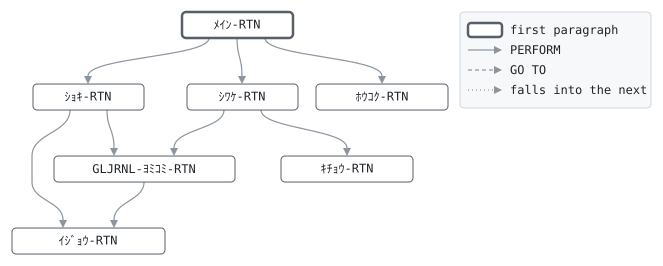

# GLD080

```text
GLD080: 日計表

日次、月次、年次の最後。その日の仕訳 GLJRNL を読み、勘定科目
ごとに借方と貸方を集計して日計表を印字する。仕訳1行は勘定
科目を貸借の側に、相手科目を反対の側に同じ金額で記帳する
ので、借方合計と貸方合計は必ず合う。同じ日に日次、月次、
年次と続けて実行すると、最後のものがその日の日計表になる。
相手科目のない仕訳、科目表にない科目は数え、4 で終わる。

復帰コード: 0 作成済、4 相手科目のない仕訳か未登録の科目
            あり、8 日付が日付でない、16 ファイル異常。

変更履歴
日付       担当 変更
2026-11-19 YN   GL-0828 初版。
```

Program [GLD080.cbl](../../../gondwana/programs/GLD080.cbl): 2 files, 7 paragraphs. Its business rules: [5 decision tables](../rules/GLD080.md).

- AUTHOR: ゴンドワナ生命 システム部.
- DATE-WRITTEN: 2026-11-19.

## Contents

- [Files](#files)
- [Flow](#flow)
- [Paragraphs](#paragraphs)
- [Calls](#calls)
- [Data flow](#data-flow)
- [Lineage](#lineage)
  - [Into JR-ｼﾜｹ-ﾚｺｰﾄﾞ](#into-jr-ｼﾜｹ-ﾚｺｰﾄﾞ)
  - [Into ﾎｳｺｸ-ｷﾞｮｳ](#into-ﾎｳｺｸ-ｷﾞｮｳ)
  - [Into WS-ｺﾏﾝﾄﾞｷﾞｮｳ](#into-ws-ｺﾏﾝﾄﾞｷﾞｮｳ)
  - [Into WS-ｴﾗｰﾌｧｲﾙ](#into-ws-ｴﾗｰﾌｧｲﾙ)
  - [Into WS-ｴﾗｰｽﾃｰﾀｽ](#into-ws-ｴﾗｰｽﾃｰﾀｽ)
  - [Into WS-ｷﾞｮｳﾑﾋﾂﾞｹ](#into-ws-ｷﾞｮｳﾑﾋﾂﾞｹ)
  - [Into WS-ｷﾞｮｳﾑﾋﾂﾞｹ-ﾜﾚｷ](#into-ws-ｷﾞｮｳﾑﾋﾂﾞｹ-ﾜﾚｷ)
  - [Into WS-ﾎｳｺｳ](#into-ws-ﾎｳｺｳ)
  - [Into WS-ﾍﾝｶﾝｹｯｶ](#into-ws-ﾍﾝｶﾝｹｯｶ)
  - [Into WS-ｼｭｳｹｲ-TBL](#into-ws-ｼｭｳｹｲ-tbl)
  - [Into WS-N](#into-ws-n)
  - [Into WS-ｷﾁｮｳ-ｶﾓｸ](#into-ws-ｷﾁｮｳ-ｶﾓｸ)
  - [Into WS-ｷﾁｮｳ-ｶﾞﾜ](#into-ws-ｷﾁｮｳ-ｶﾞﾜ)
  - [Into WS-ｹﾝｽｳ](#into-ws-ｹﾝｽｳ)
  - [Into WS-ﾌｯｷｺｰﾄﾞ](#into-ws-ﾌｯｷｺｰﾄﾞ)
  - [Into WS-ﾎｳｺｸ](#into-ws-ﾎｳｺｸ)
  - [Out of the program](#out-of-the-program)
  - [Into other data items](#into-other-data-items)
- [Field origins](#field-origins)
  - [File REPORT-F](#file-report-f)
- [Records](#records)
  - [JR-ｼﾜｹ-ﾚｺｰﾄﾞ](#jr-ｼﾜｹ-ﾚｺｰﾄﾞ)
  - [ﾎｳｺｸ-ｷﾞｮｳ](#ﾎｳｺｸ-ｷﾞｮｳ)
  - [WS-ｽﾃｰﾀｽ](#ws-ｽﾃｰﾀｽ)
  - [WS-ｺﾏﾝﾄﾞｷﾞｮｳ](#ws-ｺﾏﾝﾄﾞｷﾞｮｳ)
  - [WS-ｴﾗｰﾌｧｲﾙ](#ws-ｴﾗｰﾌｧｲﾙ)
  - [WS-ｴﾗｰｽﾃｰﾀｽ](#ws-ｴﾗｰｽﾃｰﾀｽ)
  - [WS-ｷﾞｮｳﾑﾋﾂﾞｹ](#ws-ｷﾞｮｳﾑﾋﾂﾞｹ)
  - [WS-ｷﾞｮｳﾑﾋﾂﾞｹ-ﾜﾚｷ](#ws-ｷﾞｮｳﾑﾋﾂﾞｹ-ﾜﾚｷ)
  - [WS-ﾎｳｺｳ](#ws-ﾎｳｺｳ)
  - [WS-ﾍﾝｶﾝｹｯｶ](#ws-ﾍﾝｶﾝｹｯｶ)
  - [WS-ｶﾓｸ-ﾃｲｷﾞ](#ws-ｶﾓｸ-ﾃｲｷﾞ)
  - [WS-ｶﾓｸ-TBL](#ws-ｶﾓｸ-tbl)
  - [WS-ｼｭｳｹｲ-TBL](#ws-ｼｭｳｹｲ-tbl)
  - [WS-N](#ws-n)
  - [WS-ｷﾁｮｳ-ｶﾓｸ](#ws-ｷﾁｮｳ-ｶﾓｸ)
  - [WS-ｷﾁｮｳ-ｶﾞﾜ](#ws-ｷﾁｮｳ-ｶﾞﾜ)
  - [WS-ｹﾝｽｳ](#ws-ｹﾝｽｳ)
  - [WS-ﾌｯｷｺｰﾄﾞ](#ws-ﾌｯｷｺｰﾄﾞ)
  - [WS-ﾎｳｺｸ](#ws-ﾎｳｺｸ)

## Files

| File | Kind | Assigned to | Organization | Status field | Opened | Records |
| --- | --- | --- | --- | --- | --- | --- |
| GLJRNL-F | FD | GLJRNL | LINE SEQUENTIAL | WS-GLJRNL-ST | INPUT | JR-ｼﾜｹ-ﾚｺｰﾄﾞ |
| REPORT-F | FD | GLD080R | LINE SEQUENTIAL | WS-REPORT-ST | OUTPUT | ﾎｳｺｸ-ｷﾞｮｳ |

## Flow



## Paragraphs

| Paragraph | Description | Source | Performs | Goes to | Performed by | Reached by |
| --- | --- | --- | --- | --- | --- | --- |
| ﾒｲﾝ-RTN | ﾒｲﾝ-RTN: 準備、仕訳の集計、日計表、終了。 | [GLD080.cbl:117](../../../gondwana/programs/GLD080.cbl#L117) | ｼｮｷ-RTN, ｼﾜｹ-RTN, ﾎｳｺｸ-RTN | | | |
| ｼｮｷ-RTN | ｼｮｷ-RTN: 業務日付、ファイル、最初の仕訳。 | [GLD080.cbl:129](../../../gondwana/programs/GLD080.cbl#L129) | ｲｼﾞｮｳ-RTN, GLJRNL-ﾖﾐｺﾐ-RTN | | ﾒｲﾝ-RTN | |
| GLJRNL-ﾖﾐｺﾐ-RTN | GLJRNL-ﾖﾐｺﾐ-RTN: 次の仕訳。 | [GLD080.cbl:157](../../../gondwana/programs/GLD080.cbl#L157) | ｲｼﾞｮｳ-RTN | | ｼｮｷ-RTN, ｼﾜｹ-RTN | |
| ｼﾜｹ-RTN | ｼﾜｹ-RTN: 仕訳1行を、勘定科目は貸借の側に、相手科目は反対の 側に記帳する。相手科目がなければ数えて記帳しない。 | [GLD080.cbl:169](../../../gondwana/programs/GLD080.cbl#L169) | ｷﾁｮｳ-RTN, GLJRNL-ﾖﾐｺﾐ-RTN | | ﾒｲﾝ-RTN | |
| ｷﾁｮｳ-RTN | ｷﾁｮｳ-RTN: 科目表で科目を引き、その側に金額を加える。科目表 にない科目は数える。 | [GLD080.cbl:192](../../../gondwana/programs/GLD080.cbl#L192) | | | ｼﾜｹ-RTN | |
| ﾎｳｺｸ-RTN | ﾎｳｺｸ-RTN: 動きのあった科目を科目順に、次いで合計と件数。 | [GLD080.cbl:210](../../../gondwana/programs/GLD080.cbl#L210) | | | ﾒｲﾝ-RTN | |
| ｲｼﾞｮｳ-RTN | ｲｼﾞｮｳ-RTN: ファイル異常は 16 で終わる。 | [GLD080.cbl:240](../../../gondwana/programs/GLD080.cbl#L240) | | | ｼｮｷ-RTN, GLJRNL-ﾖﾐｺﾐ-RTN | |

## Calls

| Calls | Passing | Paragraph | Source |
| --- | --- | --- | --- |
| [GLC020](GLC020.md) | WS-ﾎｳｺｳ, WS-ｷﾞｮｳﾑﾋﾂﾞｹ, WS-ｷﾞｮｳﾑﾋﾂﾞｹ-ﾜﾚｷ, WS-ﾍﾝｶﾝｹｯｶ | ｼｮｷ-RTN | [GLD080.cbl:132](../../../gondwana/programs/GLD080.cbl#L132) |

## Data flow

| Paragraph | Reads | Writes |
| --- | --- | --- |
| ﾒｲﾝ-RTN | WS-GLJRNL-ST, WS-ｼﾜｹｹﾝｽｳ, WS-ﾌｾｲｹﾝｽｳ, WS-ﾌｯｷｺｰﾄﾞ | WS-GLJRNL-ST, WS-REPORT-ST, RETURN-CODE |
| ｼｮｷ-RTN | WS-ｺﾏﾝﾄﾞｷﾞｮｳ, WS-ﾎｳｺｳ, WS-ｷﾞｮｳﾑﾋﾂﾞｹ, WS-ｷﾞｮｳﾑﾋﾂﾞｹ-ﾜﾚｷ, WS-ﾍﾝｶﾝｹｯｶ, WS-GLJRNL-ST, WS-REPORT-ST | WS-ｺﾏﾝﾄﾞｷﾞｮｳ, WS-ｷﾞｮｳﾑﾋﾂﾞｹ, WS-ﾎｳｺｳ, WS-ｷﾞｮｳﾑﾋﾂﾞｹ-ﾜﾚｷ, WS-ﾍﾝｶﾝｹｯｶ, RETURN-CODE, WS-ｼｭｳｹｲ-TBL, WS-GLJRNL-ST, WS-REPORT-ST, WS-ｴﾗｰﾌｧｲﾙ, WS-ｴﾗｰｽﾃｰﾀｽ |
| GLJRNL-ﾖﾐｺﾐ-RTN | WS-GLJRNL-ST | JR-ｼﾜｹ-ﾚｺｰﾄﾞ, WS-GLJRNL-ST, WS-ｴﾗｰﾌｧｲﾙ, WS-ｴﾗｰｽﾃｰﾀｽ |
| ｼﾜｹ-RTN | WS-ｼﾜｹｹﾝｽｳ, JR-ｱｲﾃｶﾓｸ, WS-ﾌｾｲｹﾝｽｳ, JR-ｶﾝｼﾞｮｳｶﾓｸ, JR-ﾀｲｼｬｸ | WS-ｼﾜｹｹﾝｽｳ, WS-ﾌｾｲｹﾝｽｳ, WS-ﾌｯｷｺｰﾄﾞ, WS-ｷﾁｮｳ-ｶﾓｸ, WS-ｷﾁｮｳ-ｶﾞﾜ |
| ｷﾁｮｳ-RTN | WS-ｶﾓｸ, WS-ｶﾓｸ-ｺｰﾄﾞ, WS-ｶﾓｸ-IX, WS-ｷﾁｮｳ-ｶﾓｸ, WS-ﾌｾｲｹﾝｽｳ, WS-ｷﾁｮｳ-ｶﾞﾜ, JR-ｷﾝｶﾞｸ, WS-ｶﾘｶﾀ, WS-N, WS-ｶﾘｶﾀｺﾞｳｹｲ, WS-ｶｼｶﾀ, WS-ｶｼｶﾀｺﾞｳｹｲ | WS-ｶﾓｸ-IX, WS-ﾌｾｲｹﾝｽｳ, WS-ﾌｯｷｺｰﾄﾞ, WS-N, WS-ｶﾘｶﾀ, WS-ｶﾘｶﾀｺﾞｳｹｲ, WS-ｶｼｶﾀ, WS-ｶｼｶﾀｺﾞｳｹｲ |
| ﾎｳｺｸ-RTN | WS-ｷﾞｮｳﾑﾋﾂﾞｹ-ﾜﾚｷ, WS-ﾋｮｳﾀﾞｲ-ｷﾞｮｳ, WS-ﾐﾀﾞｼ-ｷﾞｮｳ, WS-N, WS-ｶﾘｶﾀ, WS-ｶｼｶﾀ, WS-ｶﾓｸ-ｺｰﾄﾞ, WS-ｶﾓｸ-ﾒｲ, WS-ﾒｲｻｲ-ｷﾞｮｳ, WS-ｶﾘｶﾀｺﾞｳｹｲ, WS-ｶｼｶﾀｺﾞｳｹｲ, WS-ｺﾞｳｹｲ-ｷﾞｮｳ, WS-ｼﾜｹｹﾝｽｳ, WS-ｹﾝｽｳ-ｷﾞｮｳ, WS-ﾌｾｲｹﾝｽｳ | WS-ﾋｮｳﾀﾞｲ-ﾋﾂﾞｹ, ﾎｳｺｸ-ｷﾞｮｳ, WS-REPORT-ST, WS-N, WS-ﾒｲｻｲ-ｺｰﾄﾞ, WS-ﾒｲｻｲ-ﾒｲ, WS-ﾒｲｻｲ-ｶﾘｶﾀ, WS-ﾒｲｻｲ-ｶｼｶﾀ, WS-ｺﾞｳｹｲ-ｶﾘｶﾀ, WS-ｺﾞｳｹｲ-ｶｼｶﾀ, WS-ｹﾝｽｳ-ﾗﾍﾞﾙ, WS-ｹﾝｽｳ-ｱﾀｲ |
| ｲｼﾞｮｳ-RTN | WS-ｴﾗｰﾌｧｲﾙ, WS-ｴﾗｰｽﾃｰﾀｽ | RETURN-CODE |

## Lineage

Where each data item's values come from, grouped by the record they go into. A data item links to the record it belongs to.

### Into JR-ｼﾜｹ-ﾚｺｰﾄﾞ

Record [JR-ｼﾜｹ-ﾚｺｰﾄﾞ](#jr-ｼﾜｹ-ﾚｺｰﾄﾞ), from copybook [GLJRNL](../copybooks/GLJRNL.md).

| Into | From | Statement | Paragraph | Source |
| --- | --- | --- | --- | --- |
| JR-ｼﾜｹ-ﾚｺｰﾄﾞ | file GLJRNL-F | READ | GLJRNL-ﾖﾐｺﾐ-RTN | [GLD080.cbl:158](../../../gondwana/programs/GLD080.cbl#L158) |

### Into ﾎｳｺｸ-ｷﾞｮｳ

Record [ﾎｳｺｸ-ｷﾞｮｳ](#ﾎｳｺｸ-ｷﾞｮｳ).

| Into | From | Statement | Paragraph | Source |
| --- | --- | --- | --- | --- |
| ﾎｳｺｸ-ｷﾞｮｳ | [WS-ﾋｮｳﾀﾞｲ-ｷﾞｮｳ](#ws-ﾎｳｺｸ "in WS-ﾎｳｺｸ") | WRITE | ﾎｳｺｸ-RTN | [GLD080.cbl:212](../../../gondwana/programs/GLD080.cbl#L212) |
| ﾎｳｺｸ-ｷﾞｮｳ | literal SPACES | MOVE | ﾎｳｺｸ-RTN | [GLD080.cbl:213](../../../gondwana/programs/GLD080.cbl#L213) |
| ﾎｳｺｸ-ｷﾞｮｳ | [WS-ﾐﾀﾞｼ-ｷﾞｮｳ](#ws-ﾎｳｺｸ "in WS-ﾎｳｺｸ") | WRITE | ﾎｳｺｸ-RTN | [GLD080.cbl:215](../../../gondwana/programs/GLD080.cbl#L215) |
| ﾎｳｺｸ-ｷﾞｮｳ | [WS-ﾒｲｻｲ-ｷﾞｮｳ](#ws-ﾎｳｺｸ "in WS-ﾎｳｺｸ") | WRITE | ﾎｳｺｸ-RTN | [GLD080.cbl:222](../../../gondwana/programs/GLD080.cbl#L222) |
| ﾎｳｺｸ-ｷﾞｮｳ | [WS-ｺﾞｳｹｲ-ｷﾞｮｳ](#ws-ﾎｳｺｸ "in WS-ﾎｳｺｸ") | WRITE | ﾎｳｺｸ-RTN | [GLD080.cbl:227](../../../gondwana/programs/GLD080.cbl#L227) |
| ﾎｳｺｸ-ｷﾞｮｳ | literal SPACES | MOVE | ﾎｳｺｸ-RTN | [GLD080.cbl:228](../../../gondwana/programs/GLD080.cbl#L228) |
| ﾎｳｺｸ-ｷﾞｮｳ | [WS-ｹﾝｽｳ-ｷﾞｮｳ](#ws-ﾎｳｺｸ "in WS-ﾎｳｺｸ") | WRITE | ﾎｳｺｸ-RTN | [GLD080.cbl:232](../../../gondwana/programs/GLD080.cbl#L232) |
| ﾎｳｺｸ-ｷﾞｮｳ | [WS-ｹﾝｽｳ-ｷﾞｮｳ](#ws-ﾎｳｺｸ "in WS-ﾎｳｺｸ") | WRITE | ﾎｳｺｸ-RTN | [GLD080.cbl:235](../../../gondwana/programs/GLD080.cbl#L235) |

### Into WS-ｺﾏﾝﾄﾞｷﾞｮｳ

Record [WS-ｺﾏﾝﾄﾞｷﾞｮｳ](#ws-ｺﾏﾝﾄﾞｷﾞｮｳ).

| Into | From | Statement | Paragraph | Source |
| --- | --- | --- | --- | --- |
| WS-ｺﾏﾝﾄﾞｷﾞｮｳ | COMMAND-LINE | ACCEPT | ｼｮｷ-RTN | [GLD080.cbl:130](../../../gondwana/programs/GLD080.cbl#L130) |

### Into WS-ｴﾗｰﾌｧｲﾙ

Record [WS-ｴﾗｰﾌｧｲﾙ](#ws-ｴﾗｰﾌｧｲﾙ).

| Into | From | Statement | Paragraph | Source |
| --- | --- | --- | --- | --- |
| WS-ｴﾗｰﾌｧｲﾙ | literal 'GLJRNL' | MOVE | ｼｮｷ-RTN | [GLD080.cbl:144](../../../gondwana/programs/GLD080.cbl#L144) |
| WS-ｴﾗｰﾌｧｲﾙ | literal 'GLD080R' | MOVE | ｼｮｷ-RTN | [GLD080.cbl:148](../../../gondwana/programs/GLD080.cbl#L148) |
| WS-ｴﾗｰﾌｧｲﾙ | literal 'GLJRNL' | MOVE | GLJRNL-ﾖﾐｺﾐ-RTN | [GLD080.cbl:160](../../../gondwana/programs/GLD080.cbl#L160) |

### Into WS-ｴﾗｰｽﾃｰﾀｽ

Record [WS-ｴﾗｰｽﾃｰﾀｽ](#ws-ｴﾗｰｽﾃｰﾀｽ).

| Into | From | Statement | Paragraph | Source |
| --- | --- | --- | --- | --- |
| WS-ｴﾗｰｽﾃｰﾀｽ | [WS-GLJRNL-ST](#ws-ｽﾃｰﾀｽ "in WS-ｽﾃｰﾀｽ") | MOVE | ｼｮｷ-RTN | [GLD080.cbl:145](../../../gondwana/programs/GLD080.cbl#L145) |
| WS-ｴﾗｰｽﾃｰﾀｽ | [WS-REPORT-ST](#ws-ｽﾃｰﾀｽ "in WS-ｽﾃｰﾀｽ") | MOVE | ｼｮｷ-RTN | [GLD080.cbl:149](../../../gondwana/programs/GLD080.cbl#L149) |
| WS-ｴﾗｰｽﾃｰﾀｽ | [WS-GLJRNL-ST](#ws-ｽﾃｰﾀｽ "in WS-ｽﾃｰﾀｽ") | MOVE | GLJRNL-ﾖﾐｺﾐ-RTN | [GLD080.cbl:161](../../../gondwana/programs/GLD080.cbl#L161) |

### Into WS-ｷﾞｮｳﾑﾋﾂﾞｹ

Record [WS-ｷﾞｮｳﾑﾋﾂﾞｹ](#ws-ｷﾞｮｳﾑﾋﾂﾞｹ).

| Into | From | Statement | Paragraph | Source |
| --- | --- | --- | --- | --- |
| WS-ｷﾞｮｳﾑﾋﾂﾞｹ | [WS-ｺﾏﾝﾄﾞｷﾞｮｳ](#ws-ｺﾏﾝﾄﾞｷﾞｮｳ) | MOVE | ｼｮｷ-RTN | [GLD080.cbl:131](../../../gondwana/programs/GLD080.cbl#L131) |
| WS-ｷﾞｮｳﾑﾋﾂﾞｹ | call GLC020 argument 2 | CALL | ｼｮｷ-RTN | [GLD080.cbl:132](../../../gondwana/programs/GLD080.cbl#L132) |

### Into WS-ｷﾞｮｳﾑﾋﾂﾞｹ-ﾜﾚｷ

Record [WS-ｷﾞｮｳﾑﾋﾂﾞｹ-ﾜﾚｷ](#ws-ｷﾞｮｳﾑﾋﾂﾞｹ-ﾜﾚｷ).

| Into | From | Statement | Paragraph | Source |
| --- | --- | --- | --- | --- |
| WS-ｷﾞｮｳﾑﾋﾂﾞｹ-ﾜﾚｷ | call GLC020 argument 3 | CALL | ｼｮｷ-RTN | [GLD080.cbl:132](../../../gondwana/programs/GLD080.cbl#L132) |

### Into WS-ﾎｳｺｳ

Record [WS-ﾎｳｺｳ](#ws-ﾎｳｺｳ).

| Into | From | Statement | Paragraph | Source |
| --- | --- | --- | --- | --- |
| WS-ﾎｳｺｳ | call GLC020 argument 1 | CALL | ｼｮｷ-RTN | [GLD080.cbl:132](../../../gondwana/programs/GLD080.cbl#L132) |

### Into WS-ﾍﾝｶﾝｹｯｶ

Record [WS-ﾍﾝｶﾝｹｯｶ](#ws-ﾍﾝｶﾝｹｯｶ).

| Into | From | Statement | Paragraph | Source |
| --- | --- | --- | --- | --- |
| WS-ﾍﾝｶﾝｹｯｶ | call GLC020 argument 4 | CALL | ｼｮｷ-RTN | [GLD080.cbl:132](../../../gondwana/programs/GLD080.cbl#L132) |

### Into WS-ｼｭｳｹｲ-TBL

Record [WS-ｼｭｳｹｲ-TBL](#ws-ｼｭｳｹｲ-tbl).

| Into | From | Statement | Paragraph | Source |
| --- | --- | --- | --- | --- |
| WS-ｶｼｶﾀ | [JR-ｷﾝｶﾞｸ](#jr-ｼﾜｹ-ﾚｺｰﾄﾞ "in JR-ｼﾜｹ-ﾚｺｰﾄﾞ") | ADD | ｷﾁｮｳ-RTN | [GLD080.cbl:203](../../../gondwana/programs/GLD080.cbl#L203) |
| WS-ｶｼｶﾀ | [WS-ｶｼｶﾀｺﾞｳｹｲ](#ws-ｹﾝｽｳ "in WS-ｹﾝｽｳ") | ADD | ｷﾁｮｳ-RTN | [GLD080.cbl:203](../../../gondwana/programs/GLD080.cbl#L203) |
| WS-ｶﾘｶﾀ | [JR-ｷﾝｶﾞｸ](#jr-ｼﾜｹ-ﾚｺｰﾄﾞ "in JR-ｼﾜｹ-ﾚｺｰﾄﾞ") | ADD | ｷﾁｮｳ-RTN | [GLD080.cbl:201](../../../gondwana/programs/GLD080.cbl#L201) |
| WS-ｶﾘｶﾀ | [WS-ｶﾘｶﾀｺﾞｳｹｲ](#ws-ｹﾝｽｳ "in WS-ｹﾝｽｳ") | ADD | ｷﾁｮｳ-RTN | [GLD080.cbl:201](../../../gondwana/programs/GLD080.cbl#L201) |
| WS-ｼｭｳｹｲ-TBL | literal ZEROS | MOVE | ｼｮｷ-RTN | [GLD080.cbl:139](../../../gondwana/programs/GLD080.cbl#L139) |

### Into WS-N

Record [WS-N](#ws-n).

| Into | From | Statement | Paragraph | Source |
| --- | --- | --- | --- | --- |
| WS-N | WS-ｶﾓｸ-IX | SET | ｷﾁｮｳ-RTN | [GLD080.cbl:199](../../../gondwana/programs/GLD080.cbl#L199) |

### Into WS-ｷﾁｮｳ-ｶﾓｸ

Record [WS-ｷﾁｮｳ-ｶﾓｸ](#ws-ｷﾁｮｳ-ｶﾓｸ).

| Into | From | Statement | Paragraph | Source |
| --- | --- | --- | --- | --- |
| WS-ｷﾁｮｳ-ｶﾓｸ | [JR-ｶﾝｼﾞｮｳｶﾓｸ](#jr-ｼﾜｹ-ﾚｺｰﾄﾞ "in JR-ｼﾜｹ-ﾚｺｰﾄﾞ") | MOVE | ｼﾜｹ-RTN | [GLD080.cbl:175](../../../gondwana/programs/GLD080.cbl#L175) |
| WS-ｷﾁｮｳ-ｶﾓｸ | [JR-ｱｲﾃｶﾓｸ](#jr-ｼﾜｹ-ﾚｺｰﾄﾞ "in JR-ｼﾜｹ-ﾚｺｰﾄﾞ") | MOVE | ｼﾜｹ-RTN | [GLD080.cbl:178](../../../gondwana/programs/GLD080.cbl#L178) |

### Into WS-ｷﾁｮｳ-ｶﾞﾜ

Record [WS-ｷﾁｮｳ-ｶﾞﾜ](#ws-ｷﾁｮｳ-ｶﾞﾜ).

| Into | From | Statement | Paragraph | Source |
| --- | --- | --- | --- | --- |
| WS-ｷﾁｮｳ-ｶﾞﾜ | [JR-ﾀｲｼｬｸ](#jr-ｼﾜｹ-ﾚｺｰﾄﾞ "in JR-ｼﾜｹ-ﾚｺｰﾄﾞ") | MOVE | ｼﾜｹ-RTN | [GLD080.cbl:176](../../../gondwana/programs/GLD080.cbl#L176) |
| WS-ｷﾁｮｳ-ｶﾞﾜ | literal 'C' | MOVE | ｼﾜｹ-RTN | [GLD080.cbl:180](../../../gondwana/programs/GLD080.cbl#L180) |
| WS-ｷﾁｮｳ-ｶﾞﾜ | literal 'D' | MOVE | ｼﾜｹ-RTN | [GLD080.cbl:182](../../../gondwana/programs/GLD080.cbl#L182) |

### Into WS-ｹﾝｽｳ

Record [WS-ｹﾝｽｳ](#ws-ｹﾝｽｳ).

| Into | From | Statement | Paragraph | Source |
| --- | --- | --- | --- | --- |
| WS-ｶｼｶﾀｺﾞｳｹｲ | [JR-ｷﾝｶﾞｸ](#jr-ｼﾜｹ-ﾚｺｰﾄﾞ "in JR-ｼﾜｹ-ﾚｺｰﾄﾞ") | ADD | ｷﾁｮｳ-RTN | [GLD080.cbl:203](../../../gondwana/programs/GLD080.cbl#L203) |
| WS-ｶｼｶﾀｺﾞｳｹｲ | [WS-ｶｼｶﾀ](#ws-ｼｭｳｹｲ-tbl "in WS-ｼｭｳｹｲ-TBL") | ADD | ｷﾁｮｳ-RTN | [GLD080.cbl:203](../../../gondwana/programs/GLD080.cbl#L203) |
| WS-ｶﾘｶﾀｺﾞｳｹｲ | [JR-ｷﾝｶﾞｸ](#jr-ｼﾜｹ-ﾚｺｰﾄﾞ "in JR-ｼﾜｹ-ﾚｺｰﾄﾞ") | ADD | ｷﾁｮｳ-RTN | [GLD080.cbl:201](../../../gondwana/programs/GLD080.cbl#L201) |
| WS-ｶﾘｶﾀｺﾞｳｹｲ | [WS-ｶﾘｶﾀ](#ws-ｼｭｳｹｲ-tbl "in WS-ｼｭｳｹｲ-TBL") | ADD | ｷﾁｮｳ-RTN | [GLD080.cbl:201](../../../gondwana/programs/GLD080.cbl#L201) |
| WS-ｼﾜｹｹﾝｽｳ | literal 1 | ADD | ｼﾜｹ-RTN | [GLD080.cbl:170](../../../gondwana/programs/GLD080.cbl#L170) |
| WS-ﾌｾｲｹﾝｽｳ | literal 1 | ADD | ｼﾜｹ-RTN | [GLD080.cbl:172](../../../gondwana/programs/GLD080.cbl#L172) |
| WS-ﾌｾｲｹﾝｽｳ | literal 1 | ADD | ｷﾁｮｳ-RTN | [GLD080.cbl:196](../../../gondwana/programs/GLD080.cbl#L196) |

### Into WS-ﾌｯｷｺｰﾄﾞ

Record [WS-ﾌｯｷｺｰﾄﾞ](#ws-ﾌｯｷｺｰﾄﾞ).

| Into | From | Statement | Paragraph | Source |
| --- | --- | --- | --- | --- |
| WS-ﾌｯｷｺｰﾄﾞ | literal 4 | MOVE | ｼﾜｹ-RTN | [GLD080.cbl:173](../../../gondwana/programs/GLD080.cbl#L173) |
| WS-ﾌｯｷｺｰﾄﾞ | literal 4 | MOVE | ｷﾁｮｳ-RTN | [GLD080.cbl:197](../../../gondwana/programs/GLD080.cbl#L197) |

### Into WS-ﾎｳｺｸ

Record [WS-ﾎｳｺｸ](#ws-ﾎｳｺｸ).

| Into | From | Statement | Paragraph | Source |
| --- | --- | --- | --- | --- |
| WS-ｹﾝｽｳ-ｱﾀｲ | [WS-ｼﾜｹｹﾝｽｳ](#ws-ｹﾝｽｳ "in WS-ｹﾝｽｳ") | MOVE | ﾎｳｺｸ-RTN | [GLD080.cbl:231](../../../gondwana/programs/GLD080.cbl#L231) |
| WS-ｹﾝｽｳ-ｱﾀｲ | [WS-ﾌｾｲｹﾝｽｳ](#ws-ｹﾝｽｳ "in WS-ｹﾝｽｳ") | MOVE | ﾎｳｺｸ-RTN | [GLD080.cbl:234](../../../gondwana/programs/GLD080.cbl#L234) |
| WS-ｹﾝｽｳ-ﾗﾍﾞﾙ | literal '仕訳件数' | MOVE | ﾎｳｺｸ-RTN | [GLD080.cbl:230](../../../gondwana/programs/GLD080.cbl#L230) |
| WS-ｹﾝｽｳ-ﾗﾍﾞﾙ | literal '相手科目なし・未登録科目' | MOVE | ﾎｳｺｸ-RTN | [GLD080.cbl:233](../../../gondwana/programs/GLD080.cbl#L233) |
| WS-ｺﾞｳｹｲ-ｶｼｶﾀ | [WS-ｶｼｶﾀｺﾞｳｹｲ](#ws-ｹﾝｽｳ "in WS-ｹﾝｽｳ") | MOVE | ﾎｳｺｸ-RTN | [GLD080.cbl:226](../../../gondwana/programs/GLD080.cbl#L226) |
| WS-ｺﾞｳｹｲ-ｶﾘｶﾀ | [WS-ｶﾘｶﾀｺﾞｳｹｲ](#ws-ｹﾝｽｳ "in WS-ｹﾝｽｳ") | MOVE | ﾎｳｺｸ-RTN | [GLD080.cbl:225](../../../gondwana/programs/GLD080.cbl#L225) |
| WS-ﾋｮｳﾀﾞｲ-ﾋﾂﾞｹ | [WS-ｷﾞｮｳﾑﾋﾂﾞｹ-ﾜﾚｷ](#ws-ｷﾞｮｳﾑﾋﾂﾞｹ-ﾜﾚｷ) | MOVE | ﾎｳｺｸ-RTN | [GLD080.cbl:211](../../../gondwana/programs/GLD080.cbl#L211) |
| WS-ﾒｲｻｲ-ｶｼｶﾀ | [WS-ｶｼｶﾀ](#ws-ｼｭｳｹｲ-tbl "in WS-ｼｭｳｹｲ-TBL") | MOVE | ﾎｳｺｸ-RTN | [GLD080.cbl:221](../../../gondwana/programs/GLD080.cbl#L221) |
| WS-ﾒｲｻｲ-ｶﾘｶﾀ | [WS-ｶﾘｶﾀ](#ws-ｼｭｳｹｲ-tbl "in WS-ｼｭｳｹｲ-TBL") | MOVE | ﾎｳｺｸ-RTN | [GLD080.cbl:220](../../../gondwana/programs/GLD080.cbl#L220) |
| WS-ﾒｲｻｲ-ｺｰﾄﾞ | [WS-ｶﾓｸ-ｺｰﾄﾞ](#ws-ｶﾓｸ-tbl "in WS-ｶﾓｸ-TBL") | MOVE | ﾎｳｺｸ-RTN | [GLD080.cbl:218](../../../gondwana/programs/GLD080.cbl#L218) |
| WS-ﾒｲｻｲ-ﾒｲ | [WS-ｶﾓｸ-ﾒｲ](#ws-ｶﾓｸ-tbl "in WS-ｶﾓｸ-TBL") | MOVE | ﾎｳｺｸ-RTN | [GLD080.cbl:219](../../../gondwana/programs/GLD080.cbl#L219) |

### Out of the program

Records written to files, items passed to the programs called, and items displayed to the job's output.

| Into | From | Statement | Paragraph | Source |
| --- | --- | --- | --- | --- |
| call GLC020 argument 1 | [WS-ﾎｳｺｳ](#ws-ﾎｳｺｳ) | CALL | ｼｮｷ-RTN | [GLD080.cbl:132](../../../gondwana/programs/GLD080.cbl#L132) |
| call GLC020 argument 2 | [WS-ｷﾞｮｳﾑﾋﾂﾞｹ](#ws-ｷﾞｮｳﾑﾋﾂﾞｹ) | CALL | ｼｮｷ-RTN | [GLD080.cbl:132](../../../gondwana/programs/GLD080.cbl#L132) |
| call GLC020 argument 3 | [WS-ｷﾞｮｳﾑﾋﾂﾞｹ-ﾜﾚｷ](#ws-ｷﾞｮｳﾑﾋﾂﾞｹ-ﾜﾚｷ) | CALL | ｼｮｷ-RTN | [GLD080.cbl:132](../../../gondwana/programs/GLD080.cbl#L132) |
| call GLC020 argument 4 | [WS-ﾍﾝｶﾝｹｯｶ](#ws-ﾍﾝｶﾝｹｯｶ) | CALL | ｼｮｷ-RTN | [GLD080.cbl:132](../../../gondwana/programs/GLD080.cbl#L132) |
| file REPORT-F | [ﾎｳｺｸ-ｷﾞｮｳ](#ﾎｳｺｸ-ｷﾞｮｳ) | WRITE | ﾎｳｺｸ-RTN | [GLD080.cbl:212](../../../gondwana/programs/GLD080.cbl#L212) |
| file REPORT-F | [ﾎｳｺｸ-ｷﾞｮｳ](#ﾎｳｺｸ-ｷﾞｮｳ) | WRITE | ﾎｳｺｸ-RTN | [GLD080.cbl:214](../../../gondwana/programs/GLD080.cbl#L214) |
| file REPORT-F | [ﾎｳｺｸ-ｷﾞｮｳ](#ﾎｳｺｸ-ｷﾞｮｳ) | WRITE | ﾎｳｺｸ-RTN | [GLD080.cbl:215](../../../gondwana/programs/GLD080.cbl#L215) |
| file REPORT-F | [ﾎｳｺｸ-ｷﾞｮｳ](#ﾎｳｺｸ-ｷﾞｮｳ) | WRITE | ﾎｳｺｸ-RTN | [GLD080.cbl:222](../../../gondwana/programs/GLD080.cbl#L222) |
| file REPORT-F | [ﾎｳｺｸ-ｷﾞｮｳ](#ﾎｳｺｸ-ｷﾞｮｳ) | WRITE | ﾎｳｺｸ-RTN | [GLD080.cbl:227](../../../gondwana/programs/GLD080.cbl#L227) |
| file REPORT-F | [ﾎｳｺｸ-ｷﾞｮｳ](#ﾎｳｺｸ-ｷﾞｮｳ) | WRITE | ﾎｳｺｸ-RTN | [GLD080.cbl:229](../../../gondwana/programs/GLD080.cbl#L229) |
| file REPORT-F | [ﾎｳｺｸ-ｷﾞｮｳ](#ﾎｳｺｸ-ｷﾞｮｳ) | WRITE | ﾎｳｺｸ-RTN | [GLD080.cbl:232](../../../gondwana/programs/GLD080.cbl#L232) |
| file REPORT-F | [ﾎｳｺｸ-ｷﾞｮｳ](#ﾎｳｺｸ-ｷﾞｮｳ) | WRITE | ﾎｳｺｸ-RTN | [GLD080.cbl:235](../../../gondwana/programs/GLD080.cbl#L235) |
| SYSOUT | [WS-ｼﾜｹｹﾝｽｳ](#ws-ｹﾝｽｳ "in WS-ｹﾝｽｳ") | DISPLAY | ﾒｲﾝ-RTN | [GLD080.cbl:122](../../../gondwana/programs/GLD080.cbl#L122) |
| SYSOUT | [WS-ﾌｾｲｹﾝｽｳ](#ws-ｹﾝｽｳ "in WS-ｹﾝｽｳ") | DISPLAY | ﾒｲﾝ-RTN | [GLD080.cbl:122](../../../gondwana/programs/GLD080.cbl#L122) |
| SYSOUT | [WS-ｺﾏﾝﾄﾞｷﾞｮｳ](#ws-ｺﾏﾝﾄﾞｷﾞｮｳ) | DISPLAY | ｼｮｷ-RTN | [GLD080.cbl:135](../../../gondwana/programs/GLD080.cbl#L135) |
| SYSOUT | [WS-ｴﾗｰﾌｧｲﾙ](#ws-ｴﾗｰﾌｧｲﾙ) | DISPLAY | ｲｼﾞｮｳ-RTN | [GLD080.cbl:241](../../../gondwana/programs/GLD080.cbl#L241) |
| SYSOUT | [WS-ｴﾗｰｽﾃｰﾀｽ](#ws-ｴﾗｰｽﾃｰﾀｽ) | DISPLAY | ｲｼﾞｮｳ-RTN | [GLD080.cbl:241](../../../gondwana/programs/GLD080.cbl#L241) |

### Into other data items

Data items the program does not declare, such as special registers and index names.

| Into | From | Statement | Paragraph | Source |
| --- | --- | --- | --- | --- |
| RETURN-CODE | [WS-ﾌｯｷｺｰﾄﾞ](#ws-ﾌｯｷｺｰﾄﾞ) | MOVE | ﾒｲﾝ-RTN | [GLD080.cbl:123](../../../gondwana/programs/GLD080.cbl#L123) |
| RETURN-CODE | literal 8 | MOVE | ｼｮｷ-RTN | [GLD080.cbl:136](../../../gondwana/programs/GLD080.cbl#L136) |
| RETURN-CODE | literal 16 | MOVE | ｲｼﾞｮｳ-RTN | [GLD080.cbl:243](../../../gondwana/programs/GLD080.cbl#L243) |
| WS-ｶﾓｸ-IX | literal 1 | SET | ｷﾁｮｳ-RTN | [GLD080.cbl:193](../../../gondwana/programs/GLD080.cbl#L193) |

## Field origins

Where the values of each field the program writes to a file come from: the fields of the files it reads, literals, and initial values, followed through every statement that moves a value, and through groups and redefinitions by the bytes they share.

### File REPORT-F

Written from [ﾎｳｺｸ-ｷﾞｮｳ](#ﾎｳｺｸ-ｷﾞｮｳ).

| Field | Position | Origins |
| --- | --: | --- |
| ﾎｳｺｸ-ｷﾞｮｳ | 1-80 | literal SPACES |

## Records

### JR-ｼﾜｹ-ﾚｺｰﾄﾞ

File GLJRNL-F. 80 bytes, layout in copybook [GLJRNL](../copybooks/GLJRNL.md).

### ﾎｳｺｸ-ｷﾞｮｳ

File REPORT-F. 80 bytes.

| Level | Field | Kind | Start | Length | Picture | Usage | Notes | Source |
| --: | --- | --- | --: | --: | --- | --- | --- | --- |
| 01 | ﾎｳｺｸ-ｷﾞｮｳ | text | 1 | 80 | X(80) | | | [GLD080.cbl:38](../../../gondwana/programs/GLD080.cbl#L38) |

### WS-ｽﾃｰﾀｽ

Working storage. 4 bytes.

| Level | Field | Kind | Start | Length | Picture | Usage | Notes | Source |
| --: | --- | --- | --: | --: | --- | --- | --- | --- |
| 01 | WS-ｽﾃｰﾀｽ | group | 1 | 4 | | | | [GLD080.cbl:41](../../../gondwana/programs/GLD080.cbl#L41) |
| 05 | ├ WS-GLJRNL-ST | code | 1 | 2 | XX | | | [GLD080.cbl:42](../../../gondwana/programs/GLD080.cbl#L42) |
| 88 | │ ├ WS-GLJRNL-OK | | | | | | VALUE '00', '05' | [GLD080.cbl:43](../../../gondwana/programs/GLD080.cbl#L43) |
| 88 | │ └ WS-GLJRNL-ｵﾜﾘ | | | | | | VALUE '10' | [GLD080.cbl:44](../../../gondwana/programs/GLD080.cbl#L44) |
| 05 | └ WS-REPORT-ST | code | 3 | 2 | XX | | | [GLD080.cbl:45](../../../gondwana/programs/GLD080.cbl#L45) |
| 88 |   └ WS-REPORT-OK | | | | | | VALUE '00' | [GLD080.cbl:46](../../../gondwana/programs/GLD080.cbl#L46) |

### WS-ｺﾏﾝﾄﾞｷﾞｮｳ

Working storage. 80 bytes.

| Level | Field | Kind | Start | Length | Picture | Usage | Notes | Source |
| --: | --- | --- | --: | --: | --- | --- | --- | --- |
| 01 | WS-ｺﾏﾝﾄﾞｷﾞｮｳ | text | 1 | 80 | X(80) | | | [GLD080.cbl:47](../../../gondwana/programs/GLD080.cbl#L47) |

### WS-ｴﾗｰﾌｧｲﾙ

Working storage. 8 bytes.

| Level | Field | Kind | Start | Length | Picture | Usage | Notes | Source |
| --: | --- | --- | --: | --: | --- | --- | --- | --- |
| 01 | WS-ｴﾗｰﾌｧｲﾙ | text | 1 | 8 | X(8) | | | [GLD080.cbl:48](../../../gondwana/programs/GLD080.cbl#L48) |

### WS-ｴﾗｰｽﾃｰﾀｽ

Working storage. 2 bytes.

| Level | Field | Kind | Start | Length | Picture | Usage | Notes | Source |
| --: | --- | --- | --: | --: | --- | --- | --- | --- |
| 01 | WS-ｴﾗｰｽﾃｰﾀｽ | text | 1 | 2 | XX | | | [GLD080.cbl:49](../../../gondwana/programs/GLD080.cbl#L49) |

### WS-ｷﾞｮｳﾑﾋﾂﾞｹ

Working storage. 8 bytes.

| Level | Field | Kind | Start | Length | Picture | Usage | Notes | Source |
| --: | --- | --- | --: | --: | --- | --- | --- | --- |
| 01 | WS-ｷﾞｮｳﾑﾋﾂﾞｹ | date | 1 | 8 | 9(8) | | | [GLD080.cbl:50](../../../gondwana/programs/GLD080.cbl#L50) |

### WS-ｷﾞｮｳﾑﾋﾂﾞｹ-ﾜﾚｷ

Working storage. 7 bytes.

| Level | Field | Kind | Start | Length | Picture | Usage | Notes | Source |
| --: | --- | --- | --: | --: | --- | --- | --- | --- |
| 01 | WS-ｷﾞｮｳﾑﾋﾂﾞｹ-ﾜﾚｷ | date | 1 | 7 | X(7) | | | [GLD080.cbl:51](../../../gondwana/programs/GLD080.cbl#L51) |

### WS-ﾎｳｺｳ

Working storage. 1 bytes.

| Level | Field | Kind | Start | Length | Picture | Usage | Notes | Source |
| --: | --- | --- | --: | --: | --- | --- | --- | --- |
| 01 | WS-ﾎｳｺｳ | text | 1 | 1 | X | | VALUE 'W' | [GLD080.cbl:52](../../../gondwana/programs/GLD080.cbl#L52) |

### WS-ﾍﾝｶﾝｹｯｶ

Working storage. 1 bytes.

| Level | Field | Kind | Start | Length | Picture | Usage | Notes | Source |
| --: | --- | --- | --: | --: | --- | --- | --- | --- |
| 01 | WS-ﾍﾝｶﾝｹｯｶ | number | 1 | 1 | 9 | | | [GLD080.cbl:53](../../../gondwana/programs/GLD080.cbl#L53) |

### WS-ｶﾓｸ-ﾃｲｷﾞ

Working storage. 336 bytes.

| Level | Field | Kind | Start | Length | Picture | Usage | Notes | Source |
| --: | --- | --- | --: | --: | --- | --- | --- | --- |
| 01 | WS-ｶﾓｸ-ﾃｲｷﾞ | group | 1 | 336 | | | | [GLD080.cbl:54](../../../gondwana/programs/GLD080.cbl#L54) |
| 05 | ├ FILLER | filler | 1 | 24 | X(24) | | VALUE '1110預金' | [GLD080.cbl:55](../../../gondwana/programs/GLD080.cbl#L55) |
| 05 | ├ FILLER | filler | 25 | 24 | X(24) | | VALUE '1210契約者貸付金' | [GLD080.cbl:56](../../../gondwana/programs/GLD080.cbl#L56) |
| 05 | ├ FILLER | filler | 49 | 24 | X(24) | | VALUE '2110責任準備金' | [GLD080.cbl:57](../../../gondwana/programs/GLD080.cbl#L57) |
| 05 | ├ FILLER | filler | 73 | 24 | X(24) | | VALUE '2310契約者配当準備金' | [GLD080.cbl:58](../../../gondwana/programs/GLD080.cbl#L58) |
| 05 | ├ FILLER | filler | 97 | 24 | X(24) | | VALUE '2410未払手数料' | [GLD080.cbl:59](../../../gondwana/programs/GLD080.cbl#L59) |
| 05 | ├ FILLER | filler | 121 | 24 | X(24) | | VALUE '4110保険料収入' | [GLD080.cbl:60](../../../gondwana/programs/GLD080.cbl#L60) |
| 05 | ├ FILLER | filler | 145 | 24 | X(24) | | VALUE '4310貸付金利息' | [GLD080.cbl:61](../../../gondwana/programs/GLD080.cbl#L61) |
| 05 | ├ FILLER | filler | 169 | 24 | X(24) | | VALUE '5110死亡保険金' | [GLD080.cbl:62](../../../gondwana/programs/GLD080.cbl#L62) |
| 05 | ├ FILLER | filler | 193 | 24 | X(24) | | VALUE '5120入院給付金' | [GLD080.cbl:63](../../../gondwana/programs/GLD080.cbl#L63) |
| 05 | ├ FILLER | filler | 217 | 24 | X(24) | | VALUE '5130解約返戻金' | [GLD080.cbl:64](../../../gondwana/programs/GLD080.cbl#L64) |
| 05 | ├ FILLER | filler | 241 | 24 | X(24) | | VALUE '5140満期保険金' | [GLD080.cbl:65](../../../gondwana/programs/GLD080.cbl#L65) |
| 05 | ├ FILLER | filler | 265 | 24 | X(24) | | VALUE '5210責任準備金繰入' | [GLD080.cbl:66](../../../gondwana/programs/GLD080.cbl#L66) |
| 05 | ├ FILLER | filler | 289 | 24 | X(24) | | VALUE '5310契約者配当金' | [GLD080.cbl:67](../../../gondwana/programs/GLD080.cbl#L67) |
| 05 | └ FILLER | filler | 313 | 24 | X(24) | | VALUE '5410代理店手数料' | [GLD080.cbl:68](../../../gondwana/programs/GLD080.cbl#L68) |

### WS-ｶﾓｸ-TBL

Working storage. 336 bytes.

| Level | Field | Kind | Start | Length | Picture | Usage | Notes | Source |
| --: | --- | --- | --: | --: | --- | --- | --- | --- |
| 01 | WS-ｶﾓｸ-TBL | group | 1 | 336 | | | REDEFINES WS-ｶﾓｸ-ﾃｲｷﾞ | [GLD080.cbl:69](../../../gondwana/programs/GLD080.cbl#L69) |
| 05 | └ WS-ｶﾓｸ | group | 1 | 24 | | | OCCURS 14; INDEXED BY WS-ｶﾓｸ-IX | [GLD080.cbl:70](../../../gondwana/programs/GLD080.cbl#L70) |
| 10 |   ├ WS-ｶﾓｸ-ｺｰﾄﾞ | number | 1 | 4 | 9(4) | | | [GLD080.cbl:71](../../../gondwana/programs/GLD080.cbl#L71) |
| 10 |   └ WS-ｶﾓｸ-ﾒｲ | text | 5 | 20 | X(20) | | | [GLD080.cbl:72](../../../gondwana/programs/GLD080.cbl#L72) |

### WS-ｼｭｳｹｲ-TBL

Working storage. 364 bytes.

| Level | Field | Kind | Start | Length | Picture | Usage | Notes | Source |
| --: | --- | --- | --: | --: | --- | --- | --- | --- |
| 01 | WS-ｼｭｳｹｲ-TBL | group | 1 | 364 | | | | [GLD080.cbl:73](../../../gondwana/programs/GLD080.cbl#L73) |
| 05 | └ WS-ｼｭｳｹｲ | group | 1 | 26 | | | OCCURS 14 | [GLD080.cbl:74](../../../gondwana/programs/GLD080.cbl#L74) |
| 10 |   ├ WS-ｶﾘｶﾀ | amount | 1 | 13 | 9(13) | | | [GLD080.cbl:75](../../../gondwana/programs/GLD080.cbl#L75) |
| 10 |   └ WS-ｶｼｶﾀ | amount | 14 | 13 | 9(13) | | | [GLD080.cbl:76](../../../gondwana/programs/GLD080.cbl#L76) |

### WS-N

Working storage. 2 bytes.

| Level | Field | Kind | Start | Length | Picture | Usage | Notes | Source |
| --: | --- | --- | --: | --: | --- | --- | --- | --- |
| 01 | WS-N | number | 1 | 2 | 99 | | | [GLD080.cbl:77](../../../gondwana/programs/GLD080.cbl#L77) |

### WS-ｷﾁｮｳ-ｶﾓｸ

Working storage. 4 bytes.

| Level | Field | Kind | Start | Length | Picture | Usage | Notes | Source |
| --: | --- | --- | --: | --: | --- | --- | --- | --- |
| 01 | WS-ｷﾁｮｳ-ｶﾓｸ | number | 1 | 4 | 9(4) | | | [GLD080.cbl:78](../../../gondwana/programs/GLD080.cbl#L78) |

### WS-ｷﾁｮｳ-ｶﾞﾜ

Working storage. 1 bytes.

| Level | Field | Kind | Start | Length | Picture | Usage | Notes | Source |
| --: | --- | --- | --: | --: | --- | --- | --- | --- |
| 01 | WS-ｷﾁｮｳ-ｶﾞﾜ | code | 1 | 1 | X | | | [GLD080.cbl:79](../../../gondwana/programs/GLD080.cbl#L79) |
| 88 | └ WS-ｷﾁｮｳ-ｶﾘｶﾀ | | | | | | VALUE 'D' | [GLD080.cbl:80](../../../gondwana/programs/GLD080.cbl#L80) |

### WS-ｹﾝｽｳ

Working storage. 40 bytes.

| Level | Field | Kind | Start | Length | Picture | Usage | Notes | Source |
| --: | --- | --- | --: | --: | --- | --- | --- | --- |
| 01 | WS-ｹﾝｽｳ | group | 1 | 40 | | | | [GLD080.cbl:81](../../../gondwana/programs/GLD080.cbl#L81) |
| 05 | ├ WS-ｼﾜｹｹﾝｽｳ | number | 1 | 7 | 9(7) | | VALUE 0 | [GLD080.cbl:82](../../../gondwana/programs/GLD080.cbl#L82) |
| 05 | ├ WS-ﾌｾｲｹﾝｽｳ | number | 8 | 7 | 9(7) | | VALUE 0 | [GLD080.cbl:83](../../../gondwana/programs/GLD080.cbl#L83) |
| 05 | ├ WS-ｶﾘｶﾀｺﾞｳｹｲ | amount | 15 | 13 | 9(13) | | VALUE 0 | [GLD080.cbl:84](../../../gondwana/programs/GLD080.cbl#L84) |
| 05 | └ WS-ｶｼｶﾀｺﾞｳｹｲ | amount | 28 | 13 | 9(13) | | VALUE 0 | [GLD080.cbl:85](../../../gondwana/programs/GLD080.cbl#L85) |

### WS-ﾌｯｷｺｰﾄﾞ

Working storage. 2 bytes.

| Level | Field | Kind | Start | Length | Picture | Usage | Notes | Source |
| --: | --- | --- | --: | --: | --- | --- | --- | --- |
| 01 | WS-ﾌｯｷｺｰﾄﾞ | number | 1 | 2 | 99 | | VALUE 0 | [GLD080.cbl:86](../../../gondwana/programs/GLD080.cbl#L86) |

### WS-ﾎｳｺｸ

Working storage. 237 bytes.

| Level | Field | Kind | Start | Length | Picture | Usage | Notes | Source |
| --: | --- | --- | --: | --: | --- | --- | --- | --- |
| 01 | WS-ﾎｳｺｸ | group | 1 | 237 | | | | [GLD080.cbl:87](../../../gondwana/programs/GLD080.cbl#L87) |
| 05 | ├ WS-ﾋｮｳﾀﾞｲ-ｷﾞｮｳ | group | 1 | 39 | | | | [GLD080.cbl:88](../../../gondwana/programs/GLD080.cbl#L88) |
| 10 | │ ├ FILLER | filler | 1 | 22 | X(22) | | VALUE 'ゴンドワナ生命  日計表' | [GLD080.cbl:89](../../../gondwana/programs/GLD080.cbl#L89) |
| 10 | │ ├ FILLER | filler | 23 | 10 | X(10) | | VALUE SPACES | [GLD080.cbl:91](../../../gondwana/programs/GLD080.cbl#L91) |
| 10 | │ └ WS-ﾋｮｳﾀﾞｲ-ﾋﾂﾞｹ | date | 33 | 7 | X(7) | | | [GLD080.cbl:92](../../../gondwana/programs/GLD080.cbl#L92) |
| 05 | ├ WS-ﾐﾀﾞｼ-ｷﾞｮｳ | group | 40 | 47 | | | | [GLD080.cbl:93](../../../gondwana/programs/GLD080.cbl#L93) |
| 10 | │ ├ FILLER | filler | 40 | 26 | X(26) | | VALUE '科目' | [GLD080.cbl:94](../../../gondwana/programs/GLD080.cbl#L94) |
| 10 | │ ├ FILLER | filler | 66 | 17 | X(17) | | VALUE '借方' | [GLD080.cbl:95](../../../gondwana/programs/GLD080.cbl#L95) |
| 10 | │ └ FILLER | filler | 83 | 4 | X(4) | | VALUE '貸方' | [GLD080.cbl:96](../../../gondwana/programs/GLD080.cbl#L96) |
| 05 | ├ WS-ﾒｲｻｲ-ｷﾞｮｳ | group | 87 | 56 | | | | [GLD080.cbl:97](../../../gondwana/programs/GLD080.cbl#L97) |
| 10 | │ ├ WS-ﾒｲｻｲ-ｺｰﾄﾞ | number | 87 | 4 | 9(4) | | | [GLD080.cbl:98](../../../gondwana/programs/GLD080.cbl#L98) |
| 10 | │ ├ FILLER | filler | 91 | 1 | X | | VALUE SPACE | [GLD080.cbl:99](../../../gondwana/programs/GLD080.cbl#L99) |
| 10 | │ ├ WS-ﾒｲｻｲ-ﾒｲ | text | 92 | 20 | X(20) | | | [GLD080.cbl:100](../../../gondwana/programs/GLD080.cbl#L100) |
| 10 | │ ├ WS-ﾒｲｻｲ-ｶﾘｶﾀ | edited | 112 | 14 | ZZ,ZZZ,ZZZ,ZZ9 | | | [GLD080.cbl:101](../../../gondwana/programs/GLD080.cbl#L101) |
| 10 | │ ├ FILLER | filler | 126 | 3 | X(3) | | VALUE SPACES | [GLD080.cbl:102](../../../gondwana/programs/GLD080.cbl#L102) |
| 10 | │ └ WS-ﾒｲｻｲ-ｶｼｶﾀ | edited | 129 | 14 | ZZ,ZZZ,ZZZ,ZZ9 | | | [GLD080.cbl:103](../../../gondwana/programs/GLD080.cbl#L103) |
| 05 | ├ WS-ｺﾞｳｹｲ-ｷﾞｮｳ | group | 143 | 56 | | | | [GLD080.cbl:104](../../../gondwana/programs/GLD080.cbl#L104) |
| 10 | │ ├ FILLER | filler | 143 | 25 | X(25) | | VALUE '合計' | [GLD080.cbl:105](../../../gondwana/programs/GLD080.cbl#L105) |
| 10 | │ ├ WS-ｺﾞｳｹｲ-ｶﾘｶﾀ | edited | 168 | 14 | ZZ,ZZZ,ZZZ,ZZ9 | | | [GLD080.cbl:106](../../../gondwana/programs/GLD080.cbl#L106) |
| 10 | │ ├ FILLER | filler | 182 | 3 | X(3) | | VALUE SPACES | [GLD080.cbl:107](../../../gondwana/programs/GLD080.cbl#L107) |
| 10 | │ └ WS-ｺﾞｳｹｲ-ｶｼｶﾀ | edited | 185 | 14 | ZZ,ZZZ,ZZZ,ZZ9 | | | [GLD080.cbl:108](../../../gondwana/programs/GLD080.cbl#L108) |
| 05 | └ WS-ｹﾝｽｳ-ｷﾞｮｳ | group | 199 | 39 | | | | [GLD080.cbl:109](../../../gondwana/programs/GLD080.cbl#L109) |
| 10 |   ├ WS-ｹﾝｽｳ-ﾗﾍﾞﾙ | text | 199 | 25 | X(25) | | | [GLD080.cbl:110](../../../gondwana/programs/GLD080.cbl#L110) |
| 10 |   └ WS-ｹﾝｽｳ-ｱﾀｲ | edited | 224 | 14 | ZZ,ZZZ,ZZZ,ZZ9 | | | [GLD080.cbl:111](../../../gondwana/programs/GLD080.cbl#L111) |
