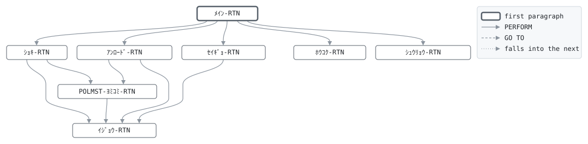

# GLD090

```text
GLD090: 契約マスタ アンロード

日次と月次の最後。契約マスタを証券番号順に1行1レコードで
アンロードし、下流 (営業システム、経理) に渡す。制御レコード
の業務日付を処理した日に進め、件数と有効保険金額を書き戻す。
報告には制御レコードの内容を印字する。

復帰コード: 0 処理済、8 日付が日付でない、16 ファイル異常。

変更履歴
日付       担当 変更
1987-04-01 KT   GL-0001 初版。
1999-11-08 MS   GL-0233 制御レコードの更新。
```

Program [GLD090.cbl](../../../gondwana/programs/GLD090.cbl): 4 files, 8 paragraphs. Its business rules: [4 decision tables](../rules/GLD090.md).

- AUTHOR: ゴンドワナ生命 システム部.
- DATE-WRITTEN: 1987-04-01.

## Contents

- [Files](#files)
- [Flow](#flow)
- [Paragraphs](#paragraphs)
- [Calls](#calls)
- [Data flow](#data-flow)
- [Lineage](#lineage)
  - [Into PM-ｹｲﾔｸ-ﾚｺｰﾄﾞ](#into-pm-ｹｲﾔｸ-ﾚｺｰﾄﾞ)
  - [Into ｱﾝﾛｰﾄﾞ-ﾚｺｰﾄﾞ](#into-ｱﾝﾛｰﾄﾞ-ﾚｺｰﾄﾞ)
  - [Into CT-ｾｲｷﾞｮ-ﾚｺｰﾄﾞ](#into-ct-ｾｲｷﾞｮ-ﾚｺｰﾄﾞ)
  - [Into ﾎｳｺｸ-ｷﾞｮｳ](#into-ﾎｳｺｸ-ｷﾞｮｳ)
  - [Into WS-ｺﾏﾝﾄﾞｷﾞｮｳ](#into-ws-ｺﾏﾝﾄﾞｷﾞｮｳ)
  - [Into WS-ｴﾗｰﾌｧｲﾙ](#into-ws-ｴﾗｰﾌｧｲﾙ)
  - [Into WS-ｴﾗｰｽﾃｰﾀｽ](#into-ws-ｴﾗｰｽﾃｰﾀｽ)
  - [Into WS-ｷﾞｮｳﾑﾋﾂﾞｹ](#into-ws-ｷﾞｮｳﾑﾋﾂﾞｹ)
  - [Into WS-ｷﾞｮｳﾑﾋﾂﾞｹ-ﾜﾚｷ](#into-ws-ｷﾞｮｳﾑﾋﾂﾞｹ-ﾜﾚｷ)
  - [Into WS-ﾎｳｺｳ](#into-ws-ﾎｳｺｳ)
  - [Into WS-ﾍﾝｶﾝｹｯｶ](#into-ws-ﾍﾝｶﾝｹｯｶ)
  - [Into WS-ｹﾝｽｳ](#into-ws-ｹﾝｽｳ)
  - [Into WS-ﾎｳｺｸ](#into-ws-ﾎｳｺｸ)
  - [Out of the program](#out-of-the-program)
  - [Into other data items](#into-other-data-items)
- [Field origins](#field-origins)
  - [File UNLOAD-F](#file-unload-f)
  - [File GLSCTL-F](#file-glsctl-f)
  - [File REPORT-F](#file-report-f)
- [Records](#records)
  - [PM-ｹｲﾔｸ-ﾚｺｰﾄﾞ](#pm-ｹｲﾔｸ-ﾚｺｰﾄﾞ)
  - [ｱﾝﾛｰﾄﾞ-ﾚｺｰﾄﾞ](#ｱﾝﾛｰﾄﾞ-ﾚｺｰﾄﾞ)
  - [CT-ｾｲｷﾞｮ-ﾚｺｰﾄﾞ](#ct-ｾｲｷﾞｮ-ﾚｺｰﾄﾞ)
  - [ﾎｳｺｸ-ｷﾞｮｳ](#ﾎｳｺｸ-ｷﾞｮｳ)
  - [WS-ｽﾃｰﾀｽ](#ws-ｽﾃｰﾀｽ)
  - [WS-ｺﾏﾝﾄﾞｷﾞｮｳ](#ws-ｺﾏﾝﾄﾞｷﾞｮｳ)
  - [WS-ｴﾗｰﾌｧｲﾙ](#ws-ｴﾗｰﾌｧｲﾙ)
  - [WS-ｴﾗｰｽﾃｰﾀｽ](#ws-ｴﾗｰｽﾃｰﾀｽ)
  - [WS-ｷﾞｮｳﾑﾋﾂﾞｹ](#ws-ｷﾞｮｳﾑﾋﾂﾞｹ)
  - [WS-ｷﾞｮｳﾑﾋﾂﾞｹ-ﾜﾚｷ](#ws-ｷﾞｮｳﾑﾋﾂﾞｹ-ﾜﾚｷ)
  - [WS-ﾎｳｺｳ](#ws-ﾎｳｺｳ)
  - [WS-ﾍﾝｶﾝｹｯｶ](#ws-ﾍﾝｶﾝｹｯｶ)
  - [WS-ｹﾝｽｳ](#ws-ｹﾝｽｳ)
  - [WS-ﾎｳｺｸ](#ws-ﾎｳｺｸ)

## Files

| File | Kind | Assigned to | Organization | Status field | Opened | Records |
| --- | --- | --- | --- | --- | --- | --- |
| POLMST-F | FD | POLMST | INDEXED, key PM-ｼｮｳｹﾝﾊﾞﾝｺﾞｳ | WS-POLMST-ST | INPUT | PM-ｹｲﾔｸ-ﾚｺｰﾄﾞ |
| UNLOAD-F | FD | UNLOAD | LINE SEQUENTIAL | WS-UNLOAD-ST | OUTPUT | ｱﾝﾛｰﾄﾞ-ﾚｺｰﾄﾞ |
| GLSCTL-F | FD | GLSCTL | SEQUENTIAL | WS-GLSCTL-ST | I-O | CT-ｾｲｷﾞｮ-ﾚｺｰﾄﾞ |
| REPORT-F | FD | GLD090R | LINE SEQUENTIAL | WS-REPORT-ST | OUTPUT | ﾎｳｺｸ-ｷﾞｮｳ |

## Flow



## Paragraphs

| Paragraph | Description | Source | Performs | Goes to | Performed by | Reached by |
| --- | --- | --- | --- | --- | --- | --- |
| ﾒｲﾝ-RTN | ﾒｲﾝ-RTN: 準備、全件のアンロード、制御レコード、報告、終了。 | [GLD090.cbl:90](../../../gondwana/programs/GLD090.cbl#L90) | ｼｮｷ-RTN, ｱﾝﾛｰﾄﾞ-RTN, ｾｲｷﾞｮ-RTN, ﾎｳｺｸ-RTN, ｼｭｳﾘｮｳ-RTN | | | |
| ｼｮｷ-RTN | ｼｮｷ-RTN: 業務日付、ファイル、制御レコード。 | [GLD090.cbl:102](../../../gondwana/programs/GLD090.cbl#L102) | ｲｼﾞｮｳ-RTN, POLMST-ﾖﾐｺﾐ-RTN | | ﾒｲﾝ-RTN | |
| POLMST-ﾖﾐｺﾐ-RTN | POLMST-ﾖﾐｺﾐ-RTN: マスタの次の契約。 | [GLD090.cbl:145](../../../gondwana/programs/GLD090.cbl#L145) | ｲｼﾞｮｳ-RTN | | ｼｮｷ-RTN, ｱﾝﾛｰﾄﾞ-RTN | |
| ｱﾝﾛｰﾄﾞ-RTN | ｱﾝﾛｰﾄﾞ-RTN: 1件を書き、数える。 | [GLD090.cbl:156](../../../gondwana/programs/GLD090.cbl#L156) | ｲｼﾞｮｳ-RTN, POLMST-ﾖﾐｺﾐ-RTN | | ﾒｲﾝ-RTN | |
| ｾｲｷﾞｮ-RTN | ｾｲｷﾞｮ-RTN: 業務日付と件数を制御レコードに書き戻す。 | [GLD090.cbl:173](../../../gondwana/programs/GLD090.cbl#L173) | ｲｼﾞｮｳ-RTN | | ﾒｲﾝ-RTN | |
| ﾎｳｺｸ-RTN | ﾎｳｺｸ-RTN: 件数と、書き戻した制御レコードの内容。 | [GLD090.cbl:189](../../../gondwana/programs/GLD090.cbl#L189) | | | ﾒｲﾝ-RTN | |
| ｼｭｳﾘｮｳ-RTN | ｼｭｳﾘｮｳ-RTN: ファイルを閉じ、件数を表示する。 | [GLD090.cbl:224](../../../gondwana/programs/GLD090.cbl#L224) | | | ﾒｲﾝ-RTN | |
| ｲｼﾞｮｳ-RTN | ｲｼﾞｮｳ-RTN: ファイル異常は 16 で終わる。 | [GLD090.cbl:231](../../../gondwana/programs/GLD090.cbl#L231) | | | ｼｮｷ-RTN, POLMST-ﾖﾐｺﾐ-RTN, ｱﾝﾛｰﾄﾞ-RTN, ｾｲｷﾞｮ-RTN | |

## Calls

| Calls | Passing | Paragraph | Source |
| --- | --- | --- | --- |
| [GLC020](GLC020.md) | WS-ﾎｳｺｳ, WS-ｷﾞｮｳﾑﾋﾂﾞｹ, WS-ｷﾞｮｳﾑﾋﾂﾞｹ-ﾜﾚｷ, WS-ﾍﾝｶﾝｹｯｶ | ｼｮｷ-RTN | [GLD090.cbl:105](../../../gondwana/programs/GLD090.cbl#L105) |

## Data flow

| Paragraph | Reads | Writes |
| --- | --- | --- |
| ﾒｲﾝ-RTN | WS-POLMST-ST | RETURN-CODE |
| ｼｮｷ-RTN | WS-ｺﾏﾝﾄﾞｷﾞｮｳ, WS-ﾎｳｺｳ, WS-ｷﾞｮｳﾑﾋﾂﾞｹ, WS-ｷﾞｮｳﾑﾋﾂﾞｹ-ﾜﾚｷ, WS-ﾍﾝｶﾝｹｯｶ, WS-POLMST-ST, WS-GLSCTL-ST, WS-UNLOAD-ST, WS-REPORT-ST, WS-ｴﾗｰﾌｧｲﾙ | WS-ｺﾏﾝﾄﾞｷﾞｮｳ, WS-ｷﾞｮｳﾑﾋﾂﾞｹ, WS-ﾎｳｺｳ, WS-ｷﾞｮｳﾑﾋﾂﾞｹ-ﾜﾚｷ, WS-ﾍﾝｶﾝｹｯｶ, RETURN-CODE, WS-ｴﾗｰﾌｧｲﾙ, WS-ｴﾗｰｽﾃｰﾀｽ, CT-ｾｲｷﾞｮ-ﾚｺｰﾄﾞ |
| POLMST-ﾖﾐｺﾐ-RTN | WS-POLMST-ST | PM-ｹｲﾔｸ-ﾚｺｰﾄﾞ, WS-ｴﾗｰﾌｧｲﾙ, WS-ｴﾗｰｽﾃｰﾀｽ |
| ｱﾝﾛｰﾄﾞ-RTN | PM-ｹｲﾔｸ-ﾚｺｰﾄﾞ, WS-UNLOAD-ST, WS-ｿｳｹﾝｽｳ, PM-ｼﾞｮｳﾀｲ, WS-ﾕｳｺｳｹﾝｽｳ, PM-ﾎｹﾝｷﾝｶﾞｸ, WS-ﾕｳｺｳﾎｹﾝｷﾝｶﾞｸ | ｱﾝﾛｰﾄﾞ-ﾚｺｰﾄﾞ, WS-ｴﾗｰﾌｧｲﾙ, WS-ｴﾗｰｽﾃｰﾀｽ, WS-ｿｳｹﾝｽｳ, WS-ﾕｳｺｳｹﾝｽｳ, WS-ﾕｳｺｳﾎｹﾝｷﾝｶﾞｸ |
| ｾｲｷﾞｮ-RTN | WS-ｷﾞｮｳﾑﾋﾂﾞｹ, WS-ｷﾞｮｳﾑﾋﾂﾞｹ-ﾜﾚｷ, WS-ﾕｳｺｳｹﾝｽｳ, WS-ｿｳｹﾝｽｳ, WS-ﾕｳｺｳﾎｹﾝｷﾝｶﾞｸ, WS-GLSCTL-ST | CT-ｷﾞｮｳﾑﾋﾂﾞｹ, CT-ｷﾞｮｳﾑﾋﾂﾞｹ-ﾜﾚｷ, CT-ﾕｳｺｳｹﾝｽｳ, CT-ｿｳｹﾝｽｳ, CT-ﾕｳｺｳﾎｹﾝｷﾝｶﾞｸ, CT-ｾｲｷﾞｮ-ﾚｺｰﾄﾞ, WS-ｴﾗｰﾌｧｲﾙ, WS-ｴﾗｰｽﾃｰﾀｽ |
| ﾎｳｺｸ-RTN | WS-ｷﾞｮｳﾑﾋﾂﾞｹ-ﾜﾚｷ, WS-ﾋｮｳﾀﾞｲ-ｷﾞｮｳ, WS-ｿｳｹﾝｽｳ, WS-ｹﾝｽｳ-ｷﾞｮｳ, WS-ﾕｳｺｳｹﾝｽｳ, WS-ﾕｳｺｳﾎｹﾝｷﾝｶﾞｸ, CT-ｷﾞｮｳﾑﾋﾂﾞｹ, WS-ﾋﾂﾞｹ-ｷﾞｮｳ, CT-ｷﾞｮｳﾑﾋﾂﾞｹ-ﾜﾚｷ, CT-ｻｲｼｭｳｾｲｷｭｳﾈﾝｹﾞﾂ, CT-ｼﾞｶｲｼﾊﾗｲﾊﾞﾝｺﾞｳ, CT-ｼﾞｶｲｼﾜｹﾊﾞﾝｺﾞｳ | WS-ﾋｮｳﾀﾞｲ-ﾋﾂﾞｹ, ﾎｳｺｸ-ｷﾞｮｳ, WS-ｹﾝｽｳ-ﾗﾍﾞﾙ, WS-ｹﾝｽｳ-ｱﾀｲ, WS-ﾋﾂﾞｹ-ﾗﾍﾞﾙ, WS-ﾋﾂﾞｹ-ｱﾀｲ |
| ｼｭｳﾘｮｳ-RTN | WS-ｿｳｹﾝｽｳ, WS-ﾕｳｺｳｹﾝｽｳ | |
| ｲｼﾞｮｳ-RTN | WS-ｴﾗｰﾌｧｲﾙ, WS-ｴﾗｰｽﾃｰﾀｽ | RETURN-CODE |

## Lineage

Where each data item's values come from, grouped by the record they go into. A data item links to the record it belongs to.

### Into PM-ｹｲﾔｸ-ﾚｺｰﾄﾞ

Record [PM-ｹｲﾔｸ-ﾚｺｰﾄﾞ](#pm-ｹｲﾔｸ-ﾚｺｰﾄﾞ), from copybook [POLMST](../copybooks/POLMST.md).

| Into | From | Statement | Paragraph | Source |
| --- | --- | --- | --- | --- |
| PM-ｹｲﾔｸ-ﾚｺｰﾄﾞ | file POLMST-F | READ | POLMST-ﾖﾐｺﾐ-RTN | [GLD090.cbl:146](../../../gondwana/programs/GLD090.cbl#L146) |

### Into ｱﾝﾛｰﾄﾞ-ﾚｺｰﾄﾞ

Record [ｱﾝﾛｰﾄﾞ-ﾚｺｰﾄﾞ](#ｱﾝﾛｰﾄﾞ-ﾚｺｰﾄﾞ).

| Into | From | Statement | Paragraph | Source |
| --- | --- | --- | --- | --- |
| ｱﾝﾛｰﾄﾞ-ﾚｺｰﾄﾞ | [PM-ｹｲﾔｸ-ﾚｺｰﾄﾞ](#pm-ｹｲﾔｸ-ﾚｺｰﾄﾞ) | WRITE | ｱﾝﾛｰﾄﾞ-RTN | [GLD090.cbl:157](../../../gondwana/programs/GLD090.cbl#L157) |

### Into CT-ｾｲｷﾞｮ-ﾚｺｰﾄﾞ

Record [CT-ｾｲｷﾞｮ-ﾚｺｰﾄﾞ](#ct-ｾｲｷﾞｮ-ﾚｺｰﾄﾞ), from copybook [CTLREC](../copybooks/CTLREC.md).

| Into | From | Statement | Paragraph | Source |
| --- | --- | --- | --- | --- |
| CT-ｷﾞｮｳﾑﾋﾂﾞｹ | [WS-ｷﾞｮｳﾑﾋﾂﾞｹ](#ws-ｷﾞｮｳﾑﾋﾂﾞｹ) | MOVE | ｾｲｷﾞｮ-RTN | [GLD090.cbl:174](../../../gondwana/programs/GLD090.cbl#L174) |
| CT-ｷﾞｮｳﾑﾋﾂﾞｹ-ﾜﾚｷ | [WS-ｷﾞｮｳﾑﾋﾂﾞｹ-ﾜﾚｷ](#ws-ｷﾞｮｳﾑﾋﾂﾞｹ-ﾜﾚｷ) | MOVE | ｾｲｷﾞｮ-RTN | [GLD090.cbl:175](../../../gondwana/programs/GLD090.cbl#L175) |
| CT-ｾｲｷﾞｮ-ﾚｺｰﾄﾞ | file GLSCTL-F | READ | ｼｮｷ-RTN | [GLD090.cbl:134](../../../gondwana/programs/GLD090.cbl#L134) |
| CT-ｿｳｹﾝｽｳ | [WS-ｿｳｹﾝｽｳ](#ws-ｹﾝｽｳ "in WS-ｹﾝｽｳ") | MOVE | ｾｲｷﾞｮ-RTN | [GLD090.cbl:177](../../../gondwana/programs/GLD090.cbl#L177) |
| CT-ﾕｳｺｳｹﾝｽｳ | [WS-ﾕｳｺｳｹﾝｽｳ](#ws-ｹﾝｽｳ "in WS-ｹﾝｽｳ") | MOVE | ｾｲｷﾞｮ-RTN | [GLD090.cbl:176](../../../gondwana/programs/GLD090.cbl#L176) |
| CT-ﾕｳｺｳﾎｹﾝｷﾝｶﾞｸ | [WS-ﾕｳｺｳﾎｹﾝｷﾝｶﾞｸ](#ws-ｹﾝｽｳ "in WS-ｹﾝｽｳ") | MOVE | ｾｲｷﾞｮ-RTN | [GLD090.cbl:178](../../../gondwana/programs/GLD090.cbl#L178) |

### Into ﾎｳｺｸ-ｷﾞｮｳ

Record [ﾎｳｺｸ-ｷﾞｮｳ](#ﾎｳｺｸ-ｷﾞｮｳ).

| Into | From | Statement | Paragraph | Source |
| --- | --- | --- | --- | --- |
| ﾎｳｺｸ-ｷﾞｮｳ | [WS-ﾋｮｳﾀﾞｲ-ｷﾞｮｳ](#ws-ﾎｳｺｸ "in WS-ﾎｳｺｸ") | WRITE | ﾎｳｺｸ-RTN | [GLD090.cbl:191](../../../gondwana/programs/GLD090.cbl#L191) |
| ﾎｳｺｸ-ｷﾞｮｳ | literal SPACES | MOVE | ﾎｳｺｸ-RTN | [GLD090.cbl:192](../../../gondwana/programs/GLD090.cbl#L192) |
| ﾎｳｺｸ-ｷﾞｮｳ | [WS-ｹﾝｽｳ-ｷﾞｮｳ](#ws-ﾎｳｺｸ "in WS-ﾎｳｺｸ") | WRITE | ﾎｳｺｸ-RTN | [GLD090.cbl:196](../../../gondwana/programs/GLD090.cbl#L196) |
| ﾎｳｺｸ-ｷﾞｮｳ | [WS-ｹﾝｽｳ-ｷﾞｮｳ](#ws-ﾎｳｺｸ "in WS-ﾎｳｺｸ") | WRITE | ﾎｳｺｸ-RTN | [GLD090.cbl:199](../../../gondwana/programs/GLD090.cbl#L199) |
| ﾎｳｺｸ-ｷﾞｮｳ | [WS-ｹﾝｽｳ-ｷﾞｮｳ](#ws-ﾎｳｺｸ "in WS-ﾎｳｺｸ") | WRITE | ﾎｳｺｸ-RTN | [GLD090.cbl:202](../../../gondwana/programs/GLD090.cbl#L202) |
| ﾎｳｺｸ-ｷﾞｮｳ | literal SPACES | MOVE | ﾎｳｺｸ-RTN | [GLD090.cbl:203](../../../gondwana/programs/GLD090.cbl#L203) |
| ﾎｳｺｸ-ｷﾞｮｳ | [WS-ﾋﾂﾞｹ-ｷﾞｮｳ](#ws-ﾎｳｺｸ "in WS-ﾎｳｺｸ") | WRITE | ﾎｳｺｸ-RTN | [GLD090.cbl:207](../../../gondwana/programs/GLD090.cbl#L207) |
| ﾎｳｺｸ-ｷﾞｮｳ | [WS-ﾋﾂﾞｹ-ｷﾞｮｳ](#ws-ﾎｳｺｸ "in WS-ﾎｳｺｸ") | WRITE | ﾎｳｺｸ-RTN | [GLD090.cbl:210](../../../gondwana/programs/GLD090.cbl#L210) |
| ﾎｳｺｸ-ｷﾞｮｳ | [WS-ｹﾝｽｳ-ｷﾞｮｳ](#ws-ﾎｳｺｸ "in WS-ﾎｳｺｸ") | WRITE | ﾎｳｺｸ-RTN | [GLD090.cbl:213](../../../gondwana/programs/GLD090.cbl#L213) |
| ﾎｳｺｸ-ｷﾞｮｳ | [WS-ｹﾝｽｳ-ｷﾞｮｳ](#ws-ﾎｳｺｸ "in WS-ﾎｳｺｸ") | WRITE | ﾎｳｺｸ-RTN | [GLD090.cbl:216](../../../gondwana/programs/GLD090.cbl#L216) |
| ﾎｳｺｸ-ｷﾞｮｳ | [WS-ｹﾝｽｳ-ｷﾞｮｳ](#ws-ﾎｳｺｸ "in WS-ﾎｳｺｸ") | WRITE | ﾎｳｺｸ-RTN | [GLD090.cbl:219](../../../gondwana/programs/GLD090.cbl#L219) |

### Into WS-ｺﾏﾝﾄﾞｷﾞｮｳ

Record [WS-ｺﾏﾝﾄﾞｷﾞｮｳ](#ws-ｺﾏﾝﾄﾞｷﾞｮｳ).

| Into | From | Statement | Paragraph | Source |
| --- | --- | --- | --- | --- |
| WS-ｺﾏﾝﾄﾞｷﾞｮｳ | COMMAND-LINE | ACCEPT | ｼｮｷ-RTN | [GLD090.cbl:103](../../../gondwana/programs/GLD090.cbl#L103) |

### Into WS-ｴﾗｰﾌｧｲﾙ

Record [WS-ｴﾗｰﾌｧｲﾙ](#ws-ｴﾗｰﾌｧｲﾙ).

| Into | From | Statement | Paragraph | Source |
| --- | --- | --- | --- | --- |
| WS-ｴﾗｰﾌｧｲﾙ | literal 'POLMST' | MOVE | ｼｮｷ-RTN | [GLD090.cbl:117](../../../gondwana/programs/GLD090.cbl#L117) |
| WS-ｴﾗｰﾌｧｲﾙ | literal 'GLSCTL' | MOVE | ｼｮｷ-RTN | [GLD090.cbl:120](../../../gondwana/programs/GLD090.cbl#L120) |
| WS-ｴﾗｰﾌｧｲﾙ | literal 'UNLOAD' | MOVE | ｼｮｷ-RTN | [GLD090.cbl:123](../../../gondwana/programs/GLD090.cbl#L123) |
| WS-ｴﾗｰﾌｧｲﾙ | literal 'GLD090R' | MOVE | ｼｮｷ-RTN | [GLD090.cbl:126](../../../gondwana/programs/GLD090.cbl#L126) |
| WS-ｴﾗｰﾌｧｲﾙ | literal SPACES | MOVE | ｼｮｷ-RTN | [GLD090.cbl:129](../../../gondwana/programs/GLD090.cbl#L129) |
| WS-ｴﾗｰﾌｧｲﾙ | literal 'GLSCTL' | MOVE | ｼｮｷ-RTN | [GLD090.cbl:136](../../../gondwana/programs/GLD090.cbl#L136) |
| WS-ｴﾗｰﾌｧｲﾙ | literal 'POLMST' | MOVE | POLMST-ﾖﾐｺﾐ-RTN | [GLD090.cbl:148](../../../gondwana/programs/GLD090.cbl#L148) |
| WS-ｴﾗｰﾌｧｲﾙ | literal 'UNLOAD' | MOVE | ｱﾝﾛｰﾄﾞ-RTN | [GLD090.cbl:159](../../../gondwana/programs/GLD090.cbl#L159) |
| WS-ｴﾗｰﾌｧｲﾙ | literal 'GLSCTL' | MOVE | ｾｲｷﾞｮ-RTN | [GLD090.cbl:181](../../../gondwana/programs/GLD090.cbl#L181) |

### Into WS-ｴﾗｰｽﾃｰﾀｽ

Record [WS-ｴﾗｰｽﾃｰﾀｽ](#ws-ｴﾗｰｽﾃｰﾀｽ).

| Into | From | Statement | Paragraph | Source |
| --- | --- | --- | --- | --- |
| WS-ｴﾗｰｽﾃｰﾀｽ | [WS-POLMST-ST](#ws-ｽﾃｰﾀｽ "in WS-ｽﾃｰﾀｽ") | MOVE | ｼｮｷ-RTN | [GLD090.cbl:118](../../../gondwana/programs/GLD090.cbl#L118) |
| WS-ｴﾗｰｽﾃｰﾀｽ | [WS-GLSCTL-ST](#ws-ｽﾃｰﾀｽ "in WS-ｽﾃｰﾀｽ") | MOVE | ｼｮｷ-RTN | [GLD090.cbl:121](../../../gondwana/programs/GLD090.cbl#L121) |
| WS-ｴﾗｰｽﾃｰﾀｽ | [WS-UNLOAD-ST](#ws-ｽﾃｰﾀｽ "in WS-ｽﾃｰﾀｽ") | MOVE | ｼｮｷ-RTN | [GLD090.cbl:124](../../../gondwana/programs/GLD090.cbl#L124) |
| WS-ｴﾗｰｽﾃｰﾀｽ | [WS-REPORT-ST](#ws-ｽﾃｰﾀｽ "in WS-ｽﾃｰﾀｽ") | MOVE | ｼｮｷ-RTN | [GLD090.cbl:127](../../../gondwana/programs/GLD090.cbl#L127) |
| WS-ｴﾗｰｽﾃｰﾀｽ | [WS-GLSCTL-ST](#ws-ｽﾃｰﾀｽ "in WS-ｽﾃｰﾀｽ") | MOVE | ｼｮｷ-RTN | [GLD090.cbl:137](../../../gondwana/programs/GLD090.cbl#L137) |
| WS-ｴﾗｰｽﾃｰﾀｽ | [WS-POLMST-ST](#ws-ｽﾃｰﾀｽ "in WS-ｽﾃｰﾀｽ") | MOVE | POLMST-ﾖﾐｺﾐ-RTN | [GLD090.cbl:149](../../../gondwana/programs/GLD090.cbl#L149) |
| WS-ｴﾗｰｽﾃｰﾀｽ | [WS-UNLOAD-ST](#ws-ｽﾃｰﾀｽ "in WS-ｽﾃｰﾀｽ") | MOVE | ｱﾝﾛｰﾄﾞ-RTN | [GLD090.cbl:160](../../../gondwana/programs/GLD090.cbl#L160) |
| WS-ｴﾗｰｽﾃｰﾀｽ | [WS-GLSCTL-ST](#ws-ｽﾃｰﾀｽ "in WS-ｽﾃｰﾀｽ") | MOVE | ｾｲｷﾞｮ-RTN | [GLD090.cbl:182](../../../gondwana/programs/GLD090.cbl#L182) |

### Into WS-ｷﾞｮｳﾑﾋﾂﾞｹ

Record [WS-ｷﾞｮｳﾑﾋﾂﾞｹ](#ws-ｷﾞｮｳﾑﾋﾂﾞｹ).

| Into | From | Statement | Paragraph | Source |
| --- | --- | --- | --- | --- |
| WS-ｷﾞｮｳﾑﾋﾂﾞｹ | [WS-ｺﾏﾝﾄﾞｷﾞｮｳ](#ws-ｺﾏﾝﾄﾞｷﾞｮｳ) | MOVE | ｼｮｷ-RTN | [GLD090.cbl:104](../../../gondwana/programs/GLD090.cbl#L104) |
| WS-ｷﾞｮｳﾑﾋﾂﾞｹ | call GLC020 argument 2 | CALL | ｼｮｷ-RTN | [GLD090.cbl:105](../../../gondwana/programs/GLD090.cbl#L105) |

### Into WS-ｷﾞｮｳﾑﾋﾂﾞｹ-ﾜﾚｷ

Record [WS-ｷﾞｮｳﾑﾋﾂﾞｹ-ﾜﾚｷ](#ws-ｷﾞｮｳﾑﾋﾂﾞｹ-ﾜﾚｷ).

| Into | From | Statement | Paragraph | Source |
| --- | --- | --- | --- | --- |
| WS-ｷﾞｮｳﾑﾋﾂﾞｹ-ﾜﾚｷ | call GLC020 argument 3 | CALL | ｼｮｷ-RTN | [GLD090.cbl:105](../../../gondwana/programs/GLD090.cbl#L105) |

### Into WS-ﾎｳｺｳ

Record [WS-ﾎｳｺｳ](#ws-ﾎｳｺｳ).

| Into | From | Statement | Paragraph | Source |
| --- | --- | --- | --- | --- |
| WS-ﾎｳｺｳ | call GLC020 argument 1 | CALL | ｼｮｷ-RTN | [GLD090.cbl:105](../../../gondwana/programs/GLD090.cbl#L105) |

### Into WS-ﾍﾝｶﾝｹｯｶ

Record [WS-ﾍﾝｶﾝｹｯｶ](#ws-ﾍﾝｶﾝｹｯｶ).

| Into | From | Statement | Paragraph | Source |
| --- | --- | --- | --- | --- |
| WS-ﾍﾝｶﾝｹｯｶ | call GLC020 argument 4 | CALL | ｼｮｷ-RTN | [GLD090.cbl:105](../../../gondwana/programs/GLD090.cbl#L105) |

### Into WS-ｹﾝｽｳ

Record [WS-ｹﾝｽｳ](#ws-ｹﾝｽｳ).

| Into | From | Statement | Paragraph | Source |
| --- | --- | --- | --- | --- |
| WS-ｿｳｹﾝｽｳ | literal 1 | ADD | ｱﾝﾛｰﾄﾞ-RTN | [GLD090.cbl:163](../../../gondwana/programs/GLD090.cbl#L163) |
| WS-ﾕｳｺｳｹﾝｽｳ | literal 1 | ADD | ｱﾝﾛｰﾄﾞ-RTN | [GLD090.cbl:165](../../../gondwana/programs/GLD090.cbl#L165) |
| WS-ﾕｳｺｳﾎｹﾝｷﾝｶﾞｸ | [PM-ﾎｹﾝｷﾝｶﾞｸ](#pm-ｹｲﾔｸ-ﾚｺｰﾄﾞ "in PM-ｹｲﾔｸ-ﾚｺｰﾄﾞ") | ADD | ｱﾝﾛｰﾄﾞ-RTN | [GLD090.cbl:166](../../../gondwana/programs/GLD090.cbl#L166) |

### Into WS-ﾎｳｺｸ

Record [WS-ﾎｳｺｸ](#ws-ﾎｳｺｸ).

| Into | From | Statement | Paragraph | Source |
| --- | --- | --- | --- | --- |
| WS-ｹﾝｽｳ-ｱﾀｲ | [WS-ｿｳｹﾝｽｳ](#ws-ｹﾝｽｳ "in WS-ｹﾝｽｳ") | MOVE | ﾎｳｺｸ-RTN | [GLD090.cbl:195](../../../gondwana/programs/GLD090.cbl#L195) |
| WS-ｹﾝｽｳ-ｱﾀｲ | [WS-ﾕｳｺｳｹﾝｽｳ](#ws-ｹﾝｽｳ "in WS-ｹﾝｽｳ") | MOVE | ﾎｳｺｸ-RTN | [GLD090.cbl:198](../../../gondwana/programs/GLD090.cbl#L198) |
| WS-ｹﾝｽｳ-ｱﾀｲ | [WS-ﾕｳｺｳﾎｹﾝｷﾝｶﾞｸ](#ws-ｹﾝｽｳ "in WS-ｹﾝｽｳ") | MOVE | ﾎｳｺｸ-RTN | [GLD090.cbl:201](../../../gondwana/programs/GLD090.cbl#L201) |
| WS-ｹﾝｽｳ-ｱﾀｲ | [CT-ｻｲｼｭｳｾｲｷｭｳﾈﾝｹﾞﾂ](#ct-ｾｲｷﾞｮ-ﾚｺｰﾄﾞ "in CT-ｾｲｷﾞｮ-ﾚｺｰﾄﾞ") | MOVE | ﾎｳｺｸ-RTN | [GLD090.cbl:212](../../../gondwana/programs/GLD090.cbl#L212) |
| WS-ｹﾝｽｳ-ｱﾀｲ | [CT-ｼﾞｶｲｼﾊﾗｲﾊﾞﾝｺﾞｳ](#ct-ｾｲｷﾞｮ-ﾚｺｰﾄﾞ "in CT-ｾｲｷﾞｮ-ﾚｺｰﾄﾞ") | MOVE | ﾎｳｺｸ-RTN | [GLD090.cbl:215](../../../gondwana/programs/GLD090.cbl#L215) |
| WS-ｹﾝｽｳ-ｱﾀｲ | [CT-ｼﾞｶｲｼﾜｹﾊﾞﾝｺﾞｳ](#ct-ｾｲｷﾞｮ-ﾚｺｰﾄﾞ "in CT-ｾｲｷﾞｮ-ﾚｺｰﾄﾞ") | MOVE | ﾎｳｺｸ-RTN | [GLD090.cbl:218](../../../gondwana/programs/GLD090.cbl#L218) |
| WS-ｹﾝｽｳ-ﾗﾍﾞﾙ | literal '総件数' | MOVE | ﾎｳｺｸ-RTN | [GLD090.cbl:194](../../../gondwana/programs/GLD090.cbl#L194) |
| WS-ｹﾝｽｳ-ﾗﾍﾞﾙ | literal '有効件数' | MOVE | ﾎｳｺｸ-RTN | [GLD090.cbl:197](../../../gondwana/programs/GLD090.cbl#L197) |
| WS-ｹﾝｽｳ-ﾗﾍﾞﾙ | literal '有効保険金額' | MOVE | ﾎｳｺｸ-RTN | [GLD090.cbl:200](../../../gondwana/programs/GLD090.cbl#L200) |
| WS-ｹﾝｽｳ-ﾗﾍﾞﾙ | literal '制御: 請求年月' | MOVE | ﾎｳｺｸ-RTN | [GLD090.cbl:211](../../../gondwana/programs/GLD090.cbl#L211) |
| WS-ｹﾝｽｳ-ﾗﾍﾞﾙ | literal '制御: 次回支払' | MOVE | ﾎｳｺｸ-RTN | [GLD090.cbl:214](../../../gondwana/programs/GLD090.cbl#L214) |
| WS-ｹﾝｽｳ-ﾗﾍﾞﾙ | literal '制御: 次回仕訳' | MOVE | ﾎｳｺｸ-RTN | [GLD090.cbl:217](../../../gondwana/programs/GLD090.cbl#L217) |
| WS-ﾋｮｳﾀﾞｲ-ﾋﾂﾞｹ | [WS-ｷﾞｮｳﾑﾋﾂﾞｹ-ﾜﾚｷ](#ws-ｷﾞｮｳﾑﾋﾂﾞｹ-ﾜﾚｷ) | MOVE | ﾎｳｺｸ-RTN | [GLD090.cbl:190](../../../gondwana/programs/GLD090.cbl#L190) |
| WS-ﾋﾂﾞｹ-ｱﾀｲ | [CT-ｷﾞｮｳﾑﾋﾂﾞｹ](#ct-ｾｲｷﾞｮ-ﾚｺｰﾄﾞ "in CT-ｾｲｷﾞｮ-ﾚｺｰﾄﾞ") | MOVE | ﾎｳｺｸ-RTN | [GLD090.cbl:206](../../../gondwana/programs/GLD090.cbl#L206) |
| WS-ﾋﾂﾞｹ-ｱﾀｲ | [CT-ｷﾞｮｳﾑﾋﾂﾞｹ-ﾜﾚｷ](#ct-ｾｲｷﾞｮ-ﾚｺｰﾄﾞ "in CT-ｾｲｷﾞｮ-ﾚｺｰﾄﾞ") | MOVE | ﾎｳｺｸ-RTN | [GLD090.cbl:209](../../../gondwana/programs/GLD090.cbl#L209) |
| WS-ﾋﾂﾞｹ-ﾗﾍﾞﾙ | literal '制御: 業務日付' | MOVE | ﾎｳｺｸ-RTN | [GLD090.cbl:205](../../../gondwana/programs/GLD090.cbl#L205) |
| WS-ﾋﾂﾞｹ-ﾗﾍﾞﾙ | literal '制御: 和暦' | MOVE | ﾎｳｺｸ-RTN | [GLD090.cbl:208](../../../gondwana/programs/GLD090.cbl#L208) |

### Out of the program

Records written to files, items passed to the programs called, and items displayed to the job's output.

| Into | From | Statement | Paragraph | Source |
| --- | --- | --- | --- | --- |
| call GLC020 argument 1 | [WS-ﾎｳｺｳ](#ws-ﾎｳｺｳ) | CALL | ｼｮｷ-RTN | [GLD090.cbl:105](../../../gondwana/programs/GLD090.cbl#L105) |
| call GLC020 argument 2 | [WS-ｷﾞｮｳﾑﾋﾂﾞｹ](#ws-ｷﾞｮｳﾑﾋﾂﾞｹ) | CALL | ｼｮｷ-RTN | [GLD090.cbl:105](../../../gondwana/programs/GLD090.cbl#L105) |
| call GLC020 argument 3 | [WS-ｷﾞｮｳﾑﾋﾂﾞｹ-ﾜﾚｷ](#ws-ｷﾞｮｳﾑﾋﾂﾞｹ-ﾜﾚｷ) | CALL | ｼｮｷ-RTN | [GLD090.cbl:105](../../../gondwana/programs/GLD090.cbl#L105) |
| call GLC020 argument 4 | [WS-ﾍﾝｶﾝｹｯｶ](#ws-ﾍﾝｶﾝｹｯｶ) | CALL | ｼｮｷ-RTN | [GLD090.cbl:105](../../../gondwana/programs/GLD090.cbl#L105) |
| file GLSCTL-F | [CT-ｾｲｷﾞｮ-ﾚｺｰﾄﾞ](#ct-ｾｲｷﾞｮ-ﾚｺｰﾄﾞ) | REWRITE | ｾｲｷﾞｮ-RTN | [GLD090.cbl:179](../../../gondwana/programs/GLD090.cbl#L179) |
| file REPORT-F | [ﾎｳｺｸ-ｷﾞｮｳ](#ﾎｳｺｸ-ｷﾞｮｳ) | WRITE | ﾎｳｺｸ-RTN | [GLD090.cbl:191](../../../gondwana/programs/GLD090.cbl#L191) |
| file REPORT-F | [ﾎｳｺｸ-ｷﾞｮｳ](#ﾎｳｺｸ-ｷﾞｮｳ) | WRITE | ﾎｳｺｸ-RTN | [GLD090.cbl:193](../../../gondwana/programs/GLD090.cbl#L193) |
| file REPORT-F | [ﾎｳｺｸ-ｷﾞｮｳ](#ﾎｳｺｸ-ｷﾞｮｳ) | WRITE | ﾎｳｺｸ-RTN | [GLD090.cbl:196](../../../gondwana/programs/GLD090.cbl#L196) |
| file REPORT-F | [ﾎｳｺｸ-ｷﾞｮｳ](#ﾎｳｺｸ-ｷﾞｮｳ) | WRITE | ﾎｳｺｸ-RTN | [GLD090.cbl:199](../../../gondwana/programs/GLD090.cbl#L199) |
| file REPORT-F | [ﾎｳｺｸ-ｷﾞｮｳ](#ﾎｳｺｸ-ｷﾞｮｳ) | WRITE | ﾎｳｺｸ-RTN | [GLD090.cbl:202](../../../gondwana/programs/GLD090.cbl#L202) |
| file REPORT-F | [ﾎｳｺｸ-ｷﾞｮｳ](#ﾎｳｺｸ-ｷﾞｮｳ) | WRITE | ﾎｳｺｸ-RTN | [GLD090.cbl:204](../../../gondwana/programs/GLD090.cbl#L204) |
| file REPORT-F | [ﾎｳｺｸ-ｷﾞｮｳ](#ﾎｳｺｸ-ｷﾞｮｳ) | WRITE | ﾎｳｺｸ-RTN | [GLD090.cbl:207](../../../gondwana/programs/GLD090.cbl#L207) |
| file REPORT-F | [ﾎｳｺｸ-ｷﾞｮｳ](#ﾎｳｺｸ-ｷﾞｮｳ) | WRITE | ﾎｳｺｸ-RTN | [GLD090.cbl:210](../../../gondwana/programs/GLD090.cbl#L210) |
| file REPORT-F | [ﾎｳｺｸ-ｷﾞｮｳ](#ﾎｳｺｸ-ｷﾞｮｳ) | WRITE | ﾎｳｺｸ-RTN | [GLD090.cbl:213](../../../gondwana/programs/GLD090.cbl#L213) |
| file REPORT-F | [ﾎｳｺｸ-ｷﾞｮｳ](#ﾎｳｺｸ-ｷﾞｮｳ) | WRITE | ﾎｳｺｸ-RTN | [GLD090.cbl:216](../../../gondwana/programs/GLD090.cbl#L216) |
| file REPORT-F | [ﾎｳｺｸ-ｷﾞｮｳ](#ﾎｳｺｸ-ｷﾞｮｳ) | WRITE | ﾎｳｺｸ-RTN | [GLD090.cbl:219](../../../gondwana/programs/GLD090.cbl#L219) |
| SYSOUT | [WS-ｺﾏﾝﾄﾞｷﾞｮｳ](#ws-ｺﾏﾝﾄﾞｷﾞｮｳ) | DISPLAY | ｼｮｷ-RTN | [GLD090.cbl:108](../../../gondwana/programs/GLD090.cbl#L108) |
| SYSOUT | [WS-ｿｳｹﾝｽｳ](#ws-ｹﾝｽｳ "in WS-ｹﾝｽｳ") | DISPLAY | ｼｭｳﾘｮｳ-RTN | [GLD090.cbl:226](../../../gondwana/programs/GLD090.cbl#L226) |
| SYSOUT | [WS-ﾕｳｺｳｹﾝｽｳ](#ws-ｹﾝｽｳ "in WS-ｹﾝｽｳ") | DISPLAY | ｼｭｳﾘｮｳ-RTN | [GLD090.cbl:226](../../../gondwana/programs/GLD090.cbl#L226) |
| SYSOUT | [WS-ｴﾗｰﾌｧｲﾙ](#ws-ｴﾗｰﾌｧｲﾙ) | DISPLAY | ｲｼﾞｮｳ-RTN | [GLD090.cbl:232](../../../gondwana/programs/GLD090.cbl#L232) |
| SYSOUT | [WS-ｴﾗｰｽﾃｰﾀｽ](#ws-ｴﾗｰｽﾃｰﾀｽ) | DISPLAY | ｲｼﾞｮｳ-RTN | [GLD090.cbl:232](../../../gondwana/programs/GLD090.cbl#L232) |
| file UNLOAD-F | [ｱﾝﾛｰﾄﾞ-ﾚｺｰﾄﾞ](#ｱﾝﾛｰﾄﾞ-ﾚｺｰﾄﾞ) | WRITE | ｱﾝﾛｰﾄﾞ-RTN | [GLD090.cbl:157](../../../gondwana/programs/GLD090.cbl#L157) |

### Into other data items

Data items the program does not declare, such as special registers and index names.

| Into | From | Statement | Paragraph | Source |
| --- | --- | --- | --- | --- |
| RETURN-CODE | literal 0 | MOVE | ﾒｲﾝ-RTN | [GLD090.cbl:96](../../../gondwana/programs/GLD090.cbl#L96) |
| RETURN-CODE | literal 8 | MOVE | ｼｮｷ-RTN | [GLD090.cbl:109](../../../gondwana/programs/GLD090.cbl#L109) |
| RETURN-CODE | literal 16 | MOVE | ｲｼﾞｮｳ-RTN | [GLD090.cbl:234](../../../gondwana/programs/GLD090.cbl#L234) |

## Field origins

Where the values of each field the program writes to a file come from: the fields of the files it reads, literals, and initial values, followed through every statement that moves a value, and through groups and redefinitions by the bytes they share.

### File UNLOAD-F

Written from [PM-ｹｲﾔｸ-ﾚｺｰﾄﾞ](#pm-ｹｲﾔｸ-ﾚｺｰﾄﾞ).

| Field | Position | Origins |
| --- | --: | --- |
| PM-ｼｮｳｹﾝﾊﾞﾝｺﾞｳ | 1-10 | file POLMST-F PM-ｼｮｳｹﾝﾊﾞﾝｺﾞｳ |
| PM-ｼﾞｮｳﾀｲ | 11 | file POLMST-F PM-ｼﾞｮｳﾀｲ |
| PM-ｼｮｳﾋﾝ | 12-13 | file POLMST-F PM-ｼｮｳﾋﾝ |
| PM-ﾎｹﾝｷﾝｶﾞｸ | 14-22 | file POLMST-F PM-ﾎｹﾝｷﾝｶﾞｸ |
| PM-ﾎｹﾝﾘｮｳ | 23-29 | file POLMST-F PM-ﾎｹﾝﾘｮｳ |
| PM-ﾊﾗｲｺﾐﾎｳﾎｳ | 30 | file POLMST-F PM-ﾊﾗｲｺﾐﾎｳﾎｳ |
| PM-ｹｲﾔｸﾋﾞ | 31-37 | file POLMST-F PM-ｹｲﾔｸﾋﾞ |
| PM-ﾎｹﾝｷｶﾝ | 38-39 | file POLMST-F PM-ﾎｹﾝｷｶﾝ |
| PM-ﾏﾝｷﾋﾞ | 40-46 | file POLMST-F PM-ﾏﾝｷﾋﾞ |
| PM-ｹｲｶﾈﾝｽｳ | 47-48 | file POLMST-F PM-ｹｲｶﾈﾝｽｳ |
| PM-ﾊﾗｲｺﾐｽﾞﾐﾈﾝｹﾞﾂ | 49-54 | file POLMST-F PM-ﾊﾗｲｺﾐｽﾞﾐﾈﾝｹﾞﾂ |
| PM-ﾐﾉｳｶｲｽｳ | 55-56 | file POLMST-F PM-ﾐﾉｳｶｲｽｳ |
| PM-ﾕｳﾖｶｲｼﾋﾞ | 57-63 | file POLMST-F PM-ﾕｳﾖｶｲｼﾋﾞ |
| PM-ｼｯｺｳﾋﾞ | 64-70 | file POLMST-F PM-ｼｯｺｳﾋﾞ |
| PM-ｼﾞｮｳﾀｲﾋﾂﾞｹ | 71-77 | file POLMST-F PM-ｼﾞｮｳﾀｲﾋﾂﾞｹ |
| PM-ｼﾒｲ | 78-97 | file POLMST-F PM-ｼﾒｲ |
| PM-ｼﾒｲｶﾅ | 98-117 | file POLMST-F PM-ｼﾒｲｶﾅ |
| PM-ｾｲﾈﾝｶﾞｯﾋﾟ | 118-124 | file POLMST-F PM-ｾｲﾈﾝｶﾞｯﾋﾟ |
| PM-ｾｲﾍﾞﾂ | 125 | file POLMST-F PM-ｾｲﾍﾞﾂ |
| PM-ｶﾆｭｳﾈﾝﾚｲ | 126-127 | file POLMST-F PM-ｶﾆｭｳﾈﾝﾚｲ |
| PM-ｼﾞｭｳｼｮ | 128-167 | file POLMST-F PM-ｼﾞｭｳｼｮ |
| PM-ｳｹﾄﾘﾆﾝ | 168-187 | file POLMST-F PM-ｳｹﾄﾘﾆﾝ |
| PM-ｷﾞﾝｺｳｺｰﾄﾞ | 188-191 | file POLMST-F PM-ｷﾞﾝｺｳｺｰﾄﾞ |
| PM-ｼﾃﾝｺｰﾄﾞ | 192-194 | file POLMST-F PM-ｼﾃﾝｺｰﾄﾞ |
| PM-ﾖｷﾝｼｭﾓｸ | 195 | file POLMST-F PM-ﾖｷﾝｼｭﾓｸ |
| PM-ｺｳｻﾞﾊﾞﾝｺﾞｳ | 196-202 | file POLMST-F PM-ｺｳｻﾞﾊﾞﾝｺﾞｳ |
| PM-ｺｳｻﾞﾒｲｷﾞ | 203-232 | file POLMST-F PM-ｺｳｻﾞﾒｲｷﾞ |
| PM-ﾀﾞｲﾘﾃﾝｺｰﾄﾞ | 233-238 | file POLMST-F PM-ﾀﾞｲﾘﾃﾝｺｰﾄﾞ |
| PM-ｶｼﾂｹｻﾞﾝﾀﾞｶ | 239-247 | file POLMST-F PM-ｶｼﾂｹｻﾞﾝﾀﾞｶ |
| PM-ｾｷﾆﾝｼﾞｭﾝﾋﾞｷﾝ | 248-256 | file POLMST-F PM-ｾｷﾆﾝｼﾞｭﾝﾋﾞｷﾝ |
| PM-ﾊｲﾄｳﾙｲｹｲ | 257-265 | file POLMST-F PM-ﾊｲﾄｳﾙｲｹｲ |
| PM-ｻｲｼｭｳﾆｭｳｷﾝﾈﾝｹﾞﾂ | 266-271 | file POLMST-F PM-ｻｲｼｭｳﾆｭｳｷﾝﾈﾝｹﾞﾂ |
| PM-ｻｲｼｭｳﾆｭｳｷﾝｶﾞｸ | 272-278 | file POLMST-F PM-ｻｲｼｭｳﾆｭｳｷﾝｶﾞｸ |

### File GLSCTL-F

Written from [CT-ｾｲｷﾞｮ-ﾚｺｰﾄﾞ](#ct-ｾｲｷﾞｮ-ﾚｺｰﾄﾞ).

| Field | Position | Origins |
| --- | --: | --- |
| CT-ｷﾞｮｳﾑﾋﾂﾞｹ | 1-8 | call GLC020 argument 2 WS-ｷﾞｮｳﾑﾋﾂﾞｹ; stream COMMAND-LINE WS-ｺﾏﾝﾄﾞｷﾞｮｳ |
| CT-ｷﾞｮｳﾑﾋﾂﾞｹ-ﾜﾚｷ | 9-15 | call GLC020 argument 3 WS-ｷﾞｮｳﾑﾋﾂﾞｹ-ﾜﾚｷ |
| CT-ｻｲｼｭｳｾｲｷｭｳﾈﾝｹﾞﾂ | 17-22 | file GLSCTL-F CT-ｻｲｼｭｳｾｲｷｭｳﾈﾝｹﾞﾂ |
| CT-ｼﾞｶｲｼﾊﾗｲﾊﾞﾝｺﾞｳ | 25-28 | file GLSCTL-F CT-ｼﾞｶｲｼﾊﾗｲﾊﾞﾝｺﾞｳ |
| CT-ｼﾞｶｲｼﾜｹﾊﾞﾝｺﾞｳ | 29-32 | file GLSCTL-F CT-ｼﾞｶｲｼﾜｹﾊﾞﾝｺﾞｳ |
| CT-ﾕｳｺｳｹﾝｽｳ | 33-36 | initial value of WS-ﾕｳｺｳｹﾝｽｳ; literal 1 |
| CT-ｿｳｹﾝｽｳ | 37-40 | initial value of WS-ｿｳｹﾝｽｳ; literal 1 |
| CT-ﾕｳｺｳﾎｹﾝｷﾝｶﾞｸ | 41-48 | file POLMST-F PM-ﾎｹﾝｷﾝｶﾞｸ; initial value of WS-ﾕｳｺｳﾎｹﾝｷﾝｶﾞｸ |

### File REPORT-F

Written from [ﾎｳｺｸ-ｷﾞｮｳ](#ﾎｳｺｸ-ｷﾞｮｳ).

| Field | Position | Origins |
| --- | --: | --- |
| ﾎｳｺｸ-ｷﾞｮｳ | 1-80 | literal SPACES |

## Records

### PM-ｹｲﾔｸ-ﾚｺｰﾄﾞ

File POLMST-F. 300 bytes, layout in copybook [POLMST](../copybooks/POLMST.md).

### ｱﾝﾛｰﾄﾞ-ﾚｺｰﾄﾞ

File UNLOAD-F. 300 bytes.

| Level | Field | Kind | Start | Length | Picture | Usage | Notes | Source |
| --: | --- | --- | --: | --: | --- | --- | --- | --- |
| 01 | ｱﾝﾛｰﾄﾞ-ﾚｺｰﾄﾞ | text | 1 | 300 | X(300) | | | [GLD090.cbl:44](../../../gondwana/programs/GLD090.cbl#L44) |

### CT-ｾｲｷﾞｮ-ﾚｺｰﾄﾞ

File GLSCTL-F. 64 bytes, layout in copybook [CTLREC](../copybooks/CTLREC.md).

### ﾎｳｺｸ-ｷﾞｮｳ

File REPORT-F. 80 bytes.

| Level | Field | Kind | Start | Length | Picture | Usage | Notes | Source |
| --: | --- | --- | --: | --: | --- | --- | --- | --- |
| 01 | ﾎｳｺｸ-ｷﾞｮｳ | text | 1 | 80 | X(80) | | | [GLD090.cbl:49](../../../gondwana/programs/GLD090.cbl#L49) |

### WS-ｽﾃｰﾀｽ

Working storage. 8 bytes.

| Level | Field | Kind | Start | Length | Picture | Usage | Notes | Source |
| --: | --- | --- | --: | --: | --- | --- | --- | --- |
| 01 | WS-ｽﾃｰﾀｽ | group | 1 | 8 | | | | [GLD090.cbl:52](../../../gondwana/programs/GLD090.cbl#L52) |
| 05 | ├ WS-POLMST-ST | code | 1 | 2 | XX | | | [GLD090.cbl:53](../../../gondwana/programs/GLD090.cbl#L53) |
| 88 | │ ├ WS-POLMST-OK | | | | | | VALUE '00' | [GLD090.cbl:54](../../../gondwana/programs/GLD090.cbl#L54) |
| 88 | │ └ WS-POLMST-ｵﾜﾘ | | | | | | VALUE '10' | [GLD090.cbl:55](../../../gondwana/programs/GLD090.cbl#L55) |
| 05 | ├ WS-UNLOAD-ST | code | 3 | 2 | XX | | | [GLD090.cbl:56](../../../gondwana/programs/GLD090.cbl#L56) |
| 88 | │ └ WS-UNLOAD-OK | | | | | | VALUE '00' | [GLD090.cbl:57](../../../gondwana/programs/GLD090.cbl#L57) |
| 05 | ├ WS-GLSCTL-ST | code | 5 | 2 | XX | | | [GLD090.cbl:58](../../../gondwana/programs/GLD090.cbl#L58) |
| 88 | │ └ WS-GLSCTL-OK | | | | | | VALUE '00' | [GLD090.cbl:59](../../../gondwana/programs/GLD090.cbl#L59) |
| 05 | └ WS-REPORT-ST | code | 7 | 2 | XX | | | [GLD090.cbl:60](../../../gondwana/programs/GLD090.cbl#L60) |
| 88 |   └ WS-REPORT-OK | | | | | | VALUE '00' | [GLD090.cbl:61](../../../gondwana/programs/GLD090.cbl#L61) |

### WS-ｺﾏﾝﾄﾞｷﾞｮｳ

Working storage. 80 bytes.

| Level | Field | Kind | Start | Length | Picture | Usage | Notes | Source |
| --: | --- | --- | --: | --: | --- | --- | --- | --- |
| 01 | WS-ｺﾏﾝﾄﾞｷﾞｮｳ | text | 1 | 80 | X(80) | | | [GLD090.cbl:62](../../../gondwana/programs/GLD090.cbl#L62) |

### WS-ｴﾗｰﾌｧｲﾙ

Working storage. 8 bytes.

| Level | Field | Kind | Start | Length | Picture | Usage | Notes | Source |
| --: | --- | --- | --: | --: | --- | --- | --- | --- |
| 01 | WS-ｴﾗｰﾌｧｲﾙ | text | 1 | 8 | X(8) | | | [GLD090.cbl:63](../../../gondwana/programs/GLD090.cbl#L63) |

### WS-ｴﾗｰｽﾃｰﾀｽ

Working storage. 2 bytes.

| Level | Field | Kind | Start | Length | Picture | Usage | Notes | Source |
| --: | --- | --- | --: | --: | --- | --- | --- | --- |
| 01 | WS-ｴﾗｰｽﾃｰﾀｽ | text | 1 | 2 | XX | | | [GLD090.cbl:64](../../../gondwana/programs/GLD090.cbl#L64) |

### WS-ｷﾞｮｳﾑﾋﾂﾞｹ

Working storage. 8 bytes.

| Level | Field | Kind | Start | Length | Picture | Usage | Notes | Source |
| --: | --- | --- | --: | --: | --- | --- | --- | --- |
| 01 | WS-ｷﾞｮｳﾑﾋﾂﾞｹ | number | 1 | 8 | 9(8) | | | [GLD090.cbl:65](../../../gondwana/programs/GLD090.cbl#L65) |

### WS-ｷﾞｮｳﾑﾋﾂﾞｹ-ﾜﾚｷ

Working storage. 7 bytes.

| Level | Field | Kind | Start | Length | Picture | Usage | Notes | Source |
| --: | --- | --- | --: | --: | --- | --- | --- | --- |
| 01 | WS-ｷﾞｮｳﾑﾋﾂﾞｹ-ﾜﾚｷ | text | 1 | 7 | X(7) | | | [GLD090.cbl:66](../../../gondwana/programs/GLD090.cbl#L66) |

### WS-ﾎｳｺｳ

Working storage. 1 bytes.

| Level | Field | Kind | Start | Length | Picture | Usage | Notes | Source |
| --: | --- | --- | --: | --: | --- | --- | --- | --- |
| 01 | WS-ﾎｳｺｳ | text | 1 | 1 | X | | VALUE 'W' | [GLD090.cbl:67](../../../gondwana/programs/GLD090.cbl#L67) |

### WS-ﾍﾝｶﾝｹｯｶ

Working storage. 1 bytes.

| Level | Field | Kind | Start | Length | Picture | Usage | Notes | Source |
| --: | --- | --- | --: | --: | --- | --- | --- | --- |
| 01 | WS-ﾍﾝｶﾝｹｯｶ | number | 1 | 1 | 9 | | | [GLD090.cbl:68](../../../gondwana/programs/GLD090.cbl#L68) |

### WS-ｹﾝｽｳ

Working storage. 29 bytes.

| Level | Field | Kind | Start | Length | Picture | Usage | Notes | Source |
| --: | --- | --- | --: | --: | --- | --- | --- | --- |
| 01 | WS-ｹﾝｽｳ | group | 1 | 29 | | | | [GLD090.cbl:69](../../../gondwana/programs/GLD090.cbl#L69) |
| 05 | ├ WS-ｿｳｹﾝｽｳ | number | 1 | 7 | 9(7) | | VALUE 0 | [GLD090.cbl:70](../../../gondwana/programs/GLD090.cbl#L70) |
| 05 | ├ WS-ﾕｳｺｳｹﾝｽｳ | number | 8 | 7 | 9(7) | | VALUE 0 | [GLD090.cbl:71](../../../gondwana/programs/GLD090.cbl#L71) |
| 05 | └ WS-ﾕｳｺｳﾎｹﾝｷﾝｶﾞｸ | number | 15 | 15 | 9(15) | | VALUE 0 | [GLD090.cbl:72](../../../gondwana/programs/GLD090.cbl#L72) |

### WS-ﾎｳｺｸ

Working storage. 94 bytes.

| Level | Field | Kind | Start | Length | Picture | Usage | Notes | Source |
| --: | --- | --- | --: | --: | --- | --- | --- | --- |
| 01 | WS-ﾎｳｺｸ | group | 1 | 94 | | | | [GLD090.cbl:73](../../../gondwana/programs/GLD090.cbl#L73) |
| 05 | ├ WS-ﾋｮｳﾀﾞｲ-ｷﾞｮｳ | group | 1 | 39 | | | | [GLD090.cbl:74](../../../gondwana/programs/GLD090.cbl#L74) |
| 10 | │ ├ FILLER | filler | 1 | 28 | X(28) | | VALUE 'ゴンドワナ生命  アンロード' | [GLD090.cbl:75](../../../gondwana/programs/GLD090.cbl#L75) |
| 10 | │ ├ FILLER | filler | 29 | 4 | X(4) | | VALUE SPACES | [GLD090.cbl:77](../../../gondwana/programs/GLD090.cbl#L77) |
| 10 | │ └ WS-ﾋｮｳﾀﾞｲ-ﾋﾂﾞｹ | text | 33 | 7 | X(7) | | | [GLD090.cbl:78](../../../gondwana/programs/GLD090.cbl#L78) |
| 05 | ├ WS-ｹﾝｽｳ-ｷﾞｮｳ | group | 40 | 31 | | | | [GLD090.cbl:79](../../../gondwana/programs/GLD090.cbl#L79) |
| 10 | │ ├ WS-ｹﾝｽｳ-ﾗﾍﾞﾙ | text | 40 | 16 | X(16) | | | [GLD090.cbl:80](../../../gondwana/programs/GLD090.cbl#L80) |
| 10 | │ └ WS-ｹﾝｽｳ-ｱﾀｲ | edited | 56 | 15 | ZZZ,ZZZ,ZZZ,ZZ9 | | | [GLD090.cbl:81](../../../gondwana/programs/GLD090.cbl#L81) |
| 05 | └ WS-ﾋﾂﾞｹ-ｷﾞｮｳ | group | 71 | 24 | | | | [GLD090.cbl:82](../../../gondwana/programs/GLD090.cbl#L82) |
| 10 |   ├ WS-ﾋﾂﾞｹ-ﾗﾍﾞﾙ | text | 71 | 16 | X(16) | | | [GLD090.cbl:83](../../../gondwana/programs/GLD090.cbl#L83) |
| 10 |   └ WS-ﾋﾂﾞｹ-ｱﾀｲ | text | 87 | 8 | X(8) | | | [GLD090.cbl:84](../../../gondwana/programs/GLD090.cbl#L84) |
