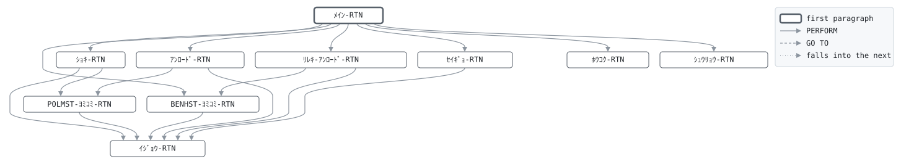

# GLD090

```text
GLD090: 契約マスタ アンロード

日次と月次の最後。契約マスタを証券番号順に1行1レコードで
アンロードし、下流 (営業システム、経理) に渡す。制御レコード
の業務日付を処理した日に進め、件数と有効保険金額を書き戻す。
報告には制御レコードの内容を印字する。
給付履歴 BENHST も、あれば証券番号・連番順にアンロードする。
保障マスタ COVMST は証券番号・保障番号順にアンロードする。

復帰コード: 0 処理済、8 日付が日付でない、16 ファイル異常。

変更履歴
日付       担当 変更
1987-04-01 KT   GL-0001 初版。
1999-11-08 MS   GL-0233 制御レコードの更新。
2026-11-16 YN   GL-0822 給付履歴のアンロード。
2026-11-18 YN   GL-0825 保障マスタのアンロード。
```

Program [GLD090.cbl](../../../gondwana/programs/GLD090.cbl): 8 files, 12 paragraphs. Its business rules: [8 decision tables](../rules/GLD090.md).

- AUTHOR: ゴンドワナ生命 システム部.
- DATE-WRITTEN: 1987-04-01.

## Contents

- [Files](#files)
- [Flow](#flow)
- [Paragraphs](#paragraphs)
- [Calls](#calls)
- [Data flow](#data-flow)
- [Lineage](#lineage)
  - [Into PM-ｹｲﾔｸ-ﾚｺｰﾄﾞ](#into-pm-ｹｲﾔｸ-ﾚｺｰﾄﾞ)
  - [Into ｱﾝﾛｰﾄﾞ-ﾚｺｰﾄﾞ](#into-ｱﾝﾛｰﾄﾞ-ﾚｺｰﾄﾞ)
  - [Into BH-ﾘﾚｷ-ﾚｺｰﾄﾞ](#into-bh-ﾘﾚｷ-ﾚｺｰﾄﾞ)
  - [Into ﾘﾚｷ-ｱﾝﾛｰﾄﾞ-ﾚｺｰﾄﾞ](#into-ﾘﾚｷ-ｱﾝﾛｰﾄﾞ-ﾚｺｰﾄﾞ)
  - [Into HS-ﾎｼｮｳ-ﾚｺｰﾄﾞ](#into-hs-ﾎｼｮｳ-ﾚｺｰﾄﾞ)
  - [Into ﾎｼｮｳ-ｱﾝﾛｰﾄﾞ-ﾚｺｰﾄﾞ](#into-ﾎｼｮｳ-ｱﾝﾛｰﾄﾞ-ﾚｺｰﾄﾞ)
  - [Into CT-ｾｲｷﾞｮ-ﾚｺｰﾄﾞ](#into-ct-ｾｲｷﾞｮ-ﾚｺｰﾄﾞ)
  - [Into ﾎｳｺｸ-ｷﾞｮｳ](#into-ﾎｳｺｸ-ｷﾞｮｳ)
  - [Into WS-ｺﾏﾝﾄﾞｷﾞｮｳ](#into-ws-ｺﾏﾝﾄﾞｷﾞｮｳ)
  - [Into WS-ｴﾗｰﾌｧｲﾙ](#into-ws-ｴﾗｰﾌｧｲﾙ)
  - [Into WS-ｴﾗｰｽﾃｰﾀｽ](#into-ws-ｴﾗｰｽﾃｰﾀｽ)
  - [Into WS-ｷﾞｮｳﾑﾋﾂﾞｹ](#into-ws-ｷﾞｮｳﾑﾋﾂﾞｹ)
  - [Into WS-ｷﾞｮｳﾑﾋﾂﾞｹ-ﾜﾚｷ](#into-ws-ｷﾞｮｳﾑﾋﾂﾞｹ-ﾜﾚｷ)
  - [Into WS-ﾎｳｺｳ](#into-ws-ﾎｳｺｳ)
  - [Into WS-ﾍﾝｶﾝｹｯｶ](#into-ws-ﾍﾝｶﾝｹｯｶ)
  - [Into WS-ｹﾝｽｳ](#into-ws-ｹﾝｽｳ)
  - [Into WS-ﾎｳｺｸ](#into-ws-ﾎｳｺｸ)
  - [Out of the program](#out-of-the-program)
  - [Into other data items](#into-other-data-items)
- [Field origins](#field-origins)
  - [File UNLOAD-F](#file-unload-f)
  - [File HSTUNL-F](#file-hstunl-f)
  - [File COVUNL-F](#file-covunl-f)
  - [File GLSCTL-F](#file-glsctl-f)
  - [File REPORT-F](#file-report-f)
- [Records](#records)
  - [PM-ｹｲﾔｸ-ﾚｺｰﾄﾞ](#pm-ｹｲﾔｸ-ﾚｺｰﾄﾞ)
  - [ｱﾝﾛｰﾄﾞ-ﾚｺｰﾄﾞ](#ｱﾝﾛｰﾄﾞ-ﾚｺｰﾄﾞ)
  - [BH-ﾘﾚｷ-ﾚｺｰﾄﾞ](#bh-ﾘﾚｷ-ﾚｺｰﾄﾞ)
  - [ﾘﾚｷ-ｱﾝﾛｰﾄﾞ-ﾚｺｰﾄﾞ](#ﾘﾚｷ-ｱﾝﾛｰﾄﾞ-ﾚｺｰﾄﾞ)
  - [HS-ﾎｼｮｳ-ﾚｺｰﾄﾞ](#hs-ﾎｼｮｳ-ﾚｺｰﾄﾞ)
  - [ﾎｼｮｳ-ｱﾝﾛｰﾄﾞ-ﾚｺｰﾄﾞ](#ﾎｼｮｳ-ｱﾝﾛｰﾄﾞ-ﾚｺｰﾄﾞ)
  - [CT-ｾｲｷﾞｮ-ﾚｺｰﾄﾞ](#ct-ｾｲｷﾞｮ-ﾚｺｰﾄﾞ)
  - [ﾎｳｺｸ-ｷﾞｮｳ](#ﾎｳｺｸ-ｷﾞｮｳ)
  - [WS-ｽﾃｰﾀｽ](#ws-ｽﾃｰﾀｽ)
  - [WS-ｺﾏﾝﾄﾞｷﾞｮｳ](#ws-ｺﾏﾝﾄﾞｷﾞｮｳ)
  - [WS-ｴﾗｰﾌｧｲﾙ](#ws-ｴﾗｰﾌｧｲﾙ)
  - [WS-ｴﾗｰｽﾃｰﾀｽ](#ws-ｴﾗｰｽﾃｰﾀｽ)
  - [WS-ｷﾞｮｳﾑﾋﾂﾞｹ](#ws-ｷﾞｮｳﾑﾋﾂﾞｹ)
  - [WS-ｷﾞｮｳﾑﾋﾂﾞｹ-ﾜﾚｷ](#ws-ｷﾞｮｳﾑﾋﾂﾞｹ-ﾜﾚｷ)
  - [WS-ﾎｳｺｳ](#ws-ﾎｳｺｳ)
  - [WS-ﾍﾝｶﾝｹｯｶ](#ws-ﾍﾝｶﾝｹｯｶ)
  - [WS-ｹﾝｽｳ](#ws-ｹﾝｽｳ)
  - [WS-ﾎｳｺｸ](#ws-ﾎｳｺｸ)

## Files

| File | Kind | Assigned to | Organization | Status field | Opened | Records |
| --- | --- | --- | --- | --- | --- | --- |
| POLMST-F | FD | POLMST | INDEXED, key PM-ｼｮｳｹﾝﾊﾞﾝｺﾞｳ | WS-POLMST-ST | INPUT | PM-ｹｲﾔｸ-ﾚｺｰﾄﾞ |
| UNLOAD-F | FD | UNLOAD | LINE SEQUENTIAL | WS-UNLOAD-ST | OUTPUT | ｱﾝﾛｰﾄﾞ-ﾚｺｰﾄﾞ |
| BENHST-F | FD | BENHST | INDEXED, key BH-ｷｰ | WS-BENHST-ST | INPUT | BH-ﾘﾚｷ-ﾚｺｰﾄﾞ |
| HSTUNL-F | FD | HSTUNL | LINE SEQUENTIAL | WS-HSTUNL-ST | OUTPUT | ﾘﾚｷ-ｱﾝﾛｰﾄﾞ-ﾚｺｰﾄﾞ |
| COVMST-F | FD | COVMST | INDEXED, key HS-ｷｰ | WS-COVMST-ST | INPUT | HS-ﾎｼｮｳ-ﾚｺｰﾄﾞ |
| COVUNL-F | FD | COVUNL | LINE SEQUENTIAL | WS-COVUNL-ST | OUTPUT | ﾎｼｮｳ-ｱﾝﾛｰﾄﾞ-ﾚｺｰﾄﾞ |
| GLSCTL-F | FD | GLSCTL | SEQUENTIAL | WS-GLSCTL-ST | I-O | CT-ｾｲｷﾞｮ-ﾚｺｰﾄﾞ |
| REPORT-F | FD | GLD090R | LINE SEQUENTIAL | WS-REPORT-ST | OUTPUT | ﾎｳｺｸ-ｷﾞｮｳ |

## Flow



## Paragraphs

| Paragraph | Description | Source | Performs | Goes to | Performed by | Reached by |
| --- | --- | --- | --- | --- | --- | --- |
| ﾒｲﾝ-RTN | ﾒｲﾝ-RTN: 準備、全件のアンロード、制御レコード、報告、終了。 | [GLD090.cbl:130](../../../gondwana/programs/GLD090.cbl#L130) | ｼｮｷ-RTN, ｱﾝﾛｰﾄﾞ-RTN, BENHST-ﾖﾐｺﾐ-RTN, ﾘﾚｷ-ｱﾝﾛｰﾄﾞ-RTN, COVMST-ﾖﾐｺﾐ-RTN, ﾎｼｮｳ-ｱﾝﾛｰﾄﾞ-RTN, ｾｲｷﾞｮ-RTN, ﾎｳｺｸ-RTN, ｼｭｳﾘｮｳ-RTN | | | |
| ｼｮｷ-RTN | ｼｮｷ-RTN: 業務日付、ファイル、制御レコード。 | [GLD090.cbl:146](../../../gondwana/programs/GLD090.cbl#L146) | ｲｼﾞｮｳ-RTN, POLMST-ﾖﾐｺﾐ-RTN | | ﾒｲﾝ-RTN | |
| POLMST-ﾖﾐｺﾐ-RTN | POLMST-ﾖﾐｺﾐ-RTN: マスタの次の契約。 | [GLD090.cbl:201](../../../gondwana/programs/GLD090.cbl#L201) | ｲｼﾞｮｳ-RTN | | ｼｮｷ-RTN, ｱﾝﾛｰﾄﾞ-RTN | |
| ｱﾝﾛｰﾄﾞ-RTN | ｱﾝﾛｰﾄﾞ-RTN: 1件を書き、数える。 | [GLD090.cbl:212](../../../gondwana/programs/GLD090.cbl#L212) | ｲｼﾞｮｳ-RTN, POLMST-ﾖﾐｺﾐ-RTN | | ﾒｲﾝ-RTN | |
| BENHST-ﾖﾐｺﾐ-RTN | BENHST-ﾖﾐｺﾐ-RTN: 給付履歴の次の1件。 | [GLD090.cbl:229](../../../gondwana/programs/GLD090.cbl#L229) | ｲｼﾞｮｳ-RTN | | ﾒｲﾝ-RTN, ﾘﾚｷ-ｱﾝﾛｰﾄﾞ-RTN | |
| ﾘﾚｷ-ｱﾝﾛｰﾄﾞ-RTN | ﾘﾚｷ-ｱﾝﾛｰﾄﾞ-RTN: 給付履歴1件を書き、数える。 | [GLD090.cbl:240](../../../gondwana/programs/GLD090.cbl#L240) | ｲｼﾞｮｳ-RTN, BENHST-ﾖﾐｺﾐ-RTN | | ﾒｲﾝ-RTN | |
| COVMST-ﾖﾐｺﾐ-RTN | COVMST-ﾖﾐｺﾐ-RTN: 保障マスタの次の1件。 | [GLD090.cbl:253](../../../gondwana/programs/GLD090.cbl#L253) | ｲｼﾞｮｳ-RTN | | ﾒｲﾝ-RTN, ﾎｼｮｳ-ｱﾝﾛｰﾄﾞ-RTN | |
| ﾎｼｮｳ-ｱﾝﾛｰﾄﾞ-RTN | ﾎｼｮｳ-ｱﾝﾛｰﾄﾞ-RTN: 保障1件を書き、数える。 | [GLD090.cbl:264](../../../gondwana/programs/GLD090.cbl#L264) | ｲｼﾞｮｳ-RTN, COVMST-ﾖﾐｺﾐ-RTN | | ﾒｲﾝ-RTN | |
| ｾｲｷﾞｮ-RTN | ｾｲｷﾞｮ-RTN: 業務日付と件数を制御レコードに書き戻す。 | [GLD090.cbl:277](../../../gondwana/programs/GLD090.cbl#L277) | ｲｼﾞｮｳ-RTN | | ﾒｲﾝ-RTN | |
| ﾎｳｺｸ-RTN | ﾎｳｺｸ-RTN: 件数と、書き戻した制御レコードの内容。 | [GLD090.cbl:293](../../../gondwana/programs/GLD090.cbl#L293) | | | ﾒｲﾝ-RTN | |
| ｼｭｳﾘｮｳ-RTN | ｼｭｳﾘｮｳ-RTN: ファイルを閉じ、件数を表示する。 | [GLD090.cbl:334](../../../gondwana/programs/GLD090.cbl#L334) | | | ﾒｲﾝ-RTN | |
| ｲｼﾞｮｳ-RTN | ｲｼﾞｮｳ-RTN: ファイル異常は 16 で終わる。 | [GLD090.cbl:342](../../../gondwana/programs/GLD090.cbl#L342) | | | ｼｮｷ-RTN, POLMST-ﾖﾐｺﾐ-RTN, ｱﾝﾛｰﾄﾞ-RTN, BENHST-ﾖﾐｺﾐ-RTN, ﾘﾚｷ-ｱﾝﾛｰﾄﾞ-RTN, COVMST-ﾖﾐｺﾐ-RTN, ﾎｼｮｳ-ｱﾝﾛｰﾄﾞ-RTN, ｾｲｷﾞｮ-RTN | |

## Calls

| Calls | Passing | Paragraph | Source |
| --- | --- | --- | --- |
| [GLC020](GLC020.md) | WS-ﾎｳｺｳ, WS-ｷﾞｮｳﾑﾋﾂﾞｹ, WS-ｷﾞｮｳﾑﾋﾂﾞｹ-ﾜﾚｷ, WS-ﾍﾝｶﾝｹｯｶ | ｼｮｷ-RTN | [GLD090.cbl:149](../../../gondwana/programs/GLD090.cbl#L149) |

## Data flow

| Paragraph | Reads | Writes |
| --- | --- | --- |
| ﾒｲﾝ-RTN | WS-POLMST-ST, WS-BENHST-ST, WS-COVMST-ST | RETURN-CODE |
| ｼｮｷ-RTN | WS-ｺﾏﾝﾄﾞｷﾞｮｳ, WS-ﾎｳｺｳ, WS-ｷﾞｮｳﾑﾋﾂﾞｹ, WS-ｷﾞｮｳﾑﾋﾂﾞｹ-ﾜﾚｷ, WS-ﾍﾝｶﾝｹｯｶ, WS-COVMST-ST, WS-COVUNL-ST, WS-BENHST-ST, WS-HSTUNL-ST, WS-POLMST-ST, WS-GLSCTL-ST, WS-UNLOAD-ST, WS-REPORT-ST, WS-ｴﾗｰﾌｧｲﾙ | WS-ｺﾏﾝﾄﾞｷﾞｮｳ, WS-ｷﾞｮｳﾑﾋﾂﾞｹ, WS-ﾎｳｺｳ, WS-ｷﾞｮｳﾑﾋﾂﾞｹ-ﾜﾚｷ, WS-ﾍﾝｶﾝｹｯｶ, RETURN-CODE, WS-POLMST-ST, WS-BENHST-ST, WS-COVMST-ST, WS-GLSCTL-ST, WS-UNLOAD-ST, WS-HSTUNL-ST, WS-COVUNL-ST, WS-REPORT-ST, WS-ｴﾗｰﾌｧｲﾙ, WS-ｴﾗｰｽﾃｰﾀｽ, CT-ｾｲｷﾞｮ-ﾚｺｰﾄﾞ |
| POLMST-ﾖﾐｺﾐ-RTN | WS-POLMST-ST | PM-ｹｲﾔｸ-ﾚｺｰﾄﾞ, WS-POLMST-ST, WS-ｴﾗｰﾌｧｲﾙ, WS-ｴﾗｰｽﾃｰﾀｽ |
| ｱﾝﾛｰﾄﾞ-RTN | PM-ｹｲﾔｸ-ﾚｺｰﾄﾞ, WS-UNLOAD-ST, WS-ｿｳｹﾝｽｳ, PM-ｼﾞｮｳﾀｲ, WS-ﾕｳｺｳｹﾝｽｳ, PM-ﾎｹﾝｷﾝｶﾞｸ, WS-ﾕｳｺｳﾎｹﾝｷﾝｶﾞｸ | ｱﾝﾛｰﾄﾞ-ﾚｺｰﾄﾞ, WS-UNLOAD-ST, WS-ｴﾗｰﾌｧｲﾙ, WS-ｴﾗｰｽﾃｰﾀｽ, WS-ｿｳｹﾝｽｳ, WS-ﾕｳｺｳｹﾝｽｳ, WS-ﾕｳｺｳﾎｹﾝｷﾝｶﾞｸ |
| BENHST-ﾖﾐｺﾐ-RTN | WS-BENHST-ST | BH-ﾘﾚｷ-ﾚｺｰﾄﾞ, WS-BENHST-ST, WS-ｴﾗｰﾌｧｲﾙ, WS-ｴﾗｰｽﾃｰﾀｽ |
| ﾘﾚｷ-ｱﾝﾛｰﾄﾞ-RTN | BH-ﾘﾚｷ-ﾚｺｰﾄﾞ, WS-HSTUNL-ST, WS-ﾘﾚｷｹﾝｽｳ | ﾘﾚｷ-ｱﾝﾛｰﾄﾞ-ﾚｺｰﾄﾞ, WS-HSTUNL-ST, WS-ｴﾗｰﾌｧｲﾙ, WS-ｴﾗｰｽﾃｰﾀｽ, WS-ﾘﾚｷｹﾝｽｳ |
| COVMST-ﾖﾐｺﾐ-RTN | WS-COVMST-ST | HS-ﾎｼｮｳ-ﾚｺｰﾄﾞ, WS-COVMST-ST, WS-ｴﾗｰﾌｧｲﾙ, WS-ｴﾗｰｽﾃｰﾀｽ |
| ﾎｼｮｳ-ｱﾝﾛｰﾄﾞ-RTN | HS-ﾎｼｮｳ-ﾚｺｰﾄﾞ, WS-COVUNL-ST, WS-ﾎｼｮｳｹﾝｽｳ | ﾎｼｮｳ-ｱﾝﾛｰﾄﾞ-ﾚｺｰﾄﾞ, WS-COVUNL-ST, WS-ｴﾗｰﾌｧｲﾙ, WS-ｴﾗｰｽﾃｰﾀｽ, WS-ﾎｼｮｳｹﾝｽｳ |
| ｾｲｷﾞｮ-RTN | WS-ｷﾞｮｳﾑﾋﾂﾞｹ, WS-ｷﾞｮｳﾑﾋﾂﾞｹ-ﾜﾚｷ, WS-ﾕｳｺｳｹﾝｽｳ, WS-ｿｳｹﾝｽｳ, WS-ﾕｳｺｳﾎｹﾝｷﾝｶﾞｸ, WS-GLSCTL-ST | CT-ｷﾞｮｳﾑﾋﾂﾞｹ, CT-ｷﾞｮｳﾑﾋﾂﾞｹ-ﾜﾚｷ, CT-ﾕｳｺｳｹﾝｽｳ, CT-ｿｳｹﾝｽｳ, CT-ﾕｳｺｳﾎｹﾝｷﾝｶﾞｸ, CT-ｾｲｷﾞｮ-ﾚｺｰﾄﾞ, WS-GLSCTL-ST, WS-ｴﾗｰﾌｧｲﾙ, WS-ｴﾗｰｽﾃｰﾀｽ |
| ﾎｳｺｸ-RTN | WS-ｷﾞｮｳﾑﾋﾂﾞｹ-ﾜﾚｷ, WS-ﾋｮｳﾀﾞｲ-ｷﾞｮｳ, WS-ｿｳｹﾝｽｳ, WS-ｹﾝｽｳ-ｷﾞｮｳ, WS-ﾕｳｺｳｹﾝｽｳ, WS-ﾕｳｺｳﾎｹﾝｷﾝｶﾞｸ, WS-ﾘﾚｷｹﾝｽｳ, WS-ﾎｼｮｳｹﾝｽｳ, CT-ｷﾞｮｳﾑﾋﾂﾞｹ, WS-ﾋﾂﾞｹ-ｷﾞｮｳ, CT-ｷﾞｮｳﾑﾋﾂﾞｹ-ﾜﾚｷ, CT-ｻｲｼｭｳｾｲｷｭｳﾈﾝｹﾞﾂ, CT-ｼﾞｶｲｼﾊﾗｲﾊﾞﾝｺﾞｳ, CT-ｼﾞｶｲｼﾜｹﾊﾞﾝｺﾞｳ | WS-ﾋｮｳﾀﾞｲ-ﾋﾂﾞｹ, ﾎｳｺｸ-ｷﾞｮｳ, WS-REPORT-ST, WS-ｹﾝｽｳ-ﾗﾍﾞﾙ, WS-ｹﾝｽｳ-ｱﾀｲ, WS-ﾋﾂﾞｹ-ﾗﾍﾞﾙ, WS-ﾋﾂﾞｹ-ｱﾀｲ |
| ｼｭｳﾘｮｳ-RTN | WS-ｿｳｹﾝｽｳ, WS-ﾕｳｺｳｹﾝｽｳ | WS-POLMST-ST, WS-BENHST-ST, WS-UNLOAD-ST, WS-HSTUNL-ST, WS-COVMST-ST, WS-COVUNL-ST, WS-GLSCTL-ST, WS-REPORT-ST |
| ｲｼﾞｮｳ-RTN | WS-ｴﾗｰﾌｧｲﾙ, WS-ｴﾗｰｽﾃｰﾀｽ | RETURN-CODE |

## Lineage

Where each data item's values come from, grouped by the record they go into. A data item links to the record it belongs to.

### Into PM-ｹｲﾔｸ-ﾚｺｰﾄﾞ

Record [PM-ｹｲﾔｸ-ﾚｺｰﾄﾞ](#pm-ｹｲﾔｸ-ﾚｺｰﾄﾞ), from copybook [POLMST](../copybooks/POLMST.md).

| Into | From | Statement | Paragraph | Source |
| --- | --- | --- | --- | --- |
| PM-ｹｲﾔｸ-ﾚｺｰﾄﾞ | file POLMST-F | READ | POLMST-ﾖﾐｺﾐ-RTN | [GLD090.cbl:202](../../../gondwana/programs/GLD090.cbl#L202) |

### Into ｱﾝﾛｰﾄﾞ-ﾚｺｰﾄﾞ

Record [ｱﾝﾛｰﾄﾞ-ﾚｺｰﾄﾞ](#ｱﾝﾛｰﾄﾞ-ﾚｺｰﾄﾞ).

| Into | From | Statement | Paragraph | Source |
| --- | --- | --- | --- | --- |
| ｱﾝﾛｰﾄﾞ-ﾚｺｰﾄﾞ | [PM-ｹｲﾔｸ-ﾚｺｰﾄﾞ](#pm-ｹｲﾔｸ-ﾚｺｰﾄﾞ) | WRITE | ｱﾝﾛｰﾄﾞ-RTN | [GLD090.cbl:213](../../../gondwana/programs/GLD090.cbl#L213) |

### Into BH-ﾘﾚｷ-ﾚｺｰﾄﾞ

Record [BH-ﾘﾚｷ-ﾚｺｰﾄﾞ](#bh-ﾘﾚｷ-ﾚｺｰﾄﾞ), from copybook [BENHST](../copybooks/BENHST.md).

| Into | From | Statement | Paragraph | Source |
| --- | --- | --- | --- | --- |
| BH-ﾘﾚｷ-ﾚｺｰﾄﾞ | file BENHST-F | READ | BENHST-ﾖﾐｺﾐ-RTN | [GLD090.cbl:230](../../../gondwana/programs/GLD090.cbl#L230) |

### Into ﾘﾚｷ-ｱﾝﾛｰﾄﾞ-ﾚｺｰﾄﾞ

Record [ﾘﾚｷ-ｱﾝﾛｰﾄﾞ-ﾚｺｰﾄﾞ](#ﾘﾚｷ-ｱﾝﾛｰﾄﾞ-ﾚｺｰﾄﾞ).

| Into | From | Statement | Paragraph | Source |
| --- | --- | --- | --- | --- |
| ﾘﾚｷ-ｱﾝﾛｰﾄﾞ-ﾚｺｰﾄﾞ | [BH-ﾘﾚｷ-ﾚｺｰﾄﾞ](#bh-ﾘﾚｷ-ﾚｺｰﾄﾞ) | WRITE | ﾘﾚｷ-ｱﾝﾛｰﾄﾞ-RTN | [GLD090.cbl:241](../../../gondwana/programs/GLD090.cbl#L241) |

### Into HS-ﾎｼｮｳ-ﾚｺｰﾄﾞ

Record [HS-ﾎｼｮｳ-ﾚｺｰﾄﾞ](#hs-ﾎｼｮｳ-ﾚｺｰﾄﾞ), from copybook [COVMST](../copybooks/COVMST.md).

| Into | From | Statement | Paragraph | Source |
| --- | --- | --- | --- | --- |
| HS-ﾎｼｮｳ-ﾚｺｰﾄﾞ | file COVMST-F | READ | COVMST-ﾖﾐｺﾐ-RTN | [GLD090.cbl:254](../../../gondwana/programs/GLD090.cbl#L254) |

### Into ﾎｼｮｳ-ｱﾝﾛｰﾄﾞ-ﾚｺｰﾄﾞ

Record [ﾎｼｮｳ-ｱﾝﾛｰﾄﾞ-ﾚｺｰﾄﾞ](#ﾎｼｮｳ-ｱﾝﾛｰﾄﾞ-ﾚｺｰﾄﾞ).

| Into | From | Statement | Paragraph | Source |
| --- | --- | --- | --- | --- |
| ﾎｼｮｳ-ｱﾝﾛｰﾄﾞ-ﾚｺｰﾄﾞ | [HS-ﾎｼｮｳ-ﾚｺｰﾄﾞ](#hs-ﾎｼｮｳ-ﾚｺｰﾄﾞ) | WRITE | ﾎｼｮｳ-ｱﾝﾛｰﾄﾞ-RTN | [GLD090.cbl:265](../../../gondwana/programs/GLD090.cbl#L265) |

### Into CT-ｾｲｷﾞｮ-ﾚｺｰﾄﾞ

Record [CT-ｾｲｷﾞｮ-ﾚｺｰﾄﾞ](#ct-ｾｲｷﾞｮ-ﾚｺｰﾄﾞ), from copybook [CTLREC](../copybooks/CTLREC.md).

| Into | From | Statement | Paragraph | Source |
| --- | --- | --- | --- | --- |
| CT-ｷﾞｮｳﾑﾋﾂﾞｹ | [WS-ｷﾞｮｳﾑﾋﾂﾞｹ](#ws-ｷﾞｮｳﾑﾋﾂﾞｹ) | MOVE | ｾｲｷﾞｮ-RTN | [GLD090.cbl:278](../../../gondwana/programs/GLD090.cbl#L278) |
| CT-ｷﾞｮｳﾑﾋﾂﾞｹ-ﾜﾚｷ | [WS-ｷﾞｮｳﾑﾋﾂﾞｹ-ﾜﾚｷ](#ws-ｷﾞｮｳﾑﾋﾂﾞｹ-ﾜﾚｷ) | MOVE | ｾｲｷﾞｮ-RTN | [GLD090.cbl:279](../../../gondwana/programs/GLD090.cbl#L279) |
| CT-ｾｲｷﾞｮ-ﾚｺｰﾄﾞ | file GLSCTL-F | READ | ｼｮｷ-RTN | [GLD090.cbl:190](../../../gondwana/programs/GLD090.cbl#L190) |
| CT-ｿｳｹﾝｽｳ | [WS-ｿｳｹﾝｽｳ](#ws-ｹﾝｽｳ "in WS-ｹﾝｽｳ") | MOVE | ｾｲｷﾞｮ-RTN | [GLD090.cbl:281](../../../gondwana/programs/GLD090.cbl#L281) |
| CT-ﾕｳｺｳｹﾝｽｳ | [WS-ﾕｳｺｳｹﾝｽｳ](#ws-ｹﾝｽｳ "in WS-ｹﾝｽｳ") | MOVE | ｾｲｷﾞｮ-RTN | [GLD090.cbl:280](../../../gondwana/programs/GLD090.cbl#L280) |
| CT-ﾕｳｺｳﾎｹﾝｷﾝｶﾞｸ | [WS-ﾕｳｺｳﾎｹﾝｷﾝｶﾞｸ](#ws-ｹﾝｽｳ "in WS-ｹﾝｽｳ") | MOVE | ｾｲｷﾞｮ-RTN | [GLD090.cbl:282](../../../gondwana/programs/GLD090.cbl#L282) |

### Into ﾎｳｺｸ-ｷﾞｮｳ

Record [ﾎｳｺｸ-ｷﾞｮｳ](#ﾎｳｺｸ-ｷﾞｮｳ).

| Into | From | Statement | Paragraph | Source |
| --- | --- | --- | --- | --- |
| ﾎｳｺｸ-ｷﾞｮｳ | [WS-ﾋｮｳﾀﾞｲ-ｷﾞｮｳ](#ws-ﾎｳｺｸ "in WS-ﾎｳｺｸ") | WRITE | ﾎｳｺｸ-RTN | [GLD090.cbl:295](../../../gondwana/programs/GLD090.cbl#L295) |
| ﾎｳｺｸ-ｷﾞｮｳ | literal SPACES | MOVE | ﾎｳｺｸ-RTN | [GLD090.cbl:296](../../../gondwana/programs/GLD090.cbl#L296) |
| ﾎｳｺｸ-ｷﾞｮｳ | [WS-ｹﾝｽｳ-ｷﾞｮｳ](#ws-ﾎｳｺｸ "in WS-ﾎｳｺｸ") | WRITE | ﾎｳｺｸ-RTN | [GLD090.cbl:300](../../../gondwana/programs/GLD090.cbl#L300) |
| ﾎｳｺｸ-ｷﾞｮｳ | [WS-ｹﾝｽｳ-ｷﾞｮｳ](#ws-ﾎｳｺｸ "in WS-ﾎｳｺｸ") | WRITE | ﾎｳｺｸ-RTN | [GLD090.cbl:303](../../../gondwana/programs/GLD090.cbl#L303) |
| ﾎｳｺｸ-ｷﾞｮｳ | [WS-ｹﾝｽｳ-ｷﾞｮｳ](#ws-ﾎｳｺｸ "in WS-ﾎｳｺｸ") | WRITE | ﾎｳｺｸ-RTN | [GLD090.cbl:306](../../../gondwana/programs/GLD090.cbl#L306) |
| ﾎｳｺｸ-ｷﾞｮｳ | [WS-ｹﾝｽｳ-ｷﾞｮｳ](#ws-ﾎｳｺｸ "in WS-ﾎｳｺｸ") | WRITE | ﾎｳｺｸ-RTN | [GLD090.cbl:309](../../../gondwana/programs/GLD090.cbl#L309) |
| ﾎｳｺｸ-ｷﾞｮｳ | [WS-ｹﾝｽｳ-ｷﾞｮｳ](#ws-ﾎｳｺｸ "in WS-ﾎｳｺｸ") | WRITE | ﾎｳｺｸ-RTN | [GLD090.cbl:312](../../../gondwana/programs/GLD090.cbl#L312) |
| ﾎｳｺｸ-ｷﾞｮｳ | literal SPACES | MOVE | ﾎｳｺｸ-RTN | [GLD090.cbl:313](../../../gondwana/programs/GLD090.cbl#L313) |
| ﾎｳｺｸ-ｷﾞｮｳ | [WS-ﾋﾂﾞｹ-ｷﾞｮｳ](#ws-ﾎｳｺｸ "in WS-ﾎｳｺｸ") | WRITE | ﾎｳｺｸ-RTN | [GLD090.cbl:317](../../../gondwana/programs/GLD090.cbl#L317) |
| ﾎｳｺｸ-ｷﾞｮｳ | [WS-ﾋﾂﾞｹ-ｷﾞｮｳ](#ws-ﾎｳｺｸ "in WS-ﾎｳｺｸ") | WRITE | ﾎｳｺｸ-RTN | [GLD090.cbl:320](../../../gondwana/programs/GLD090.cbl#L320) |
| ﾎｳｺｸ-ｷﾞｮｳ | [WS-ｹﾝｽｳ-ｷﾞｮｳ](#ws-ﾎｳｺｸ "in WS-ﾎｳｺｸ") | WRITE | ﾎｳｺｸ-RTN | [GLD090.cbl:323](../../../gondwana/programs/GLD090.cbl#L323) |
| ﾎｳｺｸ-ｷﾞｮｳ | [WS-ｹﾝｽｳ-ｷﾞｮｳ](#ws-ﾎｳｺｸ "in WS-ﾎｳｺｸ") | WRITE | ﾎｳｺｸ-RTN | [GLD090.cbl:326](../../../gondwana/programs/GLD090.cbl#L326) |
| ﾎｳｺｸ-ｷﾞｮｳ | [WS-ｹﾝｽｳ-ｷﾞｮｳ](#ws-ﾎｳｺｸ "in WS-ﾎｳｺｸ") | WRITE | ﾎｳｺｸ-RTN | [GLD090.cbl:329](../../../gondwana/programs/GLD090.cbl#L329) |

### Into WS-ｺﾏﾝﾄﾞｷﾞｮｳ

Record [WS-ｺﾏﾝﾄﾞｷﾞｮｳ](#ws-ｺﾏﾝﾄﾞｷﾞｮｳ).

| Into | From | Statement | Paragraph | Source |
| --- | --- | --- | --- | --- |
| WS-ｺﾏﾝﾄﾞｷﾞｮｳ | COMMAND-LINE | ACCEPT | ｼｮｷ-RTN | [GLD090.cbl:147](../../../gondwana/programs/GLD090.cbl#L147) |

### Into WS-ｴﾗｰﾌｧｲﾙ

Record [WS-ｴﾗｰﾌｧｲﾙ](#ws-ｴﾗｰﾌｧｲﾙ).

| Into | From | Statement | Paragraph | Source |
| --- | --- | --- | --- | --- |
| WS-ｴﾗｰﾌｧｲﾙ | literal 'COVMST' | MOVE | ｼｮｷ-RTN | [GLD090.cbl:161](../../../gondwana/programs/GLD090.cbl#L161) |
| WS-ｴﾗｰﾌｧｲﾙ | literal 'COVUNL' | MOVE | ｼｮｷ-RTN | [GLD090.cbl:164](../../../gondwana/programs/GLD090.cbl#L164) |
| WS-ｴﾗｰﾌｧｲﾙ | literal 'BENHST' | MOVE | ｼｮｷ-RTN | [GLD090.cbl:167](../../../gondwana/programs/GLD090.cbl#L167) |
| WS-ｴﾗｰﾌｧｲﾙ | literal 'HSTUNL' | MOVE | ｼｮｷ-RTN | [GLD090.cbl:170](../../../gondwana/programs/GLD090.cbl#L170) |
| WS-ｴﾗｰﾌｧｲﾙ | literal 'POLMST' | MOVE | ｼｮｷ-RTN | [GLD090.cbl:173](../../../gondwana/programs/GLD090.cbl#L173) |
| WS-ｴﾗｰﾌｧｲﾙ | literal 'GLSCTL' | MOVE | ｼｮｷ-RTN | [GLD090.cbl:176](../../../gondwana/programs/GLD090.cbl#L176) |
| WS-ｴﾗｰﾌｧｲﾙ | literal 'UNLOAD' | MOVE | ｼｮｷ-RTN | [GLD090.cbl:179](../../../gondwana/programs/GLD090.cbl#L179) |
| WS-ｴﾗｰﾌｧｲﾙ | literal 'GLD090R' | MOVE | ｼｮｷ-RTN | [GLD090.cbl:182](../../../gondwana/programs/GLD090.cbl#L182) |
| WS-ｴﾗｰﾌｧｲﾙ | literal SPACES | MOVE | ｼｮｷ-RTN | [GLD090.cbl:185](../../../gondwana/programs/GLD090.cbl#L185) |
| WS-ｴﾗｰﾌｧｲﾙ | literal 'GLSCTL' | MOVE | ｼｮｷ-RTN | [GLD090.cbl:192](../../../gondwana/programs/GLD090.cbl#L192) |
| WS-ｴﾗｰﾌｧｲﾙ | literal 'POLMST' | MOVE | POLMST-ﾖﾐｺﾐ-RTN | [GLD090.cbl:204](../../../gondwana/programs/GLD090.cbl#L204) |
| WS-ｴﾗｰﾌｧｲﾙ | literal 'UNLOAD' | MOVE | ｱﾝﾛｰﾄﾞ-RTN | [GLD090.cbl:215](../../../gondwana/programs/GLD090.cbl#L215) |
| WS-ｴﾗｰﾌｧｲﾙ | literal 'BENHST' | MOVE | BENHST-ﾖﾐｺﾐ-RTN | [GLD090.cbl:232](../../../gondwana/programs/GLD090.cbl#L232) |
| WS-ｴﾗｰﾌｧｲﾙ | literal 'HSTUNL' | MOVE | ﾘﾚｷ-ｱﾝﾛｰﾄﾞ-RTN | [GLD090.cbl:243](../../../gondwana/programs/GLD090.cbl#L243) |
| WS-ｴﾗｰﾌｧｲﾙ | literal 'COVMST' | MOVE | COVMST-ﾖﾐｺﾐ-RTN | [GLD090.cbl:256](../../../gondwana/programs/GLD090.cbl#L256) |
| WS-ｴﾗｰﾌｧｲﾙ | literal 'COVUNL' | MOVE | ﾎｼｮｳ-ｱﾝﾛｰﾄﾞ-RTN | [GLD090.cbl:267](../../../gondwana/programs/GLD090.cbl#L267) |
| WS-ｴﾗｰﾌｧｲﾙ | literal 'GLSCTL' | MOVE | ｾｲｷﾞｮ-RTN | [GLD090.cbl:285](../../../gondwana/programs/GLD090.cbl#L285) |

### Into WS-ｴﾗｰｽﾃｰﾀｽ

Record [WS-ｴﾗｰｽﾃｰﾀｽ](#ws-ｴﾗｰｽﾃｰﾀｽ).

| Into | From | Statement | Paragraph | Source |
| --- | --- | --- | --- | --- |
| WS-ｴﾗｰｽﾃｰﾀｽ | [WS-COVMST-ST](#ws-ｽﾃｰﾀｽ "in WS-ｽﾃｰﾀｽ") | MOVE | ｼｮｷ-RTN | [GLD090.cbl:162](../../../gondwana/programs/GLD090.cbl#L162) |
| WS-ｴﾗｰｽﾃｰﾀｽ | [WS-COVUNL-ST](#ws-ｽﾃｰﾀｽ "in WS-ｽﾃｰﾀｽ") | MOVE | ｼｮｷ-RTN | [GLD090.cbl:165](../../../gondwana/programs/GLD090.cbl#L165) |
| WS-ｴﾗｰｽﾃｰﾀｽ | [WS-BENHST-ST](#ws-ｽﾃｰﾀｽ "in WS-ｽﾃｰﾀｽ") | MOVE | ｼｮｷ-RTN | [GLD090.cbl:168](../../../gondwana/programs/GLD090.cbl#L168) |
| WS-ｴﾗｰｽﾃｰﾀｽ | [WS-HSTUNL-ST](#ws-ｽﾃｰﾀｽ "in WS-ｽﾃｰﾀｽ") | MOVE | ｼｮｷ-RTN | [GLD090.cbl:171](../../../gondwana/programs/GLD090.cbl#L171) |
| WS-ｴﾗｰｽﾃｰﾀｽ | [WS-POLMST-ST](#ws-ｽﾃｰﾀｽ "in WS-ｽﾃｰﾀｽ") | MOVE | ｼｮｷ-RTN | [GLD090.cbl:174](../../../gondwana/programs/GLD090.cbl#L174) |
| WS-ｴﾗｰｽﾃｰﾀｽ | [WS-GLSCTL-ST](#ws-ｽﾃｰﾀｽ "in WS-ｽﾃｰﾀｽ") | MOVE | ｼｮｷ-RTN | [GLD090.cbl:177](../../../gondwana/programs/GLD090.cbl#L177) |
| WS-ｴﾗｰｽﾃｰﾀｽ | [WS-UNLOAD-ST](#ws-ｽﾃｰﾀｽ "in WS-ｽﾃｰﾀｽ") | MOVE | ｼｮｷ-RTN | [GLD090.cbl:180](../../../gondwana/programs/GLD090.cbl#L180) |
| WS-ｴﾗｰｽﾃｰﾀｽ | [WS-REPORT-ST](#ws-ｽﾃｰﾀｽ "in WS-ｽﾃｰﾀｽ") | MOVE | ｼｮｷ-RTN | [GLD090.cbl:183](../../../gondwana/programs/GLD090.cbl#L183) |
| WS-ｴﾗｰｽﾃｰﾀｽ | [WS-GLSCTL-ST](#ws-ｽﾃｰﾀｽ "in WS-ｽﾃｰﾀｽ") | MOVE | ｼｮｷ-RTN | [GLD090.cbl:193](../../../gondwana/programs/GLD090.cbl#L193) |
| WS-ｴﾗｰｽﾃｰﾀｽ | [WS-POLMST-ST](#ws-ｽﾃｰﾀｽ "in WS-ｽﾃｰﾀｽ") | MOVE | POLMST-ﾖﾐｺﾐ-RTN | [GLD090.cbl:205](../../../gondwana/programs/GLD090.cbl#L205) |
| WS-ｴﾗｰｽﾃｰﾀｽ | [WS-UNLOAD-ST](#ws-ｽﾃｰﾀｽ "in WS-ｽﾃｰﾀｽ") | MOVE | ｱﾝﾛｰﾄﾞ-RTN | [GLD090.cbl:216](../../../gondwana/programs/GLD090.cbl#L216) |
| WS-ｴﾗｰｽﾃｰﾀｽ | [WS-BENHST-ST](#ws-ｽﾃｰﾀｽ "in WS-ｽﾃｰﾀｽ") | MOVE | BENHST-ﾖﾐｺﾐ-RTN | [GLD090.cbl:233](../../../gondwana/programs/GLD090.cbl#L233) |
| WS-ｴﾗｰｽﾃｰﾀｽ | [WS-HSTUNL-ST](#ws-ｽﾃｰﾀｽ "in WS-ｽﾃｰﾀｽ") | MOVE | ﾘﾚｷ-ｱﾝﾛｰﾄﾞ-RTN | [GLD090.cbl:244](../../../gondwana/programs/GLD090.cbl#L244) |
| WS-ｴﾗｰｽﾃｰﾀｽ | [WS-COVMST-ST](#ws-ｽﾃｰﾀｽ "in WS-ｽﾃｰﾀｽ") | MOVE | COVMST-ﾖﾐｺﾐ-RTN | [GLD090.cbl:257](../../../gondwana/programs/GLD090.cbl#L257) |
| WS-ｴﾗｰｽﾃｰﾀｽ | [WS-COVUNL-ST](#ws-ｽﾃｰﾀｽ "in WS-ｽﾃｰﾀｽ") | MOVE | ﾎｼｮｳ-ｱﾝﾛｰﾄﾞ-RTN | [GLD090.cbl:268](../../../gondwana/programs/GLD090.cbl#L268) |
| WS-ｴﾗｰｽﾃｰﾀｽ | [WS-GLSCTL-ST](#ws-ｽﾃｰﾀｽ "in WS-ｽﾃｰﾀｽ") | MOVE | ｾｲｷﾞｮ-RTN | [GLD090.cbl:286](../../../gondwana/programs/GLD090.cbl#L286) |

### Into WS-ｷﾞｮｳﾑﾋﾂﾞｹ

Record [WS-ｷﾞｮｳﾑﾋﾂﾞｹ](#ws-ｷﾞｮｳﾑﾋﾂﾞｹ).

| Into | From | Statement | Paragraph | Source |
| --- | --- | --- | --- | --- |
| WS-ｷﾞｮｳﾑﾋﾂﾞｹ | [WS-ｺﾏﾝﾄﾞｷﾞｮｳ](#ws-ｺﾏﾝﾄﾞｷﾞｮｳ) | MOVE | ｼｮｷ-RTN | [GLD090.cbl:148](../../../gondwana/programs/GLD090.cbl#L148) |
| WS-ｷﾞｮｳﾑﾋﾂﾞｹ | call GLC020 argument 2 | CALL | ｼｮｷ-RTN | [GLD090.cbl:149](../../../gondwana/programs/GLD090.cbl#L149) |

### Into WS-ｷﾞｮｳﾑﾋﾂﾞｹ-ﾜﾚｷ

Record [WS-ｷﾞｮｳﾑﾋﾂﾞｹ-ﾜﾚｷ](#ws-ｷﾞｮｳﾑﾋﾂﾞｹ-ﾜﾚｷ).

| Into | From | Statement | Paragraph | Source |
| --- | --- | --- | --- | --- |
| WS-ｷﾞｮｳﾑﾋﾂﾞｹ-ﾜﾚｷ | call GLC020 argument 3 | CALL | ｼｮｷ-RTN | [GLD090.cbl:149](../../../gondwana/programs/GLD090.cbl#L149) |

### Into WS-ﾎｳｺｳ

Record [WS-ﾎｳｺｳ](#ws-ﾎｳｺｳ).

| Into | From | Statement | Paragraph | Source |
| --- | --- | --- | --- | --- |
| WS-ﾎｳｺｳ | call GLC020 argument 1 | CALL | ｼｮｷ-RTN | [GLD090.cbl:149](../../../gondwana/programs/GLD090.cbl#L149) |

### Into WS-ﾍﾝｶﾝｹｯｶ

Record [WS-ﾍﾝｶﾝｹｯｶ](#ws-ﾍﾝｶﾝｹｯｶ).

| Into | From | Statement | Paragraph | Source |
| --- | --- | --- | --- | --- |
| WS-ﾍﾝｶﾝｹｯｶ | call GLC020 argument 4 | CALL | ｼｮｷ-RTN | [GLD090.cbl:149](../../../gondwana/programs/GLD090.cbl#L149) |

### Into WS-ｹﾝｽｳ

Record [WS-ｹﾝｽｳ](#ws-ｹﾝｽｳ).

| Into | From | Statement | Paragraph | Source |
| --- | --- | --- | --- | --- |
| WS-ｿｳｹﾝｽｳ | literal 1 | ADD | ｱﾝﾛｰﾄﾞ-RTN | [GLD090.cbl:219](../../../gondwana/programs/GLD090.cbl#L219) |
| WS-ﾎｼｮｳｹﾝｽｳ | literal 1 | ADD | ﾎｼｮｳ-ｱﾝﾛｰﾄﾞ-RTN | [GLD090.cbl:271](../../../gondwana/programs/GLD090.cbl#L271) |
| WS-ﾕｳｺｳｹﾝｽｳ | literal 1 | ADD | ｱﾝﾛｰﾄﾞ-RTN | [GLD090.cbl:221](../../../gondwana/programs/GLD090.cbl#L221) |
| WS-ﾕｳｺｳﾎｹﾝｷﾝｶﾞｸ | [PM-ﾎｹﾝｷﾝｶﾞｸ](#pm-ｹｲﾔｸ-ﾚｺｰﾄﾞ "in PM-ｹｲﾔｸ-ﾚｺｰﾄﾞ") | ADD | ｱﾝﾛｰﾄﾞ-RTN | [GLD090.cbl:222](../../../gondwana/programs/GLD090.cbl#L222) |
| WS-ﾘﾚｷｹﾝｽｳ | literal 1 | ADD | ﾘﾚｷ-ｱﾝﾛｰﾄﾞ-RTN | [GLD090.cbl:247](../../../gondwana/programs/GLD090.cbl#L247) |

### Into WS-ﾎｳｺｸ

Record [WS-ﾎｳｺｸ](#ws-ﾎｳｺｸ).

| Into | From | Statement | Paragraph | Source |
| --- | --- | --- | --- | --- |
| WS-ｹﾝｽｳ-ｱﾀｲ | [WS-ｿｳｹﾝｽｳ](#ws-ｹﾝｽｳ "in WS-ｹﾝｽｳ") | MOVE | ﾎｳｺｸ-RTN | [GLD090.cbl:299](../../../gondwana/programs/GLD090.cbl#L299) |
| WS-ｹﾝｽｳ-ｱﾀｲ | [WS-ﾕｳｺｳｹﾝｽｳ](#ws-ｹﾝｽｳ "in WS-ｹﾝｽｳ") | MOVE | ﾎｳｺｸ-RTN | [GLD090.cbl:302](../../../gondwana/programs/GLD090.cbl#L302) |
| WS-ｹﾝｽｳ-ｱﾀｲ | [WS-ﾕｳｺｳﾎｹﾝｷﾝｶﾞｸ](#ws-ｹﾝｽｳ "in WS-ｹﾝｽｳ") | MOVE | ﾎｳｺｸ-RTN | [GLD090.cbl:305](../../../gondwana/programs/GLD090.cbl#L305) |
| WS-ｹﾝｽｳ-ｱﾀｲ | [WS-ﾘﾚｷｹﾝｽｳ](#ws-ｹﾝｽｳ "in WS-ｹﾝｽｳ") | MOVE | ﾎｳｺｸ-RTN | [GLD090.cbl:308](../../../gondwana/programs/GLD090.cbl#L308) |
| WS-ｹﾝｽｳ-ｱﾀｲ | [WS-ﾎｼｮｳｹﾝｽｳ](#ws-ｹﾝｽｳ "in WS-ｹﾝｽｳ") | MOVE | ﾎｳｺｸ-RTN | [GLD090.cbl:311](../../../gondwana/programs/GLD090.cbl#L311) |
| WS-ｹﾝｽｳ-ｱﾀｲ | [CT-ｻｲｼｭｳｾｲｷｭｳﾈﾝｹﾞﾂ](#ct-ｾｲｷﾞｮ-ﾚｺｰﾄﾞ "in CT-ｾｲｷﾞｮ-ﾚｺｰﾄﾞ") | MOVE | ﾎｳｺｸ-RTN | [GLD090.cbl:322](../../../gondwana/programs/GLD090.cbl#L322) |
| WS-ｹﾝｽｳ-ｱﾀｲ | [CT-ｼﾞｶｲｼﾊﾗｲﾊﾞﾝｺﾞｳ](#ct-ｾｲｷﾞｮ-ﾚｺｰﾄﾞ "in CT-ｾｲｷﾞｮ-ﾚｺｰﾄﾞ") | MOVE | ﾎｳｺｸ-RTN | [GLD090.cbl:325](../../../gondwana/programs/GLD090.cbl#L325) |
| WS-ｹﾝｽｳ-ｱﾀｲ | [CT-ｼﾞｶｲｼﾜｹﾊﾞﾝｺﾞｳ](#ct-ｾｲｷﾞｮ-ﾚｺｰﾄﾞ "in CT-ｾｲｷﾞｮ-ﾚｺｰﾄﾞ") | MOVE | ﾎｳｺｸ-RTN | [GLD090.cbl:328](../../../gondwana/programs/GLD090.cbl#L328) |
| WS-ｹﾝｽｳ-ﾗﾍﾞﾙ | literal '総件数' | MOVE | ﾎｳｺｸ-RTN | [GLD090.cbl:298](../../../gondwana/programs/GLD090.cbl#L298) |
| WS-ｹﾝｽｳ-ﾗﾍﾞﾙ | literal '有効件数' | MOVE | ﾎｳｺｸ-RTN | [GLD090.cbl:301](../../../gondwana/programs/GLD090.cbl#L301) |
| WS-ｹﾝｽｳ-ﾗﾍﾞﾙ | literal '有効保険金額' | MOVE | ﾎｳｺｸ-RTN | [GLD090.cbl:304](../../../gondwana/programs/GLD090.cbl#L304) |
| WS-ｹﾝｽｳ-ﾗﾍﾞﾙ | literal '給付履歴件数' | MOVE | ﾎｳｺｸ-RTN | [GLD090.cbl:307](../../../gondwana/programs/GLD090.cbl#L307) |
| WS-ｹﾝｽｳ-ﾗﾍﾞﾙ | literal '保障件数' | MOVE | ﾎｳｺｸ-RTN | [GLD090.cbl:310](../../../gondwana/programs/GLD090.cbl#L310) |
| WS-ｹﾝｽｳ-ﾗﾍﾞﾙ | literal '制御: 請求年月' | MOVE | ﾎｳｺｸ-RTN | [GLD090.cbl:321](../../../gondwana/programs/GLD090.cbl#L321) |
| WS-ｹﾝｽｳ-ﾗﾍﾞﾙ | literal '制御: 次回支払' | MOVE | ﾎｳｺｸ-RTN | [GLD090.cbl:324](../../../gondwana/programs/GLD090.cbl#L324) |
| WS-ｹﾝｽｳ-ﾗﾍﾞﾙ | literal '制御: 次回仕訳' | MOVE | ﾎｳｺｸ-RTN | [GLD090.cbl:327](../../../gondwana/programs/GLD090.cbl#L327) |
| WS-ﾋｮｳﾀﾞｲ-ﾋﾂﾞｹ | [WS-ｷﾞｮｳﾑﾋﾂﾞｹ-ﾜﾚｷ](#ws-ｷﾞｮｳﾑﾋﾂﾞｹ-ﾜﾚｷ) | MOVE | ﾎｳｺｸ-RTN | [GLD090.cbl:294](../../../gondwana/programs/GLD090.cbl#L294) |
| WS-ﾋﾂﾞｹ-ｱﾀｲ | [CT-ｷﾞｮｳﾑﾋﾂﾞｹ](#ct-ｾｲｷﾞｮ-ﾚｺｰﾄﾞ "in CT-ｾｲｷﾞｮ-ﾚｺｰﾄﾞ") | MOVE | ﾎｳｺｸ-RTN | [GLD090.cbl:316](../../../gondwana/programs/GLD090.cbl#L316) |
| WS-ﾋﾂﾞｹ-ｱﾀｲ | [CT-ｷﾞｮｳﾑﾋﾂﾞｹ-ﾜﾚｷ](#ct-ｾｲｷﾞｮ-ﾚｺｰﾄﾞ "in CT-ｾｲｷﾞｮ-ﾚｺｰﾄﾞ") | MOVE | ﾎｳｺｸ-RTN | [GLD090.cbl:319](../../../gondwana/programs/GLD090.cbl#L319) |
| WS-ﾋﾂﾞｹ-ﾗﾍﾞﾙ | literal '制御: 業務日付' | MOVE | ﾎｳｺｸ-RTN | [GLD090.cbl:315](../../../gondwana/programs/GLD090.cbl#L315) |
| WS-ﾋﾂﾞｹ-ﾗﾍﾞﾙ | literal '制御: 和暦' | MOVE | ﾎｳｺｸ-RTN | [GLD090.cbl:318](../../../gondwana/programs/GLD090.cbl#L318) |

### Out of the program

Records written to files, items passed to the programs called, and items displayed to the job's output.

| Into | From | Statement | Paragraph | Source |
| --- | --- | --- | --- | --- |
| file COVUNL-F | [ﾎｼｮｳ-ｱﾝﾛｰﾄﾞ-ﾚｺｰﾄﾞ](#ﾎｼｮｳ-ｱﾝﾛｰﾄﾞ-ﾚｺｰﾄﾞ) | WRITE | ﾎｼｮｳ-ｱﾝﾛｰﾄﾞ-RTN | [GLD090.cbl:265](../../../gondwana/programs/GLD090.cbl#L265) |
| call GLC020 argument 1 | [WS-ﾎｳｺｳ](#ws-ﾎｳｺｳ) | CALL | ｼｮｷ-RTN | [GLD090.cbl:149](../../../gondwana/programs/GLD090.cbl#L149) |
| call GLC020 argument 2 | [WS-ｷﾞｮｳﾑﾋﾂﾞｹ](#ws-ｷﾞｮｳﾑﾋﾂﾞｹ) | CALL | ｼｮｷ-RTN | [GLD090.cbl:149](../../../gondwana/programs/GLD090.cbl#L149) |
| call GLC020 argument 3 | [WS-ｷﾞｮｳﾑﾋﾂﾞｹ-ﾜﾚｷ](#ws-ｷﾞｮｳﾑﾋﾂﾞｹ-ﾜﾚｷ) | CALL | ｼｮｷ-RTN | [GLD090.cbl:149](../../../gondwana/programs/GLD090.cbl#L149) |
| call GLC020 argument 4 | [WS-ﾍﾝｶﾝｹｯｶ](#ws-ﾍﾝｶﾝｹｯｶ) | CALL | ｼｮｷ-RTN | [GLD090.cbl:149](../../../gondwana/programs/GLD090.cbl#L149) |
| file GLSCTL-F | [CT-ｾｲｷﾞｮ-ﾚｺｰﾄﾞ](#ct-ｾｲｷﾞｮ-ﾚｺｰﾄﾞ) | REWRITE | ｾｲｷﾞｮ-RTN | [GLD090.cbl:283](../../../gondwana/programs/GLD090.cbl#L283) |
| file HSTUNL-F | [ﾘﾚｷ-ｱﾝﾛｰﾄﾞ-ﾚｺｰﾄﾞ](#ﾘﾚｷ-ｱﾝﾛｰﾄﾞ-ﾚｺｰﾄﾞ) | WRITE | ﾘﾚｷ-ｱﾝﾛｰﾄﾞ-RTN | [GLD090.cbl:241](../../../gondwana/programs/GLD090.cbl#L241) |
| file REPORT-F | [ﾎｳｺｸ-ｷﾞｮｳ](#ﾎｳｺｸ-ｷﾞｮｳ) | WRITE | ﾎｳｺｸ-RTN | [GLD090.cbl:295](../../../gondwana/programs/GLD090.cbl#L295) |
| file REPORT-F | [ﾎｳｺｸ-ｷﾞｮｳ](#ﾎｳｺｸ-ｷﾞｮｳ) | WRITE | ﾎｳｺｸ-RTN | [GLD090.cbl:297](../../../gondwana/programs/GLD090.cbl#L297) |
| file REPORT-F | [ﾎｳｺｸ-ｷﾞｮｳ](#ﾎｳｺｸ-ｷﾞｮｳ) | WRITE | ﾎｳｺｸ-RTN | [GLD090.cbl:300](../../../gondwana/programs/GLD090.cbl#L300) |
| file REPORT-F | [ﾎｳｺｸ-ｷﾞｮｳ](#ﾎｳｺｸ-ｷﾞｮｳ) | WRITE | ﾎｳｺｸ-RTN | [GLD090.cbl:303](../../../gondwana/programs/GLD090.cbl#L303) |
| file REPORT-F | [ﾎｳｺｸ-ｷﾞｮｳ](#ﾎｳｺｸ-ｷﾞｮｳ) | WRITE | ﾎｳｺｸ-RTN | [GLD090.cbl:306](../../../gondwana/programs/GLD090.cbl#L306) |
| file REPORT-F | [ﾎｳｺｸ-ｷﾞｮｳ](#ﾎｳｺｸ-ｷﾞｮｳ) | WRITE | ﾎｳｺｸ-RTN | [GLD090.cbl:309](../../../gondwana/programs/GLD090.cbl#L309) |
| file REPORT-F | [ﾎｳｺｸ-ｷﾞｮｳ](#ﾎｳｺｸ-ｷﾞｮｳ) | WRITE | ﾎｳｺｸ-RTN | [GLD090.cbl:312](../../../gondwana/programs/GLD090.cbl#L312) |
| file REPORT-F | [ﾎｳｺｸ-ｷﾞｮｳ](#ﾎｳｺｸ-ｷﾞｮｳ) | WRITE | ﾎｳｺｸ-RTN | [GLD090.cbl:314](../../../gondwana/programs/GLD090.cbl#L314) |
| file REPORT-F | [ﾎｳｺｸ-ｷﾞｮｳ](#ﾎｳｺｸ-ｷﾞｮｳ) | WRITE | ﾎｳｺｸ-RTN | [GLD090.cbl:317](../../../gondwana/programs/GLD090.cbl#L317) |
| file REPORT-F | [ﾎｳｺｸ-ｷﾞｮｳ](#ﾎｳｺｸ-ｷﾞｮｳ) | WRITE | ﾎｳｺｸ-RTN | [GLD090.cbl:320](../../../gondwana/programs/GLD090.cbl#L320) |
| file REPORT-F | [ﾎｳｺｸ-ｷﾞｮｳ](#ﾎｳｺｸ-ｷﾞｮｳ) | WRITE | ﾎｳｺｸ-RTN | [GLD090.cbl:323](../../../gondwana/programs/GLD090.cbl#L323) |
| file REPORT-F | [ﾎｳｺｸ-ｷﾞｮｳ](#ﾎｳｺｸ-ｷﾞｮｳ) | WRITE | ﾎｳｺｸ-RTN | [GLD090.cbl:326](../../../gondwana/programs/GLD090.cbl#L326) |
| file REPORT-F | [ﾎｳｺｸ-ｷﾞｮｳ](#ﾎｳｺｸ-ｷﾞｮｳ) | WRITE | ﾎｳｺｸ-RTN | [GLD090.cbl:329](../../../gondwana/programs/GLD090.cbl#L329) |
| SYSOUT | [WS-ｺﾏﾝﾄﾞｷﾞｮｳ](#ws-ｺﾏﾝﾄﾞｷﾞｮｳ) | DISPLAY | ｼｮｷ-RTN | [GLD090.cbl:152](../../../gondwana/programs/GLD090.cbl#L152) |
| SYSOUT | [WS-ｿｳｹﾝｽｳ](#ws-ｹﾝｽｳ "in WS-ｹﾝｽｳ") | DISPLAY | ｼｭｳﾘｮｳ-RTN | [GLD090.cbl:337](../../../gondwana/programs/GLD090.cbl#L337) |
| SYSOUT | [WS-ﾕｳｺｳｹﾝｽｳ](#ws-ｹﾝｽｳ "in WS-ｹﾝｽｳ") | DISPLAY | ｼｭｳﾘｮｳ-RTN | [GLD090.cbl:337](../../../gondwana/programs/GLD090.cbl#L337) |
| SYSOUT | [WS-ｴﾗｰﾌｧｲﾙ](#ws-ｴﾗｰﾌｧｲﾙ) | DISPLAY | ｲｼﾞｮｳ-RTN | [GLD090.cbl:343](../../../gondwana/programs/GLD090.cbl#L343) |
| SYSOUT | [WS-ｴﾗｰｽﾃｰﾀｽ](#ws-ｴﾗｰｽﾃｰﾀｽ) | DISPLAY | ｲｼﾞｮｳ-RTN | [GLD090.cbl:343](../../../gondwana/programs/GLD090.cbl#L343) |
| file UNLOAD-F | [ｱﾝﾛｰﾄﾞ-ﾚｺｰﾄﾞ](#ｱﾝﾛｰﾄﾞ-ﾚｺｰﾄﾞ) | WRITE | ｱﾝﾛｰﾄﾞ-RTN | [GLD090.cbl:213](../../../gondwana/programs/GLD090.cbl#L213) |

### Into other data items

Data items the program does not declare, such as special registers and index names.

| Into | From | Statement | Paragraph | Source |
| --- | --- | --- | --- | --- |
| RETURN-CODE | literal 0 | MOVE | ﾒｲﾝ-RTN | [GLD090.cbl:140](../../../gondwana/programs/GLD090.cbl#L140) |
| RETURN-CODE | literal 8 | MOVE | ｼｮｷ-RTN | [GLD090.cbl:153](../../../gondwana/programs/GLD090.cbl#L153) |
| RETURN-CODE | literal 16 | MOVE | ｲｼﾞｮｳ-RTN | [GLD090.cbl:345](../../../gondwana/programs/GLD090.cbl#L345) |

## Field origins

Where the values of each field the program writes to a file come from: the fields of the files it reads, literals, and initial values, followed through every statement that moves a value, and through groups and redefinitions by the bytes they share.

### File UNLOAD-F

Written from [PM-ｹｲﾔｸ-ﾚｺｰﾄﾞ](#pm-ｹｲﾔｸ-ﾚｺｰﾄﾞ).

| Field | Position | Origins |
| --- | --: | --- |
| PM-ｼｮｳｹﾝﾊﾞﾝｺﾞｳ | 1-10 | file POLMST-F PM-ｼｮｳｹﾝﾊﾞﾝｺﾞｳ |
| PM-ｼﾞｮｳﾀｲ | 11 | file POLMST-F PM-ｼﾞｮｳﾀｲ |
| PM-ｼｮｳﾋﾝ | 12-13 | file POLMST-F PM-ｼｮｳﾋﾝ |
| PM-ﾎｹﾝｷﾝｶﾞｸ | 14-22 | file POLMST-F PM-ﾎｹﾝｷﾝｶﾞｸ |
| PM-ﾎｹﾝﾘｮｳ | 23-29 | file POLMST-F PM-ﾎｹﾝﾘｮｳ |
| PM-ﾊﾗｲｺﾐﾎｳﾎｳ | 30 | file POLMST-F PM-ﾊﾗｲｺﾐﾎｳﾎｳ |
| PM-ｹｲﾔｸﾋﾞ | 31-37 | file POLMST-F PM-ｹｲﾔｸﾋﾞ |
| PM-ﾎｹﾝｷｶﾝ | 38-39 | file POLMST-F PM-ﾎｹﾝｷｶﾝ |
| PM-ﾏﾝｷﾋﾞ | 40-46 | file POLMST-F PM-ﾏﾝｷﾋﾞ |
| PM-ｹｲｶﾈﾝｽｳ | 47-48 | file POLMST-F PM-ｹｲｶﾈﾝｽｳ |
| PM-ﾊﾗｲｺﾐｽﾞﾐﾈﾝｹﾞﾂ | 49-54 | file POLMST-F PM-ﾊﾗｲｺﾐｽﾞﾐﾈﾝｹﾞﾂ |
| PM-ﾐﾉｳｶｲｽｳ | 55-56 | file POLMST-F PM-ﾐﾉｳｶｲｽｳ |
| PM-ﾕｳﾖｶｲｼﾋﾞ | 57-63 | file POLMST-F PM-ﾕｳﾖｶｲｼﾋﾞ |
| PM-ｼｯｺｳﾋﾞ | 64-70 | file POLMST-F PM-ｼｯｺｳﾋﾞ |
| PM-ｼﾞｮｳﾀｲﾋﾂﾞｹ | 71-77 | file POLMST-F PM-ｼﾞｮｳﾀｲﾋﾂﾞｹ |
| PM-ｼﾒｲ | 78-97 | file POLMST-F PM-ｼﾒｲ |
| PM-ｼﾒｲｶﾅ | 98-117 | file POLMST-F PM-ｼﾒｲｶﾅ |
| PM-ｾｲﾈﾝｶﾞｯﾋﾟ | 118-124 | file POLMST-F PM-ｾｲﾈﾝｶﾞｯﾋﾟ |
| PM-ｾｲﾍﾞﾂ | 125 | file POLMST-F PM-ｾｲﾍﾞﾂ |
| PM-ｶﾆｭｳﾈﾝﾚｲ | 126-127 | file POLMST-F PM-ｶﾆｭｳﾈﾝﾚｲ |
| PM-ｼﾞｭｳｼｮ | 128-167 | file POLMST-F PM-ｼﾞｭｳｼｮ |
| PM-ｳｹﾄﾘﾆﾝ | 168-187 | file POLMST-F PM-ｳｹﾄﾘﾆﾝ |
| PM-ｷﾞﾝｺｳｺｰﾄﾞ | 188-191 | file POLMST-F PM-ｷﾞﾝｺｳｺｰﾄﾞ |
| PM-ｼﾃﾝｺｰﾄﾞ | 192-194 | file POLMST-F PM-ｼﾃﾝｺｰﾄﾞ |
| PM-ﾖｷﾝｼｭﾓｸ | 195 | file POLMST-F PM-ﾖｷﾝｼｭﾓｸ |
| PM-ｺｳｻﾞﾊﾞﾝｺﾞｳ | 196-202 | file POLMST-F PM-ｺｳｻﾞﾊﾞﾝｺﾞｳ |
| PM-ｺｳｻﾞﾒｲｷﾞ | 203-232 | file POLMST-F PM-ｺｳｻﾞﾒｲｷﾞ |
| PM-ﾀﾞｲﾘﾃﾝｺｰﾄﾞ | 233-238 | file POLMST-F PM-ﾀﾞｲﾘﾃﾝｺｰﾄﾞ |
| PM-ｶｼﾂｹｻﾞﾝﾀﾞｶ | 239-247 | file POLMST-F PM-ｶｼﾂｹｻﾞﾝﾀﾞｶ |
| PM-ｾｷﾆﾝｼﾞｭﾝﾋﾞｷﾝ | 248-256 | file POLMST-F PM-ｾｷﾆﾝｼﾞｭﾝﾋﾞｷﾝ |
| PM-ﾊｲﾄｳﾙｲｹｲ | 257-265 | file POLMST-F PM-ﾊｲﾄｳﾙｲｹｲ |
| PM-ｻｲｼｭｳﾆｭｳｷﾝﾈﾝｹﾞﾂ | 266-271 | file POLMST-F PM-ｻｲｼｭｳﾆｭｳｷﾝﾈﾝｹﾞﾂ |
| PM-ｻｲｼｭｳﾆｭｳｷﾝｶﾞｸ | 272-278 | file POLMST-F PM-ｻｲｼｭｳﾆｭｳｷﾝｶﾞｸ |
| PM-ｶｼﾂｹｷｻﾝﾋﾞ | 279-285 | file POLMST-F PM-ｶｼﾂｹｷｻﾝﾋﾞ |
| PM-ﾌｯｶﾂﾋﾞ | 286-292 | file POLMST-F PM-ﾌｯｶﾂﾋﾞ |

### File HSTUNL-F

Written from [BH-ﾘﾚｷ-ﾚｺｰﾄﾞ](#bh-ﾘﾚｷ-ﾚｺｰﾄﾞ).

| Field | Position | Origins |
| --- | --: | --- |
| BH-ｼｮｳｹﾝﾊﾞﾝｺﾞｳ | 1-10 | file BENHST-F BH-ｼｮｳｹﾝﾊﾞﾝｺﾞｳ |
| BH-ﾚﾝﾊﾞﾝ | 11-13 | file BENHST-F BH-ﾚﾝﾊﾞﾝ |
| BH-ｼｭﾍﾞﾂ | 14 | file BENHST-F BH-ｼｭﾍﾞﾂ |
| BH-ｼﾞﾕｳﾊｯｾｲﾋﾞ | 15-21 | file BENHST-F BH-ｼﾞﾕｳﾊｯｾｲﾋﾞ |
| BH-ﾆｯｽｳ | 22-24 | file BENHST-F BH-ﾆｯｽｳ |
| BH-ｷﾝｶﾞｸ | 25-33 | file BENHST-F BH-ｷﾝｶﾞｸ |
| BH-ｼﾊﾗｲﾋﾞ | 34-40 | file BENHST-F BH-ｼﾊﾗｲﾋﾞ |
| BH-ｾｲｷｭｳﾊﾞﾝｺﾞｳ | 41-48 | file BENHST-F BH-ｾｲｷｭｳﾊﾞﾝｺﾞｳ |

### File COVUNL-F

Written from [HS-ﾎｼｮｳ-ﾚｺｰﾄﾞ](#hs-ﾎｼｮｳ-ﾚｺｰﾄﾞ).

| Field | Position | Origins |
| --- | --: | --- |
| HS-ｼｮｳｹﾝﾊﾞﾝｺﾞｳ | 1-10 | file COVMST-F HS-ｼｮｳｹﾝﾊﾞﾝｺﾞｳ |
| HS-ﾎｼｮｳﾊﾞﾝｺﾞｳ | 11-12 | file COVMST-F HS-ﾎｼｮｳﾊﾞﾝｺﾞｳ |
| HS-ｼｮｳﾋﾝ | 13-14 | file COVMST-F HS-ｼｮｳﾋﾝ |
| HS-ｼﾞｮｳﾀｲ | 15 | file COVMST-F HS-ｼﾞｮｳﾀｲ |
| HS-ﾎｹﾝｷﾝｶﾞｸ | 16-24 | file COVMST-F HS-ﾎｹﾝｷﾝｶﾞｸ |
| HS-ﾎｹﾝﾘｮｳ | 25-31 | file COVMST-F HS-ﾎｹﾝﾘｮｳ |
| HS-ｹｲﾔｸﾋﾞ | 32-38 | file COVMST-F HS-ｹｲﾔｸﾋﾞ |
| HS-ﾎｹﾝｷｶﾝ | 39-40 | file COVMST-F HS-ﾎｹﾝｷｶﾝ |
| HS-ﾏﾝｷﾋﾞ | 41-47 | file COVMST-F HS-ﾏﾝｷﾋﾞ |
| HS-ｶﾆｭｳﾈﾝﾚｲ | 48-49 | file COVMST-F HS-ｶﾆｭｳﾈﾝﾚｲ |
| HS-ｼｮｳﾒﾂﾋﾞ | 50-56 | file COVMST-F HS-ｼｮｳﾒﾂﾋﾞ |

### File GLSCTL-F

Written from [CT-ｾｲｷﾞｮ-ﾚｺｰﾄﾞ](#ct-ｾｲｷﾞｮ-ﾚｺｰﾄﾞ).

| Field | Position | Origins |
| --- | --: | --- |
| CT-ｷﾞｮｳﾑﾋﾂﾞｹ | 1-8 | call GLC020 argument 2 WS-ｷﾞｮｳﾑﾋﾂﾞｹ; stream COMMAND-LINE WS-ｺﾏﾝﾄﾞｷﾞｮｳ 1-8 |
| CT-ｷﾞｮｳﾑﾋﾂﾞｹ-ﾜﾚｷ | 9-15 | call GLC020 argument 3 WS-ｷﾞｮｳﾑﾋﾂﾞｹ-ﾜﾚｷ; stream COMMAND-LINE WS-ｺﾏﾝﾄﾞｷﾞｮｳ 1-8 |
| CT-ｻｲｼｭｳｾｲｷｭｳﾈﾝｹﾞﾂ | 17-22 | file GLSCTL-F CT-ｻｲｼｭｳｾｲｷｭｳﾈﾝｹﾞﾂ |
| CT-ｼﾞｶｲｼﾊﾗｲﾊﾞﾝｺﾞｳ | 25-28 | file GLSCTL-F CT-ｼﾞｶｲｼﾊﾗｲﾊﾞﾝｺﾞｳ |
| CT-ｼﾞｶｲｼﾜｹﾊﾞﾝｺﾞｳ | 29-32 | file GLSCTL-F CT-ｼﾞｶｲｼﾜｹﾊﾞﾝｺﾞｳ |
| CT-ﾕｳｺｳｹﾝｽｳ | 33-36 | initial value of WS-ﾕｳｺｳｹﾝｽｳ; literal 1 |
| CT-ｿｳｹﾝｽｳ | 37-40 | initial value of WS-ｿｳｹﾝｽｳ; literal 1 |
| CT-ﾕｳｺｳﾎｹﾝｷﾝｶﾞｸ | 41-48 | file POLMST-F PM-ﾎｹﾝｷﾝｶﾞｸ; initial value of WS-ﾕｳｺｳﾎｹﾝｷﾝｶﾞｸ |

### File REPORT-F

Written from [ﾎｳｺｸ-ｷﾞｮｳ](#ﾎｳｺｸ-ｷﾞｮｳ).

| Field | Position | Origins |
| --- | --: | --- |
| ﾎｳｺｸ-ｷﾞｮｳ | 1-80 | literal SPACES |

## Records

### PM-ｹｲﾔｸ-ﾚｺｰﾄﾞ

File POLMST-F. 300 bytes, layout in copybook [POLMST](../copybooks/POLMST.md).

### ｱﾝﾛｰﾄﾞ-ﾚｺｰﾄﾞ

File UNLOAD-F. 300 bytes.

| Level | Field | Kind | Start | Length | Picture | Usage | Notes | Source |
| --: | --- | --- | --: | --: | --- | --- | --- | --- |
| 01 | ｱﾝﾛｰﾄﾞ-ﾚｺｰﾄﾞ | text | 1 | 300 | X(300) | | | [GLD090.cbl:64](../../../gondwana/programs/GLD090.cbl#L64) |

### BH-ﾘﾚｷ-ﾚｺｰﾄﾞ

File BENHST-F. 60 bytes, layout in copybook [BENHST](../copybooks/BENHST.md).

### ﾘﾚｷ-ｱﾝﾛｰﾄﾞ-ﾚｺｰﾄﾞ

File HSTUNL-F. 60 bytes.

| Level | Field | Kind | Start | Length | Picture | Usage | Notes | Source |
| --: | --- | --- | --: | --: | --- | --- | --- | --- |
| 01 | ﾘﾚｷ-ｱﾝﾛｰﾄﾞ-ﾚｺｰﾄﾞ | text | 1 | 60 | X(60) | | | [GLD090.cbl:68](../../../gondwana/programs/GLD090.cbl#L68) |

### HS-ﾎｼｮｳ-ﾚｺｰﾄﾞ

File COVMST-F. 80 bytes, layout in copybook [COVMST](../copybooks/COVMST.md).

### ﾎｼｮｳ-ｱﾝﾛｰﾄﾞ-ﾚｺｰﾄﾞ

File COVUNL-F. 80 bytes.

| Level | Field | Kind | Start | Length | Picture | Usage | Notes | Source |
| --: | --- | --- | --: | --: | --- | --- | --- | --- |
| 01 | ﾎｼｮｳ-ｱﾝﾛｰﾄﾞ-ﾚｺｰﾄﾞ | text | 1 | 80 | X(80) | | | [GLD090.cbl:72](../../../gondwana/programs/GLD090.cbl#L72) |

### CT-ｾｲｷﾞｮ-ﾚｺｰﾄﾞ

File GLSCTL-F. 64 bytes, layout in copybook [CTLREC](../copybooks/CTLREC.md).

### ﾎｳｺｸ-ｷﾞｮｳ

File REPORT-F. 80 bytes.

| Level | Field | Kind | Start | Length | Picture | Usage | Notes | Source |
| --: | --- | --- | --: | --: | --- | --- | --- | --- |
| 01 | ﾎｳｺｸ-ｷﾞｮｳ | text | 1 | 80 | X(80) | | | [GLD090.cbl:77](../../../gondwana/programs/GLD090.cbl#L77) |

### WS-ｽﾃｰﾀｽ

Working storage. 16 bytes.

| Level | Field | Kind | Start | Length | Picture | Usage | Notes | Source |
| --: | --- | --- | --: | --: | --- | --- | --- | --- |
| 01 | WS-ｽﾃｰﾀｽ | group | 1 | 16 | | | | [GLD090.cbl:80](../../../gondwana/programs/GLD090.cbl#L80) |
| 05 | ├ WS-POLMST-ST | code | 1 | 2 | XX | | | [GLD090.cbl:81](../../../gondwana/programs/GLD090.cbl#L81) |
| 88 | │ ├ WS-POLMST-OK | | | | | | VALUE '00' | [GLD090.cbl:82](../../../gondwana/programs/GLD090.cbl#L82) |
| 88 | │ └ WS-POLMST-ｵﾜﾘ | | | | | | VALUE '10' | [GLD090.cbl:83](../../../gondwana/programs/GLD090.cbl#L83) |
| 05 | ├ WS-UNLOAD-ST | code | 3 | 2 | XX | | | [GLD090.cbl:84](../../../gondwana/programs/GLD090.cbl#L84) |
| 88 | │ └ WS-UNLOAD-OK | | | | | | VALUE '00' | [GLD090.cbl:85](../../../gondwana/programs/GLD090.cbl#L85) |
| 05 | ├ WS-BENHST-ST | code | 5 | 2 | XX | | | [GLD090.cbl:86](../../../gondwana/programs/GLD090.cbl#L86) |
| 88 | │ ├ WS-BENHST-OK | | | | | | VALUE '00', '05' | [GLD090.cbl:87](../../../gondwana/programs/GLD090.cbl#L87) |
| 88 | │ └ WS-BENHST-ｵﾜﾘ | | | | | | VALUE '10' | [GLD090.cbl:88](../../../gondwana/programs/GLD090.cbl#L88) |
| 05 | ├ WS-HSTUNL-ST | code | 7 | 2 | XX | | | [GLD090.cbl:89](../../../gondwana/programs/GLD090.cbl#L89) |
| 88 | │ └ WS-HSTUNL-OK | | | | | | VALUE '00' | [GLD090.cbl:90](../../../gondwana/programs/GLD090.cbl#L90) |
| 05 | ├ WS-COVMST-ST | code | 9 | 2 | XX | | | [GLD090.cbl:91](../../../gondwana/programs/GLD090.cbl#L91) |
| 88 | │ ├ WS-COVMST-OK | | | | | | VALUE '00' | [GLD090.cbl:92](../../../gondwana/programs/GLD090.cbl#L92) |
| 88 | │ └ WS-COVMST-ｵﾜﾘ | | | | | | VALUE '10' | [GLD090.cbl:93](../../../gondwana/programs/GLD090.cbl#L93) |
| 05 | ├ WS-COVUNL-ST | code | 11 | 2 | XX | | | [GLD090.cbl:94](../../../gondwana/programs/GLD090.cbl#L94) |
| 88 | │ └ WS-COVUNL-OK | | | | | | VALUE '00' | [GLD090.cbl:95](../../../gondwana/programs/GLD090.cbl#L95) |
| 05 | ├ WS-GLSCTL-ST | code | 13 | 2 | XX | | | [GLD090.cbl:96](../../../gondwana/programs/GLD090.cbl#L96) |
| 88 | │ └ WS-GLSCTL-OK | | | | | | VALUE '00' | [GLD090.cbl:97](../../../gondwana/programs/GLD090.cbl#L97) |
| 05 | └ WS-REPORT-ST | code | 15 | 2 | XX | | | [GLD090.cbl:98](../../../gondwana/programs/GLD090.cbl#L98) |
| 88 |   └ WS-REPORT-OK | | | | | | VALUE '00' | [GLD090.cbl:99](../../../gondwana/programs/GLD090.cbl#L99) |

### WS-ｺﾏﾝﾄﾞｷﾞｮｳ

Working storage. 80 bytes.

| Level | Field | Kind | Start | Length | Picture | Usage | Notes | Source |
| --: | --- | --- | --: | --: | --- | --- | --- | --- |
| 01 | WS-ｺﾏﾝﾄﾞｷﾞｮｳ | text | 1 | 80 | X(80) | | | [GLD090.cbl:100](../../../gondwana/programs/GLD090.cbl#L100) |

### WS-ｴﾗｰﾌｧｲﾙ

Working storage. 8 bytes.

| Level | Field | Kind | Start | Length | Picture | Usage | Notes | Source |
| --: | --- | --- | --: | --: | --- | --- | --- | --- |
| 01 | WS-ｴﾗｰﾌｧｲﾙ | text | 1 | 8 | X(8) | | | [GLD090.cbl:101](../../../gondwana/programs/GLD090.cbl#L101) |

### WS-ｴﾗｰｽﾃｰﾀｽ

Working storage. 2 bytes.

| Level | Field | Kind | Start | Length | Picture | Usage | Notes | Source |
| --: | --- | --- | --: | --: | --- | --- | --- | --- |
| 01 | WS-ｴﾗｰｽﾃｰﾀｽ | text | 1 | 2 | XX | | | [GLD090.cbl:102](../../../gondwana/programs/GLD090.cbl#L102) |

### WS-ｷﾞｮｳﾑﾋﾂﾞｹ

Working storage. 8 bytes.

| Level | Field | Kind | Start | Length | Picture | Usage | Notes | Source |
| --: | --- | --- | --: | --: | --- | --- | --- | --- |
| 01 | WS-ｷﾞｮｳﾑﾋﾂﾞｹ | date | 1 | 8 | 9(8) | | | [GLD090.cbl:103](../../../gondwana/programs/GLD090.cbl#L103) |

### WS-ｷﾞｮｳﾑﾋﾂﾞｹ-ﾜﾚｷ

Working storage. 7 bytes.

| Level | Field | Kind | Start | Length | Picture | Usage | Notes | Source |
| --: | --- | --- | --: | --: | --- | --- | --- | --- |
| 01 | WS-ｷﾞｮｳﾑﾋﾂﾞｹ-ﾜﾚｷ | date | 1 | 7 | X(7) | | | [GLD090.cbl:104](../../../gondwana/programs/GLD090.cbl#L104) |

### WS-ﾎｳｺｳ

Working storage. 1 bytes.

| Level | Field | Kind | Start | Length | Picture | Usage | Notes | Source |
| --: | --- | --- | --: | --: | --- | --- | --- | --- |
| 01 | WS-ﾎｳｺｳ | text | 1 | 1 | X | | VALUE 'W' | [GLD090.cbl:105](../../../gondwana/programs/GLD090.cbl#L105) |

### WS-ﾍﾝｶﾝｹｯｶ

Working storage. 1 bytes.

| Level | Field | Kind | Start | Length | Picture | Usage | Notes | Source |
| --: | --- | --- | --: | --: | --- | --- | --- | --- |
| 01 | WS-ﾍﾝｶﾝｹｯｶ | number | 1 | 1 | 9 | | | [GLD090.cbl:106](../../../gondwana/programs/GLD090.cbl#L106) |

### WS-ｹﾝｽｳ

Working storage. 43 bytes.

| Level | Field | Kind | Start | Length | Picture | Usage | Notes | Source |
| --: | --- | --- | --: | --: | --- | --- | --- | --- |
| 01 | WS-ｹﾝｽｳ | group | 1 | 43 | | | | [GLD090.cbl:107](../../../gondwana/programs/GLD090.cbl#L107) |
| 05 | ├ WS-ｿｳｹﾝｽｳ | number | 1 | 7 | 9(7) | | VALUE 0 | [GLD090.cbl:108](../../../gondwana/programs/GLD090.cbl#L108) |
| 05 | ├ WS-ﾕｳｺｳｹﾝｽｳ | number | 8 | 7 | 9(7) | | VALUE 0 | [GLD090.cbl:109](../../../gondwana/programs/GLD090.cbl#L109) |
| 05 | ├ WS-ﾕｳｺｳﾎｹﾝｷﾝｶﾞｸ | amount | 15 | 15 | 9(15) | | VALUE 0 | [GLD090.cbl:110](../../../gondwana/programs/GLD090.cbl#L110) |
| 05 | ├ WS-ﾘﾚｷｹﾝｽｳ | number | 30 | 7 | 9(7) | | VALUE 0 | [GLD090.cbl:111](../../../gondwana/programs/GLD090.cbl#L111) |
| 05 | └ WS-ﾎｼｮｳｹﾝｽｳ | number | 37 | 7 | 9(7) | | VALUE 0 | [GLD090.cbl:112](../../../gondwana/programs/GLD090.cbl#L112) |

### WS-ﾎｳｺｸ

Working storage. 94 bytes.

| Level | Field | Kind | Start | Length | Picture | Usage | Notes | Source |
| --: | --- | --- | --: | --: | --- | --- | --- | --- |
| 01 | WS-ﾎｳｺｸ | group | 1 | 94 | | | | [GLD090.cbl:113](../../../gondwana/programs/GLD090.cbl#L113) |
| 05 | ├ WS-ﾋｮｳﾀﾞｲ-ｷﾞｮｳ | group | 1 | 39 | | | | [GLD090.cbl:114](../../../gondwana/programs/GLD090.cbl#L114) |
| 10 | │ ├ FILLER | filler | 1 | 28 | X(28) | | VALUE 'ゴンドワナ生命  アンロード' | [GLD090.cbl:115](../../../gondwana/programs/GLD090.cbl#L115) |
| 10 | │ ├ FILLER | filler | 29 | 4 | X(4) | | VALUE SPACES | [GLD090.cbl:117](../../../gondwana/programs/GLD090.cbl#L117) |
| 10 | │ └ WS-ﾋｮｳﾀﾞｲ-ﾋﾂﾞｹ | date | 33 | 7 | X(7) | | | [GLD090.cbl:118](../../../gondwana/programs/GLD090.cbl#L118) |
| 05 | ├ WS-ｹﾝｽｳ-ｷﾞｮｳ | group | 40 | 31 | | | | [GLD090.cbl:119](../../../gondwana/programs/GLD090.cbl#L119) |
| 10 | │ ├ WS-ｹﾝｽｳ-ﾗﾍﾞﾙ | text | 40 | 16 | X(16) | | | [GLD090.cbl:120](../../../gondwana/programs/GLD090.cbl#L120) |
| 10 | │ └ WS-ｹﾝｽｳ-ｱﾀｲ | edited | 56 | 15 | ZZZ,ZZZ,ZZZ,ZZ9 | | | [GLD090.cbl:121](../../../gondwana/programs/GLD090.cbl#L121) |
| 05 | └ WS-ﾋﾂﾞｹ-ｷﾞｮｳ | group | 71 | 24 | | | | [GLD090.cbl:122](../../../gondwana/programs/GLD090.cbl#L122) |
| 10 |   ├ WS-ﾋﾂﾞｹ-ﾗﾍﾞﾙ | text | 71 | 16 | X(16) | | | [GLD090.cbl:123](../../../gondwana/programs/GLD090.cbl#L123) |
| 10 |   └ WS-ﾋﾂﾞｹ-ｱﾀｲ | date | 87 | 8 | X(8) | | | [GLD090.cbl:124](../../../gondwana/programs/GLD090.cbl#L124) |
