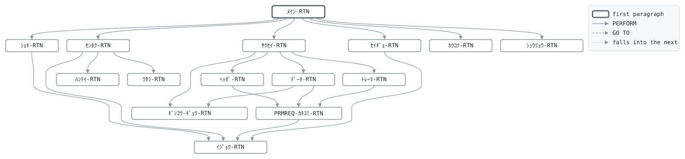

# GLM010

```text
GLM010: 保険料請求: 口座振替依頼ファイル作成

月次、振替日 (27日) の前。コマンド行の日付の月を請求月とし、
払込中 (有効・猶予中) の契約のうち、月払は払込済年月が請求月
より前のもの、年払は契約月が請求月で払込済年月が請求月より
前のものを選ぶ。振替額は保険料に未納の月数を合わせた回数分、
月払は2回分まで、年払は1回分。
収納代行の求める銀行・支店・口座番号順に整列し、銀行間の
固定長レイアウトでヘッダ、データ、トレーラ、エンドを書く。
銀行名と支店名は収納代行が埋めるので空白。
制御レコードの最終請求年月を請求月にし、同じ月に二度請求
しない。

復帰コード: 0 作成済、8 日付が日付でないか請求済、
            16 ファイル異常。

変更履歴
日付       担当 変更
2003-10-06 MS   GL-0310 初版、口座振替の開始。
2005-02-07 MS   GL-0371 未納分を合わせて2回分まで。
```

Program [GLM010.cbl](../../../gondwana/programs/GLM010.cbl): 5 files, 15 paragraphs. Its business rules: [9 decision tables](../rules/GLM010.md).

- AUTHOR: ゴンドワナ生命 システム部.
- DATE-WRITTEN: 2003-10-06.

## Contents

- [Files](#files)
- [Flow](#flow)
- [Paragraphs](#paragraphs)
- [Calls](#calls)
- [Data flow](#data-flow)
- [Lineage](#lineage)
  - [Into PM-ｹｲﾔｸ-ﾚｺｰﾄﾞ](#into-pm-ｹｲﾔｸ-ﾚｺｰﾄﾞ)
  - [Into SR-ｾｲﾚﾂ-ﾚｺｰﾄﾞ](#into-sr-ｾｲﾚﾂ-ﾚｺｰﾄﾞ)
  - [Into ZG-ﾌﾘｶｴ-ﾚｺｰﾄﾞ](#into-zg-ﾌﾘｶｴ-ﾚｺｰﾄﾞ)
  - [Into CT-ｾｲｷﾞｮ-ﾚｺｰﾄﾞ](#into-ct-ｾｲｷﾞｮ-ﾚｺｰﾄﾞ)
  - [Into ﾎｳｺｸ-ｷﾞｮｳ](#into-ﾎｳｺｸ-ｷﾞｮｳ)
  - [Into WS-ｺﾏﾝﾄﾞｷﾞｮｳ](#into-ws-ｺﾏﾝﾄﾞｷﾞｮｳ)
  - [Into WS-ｴﾗｰﾌｧｲﾙ](#into-ws-ｴﾗｰﾌｧｲﾙ)
  - [Into WS-ｴﾗｰｽﾃｰﾀｽ](#into-ws-ｴﾗｰｽﾃｰﾀｽ)
  - [Into WS-ｷﾞｮｳﾑﾋﾂﾞｹ](#into-ws-ｷﾞｮｳﾑﾋﾂﾞｹ)
  - [Into WS-ｷﾞｮｳﾑﾋﾂﾞｹ-ﾜﾚｷ](#into-ws-ｷﾞｮｳﾑﾋﾂﾞｹ-ﾜﾚｷ)
  - [Into WS-ﾎｳｺｳ](#into-ws-ﾎｳｺｳ)
  - [Into WS-ﾍﾝｶﾝｹｯｶ](#into-ws-ﾍﾝｶﾝｹｯｶ)
  - [Into WS-ﾋｷｵﾄｼﾋﾞ](#into-ws-ﾋｷｵﾄｼﾋﾞ)
  - [Into WS-ﾊﾗｲｺﾐｽﾞﾐ](#into-ws-ﾊﾗｲｺﾐｽﾞﾐ)
  - [Into WS-ｶｲｽｳ](#into-ws-ｶｲｽｳ)
  - [Into WS-ｿｳｷﾞﾝｺｳ](#into-ws-ｿｳｷﾞﾝｺｳ)
  - [Into WS-ｹﾝｽｳ](#into-ws-ｹﾝｽｳ)
  - [Into WS-ﾎｳｺｸ](#into-ws-ﾎｳｺｸ)
  - [Out of the program](#out-of-the-program)
  - [Into other data items](#into-other-data-items)
- [Field origins](#field-origins)
  - [File REPORT-F](#file-report-f)
  - [File SORT-F](#file-sort-f)
  - [File PRMREQ-F](#file-prmreq-f)
  - [File GLSCTL-F](#file-glsctl-f)
- [Links between records](#links-between-records)
- [Records](#records)
  - [PM-ｹｲﾔｸ-ﾚｺｰﾄﾞ](#pm-ｹｲﾔｸ-ﾚｺｰﾄﾞ)
  - [SR-ｾｲﾚﾂ-ﾚｺｰﾄﾞ](#sr-ｾｲﾚﾂ-ﾚｺｰﾄﾞ)
  - [ZG-ﾌﾘｶｴ-ﾚｺｰﾄﾞ](#zg-ﾌﾘｶｴ-ﾚｺｰﾄﾞ)
  - [CT-ｾｲｷﾞｮ-ﾚｺｰﾄﾞ](#ct-ｾｲｷﾞｮ-ﾚｺｰﾄﾞ)
  - [ﾎｳｺｸ-ｷﾞｮｳ](#ﾎｳｺｸ-ｷﾞｮｳ)
  - [WS-ｽﾃｰﾀｽ](#ws-ｽﾃｰﾀｽ)
  - [WS-ｺﾏﾝﾄﾞｷﾞｮｳ](#ws-ｺﾏﾝﾄﾞｷﾞｮｳ)
  - [WS-ｴﾗｰﾌｧｲﾙ](#ws-ｴﾗｰﾌｧｲﾙ)
  - [WS-ｴﾗｰｽﾃｰﾀｽ](#ws-ｴﾗｰｽﾃｰﾀｽ)
  - [WS-ｷﾞｮｳﾑﾋﾂﾞｹ](#ws-ｷﾞｮｳﾑﾋﾂﾞｹ)
  - [WS-ｷﾞｮｳﾑﾋﾂﾞｹ-ﾌﾞﾝｶｲ](#ws-ｷﾞｮｳﾑﾋﾂﾞｹ-ﾌﾞﾝｶｲ)
  - [WS-ｷﾞｮｳﾑﾋﾂﾞｹ-ﾜﾚｷ](#ws-ｷﾞｮｳﾑﾋﾂﾞｹ-ﾜﾚｷ)
  - [WS-ﾎｳｺｳ](#ws-ﾎｳｺｳ)
  - [WS-ﾍﾝｶﾝｹｯｶ](#ws-ﾍﾝｶﾝｹｯｶ)
  - [WS-ﾋｷｵﾄｼﾋﾞ](#ws-ﾋｷｵﾄｼﾋﾞ)
  - [WS-ﾊﾗｲｺﾐｽﾞﾐ](#ws-ﾊﾗｲｺﾐｽﾞﾐ)
  - [WS-ｶｲｽｳ](#ws-ｶｲｽｳ)
  - [WS-ｿｳｷﾞﾝｺｳ](#ws-ｿｳｷﾞﾝｺｳ)
  - [WS-ｹﾝｽｳ](#ws-ｹﾝｽｳ)
  - [WS-ﾌｯｷｺｰﾄﾞ](#ws-ﾌｯｷｺｰﾄﾞ)
  - [WS-ﾎｳｺｸ](#ws-ﾎｳｺｸ)

## Files

| File | Kind | Assigned to | Organization | Status field | Opened | Records |
| --- | --- | --- | --- | --- | --- | --- |
| POLMST-F | FD | POLMST | INDEXED, key PM-ｼｮｳｹﾝﾊﾞﾝｺﾞｳ | WS-POLMST-ST | INPUT | PM-ｹｲﾔｸ-ﾚｺｰﾄﾞ |
| SORT-F | SD | SORTWK | SEQUENTIAL | | | SR-ｾｲﾚﾂ-ﾚｺｰﾄﾞ |
| PRMREQ-F | FD | PRMREQ | SEQUENTIAL | WS-PRMREQ-ST | OUTPUT | ZG-ﾌﾘｶｴ-ﾚｺｰﾄﾞ |
| GLSCTL-F | FD | GLSCTL | SEQUENTIAL | WS-GLSCTL-ST | I-O | CT-ｾｲｷﾞｮ-ﾚｺｰﾄﾞ |
| REPORT-F | FD | GLM010R | LINE SEQUENTIAL | WS-REPORT-ST | OUTPUT | ﾎｳｺｸ-ｷﾞｮｳ |

## Flow



## Paragraphs

| Paragraph | Description | Source | Performs | Goes to | Performed by | Reached by |
| --- | --- | --- | --- | --- | --- | --- |
| ﾒｲﾝ-RTN | ﾒｲﾝ-RTN: 準備、選択と整列と作成、制御レコード、報告、終了。 | [GLM010.cbl:131](../../../gondwana/programs/GLM010.cbl#L131) | ｼｮｷ-RTN, ｾﾝﾀｸ-RTN (SORT), ｻｸｾｲ-RTN (SORT), ｾｲｷﾞｮ-RTN, ﾎｳｺｸ-RTN, ｼｭｳﾘｮｳ-RTN | | | |
| ｼｮｷ-RTN | ｼｮｷ-RTN: 業務日付、ファイル、制御レコード、請求済の検査。 | [GLM010.cbl:146](../../../gondwana/programs/GLM010.cbl#L146) | ｲｼﾞｮｳ-RTN | | ﾒｲﾝ-RTN | |
| ｾﾝﾀｸ-RTN | ｾﾝﾀｸ-RTN: マスタを読み、請求する契約を整列に渡す。 | [GLM010.cbl:198](../../../gondwana/programs/GLM010.cbl#L198) | ﾊﾝﾃｲ-RTN, ﾜﾀｼ-RTN, ｲｼﾞｮｳ-RTN | | ﾒｲﾝ-RTN | |
| ﾊﾝﾃｲ-RTN | ﾊﾝﾃｲ-RTN: 請求する回数。請求しない契約は 0。 | [GLM010.cbl:216](../../../gondwana/programs/GLM010.cbl#L216) | | | ｾﾝﾀｸ-RTN | |
| ﾜﾀｼ-RTN | ﾜﾀｼ-RTN: 整列レコードを作って RELEASE する。 | [GLM010.cbl:238](../../../gondwana/programs/GLM010.cbl#L238) | | | ｾﾝﾀｸ-RTN | |
| ｻｸｾｲ-RTN | ｻｸｾｲ-RTN: ヘッダ、整列済みのデータ、トレーラ、エンドを書く。 銀行が変わるごとに報告に1行。 | [GLM010.cbl:254](../../../gondwana/programs/GLM010.cbl#L254) | ﾍｯﾀﾞ-RTN, ﾃﾞｰﾀ-RTN, ｷﾞﾝｺｳ-ｷﾞｮｳ-RTN, ﾄﾚｰﾗ-RTN | | ﾒｲﾝ-RTN | |
| ﾍｯﾀﾞ-RTN | ﾍｯﾀﾞ-RTN: 委託者と引落日。 | [GLM010.cbl:283](../../../gondwana/programs/GLM010.cbl#L283) | PRMREQ-ｶｷｺﾐ-RTN | | ｻｸｾｲ-RTN | |
| ﾃﾞｰﾀ-RTN | ﾃﾞｰﾀ-RTN: 1件の振替依頼。銀行が変わったら前の銀行の行。 | [GLM010.cbl:302](../../../gondwana/programs/GLM010.cbl#L302) | ｷﾞﾝｺｳ-ｷﾞｮｳ-RTN, PRMREQ-ｶｷｺﾐ-RTN | | ｻｸｾｲ-RTN | |
| ｷﾞﾝｺｳ-ｷﾞｮｳ-RTN | ｷﾞﾝｺｳ-ｷﾞｮｳ-RTN: 銀行ごとの件数と金額を報告し、数え直す。 | [GLM010.cbl:327](../../../gondwana/programs/GLM010.cbl#L327) | | | ｻｸｾｲ-RTN, ﾃﾞｰﾀ-RTN | |
| ﾄﾚｰﾗ-RTN | ﾄﾚｰﾗ-RTN: 合計のトレーラとエンド記録。 | [GLM010.cbl:337](../../../gondwana/programs/GLM010.cbl#L337) | PRMREQ-ｶｷｺﾐ-RTN | | ｻｸｾｲ-RTN | |
| PRMREQ-ｶｷｺﾐ-RTN | PRMREQ-ｶｷｺﾐ-RTN: 依頼ファイルに1記録。 | [GLM010.cbl:352](../../../gondwana/programs/GLM010.cbl#L352) | ｲｼﾞｮｳ-RTN | | ﾍｯﾀﾞ-RTN, ﾃﾞｰﾀ-RTN, ﾄﾚｰﾗ-RTN | |
| ｾｲｷﾞｮ-RTN | ｾｲｷﾞｮ-RTN: 最終請求年月を書き戻す。 | [GLM010.cbl:363](../../../gondwana/programs/GLM010.cbl#L363) | ｲｼﾞｮｳ-RTN | | ﾒｲﾝ-RTN | |
| ﾎｳｺｸ-RTN | ﾎｳｺｸ-RTN: 件数と合計。 | [GLM010.cbl:375](../../../gondwana/programs/GLM010.cbl#L375) | | | ﾒｲﾝ-RTN | |
| ｼｭｳﾘｮｳ-RTN | ｼｭｳﾘｮｳ-RTN: ファイルを閉じ、件数を表示する。 | [GLM010.cbl:388](../../../gondwana/programs/GLM010.cbl#L388) | | | ﾒｲﾝ-RTN | |
| ｲｼﾞｮｳ-RTN | ｲｼﾞｮｳ-RTN: ファイル異常は 16 で終わる。 | [GLM010.cbl:396](../../../gondwana/programs/GLM010.cbl#L396) | | | ｼｮｷ-RTN, ｾﾝﾀｸ-RTN, PRMREQ-ｶｷｺﾐ-RTN, ｾｲｷﾞｮ-RTN | |

## Calls

| Calls | Passing | Paragraph | Source |
| --- | --- | --- | --- |
| [GLC020](GLC020.md) | WS-ﾎｳｺｳ, WS-ｷﾞｮｳﾑﾋﾂﾞｹ, WS-ｷﾞｮｳﾑﾋﾂﾞｹ-ﾜﾚｷ, WS-ﾍﾝｶﾝｹｯｶ | ｼｮｷ-RTN | [GLM010.cbl:149](../../../gondwana/programs/GLM010.cbl#L149) |

## Data flow

| Paragraph | Reads | Writes |
| --- | --- | --- |
| ﾒｲﾝ-RTN | SR-ｷﾞﾝｺｳｺｰﾄﾞ, SR-ｼﾃﾝｺｰﾄﾞ, SR-ｺｳｻﾞﾊﾞﾝｺﾞｳ, WS-ﾌｯｷｺｰﾄﾞ | RETURN-CODE |
| ｼｮｷ-RTN | WS-ｺﾏﾝﾄﾞｷﾞｮｳ, WS-ﾎｳｺｳ, WS-ｷﾞｮｳﾑﾋﾂﾞｹ, WS-ｷﾞｮｳﾑﾋﾂﾞｹ-ﾜﾚｷ, WS-ﾍﾝｶﾝｹｯｶ, WS-POLMST-ST, WS-GLSCTL-ST, WS-PRMREQ-ST, WS-REPORT-ST, WS-ｴﾗｰﾌｧｲﾙ, CT-ｻｲｼｭｳｾｲｷｭｳﾈﾝｹﾞﾂ, WS-ｾｲｷｭｳ-YYYYMM, WS-ﾋｮｳﾀﾞｲ-ｷﾞｮｳ | WS-ｺﾏﾝﾄﾞｷﾞｮｳ, WS-ｷﾞｮｳﾑﾋﾂﾞｹ, WS-ﾎｳｺｳ, WS-ｷﾞｮｳﾑﾋﾂﾞｹ-ﾜﾚｷ, WS-ﾍﾝｶﾝｹｯｶ, RETURN-CODE, WS-ｴﾗｰﾌｧｲﾙ, WS-ｴﾗｰｽﾃｰﾀｽ, CT-ｾｲｷﾞｮ-ﾚｺｰﾄﾞ, WS-ﾋｮｳﾀﾞｲ-ﾋﾂﾞｹ, WS-ﾋｮｳﾀﾞｲ-ﾈﾝｹﾞﾂ, ﾎｳｺｸ-ｷﾞｮｳ |
| ｾﾝﾀｸ-RTN | WS-POLMST-ST, WS-ｶｲｽｳ | PM-ｹｲﾔｸ-ﾚｺｰﾄﾞ, WS-ｴﾗｰﾌｧｲﾙ, WS-ｴﾗｰｽﾃｰﾀｽ |
| ﾊﾝﾃｲ-RTN | PM-ｼﾞｮｳﾀｲ, PM-ﾊﾗｲｺﾐｽﾞﾐﾈﾝｹﾞﾂ, WS-ｾｲｷｭｳ-YYYYMM, PM-ﾊﾗｲｺﾐﾎｳﾎｳ, PM-ｹｲﾔｸﾋﾞ, WS-ｾｲｷｭｳ-YYYY, WS-ﾊﾗｲｺﾐ-YYYY, WS-ｾｲｷｭｳ-MM, WS-ﾊﾗｲｺﾐ-MM, WS-ｶｲｽｳ | WS-ｶｲｽｳ, WS-ﾊﾗｲｺﾐｽﾞﾐ |
| ﾜﾀｼ-RTN | PM-ｷﾞﾝｺｳｺｰﾄﾞ, PM-ｼﾃﾝｺｰﾄﾞ, PM-ｺｳｻﾞﾊﾞﾝｺﾞｳ, PM-ﾖｷﾝｼｭﾓｸ, PM-ｺｳｻﾞﾒｲｷﾞ, PM-ｼｮｳｹﾝﾊﾞﾝｺﾞｳ, PM-ﾎｹﾝﾘｮｳ, WS-ｶｲｽｳ, WS-ｾﾝﾀｸｹﾝｽｳ, SR-ｷﾝｶﾞｸ, WS-ｾｲｷｭｳｷﾝｶﾞｸ | SR-ｷﾞﾝｺｳｺｰﾄﾞ, SR-ｼﾃﾝｺｰﾄﾞ, SR-ｺｳｻﾞﾊﾞﾝｺﾞｳ, SR-ﾖｷﾝｼｭﾓｸ, SR-ｺｳｻﾞﾒｲｷﾞ, SR-ｼｮｳｹﾝﾊﾞﾝｺﾞｳ, SR-ｷﾝｶﾞｸ, SR-ｾｲﾚﾂ-ﾚｺｰﾄﾞ, WS-ｾﾝﾀｸｹﾝｽｳ, WS-ｾｲｷｭｳｷﾝｶﾞｸ |
| ｻｸｾｲ-RTN | SR-ｷﾞﾝｺｳｺｰﾄﾞ, WS-ｷﾞﾝｺｳｹﾝｽｳ | WS-ｿｳｷﾞﾝｺｳ, SR-ｾｲﾚﾂ-ﾚｺｰﾄﾞ, SR-ｷﾞﾝｺｳｺｰﾄﾞ |
| ﾍｯﾀﾞ-RTN | WS-ｾｲｷｭｳ-MM, WS-ﾋｷｵﾄｼﾋﾞ | ZG-ﾌﾘｶｴ-ﾚｺｰﾄﾞ, ZG-ﾃﾞｰﾀｸﾌﾞﾝ, ZG-H-ｼｭﾍﾞﾂｺｰﾄﾞ, ZG-H-ｺｰﾄﾞｸﾌﾞﾝ, ZG-H-ｲﾀｸｼｬｺｰﾄﾞ, ZG-H-ｲﾀｸｼｬﾒｲ, WS-ﾋｷｵﾄｼ-MM, ZG-H-ﾋｷｵﾄｼﾋﾞ, ZG-H-ｷﾞﾝｺｳｺｰﾄﾞ, ZG-H-ｷﾞﾝｺｳﾒｲ, ZG-H-ｼﾃﾝﾒｲ, ZG-H-ｼﾃﾝｺｰﾄﾞ, ZG-H-ﾖｷﾝｼｭﾓｸ, ZG-H-ｺｳｻﾞﾊﾞﾝｺﾞｳ |
| ﾃﾞｰﾀ-RTN | SR-ｷﾞﾝｺｳｺｰﾄﾞ, WS-ｿｳｷﾞﾝｺｳ, WS-ｷﾞﾝｺｳｹﾝｽｳ, SR-ｼﾃﾝｺｰﾄﾞ, SR-ﾖｷﾝｼｭﾓｸ, SR-ｺｳｻﾞﾊﾞﾝｺﾞｳ, SR-ｺｳｻﾞﾒｲｷﾞ, SR-ｷﾝｶﾞｸ, SR-ｼｮｳｹﾝﾊﾞﾝｺﾞｳ, WS-ｷﾞﾝｺｳｷﾝｶﾞｸ | WS-ｿｳｷﾞﾝｺｳ, ZG-ﾌﾘｶｴ-ﾚｺｰﾄﾞ, ZG-ﾃﾞｰﾀｸﾌﾞﾝ, ZG-D-ｷﾞﾝｺｳｺｰﾄﾞ, ZG-D-ｼﾃﾝｺｰﾄﾞ, ZG-D-ﾖｷﾝｼｭﾓｸ, ZG-D-ｺｳｻﾞﾊﾞﾝｺﾞｳ, ZG-D-ｺｳｻﾞﾒｲｷﾞ, ZG-D-ｷﾝｶﾞｸ, ZG-D-ｼﾝｷｺｰﾄﾞ, ZG-D-ｺｷｬｸﾊﾞﾝｺﾞｳ, ZG-D-ﾌﾘｶｴｹｯｶ, WS-ｷﾞﾝｺｳｹﾝｽｳ, WS-ｷﾞﾝｺｳｷﾝｶﾞｸ |
| ｷﾞﾝｺｳ-ｷﾞｮｳ-RTN | WS-ｿｳｷﾞﾝｺｳ, WS-ｷﾞﾝｺｳｹﾝｽｳ, WS-ｷﾞﾝｺｳｷﾝｶﾞｸ, WS-ｷﾞﾝｺｳ-ｷﾞｮｳ | WS-ｷﾞﾝｺｳ-ｺｰﾄﾞ, WS-ｷﾞﾝｺｳ-ｹﾝｽｳ, WS-ｷﾞﾝｺｳ-ｷﾝｶﾞｸ, ﾎｳｺｸ-ｷﾞｮｳ, WS-ｷﾞﾝｺｳｹﾝｽｳ, WS-ｷﾞﾝｺｳｷﾝｶﾞｸ |
| ﾄﾚｰﾗ-RTN | WS-ｾﾝﾀｸｹﾝｽｳ, WS-ｾｲｷｭｳｷﾝｶﾞｸ | ZG-ﾌﾘｶｴ-ﾚｺｰﾄﾞ, ZG-ﾃﾞｰﾀｸﾌﾞﾝ, ZG-T-ｺﾞｳｹｲｹﾝｽｳ, ZG-T-ｺﾞｳｹｲｷﾝｶﾞｸ, ZG-T-ﾌﾘｶｴｽﾞﾐｹﾝｽｳ, ZG-T-ﾌﾘｶｴｽﾞﾐｷﾝｶﾞｸ, ZG-T-ﾌﾘｶｴﾌﾉｳｹﾝｽｳ, ZG-T-ﾌﾘｶｴﾌﾉｳｷﾝｶﾞｸ |
| PRMREQ-ｶｷｺﾐ-RTN | WS-PRMREQ-ST | ZG-ﾌﾘｶｴ-ﾚｺｰﾄﾞ, WS-ｴﾗｰﾌｧｲﾙ, WS-ｴﾗｰｽﾃｰﾀｽ |
| ｾｲｷﾞｮ-RTN | WS-ｾｲｷｭｳ-YYYYMM, WS-GLSCTL-ST | CT-ｻｲｼｭｳｾｲｷｭｳﾈﾝｹﾞﾂ, CT-ｾｲｷﾞｮ-ﾚｺｰﾄﾞ, WS-ｴﾗｰﾌｧｲﾙ, WS-ｴﾗｰｽﾃｰﾀｽ |
| ﾎｳｺｸ-RTN | WS-ｾﾝﾀｸｹﾝｽｳ, WS-ｹﾝｽｳ-ｷﾞｮｳ, WS-ｾｲｷｭｳｷﾝｶﾞｸ | ﾎｳｺｸ-ｷﾞｮｳ, WS-ｹﾝｽｳ-ﾗﾍﾞﾙ, WS-ｹﾝｽｳ-ｱﾀｲ |
| ｼｭｳﾘｮｳ-RTN | WS-ｾﾝﾀｸｹﾝｽｳ, WS-ｾｲｷｭｳｷﾝｶﾞｸ | |
| ｲｼﾞｮｳ-RTN | WS-ｴﾗｰﾌｧｲﾙ, WS-ｴﾗｰｽﾃｰﾀｽ | RETURN-CODE |

## Lineage

Where each data item's values come from, grouped by the record they go into. A data item links to the record it belongs to.

### Into PM-ｹｲﾔｸ-ﾚｺｰﾄﾞ

Record [PM-ｹｲﾔｸ-ﾚｺｰﾄﾞ](#pm-ｹｲﾔｸ-ﾚｺｰﾄﾞ), from copybook [POLMST](../copybooks/POLMST.md).

| Into | From | Statement | Paragraph | Source |
| --- | --- | --- | --- | --- |
| PM-ｹｲﾔｸ-ﾚｺｰﾄﾞ | file POLMST-F | READ | ｾﾝﾀｸ-RTN | [GLM010.cbl:199](../../../gondwana/programs/GLM010.cbl#L199) |
| PM-ｹｲﾔｸ-ﾚｺｰﾄﾞ | file POLMST-F | READ | ｾﾝﾀｸ-RTN | [GLM010.cbl:205](../../../gondwana/programs/GLM010.cbl#L205) |

### Into SR-ｾｲﾚﾂ-ﾚｺｰﾄﾞ

Record [SR-ｾｲﾚﾂ-ﾚｺｰﾄﾞ](#sr-ｾｲﾚﾂ-ﾚｺｰﾄﾞ).

| Into | From | Statement | Paragraph | Source |
| --- | --- | --- | --- | --- |
| SR-ｷﾝｶﾞｸ | [PM-ﾎｹﾝﾘｮｳ](#pm-ｹｲﾔｸ-ﾚｺｰﾄﾞ "in PM-ｹｲﾔｸ-ﾚｺｰﾄﾞ") | COMPUTE | ﾜﾀｼ-RTN | [GLM010.cbl:245](../../../gondwana/programs/GLM010.cbl#L245) |
| SR-ｷﾝｶﾞｸ | [WS-ｶｲｽｳ](#ws-ｶｲｽｳ) | COMPUTE | ﾜﾀｼ-RTN | [GLM010.cbl:245](../../../gondwana/programs/GLM010.cbl#L245) |
| SR-ｷﾞﾝｺｳｺｰﾄﾞ | [PM-ｷﾞﾝｺｳｺｰﾄﾞ](#pm-ｹｲﾔｸ-ﾚｺｰﾄﾞ "in PM-ｹｲﾔｸ-ﾚｺｰﾄﾞ") | MOVE | ﾜﾀｼ-RTN | [GLM010.cbl:239](../../../gondwana/programs/GLM010.cbl#L239) |
| SR-ｷﾞﾝｺｳｺｰﾄﾞ | literal 0 | MOVE | ｻｸｾｲ-RTN | [GLM010.cbl:268](../../../gondwana/programs/GLM010.cbl#L268) |
| SR-ｷﾞﾝｺｳｺｰﾄﾞ | literal 0 | MOVE | ｻｸｾｲ-RTN | [GLM010.cbl:271](../../../gondwana/programs/GLM010.cbl#L271) |
| SR-ｺｳｻﾞﾊﾞﾝｺﾞｳ | [PM-ｺｳｻﾞﾊﾞﾝｺﾞｳ](#pm-ｹｲﾔｸ-ﾚｺｰﾄﾞ "in PM-ｹｲﾔｸ-ﾚｺｰﾄﾞ") | MOVE | ﾜﾀｼ-RTN | [GLM010.cbl:241](../../../gondwana/programs/GLM010.cbl#L241) |
| SR-ｺｳｻﾞﾒｲｷﾞ | [PM-ｺｳｻﾞﾒｲｷﾞ](#pm-ｹｲﾔｸ-ﾚｺｰﾄﾞ "in PM-ｹｲﾔｸ-ﾚｺｰﾄﾞ") | MOVE | ﾜﾀｼ-RTN | [GLM010.cbl:243](../../../gondwana/programs/GLM010.cbl#L243) |
| SR-ｼｮｳｹﾝﾊﾞﾝｺﾞｳ | [PM-ｼｮｳｹﾝﾊﾞﾝｺﾞｳ](#pm-ｹｲﾔｸ-ﾚｺｰﾄﾞ "in PM-ｹｲﾔｸ-ﾚｺｰﾄﾞ") | MOVE | ﾜﾀｼ-RTN | [GLM010.cbl:244](../../../gondwana/programs/GLM010.cbl#L244) |
| SR-ｼﾃﾝｺｰﾄﾞ | [PM-ｼﾃﾝｺｰﾄﾞ](#pm-ｹｲﾔｸ-ﾚｺｰﾄﾞ "in PM-ｹｲﾔｸ-ﾚｺｰﾄﾞ") | MOVE | ﾜﾀｼ-RTN | [GLM010.cbl:240](../../../gondwana/programs/GLM010.cbl#L240) |
| SR-ｾｲﾚﾂ-ﾚｺｰﾄﾞ | file SORT-F | RETURN | ｻｸｾｲ-RTN | [GLM010.cbl:257](../../../gondwana/programs/GLM010.cbl#L257) |
| SR-ｾｲﾚﾂ-ﾚｺｰﾄﾞ | file SORT-F | RETURN | ｻｸｾｲ-RTN | [GLM010.cbl:262](../../../gondwana/programs/GLM010.cbl#L262) |
| SR-ｾｲﾚﾂ-ﾚｺｰﾄﾞ | file SORT-F | RETURN | ｻｸｾｲ-RTN | [GLM010.cbl:269](../../../gondwana/programs/GLM010.cbl#L269) |
| SR-ﾖｷﾝｼｭﾓｸ | [PM-ﾖｷﾝｼｭﾓｸ](#pm-ｹｲﾔｸ-ﾚｺｰﾄﾞ "in PM-ｹｲﾔｸ-ﾚｺｰﾄﾞ") | MOVE | ﾜﾀｼ-RTN | [GLM010.cbl:242](../../../gondwana/programs/GLM010.cbl#L242) |

### Into ZG-ﾌﾘｶｴ-ﾚｺｰﾄﾞ

Record [ZG-ﾌﾘｶｴ-ﾚｺｰﾄﾞ](#zg-ﾌﾘｶｴ-ﾚｺｰﾄﾞ), from copybook [ZENGIN](../copybooks/ZENGIN.md).

| Into | From | Statement | Paragraph | Source |
| --- | --- | --- | --- | --- |
| ZG-D-ｷﾝｶﾞｸ | [SR-ｷﾝｶﾞｸ](#sr-ｾｲﾚﾂ-ﾚｺｰﾄﾞ "in SR-ｾｲﾚﾂ-ﾚｺｰﾄﾞ") | MOVE | ﾃﾞｰﾀ-RTN | [GLM010.cbl:316](../../../gondwana/programs/GLM010.cbl#L316) |
| ZG-D-ｷﾞﾝｺｳｺｰﾄﾞ | [SR-ｷﾞﾝｺｳｺｰﾄﾞ](#sr-ｾｲﾚﾂ-ﾚｺｰﾄﾞ "in SR-ｾｲﾚﾂ-ﾚｺｰﾄﾞ") | MOVE | ﾃﾞｰﾀ-RTN | [GLM010.cbl:311](../../../gondwana/programs/GLM010.cbl#L311) |
| ZG-D-ｺｳｻﾞﾊﾞﾝｺﾞｳ | [SR-ｺｳｻﾞﾊﾞﾝｺﾞｳ](#sr-ｾｲﾚﾂ-ﾚｺｰﾄﾞ "in SR-ｾｲﾚﾂ-ﾚｺｰﾄﾞ") | MOVE | ﾃﾞｰﾀ-RTN | [GLM010.cbl:314](../../../gondwana/programs/GLM010.cbl#L314) |
| ZG-D-ｺｳｻﾞﾒｲｷﾞ | [SR-ｺｳｻﾞﾒｲｷﾞ](#sr-ｾｲﾚﾂ-ﾚｺｰﾄﾞ "in SR-ｾｲﾚﾂ-ﾚｺｰﾄﾞ") | MOVE | ﾃﾞｰﾀ-RTN | [GLM010.cbl:315](../../../gondwana/programs/GLM010.cbl#L315) |
| ZG-D-ｺｷｬｸﾊﾞﾝｺﾞｳ | [SR-ｼｮｳｹﾝﾊﾞﾝｺﾞｳ](#sr-ｾｲﾚﾂ-ﾚｺｰﾄﾞ "in SR-ｾｲﾚﾂ-ﾚｺｰﾄﾞ") | MOVE | ﾃﾞｰﾀ-RTN | [GLM010.cbl:318](../../../gondwana/programs/GLM010.cbl#L318) |
| ZG-D-ｼﾃﾝｺｰﾄﾞ | [SR-ｼﾃﾝｺｰﾄﾞ](#sr-ｾｲﾚﾂ-ﾚｺｰﾄﾞ "in SR-ｾｲﾚﾂ-ﾚｺｰﾄﾞ") | MOVE | ﾃﾞｰﾀ-RTN | [GLM010.cbl:312](../../../gondwana/programs/GLM010.cbl#L312) |
| ZG-D-ｼﾝｷｺｰﾄﾞ | literal 0 | MOVE | ﾃﾞｰﾀ-RTN | [GLM010.cbl:317](../../../gondwana/programs/GLM010.cbl#L317) |
| ZG-D-ﾌﾘｶｴｹｯｶ | literal condition ZG-D-ﾐｼｮﾘ | SET | ﾃﾞｰﾀ-RTN | [GLM010.cbl:319](../../../gondwana/programs/GLM010.cbl#L319) |
| ZG-D-ﾖｷﾝｼｭﾓｸ | [SR-ﾖｷﾝｼｭﾓｸ](#sr-ｾｲﾚﾂ-ﾚｺｰﾄﾞ "in SR-ｾｲﾚﾂ-ﾚｺｰﾄﾞ") | MOVE | ﾃﾞｰﾀ-RTN | [GLM010.cbl:313](../../../gondwana/programs/GLM010.cbl#L313) |
| ZG-H-ｲﾀｸｼｬｺｰﾄﾞ | literal 1234567890 | MOVE | ﾍｯﾀﾞ-RTN | [GLM010.cbl:288](../../../gondwana/programs/GLM010.cbl#L288) |
| ZG-H-ｲﾀｸｼｬﾒｲ | literal 'ｺﾞﾝﾄﾞﾜﾅｾｲﾒｲﾎｹﾝ' | MOVE | ﾍｯﾀﾞ-RTN | [GLM010.cbl:289](../../../gondwana/programs/GLM010.cbl#L289) |
| ZG-H-ｷﾞﾝｺｳｺｰﾄﾞ | literal 1 | MOVE | ﾍｯﾀﾞ-RTN | [GLM010.cbl:292](../../../gondwana/programs/GLM010.cbl#L292) |
| ZG-H-ｷﾞﾝｺｳﾒｲ | literal SPACES | MOVE | ﾍｯﾀﾞ-RTN | [GLM010.cbl:293](../../../gondwana/programs/GLM010.cbl#L293) |
| ZG-H-ｺｰﾄﾞｸﾌﾞﾝ | literal 0 | MOVE | ﾍｯﾀﾞ-RTN | [GLM010.cbl:287](../../../gondwana/programs/GLM010.cbl#L287) |
| ZG-H-ｺｳｻﾞﾊﾞﾝｺﾞｳ | literal 1000001 | MOVE | ﾍｯﾀﾞ-RTN | [GLM010.cbl:296](../../../gondwana/programs/GLM010.cbl#L296) |
| ZG-H-ｼｭﾍﾞﾂｺｰﾄﾞ | literal 91 | MOVE | ﾍｯﾀﾞ-RTN | [GLM010.cbl:286](../../../gondwana/programs/GLM010.cbl#L286) |
| ZG-H-ｼﾃﾝｺｰﾄﾞ | literal 1 | MOVE | ﾍｯﾀﾞ-RTN | [GLM010.cbl:294](../../../gondwana/programs/GLM010.cbl#L294) |
| ZG-H-ｼﾃﾝﾒｲ | literal SPACES | MOVE | ﾍｯﾀﾞ-RTN | [GLM010.cbl:293](../../../gondwana/programs/GLM010.cbl#L293) |
| ZG-H-ﾋｷｵﾄｼﾋﾞ | [WS-ﾋｷｵﾄｼﾋﾞ](#ws-ﾋｷｵﾄｼﾋﾞ) | MOVE | ﾍｯﾀﾞ-RTN | [GLM010.cbl:291](../../../gondwana/programs/GLM010.cbl#L291) |
| ZG-H-ﾖｷﾝｼｭﾓｸ | literal 1 | MOVE | ﾍｯﾀﾞ-RTN | [GLM010.cbl:295](../../../gondwana/programs/GLM010.cbl#L295) |
| ZG-T-ｺﾞｳｹｲｷﾝｶﾞｸ | [WS-ｾｲｷｭｳｷﾝｶﾞｸ](#ws-ｹﾝｽｳ "in WS-ｹﾝｽｳ") | MOVE | ﾄﾚｰﾗ-RTN | [GLM010.cbl:341](../../../gondwana/programs/GLM010.cbl#L341) |
| ZG-T-ｺﾞｳｹｲｹﾝｽｳ | [WS-ｾﾝﾀｸｹﾝｽｳ](#ws-ｹﾝｽｳ "in WS-ｹﾝｽｳ") | MOVE | ﾄﾚｰﾗ-RTN | [GLM010.cbl:340](../../../gondwana/programs/GLM010.cbl#L340) |
| ZG-T-ﾌﾘｶｴｽﾞﾐｷﾝｶﾞｸ | literal 0 | MOVE | ﾄﾚｰﾗ-RTN | [GLM010.cbl:342](../../../gondwana/programs/GLM010.cbl#L342) |
| ZG-T-ﾌﾘｶｴｽﾞﾐｹﾝｽｳ | literal 0 | MOVE | ﾄﾚｰﾗ-RTN | [GLM010.cbl:342](../../../gondwana/programs/GLM010.cbl#L342) |
| ZG-T-ﾌﾘｶｴﾌﾉｳｷﾝｶﾞｸ | literal 0 | MOVE | ﾄﾚｰﾗ-RTN | [GLM010.cbl:342](../../../gondwana/programs/GLM010.cbl#L342) |
| ZG-T-ﾌﾘｶｴﾌﾉｳｹﾝｽｳ | literal 0 | MOVE | ﾄﾚｰﾗ-RTN | [GLM010.cbl:342](../../../gondwana/programs/GLM010.cbl#L342) |
| ZG-ﾃﾞｰﾀｸﾌﾞﾝ | literal condition ZG-ﾍｯﾀﾞ | SET | ﾍｯﾀﾞ-RTN | [GLM010.cbl:285](../../../gondwana/programs/GLM010.cbl#L285) |
| ZG-ﾃﾞｰﾀｸﾌﾞﾝ | literal condition ZG-ﾃﾞｰﾀ | SET | ﾃﾞｰﾀ-RTN | [GLM010.cbl:310](../../../gondwana/programs/GLM010.cbl#L310) |
| ZG-ﾃﾞｰﾀｸﾌﾞﾝ | literal condition ZG-ﾄﾚｰﾗ | SET | ﾄﾚｰﾗ-RTN | [GLM010.cbl:339](../../../gondwana/programs/GLM010.cbl#L339) |
| ZG-ﾃﾞｰﾀｸﾌﾞﾝ | literal condition ZG-ｴﾝﾄﾞ | SET | ﾄﾚｰﾗ-RTN | [GLM010.cbl:346](../../../gondwana/programs/GLM010.cbl#L346) |
| ZG-ﾌﾘｶｴ-ﾚｺｰﾄﾞ | literal SPACES | MOVE | ﾍｯﾀﾞ-RTN | [GLM010.cbl:284](../../../gondwana/programs/GLM010.cbl#L284) |
| ZG-ﾌﾘｶｴ-ﾚｺｰﾄﾞ | literal SPACES | MOVE | ﾃﾞｰﾀ-RTN | [GLM010.cbl:309](../../../gondwana/programs/GLM010.cbl#L309) |
| ZG-ﾌﾘｶｴ-ﾚｺｰﾄﾞ | literal SPACES | MOVE | ﾄﾚｰﾗ-RTN | [GLM010.cbl:338](../../../gondwana/programs/GLM010.cbl#L338) |
| ZG-ﾌﾘｶｴ-ﾚｺｰﾄﾞ | literal SPACES | MOVE | ﾄﾚｰﾗ-RTN | [GLM010.cbl:345](../../../gondwana/programs/GLM010.cbl#L345) |

### Into CT-ｾｲｷﾞｮ-ﾚｺｰﾄﾞ

Record [CT-ｾｲｷﾞｮ-ﾚｺｰﾄﾞ](#ct-ｾｲｷﾞｮ-ﾚｺｰﾄﾞ), from copybook [CTLREC](../copybooks/CTLREC.md).

| Into | From | Statement | Paragraph | Source |
| --- | --- | --- | --- | --- |
| CT-ｻｲｼｭｳｾｲｷｭｳﾈﾝｹﾞﾂ | [WS-ｾｲｷｭｳ-YYYYMM](#ws-ｷﾞｮｳﾑﾋﾂﾞｹ-ﾌﾞﾝｶｲ "in WS-ｷﾞｮｳﾑﾋﾂﾞｹ-ﾌﾞﾝｶｲ") | MOVE | ｾｲｷﾞｮ-RTN | [GLM010.cbl:364](../../../gondwana/programs/GLM010.cbl#L364) |
| CT-ｾｲｷﾞｮ-ﾚｺｰﾄﾞ | file GLSCTL-F | READ | ｼｮｷ-RTN | [GLM010.cbl:178](../../../gondwana/programs/GLM010.cbl#L178) |

### Into ﾎｳｺｸ-ｷﾞｮｳ

Record [ﾎｳｺｸ-ｷﾞｮｳ](#ﾎｳｺｸ-ｷﾞｮｳ).

| Into | From | Statement | Paragraph | Source |
| --- | --- | --- | --- | --- |
| ﾎｳｺｸ-ｷﾞｮｳ | [WS-ﾋｮｳﾀﾞｲ-ｷﾞｮｳ](#ws-ﾎｳｺｸ "in WS-ﾎｳｺｸ") | WRITE | ｼｮｷ-RTN | [GLM010.cbl:191](../../../gondwana/programs/GLM010.cbl#L191) |
| ﾎｳｺｸ-ｷﾞｮｳ | literal SPACES | MOVE | ｼｮｷ-RTN | [GLM010.cbl:192](../../../gondwana/programs/GLM010.cbl#L192) |
| ﾎｳｺｸ-ｷﾞｮｳ | [WS-ｷﾞﾝｺｳ-ｷﾞｮｳ](#ws-ﾎｳｺｸ "in WS-ﾎｳｺｸ") | WRITE | ｷﾞﾝｺｳ-ｷﾞｮｳ-RTN | [GLM010.cbl:331](../../../gondwana/programs/GLM010.cbl#L331) |
| ﾎｳｺｸ-ｷﾞｮｳ | literal SPACES | MOVE | ﾎｳｺｸ-RTN | [GLM010.cbl:376](../../../gondwana/programs/GLM010.cbl#L376) |
| ﾎｳｺｸ-ｷﾞｮｳ | [WS-ｹﾝｽｳ-ｷﾞｮｳ](#ws-ﾎｳｺｸ "in WS-ﾎｳｺｸ") | WRITE | ﾎｳｺｸ-RTN | [GLM010.cbl:380](../../../gondwana/programs/GLM010.cbl#L380) |
| ﾎｳｺｸ-ｷﾞｮｳ | [WS-ｹﾝｽｳ-ｷﾞｮｳ](#ws-ﾎｳｺｸ "in WS-ﾎｳｺｸ") | WRITE | ﾎｳｺｸ-RTN | [GLM010.cbl:383](../../../gondwana/programs/GLM010.cbl#L383) |

### Into WS-ｺﾏﾝﾄﾞｷﾞｮｳ

Record [WS-ｺﾏﾝﾄﾞｷﾞｮｳ](#ws-ｺﾏﾝﾄﾞｷﾞｮｳ).

| Into | From | Statement | Paragraph | Source |
| --- | --- | --- | --- | --- |
| WS-ｺﾏﾝﾄﾞｷﾞｮｳ | COMMAND-LINE | ACCEPT | ｼｮｷ-RTN | [GLM010.cbl:147](../../../gondwana/programs/GLM010.cbl#L147) |

### Into WS-ｴﾗｰﾌｧｲﾙ

Record [WS-ｴﾗｰﾌｧｲﾙ](#ws-ｴﾗｰﾌｧｲﾙ).

| Into | From | Statement | Paragraph | Source |
| --- | --- | --- | --- | --- |
| WS-ｴﾗｰﾌｧｲﾙ | literal 'POLMST' | MOVE | ｼｮｷ-RTN | [GLM010.cbl:161](../../../gondwana/programs/GLM010.cbl#L161) |
| WS-ｴﾗｰﾌｧｲﾙ | literal 'GLSCTL' | MOVE | ｼｮｷ-RTN | [GLM010.cbl:164](../../../gondwana/programs/GLM010.cbl#L164) |
| WS-ｴﾗｰﾌｧｲﾙ | literal 'PRMREQ' | MOVE | ｼｮｷ-RTN | [GLM010.cbl:167](../../../gondwana/programs/GLM010.cbl#L167) |
| WS-ｴﾗｰﾌｧｲﾙ | literal 'GLM010R' | MOVE | ｼｮｷ-RTN | [GLM010.cbl:170](../../../gondwana/programs/GLM010.cbl#L170) |
| WS-ｴﾗｰﾌｧｲﾙ | literal SPACES | MOVE | ｼｮｷ-RTN | [GLM010.cbl:173](../../../gondwana/programs/GLM010.cbl#L173) |
| WS-ｴﾗｰﾌｧｲﾙ | literal 'GLSCTL' | MOVE | ｼｮｷ-RTN | [GLM010.cbl:180](../../../gondwana/programs/GLM010.cbl#L180) |
| WS-ｴﾗｰﾌｧｲﾙ | literal 'POLMST' | MOVE | ｾﾝﾀｸ-RTN | [GLM010.cbl:208](../../../gondwana/programs/GLM010.cbl#L208) |
| WS-ｴﾗｰﾌｧｲﾙ | literal 'PRMREQ' | MOVE | PRMREQ-ｶｷｺﾐ-RTN | [GLM010.cbl:355](../../../gondwana/programs/GLM010.cbl#L355) |
| WS-ｴﾗｰﾌｧｲﾙ | literal 'GLSCTL' | MOVE | ｾｲｷﾞｮ-RTN | [GLM010.cbl:367](../../../gondwana/programs/GLM010.cbl#L367) |

### Into WS-ｴﾗｰｽﾃｰﾀｽ

Record [WS-ｴﾗｰｽﾃｰﾀｽ](#ws-ｴﾗｰｽﾃｰﾀｽ).

| Into | From | Statement | Paragraph | Source |
| --- | --- | --- | --- | --- |
| WS-ｴﾗｰｽﾃｰﾀｽ | [WS-POLMST-ST](#ws-ｽﾃｰﾀｽ "in WS-ｽﾃｰﾀｽ") | MOVE | ｼｮｷ-RTN | [GLM010.cbl:162](../../../gondwana/programs/GLM010.cbl#L162) |
| WS-ｴﾗｰｽﾃｰﾀｽ | [WS-GLSCTL-ST](#ws-ｽﾃｰﾀｽ "in WS-ｽﾃｰﾀｽ") | MOVE | ｼｮｷ-RTN | [GLM010.cbl:165](../../../gondwana/programs/GLM010.cbl#L165) |
| WS-ｴﾗｰｽﾃｰﾀｽ | [WS-PRMREQ-ST](#ws-ｽﾃｰﾀｽ "in WS-ｽﾃｰﾀｽ") | MOVE | ｼｮｷ-RTN | [GLM010.cbl:168](../../../gondwana/programs/GLM010.cbl#L168) |
| WS-ｴﾗｰｽﾃｰﾀｽ | [WS-REPORT-ST](#ws-ｽﾃｰﾀｽ "in WS-ｽﾃｰﾀｽ") | MOVE | ｼｮｷ-RTN | [GLM010.cbl:171](../../../gondwana/programs/GLM010.cbl#L171) |
| WS-ｴﾗｰｽﾃｰﾀｽ | [WS-GLSCTL-ST](#ws-ｽﾃｰﾀｽ "in WS-ｽﾃｰﾀｽ") | MOVE | ｼｮｷ-RTN | [GLM010.cbl:181](../../../gondwana/programs/GLM010.cbl#L181) |
| WS-ｴﾗｰｽﾃｰﾀｽ | [WS-POLMST-ST](#ws-ｽﾃｰﾀｽ "in WS-ｽﾃｰﾀｽ") | MOVE | ｾﾝﾀｸ-RTN | [GLM010.cbl:209](../../../gondwana/programs/GLM010.cbl#L209) |
| WS-ｴﾗｰｽﾃｰﾀｽ | [WS-PRMREQ-ST](#ws-ｽﾃｰﾀｽ "in WS-ｽﾃｰﾀｽ") | MOVE | PRMREQ-ｶｷｺﾐ-RTN | [GLM010.cbl:356](../../../gondwana/programs/GLM010.cbl#L356) |
| WS-ｴﾗｰｽﾃｰﾀｽ | [WS-GLSCTL-ST](#ws-ｽﾃｰﾀｽ "in WS-ｽﾃｰﾀｽ") | MOVE | ｾｲｷﾞｮ-RTN | [GLM010.cbl:368](../../../gondwana/programs/GLM010.cbl#L368) |

### Into WS-ｷﾞｮｳﾑﾋﾂﾞｹ

Record [WS-ｷﾞｮｳﾑﾋﾂﾞｹ](#ws-ｷﾞｮｳﾑﾋﾂﾞｹ).

| Into | From | Statement | Paragraph | Source |
| --- | --- | --- | --- | --- |
| WS-ｷﾞｮｳﾑﾋﾂﾞｹ | [WS-ｺﾏﾝﾄﾞｷﾞｮｳ](#ws-ｺﾏﾝﾄﾞｷﾞｮｳ) | MOVE | ｼｮｷ-RTN | [GLM010.cbl:148](../../../gondwana/programs/GLM010.cbl#L148) |
| WS-ｷﾞｮｳﾑﾋﾂﾞｹ | call GLC020 argument 2 | CALL | ｼｮｷ-RTN | [GLM010.cbl:149](../../../gondwana/programs/GLM010.cbl#L149) |

### Into WS-ｷﾞｮｳﾑﾋﾂﾞｹ-ﾜﾚｷ

Record [WS-ｷﾞｮｳﾑﾋﾂﾞｹ-ﾜﾚｷ](#ws-ｷﾞｮｳﾑﾋﾂﾞｹ-ﾜﾚｷ).

| Into | From | Statement | Paragraph | Source |
| --- | --- | --- | --- | --- |
| WS-ｷﾞｮｳﾑﾋﾂﾞｹ-ﾜﾚｷ | call GLC020 argument 3 | CALL | ｼｮｷ-RTN | [GLM010.cbl:149](../../../gondwana/programs/GLM010.cbl#L149) |

### Into WS-ﾎｳｺｳ

Record [WS-ﾎｳｺｳ](#ws-ﾎｳｺｳ).

| Into | From | Statement | Paragraph | Source |
| --- | --- | --- | --- | --- |
| WS-ﾎｳｺｳ | call GLC020 argument 1 | CALL | ｼｮｷ-RTN | [GLM010.cbl:149](../../../gondwana/programs/GLM010.cbl#L149) |

### Into WS-ﾍﾝｶﾝｹｯｶ

Record [WS-ﾍﾝｶﾝｹｯｶ](#ws-ﾍﾝｶﾝｹｯｶ).

| Into | From | Statement | Paragraph | Source |
| --- | --- | --- | --- | --- |
| WS-ﾍﾝｶﾝｹｯｶ | call GLC020 argument 4 | CALL | ｼｮｷ-RTN | [GLM010.cbl:149](../../../gondwana/programs/GLM010.cbl#L149) |

### Into WS-ﾋｷｵﾄｼﾋﾞ

Record [WS-ﾋｷｵﾄｼﾋﾞ](#ws-ﾋｷｵﾄｼﾋﾞ).

| Into | From | Statement | Paragraph | Source |
| --- | --- | --- | --- | --- |
| WS-ﾋｷｵﾄｼ-MM | [WS-ｾｲｷｭｳ-MM](#ws-ｷﾞｮｳﾑﾋﾂﾞｹ-ﾌﾞﾝｶｲ "in WS-ｷﾞｮｳﾑﾋﾂﾞｹ-ﾌﾞﾝｶｲ") | MOVE | ﾍｯﾀﾞ-RTN | [GLM010.cbl:290](../../../gondwana/programs/GLM010.cbl#L290) |

### Into WS-ﾊﾗｲｺﾐｽﾞﾐ

Record [WS-ﾊﾗｲｺﾐｽﾞﾐ](#ws-ﾊﾗｲｺﾐｽﾞﾐ).

| Into | From | Statement | Paragraph | Source |
| --- | --- | --- | --- | --- |
| WS-ﾊﾗｲｺﾐｽﾞﾐ | [PM-ﾊﾗｲｺﾐｽﾞﾐﾈﾝｹﾞﾂ](#pm-ｹｲﾔｸ-ﾚｺｰﾄﾞ "in PM-ｹｲﾔｸ-ﾚｺｰﾄﾞ") | MOVE | ﾊﾝﾃｲ-RTN | [GLM010.cbl:219](../../../gondwana/programs/GLM010.cbl#L219) |

### Into WS-ｶｲｽｳ

Record [WS-ｶｲｽｳ](#ws-ｶｲｽｳ).

| Into | From | Statement | Paragraph | Source |
| --- | --- | --- | --- | --- |
| WS-ｶｲｽｳ | literal 0 | MOVE | ﾊﾝﾃｲ-RTN | [GLM010.cbl:217](../../../gondwana/programs/GLM010.cbl#L217) |
| WS-ｶｲｽｳ | literal 1 | MOVE | ﾊﾝﾃｲ-RTN | [GLM010.cbl:223](../../../gondwana/programs/GLM010.cbl#L223) |
| WS-ｶｲｽｳ | [WS-ｾｲｷｭｳ-YYYY](#ws-ｷﾞｮｳﾑﾋﾂﾞｹ-ﾌﾞﾝｶｲ "in WS-ｷﾞｮｳﾑﾋﾂﾞｹ-ﾌﾞﾝｶｲ") | COMPUTE | ﾊﾝﾃｲ-RTN | [GLM010.cbl:226](../../../gondwana/programs/GLM010.cbl#L226) |
| WS-ｶｲｽｳ | [WS-ﾊﾗｲｺﾐ-YYYY](#ws-ﾊﾗｲｺﾐｽﾞﾐ "in WS-ﾊﾗｲｺﾐｽﾞﾐ") | COMPUTE | ﾊﾝﾃｲ-RTN | [GLM010.cbl:226](../../../gondwana/programs/GLM010.cbl#L226) |
| WS-ｶｲｽｳ | [WS-ｾｲｷｭｳ-MM](#ws-ｷﾞｮｳﾑﾋﾂﾞｹ-ﾌﾞﾝｶｲ "in WS-ｷﾞｮｳﾑﾋﾂﾞｹ-ﾌﾞﾝｶｲ") | COMPUTE | ﾊﾝﾃｲ-RTN | [GLM010.cbl:226](../../../gondwana/programs/GLM010.cbl#L226) |
| WS-ｶｲｽｳ | [WS-ﾊﾗｲｺﾐ-MM](#ws-ﾊﾗｲｺﾐｽﾞﾐ "in WS-ﾊﾗｲｺﾐｽﾞﾐ") | COMPUTE | ﾊﾝﾃｲ-RTN | [GLM010.cbl:226](../../../gondwana/programs/GLM010.cbl#L226) |
| WS-ｶｲｽｳ | literal 2 | MOVE | ﾊﾝﾃｲ-RTN | [GLM010.cbl:230](../../../gondwana/programs/GLM010.cbl#L230) |

### Into WS-ｿｳｷﾞﾝｺｳ

Record [WS-ｿｳｷﾞﾝｺｳ](#ws-ｿｳｷﾞﾝｺｳ).

| Into | From | Statement | Paragraph | Source |
| --- | --- | --- | --- | --- |
| WS-ｿｳｷﾞﾝｺｳ | literal 0 | MOVE | ｻｸｾｲ-RTN | [GLM010.cbl:256](../../../gondwana/programs/GLM010.cbl#L256) |
| WS-ｿｳｷﾞﾝｺｳ | [SR-ｷﾞﾝｺｳｺｰﾄﾞ](#sr-ｾｲﾚﾂ-ﾚｺｰﾄﾞ "in SR-ｾｲﾚﾂ-ﾚｺｰﾄﾞ") | MOVE | ﾃﾞｰﾀ-RTN | [GLM010.cbl:307](../../../gondwana/programs/GLM010.cbl#L307) |

### Into WS-ｹﾝｽｳ

Record [WS-ｹﾝｽｳ](#ws-ｹﾝｽｳ).

| Into | From | Statement | Paragraph | Source |
| --- | --- | --- | --- | --- |
| WS-ｷﾞﾝｺｳｷﾝｶﾞｸ | [SR-ｷﾝｶﾞｸ](#sr-ｾｲﾚﾂ-ﾚｺｰﾄﾞ "in SR-ｾｲﾚﾂ-ﾚｺｰﾄﾞ") | ADD | ﾃﾞｰﾀ-RTN | [GLM010.cbl:322](../../../gondwana/programs/GLM010.cbl#L322) |
| WS-ｷﾞﾝｺｳｷﾝｶﾞｸ | literal 0 | MOVE | ｷﾞﾝｺｳ-ｷﾞｮｳ-RTN | [GLM010.cbl:332](../../../gondwana/programs/GLM010.cbl#L332) |
| WS-ｷﾞﾝｺｳｹﾝｽｳ | literal 1 | ADD | ﾃﾞｰﾀ-RTN | [GLM010.cbl:321](../../../gondwana/programs/GLM010.cbl#L321) |
| WS-ｷﾞﾝｺｳｹﾝｽｳ | literal 0 | MOVE | ｷﾞﾝｺｳ-ｷﾞｮｳ-RTN | [GLM010.cbl:332](../../../gondwana/programs/GLM010.cbl#L332) |
| WS-ｾｲｷｭｳｷﾝｶﾞｸ | [SR-ｷﾝｶﾞｸ](#sr-ｾｲﾚﾂ-ﾚｺｰﾄﾞ "in SR-ｾｲﾚﾂ-ﾚｺｰﾄﾞ") | ADD | ﾜﾀｼ-RTN | [GLM010.cbl:248](../../../gondwana/programs/GLM010.cbl#L248) |
| WS-ｾﾝﾀｸｹﾝｽｳ | literal 1 | ADD | ﾜﾀｼ-RTN | [GLM010.cbl:247](../../../gondwana/programs/GLM010.cbl#L247) |

### Into WS-ﾎｳｺｸ

Record [WS-ﾎｳｺｸ](#ws-ﾎｳｺｸ).

| Into | From | Statement | Paragraph | Source |
| --- | --- | --- | --- | --- |
| WS-ｷﾞﾝｺｳ-ｷﾝｶﾞｸ | [WS-ｷﾞﾝｺｳｷﾝｶﾞｸ](#ws-ｹﾝｽｳ "in WS-ｹﾝｽｳ") | MOVE | ｷﾞﾝｺｳ-ｷﾞｮｳ-RTN | [GLM010.cbl:330](../../../gondwana/programs/GLM010.cbl#L330) |
| WS-ｷﾞﾝｺｳ-ｹﾝｽｳ | [WS-ｷﾞﾝｺｳｹﾝｽｳ](#ws-ｹﾝｽｳ "in WS-ｹﾝｽｳ") | MOVE | ｷﾞﾝｺｳ-ｷﾞｮｳ-RTN | [GLM010.cbl:329](../../../gondwana/programs/GLM010.cbl#L329) |
| WS-ｷﾞﾝｺｳ-ｺｰﾄﾞ | [WS-ｿｳｷﾞﾝｺｳ](#ws-ｿｳｷﾞﾝｺｳ) | MOVE | ｷﾞﾝｺｳ-ｷﾞｮｳ-RTN | [GLM010.cbl:328](../../../gondwana/programs/GLM010.cbl#L328) |
| WS-ｹﾝｽｳ-ｱﾀｲ | [WS-ｾﾝﾀｸｹﾝｽｳ](#ws-ｹﾝｽｳ "in WS-ｹﾝｽｳ") | MOVE | ﾎｳｺｸ-RTN | [GLM010.cbl:379](../../../gondwana/programs/GLM010.cbl#L379) |
| WS-ｹﾝｽｳ-ｱﾀｲ | [WS-ｾｲｷｭｳｷﾝｶﾞｸ](#ws-ｹﾝｽｳ "in WS-ｹﾝｽｳ") | MOVE | ﾎｳｺｸ-RTN | [GLM010.cbl:382](../../../gondwana/programs/GLM010.cbl#L382) |
| WS-ｹﾝｽｳ-ﾗﾍﾞﾙ | literal '請求件数' | MOVE | ﾎｳｺｸ-RTN | [GLM010.cbl:378](../../../gondwana/programs/GLM010.cbl#L378) |
| WS-ｹﾝｽｳ-ﾗﾍﾞﾙ | literal '請求金額' | MOVE | ﾎｳｺｸ-RTN | [GLM010.cbl:381](../../../gondwana/programs/GLM010.cbl#L381) |
| WS-ﾋｮｳﾀﾞｲ-ﾈﾝｹﾞﾂ | [WS-ｾｲｷｭｳ-YYYYMM](#ws-ｷﾞｮｳﾑﾋﾂﾞｹ-ﾌﾞﾝｶｲ "in WS-ｷﾞｮｳﾑﾋﾂﾞｹ-ﾌﾞﾝｶｲ") | MOVE | ｼｮｷ-RTN | [GLM010.cbl:190](../../../gondwana/programs/GLM010.cbl#L190) |
| WS-ﾋｮｳﾀﾞｲ-ﾋﾂﾞｹ | [WS-ｷﾞｮｳﾑﾋﾂﾞｹ-ﾜﾚｷ](#ws-ｷﾞｮｳﾑﾋﾂﾞｹ-ﾜﾚｷ) | MOVE | ｼｮｷ-RTN | [GLM010.cbl:189](../../../gondwana/programs/GLM010.cbl#L189) |

### Out of the program

Records written to files, items passed to the programs called, and items displayed to the job's output.

| Into | From | Statement | Paragraph | Source |
| --- | --- | --- | --- | --- |
| call GLC020 argument 1 | [WS-ﾎｳｺｳ](#ws-ﾎｳｺｳ) | CALL | ｼｮｷ-RTN | [GLM010.cbl:149](../../../gondwana/programs/GLM010.cbl#L149) |
| call GLC020 argument 2 | [WS-ｷﾞｮｳﾑﾋﾂﾞｹ](#ws-ｷﾞｮｳﾑﾋﾂﾞｹ) | CALL | ｼｮｷ-RTN | [GLM010.cbl:149](../../../gondwana/programs/GLM010.cbl#L149) |
| call GLC020 argument 3 | [WS-ｷﾞｮｳﾑﾋﾂﾞｹ-ﾜﾚｷ](#ws-ｷﾞｮｳﾑﾋﾂﾞｹ-ﾜﾚｷ) | CALL | ｼｮｷ-RTN | [GLM010.cbl:149](../../../gondwana/programs/GLM010.cbl#L149) |
| call GLC020 argument 4 | [WS-ﾍﾝｶﾝｹｯｶ](#ws-ﾍﾝｶﾝｹｯｶ) | CALL | ｼｮｷ-RTN | [GLM010.cbl:149](../../../gondwana/programs/GLM010.cbl#L149) |
| file GLSCTL-F | [CT-ｾｲｷﾞｮ-ﾚｺｰﾄﾞ](#ct-ｾｲｷﾞｮ-ﾚｺｰﾄﾞ) | REWRITE | ｾｲｷﾞｮ-RTN | [GLM010.cbl:365](../../../gondwana/programs/GLM010.cbl#L365) |
| file PRMREQ-F | [ZG-ﾌﾘｶｴ-ﾚｺｰﾄﾞ](#zg-ﾌﾘｶｴ-ﾚｺｰﾄﾞ) | WRITE | PRMREQ-ｶｷｺﾐ-RTN | [GLM010.cbl:353](../../../gondwana/programs/GLM010.cbl#L353) |
| file REPORT-F | [ﾎｳｺｸ-ｷﾞｮｳ](#ﾎｳｺｸ-ｷﾞｮｳ) | WRITE | ｼｮｷ-RTN | [GLM010.cbl:191](../../../gondwana/programs/GLM010.cbl#L191) |
| file REPORT-F | [ﾎｳｺｸ-ｷﾞｮｳ](#ﾎｳｺｸ-ｷﾞｮｳ) | WRITE | ｼｮｷ-RTN | [GLM010.cbl:193](../../../gondwana/programs/GLM010.cbl#L193) |
| file REPORT-F | [ﾎｳｺｸ-ｷﾞｮｳ](#ﾎｳｺｸ-ｷﾞｮｳ) | WRITE | ｷﾞﾝｺｳ-ｷﾞｮｳ-RTN | [GLM010.cbl:331](../../../gondwana/programs/GLM010.cbl#L331) |
| file REPORT-F | [ﾎｳｺｸ-ｷﾞｮｳ](#ﾎｳｺｸ-ｷﾞｮｳ) | WRITE | ﾎｳｺｸ-RTN | [GLM010.cbl:377](../../../gondwana/programs/GLM010.cbl#L377) |
| file REPORT-F | [ﾎｳｺｸ-ｷﾞｮｳ](#ﾎｳｺｸ-ｷﾞｮｳ) | WRITE | ﾎｳｺｸ-RTN | [GLM010.cbl:380](../../../gondwana/programs/GLM010.cbl#L380) |
| file REPORT-F | [ﾎｳｺｸ-ｷﾞｮｳ](#ﾎｳｺｸ-ｷﾞｮｳ) | WRITE | ﾎｳｺｸ-RTN | [GLM010.cbl:383](../../../gondwana/programs/GLM010.cbl#L383) |
| file SORT-F | [SR-ｾｲﾚﾂ-ﾚｺｰﾄﾞ](#sr-ｾｲﾚﾂ-ﾚｺｰﾄﾞ) | RELEASE | ﾜﾀｼ-RTN | [GLM010.cbl:246](../../../gondwana/programs/GLM010.cbl#L246) |
| SYSOUT | [WS-ｺﾏﾝﾄﾞｷﾞｮｳ](#ws-ｺﾏﾝﾄﾞｷﾞｮｳ) | DISPLAY | ｼｮｷ-RTN | [GLM010.cbl:152](../../../gondwana/programs/GLM010.cbl#L152) |
| SYSOUT | [WS-ｾｲｷｭｳ-YYYYMM](#ws-ｷﾞｮｳﾑﾋﾂﾞｹ-ﾌﾞﾝｶｲ "in WS-ｷﾞｮｳﾑﾋﾂﾞｹ-ﾌﾞﾝｶｲ") | DISPLAY | ｼｮｷ-RTN | [GLM010.cbl:185](../../../gondwana/programs/GLM010.cbl#L185) |
| SYSOUT | [WS-ｾﾝﾀｸｹﾝｽｳ](#ws-ｹﾝｽｳ "in WS-ｹﾝｽｳ") | DISPLAY | ｼｭｳﾘｮｳ-RTN | [GLM010.cbl:390](../../../gondwana/programs/GLM010.cbl#L390) |
| SYSOUT | [WS-ｾｲｷｭｳｷﾝｶﾞｸ](#ws-ｹﾝｽｳ "in WS-ｹﾝｽｳ") | DISPLAY | ｼｭｳﾘｮｳ-RTN | [GLM010.cbl:390](../../../gondwana/programs/GLM010.cbl#L390) |
| SYSOUT | [WS-ｴﾗｰﾌｧｲﾙ](#ws-ｴﾗｰﾌｧｲﾙ) | DISPLAY | ｲｼﾞｮｳ-RTN | [GLM010.cbl:397](../../../gondwana/programs/GLM010.cbl#L397) |
| SYSOUT | [WS-ｴﾗｰｽﾃｰﾀｽ](#ws-ｴﾗｰｽﾃｰﾀｽ) | DISPLAY | ｲｼﾞｮｳ-RTN | [GLM010.cbl:397](../../../gondwana/programs/GLM010.cbl#L397) |

### Into other data items

Data items the program does not declare, such as special registers and index names.

| Into | From | Statement | Paragraph | Source |
| --- | --- | --- | --- | --- |
| RETURN-CODE | [WS-ﾌｯｷｺｰﾄﾞ](#ws-ﾌｯｷｺｰﾄﾞ) | MOVE | ﾒｲﾝ-RTN | [GLM010.cbl:140](../../../gondwana/programs/GLM010.cbl#L140) |
| RETURN-CODE | literal 8 | MOVE | ｼｮｷ-RTN | [GLM010.cbl:153](../../../gondwana/programs/GLM010.cbl#L153) |
| RETURN-CODE | literal 8 | MOVE | ｼｮｷ-RTN | [GLM010.cbl:186](../../../gondwana/programs/GLM010.cbl#L186) |
| RETURN-CODE | literal 16 | MOVE | ｲｼﾞｮｳ-RTN | [GLM010.cbl:399](../../../gondwana/programs/GLM010.cbl#L399) |

## Field origins

Where the values of each field the program writes to a file come from: the fields of the files it reads, literals, and initial values, followed through every statement that moves a value, and through groups and redefinitions by the bytes they share.

### File REPORT-F

Written from [ﾎｳｺｸ-ｷﾞｮｳ](#ﾎｳｺｸ-ｷﾞｮｳ).

| Field | Position | Origins |
| --- | --: | --- |
| ﾎｳｺｸ-ｷﾞｮｳ | 1-100 | literal SPACES |

### File SORT-F

Written from [SR-ｾｲﾚﾂ-ﾚｺｰﾄﾞ](#sr-ｾｲﾚﾂ-ﾚｺｰﾄﾞ).

| Field | Position | Origins |
| --- | --: | --- |
| SR-ｷﾞﾝｺｳｺｰﾄﾞ | 1-4 | file POLMST-F PM-ｷﾞﾝｺｳｺｰﾄﾞ |
| SR-ｼﾃﾝｺｰﾄﾞ | 5-7 | file POLMST-F PM-ｼﾃﾝｺｰﾄﾞ |
| SR-ｺｳｻﾞﾊﾞﾝｺﾞｳ | 8-14 | file POLMST-F PM-ｺｳｻﾞﾊﾞﾝｺﾞｳ |
| SR-ﾖｷﾝｼｭﾓｸ | 15 | file POLMST-F PM-ﾖｷﾝｼｭﾓｸ |
| SR-ｺｳｻﾞﾒｲｷﾞ | 16-45 | file POLMST-F PM-ｺｳｻﾞﾒｲｷﾞ |
| SR-ｼｮｳｹﾝﾊﾞﾝｺﾞｳ | 46-55 | file POLMST-F PM-ｼｮｳｹﾝﾊﾞﾝｺﾞｳ |
| SR-ｷﾝｶﾞｸ | 56-65 | call GLC020 argument 2 WS-ｾｲｷｭｳ-MM; call GLC020 argument 2 WS-ｾｲｷｭｳ-YYYY; file POLMST-F PM-ﾊﾗｲｺﾐｽﾞﾐﾈﾝｹﾞﾂ 49-52; file POLMST-F PM-ﾊﾗｲｺﾐｽﾞﾐﾈﾝｹﾞﾂ 53-54; file POLMST-F PM-ﾎｹﾝﾘｮｳ; literal 0; literal 1; literal 2; stream COMMAND-LINE WS-ｺﾏﾝﾄﾞｷﾞｮｳ |

### File PRMREQ-F

Written from [ZG-ﾌﾘｶｴ-ﾚｺｰﾄﾞ](#zg-ﾌﾘｶｴ-ﾚｺｰﾄﾞ).

#### Record ZG-ﾌﾘｶｴ-ﾚｺｰﾄﾞ, of type ZG-ﾍｯﾀﾞ

| Field | Position | Origins |
| --- | --: | --- |
| ZG-ﾃﾞｰﾀｸﾌﾞﾝ | 1 | literal condition ZG-ｴﾝﾄﾞ; literal condition ZG-ﾃﾞｰﾀ; literal condition ZG-ﾄﾚｰﾗ; literal condition ZG-ﾍｯﾀﾞ |
| ZG-H-ｼｭﾍﾞﾂｺｰﾄﾞ | 2-3 | file POLMST-F PM-ｷﾞﾝｺｳｺｰﾄﾞ 188-189; file SORT-F SR-ｷﾞﾝｺｳｺｰﾄﾞ 1-2; initial value of WS-ｾﾝﾀｸｹﾝｽｳ; literal 0; literal 1; literal 91 |
| ZG-H-ｺｰﾄﾞｸﾌﾞﾝ | 4 | file POLMST-F PM-ｷﾞﾝｺｳｺｰﾄﾞ 190-190; file SORT-F SR-ｷﾞﾝｺｳｺｰﾄﾞ 3-3; initial value of WS-ｾﾝﾀｸｹﾝｽｳ; literal 0; literal 1 |
| ZG-H-ｲﾀｸｼｬｺｰﾄﾞ | 5-14 | call GLC020 argument 2 WS-ｾｲｷｭｳ-MM; call GLC020 argument 2 WS-ｾｲｷｭｳ-YYYY; file POLMST-F PM-ｷﾞﾝｺｳｺｰﾄﾞ 191-191; file POLMST-F PM-ﾊﾗｲｺﾐｽﾞﾐﾈﾝｹﾞﾂ 49-52; file POLMST-F PM-ﾊﾗｲｺﾐｽﾞﾐﾈﾝｹﾞﾂ 53-54; file POLMST-F PM-ﾎｹﾝﾘｮｳ; file SORT-F SR-ｷﾞﾝｺｳｺｰﾄﾞ 4-4; initial value of WS-ｾｲｷｭｳｷﾝｶﾞｸ; initial value of WS-ｾﾝﾀｸｹﾝｽｳ; literal 0; literal 1; literal 1234567890; literal 2; stream COMMAND-LINE WS-ｺﾏﾝﾄﾞｷﾞｮｳ |
| ZG-H-ｲﾀｸｼｬﾒｲ | 15-54 | call GLC020 argument 2 WS-ｾｲｷｭｳ-MM; call GLC020 argument 2 WS-ｾｲｷｭｳ-YYYY; file POLMST-F PM-ｺｳｻﾞﾊﾞﾝｺﾞｳ; file POLMST-F PM-ｺｳｻﾞﾒｲｷﾞ 203-206; file POLMST-F PM-ｼﾃﾝｺｰﾄﾞ; file POLMST-F PM-ﾊﾗｲｺﾐｽﾞﾐﾈﾝｹﾞﾂ 49-52; file POLMST-F PM-ﾊﾗｲｺﾐｽﾞﾐﾈﾝｹﾞﾂ 53-54; file POLMST-F PM-ﾎｹﾝﾘｮｳ; file POLMST-F PM-ﾖｷﾝｼｭﾓｸ; file SORT-F SR-ｺｳｻﾞﾊﾞﾝｺﾞｳ; file SORT-F SR-ｺｳｻﾞﾒｲｷﾞ 16-19; file SORT-F SR-ｼﾃﾝｺｰﾄﾞ; file SORT-F SR-ﾖｷﾝｼｭﾓｸ; initial value of WS-ｾｲｷｭｳｷﾝｶﾞｸ; literal 'ｺﾞﾝﾄﾞﾜﾅｾｲﾒｲﾎｹﾝ'; literal 0; literal 1; literal 2; stream COMMAND-LINE WS-ｺﾏﾝﾄﾞｷﾞｮｳ |
| ZG-H-ﾋｷｵﾄｼﾋﾞ | 55-58 | call GLC020 argument 2 WS-ｾｲｷｭｳ-MM; file POLMST-F PM-ｺｳｻﾞﾒｲｷﾞ 207-210; file SORT-F SR-ｺｳｻﾞﾒｲｷﾞ 20-23; initial value of WS-ﾋｷｵﾄｼ-DD; literal 0; stream COMMAND-LINE WS-ｺﾏﾝﾄﾞｷﾞｮｳ |
| ZG-H-ｷﾞﾝｺｳｺｰﾄﾞ | 59-62 | file POLMST-F PM-ｺｳｻﾞﾒｲｷﾞ 211-214; file SORT-F SR-ｺｳｻﾞﾒｲｷﾞ 24-27; literal 1 |
| ZG-H-ｷﾞﾝｺｳﾒｲ | 63-77 | file POLMST-F PM-ｺｳｻﾞﾒｲｷﾞ 215-229; file SORT-F SR-ｺｳｻﾞﾒｲｷﾞ 28-42; literal SPACES |
| ZG-H-ｼﾃﾝｺｰﾄﾞ | 78-80 | file POLMST-F PM-ｺｳｻﾞﾒｲｷﾞ 230-232; file SORT-F SR-ｺｳｻﾞﾒｲｷﾞ 43-45; literal 1 |
| ZG-H-ｼﾃﾝﾒｲ | 81-95 | call GLC020 argument 2 WS-ｾｲｷｭｳ-MM; call GLC020 argument 2 WS-ｾｲｷｭｳ-YYYY; file POLMST-F PM-ｼｮｳｹﾝﾊﾞﾝｺﾞｳ; file POLMST-F PM-ﾊﾗｲｺﾐｽﾞﾐﾈﾝｹﾞﾂ 49-52; file POLMST-F PM-ﾊﾗｲｺﾐｽﾞﾐﾈﾝｹﾞﾂ 53-54; file POLMST-F PM-ﾎｹﾝﾘｮｳ; file SORT-F SR-ｷﾝｶﾞｸ; file SORT-F SR-ｼｮｳｹﾝﾊﾞﾝｺﾞｳ; literal 0; literal 1; literal 2; literal SPACES; stream COMMAND-LINE WS-ｺﾏﾝﾄﾞｷﾞｮｳ |
| ZG-H-ﾖｷﾝｼｭﾓｸ | 96 | file POLMST-F PM-ｼｮｳｹﾝﾊﾞﾝｺﾞｳ; file SORT-F SR-ｼｮｳｹﾝﾊﾞﾝｺﾞｳ; literal 1 |
| ZG-H-ｺｳｻﾞﾊﾞﾝｺﾞｳ | 97-103 | file POLMST-F PM-ｼｮｳｹﾝﾊﾞﾝｺﾞｳ; file SORT-F SR-ｼｮｳｹﾝﾊﾞﾝｺﾞｳ; literal 1000001 |

#### Record ZG-ﾌﾘｶｴ-ﾚｺｰﾄﾞ, of type ZG-ﾃﾞｰﾀ

| Field | Position | Origins |
| --- | --: | --- |
| ZG-ﾃﾞｰﾀｸﾌﾞﾝ | 1 | literal condition ZG-ｴﾝﾄﾞ; literal condition ZG-ﾃﾞｰﾀ; literal condition ZG-ﾄﾚｰﾗ; literal condition ZG-ﾍｯﾀﾞ |
| ZG-H-ｼｭﾍﾞﾂｺｰﾄﾞ | 2-3 | file POLMST-F PM-ｷﾞﾝｺｳｺｰﾄﾞ 188-189; file SORT-F SR-ｷﾞﾝｺｳｺｰﾄﾞ 1-2; initial value of WS-ｾﾝﾀｸｹﾝｽｳ; literal 0; literal 1; literal 91 |
| ZG-H-ｺｰﾄﾞｸﾌﾞﾝ | 4 | file POLMST-F PM-ｷﾞﾝｺｳｺｰﾄﾞ 190-190; file SORT-F SR-ｷﾞﾝｺｳｺｰﾄﾞ 3-3; initial value of WS-ｾﾝﾀｸｹﾝｽｳ; literal 0; literal 1 |
| ZG-H-ｲﾀｸｼｬｺｰﾄﾞ | 5-14 | call GLC020 argument 2 WS-ｾｲｷｭｳ-MM; call GLC020 argument 2 WS-ｾｲｷｭｳ-YYYY; file POLMST-F PM-ｷﾞﾝｺｳｺｰﾄﾞ 191-191; file POLMST-F PM-ﾊﾗｲｺﾐｽﾞﾐﾈﾝｹﾞﾂ 49-52; file POLMST-F PM-ﾊﾗｲｺﾐｽﾞﾐﾈﾝｹﾞﾂ 53-54; file POLMST-F PM-ﾎｹﾝﾘｮｳ; file SORT-F SR-ｷﾞﾝｺｳｺｰﾄﾞ 4-4; initial value of WS-ｾｲｷｭｳｷﾝｶﾞｸ; initial value of WS-ｾﾝﾀｸｹﾝｽｳ; literal 0; literal 1; literal 1234567890; literal 2; stream COMMAND-LINE WS-ｺﾏﾝﾄﾞｷﾞｮｳ |
| ZG-H-ｲﾀｸｼｬﾒｲ | 15-54 | call GLC020 argument 2 WS-ｾｲｷｭｳ-MM; call GLC020 argument 2 WS-ｾｲｷｭｳ-YYYY; file POLMST-F PM-ｺｳｻﾞﾊﾞﾝｺﾞｳ; file POLMST-F PM-ｺｳｻﾞﾒｲｷﾞ 203-206; file POLMST-F PM-ｼﾃﾝｺｰﾄﾞ; file POLMST-F PM-ﾊﾗｲｺﾐｽﾞﾐﾈﾝｹﾞﾂ 49-52; file POLMST-F PM-ﾊﾗｲｺﾐｽﾞﾐﾈﾝｹﾞﾂ 53-54; file POLMST-F PM-ﾎｹﾝﾘｮｳ; file POLMST-F PM-ﾖｷﾝｼｭﾓｸ; file SORT-F SR-ｺｳｻﾞﾊﾞﾝｺﾞｳ; file SORT-F SR-ｺｳｻﾞﾒｲｷﾞ 16-19; file SORT-F SR-ｼﾃﾝｺｰﾄﾞ; file SORT-F SR-ﾖｷﾝｼｭﾓｸ; initial value of WS-ｾｲｷｭｳｷﾝｶﾞｸ; literal 'ｺﾞﾝﾄﾞﾜﾅｾｲﾒｲﾎｹﾝ'; literal 0; literal 1; literal 2; stream COMMAND-LINE WS-ｺﾏﾝﾄﾞｷﾞｮｳ |
| ZG-H-ﾋｷｵﾄｼﾋﾞ | 55-58 | call GLC020 argument 2 WS-ｾｲｷｭｳ-MM; file POLMST-F PM-ｺｳｻﾞﾒｲｷﾞ 207-210; file SORT-F SR-ｺｳｻﾞﾒｲｷﾞ 20-23; initial value of WS-ﾋｷｵﾄｼ-DD; literal 0; stream COMMAND-LINE WS-ｺﾏﾝﾄﾞｷﾞｮｳ |
| ZG-H-ｷﾞﾝｺｳｺｰﾄﾞ | 59-62 | file POLMST-F PM-ｺｳｻﾞﾒｲｷﾞ 211-214; file SORT-F SR-ｺｳｻﾞﾒｲｷﾞ 24-27; literal 1 |
| ZG-H-ｷﾞﾝｺｳﾒｲ | 63-77 | file POLMST-F PM-ｺｳｻﾞﾒｲｷﾞ 215-229; file SORT-F SR-ｺｳｻﾞﾒｲｷﾞ 28-42; literal SPACES |
| ZG-H-ｼﾃﾝｺｰﾄﾞ | 78-80 | file POLMST-F PM-ｺｳｻﾞﾒｲｷﾞ 230-232; file SORT-F SR-ｺｳｻﾞﾒｲｷﾞ 43-45; literal 1 |
| ZG-H-ｼﾃﾝﾒｲ | 81-95 | call GLC020 argument 2 WS-ｾｲｷｭｳ-MM; call GLC020 argument 2 WS-ｾｲｷｭｳ-YYYY; file POLMST-F PM-ｼｮｳｹﾝﾊﾞﾝｺﾞｳ; file POLMST-F PM-ﾊﾗｲｺﾐｽﾞﾐﾈﾝｹﾞﾂ 49-52; file POLMST-F PM-ﾊﾗｲｺﾐｽﾞﾐﾈﾝｹﾞﾂ 53-54; file POLMST-F PM-ﾎｹﾝﾘｮｳ; file SORT-F SR-ｷﾝｶﾞｸ; file SORT-F SR-ｼｮｳｹﾝﾊﾞﾝｺﾞｳ; literal 0; literal 1; literal 2; literal SPACES; stream COMMAND-LINE WS-ｺﾏﾝﾄﾞｷﾞｮｳ |
| ZG-H-ﾖｷﾝｼｭﾓｸ | 96 | file POLMST-F PM-ｼｮｳｹﾝﾊﾞﾝｺﾞｳ; file SORT-F SR-ｼｮｳｹﾝﾊﾞﾝｺﾞｳ; literal 1 |
| ZG-H-ｺｳｻﾞﾊﾞﾝｺﾞｳ | 97-103 | file POLMST-F PM-ｼｮｳｹﾝﾊﾞﾝｺﾞｳ; file SORT-F SR-ｼｮｳｹﾝﾊﾞﾝｺﾞｳ; literal 1000001 |

#### Record ZG-ﾌﾘｶｴ-ﾚｺｰﾄﾞ, of type ZG-ﾄﾚｰﾗ

| Field | Position | Origins |
| --- | --: | --- |
| ZG-ﾃﾞｰﾀｸﾌﾞﾝ | 1 | literal condition ZG-ｴﾝﾄﾞ; literal condition ZG-ﾃﾞｰﾀ; literal condition ZG-ﾄﾚｰﾗ; literal condition ZG-ﾍｯﾀﾞ |
| ZG-H-ｼｭﾍﾞﾂｺｰﾄﾞ | 2-3 | file POLMST-F PM-ｷﾞﾝｺｳｺｰﾄﾞ 188-189; file SORT-F SR-ｷﾞﾝｺｳｺｰﾄﾞ 1-2; initial value of WS-ｾﾝﾀｸｹﾝｽｳ; literal 0; literal 1; literal 91 |
| ZG-H-ｺｰﾄﾞｸﾌﾞﾝ | 4 | file POLMST-F PM-ｷﾞﾝｺｳｺｰﾄﾞ 190-190; file SORT-F SR-ｷﾞﾝｺｳｺｰﾄﾞ 3-3; initial value of WS-ｾﾝﾀｸｹﾝｽｳ; literal 0; literal 1 |
| ZG-H-ｲﾀｸｼｬｺｰﾄﾞ | 5-14 | call GLC020 argument 2 WS-ｾｲｷｭｳ-MM; call GLC020 argument 2 WS-ｾｲｷｭｳ-YYYY; file POLMST-F PM-ｷﾞﾝｺｳｺｰﾄﾞ 191-191; file POLMST-F PM-ﾊﾗｲｺﾐｽﾞﾐﾈﾝｹﾞﾂ 49-52; file POLMST-F PM-ﾊﾗｲｺﾐｽﾞﾐﾈﾝｹﾞﾂ 53-54; file POLMST-F PM-ﾎｹﾝﾘｮｳ; file SORT-F SR-ｷﾞﾝｺｳｺｰﾄﾞ 4-4; initial value of WS-ｾｲｷｭｳｷﾝｶﾞｸ; initial value of WS-ｾﾝﾀｸｹﾝｽｳ; literal 0; literal 1; literal 1234567890; literal 2; stream COMMAND-LINE WS-ｺﾏﾝﾄﾞｷﾞｮｳ |
| ZG-H-ｲﾀｸｼｬﾒｲ | 15-54 | call GLC020 argument 2 WS-ｾｲｷｭｳ-MM; call GLC020 argument 2 WS-ｾｲｷｭｳ-YYYY; file POLMST-F PM-ｺｳｻﾞﾊﾞﾝｺﾞｳ; file POLMST-F PM-ｺｳｻﾞﾒｲｷﾞ 203-206; file POLMST-F PM-ｼﾃﾝｺｰﾄﾞ; file POLMST-F PM-ﾊﾗｲｺﾐｽﾞﾐﾈﾝｹﾞﾂ 49-52; file POLMST-F PM-ﾊﾗｲｺﾐｽﾞﾐﾈﾝｹﾞﾂ 53-54; file POLMST-F PM-ﾎｹﾝﾘｮｳ; file POLMST-F PM-ﾖｷﾝｼｭﾓｸ; file SORT-F SR-ｺｳｻﾞﾊﾞﾝｺﾞｳ; file SORT-F SR-ｺｳｻﾞﾒｲｷﾞ 16-19; file SORT-F SR-ｼﾃﾝｺｰﾄﾞ; file SORT-F SR-ﾖｷﾝｼｭﾓｸ; initial value of WS-ｾｲｷｭｳｷﾝｶﾞｸ; literal 'ｺﾞﾝﾄﾞﾜﾅｾｲﾒｲﾎｹﾝ'; literal 0; literal 1; literal 2; stream COMMAND-LINE WS-ｺﾏﾝﾄﾞｷﾞｮｳ |
| ZG-H-ﾋｷｵﾄｼﾋﾞ | 55-58 | call GLC020 argument 2 WS-ｾｲｷｭｳ-MM; file POLMST-F PM-ｺｳｻﾞﾒｲｷﾞ 207-210; file SORT-F SR-ｺｳｻﾞﾒｲｷﾞ 20-23; initial value of WS-ﾋｷｵﾄｼ-DD; literal 0; stream COMMAND-LINE WS-ｺﾏﾝﾄﾞｷﾞｮｳ |
| ZG-H-ｷﾞﾝｺｳｺｰﾄﾞ | 59-62 | file POLMST-F PM-ｺｳｻﾞﾒｲｷﾞ 211-214; file SORT-F SR-ｺｳｻﾞﾒｲｷﾞ 24-27; literal 1 |
| ZG-H-ｷﾞﾝｺｳﾒｲ | 63-77 | file POLMST-F PM-ｺｳｻﾞﾒｲｷﾞ 215-229; file SORT-F SR-ｺｳｻﾞﾒｲｷﾞ 28-42; literal SPACES |
| ZG-H-ｼﾃﾝｺｰﾄﾞ | 78-80 | file POLMST-F PM-ｺｳｻﾞﾒｲｷﾞ 230-232; file SORT-F SR-ｺｳｻﾞﾒｲｷﾞ 43-45; literal 1 |
| ZG-H-ｼﾃﾝﾒｲ | 81-95 | call GLC020 argument 2 WS-ｾｲｷｭｳ-MM; call GLC020 argument 2 WS-ｾｲｷｭｳ-YYYY; file POLMST-F PM-ｼｮｳｹﾝﾊﾞﾝｺﾞｳ; file POLMST-F PM-ﾊﾗｲｺﾐｽﾞﾐﾈﾝｹﾞﾂ 49-52; file POLMST-F PM-ﾊﾗｲｺﾐｽﾞﾐﾈﾝｹﾞﾂ 53-54; file POLMST-F PM-ﾎｹﾝﾘｮｳ; file SORT-F SR-ｷﾝｶﾞｸ; file SORT-F SR-ｼｮｳｹﾝﾊﾞﾝｺﾞｳ; literal 0; literal 1; literal 2; literal SPACES; stream COMMAND-LINE WS-ｺﾏﾝﾄﾞｷﾞｮｳ |
| ZG-H-ﾖｷﾝｼｭﾓｸ | 96 | file POLMST-F PM-ｼｮｳｹﾝﾊﾞﾝｺﾞｳ; file SORT-F SR-ｼｮｳｹﾝﾊﾞﾝｺﾞｳ; literal 1 |
| ZG-H-ｺｳｻﾞﾊﾞﾝｺﾞｳ | 97-103 | file POLMST-F PM-ｼｮｳｹﾝﾊﾞﾝｺﾞｳ; file SORT-F SR-ｼｮｳｹﾝﾊﾞﾝｺﾞｳ; literal 1000001 |

#### Record ZG-ﾌﾘｶｴ-ﾚｺｰﾄﾞ, of type ZG-ｴﾝﾄﾞ

| Field | Position | Origins |
| --- | --: | --- |
| ZG-ﾃﾞｰﾀｸﾌﾞﾝ | 1 | literal condition ZG-ｴﾝﾄﾞ; literal condition ZG-ﾃﾞｰﾀ; literal condition ZG-ﾄﾚｰﾗ; literal condition ZG-ﾍｯﾀﾞ |
| ZG-H-ｼｭﾍﾞﾂｺｰﾄﾞ | 2-3 | file POLMST-F PM-ｷﾞﾝｺｳｺｰﾄﾞ 188-189; file SORT-F SR-ｷﾞﾝｺｳｺｰﾄﾞ 1-2; initial value of WS-ｾﾝﾀｸｹﾝｽｳ; literal 0; literal 1; literal 91 |
| ZG-H-ｺｰﾄﾞｸﾌﾞﾝ | 4 | file POLMST-F PM-ｷﾞﾝｺｳｺｰﾄﾞ 190-190; file SORT-F SR-ｷﾞﾝｺｳｺｰﾄﾞ 3-3; initial value of WS-ｾﾝﾀｸｹﾝｽｳ; literal 0; literal 1 |
| ZG-H-ｲﾀｸｼｬｺｰﾄﾞ | 5-14 | call GLC020 argument 2 WS-ｾｲｷｭｳ-MM; call GLC020 argument 2 WS-ｾｲｷｭｳ-YYYY; file POLMST-F PM-ｷﾞﾝｺｳｺｰﾄﾞ 191-191; file POLMST-F PM-ﾊﾗｲｺﾐｽﾞﾐﾈﾝｹﾞﾂ 49-52; file POLMST-F PM-ﾊﾗｲｺﾐｽﾞﾐﾈﾝｹﾞﾂ 53-54; file POLMST-F PM-ﾎｹﾝﾘｮｳ; file SORT-F SR-ｷﾞﾝｺｳｺｰﾄﾞ 4-4; initial value of WS-ｾｲｷｭｳｷﾝｶﾞｸ; initial value of WS-ｾﾝﾀｸｹﾝｽｳ; literal 0; literal 1; literal 1234567890; literal 2; stream COMMAND-LINE WS-ｺﾏﾝﾄﾞｷﾞｮｳ |
| ZG-H-ｲﾀｸｼｬﾒｲ | 15-54 | call GLC020 argument 2 WS-ｾｲｷｭｳ-MM; call GLC020 argument 2 WS-ｾｲｷｭｳ-YYYY; file POLMST-F PM-ｺｳｻﾞﾊﾞﾝｺﾞｳ; file POLMST-F PM-ｺｳｻﾞﾒｲｷﾞ 203-206; file POLMST-F PM-ｼﾃﾝｺｰﾄﾞ; file POLMST-F PM-ﾊﾗｲｺﾐｽﾞﾐﾈﾝｹﾞﾂ 49-52; file POLMST-F PM-ﾊﾗｲｺﾐｽﾞﾐﾈﾝｹﾞﾂ 53-54; file POLMST-F PM-ﾎｹﾝﾘｮｳ; file POLMST-F PM-ﾖｷﾝｼｭﾓｸ; file SORT-F SR-ｺｳｻﾞﾊﾞﾝｺﾞｳ; file SORT-F SR-ｺｳｻﾞﾒｲｷﾞ 16-19; file SORT-F SR-ｼﾃﾝｺｰﾄﾞ; file SORT-F SR-ﾖｷﾝｼｭﾓｸ; initial value of WS-ｾｲｷｭｳｷﾝｶﾞｸ; literal 'ｺﾞﾝﾄﾞﾜﾅｾｲﾒｲﾎｹﾝ'; literal 0; literal 1; literal 2; stream COMMAND-LINE WS-ｺﾏﾝﾄﾞｷﾞｮｳ |
| ZG-H-ﾋｷｵﾄｼﾋﾞ | 55-58 | call GLC020 argument 2 WS-ｾｲｷｭｳ-MM; file POLMST-F PM-ｺｳｻﾞﾒｲｷﾞ 207-210; file SORT-F SR-ｺｳｻﾞﾒｲｷﾞ 20-23; initial value of WS-ﾋｷｵﾄｼ-DD; literal 0; stream COMMAND-LINE WS-ｺﾏﾝﾄﾞｷﾞｮｳ |
| ZG-H-ｷﾞﾝｺｳｺｰﾄﾞ | 59-62 | file POLMST-F PM-ｺｳｻﾞﾒｲｷﾞ 211-214; file SORT-F SR-ｺｳｻﾞﾒｲｷﾞ 24-27; literal 1 |
| ZG-H-ｷﾞﾝｺｳﾒｲ | 63-77 | file POLMST-F PM-ｺｳｻﾞﾒｲｷﾞ 215-229; file SORT-F SR-ｺｳｻﾞﾒｲｷﾞ 28-42; literal SPACES |
| ZG-H-ｼﾃﾝｺｰﾄﾞ | 78-80 | file POLMST-F PM-ｺｳｻﾞﾒｲｷﾞ 230-232; file SORT-F SR-ｺｳｻﾞﾒｲｷﾞ 43-45; literal 1 |
| ZG-H-ｼﾃﾝﾒｲ | 81-95 | call GLC020 argument 2 WS-ｾｲｷｭｳ-MM; call GLC020 argument 2 WS-ｾｲｷｭｳ-YYYY; file POLMST-F PM-ｼｮｳｹﾝﾊﾞﾝｺﾞｳ; file POLMST-F PM-ﾊﾗｲｺﾐｽﾞﾐﾈﾝｹﾞﾂ 49-52; file POLMST-F PM-ﾊﾗｲｺﾐｽﾞﾐﾈﾝｹﾞﾂ 53-54; file POLMST-F PM-ﾎｹﾝﾘｮｳ; file SORT-F SR-ｷﾝｶﾞｸ; file SORT-F SR-ｼｮｳｹﾝﾊﾞﾝｺﾞｳ; literal 0; literal 1; literal 2; literal SPACES; stream COMMAND-LINE WS-ｺﾏﾝﾄﾞｷﾞｮｳ |
| ZG-H-ﾖｷﾝｼｭﾓｸ | 96 | file POLMST-F PM-ｼｮｳｹﾝﾊﾞﾝｺﾞｳ; file SORT-F SR-ｼｮｳｹﾝﾊﾞﾝｺﾞｳ; literal 1 |
| ZG-H-ｺｳｻﾞﾊﾞﾝｺﾞｳ | 97-103 | file POLMST-F PM-ｼｮｳｹﾝﾊﾞﾝｺﾞｳ; file SORT-F SR-ｼｮｳｹﾝﾊﾞﾝｺﾞｳ; literal 1000001 |

### File GLSCTL-F

Written from [CT-ｾｲｷﾞｮ-ﾚｺｰﾄﾞ](#ct-ｾｲｷﾞｮ-ﾚｺｰﾄﾞ).

| Field | Position | Origins |
| --- | --: | --- |
| CT-ｷﾞｮｳﾑﾋﾂﾞｹ | 1-8 | file GLSCTL-F CT-ｷﾞｮｳﾑﾋﾂﾞｹ |
| CT-ｷﾞｮｳﾑﾋﾂﾞｹ-ﾜﾚｷ | 9-15 | file GLSCTL-F CT-ｷﾞｮｳﾑﾋﾂﾞｹ-ﾜﾚｷ |
| CT-ｻｲｼｭｳｾｲｷｭｳﾈﾝｹﾞﾂ | 17-22 | call GLC020 argument 2 WS-ｾｲｷｭｳ-YYYYMM; stream COMMAND-LINE WS-ｺﾏﾝﾄﾞｷﾞｮｳ |
| CT-ｼﾞｶｲｼﾊﾗｲﾊﾞﾝｺﾞｳ | 25-28 | file GLSCTL-F CT-ｼﾞｶｲｼﾊﾗｲﾊﾞﾝｺﾞｳ |
| CT-ｼﾞｶｲｼﾜｹﾊﾞﾝｺﾞｳ | 29-32 | file GLSCTL-F CT-ｼﾞｶｲｼﾜｹﾊﾞﾝｺﾞｳ |
| CT-ﾕｳｺｳｹﾝｽｳ | 33-36 | file GLSCTL-F CT-ﾕｳｺｳｹﾝｽｳ |
| CT-ｿｳｹﾝｽｳ | 37-40 | file GLSCTL-F CT-ｿｳｹﾝｽｳ |
| CT-ﾕｳｺｳﾎｹﾝｷﾝｶﾞｸ | 41-48 | file GLSCTL-F CT-ﾕｳｺｳﾎｹﾝｷﾝｶﾞｸ |

## Links between records

Fields of one input the program relies on to find or match the records of another: moved into an indexed file's record key to read it by, compared for equality, or compared for order to merge the two in that order, each side's values from that field alone.

| Field | Of | Links to | Of | How | Source |
| --- | --- | --- | --- | --- | --- |
| PM-ｹｲﾔｸﾋﾞ | POLMST-F | WS-ｺﾏﾝﾄﾞｷﾞｮｳ | COMMAND-LINE | equal to | [GLM010.cbl:222](../../../gondwana/programs/GLM010.cbl#L222) |

## Records

### PM-ｹｲﾔｸ-ﾚｺｰﾄﾞ

File POLMST-F. 300 bytes, layout in copybook [POLMST](../copybooks/POLMST.md).

### SR-ｾｲﾚﾂ-ﾚｺｰﾄﾞ

File SORT-F. 65 bytes.

| Level | Field | Kind | Start | Length | Picture | Usage | Notes | Source |
| --: | --- | --- | --: | --: | --- | --- | --- | --- |
| 01 | SR-ｾｲﾚﾂ-ﾚｺｰﾄﾞ | group | 1 | 65 | | | | [GLM010.cbl:52](../../../gondwana/programs/GLM010.cbl#L52) |
| 05 | ├ SR-ｷﾞﾝｺｳｺｰﾄﾞ | key | 1 | 4 | 9(4) | | | [GLM010.cbl:53](../../../gondwana/programs/GLM010.cbl#L53) |
| 05 | ├ SR-ｼﾃﾝｺｰﾄﾞ | key | 5 | 3 | 9(3) | | | [GLM010.cbl:54](../../../gondwana/programs/GLM010.cbl#L54) |
| 05 | ├ SR-ｺｳｻﾞﾊﾞﾝｺﾞｳ | key | 8 | 7 | 9(7) | | | [GLM010.cbl:55](../../../gondwana/programs/GLM010.cbl#L55) |
| 05 | ├ SR-ﾖｷﾝｼｭﾓｸ | number | 15 | 1 | 9 | | | [GLM010.cbl:56](../../../gondwana/programs/GLM010.cbl#L56) |
| 05 | ├ SR-ｺｳｻﾞﾒｲｷﾞ | text | 16 | 30 | X(30) | | | [GLM010.cbl:57](../../../gondwana/programs/GLM010.cbl#L57) |
| 05 | ├ SR-ｼｮｳｹﾝﾊﾞﾝｺﾞｳ | text | 46 | 10 | X(10) | | | [GLM010.cbl:58](../../../gondwana/programs/GLM010.cbl#L58) |
| 05 | └ SR-ｷﾝｶﾞｸ | number | 56 | 10 | 9(10) | | | [GLM010.cbl:59](../../../gondwana/programs/GLM010.cbl#L59) |

### ZG-ﾌﾘｶｴ-ﾚｺｰﾄﾞ

File PRMREQ-F. 120 bytes, layout in copybook [ZENGIN](../copybooks/ZENGIN.md). Its types, told apart by ZG-ﾃﾞｰﾀｸﾌﾞﾝ: `ZG-ﾍｯﾀﾞ`, 1; `ZG-ﾃﾞｰﾀ`, 2; `ZG-ﾄﾚｰﾗ`, 8; `ZG-ｴﾝﾄﾞ`, 9.

### CT-ｾｲｷﾞｮ-ﾚｺｰﾄﾞ

File GLSCTL-F. 64 bytes, layout in copybook [CTLREC](../copybooks/CTLREC.md).

### ﾎｳｺｸ-ｷﾞｮｳ

File REPORT-F. 100 bytes.

| Level | Field | Kind | Start | Length | Picture | Usage | Notes | Source |
| --: | --- | --- | --: | --: | --- | --- | --- | --- |
| 01 | ﾎｳｺｸ-ｷﾞｮｳ | text | 1 | 100 | X(100) | | | [GLM010.cbl:67](../../../gondwana/programs/GLM010.cbl#L67) |

### WS-ｽﾃｰﾀｽ

Working storage. 8 bytes.

| Level | Field | Kind | Start | Length | Picture | Usage | Notes | Source |
| --: | --- | --- | --: | --: | --- | --- | --- | --- |
| 01 | WS-ｽﾃｰﾀｽ | group | 1 | 8 | | | | [GLM010.cbl:70](../../../gondwana/programs/GLM010.cbl#L70) |
| 05 | ├ WS-POLMST-ST | code | 1 | 2 | XX | | | [GLM010.cbl:71](../../../gondwana/programs/GLM010.cbl#L71) |
| 88 | │ ├ WS-POLMST-OK | | | | | | VALUE '00' | [GLM010.cbl:72](../../../gondwana/programs/GLM010.cbl#L72) |
| 88 | │ └ WS-POLMST-ｵﾜﾘ | | | | | | VALUE '10' | [GLM010.cbl:73](../../../gondwana/programs/GLM010.cbl#L73) |
| 05 | ├ WS-PRMREQ-ST | code | 3 | 2 | XX | | | [GLM010.cbl:74](../../../gondwana/programs/GLM010.cbl#L74) |
| 88 | │ └ WS-PRMREQ-OK | | | | | | VALUE '00' | [GLM010.cbl:75](../../../gondwana/programs/GLM010.cbl#L75) |
| 05 | ├ WS-GLSCTL-ST | code | 5 | 2 | XX | | | [GLM010.cbl:76](../../../gondwana/programs/GLM010.cbl#L76) |
| 88 | │ └ WS-GLSCTL-OK | | | | | | VALUE '00' | [GLM010.cbl:77](../../../gondwana/programs/GLM010.cbl#L77) |
| 05 | └ WS-REPORT-ST | code | 7 | 2 | XX | | | [GLM010.cbl:78](../../../gondwana/programs/GLM010.cbl#L78) |
| 88 |   └ WS-REPORT-OK | | | | | | VALUE '00' | [GLM010.cbl:79](../../../gondwana/programs/GLM010.cbl#L79) |

### WS-ｺﾏﾝﾄﾞｷﾞｮｳ

Working storage. 80 bytes.

| Level | Field | Kind | Start | Length | Picture | Usage | Notes | Source |
| --: | --- | --- | --: | --: | --- | --- | --- | --- |
| 01 | WS-ｺﾏﾝﾄﾞｷﾞｮｳ | text | 1 | 80 | X(80) | | | [GLM010.cbl:80](../../../gondwana/programs/GLM010.cbl#L80) |

### WS-ｴﾗｰﾌｧｲﾙ

Working storage. 8 bytes.

| Level | Field | Kind | Start | Length | Picture | Usage | Notes | Source |
| --: | --- | --- | --: | --: | --- | --- | --- | --- |
| 01 | WS-ｴﾗｰﾌｧｲﾙ | text | 1 | 8 | X(8) | | | [GLM010.cbl:81](../../../gondwana/programs/GLM010.cbl#L81) |

### WS-ｴﾗｰｽﾃｰﾀｽ

Working storage. 2 bytes.

| Level | Field | Kind | Start | Length | Picture | Usage | Notes | Source |
| --: | --- | --- | --: | --: | --- | --- | --- | --- |
| 01 | WS-ｴﾗｰｽﾃｰﾀｽ | text | 1 | 2 | XX | | | [GLM010.cbl:82](../../../gondwana/programs/GLM010.cbl#L82) |

### WS-ｷﾞｮｳﾑﾋﾂﾞｹ

Working storage. 8 bytes.

| Level | Field | Kind | Start | Length | Picture | Usage | Notes | Source |
| --: | --- | --- | --: | --: | --- | --- | --- | --- |
| 01 | WS-ｷﾞｮｳﾑﾋﾂﾞｹ | number | 1 | 8 | 9(8) | | | [GLM010.cbl:83](../../../gondwana/programs/GLM010.cbl#L83) |

### WS-ｷﾞｮｳﾑﾋﾂﾞｹ-ﾌﾞﾝｶｲ

Working storage. 8 bytes.

| Level | Field | Kind | Start | Length | Picture | Usage | Notes | Source |
| --: | --- | --- | --: | --: | --- | --- | --- | --- |
| 01 | WS-ｷﾞｮｳﾑﾋﾂﾞｹ-ﾌﾞﾝｶｲ | group | 1 | 8 | | | REDEFINES WS-ｷﾞｮｳﾑﾋﾂﾞｹ | [GLM010.cbl:84](../../../gondwana/programs/GLM010.cbl#L84) |
| 05 | ├ WS-ｾｲｷｭｳ-YYYYMM | date | 1 | 6 | 9(6) | | redefined by WS-ｾｲｷｭｳ-YYYYMM-ﾌﾞﾝｶｲ | [GLM010.cbl:85](../../../gondwana/programs/GLM010.cbl#L85) |
| 05 | ╞ WS-ｾｲｷｭｳ-YYYYMM-ﾌﾞﾝｶｲ | group | 1 | 6 | | | REDEFINES WS-ｾｲｷｭｳ-YYYYMM | [GLM010.cbl:86](../../../gondwana/programs/GLM010.cbl#L86) |
| 10 | │ ├ WS-ｾｲｷｭｳ-YYYY | number | 1 | 4 | 9(4) | | | [GLM010.cbl:87](../../../gondwana/programs/GLM010.cbl#L87) |
| 10 | │ └ WS-ｾｲｷｭｳ-MM | number | 5 | 2 | 99 | | | [GLM010.cbl:88](../../../gondwana/programs/GLM010.cbl#L88) |
| 05 | └ WS-ｷﾞｮｳﾑ-DD | number | 7 | 2 | 99 | | | [GLM010.cbl:89](../../../gondwana/programs/GLM010.cbl#L89) |

### WS-ｷﾞｮｳﾑﾋﾂﾞｹ-ﾜﾚｷ

Working storage. 7 bytes.

| Level | Field | Kind | Start | Length | Picture | Usage | Notes | Source |
| --: | --- | --- | --: | --: | --- | --- | --- | --- |
| 01 | WS-ｷﾞｮｳﾑﾋﾂﾞｹ-ﾜﾚｷ | text | 1 | 7 | X(7) | | | [GLM010.cbl:90](../../../gondwana/programs/GLM010.cbl#L90) |

### WS-ﾎｳｺｳ

Working storage. 1 bytes.

| Level | Field | Kind | Start | Length | Picture | Usage | Notes | Source |
| --: | --- | --- | --: | --: | --- | --- | --- | --- |
| 01 | WS-ﾎｳｺｳ | text | 1 | 1 | X | | VALUE 'W' | [GLM010.cbl:91](../../../gondwana/programs/GLM010.cbl#L91) |

### WS-ﾍﾝｶﾝｹｯｶ

Working storage. 1 bytes.

| Level | Field | Kind | Start | Length | Picture | Usage | Notes | Source |
| --: | --- | --- | --: | --: | --- | --- | --- | --- |
| 01 | WS-ﾍﾝｶﾝｹｯｶ | number | 1 | 1 | 9 | | | [GLM010.cbl:92](../../../gondwana/programs/GLM010.cbl#L92) |

### WS-ﾋｷｵﾄｼﾋﾞ

Working storage. 4 bytes.

| Level | Field | Kind | Start | Length | Picture | Usage | Notes | Source |
| --: | --- | --- | --: | --: | --- | --- | --- | --- |
| 01 | WS-ﾋｷｵﾄｼﾋﾞ | group | 1 | 4 | | | | [GLM010.cbl:93](../../../gondwana/programs/GLM010.cbl#L93) |
| 05 | ├ WS-ﾋｷｵﾄｼ-MM | number | 1 | 2 | 99 | | | [GLM010.cbl:94](../../../gondwana/programs/GLM010.cbl#L94) |
| 05 | └ WS-ﾋｷｵﾄｼ-DD | number | 3 | 2 | 99 | | VALUE 27 | [GLM010.cbl:95](../../../gondwana/programs/GLM010.cbl#L95) |

### WS-ﾊﾗｲｺﾐｽﾞﾐ

Working storage. 6 bytes.

| Level | Field | Kind | Start | Length | Picture | Usage | Notes | Source |
| --: | --- | --- | --: | --: | --- | --- | --- | --- |
| 01 | WS-ﾊﾗｲｺﾐｽﾞﾐ | group | 1 | 6 | | | | [GLM010.cbl:96](../../../gondwana/programs/GLM010.cbl#L96) |
| 05 | ├ WS-ﾊﾗｲｺﾐ-YYYY | number | 1 | 4 | 9(4) | | | [GLM010.cbl:97](../../../gondwana/programs/GLM010.cbl#L97) |
| 05 | └ WS-ﾊﾗｲｺﾐ-MM | number | 5 | 2 | 99 | | | [GLM010.cbl:98](../../../gondwana/programs/GLM010.cbl#L98) |

### WS-ｶｲｽｳ

Working storage. 5 bytes.

| Level | Field | Kind | Start | Length | Picture | Usage | Notes | Source |
| --: | --- | --- | --: | --: | --- | --- | --- | --- |
| 01 | WS-ｶｲｽｳ | number | 1 | 5 | S9(5) | | | [GLM010.cbl:99](../../../gondwana/programs/GLM010.cbl#L99) |

### WS-ｿｳｷﾞﾝｺｳ

Working storage. 4 bytes.

| Level | Field | Kind | Start | Length | Picture | Usage | Notes | Source |
| --: | --- | --- | --: | --: | --- | --- | --- | --- |
| 01 | WS-ｿｳｷﾞﾝｺｳ | number | 1 | 4 | 9(4) | | | [GLM010.cbl:100](../../../gondwana/programs/GLM010.cbl#L100) |

### WS-ｹﾝｽｳ

Working storage. 40 bytes.

| Level | Field | Kind | Start | Length | Picture | Usage | Notes | Source |
| --: | --- | --- | --: | --: | --- | --- | --- | --- |
| 01 | WS-ｹﾝｽｳ | group | 1 | 40 | | | | [GLM010.cbl:101](../../../gondwana/programs/GLM010.cbl#L101) |
| 05 | ├ WS-ｾﾝﾀｸｹﾝｽｳ | number | 1 | 7 | 9(7) | | VALUE 0 | [GLM010.cbl:102](../../../gondwana/programs/GLM010.cbl#L102) |
| 05 | ├ WS-ｾｲｷｭｳｷﾝｶﾞｸ | number | 8 | 13 | 9(13) | | VALUE 0 | [GLM010.cbl:103](../../../gondwana/programs/GLM010.cbl#L103) |
| 05 | ├ WS-ｷﾞﾝｺｳｹﾝｽｳ | number | 21 | 7 | 9(7) | | VALUE 0 | [GLM010.cbl:104](../../../gondwana/programs/GLM010.cbl#L104) |
| 05 | └ WS-ｷﾞﾝｺｳｷﾝｶﾞｸ | number | 28 | 13 | 9(13) | | VALUE 0 | [GLM010.cbl:105](../../../gondwana/programs/GLM010.cbl#L105) |

### WS-ﾌｯｷｺｰﾄﾞ

Working storage. 2 bytes.

| Level | Field | Kind | Start | Length | Picture | Usage | Notes | Source |
| --: | --- | --- | --: | --: | --- | --- | --- | --- |
| 01 | WS-ﾌｯｷｺｰﾄﾞ | number | 1 | 2 | 99 | | VALUE 0 | [GLM010.cbl:106](../../../gondwana/programs/GLM010.cbl#L106) |

### WS-ﾎｳｺｸ

Working storage. 122 bytes.

| Level | Field | Kind | Start | Length | Picture | Usage | Notes | Source |
| --: | --- | --- | --: | --: | --- | --- | --- | --- |
| 01 | WS-ﾎｳｺｸ | group | 1 | 122 | | | | [GLM010.cbl:107](../../../gondwana/programs/GLM010.cbl#L107) |
| 05 | ├ WS-ﾋｮｳﾀﾞｲ-ｷﾞｮｳ | group | 1 | 51 | | | | [GLM010.cbl:108](../../../gondwana/programs/GLM010.cbl#L108) |
| 10 | │ ├ FILLER | filler | 1 | 28 | X(28) | | VALUE 'ゴンドワナ生命  保険料請求' | [GLM010.cbl:109](../../../gondwana/programs/GLM010.cbl#L109) |
| 10 | │ ├ FILLER | filler | 29 | 4 | X(4) | | VALUE SPACES | [GLM010.cbl:111](../../../gondwana/programs/GLM010.cbl#L111) |
| 10 | │ ├ WS-ﾋｮｳﾀﾞｲ-ﾋﾂﾞｹ | text | 33 | 7 | X(7) | | | [GLM010.cbl:112](../../../gondwana/programs/GLM010.cbl#L112) |
| 10 | │ ├ FILLER | filler | 40 | 6 | X(6) | | VALUE '  請求' | [GLM010.cbl:113](../../../gondwana/programs/GLM010.cbl#L113) |
| 10 | │ └ WS-ﾋｮｳﾀﾞｲ-ﾈﾝｹﾞﾂ | number | 46 | 6 | 9(6) | | | [GLM010.cbl:114](../../../gondwana/programs/GLM010.cbl#L114) |
| 05 | ├ WS-ｷﾞﾝｺｳ-ｷﾞｮｳ | group | 52 | 40 | | | | [GLM010.cbl:115](../../../gondwana/programs/GLM010.cbl#L115) |
| 10 | │ ├ FILLER | filler | 52 | 8 | X(8) | | VALUE '銀行' | [GLM010.cbl:116](../../../gondwana/programs/GLM010.cbl#L116) |
| 10 | │ ├ WS-ｷﾞﾝｺｳ-ｺｰﾄﾞ | number | 60 | 4 | 9(4) | | | [GLM010.cbl:117](../../../gondwana/programs/GLM010.cbl#L117) |
| 10 | │ ├ FILLER | filler | 64 | 2 | X(2) | | VALUE SPACES | [GLM010.cbl:118](../../../gondwana/programs/GLM010.cbl#L118) |
| 10 | │ ├ WS-ｷﾞﾝｺｳ-ｹﾝｽｳ | edited | 66 | 7 | ZZZ,ZZ9 | | | [GLM010.cbl:119](../../../gondwana/programs/GLM010.cbl#L119) |
| 10 | │ ├ FILLER | filler | 73 | 2 | X(2) | | VALUE '件' | [GLM010.cbl:120](../../../gondwana/programs/GLM010.cbl#L120) |
| 10 | │ ├ WS-ｷﾞﾝｺｳ-ｷﾝｶﾞｸ | edited | 75 | 15 | ZZZ,ZZZ,ZZZ,ZZ9 | | | [GLM010.cbl:121](../../../gondwana/programs/GLM010.cbl#L121) |
| 10 | │ └ FILLER | filler | 90 | 2 | X(2) | | VALUE '円' | [GLM010.cbl:122](../../../gondwana/programs/GLM010.cbl#L122) |
| 05 | └ WS-ｹﾝｽｳ-ｷﾞｮｳ | group | 92 | 31 | | | | [GLM010.cbl:123](../../../gondwana/programs/GLM010.cbl#L123) |
| 10 |   ├ WS-ｹﾝｽｳ-ﾗﾍﾞﾙ | text | 92 | 16 | X(16) | | | [GLM010.cbl:124](../../../gondwana/programs/GLM010.cbl#L124) |
| 10 |   └ WS-ｹﾝｽｳ-ｱﾀｲ | edited | 108 | 15 | ZZZ,ZZZ,ZZZ,ZZ9 | | | [GLM010.cbl:125](../../../gondwana/programs/GLM010.cbl#L125) |
