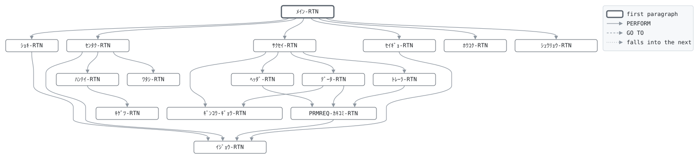

# GLM010

```text
GLM010: 保険料請求: 口座振替依頼ファイル作成

月次、振替日 (27日) の前。コマンド行の日付の月を請求月とし、
払込中 (有効・猶予中) の契約のうち、月払は払込済年月が請求月
より前のもの、年払と半年払は次の払込期月 (払込済年月の1年
後、半年後) が請求月以前のものを選ぶ。振替不能となった年払
と半年払は、翌月もう一度請求する。振替額は保険料に未納の
月数を合わせた回数分、月払は2回分まで、年払と半年払は1回分。
収納代行の求める銀行・支店・口座番号順に整列し、銀行間の
固定長レイアウトでヘッダ、データ、トレーラ、エンドを書く。
銀行名と支店名は収納代行が埋めるので空白。
制御レコードの最終請求年月を請求月にし、同じ月に二度請求
しない。

復帰コード: 0 作成済、8 日付が日付でないか請求済、
            16 ファイル異常。

変更履歴
日付       担当 変更
2003-10-06 MS   GL-0310 初版、口座振替の開始。
2005-02-07 MS   GL-0371 未納分を合わせて2回分まで。
2026-11-16 YN   GL-0823 半年払。年払の再請求。
```

Program [GLM010.cbl](../../../gondwana/programs/GLM010.cbl): 5 files, 16 paragraphs. Its business rules: [10 decision tables](../rules/GLM010.md).

- AUTHOR: ゴンドワナ生命 システム部.
- DATE-WRITTEN: 2003-10-06.

## Contents

- [Files](#files)
- [Flow](#flow)
- [Paragraphs](#paragraphs)
- [Calls](#calls)
- [Data flow](#data-flow)
- [Lineage](#lineage)
  - [Into PM-ｹｲﾔｸ-ﾚｺｰﾄﾞ](#into-pm-ｹｲﾔｸ-ﾚｺｰﾄﾞ)
  - [Into SR-ｾｲﾚﾂ-ﾚｺｰﾄﾞ](#into-sr-ｾｲﾚﾂ-ﾚｺｰﾄﾞ)
  - [Into ZG-ﾌﾘｶｴ-ﾚｺｰﾄﾞ](#into-zg-ﾌﾘｶｴ-ﾚｺｰﾄﾞ)
  - [Into CT-ｾｲｷﾞｮ-ﾚｺｰﾄﾞ](#into-ct-ｾｲｷﾞｮ-ﾚｺｰﾄﾞ)
  - [Into ﾎｳｺｸ-ｷﾞｮｳ](#into-ﾎｳｺｸ-ｷﾞｮｳ)
  - [Into WS-ｺﾏﾝﾄﾞｷﾞｮｳ](#into-ws-ｺﾏﾝﾄﾞｷﾞｮｳ)
  - [Into WS-ｴﾗｰﾌｧｲﾙ](#into-ws-ｴﾗｰﾌｧｲﾙ)
  - [Into WS-ｴﾗｰｽﾃｰﾀｽ](#into-ws-ｴﾗｰｽﾃｰﾀｽ)
  - [Into WS-ｷﾞｮｳﾑﾋﾂﾞｹ](#into-ws-ｷﾞｮｳﾑﾋﾂﾞｹ)
  - [Into WS-ｷﾞｮｳﾑﾋﾂﾞｹ-ﾜﾚｷ](#into-ws-ｷﾞｮｳﾑﾋﾂﾞｹ-ﾜﾚｷ)
  - [Into WS-ﾎｳｺｳ](#into-ws-ﾎｳｺｳ)
  - [Into WS-ﾍﾝｶﾝｹｯｶ](#into-ws-ﾍﾝｶﾝｹｯｶ)
  - [Into WS-ﾋｷｵﾄｼﾋﾞ](#into-ws-ﾋｷｵﾄｼﾋﾞ)
  - [Into WS-ﾊﾗｲｺﾐｽﾞﾐ](#into-ws-ﾊﾗｲｺﾐｽﾞﾐ)
  - [Into WS-ｶｲｽｳ](#into-ws-ｶｲｽｳ)
  - [Into WS-ｿｳｷﾞﾝｺｳ](#into-ws-ｿｳｷﾞﾝｺｳ)
  - [Into WS-ｹﾝｽｳ](#into-ws-ｹﾝｽｳ)
  - [Into WS-ﾎｳｺｸ](#into-ws-ﾎｳｺｸ)
  - [Out of the program](#out-of-the-program)
  - [Into other data items](#into-other-data-items)
- [Field origins](#field-origins)
  - [File REPORT-F](#file-report-f)
  - [File SORT-F](#file-sort-f)
  - [File PRMREQ-F](#file-prmreq-f)
  - [File GLSCTL-F](#file-glsctl-f)
- [Records](#records)
  - [PM-ｹｲﾔｸ-ﾚｺｰﾄﾞ](#pm-ｹｲﾔｸ-ﾚｺｰﾄﾞ)
  - [SR-ｾｲﾚﾂ-ﾚｺｰﾄﾞ](#sr-ｾｲﾚﾂ-ﾚｺｰﾄﾞ)
  - [ZG-ﾌﾘｶｴ-ﾚｺｰﾄﾞ](#zg-ﾌﾘｶｴ-ﾚｺｰﾄﾞ)
  - [CT-ｾｲｷﾞｮ-ﾚｺｰﾄﾞ](#ct-ｾｲｷﾞｮ-ﾚｺｰﾄﾞ)
  - [ﾎｳｺｸ-ｷﾞｮｳ](#ﾎｳｺｸ-ｷﾞｮｳ)
  - [WS-ｽﾃｰﾀｽ](#ws-ｽﾃｰﾀｽ)
  - [WS-ｺﾏﾝﾄﾞｷﾞｮｳ](#ws-ｺﾏﾝﾄﾞｷﾞｮｳ)
  - [WS-ｴﾗｰﾌｧｲﾙ](#ws-ｴﾗｰﾌｧｲﾙ)
  - [WS-ｴﾗｰｽﾃｰﾀｽ](#ws-ｴﾗｰｽﾃｰﾀｽ)
  - [WS-ｷﾞｮｳﾑﾋﾂﾞｹ](#ws-ｷﾞｮｳﾑﾋﾂﾞｹ)
  - [WS-ｷﾞｮｳﾑﾋﾂﾞｹ-ﾌﾞﾝｶｲ](#ws-ｷﾞｮｳﾑﾋﾂﾞｹ-ﾌﾞﾝｶｲ)
  - [WS-ｷﾞｮｳﾑﾋﾂﾞｹ-ﾜﾚｷ](#ws-ｷﾞｮｳﾑﾋﾂﾞｹ-ﾜﾚｷ)
  - [WS-ﾎｳｺｳ](#ws-ﾎｳｺｳ)
  - [WS-ﾍﾝｶﾝｹｯｶ](#ws-ﾍﾝｶﾝｹｯｶ)
  - [WS-ﾋｷｵﾄｼﾋﾞ](#ws-ﾋｷｵﾄｼﾋﾞ)
  - [WS-ﾊﾗｲｺﾐｽﾞﾐ](#ws-ﾊﾗｲｺﾐｽﾞﾐ)
  - [WS-ﾊﾗｲｺﾐ-YYYYMM](#ws-ﾊﾗｲｺﾐ-yyyymm)
  - [WS-ｶｲｽｳ](#ws-ｶｲｽｳ)
  - [WS-ｿｳｷﾞﾝｺｳ](#ws-ｿｳｷﾞﾝｺｳ)
  - [WS-ｹﾝｽｳ](#ws-ｹﾝｽｳ)
  - [WS-ﾌｯｷｺｰﾄﾞ](#ws-ﾌｯｷｺｰﾄﾞ)
  - [WS-ﾎｳｺｸ](#ws-ﾎｳｺｸ)

## Files

| File | Kind | Assigned to | Organization | Status field | Opened | Records |
| --- | --- | --- | --- | --- | --- | --- |
| POLMST-F | FD | POLMST | INDEXED, key PM-ｼｮｳｹﾝﾊﾞﾝｺﾞｳ | WS-POLMST-ST | INPUT | PM-ｹｲﾔｸ-ﾚｺｰﾄﾞ |
| SORT-F | SD | SORTWK | SEQUENTIAL | | | SR-ｾｲﾚﾂ-ﾚｺｰﾄﾞ |
| PRMREQ-F | FD | PRMREQ | SEQUENTIAL | WS-PRMREQ-ST | OUTPUT | ZG-ﾌﾘｶｴ-ﾚｺｰﾄﾞ |
| GLSCTL-F | FD | GLSCTL | SEQUENTIAL | WS-GLSCTL-ST | I-O | CT-ｾｲｷﾞｮ-ﾚｺｰﾄﾞ |
| REPORT-F | FD | GLM010R | LINE SEQUENTIAL | WS-REPORT-ST | OUTPUT | ﾎｳｺｸ-ｷﾞｮｳ |

## Flow



## Paragraphs

| Paragraph | Description | Source | Performs | Goes to | Performed by | Reached by |
| --- | --- | --- | --- | --- | --- | --- |
| ﾒｲﾝ-RTN | ﾒｲﾝ-RTN: 準備、選択と整列と作成、制御レコード、報告、終了。 | [GLM010.cbl:134](../../../gondwana/programs/GLM010.cbl#L134) | ｼｮｷ-RTN, ｾﾝﾀｸ-RTN (SORT), ｻｸｾｲ-RTN (SORT), ｾｲｷﾞｮ-RTN, ﾎｳｺｸ-RTN, ｼｭｳﾘｮｳ-RTN | | | |
| ｼｮｷ-RTN | ｼｮｷ-RTN: 業務日付、ファイル、制御レコード、請求済の検査。 | [GLM010.cbl:149](../../../gondwana/programs/GLM010.cbl#L149) | ｲｼﾞｮｳ-RTN | | ﾒｲﾝ-RTN | |
| ｾﾝﾀｸ-RTN | ｾﾝﾀｸ-RTN: マスタを読み、請求する契約を整列に渡す。 | [GLM010.cbl:201](../../../gondwana/programs/GLM010.cbl#L201) | ﾊﾝﾃｲ-RTN, ﾜﾀｼ-RTN, ｲｼﾞｮｳ-RTN | | ﾒｲﾝ-RTN | |
| ﾊﾝﾃｲ-RTN | ﾊﾝﾃｲ-RTN: 請求する回数。請求しない契約は 0。 | [GLM010.cbl:219](../../../gondwana/programs/GLM010.cbl#L219) | ｷｹﾞﾂ-RTN | | ｾﾝﾀｸ-RTN | |
| ｷｹﾞﾂ-RTN | ｷｹﾞﾂ-RTN: 年払と半年払の次の払込期月が請求月以前なら1回分 を請求する。 | [GLM010.cbl:244](../../../gondwana/programs/GLM010.cbl#L244) | | | ﾊﾝﾃｲ-RTN | |
| ﾜﾀｼ-RTN | ﾜﾀｼ-RTN: 整列レコードを作って RELEASE する。 | [GLM010.cbl:256](../../../gondwana/programs/GLM010.cbl#L256) | | | ｾﾝﾀｸ-RTN | |
| ｻｸｾｲ-RTN | ｻｸｾｲ-RTN: ヘッダ、整列済みのデータ、トレーラ、エンドを書く。 銀行が変わるごとに報告に1行。 | [GLM010.cbl:272](../../../gondwana/programs/GLM010.cbl#L272) | ﾍｯﾀﾞ-RTN, ﾃﾞｰﾀ-RTN, ｷﾞﾝｺｳ-ｷﾞｮｳ-RTN, ﾄﾚｰﾗ-RTN | | ﾒｲﾝ-RTN | |
| ﾍｯﾀﾞ-RTN | ﾍｯﾀﾞ-RTN: 委託者と引落日。 | [GLM010.cbl:301](../../../gondwana/programs/GLM010.cbl#L301) | PRMREQ-ｶｷｺﾐ-RTN | | ｻｸｾｲ-RTN | |
| ﾃﾞｰﾀ-RTN | ﾃﾞｰﾀ-RTN: 1件の振替依頼。銀行が変わったら前の銀行の行。 | [GLM010.cbl:320](../../../gondwana/programs/GLM010.cbl#L320) | ｷﾞﾝｺｳ-ｷﾞｮｳ-RTN, PRMREQ-ｶｷｺﾐ-RTN | | ｻｸｾｲ-RTN | |
| ｷﾞﾝｺｳ-ｷﾞｮｳ-RTN | ｷﾞﾝｺｳ-ｷﾞｮｳ-RTN: 銀行ごとの件数と金額を報告し、数え直す。 | [GLM010.cbl:345](../../../gondwana/programs/GLM010.cbl#L345) | | | ｻｸｾｲ-RTN, ﾃﾞｰﾀ-RTN | |
| ﾄﾚｰﾗ-RTN | ﾄﾚｰﾗ-RTN: 合計のトレーラとエンド記録。 | [GLM010.cbl:355](../../../gondwana/programs/GLM010.cbl#L355) | PRMREQ-ｶｷｺﾐ-RTN | | ｻｸｾｲ-RTN | |
| PRMREQ-ｶｷｺﾐ-RTN | PRMREQ-ｶｷｺﾐ-RTN: 依頼ファイルに1記録。 | [GLM010.cbl:370](../../../gondwana/programs/GLM010.cbl#L370) | ｲｼﾞｮｳ-RTN | | ﾍｯﾀﾞ-RTN, ﾃﾞｰﾀ-RTN, ﾄﾚｰﾗ-RTN | |
| ｾｲｷﾞｮ-RTN | ｾｲｷﾞｮ-RTN: 最終請求年月を書き戻す。 | [GLM010.cbl:381](../../../gondwana/programs/GLM010.cbl#L381) | ｲｼﾞｮｳ-RTN | | ﾒｲﾝ-RTN | |
| ﾎｳｺｸ-RTN | ﾎｳｺｸ-RTN: 件数と合計。 | [GLM010.cbl:393](../../../gondwana/programs/GLM010.cbl#L393) | | | ﾒｲﾝ-RTN | |
| ｼｭｳﾘｮｳ-RTN | ｼｭｳﾘｮｳ-RTN: ファイルを閉じ、件数を表示する。 | [GLM010.cbl:406](../../../gondwana/programs/GLM010.cbl#L406) | | | ﾒｲﾝ-RTN | |
| ｲｼﾞｮｳ-RTN | ｲｼﾞｮｳ-RTN: ファイル異常は 16 で終わる。 | [GLM010.cbl:414](../../../gondwana/programs/GLM010.cbl#L414) | | | ｼｮｷ-RTN, ｾﾝﾀｸ-RTN, PRMREQ-ｶｷｺﾐ-RTN, ｾｲｷﾞｮ-RTN | |

## Calls

| Calls | Passing | Paragraph | Source |
| --- | --- | --- | --- |
| [GLC020](GLC020.md) | WS-ﾎｳｺｳ, WS-ｷﾞｮｳﾑﾋﾂﾞｹ, WS-ｷﾞｮｳﾑﾋﾂﾞｹ-ﾜﾚｷ, WS-ﾍﾝｶﾝｹｯｶ | ｼｮｷ-RTN | [GLM010.cbl:152](../../../gondwana/programs/GLM010.cbl#L152) |

## Data flow

| Paragraph | Reads | Writes |
| --- | --- | --- |
| ﾒｲﾝ-RTN | SR-ｷﾞﾝｺｳｺｰﾄﾞ, SR-ｼﾃﾝｺｰﾄﾞ, SR-ｺｳｻﾞﾊﾞﾝｺﾞｳ, WS-ﾌｯｷｺｰﾄﾞ | RETURN-CODE |
| ｼｮｷ-RTN | WS-ｺﾏﾝﾄﾞｷﾞｮｳ, WS-ﾎｳｺｳ, WS-ｷﾞｮｳﾑﾋﾂﾞｹ, WS-ｷﾞｮｳﾑﾋﾂﾞｹ-ﾜﾚｷ, WS-ﾍﾝｶﾝｹｯｶ, WS-POLMST-ST, WS-GLSCTL-ST, WS-PRMREQ-ST, WS-REPORT-ST, WS-ｴﾗｰﾌｧｲﾙ, CT-ｻｲｼｭｳｾｲｷｭｳﾈﾝｹﾞﾂ, WS-ｾｲｷｭｳ-YYYYMM, WS-ﾋｮｳﾀﾞｲ-ｷﾞｮｳ | WS-ｺﾏﾝﾄﾞｷﾞｮｳ, WS-ｷﾞｮｳﾑﾋﾂﾞｹ, WS-ﾎｳｺｳ, WS-ｷﾞｮｳﾑﾋﾂﾞｹ-ﾜﾚｷ, WS-ﾍﾝｶﾝｹｯｶ, RETURN-CODE, WS-POLMST-ST, WS-GLSCTL-ST, WS-PRMREQ-ST, WS-REPORT-ST, WS-ｴﾗｰﾌｧｲﾙ, WS-ｴﾗｰｽﾃｰﾀｽ, CT-ｾｲｷﾞｮ-ﾚｺｰﾄﾞ, WS-ﾋｮｳﾀﾞｲ-ﾋﾂﾞｹ, WS-ﾋｮｳﾀﾞｲ-ﾈﾝｹﾞﾂ, ﾎｳｺｸ-ｷﾞｮｳ |
| ｾﾝﾀｸ-RTN | WS-POLMST-ST, WS-ｶｲｽｳ | PM-ｹｲﾔｸ-ﾚｺｰﾄﾞ, WS-POLMST-ST, WS-ｴﾗｰﾌｧｲﾙ, WS-ｴﾗｰｽﾃｰﾀｽ |
| ﾊﾝﾃｲ-RTN | PM-ｼﾞｮｳﾀｲ, PM-ﾊﾗｲｺﾐｽﾞﾐﾈﾝｹﾞﾂ, WS-ｾｲｷｭｳ-YYYYMM, PM-ﾊﾗｲｺﾐﾎｳﾎｳ, WS-ﾊﾗｲｺﾐ-YYYY, WS-ﾊﾗｲｺﾐ-MM, WS-ｾｲｷｭｳ-YYYY, WS-ｾｲｷｭｳ-MM, WS-ｶｲｽｳ | WS-ｶｲｽｳ, WS-ﾊﾗｲｺﾐｽﾞﾐ, WS-ﾊﾗｲｺﾐ-YYYY, WS-ﾊﾗｲｺﾐ-MM |
| ｷｹﾞﾂ-RTN | WS-ﾊﾗｲｺﾐ-MM, WS-ﾊﾗｲｺﾐ-YYYY, WS-ﾊﾗｲｺﾐ-YYYYMM, WS-ｾｲｷｭｳ-YYYYMM | WS-ﾊﾗｲｺﾐ-MM, WS-ﾊﾗｲｺﾐ-YYYY, WS-ｶｲｽｳ |
| ﾜﾀｼ-RTN | PM-ｷﾞﾝｺｳｺｰﾄﾞ, PM-ｼﾃﾝｺｰﾄﾞ, PM-ｺｳｻﾞﾊﾞﾝｺﾞｳ, PM-ﾖｷﾝｼｭﾓｸ, PM-ｺｳｻﾞﾒｲｷﾞ, PM-ｼｮｳｹﾝﾊﾞﾝｺﾞｳ, PM-ﾎｹﾝﾘｮｳ, WS-ｶｲｽｳ, WS-ｾﾝﾀｸｹﾝｽｳ, SR-ｷﾝｶﾞｸ, WS-ｾｲｷｭｳｷﾝｶﾞｸ | SR-ｷﾞﾝｺｳｺｰﾄﾞ, SR-ｼﾃﾝｺｰﾄﾞ, SR-ｺｳｻﾞﾊﾞﾝｺﾞｳ, SR-ﾖｷﾝｼｭﾓｸ, SR-ｺｳｻﾞﾒｲｷﾞ, SR-ｼｮｳｹﾝﾊﾞﾝｺﾞｳ, SR-ｷﾝｶﾞｸ, SR-ｾｲﾚﾂ-ﾚｺｰﾄﾞ, WS-ｾﾝﾀｸｹﾝｽｳ, WS-ｾｲｷｭｳｷﾝｶﾞｸ |
| ｻｸｾｲ-RTN | SR-ｷﾞﾝｺｳｺｰﾄﾞ, WS-ｷﾞﾝｺｳｹﾝｽｳ | WS-ｿｳｷﾞﾝｺｳ, SR-ｾｲﾚﾂ-ﾚｺｰﾄﾞ, SR-ｷﾞﾝｺｳｺｰﾄﾞ |
| ﾍｯﾀﾞ-RTN | WS-ｾｲｷｭｳ-MM, WS-ﾋｷｵﾄｼﾋﾞ | ZG-ﾌﾘｶｴ-ﾚｺｰﾄﾞ, ZG-ﾃﾞｰﾀｸﾌﾞﾝ, ZG-H-ｼｭﾍﾞﾂｺｰﾄﾞ, ZG-H-ｺｰﾄﾞｸﾌﾞﾝ, ZG-H-ｲﾀｸｼｬｺｰﾄﾞ, ZG-H-ｲﾀｸｼｬﾒｲ, WS-ﾋｷｵﾄｼ-MM, ZG-H-ﾋｷｵﾄｼﾋﾞ, ZG-H-ｷﾞﾝｺｳｺｰﾄﾞ, ZG-H-ｷﾞﾝｺｳﾒｲ, ZG-H-ｼﾃﾝﾒｲ, ZG-H-ｼﾃﾝｺｰﾄﾞ, ZG-H-ﾖｷﾝｼｭﾓｸ, ZG-H-ｺｳｻﾞﾊﾞﾝｺﾞｳ |
| ﾃﾞｰﾀ-RTN | SR-ｷﾞﾝｺｳｺｰﾄﾞ, WS-ｿｳｷﾞﾝｺｳ, WS-ｷﾞﾝｺｳｹﾝｽｳ, SR-ｼﾃﾝｺｰﾄﾞ, SR-ﾖｷﾝｼｭﾓｸ, SR-ｺｳｻﾞﾊﾞﾝｺﾞｳ, SR-ｺｳｻﾞﾒｲｷﾞ, SR-ｷﾝｶﾞｸ, SR-ｼｮｳｹﾝﾊﾞﾝｺﾞｳ, WS-ｷﾞﾝｺｳｷﾝｶﾞｸ | WS-ｿｳｷﾞﾝｺｳ, ZG-ﾌﾘｶｴ-ﾚｺｰﾄﾞ, ZG-ﾃﾞｰﾀｸﾌﾞﾝ, ZG-D-ｷﾞﾝｺｳｺｰﾄﾞ, ZG-D-ｼﾃﾝｺｰﾄﾞ, ZG-D-ﾖｷﾝｼｭﾓｸ, ZG-D-ｺｳｻﾞﾊﾞﾝｺﾞｳ, ZG-D-ｺｳｻﾞﾒｲｷﾞ, ZG-D-ｷﾝｶﾞｸ, ZG-D-ｼﾝｷｺｰﾄﾞ, ZG-D-ｺｷｬｸﾊﾞﾝｺﾞｳ, ZG-D-ﾌﾘｶｴｹｯｶ, WS-ｷﾞﾝｺｳｹﾝｽｳ, WS-ｷﾞﾝｺｳｷﾝｶﾞｸ |
| ｷﾞﾝｺｳ-ｷﾞｮｳ-RTN | WS-ｿｳｷﾞﾝｺｳ, WS-ｷﾞﾝｺｳｹﾝｽｳ, WS-ｷﾞﾝｺｳｷﾝｶﾞｸ, WS-ｷﾞﾝｺｳ-ｷﾞｮｳ | WS-ｷﾞﾝｺｳ-ｺｰﾄﾞ, WS-ｷﾞﾝｺｳ-ｹﾝｽｳ, WS-ｷﾞﾝｺｳ-ｷﾝｶﾞｸ, ﾎｳｺｸ-ｷﾞｮｳ, WS-REPORT-ST, WS-ｷﾞﾝｺｳｹﾝｽｳ, WS-ｷﾞﾝｺｳｷﾝｶﾞｸ |
| ﾄﾚｰﾗ-RTN | WS-ｾﾝﾀｸｹﾝｽｳ, WS-ｾｲｷｭｳｷﾝｶﾞｸ | ZG-ﾌﾘｶｴ-ﾚｺｰﾄﾞ, ZG-ﾃﾞｰﾀｸﾌﾞﾝ, ZG-T-ｺﾞｳｹｲｹﾝｽｳ, ZG-T-ｺﾞｳｹｲｷﾝｶﾞｸ, ZG-T-ﾌﾘｶｴｽﾞﾐｹﾝｽｳ, ZG-T-ﾌﾘｶｴｽﾞﾐｷﾝｶﾞｸ, ZG-T-ﾌﾘｶｴﾌﾉｳｹﾝｽｳ, ZG-T-ﾌﾘｶｴﾌﾉｳｷﾝｶﾞｸ |
| PRMREQ-ｶｷｺﾐ-RTN | WS-PRMREQ-ST | ZG-ﾌﾘｶｴ-ﾚｺｰﾄﾞ, WS-PRMREQ-ST, WS-ｴﾗｰﾌｧｲﾙ, WS-ｴﾗｰｽﾃｰﾀｽ |
| ｾｲｷﾞｮ-RTN | WS-ｾｲｷｭｳ-YYYYMM, WS-GLSCTL-ST | CT-ｻｲｼｭｳｾｲｷｭｳﾈﾝｹﾞﾂ, CT-ｾｲｷﾞｮ-ﾚｺｰﾄﾞ, WS-GLSCTL-ST, WS-ｴﾗｰﾌｧｲﾙ, WS-ｴﾗｰｽﾃｰﾀｽ |
| ﾎｳｺｸ-RTN | WS-ｾﾝﾀｸｹﾝｽｳ, WS-ｹﾝｽｳ-ｷﾞｮｳ, WS-ｾｲｷｭｳｷﾝｶﾞｸ | ﾎｳｺｸ-ｷﾞｮｳ, WS-REPORT-ST, WS-ｹﾝｽｳ-ﾗﾍﾞﾙ, WS-ｹﾝｽｳ-ｱﾀｲ |
| ｼｭｳﾘｮｳ-RTN | WS-ｾﾝﾀｸｹﾝｽｳ, WS-ｾｲｷｭｳｷﾝｶﾞｸ | WS-POLMST-ST, WS-PRMREQ-ST, WS-GLSCTL-ST, WS-REPORT-ST |
| ｲｼﾞｮｳ-RTN | WS-ｴﾗｰﾌｧｲﾙ, WS-ｴﾗｰｽﾃｰﾀｽ | RETURN-CODE |

## Lineage

Where each data item's values come from, grouped by the record they go into. A data item links to the record it belongs to.

### Into PM-ｹｲﾔｸ-ﾚｺｰﾄﾞ

Record [PM-ｹｲﾔｸ-ﾚｺｰﾄﾞ](#pm-ｹｲﾔｸ-ﾚｺｰﾄﾞ), from copybook [POLMST](../copybooks/POLMST.md).

| Into | From | Statement | Paragraph | Source |
| --- | --- | --- | --- | --- |
| PM-ｹｲﾔｸ-ﾚｺｰﾄﾞ | file POLMST-F | READ | ｾﾝﾀｸ-RTN | [GLM010.cbl:202](../../../gondwana/programs/GLM010.cbl#L202) |
| PM-ｹｲﾔｸ-ﾚｺｰﾄﾞ | file POLMST-F | READ | ｾﾝﾀｸ-RTN | [GLM010.cbl:208](../../../gondwana/programs/GLM010.cbl#L208) |

### Into SR-ｾｲﾚﾂ-ﾚｺｰﾄﾞ

Record [SR-ｾｲﾚﾂ-ﾚｺｰﾄﾞ](#sr-ｾｲﾚﾂ-ﾚｺｰﾄﾞ).

| Into | From | Statement | Paragraph | Source |
| --- | --- | --- | --- | --- |
| SR-ｷﾝｶﾞｸ | [PM-ﾎｹﾝﾘｮｳ](#pm-ｹｲﾔｸ-ﾚｺｰﾄﾞ "in PM-ｹｲﾔｸ-ﾚｺｰﾄﾞ") | COMPUTE | ﾜﾀｼ-RTN | [GLM010.cbl:263](../../../gondwana/programs/GLM010.cbl#L263) |
| SR-ｷﾝｶﾞｸ | [WS-ｶｲｽｳ](#ws-ｶｲｽｳ) | COMPUTE | ﾜﾀｼ-RTN | [GLM010.cbl:263](../../../gondwana/programs/GLM010.cbl#L263) |
| SR-ｷﾞﾝｺｳｺｰﾄﾞ | [PM-ｷﾞﾝｺｳｺｰﾄﾞ](#pm-ｹｲﾔｸ-ﾚｺｰﾄﾞ "in PM-ｹｲﾔｸ-ﾚｺｰﾄﾞ") | MOVE | ﾜﾀｼ-RTN | [GLM010.cbl:257](../../../gondwana/programs/GLM010.cbl#L257) |
| SR-ｷﾞﾝｺｳｺｰﾄﾞ | literal 0 | MOVE | ｻｸｾｲ-RTN | [GLM010.cbl:286](../../../gondwana/programs/GLM010.cbl#L286) |
| SR-ｷﾞﾝｺｳｺｰﾄﾞ | literal 0 | MOVE | ｻｸｾｲ-RTN | [GLM010.cbl:289](../../../gondwana/programs/GLM010.cbl#L289) |
| SR-ｺｳｻﾞﾊﾞﾝｺﾞｳ | [PM-ｺｳｻﾞﾊﾞﾝｺﾞｳ](#pm-ｹｲﾔｸ-ﾚｺｰﾄﾞ "in PM-ｹｲﾔｸ-ﾚｺｰﾄﾞ") | MOVE | ﾜﾀｼ-RTN | [GLM010.cbl:259](../../../gondwana/programs/GLM010.cbl#L259) |
| SR-ｺｳｻﾞﾒｲｷﾞ | [PM-ｺｳｻﾞﾒｲｷﾞ](#pm-ｹｲﾔｸ-ﾚｺｰﾄﾞ "in PM-ｹｲﾔｸ-ﾚｺｰﾄﾞ") | MOVE | ﾜﾀｼ-RTN | [GLM010.cbl:261](../../../gondwana/programs/GLM010.cbl#L261) |
| SR-ｼｮｳｹﾝﾊﾞﾝｺﾞｳ | [PM-ｼｮｳｹﾝﾊﾞﾝｺﾞｳ](#pm-ｹｲﾔｸ-ﾚｺｰﾄﾞ "in PM-ｹｲﾔｸ-ﾚｺｰﾄﾞ") | MOVE | ﾜﾀｼ-RTN | [GLM010.cbl:262](../../../gondwana/programs/GLM010.cbl#L262) |
| SR-ｼﾃﾝｺｰﾄﾞ | [PM-ｼﾃﾝｺｰﾄﾞ](#pm-ｹｲﾔｸ-ﾚｺｰﾄﾞ "in PM-ｹｲﾔｸ-ﾚｺｰﾄﾞ") | MOVE | ﾜﾀｼ-RTN | [GLM010.cbl:258](../../../gondwana/programs/GLM010.cbl#L258) |
| SR-ｾｲﾚﾂ-ﾚｺｰﾄﾞ | file SORT-F | RETURN | ｻｸｾｲ-RTN | [GLM010.cbl:275](../../../gondwana/programs/GLM010.cbl#L275) |
| SR-ｾｲﾚﾂ-ﾚｺｰﾄﾞ | file SORT-F | RETURN | ｻｸｾｲ-RTN | [GLM010.cbl:280](../../../gondwana/programs/GLM010.cbl#L280) |
| SR-ｾｲﾚﾂ-ﾚｺｰﾄﾞ | file SORT-F | RETURN | ｻｸｾｲ-RTN | [GLM010.cbl:287](../../../gondwana/programs/GLM010.cbl#L287) |
| SR-ﾖｷﾝｼｭﾓｸ | [PM-ﾖｷﾝｼｭﾓｸ](#pm-ｹｲﾔｸ-ﾚｺｰﾄﾞ "in PM-ｹｲﾔｸ-ﾚｺｰﾄﾞ") | MOVE | ﾜﾀｼ-RTN | [GLM010.cbl:260](../../../gondwana/programs/GLM010.cbl#L260) |

### Into ZG-ﾌﾘｶｴ-ﾚｺｰﾄﾞ

Record [ZG-ﾌﾘｶｴ-ﾚｺｰﾄﾞ](#zg-ﾌﾘｶｴ-ﾚｺｰﾄﾞ), from copybook [ZENGIN](../copybooks/ZENGIN.md).

| Into | From | Statement | Paragraph | Source |
| --- | --- | --- | --- | --- |
| ZG-D-ｷﾝｶﾞｸ | [SR-ｷﾝｶﾞｸ](#sr-ｾｲﾚﾂ-ﾚｺｰﾄﾞ "in SR-ｾｲﾚﾂ-ﾚｺｰﾄﾞ") | MOVE | ﾃﾞｰﾀ-RTN | [GLM010.cbl:334](../../../gondwana/programs/GLM010.cbl#L334) |
| ZG-D-ｷﾞﾝｺｳｺｰﾄﾞ | [SR-ｷﾞﾝｺｳｺｰﾄﾞ](#sr-ｾｲﾚﾂ-ﾚｺｰﾄﾞ "in SR-ｾｲﾚﾂ-ﾚｺｰﾄﾞ") | MOVE | ﾃﾞｰﾀ-RTN | [GLM010.cbl:329](../../../gondwana/programs/GLM010.cbl#L329) |
| ZG-D-ｺｳｻﾞﾊﾞﾝｺﾞｳ | [SR-ｺｳｻﾞﾊﾞﾝｺﾞｳ](#sr-ｾｲﾚﾂ-ﾚｺｰﾄﾞ "in SR-ｾｲﾚﾂ-ﾚｺｰﾄﾞ") | MOVE | ﾃﾞｰﾀ-RTN | [GLM010.cbl:332](../../../gondwana/programs/GLM010.cbl#L332) |
| ZG-D-ｺｳｻﾞﾒｲｷﾞ | [SR-ｺｳｻﾞﾒｲｷﾞ](#sr-ｾｲﾚﾂ-ﾚｺｰﾄﾞ "in SR-ｾｲﾚﾂ-ﾚｺｰﾄﾞ") | MOVE | ﾃﾞｰﾀ-RTN | [GLM010.cbl:333](../../../gondwana/programs/GLM010.cbl#L333) |
| ZG-D-ｺｷｬｸﾊﾞﾝｺﾞｳ | [SR-ｼｮｳｹﾝﾊﾞﾝｺﾞｳ](#sr-ｾｲﾚﾂ-ﾚｺｰﾄﾞ "in SR-ｾｲﾚﾂ-ﾚｺｰﾄﾞ") | MOVE | ﾃﾞｰﾀ-RTN | [GLM010.cbl:336](../../../gondwana/programs/GLM010.cbl#L336) |
| ZG-D-ｼﾃﾝｺｰﾄﾞ | [SR-ｼﾃﾝｺｰﾄﾞ](#sr-ｾｲﾚﾂ-ﾚｺｰﾄﾞ "in SR-ｾｲﾚﾂ-ﾚｺｰﾄﾞ") | MOVE | ﾃﾞｰﾀ-RTN | [GLM010.cbl:330](../../../gondwana/programs/GLM010.cbl#L330) |
| ZG-D-ｼﾝｷｺｰﾄﾞ | literal 0 | MOVE | ﾃﾞｰﾀ-RTN | [GLM010.cbl:335](../../../gondwana/programs/GLM010.cbl#L335) |
| ZG-D-ﾌﾘｶｴｹｯｶ | literal condition ZG-D-ﾐｼｮﾘ | SET | ﾃﾞｰﾀ-RTN | [GLM010.cbl:337](../../../gondwana/programs/GLM010.cbl#L337) |
| ZG-D-ﾖｷﾝｼｭﾓｸ | [SR-ﾖｷﾝｼｭﾓｸ](#sr-ｾｲﾚﾂ-ﾚｺｰﾄﾞ "in SR-ｾｲﾚﾂ-ﾚｺｰﾄﾞ") | MOVE | ﾃﾞｰﾀ-RTN | [GLM010.cbl:331](../../../gondwana/programs/GLM010.cbl#L331) |
| ZG-H-ｲﾀｸｼｬｺｰﾄﾞ | literal 1234567890 | MOVE | ﾍｯﾀﾞ-RTN | [GLM010.cbl:306](../../../gondwana/programs/GLM010.cbl#L306) |
| ZG-H-ｲﾀｸｼｬﾒｲ | literal 'ｺﾞﾝﾄﾞﾜﾅｾｲﾒｲﾎｹﾝ' | MOVE | ﾍｯﾀﾞ-RTN | [GLM010.cbl:307](../../../gondwana/programs/GLM010.cbl#L307) |
| ZG-H-ｷﾞﾝｺｳｺｰﾄﾞ | literal 1 | MOVE | ﾍｯﾀﾞ-RTN | [GLM010.cbl:310](../../../gondwana/programs/GLM010.cbl#L310) |
| ZG-H-ｷﾞﾝｺｳﾒｲ | literal SPACES | MOVE | ﾍｯﾀﾞ-RTN | [GLM010.cbl:311](../../../gondwana/programs/GLM010.cbl#L311) |
| ZG-H-ｺｰﾄﾞｸﾌﾞﾝ | literal 0 | MOVE | ﾍｯﾀﾞ-RTN | [GLM010.cbl:305](../../../gondwana/programs/GLM010.cbl#L305) |
| ZG-H-ｺｳｻﾞﾊﾞﾝｺﾞｳ | literal 1000001 | MOVE | ﾍｯﾀﾞ-RTN | [GLM010.cbl:314](../../../gondwana/programs/GLM010.cbl#L314) |
| ZG-H-ｼｭﾍﾞﾂｺｰﾄﾞ | literal 91 | MOVE | ﾍｯﾀﾞ-RTN | [GLM010.cbl:304](../../../gondwana/programs/GLM010.cbl#L304) |
| ZG-H-ｼﾃﾝｺｰﾄﾞ | literal 1 | MOVE | ﾍｯﾀﾞ-RTN | [GLM010.cbl:312](../../../gondwana/programs/GLM010.cbl#L312) |
| ZG-H-ｼﾃﾝﾒｲ | literal SPACES | MOVE | ﾍｯﾀﾞ-RTN | [GLM010.cbl:311](../../../gondwana/programs/GLM010.cbl#L311) |
| ZG-H-ﾋｷｵﾄｼﾋﾞ | [WS-ﾋｷｵﾄｼﾋﾞ](#ws-ﾋｷｵﾄｼﾋﾞ) | MOVE | ﾍｯﾀﾞ-RTN | [GLM010.cbl:309](../../../gondwana/programs/GLM010.cbl#L309) |
| ZG-H-ﾖｷﾝｼｭﾓｸ | literal 1 | MOVE | ﾍｯﾀﾞ-RTN | [GLM010.cbl:313](../../../gondwana/programs/GLM010.cbl#L313) |
| ZG-T-ｺﾞｳｹｲｷﾝｶﾞｸ | [WS-ｾｲｷｭｳｷﾝｶﾞｸ](#ws-ｹﾝｽｳ "in WS-ｹﾝｽｳ") | MOVE | ﾄﾚｰﾗ-RTN | [GLM010.cbl:359](../../../gondwana/programs/GLM010.cbl#L359) |
| ZG-T-ｺﾞｳｹｲｹﾝｽｳ | [WS-ｾﾝﾀｸｹﾝｽｳ](#ws-ｹﾝｽｳ "in WS-ｹﾝｽｳ") | MOVE | ﾄﾚｰﾗ-RTN | [GLM010.cbl:358](../../../gondwana/programs/GLM010.cbl#L358) |
| ZG-T-ﾌﾘｶｴｽﾞﾐｷﾝｶﾞｸ | literal 0 | MOVE | ﾄﾚｰﾗ-RTN | [GLM010.cbl:360](../../../gondwana/programs/GLM010.cbl#L360) |
| ZG-T-ﾌﾘｶｴｽﾞﾐｹﾝｽｳ | literal 0 | MOVE | ﾄﾚｰﾗ-RTN | [GLM010.cbl:360](../../../gondwana/programs/GLM010.cbl#L360) |
| ZG-T-ﾌﾘｶｴﾌﾉｳｷﾝｶﾞｸ | literal 0 | MOVE | ﾄﾚｰﾗ-RTN | [GLM010.cbl:360](../../../gondwana/programs/GLM010.cbl#L360) |
| ZG-T-ﾌﾘｶｴﾌﾉｳｹﾝｽｳ | literal 0 | MOVE | ﾄﾚｰﾗ-RTN | [GLM010.cbl:360](../../../gondwana/programs/GLM010.cbl#L360) |
| ZG-ﾃﾞｰﾀｸﾌﾞﾝ | literal condition ZG-ﾍｯﾀﾞ | SET | ﾍｯﾀﾞ-RTN | [GLM010.cbl:303](../../../gondwana/programs/GLM010.cbl#L303) |
| ZG-ﾃﾞｰﾀｸﾌﾞﾝ | literal condition ZG-ﾃﾞｰﾀ | SET | ﾃﾞｰﾀ-RTN | [GLM010.cbl:328](../../../gondwana/programs/GLM010.cbl#L328) |
| ZG-ﾃﾞｰﾀｸﾌﾞﾝ | literal condition ZG-ﾄﾚｰﾗ | SET | ﾄﾚｰﾗ-RTN | [GLM010.cbl:357](../../../gondwana/programs/GLM010.cbl#L357) |
| ZG-ﾃﾞｰﾀｸﾌﾞﾝ | literal condition ZG-ｴﾝﾄﾞ | SET | ﾄﾚｰﾗ-RTN | [GLM010.cbl:364](../../../gondwana/programs/GLM010.cbl#L364) |
| ZG-ﾌﾘｶｴ-ﾚｺｰﾄﾞ | literal SPACES | MOVE | ﾍｯﾀﾞ-RTN | [GLM010.cbl:302](../../../gondwana/programs/GLM010.cbl#L302) |
| ZG-ﾌﾘｶｴ-ﾚｺｰﾄﾞ | literal SPACES | MOVE | ﾃﾞｰﾀ-RTN | [GLM010.cbl:327](../../../gondwana/programs/GLM010.cbl#L327) |
| ZG-ﾌﾘｶｴ-ﾚｺｰﾄﾞ | literal SPACES | MOVE | ﾄﾚｰﾗ-RTN | [GLM010.cbl:356](../../../gondwana/programs/GLM010.cbl#L356) |
| ZG-ﾌﾘｶｴ-ﾚｺｰﾄﾞ | literal SPACES | MOVE | ﾄﾚｰﾗ-RTN | [GLM010.cbl:363](../../../gondwana/programs/GLM010.cbl#L363) |

### Into CT-ｾｲｷﾞｮ-ﾚｺｰﾄﾞ

Record [CT-ｾｲｷﾞｮ-ﾚｺｰﾄﾞ](#ct-ｾｲｷﾞｮ-ﾚｺｰﾄﾞ), from copybook [CTLREC](../copybooks/CTLREC.md).

| Into | From | Statement | Paragraph | Source |
| --- | --- | --- | --- | --- |
| CT-ｻｲｼｭｳｾｲｷｭｳﾈﾝｹﾞﾂ | [WS-ｾｲｷｭｳ-YYYYMM](#ws-ｷﾞｮｳﾑﾋﾂﾞｹ-ﾌﾞﾝｶｲ "in WS-ｷﾞｮｳﾑﾋﾂﾞｹ-ﾌﾞﾝｶｲ") | MOVE | ｾｲｷﾞｮ-RTN | [GLM010.cbl:382](../../../gondwana/programs/GLM010.cbl#L382) |
| CT-ｾｲｷﾞｮ-ﾚｺｰﾄﾞ | file GLSCTL-F | READ | ｼｮｷ-RTN | [GLM010.cbl:181](../../../gondwana/programs/GLM010.cbl#L181) |

### Into ﾎｳｺｸ-ｷﾞｮｳ

Record [ﾎｳｺｸ-ｷﾞｮｳ](#ﾎｳｺｸ-ｷﾞｮｳ).

| Into | From | Statement | Paragraph | Source |
| --- | --- | --- | --- | --- |
| ﾎｳｺｸ-ｷﾞｮｳ | [WS-ﾋｮｳﾀﾞｲ-ｷﾞｮｳ](#ws-ﾎｳｺｸ "in WS-ﾎｳｺｸ") | WRITE | ｼｮｷ-RTN | [GLM010.cbl:194](../../../gondwana/programs/GLM010.cbl#L194) |
| ﾎｳｺｸ-ｷﾞｮｳ | literal SPACES | MOVE | ｼｮｷ-RTN | [GLM010.cbl:195](../../../gondwana/programs/GLM010.cbl#L195) |
| ﾎｳｺｸ-ｷﾞｮｳ | [WS-ｷﾞﾝｺｳ-ｷﾞｮｳ](#ws-ﾎｳｺｸ "in WS-ﾎｳｺｸ") | WRITE | ｷﾞﾝｺｳ-ｷﾞｮｳ-RTN | [GLM010.cbl:349](../../../gondwana/programs/GLM010.cbl#L349) |
| ﾎｳｺｸ-ｷﾞｮｳ | literal SPACES | MOVE | ﾎｳｺｸ-RTN | [GLM010.cbl:394](../../../gondwana/programs/GLM010.cbl#L394) |
| ﾎｳｺｸ-ｷﾞｮｳ | [WS-ｹﾝｽｳ-ｷﾞｮｳ](#ws-ﾎｳｺｸ "in WS-ﾎｳｺｸ") | WRITE | ﾎｳｺｸ-RTN | [GLM010.cbl:398](../../../gondwana/programs/GLM010.cbl#L398) |
| ﾎｳｺｸ-ｷﾞｮｳ | [WS-ｹﾝｽｳ-ｷﾞｮｳ](#ws-ﾎｳｺｸ "in WS-ﾎｳｺｸ") | WRITE | ﾎｳｺｸ-RTN | [GLM010.cbl:401](../../../gondwana/programs/GLM010.cbl#L401) |

### Into WS-ｺﾏﾝﾄﾞｷﾞｮｳ

Record [WS-ｺﾏﾝﾄﾞｷﾞｮｳ](#ws-ｺﾏﾝﾄﾞｷﾞｮｳ).

| Into | From | Statement | Paragraph | Source |
| --- | --- | --- | --- | --- |
| WS-ｺﾏﾝﾄﾞｷﾞｮｳ | COMMAND-LINE | ACCEPT | ｼｮｷ-RTN | [GLM010.cbl:150](../../../gondwana/programs/GLM010.cbl#L150) |

### Into WS-ｴﾗｰﾌｧｲﾙ

Record [WS-ｴﾗｰﾌｧｲﾙ](#ws-ｴﾗｰﾌｧｲﾙ).

| Into | From | Statement | Paragraph | Source |
| --- | --- | --- | --- | --- |
| WS-ｴﾗｰﾌｧｲﾙ | literal 'POLMST' | MOVE | ｼｮｷ-RTN | [GLM010.cbl:164](../../../gondwana/programs/GLM010.cbl#L164) |
| WS-ｴﾗｰﾌｧｲﾙ | literal 'GLSCTL' | MOVE | ｼｮｷ-RTN | [GLM010.cbl:167](../../../gondwana/programs/GLM010.cbl#L167) |
| WS-ｴﾗｰﾌｧｲﾙ | literal 'PRMREQ' | MOVE | ｼｮｷ-RTN | [GLM010.cbl:170](../../../gondwana/programs/GLM010.cbl#L170) |
| WS-ｴﾗｰﾌｧｲﾙ | literal 'GLM010R' | MOVE | ｼｮｷ-RTN | [GLM010.cbl:173](../../../gondwana/programs/GLM010.cbl#L173) |
| WS-ｴﾗｰﾌｧｲﾙ | literal SPACES | MOVE | ｼｮｷ-RTN | [GLM010.cbl:176](../../../gondwana/programs/GLM010.cbl#L176) |
| WS-ｴﾗｰﾌｧｲﾙ | literal 'GLSCTL' | MOVE | ｼｮｷ-RTN | [GLM010.cbl:183](../../../gondwana/programs/GLM010.cbl#L183) |
| WS-ｴﾗｰﾌｧｲﾙ | literal 'POLMST' | MOVE | ｾﾝﾀｸ-RTN | [GLM010.cbl:211](../../../gondwana/programs/GLM010.cbl#L211) |
| WS-ｴﾗｰﾌｧｲﾙ | literal 'PRMREQ' | MOVE | PRMREQ-ｶｷｺﾐ-RTN | [GLM010.cbl:373](../../../gondwana/programs/GLM010.cbl#L373) |
| WS-ｴﾗｰﾌｧｲﾙ | literal 'GLSCTL' | MOVE | ｾｲｷﾞｮ-RTN | [GLM010.cbl:385](../../../gondwana/programs/GLM010.cbl#L385) |

### Into WS-ｴﾗｰｽﾃｰﾀｽ

Record [WS-ｴﾗｰｽﾃｰﾀｽ](#ws-ｴﾗｰｽﾃｰﾀｽ).

| Into | From | Statement | Paragraph | Source |
| --- | --- | --- | --- | --- |
| WS-ｴﾗｰｽﾃｰﾀｽ | [WS-POLMST-ST](#ws-ｽﾃｰﾀｽ "in WS-ｽﾃｰﾀｽ") | MOVE | ｼｮｷ-RTN | [GLM010.cbl:165](../../../gondwana/programs/GLM010.cbl#L165) |
| WS-ｴﾗｰｽﾃｰﾀｽ | [WS-GLSCTL-ST](#ws-ｽﾃｰﾀｽ "in WS-ｽﾃｰﾀｽ") | MOVE | ｼｮｷ-RTN | [GLM010.cbl:168](../../../gondwana/programs/GLM010.cbl#L168) |
| WS-ｴﾗｰｽﾃｰﾀｽ | [WS-PRMREQ-ST](#ws-ｽﾃｰﾀｽ "in WS-ｽﾃｰﾀｽ") | MOVE | ｼｮｷ-RTN | [GLM010.cbl:171](../../../gondwana/programs/GLM010.cbl#L171) |
| WS-ｴﾗｰｽﾃｰﾀｽ | [WS-REPORT-ST](#ws-ｽﾃｰﾀｽ "in WS-ｽﾃｰﾀｽ") | MOVE | ｼｮｷ-RTN | [GLM010.cbl:174](../../../gondwana/programs/GLM010.cbl#L174) |
| WS-ｴﾗｰｽﾃｰﾀｽ | [WS-GLSCTL-ST](#ws-ｽﾃｰﾀｽ "in WS-ｽﾃｰﾀｽ") | MOVE | ｼｮｷ-RTN | [GLM010.cbl:184](../../../gondwana/programs/GLM010.cbl#L184) |
| WS-ｴﾗｰｽﾃｰﾀｽ | [WS-POLMST-ST](#ws-ｽﾃｰﾀｽ "in WS-ｽﾃｰﾀｽ") | MOVE | ｾﾝﾀｸ-RTN | [GLM010.cbl:212](../../../gondwana/programs/GLM010.cbl#L212) |
| WS-ｴﾗｰｽﾃｰﾀｽ | [WS-PRMREQ-ST](#ws-ｽﾃｰﾀｽ "in WS-ｽﾃｰﾀｽ") | MOVE | PRMREQ-ｶｷｺﾐ-RTN | [GLM010.cbl:374](../../../gondwana/programs/GLM010.cbl#L374) |
| WS-ｴﾗｰｽﾃｰﾀｽ | [WS-GLSCTL-ST](#ws-ｽﾃｰﾀｽ "in WS-ｽﾃｰﾀｽ") | MOVE | ｾｲｷﾞｮ-RTN | [GLM010.cbl:386](../../../gondwana/programs/GLM010.cbl#L386) |

### Into WS-ｷﾞｮｳﾑﾋﾂﾞｹ

Record [WS-ｷﾞｮｳﾑﾋﾂﾞｹ](#ws-ｷﾞｮｳﾑﾋﾂﾞｹ).

| Into | From | Statement | Paragraph | Source |
| --- | --- | --- | --- | --- |
| WS-ｷﾞｮｳﾑﾋﾂﾞｹ | [WS-ｺﾏﾝﾄﾞｷﾞｮｳ](#ws-ｺﾏﾝﾄﾞｷﾞｮｳ) | MOVE | ｼｮｷ-RTN | [GLM010.cbl:151](../../../gondwana/programs/GLM010.cbl#L151) |
| WS-ｷﾞｮｳﾑﾋﾂﾞｹ | call GLC020 argument 2 | CALL | ｼｮｷ-RTN | [GLM010.cbl:152](../../../gondwana/programs/GLM010.cbl#L152) |

### Into WS-ｷﾞｮｳﾑﾋﾂﾞｹ-ﾜﾚｷ

Record [WS-ｷﾞｮｳﾑﾋﾂﾞｹ-ﾜﾚｷ](#ws-ｷﾞｮｳﾑﾋﾂﾞｹ-ﾜﾚｷ).

| Into | From | Statement | Paragraph | Source |
| --- | --- | --- | --- | --- |
| WS-ｷﾞｮｳﾑﾋﾂﾞｹ-ﾜﾚｷ | call GLC020 argument 3 | CALL | ｼｮｷ-RTN | [GLM010.cbl:152](../../../gondwana/programs/GLM010.cbl#L152) |

### Into WS-ﾎｳｺｳ

Record [WS-ﾎｳｺｳ](#ws-ﾎｳｺｳ).

| Into | From | Statement | Paragraph | Source |
| --- | --- | --- | --- | --- |
| WS-ﾎｳｺｳ | call GLC020 argument 1 | CALL | ｼｮｷ-RTN | [GLM010.cbl:152](../../../gondwana/programs/GLM010.cbl#L152) |

### Into WS-ﾍﾝｶﾝｹｯｶ

Record [WS-ﾍﾝｶﾝｹｯｶ](#ws-ﾍﾝｶﾝｹｯｶ).

| Into | From | Statement | Paragraph | Source |
| --- | --- | --- | --- | --- |
| WS-ﾍﾝｶﾝｹｯｶ | call GLC020 argument 4 | CALL | ｼｮｷ-RTN | [GLM010.cbl:152](../../../gondwana/programs/GLM010.cbl#L152) |

### Into WS-ﾋｷｵﾄｼﾋﾞ

Record [WS-ﾋｷｵﾄｼﾋﾞ](#ws-ﾋｷｵﾄｼﾋﾞ).

| Into | From | Statement | Paragraph | Source |
| --- | --- | --- | --- | --- |
| WS-ﾋｷｵﾄｼ-MM | [WS-ｾｲｷｭｳ-MM](#ws-ｷﾞｮｳﾑﾋﾂﾞｹ-ﾌﾞﾝｶｲ "in WS-ｷﾞｮｳﾑﾋﾂﾞｹ-ﾌﾞﾝｶｲ") | MOVE | ﾍｯﾀﾞ-RTN | [GLM010.cbl:308](../../../gondwana/programs/GLM010.cbl#L308) |

### Into WS-ﾊﾗｲｺﾐｽﾞﾐ

Record [WS-ﾊﾗｲｺﾐｽﾞﾐ](#ws-ﾊﾗｲｺﾐｽﾞﾐ).

| Into | From | Statement | Paragraph | Source |
| --- | --- | --- | --- | --- |
| WS-ﾊﾗｲｺﾐ-MM | literal 6 | ADD | ﾊﾝﾃｲ-RTN | [GLM010.cbl:228](../../../gondwana/programs/GLM010.cbl#L228) |
| WS-ﾊﾗｲｺﾐ-MM | literal 12 | SUBTRACT | ｷｹﾞﾂ-RTN | [GLM010.cbl:246](../../../gondwana/programs/GLM010.cbl#L246) |
| WS-ﾊﾗｲｺﾐ-YYYY | literal 1 | ADD | ﾊﾝﾃｲ-RTN | [GLM010.cbl:225](../../../gondwana/programs/GLM010.cbl#L225) |
| WS-ﾊﾗｲｺﾐ-YYYY | literal 1 | ADD | ｷｹﾞﾂ-RTN | [GLM010.cbl:247](../../../gondwana/programs/GLM010.cbl#L247) |
| WS-ﾊﾗｲｺﾐｽﾞﾐ | [PM-ﾊﾗｲｺﾐｽﾞﾐﾈﾝｹﾞﾂ](#pm-ｹｲﾔｸ-ﾚｺｰﾄﾞ "in PM-ｹｲﾔｸ-ﾚｺｰﾄﾞ") | MOVE | ﾊﾝﾃｲ-RTN | [GLM010.cbl:222](../../../gondwana/programs/GLM010.cbl#L222) |

### Into WS-ｶｲｽｳ

Record [WS-ｶｲｽｳ](#ws-ｶｲｽｳ).

| Into | From | Statement | Paragraph | Source |
| --- | --- | --- | --- | --- |
| WS-ｶｲｽｳ | literal 0 | MOVE | ﾊﾝﾃｲ-RTN | [GLM010.cbl:220](../../../gondwana/programs/GLM010.cbl#L220) |
| WS-ｶｲｽｳ | [WS-ｾｲｷｭｳ-YYYY](#ws-ｷﾞｮｳﾑﾋﾂﾞｹ-ﾌﾞﾝｶｲ "in WS-ｷﾞｮｳﾑﾋﾂﾞｹ-ﾌﾞﾝｶｲ") | COMPUTE | ﾊﾝﾃｲ-RTN | [GLM010.cbl:231](../../../gondwana/programs/GLM010.cbl#L231) |
| WS-ｶｲｽｳ | [WS-ﾊﾗｲｺﾐ-YYYY](#ws-ﾊﾗｲｺﾐｽﾞﾐ "in WS-ﾊﾗｲｺﾐｽﾞﾐ") | COMPUTE | ﾊﾝﾃｲ-RTN | [GLM010.cbl:231](../../../gondwana/programs/GLM010.cbl#L231) |
| WS-ｶｲｽｳ | [WS-ｾｲｷｭｳ-MM](#ws-ｷﾞｮｳﾑﾋﾂﾞｹ-ﾌﾞﾝｶｲ "in WS-ｷﾞｮｳﾑﾋﾂﾞｹ-ﾌﾞﾝｶｲ") | COMPUTE | ﾊﾝﾃｲ-RTN | [GLM010.cbl:231](../../../gondwana/programs/GLM010.cbl#L231) |
| WS-ｶｲｽｳ | [WS-ﾊﾗｲｺﾐ-MM](#ws-ﾊﾗｲｺﾐｽﾞﾐ "in WS-ﾊﾗｲｺﾐｽﾞﾐ") | COMPUTE | ﾊﾝﾃｲ-RTN | [GLM010.cbl:231](../../../gondwana/programs/GLM010.cbl#L231) |
| WS-ｶｲｽｳ | literal 2 | MOVE | ﾊﾝﾃｲ-RTN | [GLM010.cbl:235](../../../gondwana/programs/GLM010.cbl#L235) |
| WS-ｶｲｽｳ | literal 1 | MOVE | ｷｹﾞﾂ-RTN | [GLM010.cbl:250](../../../gondwana/programs/GLM010.cbl#L250) |

### Into WS-ｿｳｷﾞﾝｺｳ

Record [WS-ｿｳｷﾞﾝｺｳ](#ws-ｿｳｷﾞﾝｺｳ).

| Into | From | Statement | Paragraph | Source |
| --- | --- | --- | --- | --- |
| WS-ｿｳｷﾞﾝｺｳ | literal 0 | MOVE | ｻｸｾｲ-RTN | [GLM010.cbl:274](../../../gondwana/programs/GLM010.cbl#L274) |
| WS-ｿｳｷﾞﾝｺｳ | [SR-ｷﾞﾝｺｳｺｰﾄﾞ](#sr-ｾｲﾚﾂ-ﾚｺｰﾄﾞ "in SR-ｾｲﾚﾂ-ﾚｺｰﾄﾞ") | MOVE | ﾃﾞｰﾀ-RTN | [GLM010.cbl:325](../../../gondwana/programs/GLM010.cbl#L325) |

### Into WS-ｹﾝｽｳ

Record [WS-ｹﾝｽｳ](#ws-ｹﾝｽｳ).

| Into | From | Statement | Paragraph | Source |
| --- | --- | --- | --- | --- |
| WS-ｷﾞﾝｺｳｷﾝｶﾞｸ | [SR-ｷﾝｶﾞｸ](#sr-ｾｲﾚﾂ-ﾚｺｰﾄﾞ "in SR-ｾｲﾚﾂ-ﾚｺｰﾄﾞ") | ADD | ﾃﾞｰﾀ-RTN | [GLM010.cbl:340](../../../gondwana/programs/GLM010.cbl#L340) |
| WS-ｷﾞﾝｺｳｷﾝｶﾞｸ | literal 0 | MOVE | ｷﾞﾝｺｳ-ｷﾞｮｳ-RTN | [GLM010.cbl:350](../../../gondwana/programs/GLM010.cbl#L350) |
| WS-ｷﾞﾝｺｳｹﾝｽｳ | literal 1 | ADD | ﾃﾞｰﾀ-RTN | [GLM010.cbl:339](../../../gondwana/programs/GLM010.cbl#L339) |
| WS-ｷﾞﾝｺｳｹﾝｽｳ | literal 0 | MOVE | ｷﾞﾝｺｳ-ｷﾞｮｳ-RTN | [GLM010.cbl:350](../../../gondwana/programs/GLM010.cbl#L350) |
| WS-ｾｲｷｭｳｷﾝｶﾞｸ | [SR-ｷﾝｶﾞｸ](#sr-ｾｲﾚﾂ-ﾚｺｰﾄﾞ "in SR-ｾｲﾚﾂ-ﾚｺｰﾄﾞ") | ADD | ﾜﾀｼ-RTN | [GLM010.cbl:266](../../../gondwana/programs/GLM010.cbl#L266) |
| WS-ｾﾝﾀｸｹﾝｽｳ | literal 1 | ADD | ﾜﾀｼ-RTN | [GLM010.cbl:265](../../../gondwana/programs/GLM010.cbl#L265) |

### Into WS-ﾎｳｺｸ

Record [WS-ﾎｳｺｸ](#ws-ﾎｳｺｸ).

| Into | From | Statement | Paragraph | Source |
| --- | --- | --- | --- | --- |
| WS-ｷﾞﾝｺｳ-ｷﾝｶﾞｸ | [WS-ｷﾞﾝｺｳｷﾝｶﾞｸ](#ws-ｹﾝｽｳ "in WS-ｹﾝｽｳ") | MOVE | ｷﾞﾝｺｳ-ｷﾞｮｳ-RTN | [GLM010.cbl:348](../../../gondwana/programs/GLM010.cbl#L348) |
| WS-ｷﾞﾝｺｳ-ｹﾝｽｳ | [WS-ｷﾞﾝｺｳｹﾝｽｳ](#ws-ｹﾝｽｳ "in WS-ｹﾝｽｳ") | MOVE | ｷﾞﾝｺｳ-ｷﾞｮｳ-RTN | [GLM010.cbl:347](../../../gondwana/programs/GLM010.cbl#L347) |
| WS-ｷﾞﾝｺｳ-ｺｰﾄﾞ | [WS-ｿｳｷﾞﾝｺｳ](#ws-ｿｳｷﾞﾝｺｳ) | MOVE | ｷﾞﾝｺｳ-ｷﾞｮｳ-RTN | [GLM010.cbl:346](../../../gondwana/programs/GLM010.cbl#L346) |
| WS-ｹﾝｽｳ-ｱﾀｲ | [WS-ｾﾝﾀｸｹﾝｽｳ](#ws-ｹﾝｽｳ "in WS-ｹﾝｽｳ") | MOVE | ﾎｳｺｸ-RTN | [GLM010.cbl:397](../../../gondwana/programs/GLM010.cbl#L397) |
| WS-ｹﾝｽｳ-ｱﾀｲ | [WS-ｾｲｷｭｳｷﾝｶﾞｸ](#ws-ｹﾝｽｳ "in WS-ｹﾝｽｳ") | MOVE | ﾎｳｺｸ-RTN | [GLM010.cbl:400](../../../gondwana/programs/GLM010.cbl#L400) |
| WS-ｹﾝｽｳ-ﾗﾍﾞﾙ | literal '請求件数' | MOVE | ﾎｳｺｸ-RTN | [GLM010.cbl:396](../../../gondwana/programs/GLM010.cbl#L396) |
| WS-ｹﾝｽｳ-ﾗﾍﾞﾙ | literal '請求金額' | MOVE | ﾎｳｺｸ-RTN | [GLM010.cbl:399](../../../gondwana/programs/GLM010.cbl#L399) |
| WS-ﾋｮｳﾀﾞｲ-ﾈﾝｹﾞﾂ | [WS-ｾｲｷｭｳ-YYYYMM](#ws-ｷﾞｮｳﾑﾋﾂﾞｹ-ﾌﾞﾝｶｲ "in WS-ｷﾞｮｳﾑﾋﾂﾞｹ-ﾌﾞﾝｶｲ") | MOVE | ｼｮｷ-RTN | [GLM010.cbl:193](../../../gondwana/programs/GLM010.cbl#L193) |
| WS-ﾋｮｳﾀﾞｲ-ﾋﾂﾞｹ | [WS-ｷﾞｮｳﾑﾋﾂﾞｹ-ﾜﾚｷ](#ws-ｷﾞｮｳﾑﾋﾂﾞｹ-ﾜﾚｷ) | MOVE | ｼｮｷ-RTN | [GLM010.cbl:192](../../../gondwana/programs/GLM010.cbl#L192) |

### Out of the program

Records written to files, items passed to the programs called, and items displayed to the job's output.

| Into | From | Statement | Paragraph | Source |
| --- | --- | --- | --- | --- |
| call GLC020 argument 1 | [WS-ﾎｳｺｳ](#ws-ﾎｳｺｳ) | CALL | ｼｮｷ-RTN | [GLM010.cbl:152](../../../gondwana/programs/GLM010.cbl#L152) |
| call GLC020 argument 2 | [WS-ｷﾞｮｳﾑﾋﾂﾞｹ](#ws-ｷﾞｮｳﾑﾋﾂﾞｹ) | CALL | ｼｮｷ-RTN | [GLM010.cbl:152](../../../gondwana/programs/GLM010.cbl#L152) |
| call GLC020 argument 3 | [WS-ｷﾞｮｳﾑﾋﾂﾞｹ-ﾜﾚｷ](#ws-ｷﾞｮｳﾑﾋﾂﾞｹ-ﾜﾚｷ) | CALL | ｼｮｷ-RTN | [GLM010.cbl:152](../../../gondwana/programs/GLM010.cbl#L152) |
| call GLC020 argument 4 | [WS-ﾍﾝｶﾝｹｯｶ](#ws-ﾍﾝｶﾝｹｯｶ) | CALL | ｼｮｷ-RTN | [GLM010.cbl:152](../../../gondwana/programs/GLM010.cbl#L152) |
| file GLSCTL-F | [CT-ｾｲｷﾞｮ-ﾚｺｰﾄﾞ](#ct-ｾｲｷﾞｮ-ﾚｺｰﾄﾞ) | REWRITE | ｾｲｷﾞｮ-RTN | [GLM010.cbl:383](../../../gondwana/programs/GLM010.cbl#L383) |
| file PRMREQ-F | [ZG-ﾌﾘｶｴ-ﾚｺｰﾄﾞ](#zg-ﾌﾘｶｴ-ﾚｺｰﾄﾞ) | WRITE | PRMREQ-ｶｷｺﾐ-RTN | [GLM010.cbl:371](../../../gondwana/programs/GLM010.cbl#L371) |
| file REPORT-F | [ﾎｳｺｸ-ｷﾞｮｳ](#ﾎｳｺｸ-ｷﾞｮｳ) | WRITE | ｼｮｷ-RTN | [GLM010.cbl:194](../../../gondwana/programs/GLM010.cbl#L194) |
| file REPORT-F | [ﾎｳｺｸ-ｷﾞｮｳ](#ﾎｳｺｸ-ｷﾞｮｳ) | WRITE | ｼｮｷ-RTN | [GLM010.cbl:196](../../../gondwana/programs/GLM010.cbl#L196) |
| file REPORT-F | [ﾎｳｺｸ-ｷﾞｮｳ](#ﾎｳｺｸ-ｷﾞｮｳ) | WRITE | ｷﾞﾝｺｳ-ｷﾞｮｳ-RTN | [GLM010.cbl:349](../../../gondwana/programs/GLM010.cbl#L349) |
| file REPORT-F | [ﾎｳｺｸ-ｷﾞｮｳ](#ﾎｳｺｸ-ｷﾞｮｳ) | WRITE | ﾎｳｺｸ-RTN | [GLM010.cbl:395](../../../gondwana/programs/GLM010.cbl#L395) |
| file REPORT-F | [ﾎｳｺｸ-ｷﾞｮｳ](#ﾎｳｺｸ-ｷﾞｮｳ) | WRITE | ﾎｳｺｸ-RTN | [GLM010.cbl:398](../../../gondwana/programs/GLM010.cbl#L398) |
| file REPORT-F | [ﾎｳｺｸ-ｷﾞｮｳ](#ﾎｳｺｸ-ｷﾞｮｳ) | WRITE | ﾎｳｺｸ-RTN | [GLM010.cbl:401](../../../gondwana/programs/GLM010.cbl#L401) |
| file SORT-F | [SR-ｾｲﾚﾂ-ﾚｺｰﾄﾞ](#sr-ｾｲﾚﾂ-ﾚｺｰﾄﾞ) | RELEASE | ﾜﾀｼ-RTN | [GLM010.cbl:264](../../../gondwana/programs/GLM010.cbl#L264) |
| SYSOUT | [WS-ｺﾏﾝﾄﾞｷﾞｮｳ](#ws-ｺﾏﾝﾄﾞｷﾞｮｳ) | DISPLAY | ｼｮｷ-RTN | [GLM010.cbl:155](../../../gondwana/programs/GLM010.cbl#L155) |
| SYSOUT | [WS-ｾｲｷｭｳ-YYYYMM](#ws-ｷﾞｮｳﾑﾋﾂﾞｹ-ﾌﾞﾝｶｲ "in WS-ｷﾞｮｳﾑﾋﾂﾞｹ-ﾌﾞﾝｶｲ") | DISPLAY | ｼｮｷ-RTN | [GLM010.cbl:188](../../../gondwana/programs/GLM010.cbl#L188) |
| SYSOUT | [WS-ｾﾝﾀｸｹﾝｽｳ](#ws-ｹﾝｽｳ "in WS-ｹﾝｽｳ") | DISPLAY | ｼｭｳﾘｮｳ-RTN | [GLM010.cbl:408](../../../gondwana/programs/GLM010.cbl#L408) |
| SYSOUT | [WS-ｾｲｷｭｳｷﾝｶﾞｸ](#ws-ｹﾝｽｳ "in WS-ｹﾝｽｳ") | DISPLAY | ｼｭｳﾘｮｳ-RTN | [GLM010.cbl:408](../../../gondwana/programs/GLM010.cbl#L408) |
| SYSOUT | [WS-ｴﾗｰﾌｧｲﾙ](#ws-ｴﾗｰﾌｧｲﾙ) | DISPLAY | ｲｼﾞｮｳ-RTN | [GLM010.cbl:415](../../../gondwana/programs/GLM010.cbl#L415) |
| SYSOUT | [WS-ｴﾗｰｽﾃｰﾀｽ](#ws-ｴﾗｰｽﾃｰﾀｽ) | DISPLAY | ｲｼﾞｮｳ-RTN | [GLM010.cbl:415](../../../gondwana/programs/GLM010.cbl#L415) |

### Into other data items

Data items the program does not declare, such as special registers and index names.

| Into | From | Statement | Paragraph | Source |
| --- | --- | --- | --- | --- |
| RETURN-CODE | [WS-ﾌｯｷｺｰﾄﾞ](#ws-ﾌｯｷｺｰﾄﾞ) | MOVE | ﾒｲﾝ-RTN | [GLM010.cbl:143](../../../gondwana/programs/GLM010.cbl#L143) |
| RETURN-CODE | literal 8 | MOVE | ｼｮｷ-RTN | [GLM010.cbl:156](../../../gondwana/programs/GLM010.cbl#L156) |
| RETURN-CODE | literal 8 | MOVE | ｼｮｷ-RTN | [GLM010.cbl:189](../../../gondwana/programs/GLM010.cbl#L189) |
| RETURN-CODE | literal 16 | MOVE | ｲｼﾞｮｳ-RTN | [GLM010.cbl:417](../../../gondwana/programs/GLM010.cbl#L417) |

## Field origins

Where the values of each field the program writes to a file come from: the fields of the files it reads, literals, and initial values, followed through every statement that moves a value, and through groups and redefinitions by the bytes they share.

### File REPORT-F

Written from [ﾎｳｺｸ-ｷﾞｮｳ](#ﾎｳｺｸ-ｷﾞｮｳ).

| Field | Position | Origins |
| --- | --: | --- |
| ﾎｳｺｸ-ｷﾞｮｳ | 1-100 | literal SPACES |

### File SORT-F

Written from [SR-ｾｲﾚﾂ-ﾚｺｰﾄﾞ](#sr-ｾｲﾚﾂ-ﾚｺｰﾄﾞ).

| Field | Position | Origins |
| --- | --: | --- |
| SR-ｷﾞﾝｺｳｺｰﾄﾞ | 1-4 | file POLMST-F PM-ｷﾞﾝｺｳｺｰﾄﾞ |
| SR-ｼﾃﾝｺｰﾄﾞ | 5-7 | file POLMST-F PM-ｼﾃﾝｺｰﾄﾞ |
| SR-ｺｳｻﾞﾊﾞﾝｺﾞｳ | 8-14 | file POLMST-F PM-ｺｳｻﾞﾊﾞﾝｺﾞｳ |
| SR-ﾖｷﾝｼｭﾓｸ | 15 | file POLMST-F PM-ﾖｷﾝｼｭﾓｸ |
| SR-ｺｳｻﾞﾒｲｷﾞ | 16-45 | file POLMST-F PM-ｺｳｻﾞﾒｲｷﾞ |
| SR-ｼｮｳｹﾝﾊﾞﾝｺﾞｳ | 46-55 | file POLMST-F PM-ｼｮｳｹﾝﾊﾞﾝｺﾞｳ |
| SR-ｷﾝｶﾞｸ | 56-65 | call GLC020 argument 2 WS-ｾｲｷｭｳ-MM; call GLC020 argument 2 WS-ｾｲｷｭｳ-YYYY; file POLMST-F PM-ﾊﾗｲｺﾐｽﾞﾐﾈﾝｹﾞﾂ 49-52; file POLMST-F PM-ﾊﾗｲｺﾐｽﾞﾐﾈﾝｹﾞﾂ 53-54; file POLMST-F PM-ﾎｹﾝﾘｮｳ; literal 0; literal 1; literal 2; stream COMMAND-LINE WS-ｺﾏﾝﾄﾞｷﾞｮｳ 1-4; stream COMMAND-LINE WS-ｺﾏﾝﾄﾞｷﾞｮｳ 5-6 |

### File PRMREQ-F

Written from [ZG-ﾌﾘｶｴ-ﾚｺｰﾄﾞ](#zg-ﾌﾘｶｴ-ﾚｺｰﾄﾞ).

#### Record ZG-ﾌﾘｶｴ-ﾚｺｰﾄﾞ, of type ZG-ﾍｯﾀﾞ

| Field | Position | Origins |
| --- | --: | --- |
| ZG-ﾃﾞｰﾀｸﾌﾞﾝ | 1 | literal condition ZG-ﾍｯﾀﾞ |
| ZG-H-ｼｭﾍﾞﾂｺｰﾄﾞ | 2-3 | literal 91 |
| ZG-H-ｺｰﾄﾞｸﾌﾞﾝ | 4 | literal 0 |
| ZG-H-ｲﾀｸｼｬｺｰﾄﾞ | 5-14 | literal 1234567890 |
| ZG-H-ｲﾀｸｼｬﾒｲ | 15-54 | literal 'ｺﾞﾝﾄﾞﾜﾅｾｲﾒｲﾎｹﾝ' |
| ZG-H-ﾋｷｵﾄｼﾋﾞ | 55-58 | call GLC020 argument 2 WS-ｾｲｷｭｳ-MM; initial value of WS-ﾋｷｵﾄｼ-DD; stream COMMAND-LINE WS-ｺﾏﾝﾄﾞｷﾞｮｳ 5-6 |
| ZG-H-ｷﾞﾝｺｳｺｰﾄﾞ | 59-62 | literal 1 |
| ZG-H-ｷﾞﾝｺｳﾒｲ | 63-77 | literal SPACES |
| ZG-H-ｼﾃﾝｺｰﾄﾞ | 78-80 | literal 1 |
| ZG-H-ｼﾃﾝﾒｲ | 81-95 | literal SPACES |
| ZG-H-ﾖｷﾝｼｭﾓｸ | 96 | literal 1 |
| ZG-H-ｺｳｻﾞﾊﾞﾝｺﾞｳ | 97-103 | literal 1000001 |

#### Record ZG-ﾌﾘｶｴ-ﾚｺｰﾄﾞ, of type ZG-ﾃﾞｰﾀ

| Field | Position | Origins |
| --- | --: | --- |
| ZG-ﾃﾞｰﾀｸﾌﾞﾝ | 1 | literal condition ZG-ﾃﾞｰﾀ |
| ZG-D-ｷﾞﾝｺｳｺｰﾄﾞ | 2-5 | file POLMST-F PM-ｷﾞﾝｺｳｺｰﾄﾞ; file SORT-F SR-ｷﾞﾝｺｳｺｰﾄﾞ; literal 0 |
| ZG-D-ｷﾞﾝｺｳﾒｲ | 6-20 | literal SPACES |
| ZG-D-ｼﾃﾝｺｰﾄﾞ | 21-23 | file POLMST-F PM-ｼﾃﾝｺｰﾄﾞ; file SORT-F SR-ｼﾃﾝｺｰﾄﾞ |
| ZG-D-ｼﾃﾝﾒｲ | 24-38 | literal SPACES |
| ZG-D-ﾖｷﾝｼｭﾓｸ | 43 | file POLMST-F PM-ﾖｷﾝｼｭﾓｸ; file SORT-F SR-ﾖｷﾝｼｭﾓｸ |
| ZG-D-ｺｳｻﾞﾊﾞﾝｺﾞｳ | 44-50 | file POLMST-F PM-ｺｳｻﾞﾊﾞﾝｺﾞｳ; file SORT-F SR-ｺｳｻﾞﾊﾞﾝｺﾞｳ |
| ZG-D-ｺｳｻﾞﾒｲｷﾞ | 51-80 | file POLMST-F PM-ｺｳｻﾞﾒｲｷﾞ; file SORT-F SR-ｺｳｻﾞﾒｲｷﾞ |
| ZG-D-ｷﾝｶﾞｸ | 81-90 | call GLC020 argument 2 WS-ｾｲｷｭｳ-MM; call GLC020 argument 2 WS-ｾｲｷｭｳ-YYYY; file POLMST-F PM-ﾊﾗｲｺﾐｽﾞﾐﾈﾝｹﾞﾂ 49-52; file POLMST-F PM-ﾊﾗｲｺﾐｽﾞﾐﾈﾝｹﾞﾂ 53-54; file POLMST-F PM-ﾎｹﾝﾘｮｳ; file SORT-F SR-ｷﾝｶﾞｸ; literal 0; literal 1; literal 2; stream COMMAND-LINE WS-ｺﾏﾝﾄﾞｷﾞｮｳ 1-4; stream COMMAND-LINE WS-ｺﾏﾝﾄﾞｷﾞｮｳ 5-6 |
| ZG-D-ｼﾝｷｺｰﾄﾞ | 91 | literal 0 |
| ZG-D-ｺｷｬｸﾊﾞﾝｺﾞｳ | 92-111 | file POLMST-F PM-ｼｮｳｹﾝﾊﾞﾝｺﾞｳ; file SORT-F SR-ｼｮｳｹﾝﾊﾞﾝｺﾞｳ |
| ZG-D-ﾌﾘｶｴｹｯｶ | 112 | literal condition ZG-D-ﾐｼｮﾘ |

#### Record ZG-ﾌﾘｶｴ-ﾚｺｰﾄﾞ, of type ZG-ﾄﾚｰﾗ

| Field | Position | Origins |
| --- | --: | --- |
| ZG-ﾃﾞｰﾀｸﾌﾞﾝ | 1 | literal condition ZG-ﾄﾚｰﾗ |
| ZG-T-ｺﾞｳｹｲｹﾝｽｳ | 2-7 | initial value of WS-ｾﾝﾀｸｹﾝｽｳ; literal 1 |
| ZG-T-ｺﾞｳｹｲｷﾝｶﾞｸ | 8-19 | call GLC020 argument 2 WS-ｾｲｷｭｳ-MM; call GLC020 argument 2 WS-ｾｲｷｭｳ-YYYY; file POLMST-F PM-ﾊﾗｲｺﾐｽﾞﾐﾈﾝｹﾞﾂ 49-52; file POLMST-F PM-ﾊﾗｲｺﾐｽﾞﾐﾈﾝｹﾞﾂ 53-54; file POLMST-F PM-ﾎｹﾝﾘｮｳ; initial value of WS-ｾｲｷｭｳｷﾝｶﾞｸ; literal 0; literal 1; literal 2; stream COMMAND-LINE WS-ｺﾏﾝﾄﾞｷﾞｮｳ 1-4; stream COMMAND-LINE WS-ｺﾏﾝﾄﾞｷﾞｮｳ 5-6 |
| ZG-T-ﾌﾘｶｴｽﾞﾐｹﾝｽｳ | 20-25 | literal 0 |
| ZG-T-ﾌﾘｶｴｽﾞﾐｷﾝｶﾞｸ | 26-37 | literal 0 |
| ZG-T-ﾌﾘｶｴﾌﾉｳｹﾝｽｳ | 38-43 | literal 0 |
| ZG-T-ﾌﾘｶｴﾌﾉｳｷﾝｶﾞｸ | 44-55 | literal 0 |

#### Record ZG-ﾌﾘｶｴ-ﾚｺｰﾄﾞ, of type ZG-ｴﾝﾄﾞ

| Field | Position | Origins |
| --- | --: | --- |
| ZG-ﾃﾞｰﾀｸﾌﾞﾝ | 1 | literal condition ZG-ｴﾝﾄﾞ |
| ZG-H-ｼｭﾍﾞﾂｺｰﾄﾞ | 2-3 | literal SPACES |
| ZG-H-ｺｰﾄﾞｸﾌﾞﾝ | 4 | literal SPACES |
| ZG-H-ｲﾀｸｼｬｺｰﾄﾞ | 5-14 | literal SPACES |
| ZG-H-ｲﾀｸｼｬﾒｲ | 15-54 | literal SPACES |
| ZG-H-ﾋｷｵﾄｼﾋﾞ | 55-58 | literal SPACES |
| ZG-H-ｷﾞﾝｺｳｺｰﾄﾞ | 59-62 | literal SPACES |
| ZG-H-ｷﾞﾝｺｳﾒｲ | 63-77 | literal SPACES |
| ZG-H-ｼﾃﾝｺｰﾄﾞ | 78-80 | literal SPACES |
| ZG-H-ｼﾃﾝﾒｲ | 81-95 | literal SPACES |
| ZG-H-ﾖｷﾝｼｭﾓｸ | 96 | literal SPACES |
| ZG-H-ｺｳｻﾞﾊﾞﾝｺﾞｳ | 97-103 | literal SPACES |

### File GLSCTL-F

Written from [CT-ｾｲｷﾞｮ-ﾚｺｰﾄﾞ](#ct-ｾｲｷﾞｮ-ﾚｺｰﾄﾞ).

| Field | Position | Origins |
| --- | --: | --- |
| CT-ｷﾞｮｳﾑﾋﾂﾞｹ | 1-8 | file GLSCTL-F CT-ｷﾞｮｳﾑﾋﾂﾞｹ |
| CT-ｷﾞｮｳﾑﾋﾂﾞｹ-ﾜﾚｷ | 9-15 | file GLSCTL-F CT-ｷﾞｮｳﾑﾋﾂﾞｹ-ﾜﾚｷ |
| CT-ｻｲｼｭｳｾｲｷｭｳﾈﾝｹﾞﾂ | 17-22 | call GLC020 argument 2 WS-ｾｲｷｭｳ-YYYYMM; stream COMMAND-LINE WS-ｺﾏﾝﾄﾞｷﾞｮｳ 1-6 |
| CT-ｼﾞｶｲｼﾊﾗｲﾊﾞﾝｺﾞｳ | 25-28 | file GLSCTL-F CT-ｼﾞｶｲｼﾊﾗｲﾊﾞﾝｺﾞｳ |
| CT-ｼﾞｶｲｼﾜｹﾊﾞﾝｺﾞｳ | 29-32 | file GLSCTL-F CT-ｼﾞｶｲｼﾜｹﾊﾞﾝｺﾞｳ |
| CT-ﾕｳｺｳｹﾝｽｳ | 33-36 | file GLSCTL-F CT-ﾕｳｺｳｹﾝｽｳ |
| CT-ｿｳｹﾝｽｳ | 37-40 | file GLSCTL-F CT-ｿｳｹﾝｽｳ |
| CT-ﾕｳｺｳﾎｹﾝｷﾝｶﾞｸ | 41-48 | file GLSCTL-F CT-ﾕｳｺｳﾎｹﾝｷﾝｶﾞｸ |

## Records

### PM-ｹｲﾔｸ-ﾚｺｰﾄﾞ

File POLMST-F. 300 bytes, layout in copybook [POLMST](../copybooks/POLMST.md).

### SR-ｾｲﾚﾂ-ﾚｺｰﾄﾞ

File SORT-F. 65 bytes.

| Level | Field | Kind | Start | Length | Picture | Usage | Notes | Source |
| --: | --- | --- | --: | --: | --- | --- | --- | --- |
| 01 | SR-ｾｲﾚﾂ-ﾚｺｰﾄﾞ | group | 1 | 65 | | | | [GLM010.cbl:54](../../../gondwana/programs/GLM010.cbl#L54) |
| 05 | ├ SR-ｷﾞﾝｺｳｺｰﾄﾞ | key | 1 | 4 | 9(4) | | | [GLM010.cbl:55](../../../gondwana/programs/GLM010.cbl#L55) |
| 05 | ├ SR-ｼﾃﾝｺｰﾄﾞ | key | 5 | 3 | 9(3) | | | [GLM010.cbl:56](../../../gondwana/programs/GLM010.cbl#L56) |
| 05 | ├ SR-ｺｳｻﾞﾊﾞﾝｺﾞｳ | key | 8 | 7 | 9(7) | | | [GLM010.cbl:57](../../../gondwana/programs/GLM010.cbl#L57) |
| 05 | ├ SR-ﾖｷﾝｼｭﾓｸ | number | 15 | 1 | 9 | | | [GLM010.cbl:58](../../../gondwana/programs/GLM010.cbl#L58) |
| 05 | ├ SR-ｺｳｻﾞﾒｲｷﾞ | text | 16 | 30 | X(30) | | | [GLM010.cbl:59](../../../gondwana/programs/GLM010.cbl#L59) |
| 05 | ├ SR-ｼｮｳｹﾝﾊﾞﾝｺﾞｳ | text | 46 | 10 | X(10) | | | [GLM010.cbl:60](../../../gondwana/programs/GLM010.cbl#L60) |
| 05 | └ SR-ｷﾝｶﾞｸ | amount | 56 | 10 | 9(10) | | | [GLM010.cbl:61](../../../gondwana/programs/GLM010.cbl#L61) |

### ZG-ﾌﾘｶｴ-ﾚｺｰﾄﾞ

File PRMREQ-F. 120 bytes, layout in copybook [ZENGIN](../copybooks/ZENGIN.md). Its types, told apart by ZG-ﾃﾞｰﾀｸﾌﾞﾝ: `ZG-ﾍｯﾀﾞ`, 1, its fields in ZG-ﾍｯﾀﾞﾌﾞ; `ZG-ﾃﾞｰﾀ`, 2, its fields in ZG-ﾃﾞｰﾀﾌﾞ; `ZG-ﾄﾚｰﾗ`, 8, its fields in ZG-ﾄﾚｰﾗﾌﾞ; `ZG-ｴﾝﾄﾞ`, 9.

### CT-ｾｲｷﾞｮ-ﾚｺｰﾄﾞ

File GLSCTL-F. 64 bytes, layout in copybook [CTLREC](../copybooks/CTLREC.md).

### ﾎｳｺｸ-ｷﾞｮｳ

File REPORT-F. 100 bytes.

| Level | Field | Kind | Start | Length | Picture | Usage | Notes | Source |
| --: | --- | --- | --: | --: | --- | --- | --- | --- |
| 01 | ﾎｳｺｸ-ｷﾞｮｳ | text | 1 | 100 | X(100) | | | [GLM010.cbl:69](../../../gondwana/programs/GLM010.cbl#L69) |

### WS-ｽﾃｰﾀｽ

Working storage. 8 bytes.

| Level | Field | Kind | Start | Length | Picture | Usage | Notes | Source |
| --: | --- | --- | --: | --: | --- | --- | --- | --- |
| 01 | WS-ｽﾃｰﾀｽ | group | 1 | 8 | | | | [GLM010.cbl:72](../../../gondwana/programs/GLM010.cbl#L72) |
| 05 | ├ WS-POLMST-ST | code | 1 | 2 | XX | | | [GLM010.cbl:73](../../../gondwana/programs/GLM010.cbl#L73) |
| 88 | │ ├ WS-POLMST-OK | | | | | | VALUE '00' | [GLM010.cbl:74](../../../gondwana/programs/GLM010.cbl#L74) |
| 88 | │ └ WS-POLMST-ｵﾜﾘ | | | | | | VALUE '10' | [GLM010.cbl:75](../../../gondwana/programs/GLM010.cbl#L75) |
| 05 | ├ WS-PRMREQ-ST | code | 3 | 2 | XX | | | [GLM010.cbl:76](../../../gondwana/programs/GLM010.cbl#L76) |
| 88 | │ └ WS-PRMREQ-OK | | | | | | VALUE '00' | [GLM010.cbl:77](../../../gondwana/programs/GLM010.cbl#L77) |
| 05 | ├ WS-GLSCTL-ST | code | 5 | 2 | XX | | | [GLM010.cbl:78](../../../gondwana/programs/GLM010.cbl#L78) |
| 88 | │ └ WS-GLSCTL-OK | | | | | | VALUE '00' | [GLM010.cbl:79](../../../gondwana/programs/GLM010.cbl#L79) |
| 05 | └ WS-REPORT-ST | code | 7 | 2 | XX | | | [GLM010.cbl:80](../../../gondwana/programs/GLM010.cbl#L80) |
| 88 |   └ WS-REPORT-OK | | | | | | VALUE '00' | [GLM010.cbl:81](../../../gondwana/programs/GLM010.cbl#L81) |

### WS-ｺﾏﾝﾄﾞｷﾞｮｳ

Working storage. 80 bytes.

| Level | Field | Kind | Start | Length | Picture | Usage | Notes | Source |
| --: | --- | --- | --: | --: | --- | --- | --- | --- |
| 01 | WS-ｺﾏﾝﾄﾞｷﾞｮｳ | text | 1 | 80 | X(80) | | | [GLM010.cbl:82](../../../gondwana/programs/GLM010.cbl#L82) |

### WS-ｴﾗｰﾌｧｲﾙ

Working storage. 8 bytes.

| Level | Field | Kind | Start | Length | Picture | Usage | Notes | Source |
| --: | --- | --- | --: | --: | --- | --- | --- | --- |
| 01 | WS-ｴﾗｰﾌｧｲﾙ | text | 1 | 8 | X(8) | | | [GLM010.cbl:83](../../../gondwana/programs/GLM010.cbl#L83) |

### WS-ｴﾗｰｽﾃｰﾀｽ

Working storage. 2 bytes.

| Level | Field | Kind | Start | Length | Picture | Usage | Notes | Source |
| --: | --- | --- | --: | --: | --- | --- | --- | --- |
| 01 | WS-ｴﾗｰｽﾃｰﾀｽ | text | 1 | 2 | XX | | | [GLM010.cbl:84](../../../gondwana/programs/GLM010.cbl#L84) |

### WS-ｷﾞｮｳﾑﾋﾂﾞｹ

Working storage. 8 bytes.

| Level | Field | Kind | Start | Length | Picture | Usage | Notes | Source |
| --: | --- | --- | --: | --: | --- | --- | --- | --- |
| 01 | WS-ｷﾞｮｳﾑﾋﾂﾞｹ | date | 1 | 8 | 9(8) | | | [GLM010.cbl:85](../../../gondwana/programs/GLM010.cbl#L85) |

### WS-ｷﾞｮｳﾑﾋﾂﾞｹ-ﾌﾞﾝｶｲ

Working storage. 8 bytes.

| Level | Field | Kind | Start | Length | Picture | Usage | Notes | Source |
| --: | --- | --- | --: | --: | --- | --- | --- | --- |
| 01 | WS-ｷﾞｮｳﾑﾋﾂﾞｹ-ﾌﾞﾝｶｲ | group | 1 | 8 | | | REDEFINES WS-ｷﾞｮｳﾑﾋﾂﾞｹ | [GLM010.cbl:86](../../../gondwana/programs/GLM010.cbl#L86) |
| 05 | ├ WS-ｾｲｷｭｳ-YYYYMM | date | 1 | 6 | 9(6) | | redefined by WS-ｾｲｷｭｳ-YYYYMM-ﾌﾞﾝｶｲ | [GLM010.cbl:87](../../../gondwana/programs/GLM010.cbl#L87) |
| 05 | ╞ WS-ｾｲｷｭｳ-YYYYMM-ﾌﾞﾝｶｲ | group | 1 | 6 | | | REDEFINES WS-ｾｲｷｭｳ-YYYYMM | [GLM010.cbl:88](../../../gondwana/programs/GLM010.cbl#L88) |
| 10 | │ ├ WS-ｾｲｷｭｳ-YYYY | number | 1 | 4 | 9(4) | | | [GLM010.cbl:89](../../../gondwana/programs/GLM010.cbl#L89) |
| 10 | │ └ WS-ｾｲｷｭｳ-MM | number | 5 | 2 | 99 | | | [GLM010.cbl:90](../../../gondwana/programs/GLM010.cbl#L90) |
| 05 | └ WS-ｷﾞｮｳﾑ-DD | number | 7 | 2 | 99 | | | [GLM010.cbl:91](../../../gondwana/programs/GLM010.cbl#L91) |

### WS-ｷﾞｮｳﾑﾋﾂﾞｹ-ﾜﾚｷ

Working storage. 7 bytes.

| Level | Field | Kind | Start | Length | Picture | Usage | Notes | Source |
| --: | --- | --- | --: | --: | --- | --- | --- | --- |
| 01 | WS-ｷﾞｮｳﾑﾋﾂﾞｹ-ﾜﾚｷ | date | 1 | 7 | X(7) | | | [GLM010.cbl:92](../../../gondwana/programs/GLM010.cbl#L92) |

### WS-ﾎｳｺｳ

Working storage. 1 bytes.

| Level | Field | Kind | Start | Length | Picture | Usage | Notes | Source |
| --: | --- | --- | --: | --: | --- | --- | --- | --- |
| 01 | WS-ﾎｳｺｳ | text | 1 | 1 | X | | VALUE 'W' | [GLM010.cbl:93](../../../gondwana/programs/GLM010.cbl#L93) |

### WS-ﾍﾝｶﾝｹｯｶ

Working storage. 1 bytes.

| Level | Field | Kind | Start | Length | Picture | Usage | Notes | Source |
| --: | --- | --- | --: | --: | --- | --- | --- | --- |
| 01 | WS-ﾍﾝｶﾝｹｯｶ | number | 1 | 1 | 9 | | | [GLM010.cbl:94](../../../gondwana/programs/GLM010.cbl#L94) |

### WS-ﾋｷｵﾄｼﾋﾞ

Working storage. 4 bytes.

| Level | Field | Kind | Start | Length | Picture | Usage | Notes | Source |
| --: | --- | --- | --: | --: | --- | --- | --- | --- |
| 01 | WS-ﾋｷｵﾄｼﾋﾞ | group | 1 | 4 | | | | [GLM010.cbl:95](../../../gondwana/programs/GLM010.cbl#L95) |
| 05 | ├ WS-ﾋｷｵﾄｼ-MM | number | 1 | 2 | 99 | | | [GLM010.cbl:96](../../../gondwana/programs/GLM010.cbl#L96) |
| 05 | └ WS-ﾋｷｵﾄｼ-DD | number | 3 | 2 | 99 | | VALUE 27 | [GLM010.cbl:97](../../../gondwana/programs/GLM010.cbl#L97) |

### WS-ﾊﾗｲｺﾐｽﾞﾐ

Working storage. 6 bytes.

| Level | Field | Kind | Start | Length | Picture | Usage | Notes | Source |
| --: | --- | --- | --: | --: | --- | --- | --- | --- |
| 01 | WS-ﾊﾗｲｺﾐｽﾞﾐ | group | 1 | 6 | | | | [GLM010.cbl:98](../../../gondwana/programs/GLM010.cbl#L98) |
| 05 | ├ WS-ﾊﾗｲｺﾐ-YYYY | number | 1 | 4 | 9(4) | | | [GLM010.cbl:99](../../../gondwana/programs/GLM010.cbl#L99) |
| 05 | └ WS-ﾊﾗｲｺﾐ-MM | number | 5 | 2 | 99 | | | [GLM010.cbl:100](../../../gondwana/programs/GLM010.cbl#L100) |

### WS-ﾊﾗｲｺﾐ-YYYYMM

Working storage. 6 bytes.

| Level | Field | Kind | Start | Length | Picture | Usage | Notes | Source |
| --: | --- | --- | --: | --: | --- | --- | --- | --- |
| 01 | WS-ﾊﾗｲｺﾐ-YYYYMM | date | 1 | 6 | 9(6) | | REDEFINES WS-ﾊﾗｲｺﾐｽﾞﾐ | [GLM010.cbl:101](../../../gondwana/programs/GLM010.cbl#L101) |

### WS-ｶｲｽｳ

Working storage. 5 bytes.

| Level | Field | Kind | Start | Length | Picture | Usage | Notes | Source |
| --: | --- | --- | --: | --: | --- | --- | --- | --- |
| 01 | WS-ｶｲｽｳ | number | 1 | 5 | S9(5) | | | [GLM010.cbl:102](../../../gondwana/programs/GLM010.cbl#L102) |

### WS-ｿｳｷﾞﾝｺｳ

Working storage. 4 bytes.

| Level | Field | Kind | Start | Length | Picture | Usage | Notes | Source |
| --: | --- | --- | --: | --: | --- | --- | --- | --- |
| 01 | WS-ｿｳｷﾞﾝｺｳ | number | 1 | 4 | 9(4) | | | [GLM010.cbl:103](../../../gondwana/programs/GLM010.cbl#L103) |

### WS-ｹﾝｽｳ

Working storage. 40 bytes.

| Level | Field | Kind | Start | Length | Picture | Usage | Notes | Source |
| --: | --- | --- | --: | --: | --- | --- | --- | --- |
| 01 | WS-ｹﾝｽｳ | group | 1 | 40 | | | | [GLM010.cbl:104](../../../gondwana/programs/GLM010.cbl#L104) |
| 05 | ├ WS-ｾﾝﾀｸｹﾝｽｳ | number | 1 | 7 | 9(7) | | VALUE 0 | [GLM010.cbl:105](../../../gondwana/programs/GLM010.cbl#L105) |
| 05 | ├ WS-ｾｲｷｭｳｷﾝｶﾞｸ | amount | 8 | 13 | 9(13) | | VALUE 0 | [GLM010.cbl:106](../../../gondwana/programs/GLM010.cbl#L106) |
| 05 | ├ WS-ｷﾞﾝｺｳｹﾝｽｳ | number | 21 | 7 | 9(7) | | VALUE 0 | [GLM010.cbl:107](../../../gondwana/programs/GLM010.cbl#L107) |
| 05 | └ WS-ｷﾞﾝｺｳｷﾝｶﾞｸ | amount | 28 | 13 | 9(13) | | VALUE 0 | [GLM010.cbl:108](../../../gondwana/programs/GLM010.cbl#L108) |

### WS-ﾌｯｷｺｰﾄﾞ

Working storage. 2 bytes.

| Level | Field | Kind | Start | Length | Picture | Usage | Notes | Source |
| --: | --- | --- | --: | --: | --- | --- | --- | --- |
| 01 | WS-ﾌｯｷｺｰﾄﾞ | number | 1 | 2 | 99 | | VALUE 0 | [GLM010.cbl:109](../../../gondwana/programs/GLM010.cbl#L109) |

### WS-ﾎｳｺｸ

Working storage. 122 bytes.

| Level | Field | Kind | Start | Length | Picture | Usage | Notes | Source |
| --: | --- | --- | --: | --: | --- | --- | --- | --- |
| 01 | WS-ﾎｳｺｸ | group | 1 | 122 | | | | [GLM010.cbl:110](../../../gondwana/programs/GLM010.cbl#L110) |
| 05 | ├ WS-ﾋｮｳﾀﾞｲ-ｷﾞｮｳ | group | 1 | 51 | | | | [GLM010.cbl:111](../../../gondwana/programs/GLM010.cbl#L111) |
| 10 | │ ├ FILLER | filler | 1 | 28 | X(28) | | VALUE 'ゴンドワナ生命  保険料請求' | [GLM010.cbl:112](../../../gondwana/programs/GLM010.cbl#L112) |
| 10 | │ ├ FILLER | filler | 29 | 4 | X(4) | | VALUE SPACES | [GLM010.cbl:114](../../../gondwana/programs/GLM010.cbl#L114) |
| 10 | │ ├ WS-ﾋｮｳﾀﾞｲ-ﾋﾂﾞｹ | date | 33 | 7 | X(7) | | | [GLM010.cbl:115](../../../gondwana/programs/GLM010.cbl#L115) |
| 10 | │ ├ FILLER | filler | 40 | 6 | X(6) | | VALUE '  請求' | [GLM010.cbl:116](../../../gondwana/programs/GLM010.cbl#L116) |
| 10 | │ └ WS-ﾋｮｳﾀﾞｲ-ﾈﾝｹﾞﾂ | date | 46 | 6 | 9(6) | | | [GLM010.cbl:117](../../../gondwana/programs/GLM010.cbl#L117) |
| 05 | ├ WS-ｷﾞﾝｺｳ-ｷﾞｮｳ | group | 52 | 40 | | | | [GLM010.cbl:118](../../../gondwana/programs/GLM010.cbl#L118) |
| 10 | │ ├ FILLER | filler | 52 | 8 | X(8) | | VALUE '銀行' | [GLM010.cbl:119](../../../gondwana/programs/GLM010.cbl#L119) |
| 10 | │ ├ WS-ｷﾞﾝｺｳ-ｺｰﾄﾞ | number | 60 | 4 | 9(4) | | | [GLM010.cbl:120](../../../gondwana/programs/GLM010.cbl#L120) |
| 10 | │ ├ FILLER | filler | 64 | 2 | X(2) | | VALUE SPACES | [GLM010.cbl:121](../../../gondwana/programs/GLM010.cbl#L121) |
| 10 | │ ├ WS-ｷﾞﾝｺｳ-ｹﾝｽｳ | edited | 66 | 7 | ZZZ,ZZ9 | | | [GLM010.cbl:122](../../../gondwana/programs/GLM010.cbl#L122) |
| 10 | │ ├ FILLER | filler | 73 | 2 | X(2) | | VALUE '件' | [GLM010.cbl:123](../../../gondwana/programs/GLM010.cbl#L123) |
| 10 | │ ├ WS-ｷﾞﾝｺｳ-ｷﾝｶﾞｸ | edited | 75 | 15 | ZZZ,ZZZ,ZZZ,ZZ9 | | | [GLM010.cbl:124](../../../gondwana/programs/GLM010.cbl#L124) |
| 10 | │ └ FILLER | filler | 90 | 2 | X(2) | | VALUE '円' | [GLM010.cbl:125](../../../gondwana/programs/GLM010.cbl#L125) |
| 05 | └ WS-ｹﾝｽｳ-ｷﾞｮｳ | group | 92 | 31 | | | | [GLM010.cbl:126](../../../gondwana/programs/GLM010.cbl#L126) |
| 10 |   ├ WS-ｹﾝｽｳ-ﾗﾍﾞﾙ | text | 92 | 16 | X(16) | | | [GLM010.cbl:127](../../../gondwana/programs/GLM010.cbl#L127) |
| 10 |   └ WS-ｹﾝｽｳ-ｱﾀｲ | edited | 108 | 15 | ZZZ,ZZZ,ZZZ,ZZ9 | | | [GLM010.cbl:128](../../../gondwana/programs/GLM010.cbl#L128) |
