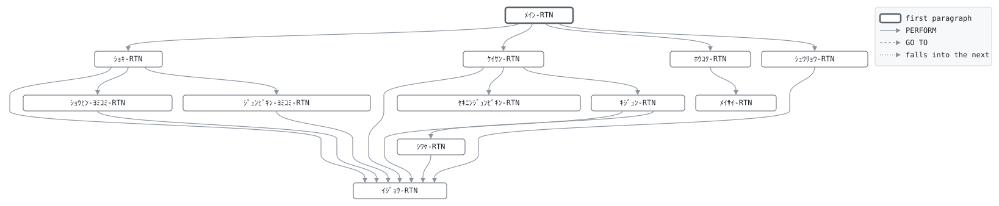

# GLM020

```text
GLM020: 責任準備金計算

月末。保障中 (有効・猶予中) の契約ごとに、責任準備金係数
(商品・経過年数、50年まで) を保険金額1,000円あたりに掛けて
月末の責任準備金を求め、前月末との差額を繰入 (借方) または
戻入 (貸方) として仕訳し、マスタに書き戻す。保障の終わった
契約に残る準備金は全額戻入する。
報告書は商品順に報告書作成機能 (REPORT WRITER) で: 商品ごとの
見出しと計、総合計、頁番号。

復帰コード: 0 処理済、8 日付が日付でない、16 ファイル異常。

変更履歴
日付       担当 変更
1987-04-01 KT   GL-0001 初版。
1995-10-02 KT   GL-0188 報告書作成機能で商品別に。
```

Program [GLM020.cbl](../../../gondwana/programs/GLM020.cbl): 7 files, 12 paragraphs. Its business rules: [13 decision tables](../rules/GLM020.md).

- AUTHOR: ゴンドワナ生命 システム部.
- DATE-WRITTEN: 1987-04-01.

## Contents

- [Files](#files)
- [Flow](#flow)
- [Paragraphs](#paragraphs)
- [Calls](#calls)
- [Data flow](#data-flow)
- [Lineage](#lineage)
  - [Into PM-ｹｲﾔｸ-ﾚｺｰﾄﾞ](#into-pm-ｹｲﾔｸ-ﾚｺｰﾄﾞ)
  - [Into RS-ｼﾞｭﾝﾋﾞｷﾝ-ﾚｺｰﾄﾞ](#into-rs-ｼﾞｭﾝﾋﾞｷﾝ-ﾚｺｰﾄﾞ)
  - [Into PR-ｼｮｳﾋﾝ-ﾚｺｰﾄﾞ](#into-pr-ｼｮｳﾋﾝ-ﾚｺｰﾄﾞ)
  - [Into SR-ｾｲﾚﾂ-ﾚｺｰﾄﾞ](#into-sr-ｾｲﾚﾂ-ﾚｺｰﾄﾞ)
  - [Into CT-ｾｲｷﾞｮ-ﾚｺｰﾄﾞ](#into-ct-ｾｲｷﾞｮ-ﾚｺｰﾄﾞ)
  - [Into JR-ｼﾜｹ-ﾚｺｰﾄﾞ](#into-jr-ｼﾜｹ-ﾚｺｰﾄﾞ)
  - [Into PAGE-HEADING-LINE-1](#into-page-heading-line-1)
  - [Into CONTROL-HEADING-SR-ｼｮｳﾋﾝ](#into-control-heading-sr-ｼｮｳﾋﾝ)
  - [Into RESERVE-DETAIL](#into-reserve-detail)
  - [Into CONTROL-FOOTING-SR-ｼｮｳﾋﾝ-LINE-1](#into-control-footing-sr-ｼｮｳﾋﾝ-line-1)
  - [Into CONTROL-FOOTING-FINAL](#into-control-footing-final)
  - [Into WS-ｺﾏﾝﾄﾞｷﾞｮｳ](#into-ws-ｺﾏﾝﾄﾞｷﾞｮｳ)
  - [Into WS-ｴﾗｰﾌｧｲﾙ](#into-ws-ｴﾗｰﾌｧｲﾙ)
  - [Into WS-ｴﾗｰｽﾃｰﾀｽ](#into-ws-ｴﾗｰｽﾃｰﾀｽ)
  - [Into WS-ｷﾞｮｳﾑﾋﾂﾞｹ](#into-ws-ｷﾞｮｳﾑﾋﾂﾞｹ)
  - [Into WS-ｷﾞｮｳﾑﾋﾂﾞｹ-ﾜﾚｷ](#into-ws-ｷﾞｮｳﾑﾋﾂﾞｹ-ﾜﾚｷ)
  - [Into WS-ﾎｳｺｳ](#into-ws-ﾎｳｺｳ)
  - [Into WS-ﾍﾝｶﾝｹｯｶ](#into-ws-ﾍﾝｶﾝｹｯｶ)
  - [Into WS-ｼｮｳﾋﾝﾒｲ](#into-ws-ｼｮｳﾋﾝﾒｲ)
  - [Into WS-ﾈﾝｽｳ](#into-ws-ﾈﾝｽｳ)
  - [Into WS-ｼｮｳﾋﾝ-TBL](#into-ws-ｼｮｳﾋﾝ-tbl)
  - [Into WS-ｼﾞｭﾝﾋﾞｷﾝ-TBL](#into-ws-ｼﾞｭﾝﾋﾞｷﾝ-tbl)
  - [Into WS-ｹﾝｽｳ](#into-ws-ｹﾝｽｳ)
  - [Out of the program](#out-of-the-program)
  - [Into other data items](#into-other-data-items)
- [Field origins](#field-origins)
  - [File POLMST-F](#file-polmst-f)
  - [File SORT-F](#file-sort-f)
  - [File GLJRNL-F](#file-gljrnl-f)
  - [File REPORT-F](#file-report-f)
  - [File GLSCTL-F](#file-glsctl-f)
- [Links between records](#links-between-records)
- [Records](#records)
  - [PM-ｹｲﾔｸ-ﾚｺｰﾄﾞ](#pm-ｹｲﾔｸ-ﾚｺｰﾄﾞ)
  - [RS-ｼﾞｭﾝﾋﾞｷﾝ-ﾚｺｰﾄﾞ](#rs-ｼﾞｭﾝﾋﾞｷﾝ-ﾚｺｰﾄﾞ)
  - [PR-ｼｮｳﾋﾝ-ﾚｺｰﾄﾞ](#pr-ｼｮｳﾋﾝ-ﾚｺｰﾄﾞ)
  - [SR-ｾｲﾚﾂ-ﾚｺｰﾄﾞ](#sr-ｾｲﾚﾂ-ﾚｺｰﾄﾞ)
  - [CT-ｾｲｷﾞｮ-ﾚｺｰﾄﾞ](#ct-ｾｲｷﾞｮ-ﾚｺｰﾄﾞ)
  - [JR-ｼﾜｹ-ﾚｺｰﾄﾞ](#jr-ｼﾜｹ-ﾚｺｰﾄﾞ)
  - [PAGE-HEADING-LINE-1](#page-heading-line-1)
  - [PAGE-HEADING-LINE-2](#page-heading-line-2)
  - [CONTROL-HEADING-SR-ｼｮｳﾋﾝ](#control-heading-sr-ｼｮｳﾋﾝ)
  - [RESERVE-DETAIL](#reserve-detail)
  - [CONTROL-FOOTING-SR-ｼｮｳﾋﾝ-LINE-1](#control-footing-sr-ｼｮｳﾋﾝ-line-1)
  - [CONTROL-FOOTING-SR-ｼｮｳﾋﾝ-LINE-2](#control-footing-sr-ｼｮｳﾋﾝ-line-2)
  - [CONTROL-FOOTING-FINAL](#control-footing-final)
  - [WS-ｽﾃｰﾀｽ](#ws-ｽﾃｰﾀｽ)
  - [WS-ｺﾏﾝﾄﾞｷﾞｮｳ](#ws-ｺﾏﾝﾄﾞｷﾞｮｳ)
  - [WS-ｴﾗｰﾌｧｲﾙ](#ws-ｴﾗｰﾌｧｲﾙ)
  - [WS-ｴﾗｰｽﾃｰﾀｽ](#ws-ｴﾗｰｽﾃｰﾀｽ)
  - [WS-ｷﾞｮｳﾑﾋﾂﾞｹ](#ws-ｷﾞｮｳﾑﾋﾂﾞｹ)
  - [WS-ｷﾞｮｳﾑﾋﾂﾞｹ-ﾜﾚｷ](#ws-ｷﾞｮｳﾑﾋﾂﾞｹ-ﾜﾚｷ)
  - [WS-ﾎｳｺｳ](#ws-ﾎｳｺｳ)
  - [WS-ﾍﾝｶﾝｹｯｶ](#ws-ﾍﾝｶﾝｹｯｶ)
  - [WS-ｼｮｳﾋﾝﾒｲ](#ws-ｼｮｳﾋﾝﾒｲ)
  - [WS-ﾈﾝｽｳ](#ws-ﾈﾝｽｳ)
  - [WS-ｼｮｳﾋﾝ-TBL](#ws-ｼｮｳﾋﾝ-tbl)
  - [WS-ﾘｮｳﾘﾂ-TBL](#ws-ﾘｮｳﾘﾂ-tbl)
  - [WS-ﾈﾝﾚｲ-ｿｴｼﾞ](#ws-ﾈﾝﾚｲ-ｿｴｼﾞ)
  - [WS-ｼﾞｭﾝﾋﾞｷﾝ-TBL](#ws-ｼﾞｭﾝﾋﾞｷﾝ-tbl)
  - [WS-ｹﾝｽｳ](#ws-ｹﾝｽｳ)

## Files

| File | Kind | Assigned to | Organization | Status field | Opened | Records |
| --- | --- | --- | --- | --- | --- | --- |
| POLMST-F | FD | POLMST | INDEXED, key PM-ｼｮｳｹﾝﾊﾞﾝｺﾞｳ, DYNAMIC access | WS-POLMST-ST | I-O | PM-ｹｲﾔｸ-ﾚｺｰﾄﾞ |
| RSVTB-F | FD | RSVTB | LINE SEQUENTIAL | WS-RSVTB-ST | INPUT | RS-ｼﾞｭﾝﾋﾞｷﾝ-ﾚｺｰﾄﾞ |
| PRODTB-F | FD | PRODTB | LINE SEQUENTIAL | WS-PRODTB-ST | INPUT | PR-ｼｮｳﾋﾝ-ﾚｺｰﾄﾞ |
| SORT-F | SD | SORTWK | SEQUENTIAL | | | SR-ｾｲﾚﾂ-ﾚｺｰﾄﾞ |
| GLSCTL-F | FD | GLSCTL | SEQUENTIAL | WS-GLSCTL-ST | I-O | CT-ｾｲｷﾞｮ-ﾚｺｰﾄﾞ |
| GLJRNL-F | FD | GLJRNL | LINE SEQUENTIAL | WS-GLJRNL-ST | EXTEND | JR-ｼﾜｹ-ﾚｺｰﾄﾞ |
| REPORT-F | FD | GLM020R | LINE SEQUENTIAL | WS-REPORT-ST | OUTPUT | PAGE-HEADING-LINE-1, PAGE-HEADING-LINE-2, CONTROL-HEADING-SR-ｼｮｳﾋﾝ, RESERVE-DETAIL, CONTROL-FOOTING-SR-ｼｮｳﾋﾝ-LINE-1, CONTROL-FOOTING-SR-ｼｮｳﾋﾝ-LINE-2, CONTROL-FOOTING-FINAL |

## Flow



## Paragraphs

| Paragraph | Description | Source | Performs | Goes to | Performed by | Reached by |
| --- | --- | --- | --- | --- | --- | --- |
| ﾒｲﾝ-RTN | ﾒｲﾝ-RTN: 準備、計算と整列と報告、終了。 | [GLM020.cbl:163](../../../gondwana/programs/GLM020.cbl#L163) | ｼｮｷ-RTN, ｹｲｻﾝ-RTN (SORT), ﾎｳｺｸ-RTN (SORT), ｼｭｳﾘｮｳ-RTN | | | |
| ｼｮｷ-RTN | ｼｮｷ-RTN: 業務日付、ファイル、テーブル、制御レコード。 | [GLM020.cbl:176](../../../gondwana/programs/GLM020.cbl#L176) | ｲｼﾞｮｳ-RTN, ｼｮｳﾋﾝ-ﾖﾐｺﾐ-RTN, ｼﾞｭﾝﾋﾞｷﾝ-ﾖﾐｺﾐ-RTN | | ﾒｲﾝ-RTN | |
| ｼﾞｭﾝﾋﾞｷﾝ-ﾖﾐｺﾐ-RTN | ｼﾞｭﾝﾋﾞｷﾝ-ﾖﾐｺﾐ-RTN: 係数を商品・経過年数のテーブルに読み込む。 | [GLM020.cbl:228](../../../gondwana/programs/GLM020.cbl#L228) | ｲｼﾞｮｳ-RTN | | ｼｮｷ-RTN | |
| ｹｲｻﾝ-RTN | ｹｲｻﾝ-RTN: マスタ全件。保障中は準備金を求め、終わった契約は 戻し、差額を仕訳し、書き戻し、整列に渡す。 | [GLM020.cbl:250](../../../gondwana/programs/GLM020.cbl#L250) | ｾｷﾆﾝｼﾞｭﾝﾋﾞｷﾝ-RTN, ｷｼﾞｭﾝ-RTN, ｲｼﾞｮｳ-RTN | | ﾒｲﾝ-RTN | |
| ｾｷﾆﾝｼﾞｭﾝﾋﾞｷﾝ-RTN | ｾｷﾆﾝｼﾞｭﾝﾋﾞｷﾝ-RTN: 係数から月末の責任準備金。 | [GLM020.cbl:274](../../../gondwana/programs/GLM020.cbl#L274) | | | ｹｲｻﾝ-RTN | |
| ｷｼﾞｭﾝ-RTN | ｷｼﾞｭﾝ-RTN: 差額の仕訳、マスタの更新、整列レコード。 | [GLM020.cbl:292](../../../gondwana/programs/GLM020.cbl#L292) | ｼﾜｹ-RTN, ｲｼﾞｮｳ-RTN | | ｹｲｻﾝ-RTN | |
| ｼﾜｹ-RTN | ｼﾜｹ-RTN: 繰入は借方、戻入は貸方。 | [GLM020.cbl:316](../../../gondwana/programs/GLM020.cbl#L316) | ｲｼﾞｮｳ-RTN | | ｷｼﾞｭﾝ-RTN | |
| ﾎｳｺｸ-RTN | ﾎｳｺｸ-RTN: 整列済みの1件ごとに明細を生成する。商品名は 見出しのために商品が変わるたびに引く。 | [GLM020.cbl:343](../../../gondwana/programs/GLM020.cbl#L343) | ﾒｲｻｲ-RTN | | ﾒｲﾝ-RTN | |
| ﾒｲｻｲ-RTN | ﾒｲｻｲ-RTN: 商品名を引き、1行生成する。 | [GLM020.cbl:364](../../../gondwana/programs/GLM020.cbl#L364) | | | ﾎｳｺｸ-RTN | |
| ｼｭｳﾘｮｳ-RTN | ｼｭｳﾘｮｳ-RTN: 制御レコードを書き戻し、ファイルを閉じる。 | [GLM020.cbl:377](../../../gondwana/programs/GLM020.cbl#L377) | ｲｼﾞｮｳ-RTN | | ﾒｲﾝ-RTN | |
| ｲｼﾞｮｳ-RTN | ｲｼﾞｮｳ-RTN: ファイル異常は 16 で終わる。 | [GLM020.cbl:392](../../../gondwana/programs/GLM020.cbl#L392) | | | ｼｮｷ-RTN, ｼﾞｭﾝﾋﾞｷﾝ-ﾖﾐｺﾐ-RTN, ｹｲｻﾝ-RTN, ｷｼﾞｭﾝ-RTN, ｼﾜｹ-RTN, ｼｭｳﾘｮｳ-RTN, ｼｮｳﾋﾝ-ﾖﾐｺﾐ-RTN | |
| ｼｮｳﾋﾝ-ﾖﾐｺﾐ-RTN | ｼｮｳﾋﾝ-ﾖﾐｺﾐ-RTN: 商品テーブルを読み込む。 | [PRDLOD.cpy:16](../../../gondwana/copybooks/PRDLOD.cpy#L16) | ｲｼﾞｮｳ-RTN | | ｼｮｷ-RTN | |

## Calls

| Calls | Passing | Paragraph | Source |
| --- | --- | --- | --- |
| [GLC020](GLC020.md) | WS-ﾎｳｺｳ, WS-ｷﾞｮｳﾑﾋﾂﾞｹ, WS-ｷﾞｮｳﾑﾋﾂﾞｹ-ﾜﾚｷ, WS-ﾍﾝｶﾝｹｯｶ | ｼｮｷ-RTN | [GLM020.cbl:179](../../../gondwana/programs/GLM020.cbl#L179) |

## Data flow

| Paragraph | Reads | Writes |
| --- | --- | --- |
| ﾒｲﾝ-RTN | SR-ｼｮｳﾋﾝ, SR-ｼｮｳｹﾝﾊﾞﾝｺﾞｳ | RETURN-CODE |
| ｼｮｷ-RTN | WS-ｺﾏﾝﾄﾞｷﾞｮｳ, WS-ﾎｳｺｳ, WS-ｷﾞｮｳﾑﾋﾂﾞｹ, WS-ｷﾞｮｳﾑﾋﾂﾞｹ-ﾜﾚｷ, WS-ﾍﾝｶﾝｹｯｶ, WS-RSVTB-ST, WS-PRODTB-ST, WS-POLMST-ST, WS-GLSCTL-ST, WS-GLJRNL-ST, WS-REPORT-ST, WS-ｴﾗｰﾌｧｲﾙ | WS-ｺﾏﾝﾄﾞｷﾞｮｳ, WS-ｷﾞｮｳﾑﾋﾂﾞｹ, WS-ﾎｳｺｳ, WS-ｷﾞｮｳﾑﾋﾂﾞｹ-ﾜﾚｷ, WS-ﾍﾝｶﾝｹｯｶ, RETURN-CODE, WS-ｴﾗｰﾌｧｲﾙ, WS-ｴﾗｰｽﾃｰﾀｽ, JR-ｼﾜｹ-ﾚｺｰﾄﾞ, CT-ｾｲｷﾞｮ-ﾚｺｰﾄﾞ |
| ｼﾞｭﾝﾋﾞｷﾝ-ﾖﾐｺﾐ-RTN | WS-RSVTB-ST, WS-ｼｮｳﾋﾝ, WS-ｼｮｳﾋﾝ-ｺｰﾄﾞ, WS-ｼｮｳﾋﾝ-IX, RS-ｼｮｳﾋﾝ, RS-ｹｲｽｳ, RS-ｹｲｶﾈﾝｽｳ | WS-ｼﾞｭﾝﾋﾞｷﾝ-TBL, RS-ｼﾞｭﾝﾋﾞｷﾝ-ﾚｺｰﾄﾞ, WS-ｼｮｳﾋﾝ-IX, WS-ｼﾞｭﾝﾋﾞｷﾝ-ｹｲｽｳ, WS-ｴﾗｰﾌｧｲﾙ, WS-ｴﾗｰｽﾃｰﾀｽ |
| ｹｲｻﾝ-RTN | WS-POLMST-ST, PM-ｼﾞｮｳﾀｲ, PM-ｾｷﾆﾝｼﾞｭﾝﾋﾞｷﾝ, WS-ﾓﾄﾞｼｹﾝｽｳ | PM-ｹｲﾔｸ-ﾚｺｰﾄﾞ, SR-ｼﾞｭﾝﾋﾞｷﾝ, WS-ﾓﾄﾞｼｹﾝｽｳ, WS-ｴﾗｰﾌｧｲﾙ, WS-ｴﾗｰｽﾃｰﾀｽ |
| ｾｷﾆﾝｼﾞｭﾝﾋﾞｷﾝ-RTN | WS-ｼｮｳﾋﾝ, WS-ｼｮｳﾋﾝ-ｺｰﾄﾞ, WS-ｼｮｳﾋﾝ-IX, PM-ｼｮｳﾋﾝ, PM-ｹｲｶﾈﾝｽｳ, PM-ﾎｹﾝｷﾝｶﾞｸ, WS-ｼﾞｭﾝﾋﾞｷﾝ-ｹｲｽｳ, WS-ﾈﾝｽｳ, WS-ｹｲｻﾝｹﾝｽｳ | WS-ｼｮｳﾋﾝ-IX, WS-ﾈﾝｽｳ, SR-ｼﾞｭﾝﾋﾞｷﾝ, WS-ｹｲｻﾝｹﾝｽｳ |
| ｷｼﾞｭﾝ-RTN | SR-ｼﾞｭﾝﾋﾞｷﾝ, PM-ｾｷﾆﾝｼﾞｭﾝﾋﾞｷﾝ, SR-ｿﾞｳｹﾞﾝ, WS-POLMST-ST, PM-ｼｮｳﾋﾝ, PM-ｼｮｳｹﾝﾊﾞﾝｺﾞｳ, PM-ｼﾒｲ, PM-ｹｲｶﾈﾝｽｳ, PM-ﾎｹﾝｷﾝｶﾞｸ, WS-ｼﾞｭﾝﾋﾞｷﾝｺﾞｳｹｲ, WS-ｿﾞｳｹﾞﾝｺﾞｳｹｲ | SR-ｿﾞｳｹﾞﾝ, PM-ｾｷﾆﾝｼﾞｭﾝﾋﾞｷﾝ, PM-ｹｲﾔｸ-ﾚｺｰﾄﾞ, WS-ｴﾗｰﾌｧｲﾙ, WS-ｴﾗｰｽﾃｰﾀｽ, SR-ｼｮｳﾋﾝ, SR-ｼｮｳｹﾝﾊﾞﾝｺﾞｳ, SR-ｼﾒｲ, SR-ｹｲｶﾈﾝｽｳ, SR-ﾎｹﾝｷﾝｶﾞｸ, SR-ｾｲﾚﾂ-ﾚｺｰﾄﾞ, WS-ｼﾞｭﾝﾋﾞｷﾝｺﾞｳｹｲ, WS-ｿﾞｳｹﾞﾝｺﾞｳｹｲ |
| ｼﾜｹ-RTN | CT-ｼﾞｶｲｼﾜｹﾊﾞﾝｺﾞｳ, WS-ｷﾞｮｳﾑﾋﾂﾞｹ-ﾜﾚｷ, SR-ｿﾞｳｹﾞﾝ, PM-ｼｮｳｹﾝﾊﾞﾝｺﾞｳ, WS-GLJRNL-ST | JR-ｼﾜｹﾊﾞﾝｺﾞｳ, CT-ｼﾞｶｲｼﾜｹﾊﾞﾝｺﾞｳ, JR-ﾋﾂﾞｹ, JR-ﾌﾟﾛｸﾞﾗﾑ, JR-ｶﾝｼﾞｮｳｶﾓｸ, JR-ﾀｲｼｬｸ, JR-ｷﾝｶﾞｸ, JR-ﾃｷﾖｳ, JR-ｼｮｳｹﾝﾊﾞﾝｺﾞｳ, JR-ｼﾜｹ-ﾚｺｰﾄﾞ, WS-ｴﾗｰﾌｧｲﾙ, WS-ｴﾗｰｽﾃｰﾀｽ |
| ﾎｳｺｸ-RTN | RESERVE-RPT, SR-ｼｮｳﾋﾝ, WS-ｷﾞｮｳﾑﾋﾂﾞｹ-ﾜﾚｷ, PAGE-COUNTER, WS-ｼｮｳﾋﾝﾒｲ, SR-ｼｮｳｹﾝﾊﾞﾝｺﾞｳ, SR-ｼﾒｲ, SR-ｹｲｶﾈﾝｽｳ, SR-ﾎｹﾝｷﾝｶﾞｸ, SR-ｼﾞｭﾝﾋﾞｷﾝ, SR-ｿﾞｳｹﾞﾝ | SR-ｾｲﾚﾂ-ﾚｺｰﾄﾞ, SR-ｼｮｳﾋﾝ, PAGE-HEADING-LINE-1, PAGE-HEADING-LINE-2, CONTROL-HEADING-SR-ｼｮｳﾋﾝ, RESERVE-DETAIL, CONTROL-FOOTING-SR-ｼｮｳﾋﾝ-LINE-1, CONTROL-FOOTING-SR-ｼｮｳﾋﾝ-LINE-2, CONTROL-FOOTING-FINAL |
| ﾒｲｻｲ-RTN | WS-ｼｮｳﾋﾝ, WS-ｼｮｳﾋﾝ-ｺｰﾄﾞ, WS-ｼｮｳﾋﾝ-IX, SR-ｼｮｳﾋﾝ, WS-ｼｮｳﾋﾝ-ﾒｲｼｮｳ, RESERVE-DETAIL, WS-ｷﾞｮｳﾑﾋﾂﾞｹ-ﾜﾚｷ, PAGE-COUNTER, WS-ｼｮｳﾋﾝﾒｲ, SR-ｼｮｳｹﾝﾊﾞﾝｺﾞｳ, SR-ｼﾒｲ, SR-ｹｲｶﾈﾝｽｳ, SR-ﾎｹﾝｷﾝｶﾞｸ, SR-ｼﾞｭﾝﾋﾞｷﾝ, SR-ｿﾞｳｹﾞﾝ | WS-ｼｮｳﾋﾝ-IX, WS-ｼｮｳﾋﾝﾒｲ, PAGE-HEADING-LINE-1, PAGE-HEADING-LINE-2, CONTROL-HEADING-SR-ｼｮｳﾋﾝ, RESERVE-DETAIL, CONTROL-FOOTING-SR-ｼｮｳﾋﾝ-LINE-1, CONTROL-FOOTING-SR-ｼｮｳﾋﾝ-LINE-2, CONTROL-FOOTING-FINAL |
| ｼｭｳﾘｮｳ-RTN | WS-GLSCTL-ST, WS-ｹｲｻﾝｹﾝｽｳ, WS-ﾓﾄﾞｼｹﾝｽｳ, WS-ｼﾞｭﾝﾋﾞｷﾝｺﾞｳｹｲ | CT-ｾｲｷﾞｮ-ﾚｺｰﾄﾞ, WS-ｴﾗｰﾌｧｲﾙ, WS-ｴﾗｰｽﾃｰﾀｽ |
| ｲｼﾞｮｳ-RTN | WS-ｴﾗｰﾌｧｲﾙ, WS-ｴﾗｰｽﾃｰﾀｽ | RETURN-CODE |
| ｼｮｳﾋﾝ-ﾖﾐｺﾐ-RTN | WS-PRODTB-ST, WS-ｼｮｳﾋﾝｹﾝｽｳ, PR-ｺｰﾄﾞ, WS-ｼｮｳﾋﾝ-IX, PR-ﾒｲｼｮｳ, PR-ｼｭﾙｲ, PR-ｻｲﾃｲﾈﾝﾚｲ, PR-ｻｲｺｳﾈﾝﾚｲ, PR-ﾎｹﾝｷｶﾝ, PR-ｻｲﾃｲﾎｹﾝｷﾝｶﾞｸ, PR-ｻｲｺｳﾎｹﾝｷﾝｶﾞｸ, PR-ﾆｭｳｲﾝﾆﾁｶﾞｸﾘﾂ, PR-ﾒﾝｾｷﾆｯｽｳ, PR-ﾊｲﾄｳﾘﾂ | PR-ｼｮｳﾋﾝ-ﾚｺｰﾄﾞ, WS-ｼｮｳﾋﾝｹﾝｽｳ, WS-ｼｮｳﾋﾝ-IX, WS-ｼｮｳﾋﾝ-ｺｰﾄﾞ, WS-ｼｮｳﾋﾝ-ﾒｲｼｮｳ, WS-ｼｮｳﾋﾝ-ｼｭﾙｲ, WS-ｼｮｳﾋﾝ-ｻｲﾃｲﾈﾝﾚｲ, WS-ｼｮｳﾋﾝ-ｻｲｺｳﾈﾝﾚｲ, WS-ｼｮｳﾋﾝ-ﾎｹﾝｷｶﾝ, WS-ｼｮｳﾋﾝ-ｻｲﾃｲｷﾝｶﾞｸ, WS-ｼｮｳﾋﾝ-ｻｲｺｳｷﾝｶﾞｸ, WS-ｼｮｳﾋﾝ-ﾆｭｳｲﾝﾆﾁｶﾞｸﾘﾂ, WS-ｼｮｳﾋﾝ-ﾒﾝｾｷﾆｯｽｳ, WS-ｼｮｳﾋﾝ-ﾊｲﾄｳﾘﾂ, WS-ｴﾗｰﾌｧｲﾙ, WS-ｴﾗｰｽﾃｰﾀｽ |

## Lineage

Where each data item's values come from, grouped by the record they go into. A data item links to the record it belongs to.

### Into PM-ｹｲﾔｸ-ﾚｺｰﾄﾞ

Record [PM-ｹｲﾔｸ-ﾚｺｰﾄﾞ](#pm-ｹｲﾔｸ-ﾚｺｰﾄﾞ), from copybook [POLMST](../copybooks/POLMST.md).

| Into | From | Statement | Paragraph | Source |
| --- | --- | --- | --- | --- |
| PM-ｹｲﾔｸ-ﾚｺｰﾄﾞ | file POLMST-F | READ | ｹｲｻﾝ-RTN | [GLM020.cbl:251](../../../gondwana/programs/GLM020.cbl#L251) |
| PM-ｹｲﾔｸ-ﾚｺｰﾄﾞ | file POLMST-F | READ | ｹｲｻﾝ-RTN | [GLM020.cbl:263](../../../gondwana/programs/GLM020.cbl#L263) |
| PM-ｾｷﾆﾝｼﾞｭﾝﾋﾞｷﾝ | [SR-ｼﾞｭﾝﾋﾞｷﾝ](#sr-ｾｲﾚﾂ-ﾚｺｰﾄﾞ "in SR-ｾｲﾚﾂ-ﾚｺｰﾄﾞ") | MOVE | ｷｼﾞｭﾝ-RTN | [GLM020.cbl:297](../../../gondwana/programs/GLM020.cbl#L297) |

### Into RS-ｼﾞｭﾝﾋﾞｷﾝ-ﾚｺｰﾄﾞ

Record [RS-ｼﾞｭﾝﾋﾞｷﾝ-ﾚｺｰﾄﾞ](#rs-ｼﾞｭﾝﾋﾞｷﾝ-ﾚｺｰﾄﾞ), from copybook [RSVTB](../copybooks/RSVTB.md).

| Into | From | Statement | Paragraph | Source |
| --- | --- | --- | --- | --- |
| RS-ｼﾞｭﾝﾋﾞｷﾝ-ﾚｺｰﾄﾞ | file RSVTB-F | READ | ｼﾞｭﾝﾋﾞｷﾝ-ﾖﾐｺﾐ-RTN | [GLM020.cbl:230](../../../gondwana/programs/GLM020.cbl#L230) |
| RS-ｼﾞｭﾝﾋﾞｷﾝ-ﾚｺｰﾄﾞ | file RSVTB-F | READ | ｼﾞｭﾝﾋﾞｷﾝ-ﾖﾐｺﾐ-RTN | [GLM020.cbl:238](../../../gondwana/programs/GLM020.cbl#L238) |

### Into PR-ｼｮｳﾋﾝ-ﾚｺｰﾄﾞ

Record [PR-ｼｮｳﾋﾝ-ﾚｺｰﾄﾞ](#pr-ｼｮｳﾋﾝ-ﾚｺｰﾄﾞ), from copybook [PRODTB](../copybooks/PRODTB.md).

| Into | From | Statement | Paragraph | Source |
| --- | --- | --- | --- | --- |
| PR-ｼｮｳﾋﾝ-ﾚｺｰﾄﾞ | file PRODTB-F | READ | ｼｮｳﾋﾝ-ﾖﾐｺﾐ-RTN | [PRDLOD.cpy:17](../../../gondwana/copybooks/PRDLOD.cpy#L17) |
| PR-ｼｮｳﾋﾝ-ﾚｺｰﾄﾞ | file PRODTB-F | READ | ｼｮｳﾋﾝ-ﾖﾐｺﾐ-RTN | [PRDLOD.cpy:35](../../../gondwana/copybooks/PRDLOD.cpy#L35) |

### Into SR-ｾｲﾚﾂ-ﾚｺｰﾄﾞ

Record [SR-ｾｲﾚﾂ-ﾚｺｰﾄﾞ](#sr-ｾｲﾚﾂ-ﾚｺｰﾄﾞ).

| Into | From | Statement | Paragraph | Source |
| --- | --- | --- | --- | --- |
| SR-ｹｲｶﾈﾝｽｳ | [PM-ｹｲｶﾈﾝｽｳ](#pm-ｹｲﾔｸ-ﾚｺｰﾄﾞ "in PM-ｹｲﾔｸ-ﾚｺｰﾄﾞ") | MOVE | ｷｼﾞｭﾝ-RTN | [GLM020.cbl:307](../../../gondwana/programs/GLM020.cbl#L307) |
| SR-ｼｮｳｹﾝﾊﾞﾝｺﾞｳ | [PM-ｼｮｳｹﾝﾊﾞﾝｺﾞｳ](#pm-ｹｲﾔｸ-ﾚｺｰﾄﾞ "in PM-ｹｲﾔｸ-ﾚｺｰﾄﾞ") | MOVE | ｷｼﾞｭﾝ-RTN | [GLM020.cbl:305](../../../gondwana/programs/GLM020.cbl#L305) |
| SR-ｼｮｳﾋﾝ | [PM-ｼｮｳﾋﾝ](#pm-ｹｲﾔｸ-ﾚｺｰﾄﾞ "in PM-ｹｲﾔｸ-ﾚｺｰﾄﾞ") | MOVE | ｷｼﾞｭﾝ-RTN | [GLM020.cbl:304](../../../gondwana/programs/GLM020.cbl#L304) |
| SR-ｼｮｳﾋﾝ | literal SPACES | MOVE | ﾎｳｺｸ-RTN | [GLM020.cbl:353](../../../gondwana/programs/GLM020.cbl#L353) |
| SR-ｼﾒｲ | [PM-ｼﾒｲ](#pm-ｹｲﾔｸ-ﾚｺｰﾄﾞ "in PM-ｹｲﾔｸ-ﾚｺｰﾄﾞ") | MOVE | ｷｼﾞｭﾝ-RTN | [GLM020.cbl:306](../../../gondwana/programs/GLM020.cbl#L306) |
| SR-ｼﾞｭﾝﾋﾞｷﾝ | literal 0 | MOVE | ｹｲｻﾝ-RTN | [GLM020.cbl:258](../../../gondwana/programs/GLM020.cbl#L258) |
| SR-ｼﾞｭﾝﾋﾞｷﾝ | [PM-ﾎｹﾝｷﾝｶﾞｸ](#pm-ｹｲﾔｸ-ﾚｺｰﾄﾞ "in PM-ｹｲﾔｸ-ﾚｺｰﾄﾞ") | COMPUTE | ｾｷﾆﾝｼﾞｭﾝﾋﾞｷﾝ-RTN | [GLM020.cbl:285](../../../gondwana/programs/GLM020.cbl#L285) |
| SR-ｼﾞｭﾝﾋﾞｷﾝ | [WS-ｼﾞｭﾝﾋﾞｷﾝ-ｹｲｽｳ](#ws-ｼﾞｭﾝﾋﾞｷﾝ-tbl "in WS-ｼﾞｭﾝﾋﾞｷﾝ-TBL") | COMPUTE | ｾｷﾆﾝｼﾞｭﾝﾋﾞｷﾝ-RTN | [GLM020.cbl:285](../../../gondwana/programs/GLM020.cbl#L285) |
| SR-ｼﾞｭﾝﾋﾞｷﾝ | WS-ｼｮｳﾋﾝ-IX | COMPUTE | ｾｷﾆﾝｼﾞｭﾝﾋﾞｷﾝ-RTN | [GLM020.cbl:285](../../../gondwana/programs/GLM020.cbl#L285) |
| SR-ｼﾞｭﾝﾋﾞｷﾝ | [WS-ﾈﾝｽｳ](#ws-ﾈﾝｽｳ) | COMPUTE | ｾｷﾆﾝｼﾞｭﾝﾋﾞｷﾝ-RTN | [GLM020.cbl:285](../../../gondwana/programs/GLM020.cbl#L285) |
| SR-ｾｲﾚﾂ-ﾚｺｰﾄﾞ | file SORT-F | RETURN | ﾎｳｺｸ-RTN | [GLM020.cbl:345](../../../gondwana/programs/GLM020.cbl#L345) |
| SR-ｾｲﾚﾂ-ﾚｺｰﾄﾞ | file SORT-F | RETURN | ﾎｳｺｸ-RTN | [GLM020.cbl:351](../../../gondwana/programs/GLM020.cbl#L351) |
| SR-ｿﾞｳｹﾞﾝ | [SR-ｼﾞｭﾝﾋﾞｷﾝ](#sr-ｾｲﾚﾂ-ﾚｺｰﾄﾞ "in SR-ｾｲﾚﾂ-ﾚｺｰﾄﾞ") | COMPUTE | ｷｼﾞｭﾝ-RTN | [GLM020.cbl:293](../../../gondwana/programs/GLM020.cbl#L293) |
| SR-ｿﾞｳｹﾞﾝ | [PM-ｾｷﾆﾝｼﾞｭﾝﾋﾞｷﾝ](#pm-ｹｲﾔｸ-ﾚｺｰﾄﾞ "in PM-ｹｲﾔｸ-ﾚｺｰﾄﾞ") | COMPUTE | ｷｼﾞｭﾝ-RTN | [GLM020.cbl:293](../../../gondwana/programs/GLM020.cbl#L293) |
| SR-ﾎｹﾝｷﾝｶﾞｸ | [PM-ﾎｹﾝｷﾝｶﾞｸ](#pm-ｹｲﾔｸ-ﾚｺｰﾄﾞ "in PM-ｹｲﾔｸ-ﾚｺｰﾄﾞ") | MOVE | ｷｼﾞｭﾝ-RTN | [GLM020.cbl:308](../../../gondwana/programs/GLM020.cbl#L308) |

### Into CT-ｾｲｷﾞｮ-ﾚｺｰﾄﾞ

Record [CT-ｾｲｷﾞｮ-ﾚｺｰﾄﾞ](#ct-ｾｲｷﾞｮ-ﾚｺｰﾄﾞ), from copybook [CTLREC](../copybooks/CTLREC.md).

| Into | From | Statement | Paragraph | Source |
| --- | --- | --- | --- | --- |
| CT-ｼﾞｶｲｼﾜｹﾊﾞﾝｺﾞｳ | literal 1 | ADD | ｼﾜｹ-RTN | [GLM020.cbl:318](../../../gondwana/programs/GLM020.cbl#L318) |
| CT-ｾｲｷﾞｮ-ﾚｺｰﾄﾞ | file GLSCTL-F | READ | ｼｮｷ-RTN | [GLM020.cbl:218](../../../gondwana/programs/GLM020.cbl#L218) |

### Into JR-ｼﾜｹ-ﾚｺｰﾄﾞ

Record [JR-ｼﾜｹ-ﾚｺｰﾄﾞ](#jr-ｼﾜｹ-ﾚｺｰﾄﾞ), from copybook [GLJRNL](../copybooks/GLJRNL.md).

| Into | From | Statement | Paragraph | Source |
| --- | --- | --- | --- | --- |
| JR-ｶﾝｼﾞｮｳｶﾓｸ | literal 5210 | MOVE | ｼﾜｹ-RTN | [GLM020.cbl:321](../../../gondwana/programs/GLM020.cbl#L321) |
| JR-ｷﾝｶﾞｸ | [SR-ｿﾞｳｹﾞﾝ](#sr-ｾｲﾚﾂ-ﾚｺｰﾄﾞ "in SR-ｾｲﾚﾂ-ﾚｺｰﾄﾞ") | MOVE | ｼﾜｹ-RTN | [GLM020.cbl:324](../../../gondwana/programs/GLM020.cbl#L324) |
| JR-ｷﾝｶﾞｸ | [SR-ｿﾞｳｹﾞﾝ](#sr-ｾｲﾚﾂ-ﾚｺｰﾄﾞ "in SR-ｾｲﾚﾂ-ﾚｺｰﾄﾞ") | COMPUTE | ｼﾜｹ-RTN | [GLM020.cbl:328](../../../gondwana/programs/GLM020.cbl#L328) |
| JR-ｼｮｳｹﾝﾊﾞﾝｺﾞｳ | [PM-ｼｮｳｹﾝﾊﾞﾝｺﾞｳ](#pm-ｹｲﾔｸ-ﾚｺｰﾄﾞ "in PM-ｹｲﾔｸ-ﾚｺｰﾄﾞ") | MOVE | ｼﾜｹ-RTN | [GLM020.cbl:331](../../../gondwana/programs/GLM020.cbl#L331) |
| JR-ｼﾜｹ-ﾚｺｰﾄﾞ | literal SPACES | MOVE | ｼｮｷ-RTN | [GLM020.cbl:215](../../../gondwana/programs/GLM020.cbl#L215) |
| JR-ｼﾜｹﾊﾞﾝｺﾞｳ | [CT-ｼﾞｶｲｼﾜｹﾊﾞﾝｺﾞｳ](#ct-ｾｲｷﾞｮ-ﾚｺｰﾄﾞ "in CT-ｾｲｷﾞｮ-ﾚｺｰﾄﾞ") | MOVE | ｼﾜｹ-RTN | [GLM020.cbl:317](../../../gondwana/programs/GLM020.cbl#L317) |
| JR-ﾀｲｼｬｸ | literal condition JR-ｶﾘｶﾀ | SET | ｼﾜｹ-RTN | [GLM020.cbl:323](../../../gondwana/programs/GLM020.cbl#L323) |
| JR-ﾀｲｼｬｸ | literal condition JR-ｶｼｶﾀ | SET | ｼﾜｹ-RTN | [GLM020.cbl:327](../../../gondwana/programs/GLM020.cbl#L327) |
| JR-ﾃｷﾖｳ | literal '責任準備金繰入' | MOVE | ｼﾜｹ-RTN | [GLM020.cbl:325](../../../gondwana/programs/GLM020.cbl#L325) |
| JR-ﾃｷﾖｳ | literal '責任準備金戻入' | MOVE | ｼﾜｹ-RTN | [GLM020.cbl:329](../../../gondwana/programs/GLM020.cbl#L329) |
| JR-ﾋﾂﾞｹ | [WS-ｷﾞｮｳﾑﾋﾂﾞｹ-ﾜﾚｷ](#ws-ｷﾞｮｳﾑﾋﾂﾞｹ-ﾜﾚｷ) | MOVE | ｼﾜｹ-RTN | [GLM020.cbl:319](../../../gondwana/programs/GLM020.cbl#L319) |
| JR-ﾌﾟﾛｸﾞﾗﾑ | literal 'GLM020' | MOVE | ｼﾜｹ-RTN | [GLM020.cbl:320](../../../gondwana/programs/GLM020.cbl#L320) |

### Into PAGE-HEADING-LINE-1

Record [PAGE-HEADING-LINE-1](#page-heading-line-1).

| Into | From | Statement | Paragraph | Source |
| --- | --- | --- | --- | --- |
| PAGE-HEADING-LINE-1-COL-36 | [WS-ｷﾞｮｳﾑﾋﾂﾞｹ-ﾜﾚｷ](#ws-ｷﾞｮｳﾑﾋﾂﾞｹ-ﾜﾚｷ) | TERMINATE | ﾎｳｺｸ-RTN | [GLM020.cbl:359](../../../gondwana/programs/GLM020.cbl#L359) |
| PAGE-HEADING-LINE-1-COL-36 | [WS-ｷﾞｮｳﾑﾋﾂﾞｹ-ﾜﾚｷ](#ws-ｷﾞｮｳﾑﾋﾂﾞｹ-ﾜﾚｷ) | GENERATE | ﾒｲｻｲ-RTN | [GLM020.cbl:372](../../../gondwana/programs/GLM020.cbl#L372) |
| PAGE-HEADING-LINE-1-COL-73 | PAGE-COUNTER | TERMINATE | ﾎｳｺｸ-RTN | [GLM020.cbl:359](../../../gondwana/programs/GLM020.cbl#L359) |
| PAGE-HEADING-LINE-1-COL-73 | PAGE-COUNTER | GENERATE | ﾒｲｻｲ-RTN | [GLM020.cbl:372](../../../gondwana/programs/GLM020.cbl#L372) |

### Into CONTROL-HEADING-SR-ｼｮｳﾋﾝ

Record [CONTROL-HEADING-SR-ｼｮｳﾋﾝ](#control-heading-sr-ｼｮｳﾋﾝ).

| Into | From | Statement | Paragraph | Source |
| --- | --- | --- | --- | --- |
| CONTROL-HEADING-SR-ｼｮｳﾋﾝ-COL-10 | [WS-ｼｮｳﾋﾝﾒｲ](#ws-ｼｮｳﾋﾝﾒｲ) | TERMINATE | ﾎｳｺｸ-RTN | [GLM020.cbl:359](../../../gondwana/programs/GLM020.cbl#L359) |
| CONTROL-HEADING-SR-ｼｮｳﾋﾝ-COL-10 | [WS-ｼｮｳﾋﾝﾒｲ](#ws-ｼｮｳﾋﾝﾒｲ) | GENERATE | ﾒｲｻｲ-RTN | [GLM020.cbl:372](../../../gondwana/programs/GLM020.cbl#L372) |
| CONTROL-HEADING-SR-ｼｮｳﾋﾝ-COL-6 | [SR-ｼｮｳﾋﾝ](#sr-ｾｲﾚﾂ-ﾚｺｰﾄﾞ "in SR-ｾｲﾚﾂ-ﾚｺｰﾄﾞ") | TERMINATE | ﾎｳｺｸ-RTN | [GLM020.cbl:359](../../../gondwana/programs/GLM020.cbl#L359) |
| CONTROL-HEADING-SR-ｼｮｳﾋﾝ-COL-6 | [SR-ｼｮｳﾋﾝ](#sr-ｾｲﾚﾂ-ﾚｺｰﾄﾞ "in SR-ｾｲﾚﾂ-ﾚｺｰﾄﾞ") | GENERATE | ﾒｲｻｲ-RTN | [GLM020.cbl:372](../../../gondwana/programs/GLM020.cbl#L372) |

### Into RESERVE-DETAIL

Record [RESERVE-DETAIL](#reserve-detail).

| Into | From | Statement | Paragraph | Source |
| --- | --- | --- | --- | --- |
| RESERVE-DETAIL-COL-1 | [SR-ｼｮｳｹﾝﾊﾞﾝｺﾞｳ](#sr-ｾｲﾚﾂ-ﾚｺｰﾄﾞ "in SR-ｾｲﾚﾂ-ﾚｺｰﾄﾞ") | TERMINATE | ﾎｳｺｸ-RTN | [GLM020.cbl:359](../../../gondwana/programs/GLM020.cbl#L359) |
| RESERVE-DETAIL-COL-1 | [SR-ｼｮｳｹﾝﾊﾞﾝｺﾞｳ](#sr-ｾｲﾚﾂ-ﾚｺｰﾄﾞ "in SR-ｾｲﾚﾂ-ﾚｺｰﾄﾞ") | GENERATE | ﾒｲｻｲ-RTN | [GLM020.cbl:372](../../../gondwana/programs/GLM020.cbl#L372) |
| RESERVE-DETAIL-COL-13 | [SR-ｼﾒｲ](#sr-ｾｲﾚﾂ-ﾚｺｰﾄﾞ "in SR-ｾｲﾚﾂ-ﾚｺｰﾄﾞ") | TERMINATE | ﾎｳｺｸ-RTN | [GLM020.cbl:359](../../../gondwana/programs/GLM020.cbl#L359) |
| RESERVE-DETAIL-COL-13 | [SR-ｼﾒｲ](#sr-ｾｲﾚﾂ-ﾚｺｰﾄﾞ "in SR-ｾｲﾚﾂ-ﾚｺｰﾄﾞ") | GENERATE | ﾒｲｻｲ-RTN | [GLM020.cbl:372](../../../gondwana/programs/GLM020.cbl#L372) |
| RESERVE-DETAIL-COL-36 | [SR-ｹｲｶﾈﾝｽｳ](#sr-ｾｲﾚﾂ-ﾚｺｰﾄﾞ "in SR-ｾｲﾚﾂ-ﾚｺｰﾄﾞ") | TERMINATE | ﾎｳｺｸ-RTN | [GLM020.cbl:359](../../../gondwana/programs/GLM020.cbl#L359) |
| RESERVE-DETAIL-COL-36 | [SR-ｹｲｶﾈﾝｽｳ](#sr-ｾｲﾚﾂ-ﾚｺｰﾄﾞ "in SR-ｾｲﾚﾂ-ﾚｺｰﾄﾞ") | GENERATE | ﾒｲｻｲ-RTN | [GLM020.cbl:372](../../../gondwana/programs/GLM020.cbl#L372) |
| RESERVE-DETAIL-COL-41 | [SR-ﾎｹﾝｷﾝｶﾞｸ](#sr-ｾｲﾚﾂ-ﾚｺｰﾄﾞ "in SR-ｾｲﾚﾂ-ﾚｺｰﾄﾞ") | TERMINATE | ﾎｳｺｸ-RTN | [GLM020.cbl:359](../../../gondwana/programs/GLM020.cbl#L359) |
| RESERVE-DETAIL-COL-41 | [SR-ﾎｹﾝｷﾝｶﾞｸ](#sr-ｾｲﾚﾂ-ﾚｺｰﾄﾞ "in SR-ｾｲﾚﾂ-ﾚｺｰﾄﾞ") | GENERATE | ﾒｲｻｲ-RTN | [GLM020.cbl:372](../../../gondwana/programs/GLM020.cbl#L372) |
| RESERVE-DETAIL-COL-56 | [SR-ｼﾞｭﾝﾋﾞｷﾝ](#sr-ｾｲﾚﾂ-ﾚｺｰﾄﾞ "in SR-ｾｲﾚﾂ-ﾚｺｰﾄﾞ") | TERMINATE | ﾎｳｺｸ-RTN | [GLM020.cbl:359](../../../gondwana/programs/GLM020.cbl#L359) |
| RESERVE-DETAIL-COL-56 | [SR-ｼﾞｭﾝﾋﾞｷﾝ](#sr-ｾｲﾚﾂ-ﾚｺｰﾄﾞ "in SR-ｾｲﾚﾂ-ﾚｺｰﾄﾞ") | GENERATE | ﾒｲｻｲ-RTN | [GLM020.cbl:372](../../../gondwana/programs/GLM020.cbl#L372) |
| RESERVE-DETAIL-COL-68 | [SR-ｿﾞｳｹﾞﾝ](#sr-ｾｲﾚﾂ-ﾚｺｰﾄﾞ "in SR-ｾｲﾚﾂ-ﾚｺｰﾄﾞ") | TERMINATE | ﾎｳｺｸ-RTN | [GLM020.cbl:359](../../../gondwana/programs/GLM020.cbl#L359) |
| RESERVE-DETAIL-COL-68 | [SR-ｿﾞｳｹﾞﾝ](#sr-ｾｲﾚﾂ-ﾚｺｰﾄﾞ "in SR-ｾｲﾚﾂ-ﾚｺｰﾄﾞ") | GENERATE | ﾒｲｻｲ-RTN | [GLM020.cbl:372](../../../gondwana/programs/GLM020.cbl#L372) |

### Into CONTROL-FOOTING-SR-ｼｮｳﾋﾝ-LINE-1

Record [CONTROL-FOOTING-SR-ｼｮｳﾋﾝ-LINE-1](#control-footing-sr-ｼｮｳﾋﾝ-line-1).

| Into | From | Statement | Paragraph | Source |
| --- | --- | --- | --- | --- |
| CONTROL-FOOTING-SR-ｼｮｳﾋﾝ-LINE-1-COL-50 | [SR-ｼﾞｭﾝﾋﾞｷﾝ](#sr-ｾｲﾚﾂ-ﾚｺｰﾄﾞ "in SR-ｾｲﾚﾂ-ﾚｺｰﾄﾞ") | TERMINATE | ﾎｳｺｸ-RTN | [GLM020.cbl:359](../../../gondwana/programs/GLM020.cbl#L359) |
| CONTROL-FOOTING-SR-ｼｮｳﾋﾝ-LINE-1-COL-50 | [SR-ｼﾞｭﾝﾋﾞｷﾝ](#sr-ｾｲﾚﾂ-ﾚｺｰﾄﾞ "in SR-ｾｲﾚﾂ-ﾚｺｰﾄﾞ") | GENERATE | ﾒｲｻｲ-RTN | [GLM020.cbl:372](../../../gondwana/programs/GLM020.cbl#L372) |
| CONTROL-FOOTING-SR-ｼｮｳﾋﾝ-LINE-1-COL-68 | [SR-ｿﾞｳｹﾞﾝ](#sr-ｾｲﾚﾂ-ﾚｺｰﾄﾞ "in SR-ｾｲﾚﾂ-ﾚｺｰﾄﾞ") | TERMINATE | ﾎｳｺｸ-RTN | [GLM020.cbl:359](../../../gondwana/programs/GLM020.cbl#L359) |
| CONTROL-FOOTING-SR-ｼｮｳﾋﾝ-LINE-1-COL-68 | [SR-ｿﾞｳｹﾞﾝ](#sr-ｾｲﾚﾂ-ﾚｺｰﾄﾞ "in SR-ｾｲﾚﾂ-ﾚｺｰﾄﾞ") | GENERATE | ﾒｲｻｲ-RTN | [GLM020.cbl:372](../../../gondwana/programs/GLM020.cbl#L372) |

### Into CONTROL-FOOTING-FINAL

Record [CONTROL-FOOTING-FINAL](#control-footing-final).

| Into | From | Statement | Paragraph | Source |
| --- | --- | --- | --- | --- |
| CONTROL-FOOTING-FINAL-COL-50 | [SR-ｼﾞｭﾝﾋﾞｷﾝ](#sr-ｾｲﾚﾂ-ﾚｺｰﾄﾞ "in SR-ｾｲﾚﾂ-ﾚｺｰﾄﾞ") | TERMINATE | ﾎｳｺｸ-RTN | [GLM020.cbl:359](../../../gondwana/programs/GLM020.cbl#L359) |
| CONTROL-FOOTING-FINAL-COL-50 | [SR-ｼﾞｭﾝﾋﾞｷﾝ](#sr-ｾｲﾚﾂ-ﾚｺｰﾄﾞ "in SR-ｾｲﾚﾂ-ﾚｺｰﾄﾞ") | GENERATE | ﾒｲｻｲ-RTN | [GLM020.cbl:372](../../../gondwana/programs/GLM020.cbl#L372) |
| CONTROL-FOOTING-FINAL-COL-68 | [SR-ｿﾞｳｹﾞﾝ](#sr-ｾｲﾚﾂ-ﾚｺｰﾄﾞ "in SR-ｾｲﾚﾂ-ﾚｺｰﾄﾞ") | TERMINATE | ﾎｳｺｸ-RTN | [GLM020.cbl:359](../../../gondwana/programs/GLM020.cbl#L359) |
| CONTROL-FOOTING-FINAL-COL-68 | [SR-ｿﾞｳｹﾞﾝ](#sr-ｾｲﾚﾂ-ﾚｺｰﾄﾞ "in SR-ｾｲﾚﾂ-ﾚｺｰﾄﾞ") | GENERATE | ﾒｲｻｲ-RTN | [GLM020.cbl:372](../../../gondwana/programs/GLM020.cbl#L372) |

### Into WS-ｺﾏﾝﾄﾞｷﾞｮｳ

Record [WS-ｺﾏﾝﾄﾞｷﾞｮｳ](#ws-ｺﾏﾝﾄﾞｷﾞｮｳ).

| Into | From | Statement | Paragraph | Source |
| --- | --- | --- | --- | --- |
| WS-ｺﾏﾝﾄﾞｷﾞｮｳ | COMMAND-LINE | ACCEPT | ｼｮｷ-RTN | [GLM020.cbl:177](../../../gondwana/programs/GLM020.cbl#L177) |

### Into WS-ｴﾗｰﾌｧｲﾙ

Record [WS-ｴﾗｰﾌｧｲﾙ](#ws-ｴﾗｰﾌｧｲﾙ).

| Into | From | Statement | Paragraph | Source |
| --- | --- | --- | --- | --- |
| WS-ｴﾗｰﾌｧｲﾙ | literal 'RSVTB' | MOVE | ｼｮｷ-RTN | [GLM020.cbl:192](../../../gondwana/programs/GLM020.cbl#L192) |
| WS-ｴﾗｰﾌｧｲﾙ | literal 'PRODTB' | MOVE | ｼｮｷ-RTN | [GLM020.cbl:195](../../../gondwana/programs/GLM020.cbl#L195) |
| WS-ｴﾗｰﾌｧｲﾙ | literal 'POLMST' | MOVE | ｼｮｷ-RTN | [GLM020.cbl:198](../../../gondwana/programs/GLM020.cbl#L198) |
| WS-ｴﾗｰﾌｧｲﾙ | literal 'GLSCTL' | MOVE | ｼｮｷ-RTN | [GLM020.cbl:201](../../../gondwana/programs/GLM020.cbl#L201) |
| WS-ｴﾗｰﾌｧｲﾙ | literal 'GLJRNL' | MOVE | ｼｮｷ-RTN | [GLM020.cbl:204](../../../gondwana/programs/GLM020.cbl#L204) |
| WS-ｴﾗｰﾌｧｲﾙ | literal 'GLM020R' | MOVE | ｼｮｷ-RTN | [GLM020.cbl:207](../../../gondwana/programs/GLM020.cbl#L207) |
| WS-ｴﾗｰﾌｧｲﾙ | literal SPACES | MOVE | ｼｮｷ-RTN | [GLM020.cbl:210](../../../gondwana/programs/GLM020.cbl#L210) |
| WS-ｴﾗｰﾌｧｲﾙ | literal 'GLSCTL' | MOVE | ｼｮｷ-RTN | [GLM020.cbl:220](../../../gondwana/programs/GLM020.cbl#L220) |
| WS-ｴﾗｰﾌｧｲﾙ | literal 'RSVTB' | MOVE | ｼﾞｭﾝﾋﾞｷﾝ-ﾖﾐｺﾐ-RTN | [GLM020.cbl:241](../../../gondwana/programs/GLM020.cbl#L241) |
| WS-ｴﾗｰﾌｧｲﾙ | literal 'POLMST' | MOVE | ｹｲｻﾝ-RTN | [GLM020.cbl:266](../../../gondwana/programs/GLM020.cbl#L266) |
| WS-ｴﾗｰﾌｧｲﾙ | literal 'POLMST' | MOVE | ｷｼﾞｭﾝ-RTN | [GLM020.cbl:300](../../../gondwana/programs/GLM020.cbl#L300) |
| WS-ｴﾗｰﾌｧｲﾙ | literal 'GLJRNL' | MOVE | ｼﾜｹ-RTN | [GLM020.cbl:334](../../../gondwana/programs/GLM020.cbl#L334) |
| WS-ｴﾗｰﾌｧｲﾙ | literal 'GLSCTL' | MOVE | ｼｭｳﾘｮｳ-RTN | [GLM020.cbl:380](../../../gondwana/programs/GLM020.cbl#L380) |
| WS-ｴﾗｰﾌｧｲﾙ | literal 'PRODTB' | MOVE | ｼｮｳﾋﾝ-ﾖﾐｺﾐ-RTN | [PRDLOD.cpy:38](../../../gondwana/copybooks/PRDLOD.cpy#L38) |

### Into WS-ｴﾗｰｽﾃｰﾀｽ

Record [WS-ｴﾗｰｽﾃｰﾀｽ](#ws-ｴﾗｰｽﾃｰﾀｽ).

| Into | From | Statement | Paragraph | Source |
| --- | --- | --- | --- | --- |
| WS-ｴﾗｰｽﾃｰﾀｽ | [WS-RSVTB-ST](#ws-ｽﾃｰﾀｽ "in WS-ｽﾃｰﾀｽ") | MOVE | ｼｮｷ-RTN | [GLM020.cbl:193](../../../gondwana/programs/GLM020.cbl#L193) |
| WS-ｴﾗｰｽﾃｰﾀｽ | [WS-PRODTB-ST](#ws-ｽﾃｰﾀｽ "in WS-ｽﾃｰﾀｽ") | MOVE | ｼｮｷ-RTN | [GLM020.cbl:196](../../../gondwana/programs/GLM020.cbl#L196) |
| WS-ｴﾗｰｽﾃｰﾀｽ | [WS-POLMST-ST](#ws-ｽﾃｰﾀｽ "in WS-ｽﾃｰﾀｽ") | MOVE | ｼｮｷ-RTN | [GLM020.cbl:199](../../../gondwana/programs/GLM020.cbl#L199) |
| WS-ｴﾗｰｽﾃｰﾀｽ | [WS-GLSCTL-ST](#ws-ｽﾃｰﾀｽ "in WS-ｽﾃｰﾀｽ") | MOVE | ｼｮｷ-RTN | [GLM020.cbl:202](../../../gondwana/programs/GLM020.cbl#L202) |
| WS-ｴﾗｰｽﾃｰﾀｽ | [WS-GLJRNL-ST](#ws-ｽﾃｰﾀｽ "in WS-ｽﾃｰﾀｽ") | MOVE | ｼｮｷ-RTN | [GLM020.cbl:205](../../../gondwana/programs/GLM020.cbl#L205) |
| WS-ｴﾗｰｽﾃｰﾀｽ | [WS-REPORT-ST](#ws-ｽﾃｰﾀｽ "in WS-ｽﾃｰﾀｽ") | MOVE | ｼｮｷ-RTN | [GLM020.cbl:208](../../../gondwana/programs/GLM020.cbl#L208) |
| WS-ｴﾗｰｽﾃｰﾀｽ | [WS-GLSCTL-ST](#ws-ｽﾃｰﾀｽ "in WS-ｽﾃｰﾀｽ") | MOVE | ｼｮｷ-RTN | [GLM020.cbl:221](../../../gondwana/programs/GLM020.cbl#L221) |
| WS-ｴﾗｰｽﾃｰﾀｽ | [WS-RSVTB-ST](#ws-ｽﾃｰﾀｽ "in WS-ｽﾃｰﾀｽ") | MOVE | ｼﾞｭﾝﾋﾞｷﾝ-ﾖﾐｺﾐ-RTN | [GLM020.cbl:242](../../../gondwana/programs/GLM020.cbl#L242) |
| WS-ｴﾗｰｽﾃｰﾀｽ | [WS-POLMST-ST](#ws-ｽﾃｰﾀｽ "in WS-ｽﾃｰﾀｽ") | MOVE | ｹｲｻﾝ-RTN | [GLM020.cbl:267](../../../gondwana/programs/GLM020.cbl#L267) |
| WS-ｴﾗｰｽﾃｰﾀｽ | [WS-POLMST-ST](#ws-ｽﾃｰﾀｽ "in WS-ｽﾃｰﾀｽ") | MOVE | ｷｼﾞｭﾝ-RTN | [GLM020.cbl:301](../../../gondwana/programs/GLM020.cbl#L301) |
| WS-ｴﾗｰｽﾃｰﾀｽ | [WS-GLJRNL-ST](#ws-ｽﾃｰﾀｽ "in WS-ｽﾃｰﾀｽ") | MOVE | ｼﾜｹ-RTN | [GLM020.cbl:335](../../../gondwana/programs/GLM020.cbl#L335) |
| WS-ｴﾗｰｽﾃｰﾀｽ | [WS-GLSCTL-ST](#ws-ｽﾃｰﾀｽ "in WS-ｽﾃｰﾀｽ") | MOVE | ｼｭｳﾘｮｳ-RTN | [GLM020.cbl:381](../../../gondwana/programs/GLM020.cbl#L381) |
| WS-ｴﾗｰｽﾃｰﾀｽ | [WS-PRODTB-ST](#ws-ｽﾃｰﾀｽ "in WS-ｽﾃｰﾀｽ") | MOVE | ｼｮｳﾋﾝ-ﾖﾐｺﾐ-RTN | [PRDLOD.cpy:39](../../../gondwana/copybooks/PRDLOD.cpy#L39) |

### Into WS-ｷﾞｮｳﾑﾋﾂﾞｹ

Record [WS-ｷﾞｮｳﾑﾋﾂﾞｹ](#ws-ｷﾞｮｳﾑﾋﾂﾞｹ).

| Into | From | Statement | Paragraph | Source |
| --- | --- | --- | --- | --- |
| WS-ｷﾞｮｳﾑﾋﾂﾞｹ | [WS-ｺﾏﾝﾄﾞｷﾞｮｳ](#ws-ｺﾏﾝﾄﾞｷﾞｮｳ) | MOVE | ｼｮｷ-RTN | [GLM020.cbl:178](../../../gondwana/programs/GLM020.cbl#L178) |
| WS-ｷﾞｮｳﾑﾋﾂﾞｹ | call GLC020 argument 2 | CALL | ｼｮｷ-RTN | [GLM020.cbl:179](../../../gondwana/programs/GLM020.cbl#L179) |

### Into WS-ｷﾞｮｳﾑﾋﾂﾞｹ-ﾜﾚｷ

Record [WS-ｷﾞｮｳﾑﾋﾂﾞｹ-ﾜﾚｷ](#ws-ｷﾞｮｳﾑﾋﾂﾞｹ-ﾜﾚｷ).

| Into | From | Statement | Paragraph | Source |
| --- | --- | --- | --- | --- |
| WS-ｷﾞｮｳﾑﾋﾂﾞｹ-ﾜﾚｷ | call GLC020 argument 3 | CALL | ｼｮｷ-RTN | [GLM020.cbl:179](../../../gondwana/programs/GLM020.cbl#L179) |

### Into WS-ﾎｳｺｳ

Record [WS-ﾎｳｺｳ](#ws-ﾎｳｺｳ).

| Into | From | Statement | Paragraph | Source |
| --- | --- | --- | --- | --- |
| WS-ﾎｳｺｳ | call GLC020 argument 1 | CALL | ｼｮｷ-RTN | [GLM020.cbl:179](../../../gondwana/programs/GLM020.cbl#L179) |

### Into WS-ﾍﾝｶﾝｹｯｶ

Record [WS-ﾍﾝｶﾝｹｯｶ](#ws-ﾍﾝｶﾝｹｯｶ).

| Into | From | Statement | Paragraph | Source |
| --- | --- | --- | --- | --- |
| WS-ﾍﾝｶﾝｹｯｶ | call GLC020 argument 4 | CALL | ｼｮｷ-RTN | [GLM020.cbl:179](../../../gondwana/programs/GLM020.cbl#L179) |

### Into WS-ｼｮｳﾋﾝﾒｲ

Record [WS-ｼｮｳﾋﾝﾒｲ](#ws-ｼｮｳﾋﾝﾒｲ).

| Into | From | Statement | Paragraph | Source |
| --- | --- | --- | --- | --- |
| WS-ｼｮｳﾋﾝﾒｲ | literal SPACES | MOVE | ﾒｲｻｲ-RTN | [GLM020.cbl:368](../../../gondwana/programs/GLM020.cbl#L368) |
| WS-ｼｮｳﾋﾝﾒｲ | [WS-ｼｮｳﾋﾝ-ﾒｲｼｮｳ](#ws-ｼｮｳﾋﾝ-tbl "in WS-ｼｮｳﾋﾝ-TBL") | MOVE | ﾒｲｻｲ-RTN | [GLM020.cbl:370](../../../gondwana/programs/GLM020.cbl#L370) |

### Into WS-ﾈﾝｽｳ

Record [WS-ﾈﾝｽｳ](#ws-ﾈﾝｽｳ).

| Into | From | Statement | Paragraph | Source |
| --- | --- | --- | --- | --- |
| WS-ﾈﾝｽｳ | literal 50 | MOVE | ｾｷﾆﾝｼﾞｭﾝﾋﾞｷﾝ-RTN | [GLM020.cbl:281](../../../gondwana/programs/GLM020.cbl#L281) |
| WS-ﾈﾝｽｳ | [PM-ｹｲｶﾈﾝｽｳ](#pm-ｹｲﾔｸ-ﾚｺｰﾄﾞ "in PM-ｹｲﾔｸ-ﾚｺｰﾄﾞ") | MOVE | ｾｷﾆﾝｼﾞｭﾝﾋﾞｷﾝ-RTN | [GLM020.cbl:283](../../../gondwana/programs/GLM020.cbl#L283) |

### Into WS-ｼｮｳﾋﾝ-TBL

Record [WS-ｼｮｳﾋﾝ-TBL](#ws-ｼｮｳﾋﾝ-tbl), from copybook [TBLWS](../copybooks/TBLWS.md).

| Into | From | Statement | Paragraph | Source |
| --- | --- | --- | --- | --- |
| WS-ｼｮｳﾋﾝ-ｺｰﾄﾞ | [PR-ｺｰﾄﾞ](#pr-ｼｮｳﾋﾝ-ﾚｺｰﾄﾞ "in PR-ｼｮｳﾋﾝ-ﾚｺｰﾄﾞ") | MOVE | ｼｮｳﾋﾝ-ﾖﾐｺﾐ-RTN | [PRDLOD.cpy:21](../../../gondwana/copybooks/PRDLOD.cpy#L21) |
| WS-ｼｮｳﾋﾝ-ｻｲｺｳｷﾝｶﾞｸ | [PR-ｻｲｺｳﾎｹﾝｷﾝｶﾞｸ](#pr-ｼｮｳﾋﾝ-ﾚｺｰﾄﾞ "in PR-ｼｮｳﾋﾝ-ﾚｺｰﾄﾞ") | MOVE | ｼｮｳﾋﾝ-ﾖﾐｺﾐ-RTN | [PRDLOD.cpy:29](../../../gondwana/copybooks/PRDLOD.cpy#L29) |
| WS-ｼｮｳﾋﾝ-ｻｲｺｳﾈﾝﾚｲ | [PR-ｻｲｺｳﾈﾝﾚｲ](#pr-ｼｮｳﾋﾝ-ﾚｺｰﾄﾞ "in PR-ｼｮｳﾋﾝ-ﾚｺｰﾄﾞ") | MOVE | ｼｮｳﾋﾝ-ﾖﾐｺﾐ-RTN | [PRDLOD.cpy:25](../../../gondwana/copybooks/PRDLOD.cpy#L25) |
| WS-ｼｮｳﾋﾝ-ｻｲﾃｲｷﾝｶﾞｸ | [PR-ｻｲﾃｲﾎｹﾝｷﾝｶﾞｸ](#pr-ｼｮｳﾋﾝ-ﾚｺｰﾄﾞ "in PR-ｼｮｳﾋﾝ-ﾚｺｰﾄﾞ") | MOVE | ｼｮｳﾋﾝ-ﾖﾐｺﾐ-RTN | [PRDLOD.cpy:27](../../../gondwana/copybooks/PRDLOD.cpy#L27) |
| WS-ｼｮｳﾋﾝ-ｻｲﾃｲﾈﾝﾚｲ | [PR-ｻｲﾃｲﾈﾝﾚｲ](#pr-ｼｮｳﾋﾝ-ﾚｺｰﾄﾞ "in PR-ｼｮｳﾋﾝ-ﾚｺｰﾄﾞ") | MOVE | ｼｮｳﾋﾝ-ﾖﾐｺﾐ-RTN | [PRDLOD.cpy:24](../../../gondwana/copybooks/PRDLOD.cpy#L24) |
| WS-ｼｮｳﾋﾝ-ｼｭﾙｲ | [PR-ｼｭﾙｲ](#pr-ｼｮｳﾋﾝ-ﾚｺｰﾄﾞ "in PR-ｼｮｳﾋﾝ-ﾚｺｰﾄﾞ") | MOVE | ｼｮｳﾋﾝ-ﾖﾐｺﾐ-RTN | [PRDLOD.cpy:23](../../../gondwana/copybooks/PRDLOD.cpy#L23) |
| WS-ｼｮｳﾋﾝ-ﾆｭｳｲﾝﾆﾁｶﾞｸﾘﾂ | [PR-ﾆｭｳｲﾝﾆﾁｶﾞｸﾘﾂ](#pr-ｼｮｳﾋﾝ-ﾚｺｰﾄﾞ "in PR-ｼｮｳﾋﾝ-ﾚｺｰﾄﾞ") | MOVE | ｼｮｳﾋﾝ-ﾖﾐｺﾐ-RTN | [PRDLOD.cpy:31](../../../gondwana/copybooks/PRDLOD.cpy#L31) |
| WS-ｼｮｳﾋﾝ-ﾊｲﾄｳﾘﾂ | [PR-ﾊｲﾄｳﾘﾂ](#pr-ｼｮｳﾋﾝ-ﾚｺｰﾄﾞ "in PR-ｼｮｳﾋﾝ-ﾚｺｰﾄﾞ") | MOVE | ｼｮｳﾋﾝ-ﾖﾐｺﾐ-RTN | [PRDLOD.cpy:34](../../../gondwana/copybooks/PRDLOD.cpy#L34) |
| WS-ｼｮｳﾋﾝ-ﾎｹﾝｷｶﾝ | [PR-ﾎｹﾝｷｶﾝ](#pr-ｼｮｳﾋﾝ-ﾚｺｰﾄﾞ "in PR-ｼｮｳﾋﾝ-ﾚｺｰﾄﾞ") | MOVE | ｼｮｳﾋﾝ-ﾖﾐｺﾐ-RTN | [PRDLOD.cpy:26](../../../gondwana/copybooks/PRDLOD.cpy#L26) |
| WS-ｼｮｳﾋﾝ-ﾒｲｼｮｳ | [PR-ﾒｲｼｮｳ](#pr-ｼｮｳﾋﾝ-ﾚｺｰﾄﾞ "in PR-ｼｮｳﾋﾝ-ﾚｺｰﾄﾞ") | MOVE | ｼｮｳﾋﾝ-ﾖﾐｺﾐ-RTN | [PRDLOD.cpy:22](../../../gondwana/copybooks/PRDLOD.cpy#L22) |
| WS-ｼｮｳﾋﾝ-ﾒﾝｾｷﾆｯｽｳ | [PR-ﾒﾝｾｷﾆｯｽｳ](#pr-ｼｮｳﾋﾝ-ﾚｺｰﾄﾞ "in PR-ｼｮｳﾋﾝ-ﾚｺｰﾄﾞ") | MOVE | ｼｮｳﾋﾝ-ﾖﾐｺﾐ-RTN | [PRDLOD.cpy:33](../../../gondwana/copybooks/PRDLOD.cpy#L33) |
| WS-ｼｮｳﾋﾝｹﾝｽｳ | literal 1 | ADD | ｼｮｳﾋﾝ-ﾖﾐｺﾐ-RTN | [PRDLOD.cpy:19](../../../gondwana/copybooks/PRDLOD.cpy#L19) |

### Into WS-ｼﾞｭﾝﾋﾞｷﾝ-TBL

Record [WS-ｼﾞｭﾝﾋﾞｷﾝ-TBL](#ws-ｼﾞｭﾝﾋﾞｷﾝ-tbl).

| Into | From | Statement | Paragraph | Source |
| --- | --- | --- | --- | --- |
| WS-ｼﾞｭﾝﾋﾞｷﾝ-TBL | literal ZEROS | MOVE | ｼﾞｭﾝﾋﾞｷﾝ-ﾖﾐｺﾐ-RTN | [GLM020.cbl:229](../../../gondwana/programs/GLM020.cbl#L229) |
| WS-ｼﾞｭﾝﾋﾞｷﾝ-ｹｲｽｳ | [RS-ｹｲｽｳ](#rs-ｼﾞｭﾝﾋﾞｷﾝ-ﾚｺｰﾄﾞ "in RS-ｼﾞｭﾝﾋﾞｷﾝ-ﾚｺｰﾄﾞ") | MOVE | ｼﾞｭﾝﾋﾞｷﾝ-ﾖﾐｺﾐ-RTN | [GLM020.cbl:235](../../../gondwana/programs/GLM020.cbl#L235) |

### Into WS-ｹﾝｽｳ

Record [WS-ｹﾝｽｳ](#ws-ｹﾝｽｳ).

| Into | From | Statement | Paragraph | Source |
| --- | --- | --- | --- | --- |
| WS-ｹｲｻﾝｹﾝｽｳ | literal 1 | ADD | ｾｷﾆﾝｼﾞｭﾝﾋﾞｷﾝ-RTN | [GLM020.cbl:287](../../../gondwana/programs/GLM020.cbl#L287) |
| WS-ｼﾞｭﾝﾋﾞｷﾝｺﾞｳｹｲ | [SR-ｼﾞｭﾝﾋﾞｷﾝ](#sr-ｾｲﾚﾂ-ﾚｺｰﾄﾞ "in SR-ｾｲﾚﾂ-ﾚｺｰﾄﾞ") | ADD | ｷｼﾞｭﾝ-RTN | [GLM020.cbl:310](../../../gondwana/programs/GLM020.cbl#L310) |
| WS-ｿﾞｳｹﾞﾝｺﾞｳｹｲ | [SR-ｿﾞｳｹﾞﾝ](#sr-ｾｲﾚﾂ-ﾚｺｰﾄﾞ "in SR-ｾｲﾚﾂ-ﾚｺｰﾄﾞ") | ADD | ｷｼﾞｭﾝ-RTN | [GLM020.cbl:311](../../../gondwana/programs/GLM020.cbl#L311) |
| WS-ﾓﾄﾞｼｹﾝｽｳ | literal 1 | ADD | ｹｲｻﾝ-RTN | [GLM020.cbl:259](../../../gondwana/programs/GLM020.cbl#L259) |

### Out of the program

Records written to files, items passed to the programs called, and items displayed to the job's output.

| Into | From | Statement | Paragraph | Source |
| --- | --- | --- | --- | --- |
| call GLC020 argument 1 | [WS-ﾎｳｺｳ](#ws-ﾎｳｺｳ) | CALL | ｼｮｷ-RTN | [GLM020.cbl:179](../../../gondwana/programs/GLM020.cbl#L179) |
| call GLC020 argument 2 | [WS-ｷﾞｮｳﾑﾋﾂﾞｹ](#ws-ｷﾞｮｳﾑﾋﾂﾞｹ) | CALL | ｼｮｷ-RTN | [GLM020.cbl:179](../../../gondwana/programs/GLM020.cbl#L179) |
| call GLC020 argument 3 | [WS-ｷﾞｮｳﾑﾋﾂﾞｹ-ﾜﾚｷ](#ws-ｷﾞｮｳﾑﾋﾂﾞｹ-ﾜﾚｷ) | CALL | ｼｮｷ-RTN | [GLM020.cbl:179](../../../gondwana/programs/GLM020.cbl#L179) |
| call GLC020 argument 4 | [WS-ﾍﾝｶﾝｹｯｶ](#ws-ﾍﾝｶﾝｹｯｶ) | CALL | ｼｮｷ-RTN | [GLM020.cbl:179](../../../gondwana/programs/GLM020.cbl#L179) |
| file GLJRNL-F | [JR-ｼﾜｹ-ﾚｺｰﾄﾞ](#jr-ｼﾜｹ-ﾚｺｰﾄﾞ) | WRITE | ｼﾜｹ-RTN | [GLM020.cbl:332](../../../gondwana/programs/GLM020.cbl#L332) |
| file GLSCTL-F | [CT-ｾｲｷﾞｮ-ﾚｺｰﾄﾞ](#ct-ｾｲｷﾞｮ-ﾚｺｰﾄﾞ) | REWRITE | ｼｭｳﾘｮｳ-RTN | [GLM020.cbl:378](../../../gondwana/programs/GLM020.cbl#L378) |
| file POLMST-F | [PM-ｹｲﾔｸ-ﾚｺｰﾄﾞ](#pm-ｹｲﾔｸ-ﾚｺｰﾄﾞ) | REWRITE | ｷｼﾞｭﾝ-RTN | [GLM020.cbl:298](../../../gondwana/programs/GLM020.cbl#L298) |
| file REPORT-F | [PAGE-HEADING-LINE-1](#page-heading-line-1) | TERMINATE | ﾎｳｺｸ-RTN | [GLM020.cbl:359](../../../gondwana/programs/GLM020.cbl#L359) |
| file REPORT-F | [PAGE-HEADING-LINE-2](#page-heading-line-2) | TERMINATE | ﾎｳｺｸ-RTN | [GLM020.cbl:359](../../../gondwana/programs/GLM020.cbl#L359) |
| file REPORT-F | [CONTROL-HEADING-SR-ｼｮｳﾋﾝ](#control-heading-sr-ｼｮｳﾋﾝ) | TERMINATE | ﾎｳｺｸ-RTN | [GLM020.cbl:359](../../../gondwana/programs/GLM020.cbl#L359) |
| file REPORT-F | [RESERVE-DETAIL](#reserve-detail) | TERMINATE | ﾎｳｺｸ-RTN | [GLM020.cbl:359](../../../gondwana/programs/GLM020.cbl#L359) |
| file REPORT-F | [CONTROL-FOOTING-SR-ｼｮｳﾋﾝ-LINE-1](#control-footing-sr-ｼｮｳﾋﾝ-line-1) | TERMINATE | ﾎｳｺｸ-RTN | [GLM020.cbl:359](../../../gondwana/programs/GLM020.cbl#L359) |
| file REPORT-F | [CONTROL-FOOTING-SR-ｼｮｳﾋﾝ-LINE-2](#control-footing-sr-ｼｮｳﾋﾝ-line-2) | TERMINATE | ﾎｳｺｸ-RTN | [GLM020.cbl:359](../../../gondwana/programs/GLM020.cbl#L359) |
| file REPORT-F | [CONTROL-FOOTING-FINAL](#control-footing-final) | TERMINATE | ﾎｳｺｸ-RTN | [GLM020.cbl:359](../../../gondwana/programs/GLM020.cbl#L359) |
| file REPORT-F | [PAGE-HEADING-LINE-1](#page-heading-line-1) | GENERATE | ﾒｲｻｲ-RTN | [GLM020.cbl:372](../../../gondwana/programs/GLM020.cbl#L372) |
| file REPORT-F | [PAGE-HEADING-LINE-2](#page-heading-line-2) | GENERATE | ﾒｲｻｲ-RTN | [GLM020.cbl:372](../../../gondwana/programs/GLM020.cbl#L372) |
| file REPORT-F | [CONTROL-HEADING-SR-ｼｮｳﾋﾝ](#control-heading-sr-ｼｮｳﾋﾝ) | GENERATE | ﾒｲｻｲ-RTN | [GLM020.cbl:372](../../../gondwana/programs/GLM020.cbl#L372) |
| file REPORT-F | [RESERVE-DETAIL](#reserve-detail) | GENERATE | ﾒｲｻｲ-RTN | [GLM020.cbl:372](../../../gondwana/programs/GLM020.cbl#L372) |
| file REPORT-F | [CONTROL-FOOTING-SR-ｼｮｳﾋﾝ-LINE-1](#control-footing-sr-ｼｮｳﾋﾝ-line-1) | GENERATE | ﾒｲｻｲ-RTN | [GLM020.cbl:372](../../../gondwana/programs/GLM020.cbl#L372) |
| file REPORT-F | [CONTROL-FOOTING-SR-ｼｮｳﾋﾝ-LINE-2](#control-footing-sr-ｼｮｳﾋﾝ-line-2) | GENERATE | ﾒｲｻｲ-RTN | [GLM020.cbl:372](../../../gondwana/programs/GLM020.cbl#L372) |
| file REPORT-F | [CONTROL-FOOTING-FINAL](#control-footing-final) | GENERATE | ﾒｲｻｲ-RTN | [GLM020.cbl:372](../../../gondwana/programs/GLM020.cbl#L372) |
| file SORT-F | [SR-ｾｲﾚﾂ-ﾚｺｰﾄﾞ](#sr-ｾｲﾚﾂ-ﾚｺｰﾄﾞ) | RELEASE | ｷｼﾞｭﾝ-RTN | [GLM020.cbl:309](../../../gondwana/programs/GLM020.cbl#L309) |
| SYSOUT | [WS-ｺﾏﾝﾄﾞｷﾞｮｳ](#ws-ｺﾏﾝﾄﾞｷﾞｮｳ) | DISPLAY | ｼｮｷ-RTN | [GLM020.cbl:182](../../../gondwana/programs/GLM020.cbl#L182) |
| SYSOUT | [WS-ｹｲｻﾝｹﾝｽｳ](#ws-ｹﾝｽｳ "in WS-ｹﾝｽｳ") | DISPLAY | ｼｭｳﾘｮｳ-RTN | [GLM020.cbl:386](../../../gondwana/programs/GLM020.cbl#L386) |
| SYSOUT | [WS-ﾓﾄﾞｼｹﾝｽｳ](#ws-ｹﾝｽｳ "in WS-ｹﾝｽｳ") | DISPLAY | ｼｭｳﾘｮｳ-RTN | [GLM020.cbl:386](../../../gondwana/programs/GLM020.cbl#L386) |
| SYSOUT | [WS-ｼﾞｭﾝﾋﾞｷﾝｺﾞｳｹｲ](#ws-ｹﾝｽｳ "in WS-ｹﾝｽｳ") | DISPLAY | ｼｭｳﾘｮｳ-RTN | [GLM020.cbl:386](../../../gondwana/programs/GLM020.cbl#L386) |
| SYSOUT | [WS-ｴﾗｰﾌｧｲﾙ](#ws-ｴﾗｰﾌｧｲﾙ) | DISPLAY | ｲｼﾞｮｳ-RTN | [GLM020.cbl:393](../../../gondwana/programs/GLM020.cbl#L393) |
| SYSOUT | [WS-ｴﾗｰｽﾃｰﾀｽ](#ws-ｴﾗｰｽﾃｰﾀｽ) | DISPLAY | ｲｼﾞｮｳ-RTN | [GLM020.cbl:393](../../../gondwana/programs/GLM020.cbl#L393) |

### Into other data items

Data items the program does not declare, such as special registers and index names.

| Into | From | Statement | Paragraph | Source |
| --- | --- | --- | --- | --- |
| RETURN-CODE | literal 0 | MOVE | ﾒｲﾝ-RTN | [GLM020.cbl:170](../../../gondwana/programs/GLM020.cbl#L170) |
| RETURN-CODE | literal 8 | MOVE | ｼｮｷ-RTN | [GLM020.cbl:183](../../../gondwana/programs/GLM020.cbl#L183) |
| RETURN-CODE | literal 16 | MOVE | ｲｼﾞｮｳ-RTN | [GLM020.cbl:395](../../../gondwana/programs/GLM020.cbl#L395) |
| WS-ｼｮｳﾋﾝ-IX | literal 1 | SET | ｼﾞｭﾝﾋﾞｷﾝ-ﾖﾐｺﾐ-RTN | [GLM020.cbl:232](../../../gondwana/programs/GLM020.cbl#L232) |
| WS-ｼｮｳﾋﾝ-IX | literal 1 | SET | ｾｷﾆﾝｼﾞｭﾝﾋﾞｷﾝ-RTN | [GLM020.cbl:275](../../../gondwana/programs/GLM020.cbl#L275) |
| WS-ｼｮｳﾋﾝ-IX | literal 1 | SET | ﾒｲｻｲ-RTN | [GLM020.cbl:365](../../../gondwana/programs/GLM020.cbl#L365) |
| WS-ｼｮｳﾋﾝ-IX | [WS-ｼｮｳﾋﾝｹﾝｽｳ](#ws-ｼｮｳﾋﾝ-tbl "in WS-ｼｮｳﾋﾝ-TBL") | SET | ｼｮｳﾋﾝ-ﾖﾐｺﾐ-RTN | [PRDLOD.cpy:20](../../../gondwana/copybooks/PRDLOD.cpy#L20) |

## Field origins

Where the values of each field the program writes to a file come from: the fields of the files it reads, literals, and initial values, followed through every statement that moves a value, and through groups and redefinitions by the bytes they share.

### File POLMST-F

Written from [PM-ｹｲﾔｸ-ﾚｺｰﾄﾞ](#pm-ｹｲﾔｸ-ﾚｺｰﾄﾞ).

| Field | Position | Origins |
| --- | --: | --- |
| PM-ｼｮｳｹﾝﾊﾞﾝｺﾞｳ | 1-10 | file POLMST-F PM-ｼｮｳｹﾝﾊﾞﾝｺﾞｳ |
| PM-ｼﾞｮｳﾀｲ | 11 | file POLMST-F PM-ｼﾞｮｳﾀｲ |
| PM-ｼｮｳﾋﾝ | 12-13 | file POLMST-F PM-ｼｮｳﾋﾝ |
| PM-ﾎｹﾝｷﾝｶﾞｸ | 14-22 | file POLMST-F PM-ﾎｹﾝｷﾝｶﾞｸ |
| PM-ﾎｹﾝﾘｮｳ | 23-29 | file POLMST-F PM-ﾎｹﾝﾘｮｳ |
| PM-ﾊﾗｲｺﾐﾎｳﾎｳ | 30 | file POLMST-F PM-ﾊﾗｲｺﾐﾎｳﾎｳ |
| PM-ｹｲﾔｸﾋﾞ | 31-37 | file POLMST-F PM-ｹｲﾔｸﾋﾞ |
| PM-ﾎｹﾝｷｶﾝ | 38-39 | file POLMST-F PM-ﾎｹﾝｷｶﾝ |
| PM-ﾏﾝｷﾋﾞ | 40-46 | file POLMST-F PM-ﾏﾝｷﾋﾞ |
| PM-ｹｲｶﾈﾝｽｳ | 47-48 | file POLMST-F PM-ｹｲｶﾈﾝｽｳ |
| PM-ﾊﾗｲｺﾐｽﾞﾐﾈﾝｹﾞﾂ | 49-54 | file POLMST-F PM-ﾊﾗｲｺﾐｽﾞﾐﾈﾝｹﾞﾂ |
| PM-ﾐﾉｳｶｲｽｳ | 55-56 | file POLMST-F PM-ﾐﾉｳｶｲｽｳ |
| PM-ﾕｳﾖｶｲｼﾋﾞ | 57-63 | file POLMST-F PM-ﾕｳﾖｶｲｼﾋﾞ |
| PM-ｼｯｺｳﾋﾞ | 64-70 | file POLMST-F PM-ｼｯｺｳﾋﾞ |
| PM-ｼﾞｮｳﾀｲﾋﾂﾞｹ | 71-77 | file POLMST-F PM-ｼﾞｮｳﾀｲﾋﾂﾞｹ |
| PM-ｼﾒｲ | 78-97 | file POLMST-F PM-ｼﾒｲ |
| PM-ｼﾒｲｶﾅ | 98-117 | file POLMST-F PM-ｼﾒｲｶﾅ |
| PM-ｾｲﾈﾝｶﾞｯﾋﾟ | 118-124 | file POLMST-F PM-ｾｲﾈﾝｶﾞｯﾋﾟ |
| PM-ｾｲﾍﾞﾂ | 125 | file POLMST-F PM-ｾｲﾍﾞﾂ |
| PM-ｶﾆｭｳﾈﾝﾚｲ | 126-127 | file POLMST-F PM-ｶﾆｭｳﾈﾝﾚｲ |
| PM-ｼﾞｭｳｼｮ | 128-167 | file POLMST-F PM-ｼﾞｭｳｼｮ |
| PM-ｳｹﾄﾘﾆﾝ | 168-187 | file POLMST-F PM-ｳｹﾄﾘﾆﾝ |
| PM-ｷﾞﾝｺｳｺｰﾄﾞ | 188-191 | file POLMST-F PM-ｷﾞﾝｺｳｺｰﾄﾞ |
| PM-ｼﾃﾝｺｰﾄﾞ | 192-194 | file POLMST-F PM-ｼﾃﾝｺｰﾄﾞ |
| PM-ﾖｷﾝｼｭﾓｸ | 195 | file POLMST-F PM-ﾖｷﾝｼｭﾓｸ |
| PM-ｺｳｻﾞﾊﾞﾝｺﾞｳ | 196-202 | file POLMST-F PM-ｺｳｻﾞﾊﾞﾝｺﾞｳ |
| PM-ｺｳｻﾞﾒｲｷﾞ | 203-232 | file POLMST-F PM-ｺｳｻﾞﾒｲｷﾞ |
| PM-ﾀﾞｲﾘﾃﾝｺｰﾄﾞ | 233-238 | file POLMST-F PM-ﾀﾞｲﾘﾃﾝｺｰﾄﾞ |
| PM-ｶｼﾂｹｻﾞﾝﾀﾞｶ | 239-247 | file POLMST-F PM-ｶｼﾂｹｻﾞﾝﾀﾞｶ |
| PM-ｾｷﾆﾝｼﾞｭﾝﾋﾞｷﾝ | 248-256 | file POLMST-F PM-ｹｲｶﾈﾝｽｳ; file POLMST-F PM-ﾎｹﾝｷﾝｶﾞｸ; file RSVTB-F RS-ｹｲｽｳ; literal 0; literal 50 |
| PM-ﾊｲﾄｳﾙｲｹｲ | 257-265 | file POLMST-F PM-ﾊｲﾄｳﾙｲｹｲ |
| PM-ｻｲｼｭｳﾆｭｳｷﾝﾈﾝｹﾞﾂ | 266-271 | file POLMST-F PM-ｻｲｼｭｳﾆｭｳｷﾝﾈﾝｹﾞﾂ |
| PM-ｻｲｼｭｳﾆｭｳｷﾝｶﾞｸ | 272-278 | file POLMST-F PM-ｻｲｼｭｳﾆｭｳｷﾝｶﾞｸ |

### File SORT-F

Written from [SR-ｾｲﾚﾂ-ﾚｺｰﾄﾞ](#sr-ｾｲﾚﾂ-ﾚｺｰﾄﾞ).

| Field | Position | Origins |
| --- | --: | --- |
| SR-ｼｮｳﾋﾝ | 1-2 | file POLMST-F PM-ｼｮｳﾋﾝ |
| SR-ｼｮｳｹﾝﾊﾞﾝｺﾞｳ | 3-12 | file POLMST-F PM-ｼｮｳｹﾝﾊﾞﾝｺﾞｳ |
| SR-ｼﾒｲ | 13-32 | file POLMST-F PM-ｼﾒｲ |
| SR-ｹｲｶﾈﾝｽｳ | 33-34 | file POLMST-F PM-ｹｲｶﾈﾝｽｳ |
| SR-ﾎｹﾝｷﾝｶﾞｸ | 35-43 | file POLMST-F PM-ﾎｹﾝｷﾝｶﾞｸ |
| SR-ｼﾞｭﾝﾋﾞｷﾝ | 44-52 | file POLMST-F PM-ｹｲｶﾈﾝｽｳ; file POLMST-F PM-ﾎｹﾝｷﾝｶﾞｸ; file RSVTB-F RS-ｹｲｽｳ; literal 0; literal 50 |
| SR-ｿﾞｳｹﾞﾝ | 53-61 | file POLMST-F PM-ｹｲｶﾈﾝｽｳ; file POLMST-F PM-ｾｷﾆﾝｼﾞｭﾝﾋﾞｷﾝ; file POLMST-F PM-ﾎｹﾝｷﾝｶﾞｸ; file RSVTB-F RS-ｹｲｽｳ; literal 0; literal 50 |

### File GLJRNL-F

Written from [JR-ｼﾜｹ-ﾚｺｰﾄﾞ](#jr-ｼﾜｹ-ﾚｺｰﾄﾞ).

| Field | Position | Origins |
| --- | --: | --- |
| JR-ｼﾜｹﾊﾞﾝｺﾞｳ | 1-9 | file GLSCTL-F CT-ｼﾞｶｲｼﾜｹﾊﾞﾝｺﾞｳ; literal 1 |
| JR-ﾋﾂﾞｹ | 10-16 | call GLC020 argument 3 WS-ｷﾞｮｳﾑﾋﾂﾞｹ-ﾜﾚｷ |
| JR-ﾌﾟﾛｸﾞﾗﾑ | 17-22 | literal 'GLM020' |
| JR-ｶﾝｼﾞｮｳｶﾓｸ | 23-26 | literal 5210 |
| JR-ﾀｲｼｬｸ | 27 | literal condition JR-ｶｼｶﾀ; literal condition JR-ｶﾘｶﾀ |
| JR-ｷﾝｶﾞｸ | 28-38 | file POLMST-F PM-ｹｲｶﾈﾝｽｳ; file POLMST-F PM-ｾｷﾆﾝｼﾞｭﾝﾋﾞｷﾝ; file POLMST-F PM-ﾎｹﾝｷﾝｶﾞｸ; file RSVTB-F RS-ｹｲｽｳ; literal 0; literal 50 |
| JR-ｼｮｳｹﾝﾊﾞﾝｺﾞｳ | 39-48 | file POLMST-F PM-ｼｮｳｹﾝﾊﾞﾝｺﾞｳ |
| JR-ﾃｷﾖｳ | 49-68 | literal '責任準備金戻入'; literal '責任準備金繰入' |

### File REPORT-F

Written from [PAGE-HEADING-LINE-1](#page-heading-line-1), [PAGE-HEADING-LINE-2](#page-heading-line-2), [CONTROL-HEADING-SR-ｼｮｳﾋﾝ](#control-heading-sr-ｼｮｳﾋﾝ), [RESERVE-DETAIL](#reserve-detail), [CONTROL-FOOTING-SR-ｼｮｳﾋﾝ-LINE-1](#control-footing-sr-ｼｮｳﾋﾝ-line-1), [CONTROL-FOOTING-SR-ｼｮｳﾋﾝ-LINE-2](#control-footing-sr-ｼｮｳﾋﾝ-line-2) and [CONTROL-FOOTING-FINAL](#control-footing-final).

#### Record PAGE-HEADING-LINE-1

| Field | Position | Origins |
| --- | --: | --- |
| PAGE-HEADING-LINE-1-COL-1 | 1-32 | initial value of PAGE-HEADING-LINE-1-COL-1 |
| PAGE-HEADING-LINE-1-COL-36 | 36-42 | call GLC020 argument 3 WS-ｷﾞｮｳﾑﾋﾂﾞｹ-ﾜﾚｷ |
| PAGE-HEADING-LINE-1-COL-70 | 70-71 | initial value of PAGE-HEADING-LINE-1-COL-70 |
| PAGE-HEADING-LINE-1-COL-73 | 73-75 | |

#### Record PAGE-HEADING-LINE-2

| Field | Position | Origins |
| --- | --: | --- |
| PAGE-HEADING-LINE-2-COL-1 | 1-8 | initial value of PAGE-HEADING-LINE-2-COL-1 |
| PAGE-HEADING-LINE-2-COL-13 | 13-16 | initial value of PAGE-HEADING-LINE-2-COL-13 |
| PAGE-HEADING-LINE-2-COL-35 | 35-38 | initial value of PAGE-HEADING-LINE-2-COL-35 |
| PAGE-HEADING-LINE-2-COL-45 | 45-52 | initial value of PAGE-HEADING-LINE-2-COL-45 |
| PAGE-HEADING-LINE-2-COL-58 | 58-67 | initial value of PAGE-HEADING-LINE-2-COL-58 |
| PAGE-HEADING-LINE-2-COL-72 | 72-75 | initial value of PAGE-HEADING-LINE-2-COL-72 |

#### Record CONTROL-HEADING-SR-ｼｮｳﾋﾝ

| Field | Position | Origins |
| --- | --: | --- |
| CONTROL-HEADING-SR-ｼｮｳﾋﾝ-COL-1 | 1-4 | initial value of CONTROL-HEADING-SR-ｼｮｳﾋﾝ-COL-1 |
| CONTROL-HEADING-SR-ｼｮｳﾋﾝ-COL-6 | 6-7 | file POLMST-F PM-ｼｮｳﾋﾝ; file SORT-F SR-ｼｮｳﾋﾝ; literal SPACES |
| CONTROL-HEADING-SR-ｼｮｳﾋﾝ-COL-10 | 10-29 | file PRODTB-F PR-ﾒｲｼｮｳ; literal SPACES |

#### Record RESERVE-DETAIL

| Field | Position | Origins |
| --- | --: | --- |
| RESERVE-DETAIL-COL-1 | 1-10 | file POLMST-F PM-ｼｮｳｹﾝﾊﾞﾝｺﾞｳ; file SORT-F SR-ｼｮｳｹﾝﾊﾞﾝｺﾞｳ |
| RESERVE-DETAIL-COL-13 | 13-32 | file POLMST-F PM-ｼﾒｲ; file SORT-F SR-ｼﾒｲ |
| RESERVE-DETAIL-COL-36 | 36-37 | file POLMST-F PM-ｹｲｶﾈﾝｽｳ; file SORT-F SR-ｹｲｶﾈﾝｽｳ |
| RESERVE-DETAIL-COL-41 | 41-51 | file POLMST-F PM-ﾎｹﾝｷﾝｶﾞｸ; file SORT-F SR-ﾎｹﾝｷﾝｶﾞｸ |
| RESERVE-DETAIL-COL-56 | 56-66 | file POLMST-F PM-ｹｲｶﾈﾝｽｳ; file POLMST-F PM-ﾎｹﾝｷﾝｶﾞｸ; file RSVTB-F RS-ｹｲｽｳ; file SORT-F SR-ｼﾞｭﾝﾋﾞｷﾝ; literal 0; literal 50 |
| RESERVE-DETAIL-COL-68 | 68-79 | file POLMST-F PM-ｹｲｶﾈﾝｽｳ; file POLMST-F PM-ｾｷﾆﾝｼﾞｭﾝﾋﾞｷﾝ; file POLMST-F PM-ﾎｹﾝｷﾝｶﾞｸ; file RSVTB-F RS-ｹｲｽｳ; file SORT-F SR-ｿﾞｳｹﾞﾝ; literal 0; literal 50 |

#### Record CONTROL-FOOTING-SR-ｼｮｳﾋﾝ-LINE-1

| Field | Position | Origins |
| --- | --: | --- |
| CONTROL-FOOTING-SR-ｼｮｳﾋﾝ-LINE-1-COL-1 | 1-8 | initial value of CONTROL-FOOTING-SR-ｼｮｳﾋﾝ-LINE-1-COL-1 |
| CONTROL-FOOTING-SR-ｼｮｳﾋﾝ-LINE-1-COL-50 | 50-66 | file POLMST-F PM-ｹｲｶﾈﾝｽｳ; file POLMST-F PM-ﾎｹﾝｷﾝｶﾞｸ; file RSVTB-F RS-ｹｲｽｳ; file SORT-F SR-ｼﾞｭﾝﾋﾞｷﾝ; literal 0; literal 50 |
| CONTROL-FOOTING-SR-ｼｮｳﾋﾝ-LINE-1-COL-68 | 68-79 | file POLMST-F PM-ｹｲｶﾈﾝｽｳ; file POLMST-F PM-ｾｷﾆﾝｼﾞｭﾝﾋﾞｷﾝ; file POLMST-F PM-ﾎｹﾝｷﾝｶﾞｸ; file RSVTB-F RS-ｹｲｽｳ; file SORT-F SR-ｿﾞｳｹﾞﾝ; literal 0; literal 50 |

#### Record CONTROL-FOOTING-SR-ｼｮｳﾋﾝ-LINE-2

| Field | Position | Origins |
| --- | --: | --- |
| CONTROL-FOOTING-SR-ｼｮｳﾋﾝ-LINE-2-COL-1 | 1 | |

#### Record CONTROL-FOOTING-FINAL

| Field | Position | Origins |
| --- | --: | --- |
| CONTROL-FOOTING-FINAL-COL-1 | 1-8 | initial value of CONTROL-FOOTING-FINAL-COL-1 |
| CONTROL-FOOTING-FINAL-COL-50 | 50-66 | file POLMST-F PM-ｹｲｶﾈﾝｽｳ; file POLMST-F PM-ﾎｹﾝｷﾝｶﾞｸ; file RSVTB-F RS-ｹｲｽｳ; file SORT-F SR-ｼﾞｭﾝﾋﾞｷﾝ; literal 0; literal 50 |
| CONTROL-FOOTING-FINAL-COL-68 | 68-79 | file POLMST-F PM-ｹｲｶﾈﾝｽｳ; file POLMST-F PM-ｾｷﾆﾝｼﾞｭﾝﾋﾞｷﾝ; file POLMST-F PM-ﾎｹﾝｷﾝｶﾞｸ; file RSVTB-F RS-ｹｲｽｳ; file SORT-F SR-ｿﾞｳｹﾞﾝ; literal 0; literal 50 |

### File GLSCTL-F

Written from [CT-ｾｲｷﾞｮ-ﾚｺｰﾄﾞ](#ct-ｾｲｷﾞｮ-ﾚｺｰﾄﾞ).

| Field | Position | Origins |
| --- | --: | --- |
| CT-ｷﾞｮｳﾑﾋﾂﾞｹ | 1-8 | file GLSCTL-F CT-ｷﾞｮｳﾑﾋﾂﾞｹ |
| CT-ｷﾞｮｳﾑﾋﾂﾞｹ-ﾜﾚｷ | 9-15 | file GLSCTL-F CT-ｷﾞｮｳﾑﾋﾂﾞｹ-ﾜﾚｷ |
| CT-ｻｲｼｭｳｾｲｷｭｳﾈﾝｹﾞﾂ | 17-22 | file GLSCTL-F CT-ｻｲｼｭｳｾｲｷｭｳﾈﾝｹﾞﾂ |
| CT-ｼﾞｶｲｼﾊﾗｲﾊﾞﾝｺﾞｳ | 25-28 | file GLSCTL-F CT-ｼﾞｶｲｼﾊﾗｲﾊﾞﾝｺﾞｳ |
| CT-ｼﾞｶｲｼﾜｹﾊﾞﾝｺﾞｳ | 29-32 | file GLSCTL-F CT-ｼﾞｶｲｼﾜｹﾊﾞﾝｺﾞｳ; literal 1 |
| CT-ﾕｳｺｳｹﾝｽｳ | 33-36 | file GLSCTL-F CT-ﾕｳｺｳｹﾝｽｳ |
| CT-ｿｳｹﾝｽｳ | 37-40 | file GLSCTL-F CT-ｿｳｹﾝｽｳ |
| CT-ﾕｳｺｳﾎｹﾝｷﾝｶﾞｸ | 41-48 | file GLSCTL-F CT-ﾕｳｺｳﾎｹﾝｷﾝｶﾞｸ |

## Links between records

Fields of one input the program relies on to find or match the records of another: moved into an indexed file's record key to read it by, compared for equality, or compared for order to merge the two in that order, each side's values from that field alone.

| Field | Of | Links to | Of | How | Source |
| --- | --- | --- | --- | --- | --- |
| PR-ｺｰﾄﾞ | PRODTB-F | RS-ｼｮｳﾋﾝ | RSVTB-F | equal to | [GLM020.cbl:233](../../../gondwana/programs/GLM020.cbl#L233) |
| PR-ｺｰﾄﾞ | PRODTB-F | PM-ｼｮｳﾋﾝ | POLMST-F | equal to | [GLM020.cbl:276](../../../gondwana/programs/GLM020.cbl#L276) |

## Records

### PM-ｹｲﾔｸ-ﾚｺｰﾄﾞ

File POLMST-F. 300 bytes, layout in copybook [POLMST](../copybooks/POLMST.md).

### RS-ｼﾞｭﾝﾋﾞｷﾝ-ﾚｺｰﾄﾞ

File RSVTB-F. 11 bytes, layout in copybook [RSVTB](../copybooks/RSVTB.md).

### PR-ｼｮｳﾋﾝ-ﾚｺｰﾄﾞ

File PRODTB-F. 60 bytes, layout in copybook [PRODTB](../copybooks/PRODTB.md).

### SR-ｾｲﾚﾂ-ﾚｺｰﾄﾞ

File SORT-F. 61 bytes.

| Level | Field | Kind | Start | Length | Picture | Usage | Notes | Source |
| --: | --- | --- | --: | --: | --- | --- | --- | --- |
| 01 | SR-ｾｲﾚﾂ-ﾚｺｰﾄﾞ | group | 1 | 61 | | | | [GLM020.cbl:58](../../../gondwana/programs/GLM020.cbl#L58) |
| 05 | ├ SR-ｼｮｳﾋﾝ | key | 1 | 2 | X(2) | | | [GLM020.cbl:59](../../../gondwana/programs/GLM020.cbl#L59) |
| 05 | ├ SR-ｼｮｳｹﾝﾊﾞﾝｺﾞｳ | key | 3 | 10 | X(10) | | | [GLM020.cbl:60](../../../gondwana/programs/GLM020.cbl#L60) |
| 05 | ├ SR-ｼﾒｲ | text | 13 | 20 | X(20) | | | [GLM020.cbl:61](../../../gondwana/programs/GLM020.cbl#L61) |
| 05 | ├ SR-ｹｲｶﾈﾝｽｳ | number | 33 | 2 | 99 | | | [GLM020.cbl:62](../../../gondwana/programs/GLM020.cbl#L62) |
| 05 | ├ SR-ﾎｹﾝｷﾝｶﾞｸ | number | 35 | 9 | 9(9) | | | [GLM020.cbl:63](../../../gondwana/programs/GLM020.cbl#L63) |
| 05 | ├ SR-ｼﾞｭﾝﾋﾞｷﾝ | number | 44 | 9 | 9(9) | | | [GLM020.cbl:64](../../../gondwana/programs/GLM020.cbl#L64) |
| 05 | └ SR-ｿﾞｳｹﾞﾝ | number | 53 | 9 | S9(9) | | | [GLM020.cbl:65](../../../gondwana/programs/GLM020.cbl#L65) |

### CT-ｾｲｷﾞｮ-ﾚｺｰﾄﾞ

File GLSCTL-F. 64 bytes, layout in copybook [CTLREC](../copybooks/CTLREC.md).

### JR-ｼﾜｹ-ﾚｺｰﾄﾞ

File GLJRNL-F. 80 bytes, layout in copybook [GLJRNL](../copybooks/GLJRNL.md).

### PAGE-HEADING-LINE-1

File REPORT-F. 75 bytes.

| Level | Field | Kind | Start | Length | Picture | Usage | Notes | Source |
| --: | --- | --- | --: | --: | --- | --- | --- | --- |
| 01 | PAGE-HEADING-LINE-1 | group | 1 | 75 | | | | [GLM020.cbl:120](../../../gondwana/programs/GLM020.cbl#L120) |
| 10 | ├ PAGE-HEADING-LINE-1-COL-1 | text | 1 | 32 | X(32) | | VALUE 'ゴンドワナ生命  責任準備金計算表' | [GLM020.cbl:121](../../../gondwana/programs/GLM020.cbl#L121) |
| 10 | ├ PAGE-HEADING-LINE-1-COL-36 | text | 36 | 7 | X(7) | | | [GLM020.cbl:123](../../../gondwana/programs/GLM020.cbl#L123) |
| 10 | ├ PAGE-HEADING-LINE-1-COL-70 | text | 70 | 2 | X(2) | | VALUE '頁' | [GLM020.cbl:124](../../../gondwana/programs/GLM020.cbl#L124) |
| 10 | └ PAGE-HEADING-LINE-1-COL-73 | edited | 73 | 3 | ZZ9 | | | [GLM020.cbl:125](../../../gondwana/programs/GLM020.cbl#L125) |

### PAGE-HEADING-LINE-2

File REPORT-F. 75 bytes.

| Level | Field | Kind | Start | Length | Picture | Usage | Notes | Source |
| --: | --- | --- | --: | --: | --- | --- | --- | --- |
| 01 | PAGE-HEADING-LINE-2 | group | 1 | 75 | | | | [GLM020.cbl:126](../../../gondwana/programs/GLM020.cbl#L126) |
| 10 | ├ PAGE-HEADING-LINE-2-COL-1 | text | 1 | 8 | X(8) | | VALUE '証券番号' | [GLM020.cbl:127](../../../gondwana/programs/GLM020.cbl#L127) |
| 10 | ├ PAGE-HEADING-LINE-2-COL-13 | text | 13 | 4 | X(4) | | VALUE '氏名' | [GLM020.cbl:128](../../../gondwana/programs/GLM020.cbl#L128) |
| 10 | ├ PAGE-HEADING-LINE-2-COL-35 | text | 35 | 4 | X(4) | | VALUE '年数' | [GLM020.cbl:129](../../../gondwana/programs/GLM020.cbl#L129) |
| 10 | ├ PAGE-HEADING-LINE-2-COL-45 | text | 45 | 8 | X(8) | | VALUE '保険金額' | [GLM020.cbl:130](../../../gondwana/programs/GLM020.cbl#L130) |
| 10 | ├ PAGE-HEADING-LINE-2-COL-58 | text | 58 | 10 | X(10) | | VALUE '責任準備金' | [GLM020.cbl:131](../../../gondwana/programs/GLM020.cbl#L131) |
| 10 | └ PAGE-HEADING-LINE-2-COL-72 | text | 72 | 4 | X(4) | | VALUE '増減' | [GLM020.cbl:132](../../../gondwana/programs/GLM020.cbl#L132) |

### CONTROL-HEADING-SR-ｼｮｳﾋﾝ

File REPORT-F. 29 bytes.

| Level | Field | Kind | Start | Length | Picture | Usage | Notes | Source |
| --: | --- | --- | --: | --: | --- | --- | --- | --- |
| 01 | CONTROL-HEADING-SR-ｼｮｳﾋﾝ | group | 1 | 29 | | | | [GLM020.cbl:134](../../../gondwana/programs/GLM020.cbl#L134) |
| 10 | ├ CONTROL-HEADING-SR-ｼｮｳﾋﾝ-COL-1 | text | 1 | 4 | X(4) | | VALUE '商品' | [GLM020.cbl:135](../../../gondwana/programs/GLM020.cbl#L135) |
| 10 | ├ CONTROL-HEADING-SR-ｼｮｳﾋﾝ-COL-6 | text | 6 | 2 | X(2) | | | [GLM020.cbl:136](../../../gondwana/programs/GLM020.cbl#L136) |
| 10 | └ CONTROL-HEADING-SR-ｼｮｳﾋﾝ-COL-10 | text | 10 | 20 | X(20) | | | [GLM020.cbl:137](../../../gondwana/programs/GLM020.cbl#L137) |

### RESERVE-DETAIL

File REPORT-F. 79 bytes.

| Level | Field | Kind | Start | Length | Picture | Usage | Notes | Source |
| --: | --- | --- | --: | --: | --- | --- | --- | --- |
| 01 | RESERVE-DETAIL | group | 1 | 79 | | | | [GLM020.cbl:139](../../../gondwana/programs/GLM020.cbl#L139) |
| 10 | ├ RESERVE-DETAIL-COL-1 | text | 1 | 10 | X(10) | | | [GLM020.cbl:140](../../../gondwana/programs/GLM020.cbl#L140) |
| 10 | ├ RESERVE-DETAIL-COL-13 | text | 13 | 20 | X(20) | | | [GLM020.cbl:141](../../../gondwana/programs/GLM020.cbl#L141) |
| 10 | ├ RESERVE-DETAIL-COL-36 | edited | 36 | 2 | Z9 | | | [GLM020.cbl:142](../../../gondwana/programs/GLM020.cbl#L142) |
| 10 | ├ RESERVE-DETAIL-COL-41 | edited | 41 | 11 | ZZZ,ZZZ,ZZ9 | | | [GLM020.cbl:143](../../../gondwana/programs/GLM020.cbl#L143) |
| 10 | ├ RESERVE-DETAIL-COL-56 | edited | 56 | 11 | ZZZ,ZZZ,ZZ9 | | | [GLM020.cbl:144](../../../gondwana/programs/GLM020.cbl#L144) |
| 10 | └ RESERVE-DETAIL-COL-68 | edited | 68 | 12 | ----,---,--9 | | | [GLM020.cbl:145](../../../gondwana/programs/GLM020.cbl#L145) |

### CONTROL-FOOTING-SR-ｼｮｳﾋﾝ-LINE-1

File REPORT-F. 79 bytes.

| Level | Field | Kind | Start | Length | Picture | Usage | Notes | Source |
| --: | --- | --- | --: | --: | --- | --- | --- | --- |
| 01 | CONTROL-FOOTING-SR-ｼｮｳﾋﾝ-LINE-1 | group | 1 | 79 | | | | [GLM020.cbl:147](../../../gondwana/programs/GLM020.cbl#L147) |
| 10 | ├ CONTROL-FOOTING-SR-ｼｮｳﾋﾝ-LINE-1-COL-1 | text | 1 | 8 | X(8) | | VALUE '商品計' | [GLM020.cbl:148](../../../gondwana/programs/GLM020.cbl#L148) |
| 10 | ├ CONTROL-FOOTING-SR-ｼｮｳﾋﾝ-LINE-1-COL-50 | edited | 50 | 17 | Z,ZZZ,ZZZ,ZZZ,ZZ9 | | | [GLM020.cbl:149](../../../gondwana/programs/GLM020.cbl#L149) |
| 10 | └ CONTROL-FOOTING-SR-ｼｮｳﾋﾝ-LINE-1-COL-68 | edited | 68 | 12 | ----,---,--9 | | | [GLM020.cbl:150](../../../gondwana/programs/GLM020.cbl#L150) |

### CONTROL-FOOTING-SR-ｼｮｳﾋﾝ-LINE-2

File REPORT-F. 1 bytes.

| Level | Field | Kind | Start | Length | Picture | Usage | Notes | Source |
| --: | --- | --- | --: | --: | --- | --- | --- | --- |
| 01 | CONTROL-FOOTING-SR-ｼｮｳﾋﾝ-LINE-2 | group | 1 | 1 | | | | [GLM020.cbl:151](../../../gondwana/programs/GLM020.cbl#L151) |
| 10 | └ CONTROL-FOOTING-SR-ｼｮｳﾋﾝ-LINE-2-COL-1 | text | 1 | 1 | X(1) | | VALUE ' ' | [GLM020.cbl:152](../../../gondwana/programs/GLM020.cbl#L152) |

### CONTROL-FOOTING-FINAL

File REPORT-F. 79 bytes.

| Level | Field | Kind | Start | Length | Picture | Usage | Notes | Source |
| --: | --- | --- | --: | --: | --- | --- | --- | --- |
| 01 | CONTROL-FOOTING-FINAL | group | 1 | 79 | | | | [GLM020.cbl:154](../../../gondwana/programs/GLM020.cbl#L154) |
| 10 | ├ CONTROL-FOOTING-FINAL-COL-1 | text | 1 | 8 | X(8) | | VALUE '合計' | [GLM020.cbl:155](../../../gondwana/programs/GLM020.cbl#L155) |
| 10 | ├ CONTROL-FOOTING-FINAL-COL-50 | edited | 50 | 17 | Z,ZZZ,ZZZ,ZZZ,ZZ9 | | | [GLM020.cbl:156](../../../gondwana/programs/GLM020.cbl#L156) |
| 10 | └ CONTROL-FOOTING-FINAL-COL-68 | edited | 68 | 12 | ----,---,--9 | | | [GLM020.cbl:157](../../../gondwana/programs/GLM020.cbl#L157) |

### WS-ｽﾃｰﾀｽ

Working storage. 12 bytes.

| Level | Field | Kind | Start | Length | Picture | Usage | Notes | Source |
| --: | --- | --- | --: | --: | --- | --- | --- | --- |
| 01 | WS-ｽﾃｰﾀｽ | group | 1 | 12 | | | | [GLM020.cbl:75](../../../gondwana/programs/GLM020.cbl#L75) |
| 05 | ├ WS-POLMST-ST | code | 1 | 2 | XX | | | [GLM020.cbl:76](../../../gondwana/programs/GLM020.cbl#L76) |
| 88 | │ ├ WS-POLMST-OK | | | | | | VALUE '00' | [GLM020.cbl:77](../../../gondwana/programs/GLM020.cbl#L77) |
| 88 | │ └ WS-POLMST-ｵﾜﾘ | | | | | | VALUE '10' | [GLM020.cbl:78](../../../gondwana/programs/GLM020.cbl#L78) |
| 05 | ├ WS-RSVTB-ST | code | 3 | 2 | XX | | | [GLM020.cbl:79](../../../gondwana/programs/GLM020.cbl#L79) |
| 88 | │ ├ WS-RSVTB-OK | | | | | | VALUE '00' | [GLM020.cbl:80](../../../gondwana/programs/GLM020.cbl#L80) |
| 88 | │ └ WS-RSVTB-ｵﾜﾘ | | | | | | VALUE '10' | [GLM020.cbl:81](../../../gondwana/programs/GLM020.cbl#L81) |
| 05 | ├ WS-PRODTB-ST | code | 5 | 2 | XX | | | [GLM020.cbl:82](../../../gondwana/programs/GLM020.cbl#L82) |
| 88 | │ ├ WS-PRODTB-OK | | | | | | VALUE '00' | [GLM020.cbl:83](../../../gondwana/programs/GLM020.cbl#L83) |
| 88 | │ └ WS-PRODTB-ｵﾜﾘ | | | | | | VALUE '10' | [GLM020.cbl:84](../../../gondwana/programs/GLM020.cbl#L84) |
| 05 | ├ WS-GLSCTL-ST | code | 7 | 2 | XX | | | [GLM020.cbl:85](../../../gondwana/programs/GLM020.cbl#L85) |
| 88 | │ └ WS-GLSCTL-OK | | | | | | VALUE '00' | [GLM020.cbl:86](../../../gondwana/programs/GLM020.cbl#L86) |
| 05 | ├ WS-GLJRNL-ST | code | 9 | 2 | XX | | | [GLM020.cbl:87](../../../gondwana/programs/GLM020.cbl#L87) |
| 88 | │ └ WS-GLJRNL-OK | | | | | | VALUE '00', '05' | [GLM020.cbl:88](../../../gondwana/programs/GLM020.cbl#L88) |
| 05 | └ WS-REPORT-ST | code | 11 | 2 | XX | | | [GLM020.cbl:89](../../../gondwana/programs/GLM020.cbl#L89) |
| 88 |   └ WS-REPORT-OK | | | | | | VALUE '00' | [GLM020.cbl:90](../../../gondwana/programs/GLM020.cbl#L90) |

### WS-ｺﾏﾝﾄﾞｷﾞｮｳ

Working storage. 80 bytes.

| Level | Field | Kind | Start | Length | Picture | Usage | Notes | Source |
| --: | --- | --- | --: | --: | --- | --- | --- | --- |
| 01 | WS-ｺﾏﾝﾄﾞｷﾞｮｳ | text | 1 | 80 | X(80) | | | [GLM020.cbl:91](../../../gondwana/programs/GLM020.cbl#L91) |

### WS-ｴﾗｰﾌｧｲﾙ

Working storage. 8 bytes.

| Level | Field | Kind | Start | Length | Picture | Usage | Notes | Source |
| --: | --- | --- | --: | --: | --- | --- | --- | --- |
| 01 | WS-ｴﾗｰﾌｧｲﾙ | text | 1 | 8 | X(8) | | | [GLM020.cbl:92](../../../gondwana/programs/GLM020.cbl#L92) |

### WS-ｴﾗｰｽﾃｰﾀｽ

Working storage. 2 bytes.

| Level | Field | Kind | Start | Length | Picture | Usage | Notes | Source |
| --: | --- | --- | --: | --: | --- | --- | --- | --- |
| 01 | WS-ｴﾗｰｽﾃｰﾀｽ | text | 1 | 2 | XX | | | [GLM020.cbl:93](../../../gondwana/programs/GLM020.cbl#L93) |

### WS-ｷﾞｮｳﾑﾋﾂﾞｹ

Working storage. 8 bytes.

| Level | Field | Kind | Start | Length | Picture | Usage | Notes | Source |
| --: | --- | --- | --: | --: | --- | --- | --- | --- |
| 01 | WS-ｷﾞｮｳﾑﾋﾂﾞｹ | number | 1 | 8 | 9(8) | | | [GLM020.cbl:94](../../../gondwana/programs/GLM020.cbl#L94) |

### WS-ｷﾞｮｳﾑﾋﾂﾞｹ-ﾜﾚｷ

Working storage. 7 bytes.

| Level | Field | Kind | Start | Length | Picture | Usage | Notes | Source |
| --: | --- | --- | --: | --: | --- | --- | --- | --- |
| 01 | WS-ｷﾞｮｳﾑﾋﾂﾞｹ-ﾜﾚｷ | text | 1 | 7 | X(7) | | | [GLM020.cbl:95](../../../gondwana/programs/GLM020.cbl#L95) |

### WS-ﾎｳｺｳ

Working storage. 1 bytes.

| Level | Field | Kind | Start | Length | Picture | Usage | Notes | Source |
| --: | --- | --- | --: | --: | --- | --- | --- | --- |
| 01 | WS-ﾎｳｺｳ | text | 1 | 1 | X | | VALUE 'W' | [GLM020.cbl:96](../../../gondwana/programs/GLM020.cbl#L96) |

### WS-ﾍﾝｶﾝｹｯｶ

Working storage. 1 bytes.

| Level | Field | Kind | Start | Length | Picture | Usage | Notes | Source |
| --: | --- | --- | --: | --: | --- | --- | --- | --- |
| 01 | WS-ﾍﾝｶﾝｹｯｶ | number | 1 | 1 | 9 | | | [GLM020.cbl:97](../../../gondwana/programs/GLM020.cbl#L97) |

### WS-ｼｮｳﾋﾝﾒｲ

Working storage. 20 bytes.

| Level | Field | Kind | Start | Length | Picture | Usage | Notes | Source |
| --: | --- | --- | --: | --: | --- | --- | --- | --- |
| 01 | WS-ｼｮｳﾋﾝﾒｲ | text | 1 | 20 | X(20) | | | [GLM020.cbl:98](../../../gondwana/programs/GLM020.cbl#L98) |

### WS-ﾈﾝｽｳ

Working storage. 2 bytes.

| Level | Field | Kind | Start | Length | Picture | Usage | Notes | Source |
| --: | --- | --- | --: | --: | --- | --- | --- | --- |
| 01 | WS-ﾈﾝｽｳ | number | 1 | 2 | 99 | | | [GLM020.cbl:99](../../../gondwana/programs/GLM020.cbl#L99) |

### WS-ｼｮｳﾋﾝ-TBL

Working storage. 592 bytes, layout in copybook [TBLWS](../copybooks/TBLWS.md).

### WS-ﾘｮｳﾘﾂ-TBL

Working storage. 8100 bytes, layout in copybook [TBLWS](../copybooks/TBLWS.md).

### WS-ﾈﾝﾚｲ-ｿｴｼﾞ

Working storage. 2 bytes, layout in copybook [TBLWS](../copybooks/TBLWS.md).

### WS-ｼﾞｭﾝﾋﾞｷﾝ-TBL

Working storage. 3500 bytes.

| Level | Field | Kind | Start | Length | Picture | Usage | Notes | Source |
| --: | --- | --- | --: | --: | --- | --- | --- | --- |
| 01 | WS-ｼﾞｭﾝﾋﾞｷﾝ-TBL | group | 1 | 3500 | | | | [GLM020.cbl:101](../../../gondwana/programs/GLM020.cbl#L101) |
| 05 | └ WS-ｼﾞｭﾝﾋﾞｷﾝ-ｼｮｳﾋﾝ | group | 1 | 350 | | | OCCURS 10 | [GLM020.cbl:102](../../../gondwana/programs/GLM020.cbl#L102) |
| 10 |   └ WS-ｼﾞｭﾝﾋﾞｷﾝ-ｹｲｽｳ | amount | 1 | 7 | 9(4)V9(3) | | OCCURS 50 | [GLM020.cbl:103](../../../gondwana/programs/GLM020.cbl#L103) |

### WS-ｹﾝｽｳ

Working storage. 40 bytes.

| Level | Field | Kind | Start | Length | Picture | Usage | Notes | Source |
| --: | --- | --- | --: | --: | --- | --- | --- | --- |
| 01 | WS-ｹﾝｽｳ | group | 1 | 40 | | | | [GLM020.cbl:105](../../../gondwana/programs/GLM020.cbl#L105) |
| 05 | ├ WS-ｹｲｻﾝｹﾝｽｳ | number | 1 | 7 | 9(7) | | VALUE 0 | [GLM020.cbl:106](../../../gondwana/programs/GLM020.cbl#L106) |
| 05 | ├ WS-ﾓﾄﾞｼｹﾝｽｳ | number | 8 | 7 | 9(7) | | VALUE 0 | [GLM020.cbl:107](../../../gondwana/programs/GLM020.cbl#L107) |
| 05 | ├ WS-ｼﾞｭﾝﾋﾞｷﾝｺﾞｳｹｲ | number | 15 | 13 | 9(13) | | VALUE 0 | [GLM020.cbl:108](../../../gondwana/programs/GLM020.cbl#L108) |
| 05 | └ WS-ｿﾞｳｹﾞﾝｺﾞｳｹｲ | number | 28 | 13 | S9(13) | | VALUE 0 | [GLM020.cbl:109](../../../gondwana/programs/GLM020.cbl#L109) |
