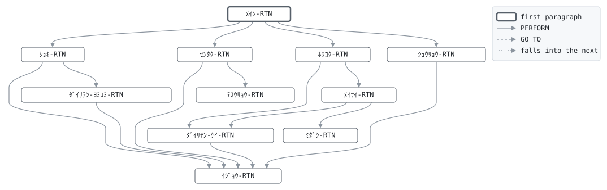

# GLM030

```text
GLM030: 代理店手数料計算

月末。当月に保険料の入金があった契約 (最終入金年月が業務月)
ごとに、入金額に経過年数による料率を掛けて代理店手数料を
求める: 1年目 40%、2～3年目 7%、4～10年目 2%、11年目から
なし、円未満切捨て。代理店順に整列し、報告書作成機能で代理店
ごとの見出し (代理店マスタの名称、支社、入社年月) と計を
印字する。代理店ごとの合計を手数料ファイルに書き、仕訳する。
代理店マスタにない代理店は "(未登録)" として印字する。

復帰コード: 0 処理済、8 日付が日付でない、16 ファイル異常。

変更履歴
日付       担当 変更
1987-04-01 KT   GL-0001 初版。
1995-10-02 KT   GL-0188 報告書作成機能で代理店別に。
```

Program [GLM030.cbl](../../../gondwana/programs/GLM030.cbl): 7 files, 11 paragraphs. Its business rules: [11 decision tables](../rules/GLM030.md).

- AUTHOR: ゴンドワナ生命 システム部.
- DATE-WRITTEN: 1987-04-01.

## Contents

- [Files](#files)
- [Flow](#flow)
- [Paragraphs](#paragraphs)
- [Calls](#calls)
- [Data flow](#data-flow)
- [Lineage](#lineage)
  - [Into PM-ｹｲﾔｸ-ﾚｺｰﾄﾞ](#into-pm-ｹｲﾔｸ-ﾚｺｰﾄﾞ)
  - [Into AG-ﾀﾞｲﾘﾃﾝ-ﾚｺｰﾄﾞ](#into-ag-ﾀﾞｲﾘﾃﾝ-ﾚｺｰﾄﾞ)
  - [Into SR-ｾｲﾚﾂ-ﾚｺｰﾄﾞ](#into-sr-ｾｲﾚﾂ-ﾚｺｰﾄﾞ)
  - [Into CT-ｾｲｷﾞｮ-ﾚｺｰﾄﾞ](#into-ct-ｾｲｷﾞｮ-ﾚｺｰﾄﾞ)
  - [Into JR-ｼﾜｹ-ﾚｺｰﾄﾞ](#into-jr-ｼﾜｹ-ﾚｺｰﾄﾞ)
  - [Into CM-ﾃｽｳﾘｮｳ-ﾚｺｰﾄﾞ](#into-cm-ﾃｽｳﾘｮｳ-ﾚｺｰﾄﾞ)
  - [Into PAGE-HEADING-LINE-1](#into-page-heading-line-1)
  - [Into CONTROL-HEADING-SR-ﾀﾞｲﾘﾃﾝｺｰﾄﾞ](#into-control-heading-sr-ﾀﾞｲﾘﾃﾝｺｰﾄﾞ)
  - [Into COMMISSION-DETAIL](#into-commission-detail)
  - [Into CONTROL-FOOTING-SR-ﾀﾞｲﾘﾃﾝｺｰﾄﾞ-LINE-1](#into-control-footing-sr-ﾀﾞｲﾘﾃﾝｺｰﾄﾞ-line-1)
  - [Into CONTROL-FOOTING-FINAL](#into-control-footing-final)
  - [Into WS-ｺﾏﾝﾄﾞｷﾞｮｳ](#into-ws-ｺﾏﾝﾄﾞｷﾞｮｳ)
  - [Into WS-ｴﾗｰﾌｧｲﾙ](#into-ws-ｴﾗｰﾌｧｲﾙ)
  - [Into WS-ｴﾗｰｽﾃｰﾀｽ](#into-ws-ｴﾗｰｽﾃｰﾀｽ)
  - [Into WS-ｷﾞｮｳﾑﾋﾂﾞｹ](#into-ws-ｷﾞｮｳﾑﾋﾂﾞｹ)
  - [Into WS-ｷﾞｮｳﾑﾋﾂﾞｹ-ﾜﾚｷ](#into-ws-ｷﾞｮｳﾑﾋﾂﾞｹ-ﾜﾚｷ)
  - [Into WS-ﾎｳｺｳ](#into-ws-ﾎｳｺｳ)
  - [Into WS-ﾍﾝｶﾝｹｯｶ](#into-ws-ﾍﾝｶﾝｹｯｶ)
  - [Into WS-ﾀﾞｲﾘﾃﾝ-TBL](#into-ws-ﾀﾞｲﾘﾃﾝ-tbl)
  - [Into WS-ﾐﾀﾞｼ](#into-ws-ﾐﾀﾞｼ)
  - [Into WS-ｿｳﾀﾞｲﾘﾃﾝ](#into-ws-ｿｳﾀﾞｲﾘﾃﾝ)
  - [Into WS-ｹﾝｽｳ](#into-ws-ｹﾝｽｳ)
  - [Out of the program](#out-of-the-program)
  - [Into other data items](#into-other-data-items)
- [Field origins](#field-origins)
  - [File SORT-F](#file-sort-f)
  - [File REPORT-F](#file-report-f)
  - [File COMMIS-F](#file-commis-f)
  - [File GLJRNL-F](#file-gljrnl-f)
  - [File GLSCTL-F](#file-glsctl-f)
- [Links between records](#links-between-records)
- [Records](#records)
  - [PM-ｹｲﾔｸ-ﾚｺｰﾄﾞ](#pm-ｹｲﾔｸ-ﾚｺｰﾄﾞ)
  - [AG-ﾀﾞｲﾘﾃﾝ-ﾚｺｰﾄﾞ](#ag-ﾀﾞｲﾘﾃﾝ-ﾚｺｰﾄﾞ)
  - [SR-ｾｲﾚﾂ-ﾚｺｰﾄﾞ](#sr-ｾｲﾚﾂ-ﾚｺｰﾄﾞ)
  - [CT-ｾｲｷﾞｮ-ﾚｺｰﾄﾞ](#ct-ｾｲｷﾞｮ-ﾚｺｰﾄﾞ)
  - [JR-ｼﾜｹ-ﾚｺｰﾄﾞ](#jr-ｼﾜｹ-ﾚｺｰﾄﾞ)
  - [CM-ﾃｽｳﾘｮｳ-ﾚｺｰﾄﾞ](#cm-ﾃｽｳﾘｮｳ-ﾚｺｰﾄﾞ)
  - [PAGE-HEADING-LINE-1](#page-heading-line-1)
  - [PAGE-HEADING-LINE-2](#page-heading-line-2)
  - [CONTROL-HEADING-SR-ﾀﾞｲﾘﾃﾝｺｰﾄﾞ](#control-heading-sr-ﾀﾞｲﾘﾃﾝｺｰﾄﾞ)
  - [COMMISSION-DETAIL](#commission-detail)
  - [CONTROL-FOOTING-SR-ﾀﾞｲﾘﾃﾝｺｰﾄﾞ-LINE-1](#control-footing-sr-ﾀﾞｲﾘﾃﾝｺｰﾄﾞ-line-1)
  - [CONTROL-FOOTING-SR-ﾀﾞｲﾘﾃﾝｺｰﾄﾞ-LINE-2](#control-footing-sr-ﾀﾞｲﾘﾃﾝｺｰﾄﾞ-line-2)
  - [CONTROL-FOOTING-FINAL](#control-footing-final)
  - [WS-ｽﾃｰﾀｽ](#ws-ｽﾃｰﾀｽ)
  - [WS-ｺﾏﾝﾄﾞｷﾞｮｳ](#ws-ｺﾏﾝﾄﾞｷﾞｮｳ)
  - [WS-ｴﾗｰﾌｧｲﾙ](#ws-ｴﾗｰﾌｧｲﾙ)
  - [WS-ｴﾗｰｽﾃｰﾀｽ](#ws-ｴﾗｰｽﾃｰﾀｽ)
  - [WS-ｷﾞｮｳﾑﾋﾂﾞｹ](#ws-ｷﾞｮｳﾑﾋﾂﾞｹ)
  - [WS-ｷﾞｮｳﾑﾋﾂﾞｹ-ﾌﾞﾝｶｲ](#ws-ｷﾞｮｳﾑﾋﾂﾞｹ-ﾌﾞﾝｶｲ)
  - [WS-ｷﾞｮｳﾑﾋﾂﾞｹ-ﾜﾚｷ](#ws-ｷﾞｮｳﾑﾋﾂﾞｹ-ﾜﾚｷ)
  - [WS-ﾎｳｺｳ](#ws-ﾎｳｺｳ)
  - [WS-ﾍﾝｶﾝｹｯｶ](#ws-ﾍﾝｶﾝｹｯｶ)
  - [WS-ﾀﾞｲﾘﾃﾝ-TBL](#ws-ﾀﾞｲﾘﾃﾝ-tbl)
  - [WS-ﾐﾀﾞｼ](#ws-ﾐﾀﾞｼ)
  - [WS-ｿｳﾀﾞｲﾘﾃﾝ](#ws-ｿｳﾀﾞｲﾘﾃﾝ)
  - [WS-ｹﾝｽｳ](#ws-ｹﾝｽｳ)

## Files

| File | Kind | Assigned to | Organization | Status field | Opened | Records |
| --- | --- | --- | --- | --- | --- | --- |
| POLMST-F | FD | POLMST | INDEXED, key PM-ｼｮｳｹﾝﾊﾞﾝｺﾞｳ | WS-POLMST-ST | INPUT | PM-ｹｲﾔｸ-ﾚｺｰﾄﾞ |
| AGTMST-F | FD | AGTMST | LINE SEQUENTIAL | WS-AGTMST-ST | INPUT | AG-ﾀﾞｲﾘﾃﾝ-ﾚｺｰﾄﾞ |
| SORT-F | SD | SORTWK | SEQUENTIAL | | | SR-ｾｲﾚﾂ-ﾚｺｰﾄﾞ |
| GLSCTL-F | FD | GLSCTL | SEQUENTIAL | WS-GLSCTL-ST | I-O | CT-ｾｲｷﾞｮ-ﾚｺｰﾄﾞ |
| GLJRNL-F | FD | GLJRNL | LINE SEQUENTIAL | WS-GLJRNL-ST | EXTEND | JR-ｼﾜｹ-ﾚｺｰﾄﾞ |
| COMMIS-F | FD | COMMIS | LINE SEQUENTIAL | WS-COMMIS-ST | OUTPUT | CM-ﾃｽｳﾘｮｳ-ﾚｺｰﾄﾞ |
| REPORT-F | FD | GLM030R | LINE SEQUENTIAL | WS-REPORT-ST | OUTPUT | PAGE-HEADING-LINE-1, PAGE-HEADING-LINE-2, CONTROL-HEADING-SR-ﾀﾞｲﾘﾃﾝｺｰﾄﾞ, COMMISSION-DETAIL, CONTROL-FOOTING-SR-ﾀﾞｲﾘﾃﾝｺｰﾄﾞ-LINE-1, CONTROL-FOOTING-SR-ﾀﾞｲﾘﾃﾝｺｰﾄﾞ-LINE-2, CONTROL-FOOTING-FINAL |

## Flow



## Paragraphs

| Paragraph | Description | Source | Performs | Goes to | Performed by | Reached by |
| --- | --- | --- | --- | --- | --- | --- |
| ﾒｲﾝ-RTN | ﾒｲﾝ-RTN: 準備、選択と整列と報告、終了。 | [GLM030.cbl:180](../../../gondwana/programs/GLM030.cbl#L180) | ｼｮｷ-RTN, ｾﾝﾀｸ-RTN (SORT), ﾎｳｺｸ-RTN (SORT), ｼｭｳﾘｮｳ-RTN | | | |
| ｼｮｷ-RTN | ｼｮｷ-RTN: 業務日付、ファイル、代理店マスタ、制御レコード。 | [GLM030.cbl:193](../../../gondwana/programs/GLM030.cbl#L193) | ｲｼﾞｮｳ-RTN, ﾀﾞｲﾘﾃﾝ-ﾖﾐｺﾐ-RTN | | ﾒｲﾝ-RTN | |
| ﾀﾞｲﾘﾃﾝ-ﾖﾐｺﾐ-RTN | ﾀﾞｲﾘﾃﾝ-ﾖﾐｺﾐ-RTN: 代理店マスタをテーブルに読み込む。 | [GLM030.cbl:244](../../../gondwana/programs/GLM030.cbl#L244) | ｲｼﾞｮｳ-RTN | | ｼｮｷ-RTN | |
| ｾﾝﾀｸ-RTN | ｾﾝﾀｸ-RTN: 当月入金のあった契約の手数料を求め、整列に渡す。 | [GLM030.cbl:264](../../../gondwana/programs/GLM030.cbl#L264) | ﾃｽｳﾘｮｳ-RTN, ｲｼﾞｮｳ-RTN | | ﾒｲﾝ-RTN | |
| ﾃｽｳﾘｮｳ-RTN | ﾃｽｳﾘｮｳ-RTN: 経過年数による料率と手数料。 | [GLM030.cbl:282](../../../gondwana/programs/GLM030.cbl#L282) | | | ｾﾝﾀｸ-RTN | |
| ﾎｳｺｸ-RTN | ﾎｳｺｸ-RTN: 整列済みの1件ごとに明細を生成し、代理店が変わる ごとに合計を書き出す。 | [GLM030.cbl:307](../../../gondwana/programs/GLM030.cbl#L307) | ﾒｲｻｲ-RTN, ﾀﾞｲﾘﾃﾝ-ｹｲ-RTN | | ﾒｲﾝ-RTN | |
| ﾒｲｻｲ-RTN | ﾒｲｻｲ-RTN: 代理店が変わったら前の代理店の計と見出しの準備、 1行生成。 | [GLM030.cbl:333](../../../gondwana/programs/GLM030.cbl#L333) | ﾀﾞｲﾘﾃﾝ-ｹｲ-RTN, ﾐﾀﾞｼ-RTN | | ﾎｳｺｸ-RTN | |
| ﾐﾀﾞｼ-RTN | ﾐﾀﾞｼ-RTN: 代理店マスタから見出しの名称、支社、入社年月。 | [GLM030.cbl:349](../../../gondwana/programs/GLM030.cbl#L349) | | | ﾒｲｻｲ-RTN | |
| ﾀﾞｲﾘﾃﾝ-ｹｲ-RTN | ﾀﾞｲﾘﾃﾝ-ｹｲ-RTN: 代理店の合計を手数料ファイルに書き、仕訳し、 数え直す。 | [GLM030.cbl:369](../../../gondwana/programs/GLM030.cbl#L369) | ｲｼﾞｮｳ-RTN | | ﾎｳｺｸ-RTN, ﾒｲｻｲ-RTN | |
| ｼｭｳﾘｮｳ-RTN | ｼｭｳﾘｮｳ-RTN: 制御レコードを書き戻し、ファイルを閉じる。 | [GLM030.cbl:403](../../../gondwana/programs/GLM030.cbl#L403) | ｲｼﾞｮｳ-RTN | | ﾒｲﾝ-RTN | |
| ｲｼﾞｮｳ-RTN | ｲｼﾞｮｳ-RTN: ファイル異常は 16 で終わる。 | [GLM030.cbl:418](../../../gondwana/programs/GLM030.cbl#L418) | | | ｼｮｷ-RTN, ﾀﾞｲﾘﾃﾝ-ﾖﾐｺﾐ-RTN, ｾﾝﾀｸ-RTN, ﾀﾞｲﾘﾃﾝ-ｹｲ-RTN, ｼｭｳﾘｮｳ-RTN | |

## Calls

| Calls | Passing | Paragraph | Source |
| --- | --- | --- | --- |
| [GLC020](GLC020.md) | WS-ﾎｳｺｳ, WS-ｷﾞｮｳﾑﾋﾂﾞｹ, WS-ｷﾞｮｳﾑﾋﾂﾞｹ-ﾜﾚｷ, WS-ﾍﾝｶﾝｹｯｶ | ｼｮｷ-RTN | [GLM030.cbl:196](../../../gondwana/programs/GLM030.cbl#L196) |

## Data flow

| Paragraph | Reads | Writes |
| --- | --- | --- |
| ﾒｲﾝ-RTN | SR-ﾀﾞｲﾘﾃﾝｺｰﾄﾞ, SR-ｼｮｳｹﾝﾊﾞﾝｺﾞｳ | RETURN-CODE |
| ｼｮｷ-RTN | WS-ｺﾏﾝﾄﾞｷﾞｮｳ, WS-ﾎｳｺｳ, WS-ｷﾞｮｳﾑﾋﾂﾞｹ, WS-ｷﾞｮｳﾑﾋﾂﾞｹ-ﾜﾚｷ, WS-ﾍﾝｶﾝｹｯｶ, WS-POLMST-ST, WS-AGTMST-ST, WS-GLSCTL-ST, WS-GLJRNL-ST, WS-COMMIS-ST, WS-REPORT-ST, WS-ｴﾗｰﾌｧｲﾙ | WS-ｺﾏﾝﾄﾞｷﾞｮｳ, WS-ｷﾞｮｳﾑﾋﾂﾞｹ, WS-ﾎｳｺｳ, WS-ｷﾞｮｳﾑﾋﾂﾞｹ-ﾜﾚｷ, WS-ﾍﾝｶﾝｹｯｶ, RETURN-CODE, WS-ｴﾗｰﾌｧｲﾙ, WS-ｴﾗｰｽﾃｰﾀｽ, JR-ｼﾜｹ-ﾚｺｰﾄﾞ, CT-ｾｲｷﾞｮ-ﾚｺｰﾄﾞ |
| ﾀﾞｲﾘﾃﾝ-ﾖﾐｺﾐ-RTN | WS-AGTMST-ST, WS-ﾀﾞｲﾘﾃﾝｹﾝｽｳ, AG-ｺｰﾄﾞ, WS-ﾀﾞｲﾘﾃﾝ-IX, AG-ｼﾒｲ, AG-ｼﾃﾝ, AG-ﾆｭｳｼｬﾈﾝｹﾞﾂ | AG-ﾀﾞｲﾘﾃﾝ-ﾚｺｰﾄﾞ, WS-ﾀﾞｲﾘﾃﾝｹﾝｽｳ, WS-ﾀﾞｲﾘﾃﾝ-IX, WS-ﾀﾞｲﾘﾃﾝ-ｺｰﾄﾞ, WS-ﾀﾞｲﾘﾃﾝ-ｼﾒｲ, WS-ﾀﾞｲﾘﾃﾝ-ｼﾃﾝ, WS-ﾀﾞｲﾘﾃﾝ-ﾆｭｳｼｬ, WS-ｴﾗｰﾌｧｲﾙ, WS-ｴﾗｰｽﾃｰﾀｽ |
| ｾﾝﾀｸ-RTN | WS-POLMST-ST, PM-ｻｲｼｭｳﾆｭｳｷﾝﾈﾝｹﾞﾂ, WS-ｷﾞｮｳﾑ-YYYYMM, PM-ｻｲｼｭｳﾆｭｳｷﾝｶﾞｸ | PM-ｹｲﾔｸ-ﾚｺｰﾄﾞ, WS-ｴﾗｰﾌｧｲﾙ, WS-ｴﾗｰｽﾃｰﾀｽ |
| ﾃｽｳﾘｮｳ-RTN | PM-ｹｲｶﾈﾝｽｳ, PM-ｻｲｼｭｳﾆｭｳｷﾝｶﾞｸ, SR-ﾘﾂ, PM-ﾀﾞｲﾘﾃﾝｺｰﾄﾞ, PM-ｼｮｳｹﾝﾊﾞﾝｺﾞｳ, PM-ｼｮｳﾋﾝ, WS-ﾀｲｼｮｳｹﾝｽｳ, SR-ﾃｽｳﾘｮｳ, WS-ﾃｽｳﾘｮｳｺﾞｳｹｲ | SR-ﾘﾂ, SR-ﾃｽｳﾘｮｳ, SR-ﾀﾞｲﾘﾃﾝｺｰﾄﾞ, SR-ｼｮｳｹﾝﾊﾞﾝｺﾞｳ, SR-ｼｮｳﾋﾝ, SR-ｹｲｶﾈﾝｽｳ, SR-ﾆｭｳｷﾝｶﾞｸ, SR-ｾｲﾚﾂ-ﾚｺｰﾄﾞ, WS-ﾀｲｼｮｳｹﾝｽｳ, WS-ﾃｽｳﾘｮｳｺﾞｳｹｲ |
| ﾎｳｺｸ-RTN | COMMISSION-RPT, SR-ﾀﾞｲﾘﾃﾝｺｰﾄﾞ, WS-ｿｳﾀﾞｲﾘﾃﾝ, WS-ｷﾞｮｳﾑﾋﾂﾞｹ-ﾜﾚｷ, PAGE-COUNTER, WS-ﾐﾀﾞｼ-ｼﾒｲ, WS-ﾐﾀﾞｼ-ｼﾃﾝ, WS-ﾐﾀﾞｼ-ﾆｭｳｼｬ, SR-ｼｮｳｹﾝﾊﾞﾝｺﾞｳ, SR-ｼｮｳﾋﾝ, SR-ｹｲｶﾈﾝｽｳ, SR-ﾆｭｳｷﾝｶﾞｸ, SR-ﾘﾂ, SR-ﾃｽｳﾘｮｳ | WS-ｿｳﾀﾞｲﾘﾃﾝ, SR-ｾｲﾚﾂ-ﾚｺｰﾄﾞ, SR-ﾀﾞｲﾘﾃﾝｺｰﾄﾞ, PAGE-HEADING-LINE-1, PAGE-HEADING-LINE-2, CONTROL-HEADING-SR-ﾀﾞｲﾘﾃﾝｺｰﾄﾞ, COMMISSION-DETAIL, CONTROL-FOOTING-SR-ﾀﾞｲﾘﾃﾝｺｰﾄﾞ-LINE-1, CONTROL-FOOTING-SR-ﾀﾞｲﾘﾃﾝｺｰﾄﾞ-LINE-2, CONTROL-FOOTING-FINAL |
| ﾒｲｻｲ-RTN | SR-ﾀﾞｲﾘﾃﾝｺｰﾄﾞ, WS-ｿｳﾀﾞｲﾘﾃﾝ, COMMISSION-DETAIL, WS-ｷﾞｮｳﾑﾋﾂﾞｹ-ﾜﾚｷ, PAGE-COUNTER, WS-ﾐﾀﾞｼ-ｼﾒｲ, WS-ﾐﾀﾞｼ-ｼﾃﾝ, WS-ﾐﾀﾞｼ-ﾆｭｳｼｬ, SR-ｼｮｳｹﾝﾊﾞﾝｺﾞｳ, SR-ｼｮｳﾋﾝ, SR-ｹｲｶﾈﾝｽｳ, SR-ﾆｭｳｷﾝｶﾞｸ, SR-ﾘﾂ, SR-ﾃｽｳﾘｮｳ, WS-ﾀﾞｲﾘﾃﾝ-ｹﾝｽｳ, WS-ﾀﾞｲﾘﾃﾝ-ﾆｭｳｷﾝ, WS-ﾀﾞｲﾘﾃﾝ-ﾃｽｳﾘｮｳ | WS-ｿｳﾀﾞｲﾘﾃﾝ, PAGE-HEADING-LINE-1, PAGE-HEADING-LINE-2, CONTROL-HEADING-SR-ﾀﾞｲﾘﾃﾝｺｰﾄﾞ, COMMISSION-DETAIL, CONTROL-FOOTING-SR-ﾀﾞｲﾘﾃﾝｺｰﾄﾞ-LINE-1, CONTROL-FOOTING-SR-ﾀﾞｲﾘﾃﾝｺｰﾄﾞ-LINE-2, CONTROL-FOOTING-FINAL, WS-ﾀﾞｲﾘﾃﾝ-ｹﾝｽｳ, WS-ﾀﾞｲﾘﾃﾝ-ﾆｭｳｷﾝ, WS-ﾀﾞｲﾘﾃﾝ-ﾃｽｳﾘｮｳ |
| ﾐﾀﾞｼ-RTN | WS-ﾀﾞｲﾘﾃﾝ, WS-ﾀﾞｲﾘﾃﾝ-ｺｰﾄﾞ, WS-ﾀﾞｲﾘﾃﾝ-IX, SR-ﾀﾞｲﾘﾃﾝｺｰﾄﾞ, WS-ﾀﾞｲﾘﾃﾝ-ｼﾒｲ, WS-ﾀﾞｲﾘﾃﾝ-ｼﾃﾝ, WS-ﾀﾞｲﾘﾃﾝ-ﾆｭｳｼｬ | WS-ﾀﾞｲﾘﾃﾝ-IX, WS-ﾐﾀﾞｼ-ｼﾒｲ, WS-ﾐﾀﾞｼ-ｼﾃﾝ, WS-ﾐﾀﾞｼ-ﾆｭｳｼｬ |
| ﾀﾞｲﾘﾃﾝ-ｹｲ-RTN | WS-ｷﾞｮｳﾑ-YYYYMM, WS-ｿｳﾀﾞｲﾘﾃﾝ, WS-ﾀﾞｲﾘﾃﾝ-ｹﾝｽｳ, WS-ﾀﾞｲﾘﾃﾝ-ﾆｭｳｷﾝ, WS-ﾀﾞｲﾘﾃﾝ-ﾃｽｳﾘｮｳ, WS-COMMIS-ST, CT-ｼﾞｶｲｼﾜｹﾊﾞﾝｺﾞｳ, WS-ｷﾞｮｳﾑﾋﾂﾞｹ-ﾜﾚｷ, WS-GLJRNL-ST | CM-ﾈﾝｹﾞﾂ, CM-ﾀﾞｲﾘﾃﾝｺｰﾄﾞ, CM-ｹﾝｽｳ, CM-ﾆｭｳｷﾝｶﾞｸ, CM-ﾃｽｳﾘｮｳ, CM-ﾃｽｳﾘｮｳ-ﾚｺｰﾄﾞ, WS-ｴﾗｰﾌｧｲﾙ, WS-ｴﾗｰｽﾃｰﾀｽ, JR-ｼﾜｹﾊﾞﾝｺﾞｳ, CT-ｼﾞｶｲｼﾜｹﾊﾞﾝｺﾞｳ, JR-ﾋﾂﾞｹ, JR-ﾌﾟﾛｸﾞﾗﾑ, JR-ｶﾝｼﾞｮｳｶﾓｸ, JR-ﾀｲｼｬｸ, JR-ｷﾝｶﾞｸ, JR-ｼｮｳｹﾝﾊﾞﾝｺﾞｳ, JR-ﾃｷﾖｳ, JR-ｼﾜｹ-ﾚｺｰﾄﾞ, WS-ﾀﾞｲﾘﾃﾝ-ｹﾝｽｳ, WS-ﾀﾞｲﾘﾃﾝ-ﾆｭｳｷﾝ, WS-ﾀﾞｲﾘﾃﾝ-ﾃｽｳﾘｮｳ |
| ｼｭｳﾘｮｳ-RTN | WS-GLSCTL-ST, WS-ﾀｲｼｮｳｹﾝｽｳ, WS-ﾃｽｳﾘｮｳｺﾞｳｹｲ | CT-ｾｲｷﾞｮ-ﾚｺｰﾄﾞ, WS-ｴﾗｰﾌｧｲﾙ, WS-ｴﾗｰｽﾃｰﾀｽ |
| ｲｼﾞｮｳ-RTN | WS-ｴﾗｰﾌｧｲﾙ, WS-ｴﾗｰｽﾃｰﾀｽ | RETURN-CODE |

## Lineage

Where each data item's values come from, grouped by the record they go into. A data item links to the record it belongs to.

### Into PM-ｹｲﾔｸ-ﾚｺｰﾄﾞ

Record [PM-ｹｲﾔｸ-ﾚｺｰﾄﾞ](#pm-ｹｲﾔｸ-ﾚｺｰﾄﾞ), from copybook [POLMST](../copybooks/POLMST.md).

| Into | From | Statement | Paragraph | Source |
| --- | --- | --- | --- | --- |
| PM-ｹｲﾔｸ-ﾚｺｰﾄﾞ | file POLMST-F | READ | ｾﾝﾀｸ-RTN | [GLM030.cbl:265](../../../gondwana/programs/GLM030.cbl#L265) |
| PM-ｹｲﾔｸ-ﾚｺｰﾄﾞ | file POLMST-F | READ | ｾﾝﾀｸ-RTN | [GLM030.cbl:271](../../../gondwana/programs/GLM030.cbl#L271) |

### Into AG-ﾀﾞｲﾘﾃﾝ-ﾚｺｰﾄﾞ

Record [AG-ﾀﾞｲﾘﾃﾝ-ﾚｺｰﾄﾞ](#ag-ﾀﾞｲﾘﾃﾝ-ﾚｺｰﾄﾞ), from copybook [AGTMST](../copybooks/AGTMST.md).

| Into | From | Statement | Paragraph | Source |
| --- | --- | --- | --- | --- |
| AG-ﾀﾞｲﾘﾃﾝ-ﾚｺｰﾄﾞ | file AGTMST-F | READ | ﾀﾞｲﾘﾃﾝ-ﾖﾐｺﾐ-RTN | [GLM030.cbl:245](../../../gondwana/programs/GLM030.cbl#L245) |
| AG-ﾀﾞｲﾘﾃﾝ-ﾚｺｰﾄﾞ | file AGTMST-F | READ | ﾀﾞｲﾘﾃﾝ-ﾖﾐｺﾐ-RTN | [GLM030.cbl:253](../../../gondwana/programs/GLM030.cbl#L253) |

### Into SR-ｾｲﾚﾂ-ﾚｺｰﾄﾞ

Record [SR-ｾｲﾚﾂ-ﾚｺｰﾄﾞ](#sr-ｾｲﾚﾂ-ﾚｺｰﾄﾞ).

| Into | From | Statement | Paragraph | Source |
| --- | --- | --- | --- | --- |
| SR-ｹｲｶﾈﾝｽｳ | [PM-ｹｲｶﾈﾝｽｳ](#pm-ｹｲﾔｸ-ﾚｺｰﾄﾞ "in PM-ｹｲﾔｸ-ﾚｺｰﾄﾞ") | MOVE | ﾃｽｳﾘｮｳ-RTN | [GLM030.cbl:297](../../../gondwana/programs/GLM030.cbl#L297) |
| SR-ｼｮｳｹﾝﾊﾞﾝｺﾞｳ | [PM-ｼｮｳｹﾝﾊﾞﾝｺﾞｳ](#pm-ｹｲﾔｸ-ﾚｺｰﾄﾞ "in PM-ｹｲﾔｸ-ﾚｺｰﾄﾞ") | MOVE | ﾃｽｳﾘｮｳ-RTN | [GLM030.cbl:295](../../../gondwana/programs/GLM030.cbl#L295) |
| SR-ｼｮｳﾋﾝ | [PM-ｼｮｳﾋﾝ](#pm-ｹｲﾔｸ-ﾚｺｰﾄﾞ "in PM-ｹｲﾔｸ-ﾚｺｰﾄﾞ") | MOVE | ﾃｽｳﾘｮｳ-RTN | [GLM030.cbl:296](../../../gondwana/programs/GLM030.cbl#L296) |
| SR-ｾｲﾚﾂ-ﾚｺｰﾄﾞ | file SORT-F | RETURN | ﾎｳｺｸ-RTN | [GLM030.cbl:310](../../../gondwana/programs/GLM030.cbl#L310) |
| SR-ｾｲﾚﾂ-ﾚｺｰﾄﾞ | file SORT-F | RETURN | ﾎｳｺｸ-RTN | [GLM030.cbl:316](../../../gondwana/programs/GLM030.cbl#L316) |
| SR-ﾀﾞｲﾘﾃﾝｺｰﾄﾞ | [PM-ﾀﾞｲﾘﾃﾝｺｰﾄﾞ](#pm-ｹｲﾔｸ-ﾚｺｰﾄﾞ "in PM-ｹｲﾔｸ-ﾚｺｰﾄﾞ") | MOVE | ﾃｽｳﾘｮｳ-RTN | [GLM030.cbl:294](../../../gondwana/programs/GLM030.cbl#L294) |
| SR-ﾀﾞｲﾘﾃﾝｺｰﾄﾞ | literal SPACES | MOVE | ﾎｳｺｸ-RTN | [GLM030.cbl:318](../../../gondwana/programs/GLM030.cbl#L318) |
| SR-ﾃｽｳﾘｮｳ | [PM-ｻｲｼｭｳﾆｭｳｷﾝｶﾞｸ](#pm-ｹｲﾔｸ-ﾚｺｰﾄﾞ "in PM-ｹｲﾔｸ-ﾚｺｰﾄﾞ") | COMPUTE | ﾃｽｳﾘｮｳ-RTN | [GLM030.cbl:293](../../../gondwana/programs/GLM030.cbl#L293) |
| SR-ﾃｽｳﾘｮｳ | [SR-ﾘﾂ](#sr-ｾｲﾚﾂ-ﾚｺｰﾄﾞ "in SR-ｾｲﾚﾂ-ﾚｺｰﾄﾞ") | COMPUTE | ﾃｽｳﾘｮｳ-RTN | [GLM030.cbl:293](../../../gondwana/programs/GLM030.cbl#L293) |
| SR-ﾆｭｳｷﾝｶﾞｸ | [PM-ｻｲｼｭｳﾆｭｳｷﾝｶﾞｸ](#pm-ｹｲﾔｸ-ﾚｺｰﾄﾞ "in PM-ｹｲﾔｸ-ﾚｺｰﾄﾞ") | MOVE | ﾃｽｳﾘｮｳ-RTN | [GLM030.cbl:298](../../../gondwana/programs/GLM030.cbl#L298) |
| SR-ﾘﾂ | literal 40 | MOVE | ﾃｽｳﾘｮｳ-RTN | [GLM030.cbl:285](../../../gondwana/programs/GLM030.cbl#L285) |
| SR-ﾘﾂ | literal 7 | MOVE | ﾃｽｳﾘｮｳ-RTN | [GLM030.cbl:287](../../../gondwana/programs/GLM030.cbl#L287) |
| SR-ﾘﾂ | literal 2 | MOVE | ﾃｽｳﾘｮｳ-RTN | [GLM030.cbl:289](../../../gondwana/programs/GLM030.cbl#L289) |
| SR-ﾘﾂ | literal 0 | MOVE | ﾃｽｳﾘｮｳ-RTN | [GLM030.cbl:291](../../../gondwana/programs/GLM030.cbl#L291) |

### Into CT-ｾｲｷﾞｮ-ﾚｺｰﾄﾞ

Record [CT-ｾｲｷﾞｮ-ﾚｺｰﾄﾞ](#ct-ｾｲｷﾞｮ-ﾚｺｰﾄﾞ), from copybook [CTLREC](../copybooks/CTLREC.md).

| Into | From | Statement | Paragraph | Source |
| --- | --- | --- | --- | --- |
| CT-ｼﾞｶｲｼﾜｹﾊﾞﾝｺﾞｳ | literal 1 | ADD | ﾀﾞｲﾘﾃﾝ-ｹｲ-RTN | [GLM030.cbl:383](../../../gondwana/programs/GLM030.cbl#L383) |
| CT-ｾｲｷﾞｮ-ﾚｺｰﾄﾞ | file GLSCTL-F | READ | ｼｮｷ-RTN | [GLM030.cbl:234](../../../gondwana/programs/GLM030.cbl#L234) |

### Into JR-ｼﾜｹ-ﾚｺｰﾄﾞ

Record [JR-ｼﾜｹ-ﾚｺｰﾄﾞ](#jr-ｼﾜｹ-ﾚｺｰﾄﾞ), from copybook [GLJRNL](../copybooks/GLJRNL.md).

| Into | From | Statement | Paragraph | Source |
| --- | --- | --- | --- | --- |
| JR-ｶﾝｼﾞｮｳｶﾓｸ | literal 5410 | MOVE | ﾀﾞｲﾘﾃﾝ-ｹｲ-RTN | [GLM030.cbl:386](../../../gondwana/programs/GLM030.cbl#L386) |
| JR-ｷﾝｶﾞｸ | [WS-ﾀﾞｲﾘﾃﾝ-ﾃｽｳﾘｮｳ](#ws-ｹﾝｽｳ "in WS-ｹﾝｽｳ") | MOVE | ﾀﾞｲﾘﾃﾝ-ｹｲ-RTN | [GLM030.cbl:388](../../../gondwana/programs/GLM030.cbl#L388) |
| JR-ｼｮｳｹﾝﾊﾞﾝｺﾞｳ | [WS-ｿｳﾀﾞｲﾘﾃﾝ](#ws-ｿｳﾀﾞｲﾘﾃﾝ) | MOVE | ﾀﾞｲﾘﾃﾝ-ｹｲ-RTN | [GLM030.cbl:389](../../../gondwana/programs/GLM030.cbl#L389) |
| JR-ｼﾜｹ-ﾚｺｰﾄﾞ | literal SPACES | MOVE | ｼｮｷ-RTN | [GLM030.cbl:232](../../../gondwana/programs/GLM030.cbl#L232) |
| JR-ｼﾜｹﾊﾞﾝｺﾞｳ | [CT-ｼﾞｶｲｼﾜｹﾊﾞﾝｺﾞｳ](#ct-ｾｲｷﾞｮ-ﾚｺｰﾄﾞ "in CT-ｾｲｷﾞｮ-ﾚｺｰﾄﾞ") | MOVE | ﾀﾞｲﾘﾃﾝ-ｹｲ-RTN | [GLM030.cbl:382](../../../gondwana/programs/GLM030.cbl#L382) |
| JR-ﾀｲｼｬｸ | literal condition JR-ｶﾘｶﾀ | SET | ﾀﾞｲﾘﾃﾝ-ｹｲ-RTN | [GLM030.cbl:387](../../../gondwana/programs/GLM030.cbl#L387) |
| JR-ﾃｷﾖｳ | literal '代理店手数料' | MOVE | ﾀﾞｲﾘﾃﾝ-ｹｲ-RTN | [GLM030.cbl:390](../../../gondwana/programs/GLM030.cbl#L390) |
| JR-ﾋﾂﾞｹ | [WS-ｷﾞｮｳﾑﾋﾂﾞｹ-ﾜﾚｷ](#ws-ｷﾞｮｳﾑﾋﾂﾞｹ-ﾜﾚｷ) | MOVE | ﾀﾞｲﾘﾃﾝ-ｹｲ-RTN | [GLM030.cbl:384](../../../gondwana/programs/GLM030.cbl#L384) |
| JR-ﾌﾟﾛｸﾞﾗﾑ | literal 'GLM030' | MOVE | ﾀﾞｲﾘﾃﾝ-ｹｲ-RTN | [GLM030.cbl:385](../../../gondwana/programs/GLM030.cbl#L385) |

### Into CM-ﾃｽｳﾘｮｳ-ﾚｺｰﾄﾞ

Record [CM-ﾃｽｳﾘｮｳ-ﾚｺｰﾄﾞ](#cm-ﾃｽｳﾘｮｳ-ﾚｺｰﾄﾞ).

| Into | From | Statement | Paragraph | Source |
| --- | --- | --- | --- | --- |
| CM-ｹﾝｽｳ | [WS-ﾀﾞｲﾘﾃﾝ-ｹﾝｽｳ](#ws-ｹﾝｽｳ "in WS-ｹﾝｽｳ") | MOVE | ﾀﾞｲﾘﾃﾝ-ｹｲ-RTN | [GLM030.cbl:372](../../../gondwana/programs/GLM030.cbl#L372) |
| CM-ﾀﾞｲﾘﾃﾝｺｰﾄﾞ | [WS-ｿｳﾀﾞｲﾘﾃﾝ](#ws-ｿｳﾀﾞｲﾘﾃﾝ) | MOVE | ﾀﾞｲﾘﾃﾝ-ｹｲ-RTN | [GLM030.cbl:371](../../../gondwana/programs/GLM030.cbl#L371) |
| CM-ﾃｽｳﾘｮｳ | [WS-ﾀﾞｲﾘﾃﾝ-ﾃｽｳﾘｮｳ](#ws-ｹﾝｽｳ "in WS-ｹﾝｽｳ") | MOVE | ﾀﾞｲﾘﾃﾝ-ｹｲ-RTN | [GLM030.cbl:374](../../../gondwana/programs/GLM030.cbl#L374) |
| CM-ﾆｭｳｷﾝｶﾞｸ | [WS-ﾀﾞｲﾘﾃﾝ-ﾆｭｳｷﾝ](#ws-ｹﾝｽｳ "in WS-ｹﾝｽｳ") | MOVE | ﾀﾞｲﾘﾃﾝ-ｹｲ-RTN | [GLM030.cbl:373](../../../gondwana/programs/GLM030.cbl#L373) |
| CM-ﾈﾝｹﾞﾂ | [WS-ｷﾞｮｳﾑ-YYYYMM](#ws-ｷﾞｮｳﾑﾋﾂﾞｹ-ﾌﾞﾝｶｲ "in WS-ｷﾞｮｳﾑﾋﾂﾞｹ-ﾌﾞﾝｶｲ") | MOVE | ﾀﾞｲﾘﾃﾝ-ｹｲ-RTN | [GLM030.cbl:370](../../../gondwana/programs/GLM030.cbl#L370) |

### Into PAGE-HEADING-LINE-1

Record [PAGE-HEADING-LINE-1](#page-heading-line-1).

| Into | From | Statement | Paragraph | Source |
| --- | --- | --- | --- | --- |
| PAGE-HEADING-LINE-1-COL-38 | [WS-ｷﾞｮｳﾑﾋﾂﾞｹ-ﾜﾚｷ](#ws-ｷﾞｮｳﾑﾋﾂﾞｹ-ﾜﾚｷ) | TERMINATE | ﾎｳｺｸ-RTN | [GLM030.cbl:327](../../../gondwana/programs/GLM030.cbl#L327) |
| PAGE-HEADING-LINE-1-COL-38 | [WS-ｷﾞｮｳﾑﾋﾂﾞｹ-ﾜﾚｷ](#ws-ｷﾞｮｳﾑﾋﾂﾞｹ-ﾜﾚｷ) | GENERATE | ﾒｲｻｲ-RTN | [GLM030.cbl:341](../../../gondwana/programs/GLM030.cbl#L341) |
| PAGE-HEADING-LINE-1-COL-73 | PAGE-COUNTER | TERMINATE | ﾎｳｺｸ-RTN | [GLM030.cbl:327](../../../gondwana/programs/GLM030.cbl#L327) |
| PAGE-HEADING-LINE-1-COL-73 | PAGE-COUNTER | GENERATE | ﾒｲｻｲ-RTN | [GLM030.cbl:341](../../../gondwana/programs/GLM030.cbl#L341) |

### Into CONTROL-HEADING-SR-ﾀﾞｲﾘﾃﾝｺｰﾄﾞ

Record [CONTROL-HEADING-SR-ﾀﾞｲﾘﾃﾝｺｰﾄﾞ](#control-heading-sr-ﾀﾞｲﾘﾃﾝｺｰﾄﾞ).

| Into | From | Statement | Paragraph | Source |
| --- | --- | --- | --- | --- |
| CONTROL-HEADING-SR-ﾀﾞｲﾘﾃﾝｺｰﾄﾞ-COL-16 | [WS-ﾐﾀﾞｼ-ｼﾒｲ](#ws-ﾐﾀﾞｼ "in WS-ﾐﾀﾞｼ") | TERMINATE | ﾎｳｺｸ-RTN | [GLM030.cbl:327](../../../gondwana/programs/GLM030.cbl#L327) |
| CONTROL-HEADING-SR-ﾀﾞｲﾘﾃﾝｺｰﾄﾞ-COL-16 | [WS-ﾐﾀﾞｼ-ｼﾒｲ](#ws-ﾐﾀﾞｼ "in WS-ﾐﾀﾞｼ") | GENERATE | ﾒｲｻｲ-RTN | [GLM030.cbl:341](../../../gondwana/programs/GLM030.cbl#L341) |
| CONTROL-HEADING-SR-ﾀﾞｲﾘﾃﾝｺｰﾄﾞ-COL-38 | [WS-ﾐﾀﾞｼ-ｼﾃﾝ](#ws-ﾐﾀﾞｼ "in WS-ﾐﾀﾞｼ") | TERMINATE | ﾎｳｺｸ-RTN | [GLM030.cbl:327](../../../gondwana/programs/GLM030.cbl#L327) |
| CONTROL-HEADING-SR-ﾀﾞｲﾘﾃﾝｺｰﾄﾞ-COL-38 | [WS-ﾐﾀﾞｼ-ｼﾃﾝ](#ws-ﾐﾀﾞｼ "in WS-ﾐﾀﾞｼ") | GENERATE | ﾒｲｻｲ-RTN | [GLM030.cbl:341](../../../gondwana/programs/GLM030.cbl#L341) |
| CONTROL-HEADING-SR-ﾀﾞｲﾘﾃﾝｺｰﾄﾞ-COL-53 | [WS-ﾐﾀﾞｼ-ﾆｭｳｼｬ](#ws-ﾐﾀﾞｼ "in WS-ﾐﾀﾞｼ") | TERMINATE | ﾎｳｺｸ-RTN | [GLM030.cbl:327](../../../gondwana/programs/GLM030.cbl#L327) |
| CONTROL-HEADING-SR-ﾀﾞｲﾘﾃﾝｺｰﾄﾞ-COL-53 | [WS-ﾐﾀﾞｼ-ﾆｭｳｼｬ](#ws-ﾐﾀﾞｼ "in WS-ﾐﾀﾞｼ") | GENERATE | ﾒｲｻｲ-RTN | [GLM030.cbl:341](../../../gondwana/programs/GLM030.cbl#L341) |
| CONTROL-HEADING-SR-ﾀﾞｲﾘﾃﾝｺｰﾄﾞ-COL-8 | [SR-ﾀﾞｲﾘﾃﾝｺｰﾄﾞ](#sr-ｾｲﾚﾂ-ﾚｺｰﾄﾞ "in SR-ｾｲﾚﾂ-ﾚｺｰﾄﾞ") | TERMINATE | ﾎｳｺｸ-RTN | [GLM030.cbl:327](../../../gondwana/programs/GLM030.cbl#L327) |
| CONTROL-HEADING-SR-ﾀﾞｲﾘﾃﾝｺｰﾄﾞ-COL-8 | [SR-ﾀﾞｲﾘﾃﾝｺｰﾄﾞ](#sr-ｾｲﾚﾂ-ﾚｺｰﾄﾞ "in SR-ｾｲﾚﾂ-ﾚｺｰﾄﾞ") | GENERATE | ﾒｲｻｲ-RTN | [GLM030.cbl:341](../../../gondwana/programs/GLM030.cbl#L341) |

### Into COMMISSION-DETAIL

Record [COMMISSION-DETAIL](#commission-detail).

| Into | From | Statement | Paragraph | Source |
| --- | --- | --- | --- | --- |
| COMMISSION-DETAIL-COL-1 | [SR-ｼｮｳｹﾝﾊﾞﾝｺﾞｳ](#sr-ｾｲﾚﾂ-ﾚｺｰﾄﾞ "in SR-ｾｲﾚﾂ-ﾚｺｰﾄﾞ") | TERMINATE | ﾎｳｺｸ-RTN | [GLM030.cbl:327](../../../gondwana/programs/GLM030.cbl#L327) |
| COMMISSION-DETAIL-COL-1 | [SR-ｼｮｳｹﾝﾊﾞﾝｺﾞｳ](#sr-ｾｲﾚﾂ-ﾚｺｰﾄﾞ "in SR-ｾｲﾚﾂ-ﾚｺｰﾄﾞ") | GENERATE | ﾒｲｻｲ-RTN | [GLM030.cbl:341](../../../gondwana/programs/GLM030.cbl#L341) |
| COMMISSION-DETAIL-COL-13 | [SR-ｼｮｳﾋﾝ](#sr-ｾｲﾚﾂ-ﾚｺｰﾄﾞ "in SR-ｾｲﾚﾂ-ﾚｺｰﾄﾞ") | TERMINATE | ﾎｳｺｸ-RTN | [GLM030.cbl:327](../../../gondwana/programs/GLM030.cbl#L327) |
| COMMISSION-DETAIL-COL-13 | [SR-ｼｮｳﾋﾝ](#sr-ｾｲﾚﾂ-ﾚｺｰﾄﾞ "in SR-ｾｲﾚﾂ-ﾚｺｰﾄﾞ") | GENERATE | ﾒｲｻｲ-RTN | [GLM030.cbl:341](../../../gondwana/programs/GLM030.cbl#L341) |
| COMMISSION-DETAIL-COL-20 | [SR-ｹｲｶﾈﾝｽｳ](#sr-ｾｲﾚﾂ-ﾚｺｰﾄﾞ "in SR-ｾｲﾚﾂ-ﾚｺｰﾄﾞ") | TERMINATE | ﾎｳｺｸ-RTN | [GLM030.cbl:327](../../../gondwana/programs/GLM030.cbl#L327) |
| COMMISSION-DETAIL-COL-20 | [SR-ｹｲｶﾈﾝｽｳ](#sr-ｾｲﾚﾂ-ﾚｺｰﾄﾞ "in SR-ｾｲﾚﾂ-ﾚｺｰﾄﾞ") | GENERATE | ﾒｲｻｲ-RTN | [GLM030.cbl:341](../../../gondwana/programs/GLM030.cbl#L341) |
| COMMISSION-DETAIL-COL-25 | [SR-ﾆｭｳｷﾝｶﾞｸ](#sr-ｾｲﾚﾂ-ﾚｺｰﾄﾞ "in SR-ｾｲﾚﾂ-ﾚｺｰﾄﾞ") | TERMINATE | ﾎｳｺｸ-RTN | [GLM030.cbl:327](../../../gondwana/programs/GLM030.cbl#L327) |
| COMMISSION-DETAIL-COL-25 | [SR-ﾆｭｳｷﾝｶﾞｸ](#sr-ｾｲﾚﾂ-ﾚｺｰﾄﾞ "in SR-ｾｲﾚﾂ-ﾚｺｰﾄﾞ") | GENERATE | ﾒｲｻｲ-RTN | [GLM030.cbl:341](../../../gondwana/programs/GLM030.cbl#L341) |
| COMMISSION-DETAIL-COL-38 | [SR-ﾘﾂ](#sr-ｾｲﾚﾂ-ﾚｺｰﾄﾞ "in SR-ｾｲﾚﾂ-ﾚｺｰﾄﾞ") | TERMINATE | ﾎｳｺｸ-RTN | [GLM030.cbl:327](../../../gondwana/programs/GLM030.cbl#L327) |
| COMMISSION-DETAIL-COL-38 | [SR-ﾘﾂ](#sr-ｾｲﾚﾂ-ﾚｺｰﾄﾞ "in SR-ｾｲﾚﾂ-ﾚｺｰﾄﾞ") | GENERATE | ﾒｲｻｲ-RTN | [GLM030.cbl:341](../../../gondwana/programs/GLM030.cbl#L341) |
| COMMISSION-DETAIL-COL-44 | [SR-ﾃｽｳﾘｮｳ](#sr-ｾｲﾚﾂ-ﾚｺｰﾄﾞ "in SR-ｾｲﾚﾂ-ﾚｺｰﾄﾞ") | TERMINATE | ﾎｳｺｸ-RTN | [GLM030.cbl:327](../../../gondwana/programs/GLM030.cbl#L327) |
| COMMISSION-DETAIL-COL-44 | [SR-ﾃｽｳﾘｮｳ](#sr-ｾｲﾚﾂ-ﾚｺｰﾄﾞ "in SR-ｾｲﾚﾂ-ﾚｺｰﾄﾞ") | GENERATE | ﾒｲｻｲ-RTN | [GLM030.cbl:341](../../../gondwana/programs/GLM030.cbl#L341) |

### Into CONTROL-FOOTING-SR-ﾀﾞｲﾘﾃﾝｺｰﾄﾞ-LINE-1

Record [CONTROL-FOOTING-SR-ﾀﾞｲﾘﾃﾝｺｰﾄﾞ-LINE-1](#control-footing-sr-ﾀﾞｲﾘﾃﾝｺｰﾄﾞ-line-1).

| Into | From | Statement | Paragraph | Source |
| --- | --- | --- | --- | --- |
| CONTROL-FOOTING-SR-ﾀﾞｲﾘﾃﾝｺｰﾄﾞ-LINE-1-COL-21 | [SR-ﾆｭｳｷﾝｶﾞｸ](#sr-ｾｲﾚﾂ-ﾚｺｰﾄﾞ "in SR-ｾｲﾚﾂ-ﾚｺｰﾄﾞ") | TERMINATE | ﾎｳｺｸ-RTN | [GLM030.cbl:327](../../../gondwana/programs/GLM030.cbl#L327) |
| CONTROL-FOOTING-SR-ﾀﾞｲﾘﾃﾝｺｰﾄﾞ-LINE-1-COL-21 | [SR-ﾆｭｳｷﾝｶﾞｸ](#sr-ｾｲﾚﾂ-ﾚｺｰﾄﾞ "in SR-ｾｲﾚﾂ-ﾚｺｰﾄﾞ") | GENERATE | ﾒｲｻｲ-RTN | [GLM030.cbl:341](../../../gondwana/programs/GLM030.cbl#L341) |
| CONTROL-FOOTING-SR-ﾀﾞｲﾘﾃﾝｺｰﾄﾞ-LINE-1-COL-40 | [SR-ﾃｽｳﾘｮｳ](#sr-ｾｲﾚﾂ-ﾚｺｰﾄﾞ "in SR-ｾｲﾚﾂ-ﾚｺｰﾄﾞ") | TERMINATE | ﾎｳｺｸ-RTN | [GLM030.cbl:327](../../../gondwana/programs/GLM030.cbl#L327) |
| CONTROL-FOOTING-SR-ﾀﾞｲﾘﾃﾝｺｰﾄﾞ-LINE-1-COL-40 | [SR-ﾃｽｳﾘｮｳ](#sr-ｾｲﾚﾂ-ﾚｺｰﾄﾞ "in SR-ｾｲﾚﾂ-ﾚｺｰﾄﾞ") | GENERATE | ﾒｲｻｲ-RTN | [GLM030.cbl:341](../../../gondwana/programs/GLM030.cbl#L341) |

### Into CONTROL-FOOTING-FINAL

Record [CONTROL-FOOTING-FINAL](#control-footing-final).

| Into | From | Statement | Paragraph | Source |
| --- | --- | --- | --- | --- |
| CONTROL-FOOTING-FINAL-COL-21 | [SR-ﾆｭｳｷﾝｶﾞｸ](#sr-ｾｲﾚﾂ-ﾚｺｰﾄﾞ "in SR-ｾｲﾚﾂ-ﾚｺｰﾄﾞ") | TERMINATE | ﾎｳｺｸ-RTN | [GLM030.cbl:327](../../../gondwana/programs/GLM030.cbl#L327) |
| CONTROL-FOOTING-FINAL-COL-21 | [SR-ﾆｭｳｷﾝｶﾞｸ](#sr-ｾｲﾚﾂ-ﾚｺｰﾄﾞ "in SR-ｾｲﾚﾂ-ﾚｺｰﾄﾞ") | GENERATE | ﾒｲｻｲ-RTN | [GLM030.cbl:341](../../../gondwana/programs/GLM030.cbl#L341) |
| CONTROL-FOOTING-FINAL-COL-40 | [SR-ﾃｽｳﾘｮｳ](#sr-ｾｲﾚﾂ-ﾚｺｰﾄﾞ "in SR-ｾｲﾚﾂ-ﾚｺｰﾄﾞ") | TERMINATE | ﾎｳｺｸ-RTN | [GLM030.cbl:327](../../../gondwana/programs/GLM030.cbl#L327) |
| CONTROL-FOOTING-FINAL-COL-40 | [SR-ﾃｽｳﾘｮｳ](#sr-ｾｲﾚﾂ-ﾚｺｰﾄﾞ "in SR-ｾｲﾚﾂ-ﾚｺｰﾄﾞ") | GENERATE | ﾒｲｻｲ-RTN | [GLM030.cbl:341](../../../gondwana/programs/GLM030.cbl#L341) |

### Into WS-ｺﾏﾝﾄﾞｷﾞｮｳ

Record [WS-ｺﾏﾝﾄﾞｷﾞｮｳ](#ws-ｺﾏﾝﾄﾞｷﾞｮｳ).

| Into | From | Statement | Paragraph | Source |
| --- | --- | --- | --- | --- |
| WS-ｺﾏﾝﾄﾞｷﾞｮｳ | COMMAND-LINE | ACCEPT | ｼｮｷ-RTN | [GLM030.cbl:194](../../../gondwana/programs/GLM030.cbl#L194) |

### Into WS-ｴﾗｰﾌｧｲﾙ

Record [WS-ｴﾗｰﾌｧｲﾙ](#ws-ｴﾗｰﾌｧｲﾙ).

| Into | From | Statement | Paragraph | Source |
| --- | --- | --- | --- | --- |
| WS-ｴﾗｰﾌｧｲﾙ | literal 'POLMST' | MOVE | ｼｮｷ-RTN | [GLM030.cbl:209](../../../gondwana/programs/GLM030.cbl#L209) |
| WS-ｴﾗｰﾌｧｲﾙ | literal 'AGTMST' | MOVE | ｼｮｷ-RTN | [GLM030.cbl:212](../../../gondwana/programs/GLM030.cbl#L212) |
| WS-ｴﾗｰﾌｧｲﾙ | literal 'GLSCTL' | MOVE | ｼｮｷ-RTN | [GLM030.cbl:215](../../../gondwana/programs/GLM030.cbl#L215) |
| WS-ｴﾗｰﾌｧｲﾙ | literal 'GLJRNL' | MOVE | ｼｮｷ-RTN | [GLM030.cbl:218](../../../gondwana/programs/GLM030.cbl#L218) |
| WS-ｴﾗｰﾌｧｲﾙ | literal 'COMMIS' | MOVE | ｼｮｷ-RTN | [GLM030.cbl:221](../../../gondwana/programs/GLM030.cbl#L221) |
| WS-ｴﾗｰﾌｧｲﾙ | literal 'GLM030R' | MOVE | ｼｮｷ-RTN | [GLM030.cbl:224](../../../gondwana/programs/GLM030.cbl#L224) |
| WS-ｴﾗｰﾌｧｲﾙ | literal SPACES | MOVE | ｼｮｷ-RTN | [GLM030.cbl:227](../../../gondwana/programs/GLM030.cbl#L227) |
| WS-ｴﾗｰﾌｧｲﾙ | literal 'GLSCTL' | MOVE | ｼｮｷ-RTN | [GLM030.cbl:236](../../../gondwana/programs/GLM030.cbl#L236) |
| WS-ｴﾗｰﾌｧｲﾙ | literal 'AGTMST' | MOVE | ﾀﾞｲﾘﾃﾝ-ﾖﾐｺﾐ-RTN | [GLM030.cbl:256](../../../gondwana/programs/GLM030.cbl#L256) |
| WS-ｴﾗｰﾌｧｲﾙ | literal 'POLMST' | MOVE | ｾﾝﾀｸ-RTN | [GLM030.cbl:274](../../../gondwana/programs/GLM030.cbl#L274) |
| WS-ｴﾗｰﾌｧｲﾙ | literal 'COMMIS' | MOVE | ﾀﾞｲﾘﾃﾝ-ｹｲ-RTN | [GLM030.cbl:377](../../../gondwana/programs/GLM030.cbl#L377) |
| WS-ｴﾗｰﾌｧｲﾙ | literal 'GLJRNL' | MOVE | ﾀﾞｲﾘﾃﾝ-ｹｲ-RTN | [GLM030.cbl:393](../../../gondwana/programs/GLM030.cbl#L393) |
| WS-ｴﾗｰﾌｧｲﾙ | literal 'GLSCTL' | MOVE | ｼｭｳﾘｮｳ-RTN | [GLM030.cbl:406](../../../gondwana/programs/GLM030.cbl#L406) |

### Into WS-ｴﾗｰｽﾃｰﾀｽ

Record [WS-ｴﾗｰｽﾃｰﾀｽ](#ws-ｴﾗｰｽﾃｰﾀｽ).

| Into | From | Statement | Paragraph | Source |
| --- | --- | --- | --- | --- |
| WS-ｴﾗｰｽﾃｰﾀｽ | [WS-POLMST-ST](#ws-ｽﾃｰﾀｽ "in WS-ｽﾃｰﾀｽ") | MOVE | ｼｮｷ-RTN | [GLM030.cbl:210](../../../gondwana/programs/GLM030.cbl#L210) |
| WS-ｴﾗｰｽﾃｰﾀｽ | [WS-AGTMST-ST](#ws-ｽﾃｰﾀｽ "in WS-ｽﾃｰﾀｽ") | MOVE | ｼｮｷ-RTN | [GLM030.cbl:213](../../../gondwana/programs/GLM030.cbl#L213) |
| WS-ｴﾗｰｽﾃｰﾀｽ | [WS-GLSCTL-ST](#ws-ｽﾃｰﾀｽ "in WS-ｽﾃｰﾀｽ") | MOVE | ｼｮｷ-RTN | [GLM030.cbl:216](../../../gondwana/programs/GLM030.cbl#L216) |
| WS-ｴﾗｰｽﾃｰﾀｽ | [WS-GLJRNL-ST](#ws-ｽﾃｰﾀｽ "in WS-ｽﾃｰﾀｽ") | MOVE | ｼｮｷ-RTN | [GLM030.cbl:219](../../../gondwana/programs/GLM030.cbl#L219) |
| WS-ｴﾗｰｽﾃｰﾀｽ | [WS-COMMIS-ST](#ws-ｽﾃｰﾀｽ "in WS-ｽﾃｰﾀｽ") | MOVE | ｼｮｷ-RTN | [GLM030.cbl:222](../../../gondwana/programs/GLM030.cbl#L222) |
| WS-ｴﾗｰｽﾃｰﾀｽ | [WS-REPORT-ST](#ws-ｽﾃｰﾀｽ "in WS-ｽﾃｰﾀｽ") | MOVE | ｼｮｷ-RTN | [GLM030.cbl:225](../../../gondwana/programs/GLM030.cbl#L225) |
| WS-ｴﾗｰｽﾃｰﾀｽ | [WS-GLSCTL-ST](#ws-ｽﾃｰﾀｽ "in WS-ｽﾃｰﾀｽ") | MOVE | ｼｮｷ-RTN | [GLM030.cbl:237](../../../gondwana/programs/GLM030.cbl#L237) |
| WS-ｴﾗｰｽﾃｰﾀｽ | [WS-AGTMST-ST](#ws-ｽﾃｰﾀｽ "in WS-ｽﾃｰﾀｽ") | MOVE | ﾀﾞｲﾘﾃﾝ-ﾖﾐｺﾐ-RTN | [GLM030.cbl:257](../../../gondwana/programs/GLM030.cbl#L257) |
| WS-ｴﾗｰｽﾃｰﾀｽ | [WS-POLMST-ST](#ws-ｽﾃｰﾀｽ "in WS-ｽﾃｰﾀｽ") | MOVE | ｾﾝﾀｸ-RTN | [GLM030.cbl:275](../../../gondwana/programs/GLM030.cbl#L275) |
| WS-ｴﾗｰｽﾃｰﾀｽ | [WS-COMMIS-ST](#ws-ｽﾃｰﾀｽ "in WS-ｽﾃｰﾀｽ") | MOVE | ﾀﾞｲﾘﾃﾝ-ｹｲ-RTN | [GLM030.cbl:378](../../../gondwana/programs/GLM030.cbl#L378) |
| WS-ｴﾗｰｽﾃｰﾀｽ | [WS-GLJRNL-ST](#ws-ｽﾃｰﾀｽ "in WS-ｽﾃｰﾀｽ") | MOVE | ﾀﾞｲﾘﾃﾝ-ｹｲ-RTN | [GLM030.cbl:394](../../../gondwana/programs/GLM030.cbl#L394) |
| WS-ｴﾗｰｽﾃｰﾀｽ | [WS-GLSCTL-ST](#ws-ｽﾃｰﾀｽ "in WS-ｽﾃｰﾀｽ") | MOVE | ｼｭｳﾘｮｳ-RTN | [GLM030.cbl:407](../../../gondwana/programs/GLM030.cbl#L407) |

### Into WS-ｷﾞｮｳﾑﾋﾂﾞｹ

Record [WS-ｷﾞｮｳﾑﾋﾂﾞｹ](#ws-ｷﾞｮｳﾑﾋﾂﾞｹ).

| Into | From | Statement | Paragraph | Source |
| --- | --- | --- | --- | --- |
| WS-ｷﾞｮｳﾑﾋﾂﾞｹ | [WS-ｺﾏﾝﾄﾞｷﾞｮｳ](#ws-ｺﾏﾝﾄﾞｷﾞｮｳ) | MOVE | ｼｮｷ-RTN | [GLM030.cbl:195](../../../gondwana/programs/GLM030.cbl#L195) |
| WS-ｷﾞｮｳﾑﾋﾂﾞｹ | call GLC020 argument 2 | CALL | ｼｮｷ-RTN | [GLM030.cbl:196](../../../gondwana/programs/GLM030.cbl#L196) |

### Into WS-ｷﾞｮｳﾑﾋﾂﾞｹ-ﾜﾚｷ

Record [WS-ｷﾞｮｳﾑﾋﾂﾞｹ-ﾜﾚｷ](#ws-ｷﾞｮｳﾑﾋﾂﾞｹ-ﾜﾚｷ).

| Into | From | Statement | Paragraph | Source |
| --- | --- | --- | --- | --- |
| WS-ｷﾞｮｳﾑﾋﾂﾞｹ-ﾜﾚｷ | call GLC020 argument 3 | CALL | ｼｮｷ-RTN | [GLM030.cbl:196](../../../gondwana/programs/GLM030.cbl#L196) |

### Into WS-ﾎｳｺｳ

Record [WS-ﾎｳｺｳ](#ws-ﾎｳｺｳ).

| Into | From | Statement | Paragraph | Source |
| --- | --- | --- | --- | --- |
| WS-ﾎｳｺｳ | call GLC020 argument 1 | CALL | ｼｮｷ-RTN | [GLM030.cbl:196](../../../gondwana/programs/GLM030.cbl#L196) |

### Into WS-ﾍﾝｶﾝｹｯｶ

Record [WS-ﾍﾝｶﾝｹｯｶ](#ws-ﾍﾝｶﾝｹｯｶ).

| Into | From | Statement | Paragraph | Source |
| --- | --- | --- | --- | --- |
| WS-ﾍﾝｶﾝｹｯｶ | call GLC020 argument 4 | CALL | ｼｮｷ-RTN | [GLM030.cbl:196](../../../gondwana/programs/GLM030.cbl#L196) |

### Into WS-ﾀﾞｲﾘﾃﾝ-TBL

Record [WS-ﾀﾞｲﾘﾃﾝ-TBL](#ws-ﾀﾞｲﾘﾃﾝ-tbl).

| Into | From | Statement | Paragraph | Source |
| --- | --- | --- | --- | --- |
| WS-ﾀﾞｲﾘﾃﾝ-ｺｰﾄﾞ | [AG-ｺｰﾄﾞ](#ag-ﾀﾞｲﾘﾃﾝ-ﾚｺｰﾄﾞ "in AG-ﾀﾞｲﾘﾃﾝ-ﾚｺｰﾄﾞ") | MOVE | ﾀﾞｲﾘﾃﾝ-ﾖﾐｺﾐ-RTN | [GLM030.cbl:249](../../../gondwana/programs/GLM030.cbl#L249) |
| WS-ﾀﾞｲﾘﾃﾝ-ｼﾃﾝ | [AG-ｼﾃﾝ](#ag-ﾀﾞｲﾘﾃﾝ-ﾚｺｰﾄﾞ "in AG-ﾀﾞｲﾘﾃﾝ-ﾚｺｰﾄﾞ") | MOVE | ﾀﾞｲﾘﾃﾝ-ﾖﾐｺﾐ-RTN | [GLM030.cbl:251](../../../gondwana/programs/GLM030.cbl#L251) |
| WS-ﾀﾞｲﾘﾃﾝ-ｼﾒｲ | [AG-ｼﾒｲ](#ag-ﾀﾞｲﾘﾃﾝ-ﾚｺｰﾄﾞ "in AG-ﾀﾞｲﾘﾃﾝ-ﾚｺｰﾄﾞ") | MOVE | ﾀﾞｲﾘﾃﾝ-ﾖﾐｺﾐ-RTN | [GLM030.cbl:250](../../../gondwana/programs/GLM030.cbl#L250) |
| WS-ﾀﾞｲﾘﾃﾝ-ﾆｭｳｼｬ | [AG-ﾆｭｳｼｬﾈﾝｹﾞﾂ](#ag-ﾀﾞｲﾘﾃﾝ-ﾚｺｰﾄﾞ "in AG-ﾀﾞｲﾘﾃﾝ-ﾚｺｰﾄﾞ") | MOVE | ﾀﾞｲﾘﾃﾝ-ﾖﾐｺﾐ-RTN | [GLM030.cbl:252](../../../gondwana/programs/GLM030.cbl#L252) |
| WS-ﾀﾞｲﾘﾃﾝｹﾝｽｳ | literal 1 | ADD | ﾀﾞｲﾘﾃﾝ-ﾖﾐｺﾐ-RTN | [GLM030.cbl:247](../../../gondwana/programs/GLM030.cbl#L247) |

### Into WS-ﾐﾀﾞｼ

Record [WS-ﾐﾀﾞｼ](#ws-ﾐﾀﾞｼ).

| Into | From | Statement | Paragraph | Source |
| --- | --- | --- | --- | --- |
| WS-ﾐﾀﾞｼ-ｼﾃﾝ | literal SPACES | MOVE | ﾐﾀﾞｼ-RTN | [GLM030.cbl:354](../../../gondwana/programs/GLM030.cbl#L354) |
| WS-ﾐﾀﾞｼ-ｼﾃﾝ | [WS-ﾀﾞｲﾘﾃﾝ-ｼﾃﾝ](#ws-ﾀﾞｲﾘﾃﾝ-tbl "in WS-ﾀﾞｲﾘﾃﾝ-TBL") | MOVE | ﾐﾀﾞｼ-RTN | [GLM030.cbl:357](../../../gondwana/programs/GLM030.cbl#L357) |
| WS-ﾐﾀﾞｼ-ｼﾒｲ | literal '(未登録)' | MOVE | ﾐﾀﾞｼ-RTN | [GLM030.cbl:353](../../../gondwana/programs/GLM030.cbl#L353) |
| WS-ﾐﾀﾞｼ-ｼﾒｲ | [WS-ﾀﾞｲﾘﾃﾝ-ｼﾒｲ](#ws-ﾀﾞｲﾘﾃﾝ-tbl "in WS-ﾀﾞｲﾘﾃﾝ-TBL") | MOVE | ﾐﾀﾞｼ-RTN | [GLM030.cbl:356](../../../gondwana/programs/GLM030.cbl#L356) |
| WS-ﾐﾀﾞｼ-ﾆｭｳｼｬ | literal SPACES | MOVE | ﾐﾀﾞｼ-RTN | [GLM030.cbl:354](../../../gondwana/programs/GLM030.cbl#L354) |
| WS-ﾐﾀﾞｼ-ﾆｭｳｼｬ | [WS-ﾀﾞｲﾘﾃﾝ-ﾆｭｳｼｬ](#ws-ﾀﾞｲﾘﾃﾝ-tbl "in WS-ﾀﾞｲﾘﾃﾝ-TBL") | MOVE | ﾐﾀﾞｼ-RTN | [GLM030.cbl:358](../../../gondwana/programs/GLM030.cbl#L358) |
| WS-ﾐﾀﾞｼ-ﾆｭｳｼｬ | literal '/' | MOVE | ﾐﾀﾞｼ-RTN | [GLM030.cbl:360](../../../gondwana/programs/GLM030.cbl#L360) |
| WS-ﾐﾀﾞｼ-ﾆｭｳｼｬ | [WS-ﾀﾞｲﾘﾃﾝ-ﾆｭｳｼｬ](#ws-ﾀﾞｲﾘﾃﾝ-tbl "in WS-ﾀﾞｲﾘﾃﾝ-TBL") | MOVE | ﾐﾀﾞｼ-RTN | [GLM030.cbl:361](../../../gondwana/programs/GLM030.cbl#L361) |

### Into WS-ｿｳﾀﾞｲﾘﾃﾝ

Record [WS-ｿｳﾀﾞｲﾘﾃﾝ](#ws-ｿｳﾀﾞｲﾘﾃﾝ).

| Into | From | Statement | Paragraph | Source |
| --- | --- | --- | --- | --- |
| WS-ｿｳﾀﾞｲﾘﾃﾝ | literal SPACES | MOVE | ﾎｳｺｸ-RTN | [GLM030.cbl:309](../../../gondwana/programs/GLM030.cbl#L309) |
| WS-ｿｳﾀﾞｲﾘﾃﾝ | [SR-ﾀﾞｲﾘﾃﾝｺｰﾄﾞ](#sr-ｾｲﾚﾂ-ﾚｺｰﾄﾞ "in SR-ｾｲﾚﾂ-ﾚｺｰﾄﾞ") | MOVE | ﾒｲｻｲ-RTN | [GLM030.cbl:338](../../../gondwana/programs/GLM030.cbl#L338) |

### Into WS-ｹﾝｽｳ

Record [WS-ｹﾝｽｳ](#ws-ｹﾝｽｳ).

| Into | From | Statement | Paragraph | Source |
| --- | --- | --- | --- | --- |
| WS-ﾀｲｼｮｳｹﾝｽｳ | literal 1 | ADD | ﾃｽｳﾘｮｳ-RTN | [GLM030.cbl:300](../../../gondwana/programs/GLM030.cbl#L300) |
| WS-ﾀﾞｲﾘﾃﾝ-ｹﾝｽｳ | literal 1 | ADD | ﾒｲｻｲ-RTN | [GLM030.cbl:342](../../../gondwana/programs/GLM030.cbl#L342) |
| WS-ﾀﾞｲﾘﾃﾝ-ｹﾝｽｳ | literal 0 | MOVE | ﾀﾞｲﾘﾃﾝ-ｹｲ-RTN | [GLM030.cbl:398](../../../gondwana/programs/GLM030.cbl#L398) |
| WS-ﾀﾞｲﾘﾃﾝ-ﾃｽｳﾘｮｳ | [SR-ﾃｽｳﾘｮｳ](#sr-ｾｲﾚﾂ-ﾚｺｰﾄﾞ "in SR-ｾｲﾚﾂ-ﾚｺｰﾄﾞ") | ADD | ﾒｲｻｲ-RTN | [GLM030.cbl:344](../../../gondwana/programs/GLM030.cbl#L344) |
| WS-ﾀﾞｲﾘﾃﾝ-ﾃｽｳﾘｮｳ | literal 0 | MOVE | ﾀﾞｲﾘﾃﾝ-ｹｲ-RTN | [GLM030.cbl:398](../../../gondwana/programs/GLM030.cbl#L398) |
| WS-ﾀﾞｲﾘﾃﾝ-ﾆｭｳｷﾝ | [SR-ﾆｭｳｷﾝｶﾞｸ](#sr-ｾｲﾚﾂ-ﾚｺｰﾄﾞ "in SR-ｾｲﾚﾂ-ﾚｺｰﾄﾞ") | ADD | ﾒｲｻｲ-RTN | [GLM030.cbl:343](../../../gondwana/programs/GLM030.cbl#L343) |
| WS-ﾀﾞｲﾘﾃﾝ-ﾆｭｳｷﾝ | literal 0 | MOVE | ﾀﾞｲﾘﾃﾝ-ｹｲ-RTN | [GLM030.cbl:398](../../../gondwana/programs/GLM030.cbl#L398) |
| WS-ﾃｽｳﾘｮｳｺﾞｳｹｲ | [SR-ﾃｽｳﾘｮｳ](#sr-ｾｲﾚﾂ-ﾚｺｰﾄﾞ "in SR-ｾｲﾚﾂ-ﾚｺｰﾄﾞ") | ADD | ﾃｽｳﾘｮｳ-RTN | [GLM030.cbl:301](../../../gondwana/programs/GLM030.cbl#L301) |

### Out of the program

Records written to files, items passed to the programs called, and items displayed to the job's output.

| Into | From | Statement | Paragraph | Source |
| --- | --- | --- | --- | --- |
| file COMMIS-F | [CM-ﾃｽｳﾘｮｳ-ﾚｺｰﾄﾞ](#cm-ﾃｽｳﾘｮｳ-ﾚｺｰﾄﾞ) | WRITE | ﾀﾞｲﾘﾃﾝ-ｹｲ-RTN | [GLM030.cbl:375](../../../gondwana/programs/GLM030.cbl#L375) |
| call GLC020 argument 1 | [WS-ﾎｳｺｳ](#ws-ﾎｳｺｳ) | CALL | ｼｮｷ-RTN | [GLM030.cbl:196](../../../gondwana/programs/GLM030.cbl#L196) |
| call GLC020 argument 2 | [WS-ｷﾞｮｳﾑﾋﾂﾞｹ](#ws-ｷﾞｮｳﾑﾋﾂﾞｹ) | CALL | ｼｮｷ-RTN | [GLM030.cbl:196](../../../gondwana/programs/GLM030.cbl#L196) |
| call GLC020 argument 3 | [WS-ｷﾞｮｳﾑﾋﾂﾞｹ-ﾜﾚｷ](#ws-ｷﾞｮｳﾑﾋﾂﾞｹ-ﾜﾚｷ) | CALL | ｼｮｷ-RTN | [GLM030.cbl:196](../../../gondwana/programs/GLM030.cbl#L196) |
| call GLC020 argument 4 | [WS-ﾍﾝｶﾝｹｯｶ](#ws-ﾍﾝｶﾝｹｯｶ) | CALL | ｼｮｷ-RTN | [GLM030.cbl:196](../../../gondwana/programs/GLM030.cbl#L196) |
| file GLJRNL-F | [JR-ｼﾜｹ-ﾚｺｰﾄﾞ](#jr-ｼﾜｹ-ﾚｺｰﾄﾞ) | WRITE | ﾀﾞｲﾘﾃﾝ-ｹｲ-RTN | [GLM030.cbl:391](../../../gondwana/programs/GLM030.cbl#L391) |
| file GLSCTL-F | [CT-ｾｲｷﾞｮ-ﾚｺｰﾄﾞ](#ct-ｾｲｷﾞｮ-ﾚｺｰﾄﾞ) | REWRITE | ｼｭｳﾘｮｳ-RTN | [GLM030.cbl:404](../../../gondwana/programs/GLM030.cbl#L404) |
| file REPORT-F | [PAGE-HEADING-LINE-1](#page-heading-line-1) | TERMINATE | ﾎｳｺｸ-RTN | [GLM030.cbl:327](../../../gondwana/programs/GLM030.cbl#L327) |
| file REPORT-F | [PAGE-HEADING-LINE-2](#page-heading-line-2) | TERMINATE | ﾎｳｺｸ-RTN | [GLM030.cbl:327](../../../gondwana/programs/GLM030.cbl#L327) |
| file REPORT-F | [CONTROL-HEADING-SR-ﾀﾞｲﾘﾃﾝｺｰﾄﾞ](#control-heading-sr-ﾀﾞｲﾘﾃﾝｺｰﾄﾞ) | TERMINATE | ﾎｳｺｸ-RTN | [GLM030.cbl:327](../../../gondwana/programs/GLM030.cbl#L327) |
| file REPORT-F | [COMMISSION-DETAIL](#commission-detail) | TERMINATE | ﾎｳｺｸ-RTN | [GLM030.cbl:327](../../../gondwana/programs/GLM030.cbl#L327) |
| file REPORT-F | [CONTROL-FOOTING-SR-ﾀﾞｲﾘﾃﾝｺｰﾄﾞ-LINE-1](#control-footing-sr-ﾀﾞｲﾘﾃﾝｺｰﾄﾞ-line-1) | TERMINATE | ﾎｳｺｸ-RTN | [GLM030.cbl:327](../../../gondwana/programs/GLM030.cbl#L327) |
| file REPORT-F | [CONTROL-FOOTING-SR-ﾀﾞｲﾘﾃﾝｺｰﾄﾞ-LINE-2](#control-footing-sr-ﾀﾞｲﾘﾃﾝｺｰﾄﾞ-line-2) | TERMINATE | ﾎｳｺｸ-RTN | [GLM030.cbl:327](../../../gondwana/programs/GLM030.cbl#L327) |
| file REPORT-F | [CONTROL-FOOTING-FINAL](#control-footing-final) | TERMINATE | ﾎｳｺｸ-RTN | [GLM030.cbl:327](../../../gondwana/programs/GLM030.cbl#L327) |
| file REPORT-F | [PAGE-HEADING-LINE-1](#page-heading-line-1) | GENERATE | ﾒｲｻｲ-RTN | [GLM030.cbl:341](../../../gondwana/programs/GLM030.cbl#L341) |
| file REPORT-F | [PAGE-HEADING-LINE-2](#page-heading-line-2) | GENERATE | ﾒｲｻｲ-RTN | [GLM030.cbl:341](../../../gondwana/programs/GLM030.cbl#L341) |
| file REPORT-F | [CONTROL-HEADING-SR-ﾀﾞｲﾘﾃﾝｺｰﾄﾞ](#control-heading-sr-ﾀﾞｲﾘﾃﾝｺｰﾄﾞ) | GENERATE | ﾒｲｻｲ-RTN | [GLM030.cbl:341](../../../gondwana/programs/GLM030.cbl#L341) |
| file REPORT-F | [COMMISSION-DETAIL](#commission-detail) | GENERATE | ﾒｲｻｲ-RTN | [GLM030.cbl:341](../../../gondwana/programs/GLM030.cbl#L341) |
| file REPORT-F | [CONTROL-FOOTING-SR-ﾀﾞｲﾘﾃﾝｺｰﾄﾞ-LINE-1](#control-footing-sr-ﾀﾞｲﾘﾃﾝｺｰﾄﾞ-line-1) | GENERATE | ﾒｲｻｲ-RTN | [GLM030.cbl:341](../../../gondwana/programs/GLM030.cbl#L341) |
| file REPORT-F | [CONTROL-FOOTING-SR-ﾀﾞｲﾘﾃﾝｺｰﾄﾞ-LINE-2](#control-footing-sr-ﾀﾞｲﾘﾃﾝｺｰﾄﾞ-line-2) | GENERATE | ﾒｲｻｲ-RTN | [GLM030.cbl:341](../../../gondwana/programs/GLM030.cbl#L341) |
| file REPORT-F | [CONTROL-FOOTING-FINAL](#control-footing-final) | GENERATE | ﾒｲｻｲ-RTN | [GLM030.cbl:341](../../../gondwana/programs/GLM030.cbl#L341) |
| file SORT-F | [SR-ｾｲﾚﾂ-ﾚｺｰﾄﾞ](#sr-ｾｲﾚﾂ-ﾚｺｰﾄﾞ) | RELEASE | ﾃｽｳﾘｮｳ-RTN | [GLM030.cbl:299](../../../gondwana/programs/GLM030.cbl#L299) |
| SYSOUT | [WS-ｺﾏﾝﾄﾞｷﾞｮｳ](#ws-ｺﾏﾝﾄﾞｷﾞｮｳ) | DISPLAY | ｼｮｷ-RTN | [GLM030.cbl:199](../../../gondwana/programs/GLM030.cbl#L199) |
| SYSOUT | [WS-ﾀｲｼｮｳｹﾝｽｳ](#ws-ｹﾝｽｳ "in WS-ｹﾝｽｳ") | DISPLAY | ｼｭｳﾘｮｳ-RTN | [GLM030.cbl:412](../../../gondwana/programs/GLM030.cbl#L412) |
| SYSOUT | [WS-ﾃｽｳﾘｮｳｺﾞｳｹｲ](#ws-ｹﾝｽｳ "in WS-ｹﾝｽｳ") | DISPLAY | ｼｭｳﾘｮｳ-RTN | [GLM030.cbl:412](../../../gondwana/programs/GLM030.cbl#L412) |
| SYSOUT | [WS-ｴﾗｰﾌｧｲﾙ](#ws-ｴﾗｰﾌｧｲﾙ) | DISPLAY | ｲｼﾞｮｳ-RTN | [GLM030.cbl:419](../../../gondwana/programs/GLM030.cbl#L419) |
| SYSOUT | [WS-ｴﾗｰｽﾃｰﾀｽ](#ws-ｴﾗｰｽﾃｰﾀｽ) | DISPLAY | ｲｼﾞｮｳ-RTN | [GLM030.cbl:419](../../../gondwana/programs/GLM030.cbl#L419) |

### Into other data items

Data items the program does not declare, such as special registers and index names.

| Into | From | Statement | Paragraph | Source |
| --- | --- | --- | --- | --- |
| RETURN-CODE | literal 0 | MOVE | ﾒｲﾝ-RTN | [GLM030.cbl:187](../../../gondwana/programs/GLM030.cbl#L187) |
| RETURN-CODE | literal 8 | MOVE | ｼｮｷ-RTN | [GLM030.cbl:200](../../../gondwana/programs/GLM030.cbl#L200) |
| RETURN-CODE | literal 16 | MOVE | ｲｼﾞｮｳ-RTN | [GLM030.cbl:421](../../../gondwana/programs/GLM030.cbl#L421) |
| WS-ﾀﾞｲﾘﾃﾝ-IX | [WS-ﾀﾞｲﾘﾃﾝｹﾝｽｳ](#ws-ﾀﾞｲﾘﾃﾝ-tbl "in WS-ﾀﾞｲﾘﾃﾝ-TBL") | SET | ﾀﾞｲﾘﾃﾝ-ﾖﾐｺﾐ-RTN | [GLM030.cbl:248](../../../gondwana/programs/GLM030.cbl#L248) |
| WS-ﾀﾞｲﾘﾃﾝ-IX | literal 1 | SET | ﾐﾀﾞｼ-RTN | [GLM030.cbl:350](../../../gondwana/programs/GLM030.cbl#L350) |

## Field origins

Where the values of each field the program writes to a file come from: the fields of the files it reads, literals, and initial values, followed through every statement that moves a value, and through groups and redefinitions by the bytes they share.

### File SORT-F

Written from [SR-ｾｲﾚﾂ-ﾚｺｰﾄﾞ](#sr-ｾｲﾚﾂ-ﾚｺｰﾄﾞ).

| Field | Position | Origins |
| --- | --: | --- |
| SR-ﾀﾞｲﾘﾃﾝｺｰﾄﾞ | 1-6 | file POLMST-F PM-ﾀﾞｲﾘﾃﾝｺｰﾄﾞ |
| SR-ｼｮｳｹﾝﾊﾞﾝｺﾞｳ | 7-16 | file POLMST-F PM-ｼｮｳｹﾝﾊﾞﾝｺﾞｳ |
| SR-ｼｮｳﾋﾝ | 17-18 | file POLMST-F PM-ｼｮｳﾋﾝ |
| SR-ｹｲｶﾈﾝｽｳ | 19-20 | file POLMST-F PM-ｹｲｶﾈﾝｽｳ |
| SR-ﾆｭｳｷﾝｶﾞｸ | 21-27 | file POLMST-F PM-ｻｲｼｭｳﾆｭｳｷﾝｶﾞｸ |
| SR-ﾘﾂ | 28-29 | literal 0; literal 2; literal 40; literal 7 |
| SR-ﾃｽｳﾘｮｳ | 30-36 | file POLMST-F PM-ｻｲｼｭｳﾆｭｳｷﾝｶﾞｸ; literal 0; literal 2; literal 40; literal 7 |

### File REPORT-F

Written from [PAGE-HEADING-LINE-1](#page-heading-line-1), [PAGE-HEADING-LINE-2](#page-heading-line-2), [CONTROL-HEADING-SR-ﾀﾞｲﾘﾃﾝｺｰﾄﾞ](#control-heading-sr-ﾀﾞｲﾘﾃﾝｺｰﾄﾞ), [COMMISSION-DETAIL](#commission-detail), [CONTROL-FOOTING-SR-ﾀﾞｲﾘﾃﾝｺｰﾄﾞ-LINE-1](#control-footing-sr-ﾀﾞｲﾘﾃﾝｺｰﾄﾞ-line-1), [CONTROL-FOOTING-SR-ﾀﾞｲﾘﾃﾝｺｰﾄﾞ-LINE-2](#control-footing-sr-ﾀﾞｲﾘﾃﾝｺｰﾄﾞ-line-2) and [CONTROL-FOOTING-FINAL](#control-footing-final).

#### Record PAGE-HEADING-LINE-1

| Field | Position | Origins |
| --- | --: | --- |
| PAGE-HEADING-LINE-1-COL-1 | 1-34 | initial value of PAGE-HEADING-LINE-1-COL-1 |
| PAGE-HEADING-LINE-1-COL-38 | 38-44 | call GLC020 argument 3 WS-ｷﾞｮｳﾑﾋﾂﾞｹ-ﾜﾚｷ |
| PAGE-HEADING-LINE-1-COL-70 | 70-71 | initial value of PAGE-HEADING-LINE-1-COL-70 |
| PAGE-HEADING-LINE-1-COL-73 | 73-75 | |

#### Record PAGE-HEADING-LINE-2

| Field | Position | Origins |
| --- | --: | --- |
| PAGE-HEADING-LINE-2-COL-1 | 1-8 | initial value of PAGE-HEADING-LINE-2-COL-1 |
| PAGE-HEADING-LINE-2-COL-13 | 13-16 | initial value of PAGE-HEADING-LINE-2-COL-13 |
| PAGE-HEADING-LINE-2-COL-19 | 19-22 | initial value of PAGE-HEADING-LINE-2-COL-19 |
| PAGE-HEADING-LINE-2-COL-29 | 29-34 | initial value of PAGE-HEADING-LINE-2-COL-29 |
| PAGE-HEADING-LINE-2-COL-38 | 38-41 | initial value of PAGE-HEADING-LINE-2-COL-38 |
| PAGE-HEADING-LINE-2-COL-48 | 48-53 | initial value of PAGE-HEADING-LINE-2-COL-48 |

#### Record CONTROL-HEADING-SR-ﾀﾞｲﾘﾃﾝｺｰﾄﾞ

| Field | Position | Origins |
| --- | --: | --- |
| CONTROL-HEADING-SR-ﾀﾞｲﾘﾃﾝｺｰﾄﾞ-COL-1 | 1-6 | initial value of CONTROL-HEADING-SR-ﾀﾞｲﾘﾃﾝｺｰﾄﾞ-COL-1 |
| CONTROL-HEADING-SR-ﾀﾞｲﾘﾃﾝｺｰﾄﾞ-COL-8 | 8-13 | file POLMST-F PM-ﾀﾞｲﾘﾃﾝｺｰﾄﾞ; file SORT-F SR-ﾀﾞｲﾘﾃﾝｺｰﾄﾞ; literal SPACES |
| CONTROL-HEADING-SR-ﾀﾞｲﾘﾃﾝｺｰﾄﾞ-COL-16 | 16-35 | file AGTMST-F AG-ｼﾒｲ; literal '(未登録)' |
| CONTROL-HEADING-SR-ﾀﾞｲﾘﾃﾝｺｰﾄﾞ-COL-38 | 38-41 | file AGTMST-F AG-ｼﾃﾝ; literal SPACES |
| CONTROL-HEADING-SR-ﾀﾞｲﾘﾃﾝｺｰﾄﾞ-COL-44 | 44-51 | initial value of CONTROL-HEADING-SR-ﾀﾞｲﾘﾃﾝｺｰﾄﾞ-COL-44 |
| CONTROL-HEADING-SR-ﾀﾞｲﾘﾃﾝｺｰﾄﾞ-COL-53 | 53-57 | file AGTMST-F AG-ﾆｭｳｼｬﾈﾝｹﾞﾂ; literal '/'; literal SPACES |

#### Record COMMISSION-DETAIL

| Field | Position | Origins |
| --- | --: | --- |
| COMMISSION-DETAIL-COL-1 | 1-10 | file POLMST-F PM-ｼｮｳｹﾝﾊﾞﾝｺﾞｳ; file SORT-F SR-ｼｮｳｹﾝﾊﾞﾝｺﾞｳ |
| COMMISSION-DETAIL-COL-13 | 13-14 | file POLMST-F PM-ｼｮｳﾋﾝ; file SORT-F SR-ｼｮｳﾋﾝ |
| COMMISSION-DETAIL-COL-20 | 20-21 | file POLMST-F PM-ｹｲｶﾈﾝｽｳ; file SORT-F SR-ｹｲｶﾈﾝｽｳ |
| COMMISSION-DETAIL-COL-25 | 25-33 | file POLMST-F PM-ｻｲｼｭｳﾆｭｳｷﾝｶﾞｸ; file SORT-F SR-ﾆｭｳｷﾝｶﾞｸ |
| COMMISSION-DETAIL-COL-38 | 38-39 | file SORT-F SR-ﾘﾂ; literal 0; literal 2; literal 40; literal 7 |
| COMMISSION-DETAIL-COL-40 | 40 | initial value of COMMISSION-DETAIL-COL-40 |
| COMMISSION-DETAIL-COL-44 | 44-52 | file POLMST-F PM-ｻｲｼｭｳﾆｭｳｷﾝｶﾞｸ; file SORT-F SR-ﾃｽｳﾘｮｳ; literal 0; literal 2; literal 40; literal 7 |

#### Record CONTROL-FOOTING-SR-ﾀﾞｲﾘﾃﾝｺｰﾄﾞ-LINE-1

| Field | Position | Origins |
| --- | --: | --- |
| CONTROL-FOOTING-SR-ﾀﾞｲﾘﾃﾝｺｰﾄﾞ-LINE-1-COL-1 | 1-8 | initial value of CONTROL-FOOTING-SR-ﾀﾞｲﾘﾃﾝｺｰﾄﾞ-LINE-1-COL-1 |
| CONTROL-FOOTING-SR-ﾀﾞｲﾘﾃﾝｺｰﾄﾞ-LINE-1-COL-21 | 21-31 | file POLMST-F PM-ｻｲｼｭｳﾆｭｳｷﾝｶﾞｸ; file SORT-F SR-ﾆｭｳｷﾝｶﾞｸ |
| CONTROL-FOOTING-SR-ﾀﾞｲﾘﾃﾝｺｰﾄﾞ-LINE-1-COL-40 | 40-50 | file POLMST-F PM-ｻｲｼｭｳﾆｭｳｷﾝｶﾞｸ; file SORT-F SR-ﾃｽｳﾘｮｳ; literal 0; literal 2; literal 40; literal 7 |

#### Record CONTROL-FOOTING-SR-ﾀﾞｲﾘﾃﾝｺｰﾄﾞ-LINE-2

| Field | Position | Origins |
| --- | --: | --- |
| CONTROL-FOOTING-SR-ﾀﾞｲﾘﾃﾝｺｰﾄﾞ-LINE-2-COL-1 | 1 | |

#### Record CONTROL-FOOTING-FINAL

| Field | Position | Origins |
| --- | --: | --- |
| CONTROL-FOOTING-FINAL-COL-1 | 1-8 | initial value of CONTROL-FOOTING-FINAL-COL-1 |
| CONTROL-FOOTING-FINAL-COL-21 | 21-31 | file POLMST-F PM-ｻｲｼｭｳﾆｭｳｷﾝｶﾞｸ; file SORT-F SR-ﾆｭｳｷﾝｶﾞｸ |
| CONTROL-FOOTING-FINAL-COL-40 | 40-50 | file POLMST-F PM-ｻｲｼｭｳﾆｭｳｷﾝｶﾞｸ; file SORT-F SR-ﾃｽｳﾘｮｳ; literal 0; literal 2; literal 40; literal 7 |

### File COMMIS-F

Written from [CM-ﾃｽｳﾘｮｳ-ﾚｺｰﾄﾞ](#cm-ﾃｽｳﾘｮｳ-ﾚｺｰﾄﾞ).

| Field | Position | Origins |
| --- | --: | --- |
| CM-ﾈﾝｹﾞﾂ | 1-6 | call GLC020 argument 2 WS-ｷﾞｮｳﾑ-YYYYMM; stream COMMAND-LINE WS-ｺﾏﾝﾄﾞｷﾞｮｳ |
| CM-ﾀﾞｲﾘﾃﾝｺｰﾄﾞ | 7-12 | file POLMST-F PM-ﾀﾞｲﾘﾃﾝｺｰﾄﾞ; file SORT-F SR-ﾀﾞｲﾘﾃﾝｺｰﾄﾞ; literal SPACES |
| CM-ｹﾝｽｳ | 13-17 | initial value of WS-ﾀﾞｲﾘﾃﾝ-ｹﾝｽｳ; literal 0; literal 1 |
| CM-ﾆｭｳｷﾝｶﾞｸ | 18-28 | file POLMST-F PM-ｻｲｼｭｳﾆｭｳｷﾝｶﾞｸ; file SORT-F SR-ﾆｭｳｷﾝｶﾞｸ; initial value of WS-ﾀﾞｲﾘﾃﾝ-ﾆｭｳｷﾝ; literal 0 |
| CM-ﾃｽｳﾘｮｳ | 29-37 | file POLMST-F PM-ｻｲｼｭｳﾆｭｳｷﾝｶﾞｸ; file SORT-F SR-ﾃｽｳﾘｮｳ; initial value of WS-ﾀﾞｲﾘﾃﾝ-ﾃｽｳﾘｮｳ; literal 0; literal 2; literal 40; literal 7 |

### File GLJRNL-F

Written from [JR-ｼﾜｹ-ﾚｺｰﾄﾞ](#jr-ｼﾜｹ-ﾚｺｰﾄﾞ).

| Field | Position | Origins |
| --- | --: | --- |
| JR-ｼﾜｹﾊﾞﾝｺﾞｳ | 1-9 | file GLSCTL-F CT-ｼﾞｶｲｼﾜｹﾊﾞﾝｺﾞｳ; literal 1 |
| JR-ﾋﾂﾞｹ | 10-16 | call GLC020 argument 3 WS-ｷﾞｮｳﾑﾋﾂﾞｹ-ﾜﾚｷ |
| JR-ﾌﾟﾛｸﾞﾗﾑ | 17-22 | literal 'GLM030' |
| JR-ｶﾝｼﾞｮｳｶﾓｸ | 23-26 | literal 5410 |
| JR-ﾀｲｼｬｸ | 27 | literal condition JR-ｶﾘｶﾀ |
| JR-ｷﾝｶﾞｸ | 28-38 | file POLMST-F PM-ｻｲｼｭｳﾆｭｳｷﾝｶﾞｸ; file SORT-F SR-ﾃｽｳﾘｮｳ; initial value of WS-ﾀﾞｲﾘﾃﾝ-ﾃｽｳﾘｮｳ; literal 0; literal 2; literal 40; literal 7 |
| JR-ｼｮｳｹﾝﾊﾞﾝｺﾞｳ | 39-48 | file POLMST-F PM-ﾀﾞｲﾘﾃﾝｺｰﾄﾞ; file SORT-F SR-ﾀﾞｲﾘﾃﾝｺｰﾄﾞ; literal SPACES |
| JR-ﾃｷﾖｳ | 49-68 | literal '代理店手数料' |

### File GLSCTL-F

Written from [CT-ｾｲｷﾞｮ-ﾚｺｰﾄﾞ](#ct-ｾｲｷﾞｮ-ﾚｺｰﾄﾞ).

| Field | Position | Origins |
| --- | --: | --- |
| CT-ｷﾞｮｳﾑﾋﾂﾞｹ | 1-8 | file GLSCTL-F CT-ｷﾞｮｳﾑﾋﾂﾞｹ |
| CT-ｷﾞｮｳﾑﾋﾂﾞｹ-ﾜﾚｷ | 9-15 | file GLSCTL-F CT-ｷﾞｮｳﾑﾋﾂﾞｹ-ﾜﾚｷ |
| CT-ｻｲｼｭｳｾｲｷｭｳﾈﾝｹﾞﾂ | 17-22 | file GLSCTL-F CT-ｻｲｼｭｳｾｲｷｭｳﾈﾝｹﾞﾂ |
| CT-ｼﾞｶｲｼﾊﾗｲﾊﾞﾝｺﾞｳ | 25-28 | file GLSCTL-F CT-ｼﾞｶｲｼﾊﾗｲﾊﾞﾝｺﾞｳ |
| CT-ｼﾞｶｲｼﾜｹﾊﾞﾝｺﾞｳ | 29-32 | file GLSCTL-F CT-ｼﾞｶｲｼﾜｹﾊﾞﾝｺﾞｳ; literal 1 |
| CT-ﾕｳｺｳｹﾝｽｳ | 33-36 | file GLSCTL-F CT-ﾕｳｺｳｹﾝｽｳ |
| CT-ｿｳｹﾝｽｳ | 37-40 | file GLSCTL-F CT-ｿｳｹﾝｽｳ |
| CT-ﾕｳｺｳﾎｹﾝｷﾝｶﾞｸ | 41-48 | file GLSCTL-F CT-ﾕｳｺｳﾎｹﾝｷﾝｶﾞｸ |

## Links between records

Fields of one input the program relies on to find or match the records of another: moved into an indexed file's record key to read it by, compared for equality, or compared for order to merge the two in that order, each side's values from that field alone.

| Field | Of | Links to | Of | How | Source |
| --- | --- | --- | --- | --- | --- |
| PM-ｻｲｼｭｳﾆｭｳｷﾝﾈﾝｹﾞﾂ | POLMST-F | WS-ｺﾏﾝﾄﾞｷﾞｮｳ | COMMAND-LINE | equal to | [GLM030.cbl:267](../../../gondwana/programs/GLM030.cbl#L267) |

## Records

### PM-ｹｲﾔｸ-ﾚｺｰﾄﾞ

File POLMST-F. 300 bytes, layout in copybook [POLMST](../copybooks/POLMST.md).

### AG-ﾀﾞｲﾘﾃﾝ-ﾚｺｰﾄﾞ

File AGTMST-F. 60 bytes, layout in copybook [AGTMST](../copybooks/AGTMST.md).

### SR-ｾｲﾚﾂ-ﾚｺｰﾄﾞ

File SORT-F. 36 bytes.

| Level | Field | Kind | Start | Length | Picture | Usage | Notes | Source |
| --: | --- | --- | --: | --: | --- | --- | --- | --- |
| 01 | SR-ｾｲﾚﾂ-ﾚｺｰﾄﾞ | group | 1 | 36 | | | | [GLM030.cbl:56](../../../gondwana/programs/GLM030.cbl#L56) |
| 05 | ├ SR-ﾀﾞｲﾘﾃﾝｺｰﾄﾞ | key | 1 | 6 | X(6) | | | [GLM030.cbl:57](../../../gondwana/programs/GLM030.cbl#L57) |
| 05 | ├ SR-ｼｮｳｹﾝﾊﾞﾝｺﾞｳ | key | 7 | 10 | X(10) | | | [GLM030.cbl:58](../../../gondwana/programs/GLM030.cbl#L58) |
| 05 | ├ SR-ｼｮｳﾋﾝ | text | 17 | 2 | X(2) | | | [GLM030.cbl:59](../../../gondwana/programs/GLM030.cbl#L59) |
| 05 | ├ SR-ｹｲｶﾈﾝｽｳ | number | 19 | 2 | 99 | | | [GLM030.cbl:60](../../../gondwana/programs/GLM030.cbl#L60) |
| 05 | ├ SR-ﾆｭｳｷﾝｶﾞｸ | amount | 21 | 7 | 9(7) | | | [GLM030.cbl:61](../../../gondwana/programs/GLM030.cbl#L61) |
| 05 | ├ SR-ﾘﾂ | rate | 28 | 2 | 99 | | | [GLM030.cbl:62](../../../gondwana/programs/GLM030.cbl#L62) |
| 05 | └ SR-ﾃｽｳﾘｮｳ | amount | 30 | 7 | 9(7) | | | [GLM030.cbl:63](../../../gondwana/programs/GLM030.cbl#L63) |

### CT-ｾｲｷﾞｮ-ﾚｺｰﾄﾞ

File GLSCTL-F. 64 bytes, layout in copybook [CTLREC](../copybooks/CTLREC.md).

### JR-ｼﾜｹ-ﾚｺｰﾄﾞ

File GLJRNL-F. 80 bytes, layout in copybook [GLJRNL](../copybooks/GLJRNL.md).

### CM-ﾃｽｳﾘｮｳ-ﾚｺｰﾄﾞ

File COMMIS-F. 37 bytes.

| Level | Field | Kind | Start | Length | Picture | Usage | Notes | Source |
| --: | --- | --- | --: | --: | --- | --- | --- | --- |
| 01 | CM-ﾃｽｳﾘｮｳ-ﾚｺｰﾄﾞ | group | 1 | 37 | | | | [GLM030.cbl:70](../../../gondwana/programs/GLM030.cbl#L70) |
| 05 | ├ CM-ﾈﾝｹﾞﾂ | date | 1 | 6 | 9(6) | | | [GLM030.cbl:71](../../../gondwana/programs/GLM030.cbl#L71) |
| 05 | ├ CM-ﾀﾞｲﾘﾃﾝｺｰﾄﾞ | text | 7 | 6 | X(6) | | | [GLM030.cbl:72](../../../gondwana/programs/GLM030.cbl#L72) |
| 05 | ├ CM-ｹﾝｽｳ | number | 13 | 5 | 9(5) | | | [GLM030.cbl:73](../../../gondwana/programs/GLM030.cbl#L73) |
| 05 | ├ CM-ﾆｭｳｷﾝｶﾞｸ | amount | 18 | 11 | 9(11) | | | [GLM030.cbl:74](../../../gondwana/programs/GLM030.cbl#L74) |
| 05 | └ CM-ﾃｽｳﾘｮｳ | amount | 29 | 9 | 9(9) | | | [GLM030.cbl:75](../../../gondwana/programs/GLM030.cbl#L75) |

### PAGE-HEADING-LINE-1

File REPORT-F. 75 bytes.

| Level | Field | Kind | Start | Length | Picture | Usage | Notes | Source |
| --: | --- | --- | --: | --: | --- | --- | --- | --- |
| 01 | PAGE-HEADING-LINE-1 | group | 1 | 75 | | | | [GLM030.cbl:133](../../../gondwana/programs/GLM030.cbl#L133) |
| 10 | ├ PAGE-HEADING-LINE-1-COL-1 | text | 1 | 34 | X(34) | | VALUE 'ゴンドワナ生命  代理店手数料計算表' | [GLM030.cbl:134](../../../gondwana/programs/GLM030.cbl#L134) |
| 10 | ├ PAGE-HEADING-LINE-1-COL-38 | text | 38 | 7 | X(7) | | | [GLM030.cbl:136](../../../gondwana/programs/GLM030.cbl#L136) |
| 10 | ├ PAGE-HEADING-LINE-1-COL-70 | text | 70 | 2 | X(2) | | VALUE '頁' | [GLM030.cbl:137](../../../gondwana/programs/GLM030.cbl#L137) |
| 10 | └ PAGE-HEADING-LINE-1-COL-73 | edited | 73 | 3 | ZZ9 | | | [GLM030.cbl:138](../../../gondwana/programs/GLM030.cbl#L138) |

### PAGE-HEADING-LINE-2

File REPORT-F. 53 bytes.

| Level | Field | Kind | Start | Length | Picture | Usage | Notes | Source |
| --: | --- | --- | --: | --: | --- | --- | --- | --- |
| 01 | PAGE-HEADING-LINE-2 | group | 1 | 53 | | | | [GLM030.cbl:139](../../../gondwana/programs/GLM030.cbl#L139) |
| 10 | ├ PAGE-HEADING-LINE-2-COL-1 | text | 1 | 8 | X(8) | | VALUE '証券番号' | [GLM030.cbl:140](../../../gondwana/programs/GLM030.cbl#L140) |
| 10 | ├ PAGE-HEADING-LINE-2-COL-13 | text | 13 | 4 | X(4) | | VALUE '商品' | [GLM030.cbl:141](../../../gondwana/programs/GLM030.cbl#L141) |
| 10 | ├ PAGE-HEADING-LINE-2-COL-19 | text | 19 | 4 | X(4) | | VALUE '年数' | [GLM030.cbl:142](../../../gondwana/programs/GLM030.cbl#L142) |
| 10 | ├ PAGE-HEADING-LINE-2-COL-29 | text | 29 | 6 | X(6) | | VALUE '入金額' | [GLM030.cbl:143](../../../gondwana/programs/GLM030.cbl#L143) |
| 10 | ├ PAGE-HEADING-LINE-2-COL-38 | text | 38 | 4 | X(4) | | VALUE '料率' | [GLM030.cbl:144](../../../gondwana/programs/GLM030.cbl#L144) |
| 10 | └ PAGE-HEADING-LINE-2-COL-48 | text | 48 | 6 | X(6) | | VALUE '手数料' | [GLM030.cbl:145](../../../gondwana/programs/GLM030.cbl#L145) |

### CONTROL-HEADING-SR-ﾀﾞｲﾘﾃﾝｺｰﾄﾞ

File REPORT-F. 57 bytes.

| Level | Field | Kind | Start | Length | Picture | Usage | Notes | Source |
| --: | --- | --- | --: | --: | --- | --- | --- | --- |
| 01 | CONTROL-HEADING-SR-ﾀﾞｲﾘﾃﾝｺｰﾄﾞ | group | 1 | 57 | | | | [GLM030.cbl:147](../../../gondwana/programs/GLM030.cbl#L147) |
| 10 | ├ CONTROL-HEADING-SR-ﾀﾞｲﾘﾃﾝｺｰﾄﾞ-COL-1 | text | 1 | 6 | X(6) | | VALUE '代理店' | [GLM030.cbl:148](../../../gondwana/programs/GLM030.cbl#L148) |
| 10 | ├ CONTROL-HEADING-SR-ﾀﾞｲﾘﾃﾝｺｰﾄﾞ-COL-8 | text | 8 | 6 | X(6) | | | [GLM030.cbl:149](../../../gondwana/programs/GLM030.cbl#L149) |
| 10 | ├ CONTROL-HEADING-SR-ﾀﾞｲﾘﾃﾝｺｰﾄﾞ-COL-16 | text | 16 | 20 | X(20) | | | [GLM030.cbl:150](../../../gondwana/programs/GLM030.cbl#L150) |
| 10 | ├ CONTROL-HEADING-SR-ﾀﾞｲﾘﾃﾝｺｰﾄﾞ-COL-38 | text | 38 | 4 | X(4) | | | [GLM030.cbl:151](../../../gondwana/programs/GLM030.cbl#L151) |
| 10 | ├ CONTROL-HEADING-SR-ﾀﾞｲﾘﾃﾝｺｰﾄﾞ-COL-44 | text | 44 | 8 | X(8) | | VALUE '入社年月' | [GLM030.cbl:152](../../../gondwana/programs/GLM030.cbl#L152) |
| 10 | └ CONTROL-HEADING-SR-ﾀﾞｲﾘﾃﾝｺｰﾄﾞ-COL-53 | text | 53 | 5 | X(5) | | | [GLM030.cbl:153](../../../gondwana/programs/GLM030.cbl#L153) |

### COMMISSION-DETAIL

File REPORT-F. 52 bytes.

| Level | Field | Kind | Start | Length | Picture | Usage | Notes | Source |
| --: | --- | --- | --: | --: | --- | --- | --- | --- |
| 01 | COMMISSION-DETAIL | group | 1 | 52 | | | | [GLM030.cbl:155](../../../gondwana/programs/GLM030.cbl#L155) |
| 10 | ├ COMMISSION-DETAIL-COL-1 | text | 1 | 10 | X(10) | | | [GLM030.cbl:156](../../../gondwana/programs/GLM030.cbl#L156) |
| 10 | ├ COMMISSION-DETAIL-COL-13 | text | 13 | 2 | X(2) | | | [GLM030.cbl:157](../../../gondwana/programs/GLM030.cbl#L157) |
| 10 | ├ COMMISSION-DETAIL-COL-20 | edited | 20 | 2 | Z9 | | | [GLM030.cbl:158](../../../gondwana/programs/GLM030.cbl#L158) |
| 10 | ├ COMMISSION-DETAIL-COL-25 | edited | 25 | 9 | Z,ZZZ,ZZ9 | | | [GLM030.cbl:159](../../../gondwana/programs/GLM030.cbl#L159) |
| 10 | ├ COMMISSION-DETAIL-COL-38 | edited | 38 | 2 | Z9 | | | [GLM030.cbl:160](../../../gondwana/programs/GLM030.cbl#L160) |
| 10 | ├ COMMISSION-DETAIL-COL-40 | text | 40 | 1 | X(1) | | VALUE '%' | [GLM030.cbl:161](../../../gondwana/programs/GLM030.cbl#L161) |
| 10 | └ COMMISSION-DETAIL-COL-44 | edited | 44 | 9 | Z,ZZZ,ZZ9 | | | [GLM030.cbl:162](../../../gondwana/programs/GLM030.cbl#L162) |

### CONTROL-FOOTING-SR-ﾀﾞｲﾘﾃﾝｺｰﾄﾞ-LINE-1

File REPORT-F. 50 bytes.

| Level | Field | Kind | Start | Length | Picture | Usage | Notes | Source |
| --: | --- | --- | --: | --: | --- | --- | --- | --- |
| 01 | CONTROL-FOOTING-SR-ﾀﾞｲﾘﾃﾝｺｰﾄﾞ-LINE-1 | group | 1 | 50 | | | | [GLM030.cbl:164](../../../gondwana/programs/GLM030.cbl#L164) |
| 10 | ├ CONTROL-FOOTING-SR-ﾀﾞｲﾘﾃﾝｺｰﾄﾞ-LINE-1-COL-1 | text | 1 | 8 | X(8) | | VALUE '代理店計' | [GLM030.cbl:165](../../../gondwana/programs/GLM030.cbl#L165) |
| 10 | ├ CONTROL-FOOTING-SR-ﾀﾞｲﾘﾃﾝｺｰﾄﾞ-LINE-1-COL-21 | edited | 21 | 11 | ZZZ,ZZZ,ZZ9 | | | [GLM030.cbl:166](../../../gondwana/programs/GLM030.cbl#L166) |
| 10 | └ CONTROL-FOOTING-SR-ﾀﾞｲﾘﾃﾝｺｰﾄﾞ-LINE-1-COL-40 | edited | 40 | 11 | ZZZ,ZZZ,ZZ9 | | | [GLM030.cbl:167](../../../gondwana/programs/GLM030.cbl#L167) |

### CONTROL-FOOTING-SR-ﾀﾞｲﾘﾃﾝｺｰﾄﾞ-LINE-2

File REPORT-F. 1 bytes.

| Level | Field | Kind | Start | Length | Picture | Usage | Notes | Source |
| --: | --- | --- | --: | --: | --- | --- | --- | --- |
| 01 | CONTROL-FOOTING-SR-ﾀﾞｲﾘﾃﾝｺｰﾄﾞ-LINE-2 | group | 1 | 1 | | | | [GLM030.cbl:168](../../../gondwana/programs/GLM030.cbl#L168) |
| 10 | └ CONTROL-FOOTING-SR-ﾀﾞｲﾘﾃﾝｺｰﾄﾞ-LINE-2-COL-1 | text | 1 | 1 | X(1) | | VALUE ' ' | [GLM030.cbl:169](../../../gondwana/programs/GLM030.cbl#L169) |

### CONTROL-FOOTING-FINAL

File REPORT-F. 50 bytes.

| Level | Field | Kind | Start | Length | Picture | Usage | Notes | Source |
| --: | --- | --- | --: | --: | --- | --- | --- | --- |
| 01 | CONTROL-FOOTING-FINAL | group | 1 | 50 | | | | [GLM030.cbl:171](../../../gondwana/programs/GLM030.cbl#L171) |
| 10 | ├ CONTROL-FOOTING-FINAL-COL-1 | text | 1 | 8 | X(8) | | VALUE '合計' | [GLM030.cbl:172](../../../gondwana/programs/GLM030.cbl#L172) |
| 10 | ├ CONTROL-FOOTING-FINAL-COL-21 | edited | 21 | 11 | ZZZ,ZZZ,ZZ9 | | | [GLM030.cbl:173](../../../gondwana/programs/GLM030.cbl#L173) |
| 10 | └ CONTROL-FOOTING-FINAL-COL-40 | edited | 40 | 11 | ZZZ,ZZZ,ZZ9 | | | [GLM030.cbl:174](../../../gondwana/programs/GLM030.cbl#L174) |

### WS-ｽﾃｰﾀｽ

Working storage. 12 bytes.

| Level | Field | Kind | Start | Length | Picture | Usage | Notes | Source |
| --: | --- | --- | --: | --: | --- | --- | --- | --- |
| 01 | WS-ｽﾃｰﾀｽ | group | 1 | 12 | | | | [GLM030.cbl:80](../../../gondwana/programs/GLM030.cbl#L80) |
| 05 | ├ WS-POLMST-ST | code | 1 | 2 | XX | | | [GLM030.cbl:81](../../../gondwana/programs/GLM030.cbl#L81) |
| 88 | │ ├ WS-POLMST-OK | | | | | | VALUE '00' | [GLM030.cbl:82](../../../gondwana/programs/GLM030.cbl#L82) |
| 88 | │ └ WS-POLMST-ｵﾜﾘ | | | | | | VALUE '10' | [GLM030.cbl:83](../../../gondwana/programs/GLM030.cbl#L83) |
| 05 | ├ WS-AGTMST-ST | code | 3 | 2 | XX | | | [GLM030.cbl:84](../../../gondwana/programs/GLM030.cbl#L84) |
| 88 | │ ├ WS-AGTMST-OK | | | | | | VALUE '00' | [GLM030.cbl:85](../../../gondwana/programs/GLM030.cbl#L85) |
| 88 | │ └ WS-AGTMST-ｵﾜﾘ | | | | | | VALUE '10' | [GLM030.cbl:86](../../../gondwana/programs/GLM030.cbl#L86) |
| 05 | ├ WS-GLSCTL-ST | code | 5 | 2 | XX | | | [GLM030.cbl:87](../../../gondwana/programs/GLM030.cbl#L87) |
| 88 | │ └ WS-GLSCTL-OK | | | | | | VALUE '00' | [GLM030.cbl:88](../../../gondwana/programs/GLM030.cbl#L88) |
| 05 | ├ WS-GLJRNL-ST | code | 7 | 2 | XX | | | [GLM030.cbl:89](../../../gondwana/programs/GLM030.cbl#L89) |
| 88 | │ └ WS-GLJRNL-OK | | | | | | VALUE '00', '05' | [GLM030.cbl:90](../../../gondwana/programs/GLM030.cbl#L90) |
| 05 | ├ WS-COMMIS-ST | code | 9 | 2 | XX | | | [GLM030.cbl:91](../../../gondwana/programs/GLM030.cbl#L91) |
| 88 | │ └ WS-COMMIS-OK | | | | | | VALUE '00' | [GLM030.cbl:92](../../../gondwana/programs/GLM030.cbl#L92) |
| 05 | └ WS-REPORT-ST | code | 11 | 2 | XX | | | [GLM030.cbl:93](../../../gondwana/programs/GLM030.cbl#L93) |
| 88 |   └ WS-REPORT-OK | | | | | | VALUE '00' | [GLM030.cbl:94](../../../gondwana/programs/GLM030.cbl#L94) |

### WS-ｺﾏﾝﾄﾞｷﾞｮｳ

Working storage. 80 bytes.

| Level | Field | Kind | Start | Length | Picture | Usage | Notes | Source |
| --: | --- | --- | --: | --: | --- | --- | --- | --- |
| 01 | WS-ｺﾏﾝﾄﾞｷﾞｮｳ | text | 1 | 80 | X(80) | | | [GLM030.cbl:95](../../../gondwana/programs/GLM030.cbl#L95) |

### WS-ｴﾗｰﾌｧｲﾙ

Working storage. 8 bytes.

| Level | Field | Kind | Start | Length | Picture | Usage | Notes | Source |
| --: | --- | --- | --: | --: | --- | --- | --- | --- |
| 01 | WS-ｴﾗｰﾌｧｲﾙ | text | 1 | 8 | X(8) | | | [GLM030.cbl:96](../../../gondwana/programs/GLM030.cbl#L96) |

### WS-ｴﾗｰｽﾃｰﾀｽ

Working storage. 2 bytes.

| Level | Field | Kind | Start | Length | Picture | Usage | Notes | Source |
| --: | --- | --- | --: | --: | --- | --- | --- | --- |
| 01 | WS-ｴﾗｰｽﾃｰﾀｽ | text | 1 | 2 | XX | | | [GLM030.cbl:97](../../../gondwana/programs/GLM030.cbl#L97) |

### WS-ｷﾞｮｳﾑﾋﾂﾞｹ

Working storage. 8 bytes.

| Level | Field | Kind | Start | Length | Picture | Usage | Notes | Source |
| --: | --- | --- | --: | --: | --- | --- | --- | --- |
| 01 | WS-ｷﾞｮｳﾑﾋﾂﾞｹ | date | 1 | 8 | 9(8) | | | [GLM030.cbl:98](../../../gondwana/programs/GLM030.cbl#L98) |

### WS-ｷﾞｮｳﾑﾋﾂﾞｹ-ﾌﾞﾝｶｲ

Working storage. 8 bytes.

| Level | Field | Kind | Start | Length | Picture | Usage | Notes | Source |
| --: | --- | --- | --: | --: | --- | --- | --- | --- |
| 01 | WS-ｷﾞｮｳﾑﾋﾂﾞｹ-ﾌﾞﾝｶｲ | group | 1 | 8 | | | REDEFINES WS-ｷﾞｮｳﾑﾋﾂﾞｹ | [GLM030.cbl:99](../../../gondwana/programs/GLM030.cbl#L99) |
| 05 | ├ WS-ｷﾞｮｳﾑ-YYYYMM | date | 1 | 6 | 9(6) | | | [GLM030.cbl:100](../../../gondwana/programs/GLM030.cbl#L100) |
| 05 | └ WS-ｷﾞｮｳﾑ-DD | number | 7 | 2 | 99 | | | [GLM030.cbl:101](../../../gondwana/programs/GLM030.cbl#L101) |

### WS-ｷﾞｮｳﾑﾋﾂﾞｹ-ﾜﾚｷ

Working storage. 7 bytes.

| Level | Field | Kind | Start | Length | Picture | Usage | Notes | Source |
| --: | --- | --- | --: | --: | --- | --- | --- | --- |
| 01 | WS-ｷﾞｮｳﾑﾋﾂﾞｹ-ﾜﾚｷ | date | 1 | 7 | X(7) | | | [GLM030.cbl:102](../../../gondwana/programs/GLM030.cbl#L102) |

### WS-ﾎｳｺｳ

Working storage. 1 bytes.

| Level | Field | Kind | Start | Length | Picture | Usage | Notes | Source |
| --: | --- | --- | --: | --: | --- | --- | --- | --- |
| 01 | WS-ﾎｳｺｳ | text | 1 | 1 | X | | VALUE 'W' | [GLM030.cbl:103](../../../gondwana/programs/GLM030.cbl#L103) |

### WS-ﾍﾝｶﾝｹｯｶ

Working storage. 1 bytes.

| Level | Field | Kind | Start | Length | Picture | Usage | Notes | Source |
| --: | --- | --- | --: | --: | --- | --- | --- | --- |
| 01 | WS-ﾍﾝｶﾝｹｯｶ | number | 1 | 1 | 9 | | | [GLM030.cbl:104](../../../gondwana/programs/GLM030.cbl#L104) |

### WS-ﾀﾞｲﾘﾃﾝ-TBL

Working storage. 6803 bytes.

| Level | Field | Kind | Start | Length | Picture | Usage | Notes | Source |
| --: | --- | --- | --: | --: | --- | --- | --- | --- |
| 01 | WS-ﾀﾞｲﾘﾃﾝ-TBL | group | 1 | 6803 | | | | [GLM030.cbl:105](../../../gondwana/programs/GLM030.cbl#L105) |
| 05 | ├ WS-ﾀﾞｲﾘﾃﾝｹﾝｽｳ | number | 1 | 3 | 999 | | VALUE 0 | [GLM030.cbl:106](../../../gondwana/programs/GLM030.cbl#L106) |
| 05 | └ WS-ﾀﾞｲﾘﾃﾝ | group | 4 | 34 | | | OCCURS 200; INDEXED BY WS-ﾀﾞｲﾘﾃﾝ-IX | [GLM030.cbl:107](../../../gondwana/programs/GLM030.cbl#L107) |
| 10 |   ├ WS-ﾀﾞｲﾘﾃﾝ-ｺｰﾄﾞ | text | 4 | 6 | X(6) | | | [GLM030.cbl:108](../../../gondwana/programs/GLM030.cbl#L108) |
| 10 |   ├ WS-ﾀﾞｲﾘﾃﾝ-ｼﾒｲ | text | 10 | 20 | X(20) | | | [GLM030.cbl:109](../../../gondwana/programs/GLM030.cbl#L109) |
| 10 |   ├ WS-ﾀﾞｲﾘﾃﾝ-ｼﾃﾝ | text | 30 | 4 | X(4) | | | [GLM030.cbl:110](../../../gondwana/programs/GLM030.cbl#L110) |
| 10 |   └ WS-ﾀﾞｲﾘﾃﾝ-ﾆｭｳｼｬ | number | 34 | 4 | 9(4) | | | [GLM030.cbl:111](../../../gondwana/programs/GLM030.cbl#L111) |

### WS-ﾐﾀﾞｼ

Working storage. 29 bytes.

| Level | Field | Kind | Start | Length | Picture | Usage | Notes | Source |
| --: | --- | --- | --: | --: | --- | --- | --- | --- |
| 01 | WS-ﾐﾀﾞｼ | group | 1 | 29 | | | | [GLM030.cbl:112](../../../gondwana/programs/GLM030.cbl#L112) |
| 05 | ├ WS-ﾐﾀﾞｼ-ｼﾒｲ | text | 1 | 20 | X(20) | | | [GLM030.cbl:113](../../../gondwana/programs/GLM030.cbl#L113) |
| 05 | ├ WS-ﾐﾀﾞｼ-ｼﾃﾝ | text | 21 | 4 | X(4) | | | [GLM030.cbl:114](../../../gondwana/programs/GLM030.cbl#L114) |
| 05 | └ WS-ﾐﾀﾞｼ-ﾆｭｳｼｬ | text | 25 | 5 | X(5) | | | [GLM030.cbl:115](../../../gondwana/programs/GLM030.cbl#L115) |

### WS-ｿｳﾀﾞｲﾘﾃﾝ

Working storage. 6 bytes.

| Level | Field | Kind | Start | Length | Picture | Usage | Notes | Source |
| --: | --- | --- | --: | --: | --- | --- | --- | --- |
| 01 | WS-ｿｳﾀﾞｲﾘﾃﾝ | text | 1 | 6 | X(6) | | | [GLM030.cbl:116](../../../gondwana/programs/GLM030.cbl#L116) |

### WS-ｹﾝｽｳ

Working storage. 45 bytes.

| Level | Field | Kind | Start | Length | Picture | Usage | Notes | Source |
| --: | --- | --- | --: | --: | --- | --- | --- | --- |
| 01 | WS-ｹﾝｽｳ | group | 1 | 45 | | | | [GLM030.cbl:117](../../../gondwana/programs/GLM030.cbl#L117) |
| 05 | ├ WS-ﾀｲｼｮｳｹﾝｽｳ | number | 1 | 7 | 9(7) | | VALUE 0 | [GLM030.cbl:118](../../../gondwana/programs/GLM030.cbl#L118) |
| 05 | ├ WS-ﾃｽｳﾘｮｳｺﾞｳｹｲ | amount | 8 | 13 | 9(13) | | VALUE 0 | [GLM030.cbl:119](../../../gondwana/programs/GLM030.cbl#L119) |
| 05 | ├ WS-ﾀﾞｲﾘﾃﾝ-ｹﾝｽｳ | number | 21 | 5 | 9(5) | | VALUE 0 | [GLM030.cbl:120](../../../gondwana/programs/GLM030.cbl#L120) |
| 05 | ├ WS-ﾀﾞｲﾘﾃﾝ-ﾆｭｳｷﾝ | amount | 26 | 11 | 9(11) | | VALUE 0 | [GLM030.cbl:121](../../../gondwana/programs/GLM030.cbl#L121) |
| 05 | └ WS-ﾀﾞｲﾘﾃﾝ-ﾃｽｳﾘｮｳ | amount | 37 | 9 | 9(9) | | VALUE 0 | [GLM030.cbl:122](../../../gondwana/programs/GLM030.cbl#L122) |
