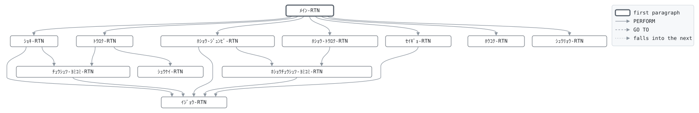

# GLO010

```text
GLO010: システム開設: 契約マスタの初期登録

システム開設時に1回だけ、コマンド行の業務日付 YYYYMMDD で
実行する。契約抽出ファイル (1行1マスタレコード) を読み、
証券番号をキーとする索引マスタに登録する。次に制御レコード
を、両暦の日付、採番カウンタ 1、登録した件数で書く。
抽出に二重にある証券番号は1件だけ登録し、数える。旧システム
の抽出にない請求回数と請求保険料は 0 にする。
続いて保障抽出ファイル (1行1保障レコード) を、証券番号と
保障番号をキーとする保障マスタに登録する。契約マスタにない
契約の保障は登録せず、二重にある保障は1件だけ登録し、
どちらも数える。

復帰コード: 0 登録済、4 抽出に重複か契約のない保障あり、
            8 日付が日付でない、16 ファイル異常。

変更履歴
日付       担当 変更
1999-11-08 MS   GL-0233 初版、PC システム移行時。
2026-11-18 YN   GL-0825 保障マスタの初期登録。
2026-11-19 YN   GL-0826 請求回数と請求保険料の初期値。
```

Program [GLO010.cbl](../../../gondwana/programs/GLO010.cbl): 6 files, 12 paragraphs. Its business rules: [8 decision tables](../rules/GLO010.md).

- AUTHOR: ゴンドワナ生命 システム部.
- DATE-WRITTEN: 1999-11-08.

## Contents

- [Files](#files)
- [Flow](#flow)
- [Paragraphs](#paragraphs)
- [Calls](#calls)
- [Data flow](#data-flow)
- [Lineage](#lineage)
  - [Into ﾁｭｳｼｭﾂ-ﾚｺｰﾄﾞ](#into-ﾁｭｳｼｭﾂ-ﾚｺｰﾄﾞ)
  - [Into PM-ｹｲﾔｸ-ﾚｺｰﾄﾞ](#into-pm-ｹｲﾔｸ-ﾚｺｰﾄﾞ)
  - [Into ﾎｼｮｳﾁｭｳｼｭﾂ-ﾚｺｰﾄﾞ](#into-ﾎｼｮｳﾁｭｳｼｭﾂ-ﾚｺｰﾄﾞ)
  - [Into HS-ﾎｼｮｳ-ﾚｺｰﾄﾞ](#into-hs-ﾎｼｮｳ-ﾚｺｰﾄﾞ)
  - [Into CT-ｾｲｷﾞｮ-ﾚｺｰﾄﾞ](#into-ct-ｾｲｷﾞｮ-ﾚｺｰﾄﾞ)
  - [Into ﾎｳｺｸ-ｷﾞｮｳ](#into-ﾎｳｺｸ-ｷﾞｮｳ)
  - [Into WS-ｺﾏﾝﾄﾞｷﾞｮｳ](#into-ws-ｺﾏﾝﾄﾞｷﾞｮｳ)
  - [Into WS-ｷﾞｮｳﾑﾋﾂﾞｹ](#into-ws-ｷﾞｮｳﾑﾋﾂﾞｹ)
  - [Into WS-ｷﾞｮｳﾑﾋﾂﾞｹ-ﾜﾚｷ](#into-ws-ｷﾞｮｳﾑﾋﾂﾞｹ-ﾜﾚｷ)
  - [Into WS-ﾎｳｺｳ](#into-ws-ﾎｳｺｳ)
  - [Into WS-ﾍﾝｶﾝｹｯｶ](#into-ws-ﾍﾝｶﾝｹｯｶ)
  - [Into WS-ｹﾝｽｳ](#into-ws-ｹﾝｽｳ)
  - [Into WS-ﾌｯｷｺｰﾄﾞ](#into-ws-ﾌｯｷｺｰﾄﾞ)
  - [Into WS-ﾎｳｺｸ](#into-ws-ﾎｳｺｸ)
  - [Out of the program](#out-of-the-program)
  - [Into other data items](#into-other-data-items)
- [Field origins](#field-origins)
  - [File POLMST-F](#file-polmst-f)
  - [File COVMST-F](#file-covmst-f)
  - [File GLSCTL-F](#file-glsctl-f)
  - [File REPORT-F](#file-report-f)
- [Links between records](#links-between-records)
- [Records](#records)
  - [ﾁｭｳｼｭﾂ-ﾚｺｰﾄﾞ](#ﾁｭｳｼｭﾂ-ﾚｺｰﾄﾞ)
  - [PM-ｹｲﾔｸ-ﾚｺｰﾄﾞ](#pm-ｹｲﾔｸ-ﾚｺｰﾄﾞ)
  - [ﾎｼｮｳﾁｭｳｼｭﾂ-ﾚｺｰﾄﾞ](#ﾎｼｮｳﾁｭｳｼｭﾂ-ﾚｺｰﾄﾞ)
  - [HS-ﾎｼｮｳ-ﾚｺｰﾄﾞ](#hs-ﾎｼｮｳ-ﾚｺｰﾄﾞ)
  - [CT-ｾｲｷﾞｮ-ﾚｺｰﾄﾞ](#ct-ｾｲｷﾞｮ-ﾚｺｰﾄﾞ)
  - [ﾎｳｺｸ-ｷﾞｮｳ](#ﾎｳｺｸ-ｷﾞｮｳ)
  - [WS-ｽﾃｰﾀｽ](#ws-ｽﾃｰﾀｽ)
  - [WS-ｺﾏﾝﾄﾞｷﾞｮｳ](#ws-ｺﾏﾝﾄﾞｷﾞｮｳ)
  - [WS-ｷﾞｮｳﾑﾋﾂﾞｹ](#ws-ｷﾞｮｳﾑﾋﾂﾞｹ)
  - [WS-ｷﾞｮｳﾑﾋﾂﾞｹ-ﾜﾚｷ](#ws-ｷﾞｮｳﾑﾋﾂﾞｹ-ﾜﾚｷ)
  - [WS-ﾎｳｺｳ](#ws-ﾎｳｺｳ)
  - [WS-ﾍﾝｶﾝｹｯｶ](#ws-ﾍﾝｶﾝｹｯｶ)
  - [WS-ｹﾝｽｳ](#ws-ｹﾝｽｳ)
  - [WS-ﾌｯｷｺｰﾄﾞ](#ws-ﾌｯｷｺｰﾄﾞ)
  - [WS-ﾎｳｺｸ](#ws-ﾎｳｺｸ)

## Files

| File | Kind | Assigned to | Organization | Status field | Opened | Records |
| --- | --- | --- | --- | --- | --- | --- |
| EXTRACT-F | FD | EXTRACT | LINE SEQUENTIAL | WS-ﾁｭｳｼｭﾂ-ST | INPUT | ﾁｭｳｼｭﾂ-ﾚｺｰﾄﾞ |
| POLMST-F | FD | POLMST | INDEXED, key PM-ｼｮｳｹﾝﾊﾞﾝｺﾞｳ, RANDOM access | WS-ｹｲﾔｸ-ST | OUTPUT, INPUT | PM-ｹｲﾔｸ-ﾚｺｰﾄﾞ |
| COVEXT-F | FD | COVEXT | LINE SEQUENTIAL | WS-ﾎｼｮｳﾁｭｳｼｭﾂ-ST | INPUT | ﾎｼｮｳﾁｭｳｼｭﾂ-ﾚｺｰﾄﾞ |
| COVMST-F | FD | COVMST | INDEXED, key HS-ｷｰ, RANDOM access | WS-ﾎｼｮｳ-ST | OUTPUT | HS-ﾎｼｮｳ-ﾚｺｰﾄﾞ |
| GLSCTL-F | FD | GLSCTL | SEQUENTIAL | WS-ｾｲｷﾞｮ-ST | OUTPUT | CT-ｾｲｷﾞｮ-ﾚｺｰﾄﾞ |
| REPORT-F | FD | GLO010R | LINE SEQUENTIAL | WS-ﾎｳｺｸ-ST | OUTPUT | ﾎｳｺｸ-ｷﾞｮｳ |

## Flow



## Paragraphs

| Paragraph | Description | Source | Performs | Goes to | Performed by | Reached by |
| --- | --- | --- | --- | --- | --- | --- |
| ﾒｲﾝ-RTN | ﾒｲﾝ-RTN: 日付、契約の登録、保障の登録、制御レコード、報告。 | [GLO010.cbl:125](../../../gondwana/programs/GLO010.cbl#L125) | ｼｮｷ-RTN, ﾄｳﾛｸ-RTN, ﾎｼｮｳ-ｼﾞｭﾝﾋﾞ-RTN, ﾎｼｮｳ-ﾄｳﾛｸ-RTN, ｾｲｷﾞｮ-RTN, ﾎｳｺｸ-RTN, ｼｭｳﾘｮｳ-RTN | | | |
| ｼｮｷ-RTN | ｼｮｷ-RTN: コマンド行の業務日付を両暦にし、ファイルを開く。 | [GLO010.cbl:139](../../../gondwana/programs/GLO010.cbl#L139) | ｲｼﾞｮｳ-RTN, ﾁｭｳｼｭﾂ-ﾖﾐｺﾐ-RTN | | ﾒｲﾝ-RTN | |
| ﾁｭｳｼｭﾂ-ﾖﾐｺﾐ-RTN | ﾁｭｳｼｭﾂ-ﾖﾐｺﾐ-RTN: 抽出ファイルの次の行。 | [GLO010.cbl:178](../../../gondwana/programs/GLO010.cbl#L178) | ｲｼﾞｮｳ-RTN | | ｼｮｷ-RTN, ﾄｳﾛｸ-RTN | |
| ﾄｳﾛｸ-RTN | ﾄｳﾛｸ-RTN: 契約1件をマスタに登録し、状態別に数える。 | [GLO010.cbl:193](../../../gondwana/programs/GLO010.cbl#L193) | ｼｭｳｹｲ-RTN, ﾁｭｳｼｭﾂ-ﾖﾐｺﾐ-RTN | | ﾒｲﾝ-RTN | |
| ｼｭｳｹｲ-RTN | ｼｭｳｹｲ-RTN: 契約を状態別に数える。 | [GLO010.cbl:212](../../../gondwana/programs/GLO010.cbl#L212) | | | ﾄｳﾛｸ-RTN | |
| ﾎｼｮｳ-ｼﾞｭﾝﾋﾞ-RTN | ﾎｼｮｳ-ｼﾞｭﾝﾋﾞ-RTN: 契約マスタを読めるように開き直し、保障 抽出ファイルと保障マスタを開く。 | [GLO010.cbl:230](../../../gondwana/programs/GLO010.cbl#L230) | ｲｼﾞｮｳ-RTN, ﾎｼｮｳﾁｭｳｼｭﾂ-ﾖﾐｺﾐ-RTN | | ﾒｲﾝ-RTN | |
| ﾎｼｮｳﾁｭｳｼｭﾂ-ﾖﾐｺﾐ-RTN | ﾎｼｮｳﾁｭｳｼｭﾂ-ﾖﾐｺﾐ-RTN: 保障抽出ファイルの次の行。 | [GLO010.cbl:255](../../../gondwana/programs/GLO010.cbl#L255) | ｲｼﾞｮｳ-RTN | | ﾎｼｮｳ-ｼﾞｭﾝﾋﾞ-RTN, ﾎｼｮｳ-ﾄｳﾛｸ-RTN | |
| ﾎｼｮｳ-ﾄｳﾛｸ-RTN | ﾎｼｮｳ-ﾄｳﾛｸ-RTN: 保障1件を、その契約がマスタにあれば保障 マスタに登録する。 | [GLO010.cbl:271](../../../gondwana/programs/GLO010.cbl#L271) | ﾎｼｮｳﾁｭｳｼｭﾂ-ﾖﾐｺﾐ-RTN | | ﾒｲﾝ-RTN | |
| ｾｲｷﾞｮ-RTN | ｾｲｷﾞｮ-RTN: 制御レコードを1回書く。 | [GLO010.cbl:292](../../../gondwana/programs/GLO010.cbl#L292) | ｲｼﾞｮｳ-RTN | | ﾒｲﾝ-RTN | |
| ﾎｳｺｸ-RTN | ﾎｳｺｸ-RTN: 登録結果の報告。 | [GLO010.cbl:312](../../../gondwana/programs/GLO010.cbl#L312) | | | ﾒｲﾝ-RTN | |
| ｼｭｳﾘｮｳ-RTN | ｼｭｳﾘｮｳ-RTN: ファイルを閉じ、件数を表示する。 | [GLO010.cbl:356](../../../gondwana/programs/GLO010.cbl#L356) | | | ﾒｲﾝ-RTN | |
| ｲｼﾞｮｳ-RTN | ｲｼﾞｮｳ-RTN: ファイル異常は 16 で終わる。ファイル名と状態は コマンド行域にある。 | [GLO010.cbl:367](../../../gondwana/programs/GLO010.cbl#L367) | | | ｼｮｷ-RTN, ﾁｭｳｼｭﾂ-ﾖﾐｺﾐ-RTN, ﾎｼｮｳ-ｼﾞｭﾝﾋﾞ-RTN, ﾎｼｮｳﾁｭｳｼｭﾂ-ﾖﾐｺﾐ-RTN, ｾｲｷﾞｮ-RTN | |

## Calls

| Calls | Passing | Paragraph | Source |
| --- | --- | --- | --- |
| [GLC020](GLC020.md) | WS-ﾎｳｺｳ, WS-ｷﾞｮｳﾑﾋﾂﾞｹ, WS-ｷﾞｮｳﾑﾋﾂﾞｹ-ﾜﾚｷ, WS-ﾍﾝｶﾝｹｯｶ | ｼｮｷ-RTN | [GLO010.cbl:142](../../../gondwana/programs/GLO010.cbl#L142) |

## Data flow

| Paragraph | Reads | Writes |
| --- | --- | --- |
| ﾒｲﾝ-RTN | WS-ﾁｭｳｼｭﾂ-ST, WS-ﾎｼｮｳﾁｭｳｼｭﾂ-ST, WS-ﾌｯｷｺｰﾄﾞ | RETURN-CODE |
| ｼｮｷ-RTN | WS-ｺﾏﾝﾄﾞｷﾞｮｳ, WS-ﾎｳｺｳ, WS-ｷﾞｮｳﾑﾋﾂﾞｹ, WS-ｷﾞｮｳﾑﾋﾂﾞｹ-ﾜﾚｷ, WS-ﾍﾝｶﾝｹｯｶ, WS-ﾁｭｳｼｭﾂ-ST, WS-ｹｲﾔｸ-ST, WS-ｾｲｷﾞｮ-ST, WS-ﾎｳｺｸ-ST | WS-ｺﾏﾝﾄﾞｷﾞｮｳ, WS-ｷﾞｮｳﾑﾋﾂﾞｹ, WS-ﾎｳｺｳ, WS-ｷﾞｮｳﾑﾋﾂﾞｹ-ﾜﾚｷ, WS-ﾍﾝｶﾝｹｯｶ, RETURN-CODE, WS-ﾁｭｳｼｭﾂ-ST, WS-ｹｲﾔｸ-ST, WS-ｾｲｷﾞｮ-ST, WS-ﾎｳｺｸ-ST |
| ﾁｭｳｼｭﾂ-ﾖﾐｺﾐ-RTN | WS-ﾁｭｳｼｭﾂ-ST, WS-ﾖﾐｺﾐｹﾝｽｳ | ﾁｭｳｼｭﾂ-ﾚｺｰﾄﾞ, WS-ﾁｭｳｼｭﾂ-ST, WS-ﾖﾐｺﾐｹﾝｽｳ, WS-ｺﾏﾝﾄﾞｷﾞｮｳ |
| ﾄｳﾛｸ-RTN | ﾁｭｳｼｭﾂ-ﾚｺｰﾄﾞ, PM-ｾｲｷｭｳｶｲｽｳ, PM-ｾｲｷｭｳﾎｹﾝﾘｮｳ, WS-ﾁｮｳﾌｸｹﾝｽｳ, WS-ﾄｳﾛｸｹﾝｽｳ | PM-ｹｲﾔｸ-ﾚｺｰﾄﾞ, PM-ｾｲｷｭｳｶｲｽｳ, PM-ｾｲｷｭｳﾎｹﾝﾘｮｳ, WS-ｹｲﾔｸ-ST, WS-ﾁｮｳﾌｸｹﾝｽｳ, WS-ﾌｯｷｺｰﾄﾞ, WS-ﾄｳﾛｸｹﾝｽｳ |
| ｼｭｳｹｲ-RTN | PM-ｼﾞｮｳﾀｲ, WS-ﾕｳｺｳｹﾝｽｳ, PM-ﾎｹﾝｷﾝｶﾞｸ, WS-ﾕｳｺｳﾎｹﾝｷﾝｶﾞｸ, WS-ﾕｳﾖｹﾝｽｳ, WS-ｼｯｺｳｹﾝｽｳ, WS-ｼｮｳﾒﾂｹﾝｽｳ | WS-ﾕｳｺｳｹﾝｽｳ, WS-ﾕｳｺｳﾎｹﾝｷﾝｶﾞｸ, WS-ﾕｳﾖｹﾝｽｳ, WS-ｼｯｺｳｹﾝｽｳ, WS-ｼｮｳﾒﾂｹﾝｽｳ |
| ﾎｼｮｳ-ｼﾞｭﾝﾋﾞ-RTN | WS-ｹｲﾔｸ-ST, WS-ﾎｼｮｳﾁｭｳｼｭﾂ-ST, WS-ﾎｼｮｳ-ST | WS-ｹｲﾔｸ-ST, WS-ｺﾏﾝﾄﾞｷﾞｮｳ, WS-ﾎｼｮｳﾁｭｳｼｭﾂ-ST, WS-ﾎｼｮｳ-ST |
| ﾎｼｮｳﾁｭｳｼｭﾂ-ﾖﾐｺﾐ-RTN | WS-ﾎｼｮｳﾁｭｳｼｭﾂ-ST, WS-ﾎｼｮｳﾖﾐｺﾐｹﾝｽｳ | ﾎｼｮｳﾁｭｳｼｭﾂ-ﾚｺｰﾄﾞ, WS-ﾎｼｮｳﾁｭｳｼｭﾂ-ST, WS-ﾎｼｮｳﾖﾐｺﾐｹﾝｽｳ, WS-ｺﾏﾝﾄﾞｷﾞｮｳ |
| ﾎｼｮｳ-ﾄｳﾛｸ-RTN | ﾎｼｮｳﾁｭｳｼｭﾂ-ﾚｺｰﾄﾞ, HS-ｼｮｳｹﾝﾊﾞﾝｺﾞｳ, WS-ｹｲﾔｸﾅｼｹﾝｽｳ, WS-ﾎｼｮｳﾁｮｳﾌｸｹﾝｽｳ, WS-ﾎｼｮｳﾄｳﾛｸｹﾝｽｳ | HS-ﾎｼｮｳ-ﾚｺｰﾄﾞ, PM-ｼｮｳｹﾝﾊﾞﾝｺﾞｳ, PM-ｹｲﾔｸ-ﾚｺｰﾄﾞ, WS-ｹｲﾔｸ-ST, WS-ｹｲﾔｸﾅｼｹﾝｽｳ, WS-ﾌｯｷｺｰﾄﾞ, WS-ﾎｼｮｳ-ST, WS-ﾎｼｮｳﾁｮｳﾌｸｹﾝｽｳ, WS-ﾎｼｮｳﾄｳﾛｸｹﾝｽｳ |
| ｾｲｷﾞｮ-RTN | WS-ｷﾞｮｳﾑﾋﾂﾞｹ, WS-ｷﾞｮｳﾑﾋﾂﾞｹ-ﾜﾚｷ, WS-ﾕｳｺｳｹﾝｽｳ, WS-ﾕｳﾖｹﾝｽｳ, WS-ﾄｳﾛｸｹﾝｽｳ, WS-ﾕｳｺｳﾎｹﾝｷﾝｶﾞｸ, WS-ｾｲｷﾞｮ-ST | CT-ｾｲｷﾞｮ-ﾚｺｰﾄﾞ, CT-ｷﾞｮｳﾑﾋﾂﾞｹ, CT-ｷﾞｮｳﾑﾋﾂﾞｹ-ﾜﾚｷ, CT-ｻｲｼｭｳｾｲｷｭｳﾈﾝｹﾞﾂ, CT-ｼﾞｶｲｼﾊﾗｲﾊﾞﾝｺﾞｳ, CT-ｼﾞｶｲｼﾜｹﾊﾞﾝｺﾞｳ, CT-ﾕｳｺｳｹﾝｽｳ, CT-ｿｳｹﾝｽｳ, CT-ﾕｳｺｳﾎｹﾝｷﾝｶﾞｸ, WS-ｾｲｷﾞｮ-ST, WS-ｺﾏﾝﾄﾞｷﾞｮｳ |
| ﾎｳｺｸ-RTN | WS-ｷﾞｮｳﾑﾋﾂﾞｹ-ﾜﾚｷ, WS-ﾋｮｳﾀﾞｲ-ｷﾞｮｳ, WS-ﾖﾐｺﾐｹﾝｽｳ, WS-ｹﾝｽｳ-ｷﾞｮｳ, WS-ﾄｳﾛｸｹﾝｽｳ, WS-ﾁｮｳﾌｸｹﾝｽｳ, WS-ﾕｳｺｳｹﾝｽｳ, WS-ﾕｳﾖｹﾝｽｳ, WS-ｼｯｺｳｹﾝｽｳ, WS-ｼｮｳﾒﾂｹﾝｽｳ, WS-ﾕｳｺｳﾎｹﾝｷﾝｶﾞｸ, WS-ｷﾝｶﾞｸ-ｷﾞｮｳ, WS-ﾎｼｮｳﾖﾐｺﾐｹﾝｽｳ, WS-ﾎｼｮｳﾄｳﾛｸｹﾝｽｳ, WS-ﾎｼｮｳﾁｮｳﾌｸｹﾝｽｳ, WS-ｹｲﾔｸﾅｼｹﾝｽｳ | WS-ﾋｮｳﾀﾞｲ-ﾋﾂﾞｹ, ﾎｳｺｸ-ｷﾞｮｳ, WS-ﾎｳｺｸ-ST, WS-ｹﾝｽｳ-ﾗﾍﾞﾙ, WS-ｹﾝｽｳ-ｱﾀｲ, WS-ｷﾝｶﾞｸ-ｱﾀｲ |
| ｼｭｳﾘｮｳ-RTN | WS-ﾄｳﾛｸｹﾝｽｳ, WS-ﾁｮｳﾌｸｹﾝｽｳ, WS-ﾎｼｮｳﾄｳﾛｸｹﾝｽｳ | WS-ﾁｭｳｼｭﾂ-ST, WS-ｹｲﾔｸ-ST, WS-ﾎｼｮｳﾁｭｳｼｭﾂ-ST, WS-ﾎｼｮｳ-ST, WS-ｾｲｷﾞｮ-ST, WS-ﾎｳｺｸ-ST |
| ｲｼﾞｮｳ-RTN | WS-ｺﾏﾝﾄﾞｷﾞｮｳ | RETURN-CODE |

## Lineage

Where each data item's values come from, grouped by the record they go into. A data item links to the record it belongs to.

### Into ﾁｭｳｼｭﾂ-ﾚｺｰﾄﾞ

Record [ﾁｭｳｼｭﾂ-ﾚｺｰﾄﾞ](#ﾁｭｳｼｭﾂ-ﾚｺｰﾄﾞ).

| Into | From | Statement | Paragraph | Source |
| --- | --- | --- | --- | --- |
| ﾁｭｳｼｭﾂ-ﾚｺｰﾄﾞ | file EXTRACT-F | READ | ﾁｭｳｼｭﾂ-ﾖﾐｺﾐ-RTN | [GLO010.cbl:179](../../../gondwana/programs/GLO010.cbl#L179) |

### Into PM-ｹｲﾔｸ-ﾚｺｰﾄﾞ

Record [PM-ｹｲﾔｸ-ﾚｺｰﾄﾞ](#pm-ｹｲﾔｸ-ﾚｺｰﾄﾞ), from copybook [POLMST](../copybooks/POLMST.md).

| Into | From | Statement | Paragraph | Source |
| --- | --- | --- | --- | --- |
| PM-ｹｲﾔｸ-ﾚｺｰﾄﾞ | [ﾁｭｳｼｭﾂ-ﾚｺｰﾄﾞ](#ﾁｭｳｼｭﾂ-ﾚｺｰﾄﾞ) | MOVE | ﾄｳﾛｸ-RTN | [GLO010.cbl:194](../../../gondwana/programs/GLO010.cbl#L194) |
| PM-ｹｲﾔｸ-ﾚｺｰﾄﾞ | file POLMST-F | READ | ﾎｼｮｳ-ﾄｳﾛｸ-RTN | [GLO010.cbl:274](../../../gondwana/programs/GLO010.cbl#L274) |
| PM-ｼｮｳｹﾝﾊﾞﾝｺﾞｳ | [HS-ｼｮｳｹﾝﾊﾞﾝｺﾞｳ](#hs-ﾎｼｮｳ-ﾚｺｰﾄﾞ "in HS-ﾎｼｮｳ-ﾚｺｰﾄﾞ") | MOVE | ﾎｼｮｳ-ﾄｳﾛｸ-RTN | [GLO010.cbl:273](../../../gondwana/programs/GLO010.cbl#L273) |
| PM-ｾｲｷｭｳｶｲｽｳ | literal 0 | MOVE | ﾄｳﾛｸ-RTN | [GLO010.cbl:197](../../../gondwana/programs/GLO010.cbl#L197) |
| PM-ｾｲｷｭｳﾎｹﾝﾘｮｳ | literal 0 | MOVE | ﾄｳﾛｸ-RTN | [GLO010.cbl:197](../../../gondwana/programs/GLO010.cbl#L197) |

### Into ﾎｼｮｳﾁｭｳｼｭﾂ-ﾚｺｰﾄﾞ

Record [ﾎｼｮｳﾁｭｳｼｭﾂ-ﾚｺｰﾄﾞ](#ﾎｼｮｳﾁｭｳｼｭﾂ-ﾚｺｰﾄﾞ).

| Into | From | Statement | Paragraph | Source |
| --- | --- | --- | --- | --- |
| ﾎｼｮｳﾁｭｳｼｭﾂ-ﾚｺｰﾄﾞ | file COVEXT-F | READ | ﾎｼｮｳﾁｭｳｼｭﾂ-ﾖﾐｺﾐ-RTN | [GLO010.cbl:256](../../../gondwana/programs/GLO010.cbl#L256) |

### Into HS-ﾎｼｮｳ-ﾚｺｰﾄﾞ

Record [HS-ﾎｼｮｳ-ﾚｺｰﾄﾞ](#hs-ﾎｼｮｳ-ﾚｺｰﾄﾞ), from copybook [COVMST](../copybooks/COVMST.md).

| Into | From | Statement | Paragraph | Source |
| --- | --- | --- | --- | --- |
| HS-ﾎｼｮｳ-ﾚｺｰﾄﾞ | [ﾎｼｮｳﾁｭｳｼｭﾂ-ﾚｺｰﾄﾞ](#ﾎｼｮｳﾁｭｳｼｭﾂ-ﾚｺｰﾄﾞ) | MOVE | ﾎｼｮｳ-ﾄｳﾛｸ-RTN | [GLO010.cbl:272](../../../gondwana/programs/GLO010.cbl#L272) |

### Into CT-ｾｲｷﾞｮ-ﾚｺｰﾄﾞ

Record [CT-ｾｲｷﾞｮ-ﾚｺｰﾄﾞ](#ct-ｾｲｷﾞｮ-ﾚｺｰﾄﾞ), from copybook [CTLREC](../copybooks/CTLREC.md).

| Into | From | Statement | Paragraph | Source |
| --- | --- | --- | --- | --- |
| CT-ｷﾞｮｳﾑﾋﾂﾞｹ | [WS-ｷﾞｮｳﾑﾋﾂﾞｹ](#ws-ｷﾞｮｳﾑﾋﾂﾞｹ) | MOVE | ｾｲｷﾞｮ-RTN | [GLO010.cbl:294](../../../gondwana/programs/GLO010.cbl#L294) |
| CT-ｷﾞｮｳﾑﾋﾂﾞｹ-ﾜﾚｷ | [WS-ｷﾞｮｳﾑﾋﾂﾞｹ-ﾜﾚｷ](#ws-ｷﾞｮｳﾑﾋﾂﾞｹ-ﾜﾚｷ) | MOVE | ｾｲｷﾞｮ-RTN | [GLO010.cbl:295](../../../gondwana/programs/GLO010.cbl#L295) |
| CT-ｻｲｼｭｳｾｲｷｭｳﾈﾝｹﾞﾂ | literal 0 | MOVE | ｾｲｷﾞｮ-RTN | [GLO010.cbl:296](../../../gondwana/programs/GLO010.cbl#L296) |
| CT-ｼﾞｶｲｼﾊﾗｲﾊﾞﾝｺﾞｳ | literal 1 | MOVE | ｾｲｷﾞｮ-RTN | [GLO010.cbl:297](../../../gondwana/programs/GLO010.cbl#L297) |
| CT-ｼﾞｶｲｼﾜｹﾊﾞﾝｺﾞｳ | literal 1 | MOVE | ｾｲｷﾞｮ-RTN | [GLO010.cbl:298](../../../gondwana/programs/GLO010.cbl#L298) |
| CT-ｾｲｷﾞｮ-ﾚｺｰﾄﾞ | literal SPACES | MOVE | ｾｲｷﾞｮ-RTN | [GLO010.cbl:293](../../../gondwana/programs/GLO010.cbl#L293) |
| CT-ｿｳｹﾝｽｳ | [WS-ﾄｳﾛｸｹﾝｽｳ](#ws-ｹﾝｽｳ "in WS-ｹﾝｽｳ") | MOVE | ｾｲｷﾞｮ-RTN | [GLO010.cbl:300](../../../gondwana/programs/GLO010.cbl#L300) |
| CT-ﾕｳｺｳｹﾝｽｳ | [WS-ﾕｳｺｳｹﾝｽｳ](#ws-ｹﾝｽｳ "in WS-ｹﾝｽｳ") | COMPUTE | ｾｲｷﾞｮ-RTN | [GLO010.cbl:299](../../../gondwana/programs/GLO010.cbl#L299) |
| CT-ﾕｳｺｳｹﾝｽｳ | [WS-ﾕｳﾖｹﾝｽｳ](#ws-ｹﾝｽｳ "in WS-ｹﾝｽｳ") | COMPUTE | ｾｲｷﾞｮ-RTN | [GLO010.cbl:299](../../../gondwana/programs/GLO010.cbl#L299) |
| CT-ﾕｳｺｳﾎｹﾝｷﾝｶﾞｸ | [WS-ﾕｳｺｳﾎｹﾝｷﾝｶﾞｸ](#ws-ｹﾝｽｳ "in WS-ｹﾝｽｳ") | MOVE | ｾｲｷﾞｮ-RTN | [GLO010.cbl:301](../../../gondwana/programs/GLO010.cbl#L301) |

### Into ﾎｳｺｸ-ｷﾞｮｳ

Record [ﾎｳｺｸ-ｷﾞｮｳ](#ﾎｳｺｸ-ｷﾞｮｳ).

| Into | From | Statement | Paragraph | Source |
| --- | --- | --- | --- | --- |
| ﾎｳｺｸ-ｷﾞｮｳ | [WS-ﾋｮｳﾀﾞｲ-ｷﾞｮｳ](#ws-ﾎｳｺｸ "in WS-ﾎｳｺｸ") | WRITE | ﾎｳｺｸ-RTN | [GLO010.cbl:314](../../../gondwana/programs/GLO010.cbl#L314) |
| ﾎｳｺｸ-ｷﾞｮｳ | literal SPACES | MOVE | ﾎｳｺｸ-RTN | [GLO010.cbl:315](../../../gondwana/programs/GLO010.cbl#L315) |
| ﾎｳｺｸ-ｷﾞｮｳ | [WS-ｹﾝｽｳ-ｷﾞｮｳ](#ws-ﾎｳｺｸ "in WS-ﾎｳｺｸ") | WRITE | ﾎｳｺｸ-RTN | [GLO010.cbl:319](../../../gondwana/programs/GLO010.cbl#L319) |
| ﾎｳｺｸ-ｷﾞｮｳ | [WS-ｹﾝｽｳ-ｷﾞｮｳ](#ws-ﾎｳｺｸ "in WS-ﾎｳｺｸ") | WRITE | ﾎｳｺｸ-RTN | [GLO010.cbl:322](../../../gondwana/programs/GLO010.cbl#L322) |
| ﾎｳｺｸ-ｷﾞｮｳ | [WS-ｹﾝｽｳ-ｷﾞｮｳ](#ws-ﾎｳｺｸ "in WS-ﾎｳｺｸ") | WRITE | ﾎｳｺｸ-RTN | [GLO010.cbl:325](../../../gondwana/programs/GLO010.cbl#L325) |
| ﾎｳｺｸ-ｷﾞｮｳ | [WS-ｹﾝｽｳ-ｷﾞｮｳ](#ws-ﾎｳｺｸ "in WS-ﾎｳｺｸ") | WRITE | ﾎｳｺｸ-RTN | [GLO010.cbl:328](../../../gondwana/programs/GLO010.cbl#L328) |
| ﾎｳｺｸ-ｷﾞｮｳ | [WS-ｹﾝｽｳ-ｷﾞｮｳ](#ws-ﾎｳｺｸ "in WS-ﾎｳｺｸ") | WRITE | ﾎｳｺｸ-RTN | [GLO010.cbl:331](../../../gondwana/programs/GLO010.cbl#L331) |
| ﾎｳｺｸ-ｷﾞｮｳ | [WS-ｹﾝｽｳ-ｷﾞｮｳ](#ws-ﾎｳｺｸ "in WS-ﾎｳｺｸ") | WRITE | ﾎｳｺｸ-RTN | [GLO010.cbl:334](../../../gondwana/programs/GLO010.cbl#L334) |
| ﾎｳｺｸ-ｷﾞｮｳ | [WS-ｹﾝｽｳ-ｷﾞｮｳ](#ws-ﾎｳｺｸ "in WS-ﾎｳｺｸ") | WRITE | ﾎｳｺｸ-RTN | [GLO010.cbl:337](../../../gondwana/programs/GLO010.cbl#L337) |
| ﾎｳｺｸ-ｷﾞｮｳ | [WS-ｷﾝｶﾞｸ-ｷﾞｮｳ](#ws-ﾎｳｺｸ "in WS-ﾎｳｺｸ") | WRITE | ﾎｳｺｸ-RTN | [GLO010.cbl:339](../../../gondwana/programs/GLO010.cbl#L339) |
| ﾎｳｺｸ-ｷﾞｮｳ | [WS-ｹﾝｽｳ-ｷﾞｮｳ](#ws-ﾎｳｺｸ "in WS-ﾎｳｺｸ") | WRITE | ﾎｳｺｸ-RTN | [GLO010.cbl:342](../../../gondwana/programs/GLO010.cbl#L342) |
| ﾎｳｺｸ-ｷﾞｮｳ | [WS-ｹﾝｽｳ-ｷﾞｮｳ](#ws-ﾎｳｺｸ "in WS-ﾎｳｺｸ") | WRITE | ﾎｳｺｸ-RTN | [GLO010.cbl:345](../../../gondwana/programs/GLO010.cbl#L345) |
| ﾎｳｺｸ-ｷﾞｮｳ | [WS-ｹﾝｽｳ-ｷﾞｮｳ](#ws-ﾎｳｺｸ "in WS-ﾎｳｺｸ") | WRITE | ﾎｳｺｸ-RTN | [GLO010.cbl:348](../../../gondwana/programs/GLO010.cbl#L348) |
| ﾎｳｺｸ-ｷﾞｮｳ | [WS-ｹﾝｽｳ-ｷﾞｮｳ](#ws-ﾎｳｺｸ "in WS-ﾎｳｺｸ") | WRITE | ﾎｳｺｸ-RTN | [GLO010.cbl:351](../../../gondwana/programs/GLO010.cbl#L351) |

### Into WS-ｺﾏﾝﾄﾞｷﾞｮｳ

Record [WS-ｺﾏﾝﾄﾞｷﾞｮｳ](#ws-ｺﾏﾝﾄﾞｷﾞｮｳ).

| Into | From | Statement | Paragraph | Source |
| --- | --- | --- | --- | --- |
| WS-ｺﾏﾝﾄﾞｷﾞｮｳ | COMMAND-LINE | ACCEPT | ｼｮｷ-RTN | [GLO010.cbl:140](../../../gondwana/programs/GLO010.cbl#L140) |
| WS-ｺﾏﾝﾄﾞｷﾞｮｳ | literal 'EXTRACT' | MOVE | ｼｮｷ-RTN | [GLO010.cbl:151](../../../gondwana/programs/GLO010.cbl#L151) |
| WS-ｺﾏﾝﾄﾞｷﾞｮｳ | [WS-ﾁｭｳｼｭﾂ-ST](#ws-ｽﾃｰﾀｽ "in WS-ｽﾃｰﾀｽ") | MOVE | ｼｮｷ-RTN | [GLO010.cbl:152](../../../gondwana/programs/GLO010.cbl#L152) |
| WS-ｺﾏﾝﾄﾞｷﾞｮｳ | literal 'POLMST' | MOVE | ｼｮｷ-RTN | [GLO010.cbl:157](../../../gondwana/programs/GLO010.cbl#L157) |
| WS-ｺﾏﾝﾄﾞｷﾞｮｳ | [WS-ｹｲﾔｸ-ST](#ws-ｽﾃｰﾀｽ "in WS-ｽﾃｰﾀｽ") | MOVE | ｼｮｷ-RTN | [GLO010.cbl:158](../../../gondwana/programs/GLO010.cbl#L158) |
| WS-ｺﾏﾝﾄﾞｷﾞｮｳ | literal 'GLSCTL' | MOVE | ｼｮｷ-RTN | [GLO010.cbl:163](../../../gondwana/programs/GLO010.cbl#L163) |
| WS-ｺﾏﾝﾄﾞｷﾞｮｳ | [WS-ｾｲｷﾞｮ-ST](#ws-ｽﾃｰﾀｽ "in WS-ｽﾃｰﾀｽ") | MOVE | ｼｮｷ-RTN | [GLO010.cbl:164](../../../gondwana/programs/GLO010.cbl#L164) |
| WS-ｺﾏﾝﾄﾞｷﾞｮｳ | literal 'GLO010R' | MOVE | ｼｮｷ-RTN | [GLO010.cbl:169](../../../gondwana/programs/GLO010.cbl#L169) |
| WS-ｺﾏﾝﾄﾞｷﾞｮｳ | [WS-ﾎｳｺｸ-ST](#ws-ｽﾃｰﾀｽ "in WS-ｽﾃｰﾀｽ") | MOVE | ｼｮｷ-RTN | [GLO010.cbl:170](../../../gondwana/programs/GLO010.cbl#L170) |
| WS-ｺﾏﾝﾄﾞｷﾞｮｳ | literal 'EXTRACT' | MOVE | ﾁｭｳｼｭﾂ-ﾖﾐｺﾐ-RTN | [GLO010.cbl:184](../../../gondwana/programs/GLO010.cbl#L184) |
| WS-ｺﾏﾝﾄﾞｷﾞｮｳ | [WS-ﾁｭｳｼｭﾂ-ST](#ws-ｽﾃｰﾀｽ "in WS-ｽﾃｰﾀｽ") | MOVE | ﾁｭｳｼｭﾂ-ﾖﾐｺﾐ-RTN | [GLO010.cbl:185](../../../gondwana/programs/GLO010.cbl#L185) |
| WS-ｺﾏﾝﾄﾞｷﾞｮｳ | literal 'POLMST' | MOVE | ﾎｼｮｳ-ｼﾞｭﾝﾋﾞ-RTN | [GLO010.cbl:234](../../../gondwana/programs/GLO010.cbl#L234) |
| WS-ｺﾏﾝﾄﾞｷﾞｮｳ | [WS-ｹｲﾔｸ-ST](#ws-ｽﾃｰﾀｽ "in WS-ｽﾃｰﾀｽ") | MOVE | ﾎｼｮｳ-ｼﾞｭﾝﾋﾞ-RTN | [GLO010.cbl:235](../../../gondwana/programs/GLO010.cbl#L235) |
| WS-ｺﾏﾝﾄﾞｷﾞｮｳ | literal 'COVEXT' | MOVE | ﾎｼｮｳ-ｼﾞｭﾝﾋﾞ-RTN | [GLO010.cbl:240](../../../gondwana/programs/GLO010.cbl#L240) |
| WS-ｺﾏﾝﾄﾞｷﾞｮｳ | [WS-ﾎｼｮｳﾁｭｳｼｭﾂ-ST](#ws-ｽﾃｰﾀｽ "in WS-ｽﾃｰﾀｽ") | MOVE | ﾎｼｮｳ-ｼﾞｭﾝﾋﾞ-RTN | [GLO010.cbl:241](../../../gondwana/programs/GLO010.cbl#L241) |
| WS-ｺﾏﾝﾄﾞｷﾞｮｳ | literal 'COVMST' | MOVE | ﾎｼｮｳ-ｼﾞｭﾝﾋﾞ-RTN | [GLO010.cbl:246](../../../gondwana/programs/GLO010.cbl#L246) |
| WS-ｺﾏﾝﾄﾞｷﾞｮｳ | [WS-ﾎｼｮｳ-ST](#ws-ｽﾃｰﾀｽ "in WS-ｽﾃｰﾀｽ") | MOVE | ﾎｼｮｳ-ｼﾞｭﾝﾋﾞ-RTN | [GLO010.cbl:247](../../../gondwana/programs/GLO010.cbl#L247) |
| WS-ｺﾏﾝﾄﾞｷﾞｮｳ | literal 'COVEXT' | MOVE | ﾎｼｮｳﾁｭｳｼｭﾂ-ﾖﾐｺﾐ-RTN | [GLO010.cbl:261](../../../gondwana/programs/GLO010.cbl#L261) |
| WS-ｺﾏﾝﾄﾞｷﾞｮｳ | [WS-ﾎｼｮｳﾁｭｳｼｭﾂ-ST](#ws-ｽﾃｰﾀｽ "in WS-ｽﾃｰﾀｽ") | MOVE | ﾎｼｮｳﾁｭｳｼｭﾂ-ﾖﾐｺﾐ-RTN | [GLO010.cbl:262](../../../gondwana/programs/GLO010.cbl#L262) |
| WS-ｺﾏﾝﾄﾞｷﾞｮｳ | literal 'GLSCTL' | MOVE | ｾｲｷﾞｮ-RTN | [GLO010.cbl:304](../../../gondwana/programs/GLO010.cbl#L304) |
| WS-ｺﾏﾝﾄﾞｷﾞｮｳ | [WS-ｾｲｷﾞｮ-ST](#ws-ｽﾃｰﾀｽ "in WS-ｽﾃｰﾀｽ") | MOVE | ｾｲｷﾞｮ-RTN | [GLO010.cbl:305](../../../gondwana/programs/GLO010.cbl#L305) |

### Into WS-ｷﾞｮｳﾑﾋﾂﾞｹ

Record [WS-ｷﾞｮｳﾑﾋﾂﾞｹ](#ws-ｷﾞｮｳﾑﾋﾂﾞｹ).

| Into | From | Statement | Paragraph | Source |
| --- | --- | --- | --- | --- |
| WS-ｷﾞｮｳﾑﾋﾂﾞｹ | [WS-ｺﾏﾝﾄﾞｷﾞｮｳ](#ws-ｺﾏﾝﾄﾞｷﾞｮｳ) | MOVE | ｼｮｷ-RTN | [GLO010.cbl:141](../../../gondwana/programs/GLO010.cbl#L141) |
| WS-ｷﾞｮｳﾑﾋﾂﾞｹ | call GLC020 argument 2 | CALL | ｼｮｷ-RTN | [GLO010.cbl:142](../../../gondwana/programs/GLO010.cbl#L142) |

### Into WS-ｷﾞｮｳﾑﾋﾂﾞｹ-ﾜﾚｷ

Record [WS-ｷﾞｮｳﾑﾋﾂﾞｹ-ﾜﾚｷ](#ws-ｷﾞｮｳﾑﾋﾂﾞｹ-ﾜﾚｷ).

| Into | From | Statement | Paragraph | Source |
| --- | --- | --- | --- | --- |
| WS-ｷﾞｮｳﾑﾋﾂﾞｹ-ﾜﾚｷ | call GLC020 argument 3 | CALL | ｼｮｷ-RTN | [GLO010.cbl:142](../../../gondwana/programs/GLO010.cbl#L142) |

### Into WS-ﾎｳｺｳ

Record [WS-ﾎｳｺｳ](#ws-ﾎｳｺｳ).

| Into | From | Statement | Paragraph | Source |
| --- | --- | --- | --- | --- |
| WS-ﾎｳｺｳ | call GLC020 argument 1 | CALL | ｼｮｷ-RTN | [GLO010.cbl:142](../../../gondwana/programs/GLO010.cbl#L142) |

### Into WS-ﾍﾝｶﾝｹｯｶ

Record [WS-ﾍﾝｶﾝｹｯｶ](#ws-ﾍﾝｶﾝｹｯｶ).

| Into | From | Statement | Paragraph | Source |
| --- | --- | --- | --- | --- |
| WS-ﾍﾝｶﾝｹｯｶ | call GLC020 argument 4 | CALL | ｼｮｷ-RTN | [GLO010.cbl:142](../../../gondwana/programs/GLO010.cbl#L142) |

### Into WS-ｹﾝｽｳ

Record [WS-ｹﾝｽｳ](#ws-ｹﾝｽｳ).

| Into | From | Statement | Paragraph | Source |
| --- | --- | --- | --- | --- |
| WS-ｹｲﾔｸﾅｼｹﾝｽｳ | literal 1 | ADD | ﾎｼｮｳ-ﾄｳﾛｸ-RTN | [GLO010.cbl:276](../../../gondwana/programs/GLO010.cbl#L276) |
| WS-ｼｮｳﾒﾂｹﾝｽｳ | literal 1 | ADD | ｼｭｳｹｲ-RTN | [GLO010.cbl:223](../../../gondwana/programs/GLO010.cbl#L223) |
| WS-ｼｯｺｳｹﾝｽｳ | literal 1 | ADD | ｼｭｳｹｲ-RTN | [GLO010.cbl:221](../../../gondwana/programs/GLO010.cbl#L221) |
| WS-ﾁｮｳﾌｸｹﾝｽｳ | literal 1 | ADD | ﾄｳﾛｸ-RTN | [GLO010.cbl:201](../../../gondwana/programs/GLO010.cbl#L201) |
| WS-ﾄｳﾛｸｹﾝｽｳ | literal 1 | ADD | ﾄｳﾛｸ-RTN | [GLO010.cbl:204](../../../gondwana/programs/GLO010.cbl#L204) |
| WS-ﾎｼｮｳﾁｮｳﾌｸｹﾝｽｳ | literal 1 | ADD | ﾎｼｮｳ-ﾄｳﾛｸ-RTN | [GLO010.cbl:281](../../../gondwana/programs/GLO010.cbl#L281) |
| WS-ﾎｼｮｳﾄｳﾛｸｹﾝｽｳ | literal 1 | ADD | ﾎｼｮｳ-ﾄｳﾛｸ-RTN | [GLO010.cbl:284](../../../gondwana/programs/GLO010.cbl#L284) |
| WS-ﾎｼｮｳﾖﾐｺﾐｹﾝｽｳ | literal 1 | ADD | ﾎｼｮｳﾁｭｳｼｭﾂ-ﾖﾐｺﾐ-RTN | [GLO010.cbl:258](../../../gondwana/programs/GLO010.cbl#L258) |
| WS-ﾕｳｺｳｹﾝｽｳ | literal 1 | ADD | ｼｭｳｹｲ-RTN | [GLO010.cbl:215](../../../gondwana/programs/GLO010.cbl#L215) |
| WS-ﾕｳｺｳﾎｹﾝｷﾝｶﾞｸ | [PM-ﾎｹﾝｷﾝｶﾞｸ](#pm-ｹｲﾔｸ-ﾚｺｰﾄﾞ "in PM-ｹｲﾔｸ-ﾚｺｰﾄﾞ") | ADD | ｼｭｳｹｲ-RTN | [GLO010.cbl:216](../../../gondwana/programs/GLO010.cbl#L216) |
| WS-ﾕｳｺｳﾎｹﾝｷﾝｶﾞｸ | [PM-ﾎｹﾝｷﾝｶﾞｸ](#pm-ｹｲﾔｸ-ﾚｺｰﾄﾞ "in PM-ｹｲﾔｸ-ﾚｺｰﾄﾞ") | ADD | ｼｭｳｹｲ-RTN | [GLO010.cbl:219](../../../gondwana/programs/GLO010.cbl#L219) |
| WS-ﾕｳﾖｹﾝｽｳ | literal 1 | ADD | ｼｭｳｹｲ-RTN | [GLO010.cbl:218](../../../gondwana/programs/GLO010.cbl#L218) |
| WS-ﾖﾐｺﾐｹﾝｽｳ | literal 1 | ADD | ﾁｭｳｼｭﾂ-ﾖﾐｺﾐ-RTN | [GLO010.cbl:181](../../../gondwana/programs/GLO010.cbl#L181) |

### Into WS-ﾌｯｷｺｰﾄﾞ

Record [WS-ﾌｯｷｺｰﾄﾞ](#ws-ﾌｯｷｺｰﾄﾞ).

| Into | From | Statement | Paragraph | Source |
| --- | --- | --- | --- | --- |
| WS-ﾌｯｷｺｰﾄﾞ | literal 4 | MOVE | ﾄｳﾛｸ-RTN | [GLO010.cbl:202](../../../gondwana/programs/GLO010.cbl#L202) |
| WS-ﾌｯｷｺｰﾄﾞ | literal 4 | MOVE | ﾎｼｮｳ-ﾄｳﾛｸ-RTN | [GLO010.cbl:277](../../../gondwana/programs/GLO010.cbl#L277) |
| WS-ﾌｯｷｺｰﾄﾞ | literal 4 | MOVE | ﾎｼｮｳ-ﾄｳﾛｸ-RTN | [GLO010.cbl:282](../../../gondwana/programs/GLO010.cbl#L282) |

### Into WS-ﾎｳｺｸ

Record [WS-ﾎｳｺｸ](#ws-ﾎｳｺｸ).

| Into | From | Statement | Paragraph | Source |
| --- | --- | --- | --- | --- |
| WS-ｷﾝｶﾞｸ-ｱﾀｲ | [WS-ﾕｳｺｳﾎｹﾝｷﾝｶﾞｸ](#ws-ｹﾝｽｳ "in WS-ｹﾝｽｳ") | MOVE | ﾎｳｺｸ-RTN | [GLO010.cbl:338](../../../gondwana/programs/GLO010.cbl#L338) |
| WS-ｹﾝｽｳ-ｱﾀｲ | [WS-ﾖﾐｺﾐｹﾝｽｳ](#ws-ｹﾝｽｳ "in WS-ｹﾝｽｳ") | MOVE | ﾎｳｺｸ-RTN | [GLO010.cbl:318](../../../gondwana/programs/GLO010.cbl#L318) |
| WS-ｹﾝｽｳ-ｱﾀｲ | [WS-ﾄｳﾛｸｹﾝｽｳ](#ws-ｹﾝｽｳ "in WS-ｹﾝｽｳ") | MOVE | ﾎｳｺｸ-RTN | [GLO010.cbl:321](../../../gondwana/programs/GLO010.cbl#L321) |
| WS-ｹﾝｽｳ-ｱﾀｲ | [WS-ﾁｮｳﾌｸｹﾝｽｳ](#ws-ｹﾝｽｳ "in WS-ｹﾝｽｳ") | MOVE | ﾎｳｺｸ-RTN | [GLO010.cbl:324](../../../gondwana/programs/GLO010.cbl#L324) |
| WS-ｹﾝｽｳ-ｱﾀｲ | [WS-ﾕｳｺｳｹﾝｽｳ](#ws-ｹﾝｽｳ "in WS-ｹﾝｽｳ") | MOVE | ﾎｳｺｸ-RTN | [GLO010.cbl:327](../../../gondwana/programs/GLO010.cbl#L327) |
| WS-ｹﾝｽｳ-ｱﾀｲ | [WS-ﾕｳﾖｹﾝｽｳ](#ws-ｹﾝｽｳ "in WS-ｹﾝｽｳ") | MOVE | ﾎｳｺｸ-RTN | [GLO010.cbl:330](../../../gondwana/programs/GLO010.cbl#L330) |
| WS-ｹﾝｽｳ-ｱﾀｲ | [WS-ｼｯｺｳｹﾝｽｳ](#ws-ｹﾝｽｳ "in WS-ｹﾝｽｳ") | MOVE | ﾎｳｺｸ-RTN | [GLO010.cbl:333](../../../gondwana/programs/GLO010.cbl#L333) |
| WS-ｹﾝｽｳ-ｱﾀｲ | [WS-ｼｮｳﾒﾂｹﾝｽｳ](#ws-ｹﾝｽｳ "in WS-ｹﾝｽｳ") | MOVE | ﾎｳｺｸ-RTN | [GLO010.cbl:336](../../../gondwana/programs/GLO010.cbl#L336) |
| WS-ｹﾝｽｳ-ｱﾀｲ | [WS-ﾎｼｮｳﾖﾐｺﾐｹﾝｽｳ](#ws-ｹﾝｽｳ "in WS-ｹﾝｽｳ") | MOVE | ﾎｳｺｸ-RTN | [GLO010.cbl:341](../../../gondwana/programs/GLO010.cbl#L341) |
| WS-ｹﾝｽｳ-ｱﾀｲ | [WS-ﾎｼｮｳﾄｳﾛｸｹﾝｽｳ](#ws-ｹﾝｽｳ "in WS-ｹﾝｽｳ") | MOVE | ﾎｳｺｸ-RTN | [GLO010.cbl:344](../../../gondwana/programs/GLO010.cbl#L344) |
| WS-ｹﾝｽｳ-ｱﾀｲ | [WS-ﾎｼｮｳﾁｮｳﾌｸｹﾝｽｳ](#ws-ｹﾝｽｳ "in WS-ｹﾝｽｳ") | MOVE | ﾎｳｺｸ-RTN | [GLO010.cbl:347](../../../gondwana/programs/GLO010.cbl#L347) |
| WS-ｹﾝｽｳ-ｱﾀｲ | [WS-ｹｲﾔｸﾅｼｹﾝｽｳ](#ws-ｹﾝｽｳ "in WS-ｹﾝｽｳ") | MOVE | ﾎｳｺｸ-RTN | [GLO010.cbl:350](../../../gondwana/programs/GLO010.cbl#L350) |
| WS-ｹﾝｽｳ-ﾗﾍﾞﾙ | literal '抽出件数' | MOVE | ﾎｳｺｸ-RTN | [GLO010.cbl:317](../../../gondwana/programs/GLO010.cbl#L317) |
| WS-ｹﾝｽｳ-ﾗﾍﾞﾙ | literal '登録件数' | MOVE | ﾎｳｺｸ-RTN | [GLO010.cbl:320](../../../gondwana/programs/GLO010.cbl#L320) |
| WS-ｹﾝｽｳ-ﾗﾍﾞﾙ | literal '重複件数' | MOVE | ﾎｳｺｸ-RTN | [GLO010.cbl:323](../../../gondwana/programs/GLO010.cbl#L323) |
| WS-ｹﾝｽｳ-ﾗﾍﾞﾙ | literal '有効' | MOVE | ﾎｳｺｸ-RTN | [GLO010.cbl:326](../../../gondwana/programs/GLO010.cbl#L326) |
| WS-ｹﾝｽｳ-ﾗﾍﾞﾙ | literal '猶予中' | MOVE | ﾎｳｺｸ-RTN | [GLO010.cbl:329](../../../gondwana/programs/GLO010.cbl#L329) |
| WS-ｹﾝｽｳ-ﾗﾍﾞﾙ | literal '失効' | MOVE | ﾎｳｺｸ-RTN | [GLO010.cbl:332](../../../gondwana/programs/GLO010.cbl#L332) |
| WS-ｹﾝｽｳ-ﾗﾍﾞﾙ | literal '消滅' | MOVE | ﾎｳｺｸ-RTN | [GLO010.cbl:335](../../../gondwana/programs/GLO010.cbl#L335) |
| WS-ｹﾝｽｳ-ﾗﾍﾞﾙ | literal '保障抽出件数' | MOVE | ﾎｳｺｸ-RTN | [GLO010.cbl:340](../../../gondwana/programs/GLO010.cbl#L340) |
| WS-ｹﾝｽｳ-ﾗﾍﾞﾙ | literal '保障登録件数' | MOVE | ﾎｳｺｸ-RTN | [GLO010.cbl:343](../../../gondwana/programs/GLO010.cbl#L343) |
| WS-ｹﾝｽｳ-ﾗﾍﾞﾙ | literal '保障重複件数' | MOVE | ﾎｳｺｸ-RTN | [GLO010.cbl:346](../../../gondwana/programs/GLO010.cbl#L346) |
| WS-ｹﾝｽｳ-ﾗﾍﾞﾙ | literal '契約なし保障' | MOVE | ﾎｳｺｸ-RTN | [GLO010.cbl:349](../../../gondwana/programs/GLO010.cbl#L349) |
| WS-ﾋｮｳﾀﾞｲ-ﾋﾂﾞｹ | [WS-ｷﾞｮｳﾑﾋﾂﾞｹ-ﾜﾚｷ](#ws-ｷﾞｮｳﾑﾋﾂﾞｹ-ﾜﾚｷ) | MOVE | ﾎｳｺｸ-RTN | [GLO010.cbl:313](../../../gondwana/programs/GLO010.cbl#L313) |

### Out of the program

Records written to files, items passed to the programs called, and items displayed to the job's output.

| Into | From | Statement | Paragraph | Source |
| --- | --- | --- | --- | --- |
| file COVMST-F | [HS-ﾎｼｮｳ-ﾚｺｰﾄﾞ](#hs-ﾎｼｮｳ-ﾚｺｰﾄﾞ) | WRITE | ﾎｼｮｳ-ﾄｳﾛｸ-RTN | [GLO010.cbl:279](../../../gondwana/programs/GLO010.cbl#L279) |
| call GLC020 argument 1 | [WS-ﾎｳｺｳ](#ws-ﾎｳｺｳ) | CALL | ｼｮｷ-RTN | [GLO010.cbl:142](../../../gondwana/programs/GLO010.cbl#L142) |
| call GLC020 argument 2 | [WS-ｷﾞｮｳﾑﾋﾂﾞｹ](#ws-ｷﾞｮｳﾑﾋﾂﾞｹ) | CALL | ｼｮｷ-RTN | [GLO010.cbl:142](../../../gondwana/programs/GLO010.cbl#L142) |
| call GLC020 argument 3 | [WS-ｷﾞｮｳﾑﾋﾂﾞｹ-ﾜﾚｷ](#ws-ｷﾞｮｳﾑﾋﾂﾞｹ-ﾜﾚｷ) | CALL | ｼｮｷ-RTN | [GLO010.cbl:142](../../../gondwana/programs/GLO010.cbl#L142) |
| call GLC020 argument 4 | [WS-ﾍﾝｶﾝｹｯｶ](#ws-ﾍﾝｶﾝｹｯｶ) | CALL | ｼｮｷ-RTN | [GLO010.cbl:142](../../../gondwana/programs/GLO010.cbl#L142) |
| file GLSCTL-F | [CT-ｾｲｷﾞｮ-ﾚｺｰﾄﾞ](#ct-ｾｲｷﾞｮ-ﾚｺｰﾄﾞ) | WRITE | ｾｲｷﾞｮ-RTN | [GLO010.cbl:302](../../../gondwana/programs/GLO010.cbl#L302) |
| file POLMST-F | [PM-ｹｲﾔｸ-ﾚｺｰﾄﾞ](#pm-ｹｲﾔｸ-ﾚｺｰﾄﾞ) | WRITE | ﾄｳﾛｸ-RTN | [GLO010.cbl:199](../../../gondwana/programs/GLO010.cbl#L199) |
| file REPORT-F | [ﾎｳｺｸ-ｷﾞｮｳ](#ﾎｳｺｸ-ｷﾞｮｳ) | WRITE | ﾎｳｺｸ-RTN | [GLO010.cbl:314](../../../gondwana/programs/GLO010.cbl#L314) |
| file REPORT-F | [ﾎｳｺｸ-ｷﾞｮｳ](#ﾎｳｺｸ-ｷﾞｮｳ) | WRITE | ﾎｳｺｸ-RTN | [GLO010.cbl:316](../../../gondwana/programs/GLO010.cbl#L316) |
| file REPORT-F | [ﾎｳｺｸ-ｷﾞｮｳ](#ﾎｳｺｸ-ｷﾞｮｳ) | WRITE | ﾎｳｺｸ-RTN | [GLO010.cbl:319](../../../gondwana/programs/GLO010.cbl#L319) |
| file REPORT-F | [ﾎｳｺｸ-ｷﾞｮｳ](#ﾎｳｺｸ-ｷﾞｮｳ) | WRITE | ﾎｳｺｸ-RTN | [GLO010.cbl:322](../../../gondwana/programs/GLO010.cbl#L322) |
| file REPORT-F | [ﾎｳｺｸ-ｷﾞｮｳ](#ﾎｳｺｸ-ｷﾞｮｳ) | WRITE | ﾎｳｺｸ-RTN | [GLO010.cbl:325](../../../gondwana/programs/GLO010.cbl#L325) |
| file REPORT-F | [ﾎｳｺｸ-ｷﾞｮｳ](#ﾎｳｺｸ-ｷﾞｮｳ) | WRITE | ﾎｳｺｸ-RTN | [GLO010.cbl:328](../../../gondwana/programs/GLO010.cbl#L328) |
| file REPORT-F | [ﾎｳｺｸ-ｷﾞｮｳ](#ﾎｳｺｸ-ｷﾞｮｳ) | WRITE | ﾎｳｺｸ-RTN | [GLO010.cbl:331](../../../gondwana/programs/GLO010.cbl#L331) |
| file REPORT-F | [ﾎｳｺｸ-ｷﾞｮｳ](#ﾎｳｺｸ-ｷﾞｮｳ) | WRITE | ﾎｳｺｸ-RTN | [GLO010.cbl:334](../../../gondwana/programs/GLO010.cbl#L334) |
| file REPORT-F | [ﾎｳｺｸ-ｷﾞｮｳ](#ﾎｳｺｸ-ｷﾞｮｳ) | WRITE | ﾎｳｺｸ-RTN | [GLO010.cbl:337](../../../gondwana/programs/GLO010.cbl#L337) |
| file REPORT-F | [ﾎｳｺｸ-ｷﾞｮｳ](#ﾎｳｺｸ-ｷﾞｮｳ) | WRITE | ﾎｳｺｸ-RTN | [GLO010.cbl:339](../../../gondwana/programs/GLO010.cbl#L339) |
| file REPORT-F | [ﾎｳｺｸ-ｷﾞｮｳ](#ﾎｳｺｸ-ｷﾞｮｳ) | WRITE | ﾎｳｺｸ-RTN | [GLO010.cbl:342](../../../gondwana/programs/GLO010.cbl#L342) |
| file REPORT-F | [ﾎｳｺｸ-ｷﾞｮｳ](#ﾎｳｺｸ-ｷﾞｮｳ) | WRITE | ﾎｳｺｸ-RTN | [GLO010.cbl:345](../../../gondwana/programs/GLO010.cbl#L345) |
| file REPORT-F | [ﾎｳｺｸ-ｷﾞｮｳ](#ﾎｳｺｸ-ｷﾞｮｳ) | WRITE | ﾎｳｺｸ-RTN | [GLO010.cbl:348](../../../gondwana/programs/GLO010.cbl#L348) |
| file REPORT-F | [ﾎｳｺｸ-ｷﾞｮｳ](#ﾎｳｺｸ-ｷﾞｮｳ) | WRITE | ﾎｳｺｸ-RTN | [GLO010.cbl:351](../../../gondwana/programs/GLO010.cbl#L351) |
| SYSOUT | [WS-ｺﾏﾝﾄﾞｷﾞｮｳ](#ws-ｺﾏﾝﾄﾞｷﾞｮｳ) | DISPLAY | ｼｮｷ-RTN | [GLO010.cbl:145](../../../gondwana/programs/GLO010.cbl#L145) |
| SYSOUT | [WS-ﾄｳﾛｸｹﾝｽｳ](#ws-ｹﾝｽｳ "in WS-ｹﾝｽｳ") | DISPLAY | ｼｭｳﾘｮｳ-RTN | [GLO010.cbl:359](../../../gondwana/programs/GLO010.cbl#L359) |
| SYSOUT | [WS-ﾁｮｳﾌｸｹﾝｽｳ](#ws-ｹﾝｽｳ "in WS-ｹﾝｽｳ") | DISPLAY | ｼｭｳﾘｮｳ-RTN | [GLO010.cbl:359](../../../gondwana/programs/GLO010.cbl#L359) |
| SYSOUT | [WS-ﾎｼｮｳﾄｳﾛｸｹﾝｽｳ](#ws-ｹﾝｽｳ "in WS-ｹﾝｽｳ") | DISPLAY | ｼｭｳﾘｮｳ-RTN | [GLO010.cbl:359](../../../gondwana/programs/GLO010.cbl#L359) |
| SYSOUT | [WS-ｺﾏﾝﾄﾞｷﾞｮｳ](#ws-ｺﾏﾝﾄﾞｷﾞｮｳ) | DISPLAY | ｲｼﾞｮｳ-RTN | [GLO010.cbl:368](../../../gondwana/programs/GLO010.cbl#L368) |

### Into other data items

Data items the program does not declare, such as special registers and index names.

| Into | From | Statement | Paragraph | Source |
| --- | --- | --- | --- | --- |
| RETURN-CODE | [WS-ﾌｯｷｺｰﾄﾞ](#ws-ﾌｯｷｺｰﾄﾞ) | MOVE | ﾒｲﾝ-RTN | [GLO010.cbl:133](../../../gondwana/programs/GLO010.cbl#L133) |
| RETURN-CODE | literal 8 | MOVE | ｼｮｷ-RTN | [GLO010.cbl:146](../../../gondwana/programs/GLO010.cbl#L146) |
| RETURN-CODE | literal 16 | MOVE | ｲｼﾞｮｳ-RTN | [GLO010.cbl:370](../../../gondwana/programs/GLO010.cbl#L370) |

## Field origins

Where the values of each field the program writes to a file come from: the fields of the files it reads, literals, and initial values, followed through every statement that moves a value, and through groups and redefinitions by the bytes they share.

### File POLMST-F

Written from [PM-ｹｲﾔｸ-ﾚｺｰﾄﾞ](#pm-ｹｲﾔｸ-ﾚｺｰﾄﾞ).

| Field | Position | Origins |
| --- | --: | --- |
| PM-ｼｮｳｹﾝﾊﾞﾝｺﾞｳ | 1-10 | file EXTRACT-F ﾁｭｳｼｭﾂ-ﾚｺｰﾄﾞ 1-10 |
| PM-ｼﾞｮｳﾀｲ | 11 | file EXTRACT-F ﾁｭｳｼｭﾂ-ﾚｺｰﾄﾞ 11-11 |
| PM-ｼｮｳﾋﾝ | 12-13 | file EXTRACT-F ﾁｭｳｼｭﾂ-ﾚｺｰﾄﾞ 12-13 |
| PM-ﾎｹﾝｷﾝｶﾞｸ | 14-22 | file EXTRACT-F ﾁｭｳｼｭﾂ-ﾚｺｰﾄﾞ 14-22 |
| PM-ﾎｹﾝﾘｮｳ | 23-29 | file EXTRACT-F ﾁｭｳｼｭﾂ-ﾚｺｰﾄﾞ 23-29 |
| PM-ﾊﾗｲｺﾐﾎｳﾎｳ | 30 | file EXTRACT-F ﾁｭｳｼｭﾂ-ﾚｺｰﾄﾞ 30-30 |
| PM-ｹｲﾔｸﾋﾞ | 31-37 | file EXTRACT-F ﾁｭｳｼｭﾂ-ﾚｺｰﾄﾞ 31-37 |
| PM-ﾎｹﾝｷｶﾝ | 38-39 | file EXTRACT-F ﾁｭｳｼｭﾂ-ﾚｺｰﾄﾞ 38-39 |
| PM-ﾏﾝｷﾋﾞ | 40-46 | file EXTRACT-F ﾁｭｳｼｭﾂ-ﾚｺｰﾄﾞ 40-46 |
| PM-ｹｲｶﾈﾝｽｳ | 47-48 | file EXTRACT-F ﾁｭｳｼｭﾂ-ﾚｺｰﾄﾞ 47-48 |
| PM-ﾊﾗｲｺﾐｽﾞﾐﾈﾝｹﾞﾂ | 49-54 | file EXTRACT-F ﾁｭｳｼｭﾂ-ﾚｺｰﾄﾞ 49-54 |
| PM-ﾐﾉｳｶｲｽｳ | 55-56 | file EXTRACT-F ﾁｭｳｼｭﾂ-ﾚｺｰﾄﾞ 55-56 |
| PM-ﾕｳﾖｶｲｼﾋﾞ | 57-63 | file EXTRACT-F ﾁｭｳｼｭﾂ-ﾚｺｰﾄﾞ 57-63 |
| PM-ｼｯｺｳﾋﾞ | 64-70 | file EXTRACT-F ﾁｭｳｼｭﾂ-ﾚｺｰﾄﾞ 64-70 |
| PM-ｼﾞｮｳﾀｲﾋﾂﾞｹ | 71-77 | file EXTRACT-F ﾁｭｳｼｭﾂ-ﾚｺｰﾄﾞ 71-77 |
| PM-ｼﾒｲ | 78-97 | file EXTRACT-F ﾁｭｳｼｭﾂ-ﾚｺｰﾄﾞ 78-97 |
| PM-ｼﾒｲｶﾅ | 98-117 | file EXTRACT-F ﾁｭｳｼｭﾂ-ﾚｺｰﾄﾞ 98-117 |
| PM-ｾｲﾈﾝｶﾞｯﾋﾟ | 118-124 | file EXTRACT-F ﾁｭｳｼｭﾂ-ﾚｺｰﾄﾞ 118-124 |
| PM-ｾｲﾍﾞﾂ | 125 | file EXTRACT-F ﾁｭｳｼｭﾂ-ﾚｺｰﾄﾞ 125-125 |
| PM-ｶﾆｭｳﾈﾝﾚｲ | 126-127 | file EXTRACT-F ﾁｭｳｼｭﾂ-ﾚｺｰﾄﾞ 126-127 |
| PM-ｼﾞｭｳｼｮ | 128-167 | file EXTRACT-F ﾁｭｳｼｭﾂ-ﾚｺｰﾄﾞ 128-167 |
| PM-ｳｹﾄﾘﾆﾝ | 168-187 | file EXTRACT-F ﾁｭｳｼｭﾂ-ﾚｺｰﾄﾞ 168-187 |
| PM-ｷﾞﾝｺｳｺｰﾄﾞ | 188-191 | file EXTRACT-F ﾁｭｳｼｭﾂ-ﾚｺｰﾄﾞ 188-191 |
| PM-ｼﾃﾝｺｰﾄﾞ | 192-194 | file EXTRACT-F ﾁｭｳｼｭﾂ-ﾚｺｰﾄﾞ 192-194 |
| PM-ﾖｷﾝｼｭﾓｸ | 195 | file EXTRACT-F ﾁｭｳｼｭﾂ-ﾚｺｰﾄﾞ 195-195 |
| PM-ｺｳｻﾞﾊﾞﾝｺﾞｳ | 196-202 | file EXTRACT-F ﾁｭｳｼｭﾂ-ﾚｺｰﾄﾞ 196-202 |
| PM-ｺｳｻﾞﾒｲｷﾞ | 203-232 | file EXTRACT-F ﾁｭｳｼｭﾂ-ﾚｺｰﾄﾞ 203-232 |
| PM-ﾀﾞｲﾘﾃﾝｺｰﾄﾞ | 233-238 | file EXTRACT-F ﾁｭｳｼｭﾂ-ﾚｺｰﾄﾞ 233-238 |
| PM-ｶｼﾂｹｻﾞﾝﾀﾞｶ | 239-247 | file EXTRACT-F ﾁｭｳｼｭﾂ-ﾚｺｰﾄﾞ 239-247 |
| PM-ｾｷﾆﾝｼﾞｭﾝﾋﾞｷﾝ | 248-256 | file EXTRACT-F ﾁｭｳｼｭﾂ-ﾚｺｰﾄﾞ 248-256 |
| PM-ﾊｲﾄｳﾙｲｹｲ | 257-265 | file EXTRACT-F ﾁｭｳｼｭﾂ-ﾚｺｰﾄﾞ 257-265 |
| PM-ｻｲｼｭｳﾆｭｳｷﾝﾈﾝｹﾞﾂ | 266-271 | file EXTRACT-F ﾁｭｳｼｭﾂ-ﾚｺｰﾄﾞ 266-271 |
| PM-ｻｲｼｭｳﾆｭｳｷﾝｶﾞｸ | 272-278 | file EXTRACT-F ﾁｭｳｼｭﾂ-ﾚｺｰﾄﾞ 272-278 |
| PM-ｶｼﾂｹｷｻﾝﾋﾞ | 279-285 | file EXTRACT-F ﾁｭｳｼｭﾂ-ﾚｺｰﾄﾞ 279-285 |
| PM-ﾌｯｶﾂﾋﾞ | 286-292 | file EXTRACT-F ﾁｭｳｼｭﾂ-ﾚｺｰﾄﾞ 286-292 |
| PM-ｾｲｷｭｳｶｲｽｳ | 293 | file EXTRACT-F ﾁｭｳｼｭﾂ-ﾚｺｰﾄﾞ 293-293; literal 0 |
| PM-ｾｲｷｭｳﾎｹﾝﾘｮｳ | 294-300 | file EXTRACT-F ﾁｭｳｼｭﾂ-ﾚｺｰﾄﾞ 294-300; literal 0 |

### File COVMST-F

Written from [HS-ﾎｼｮｳ-ﾚｺｰﾄﾞ](#hs-ﾎｼｮｳ-ﾚｺｰﾄﾞ).

| Field | Position | Origins |
| --- | --: | --- |
| HS-ｼｮｳｹﾝﾊﾞﾝｺﾞｳ | 1-10 | file COVEXT-F ﾎｼｮｳﾁｭｳｼｭﾂ-ﾚｺｰﾄﾞ 1-10 |
| HS-ﾎｼｮｳﾊﾞﾝｺﾞｳ | 11-12 | file COVEXT-F ﾎｼｮｳﾁｭｳｼｭﾂ-ﾚｺｰﾄﾞ 11-12 |
| HS-ｼｮｳﾋﾝ | 13-14 | file COVEXT-F ﾎｼｮｳﾁｭｳｼｭﾂ-ﾚｺｰﾄﾞ 13-14 |
| HS-ｼﾞｮｳﾀｲ | 15 | file COVEXT-F ﾎｼｮｳﾁｭｳｼｭﾂ-ﾚｺｰﾄﾞ 15-15 |
| HS-ﾎｹﾝｷﾝｶﾞｸ | 16-24 | file COVEXT-F ﾎｼｮｳﾁｭｳｼｭﾂ-ﾚｺｰﾄﾞ 16-24 |
| HS-ﾎｹﾝﾘｮｳ | 25-31 | file COVEXT-F ﾎｼｮｳﾁｭｳｼｭﾂ-ﾚｺｰﾄﾞ 25-31 |
| HS-ｹｲﾔｸﾋﾞ | 32-38 | file COVEXT-F ﾎｼｮｳﾁｭｳｼｭﾂ-ﾚｺｰﾄﾞ 32-38 |
| HS-ﾎｹﾝｷｶﾝ | 39-40 | file COVEXT-F ﾎｼｮｳﾁｭｳｼｭﾂ-ﾚｺｰﾄﾞ 39-40 |
| HS-ﾏﾝｷﾋﾞ | 41-47 | file COVEXT-F ﾎｼｮｳﾁｭｳｼｭﾂ-ﾚｺｰﾄﾞ 41-47 |
| HS-ｶﾆｭｳﾈﾝﾚｲ | 48-49 | file COVEXT-F ﾎｼｮｳﾁｭｳｼｭﾂ-ﾚｺｰﾄﾞ 48-49 |
| HS-ｼｮｳﾒﾂﾋﾞ | 50-56 | file COVEXT-F ﾎｼｮｳﾁｭｳｼｭﾂ-ﾚｺｰﾄﾞ 50-56 |

### File GLSCTL-F

Written from [CT-ｾｲｷﾞｮ-ﾚｺｰﾄﾞ](#ct-ｾｲｷﾞｮ-ﾚｺｰﾄﾞ).

| Field | Position | Origins |
| --- | --: | --- |
| CT-ｷﾞｮｳﾑﾋﾂﾞｹ | 1-8 | call GLC020 argument 2 WS-ｷﾞｮｳﾑﾋﾂﾞｹ; stream COMMAND-LINE WS-ｺﾏﾝﾄﾞｷﾞｮｳ 1-8 |
| CT-ｷﾞｮｳﾑﾋﾂﾞｹ-ﾜﾚｷ | 9-15 | call GLC020 argument 3 WS-ｷﾞｮｳﾑﾋﾂﾞｹ-ﾜﾚｷ; stream COMMAND-LINE WS-ｺﾏﾝﾄﾞｷﾞｮｳ 1-8 |
| CT-ｻｲｼｭｳｾｲｷｭｳﾈﾝｹﾞﾂ | 17-22 | literal 0 |
| CT-ｼﾞｶｲｼﾊﾗｲﾊﾞﾝｺﾞｳ | 25-28 | literal 1 |
| CT-ｼﾞｶｲｼﾜｹﾊﾞﾝｺﾞｳ | 29-32 | literal 1 |
| CT-ﾕｳｺｳｹﾝｽｳ | 33-36 | initial value of WS-ﾕｳｺｳｹﾝｽｳ; initial value of WS-ﾕｳﾖｹﾝｽｳ; literal 1 |
| CT-ｿｳｹﾝｽｳ | 37-40 | initial value of WS-ﾄｳﾛｸｹﾝｽｳ; literal 1 |
| CT-ﾕｳｺｳﾎｹﾝｷﾝｶﾞｸ | 41-48 | file EXTRACT-F ﾁｭｳｼｭﾂ-ﾚｺｰﾄﾞ 14-22; initial value of WS-ﾕｳｺｳﾎｹﾝｷﾝｶﾞｸ |

### File REPORT-F

Written from [ﾎｳｺｸ-ｷﾞｮｳ](#ﾎｳｺｸ-ｷﾞｮｳ).

| Field | Position | Origins |
| --- | --: | --- |
| ﾎｳｺｸ-ｷﾞｮｳ | 1-80 | literal SPACES |

## Links between records

Fields of one input the program relies on to find or match the records of another: moved into an indexed file's record key to read it by, compared for equality, or compared for order to merge the two in that order, each side's values from that field alone.

| Field | Of | Links to | Of | How | Source |
| --- | --- | --- | --- | --- | --- |
| HS-ｼｮｳｹﾝﾊﾞﾝｺﾞｳ | COVEXT-F | PM-ｼｮｳｹﾝﾊﾞﾝｺﾞｳ | POLMST-F | key to read by | [GLO010.cbl:273](../../../gondwana/programs/GLO010.cbl#L273) |

## Records

### ﾁｭｳｼｭﾂ-ﾚｺｰﾄﾞ

File EXTRACT-F. 300 bytes.

| Level | Field | Kind | Start | Length | Picture | Usage | Notes | Source |
| --: | --- | --- | --: | --: | --- | --- | --- | --- |
| 01 | ﾁｭｳｼｭﾂ-ﾚｺｰﾄﾞ | text | 1 | 300 | X(300) | | | [GLO010.cbl:58](../../../gondwana/programs/GLO010.cbl#L58) |

### PM-ｹｲﾔｸ-ﾚｺｰﾄﾞ

File POLMST-F. 300 bytes, layout in copybook [POLMST](../copybooks/POLMST.md).

### ﾎｼｮｳﾁｭｳｼｭﾂ-ﾚｺｰﾄﾞ

File COVEXT-F. 80 bytes.

| Level | Field | Kind | Start | Length | Picture | Usage | Notes | Source |
| --: | --- | --- | --: | --: | --- | --- | --- | --- |
| 01 | ﾎｼｮｳﾁｭｳｼｭﾂ-ﾚｺｰﾄﾞ | text | 1 | 80 | X(80) | | | [GLO010.cbl:62](../../../gondwana/programs/GLO010.cbl#L62) |

### HS-ﾎｼｮｳ-ﾚｺｰﾄﾞ

File COVMST-F. 80 bytes, layout in copybook [COVMST](../copybooks/COVMST.md).

### CT-ｾｲｷﾞｮ-ﾚｺｰﾄﾞ

File GLSCTL-F. 64 bytes, layout in copybook [CTLREC](../copybooks/CTLREC.md).

### ﾎｳｺｸ-ｷﾞｮｳ

File REPORT-F. 80 bytes.

| Level | Field | Kind | Start | Length | Picture | Usage | Notes | Source |
| --: | --- | --- | --: | --: | --- | --- | --- | --- |
| 01 | ﾎｳｺｸ-ｷﾞｮｳ | text | 1 | 80 | X(80) | | | [GLO010.cbl:69](../../../gondwana/programs/GLO010.cbl#L69) |

### WS-ｽﾃｰﾀｽ

Working storage. 12 bytes.

| Level | Field | Kind | Start | Length | Picture | Usage | Notes | Source |
| --: | --- | --- | --: | --: | --- | --- | --- | --- |
| 01 | WS-ｽﾃｰﾀｽ | group | 1 | 12 | | | | [GLO010.cbl:72](../../../gondwana/programs/GLO010.cbl#L72) |
| 05 | ├ WS-ﾁｭｳｼｭﾂ-ST | code | 1 | 2 | XX | | | [GLO010.cbl:73](../../../gondwana/programs/GLO010.cbl#L73) |
| 88 | │ ├ WS-ﾁｭｳｼｭﾂ-OK | | | | | | VALUE '00' | [GLO010.cbl:74](../../../gondwana/programs/GLO010.cbl#L74) |
| 88 | │ └ WS-ﾁｭｳｼｭﾂ-ｵﾜﾘ | | | | | | VALUE '10' | [GLO010.cbl:75](../../../gondwana/programs/GLO010.cbl#L75) |
| 05 | ├ WS-ｹｲﾔｸ-ST | code | 3 | 2 | XX | | | [GLO010.cbl:76](../../../gondwana/programs/GLO010.cbl#L76) |
| 88 | │ └ WS-ｹｲﾔｸ-OK | | | | | | VALUE '00' | [GLO010.cbl:77](../../../gondwana/programs/GLO010.cbl#L77) |
| 05 | ├ WS-ﾎｼｮｳﾁｭｳｼｭﾂ-ST | code | 5 | 2 | XX | | | [GLO010.cbl:78](../../../gondwana/programs/GLO010.cbl#L78) |
| 88 | │ ├ WS-ﾎｼｮｳﾁｭｳｼｭﾂ-OK | | | | | | VALUE '00' | [GLO010.cbl:79](../../../gondwana/programs/GLO010.cbl#L79) |
| 88 | │ └ WS-ﾎｼｮｳﾁｭｳｼｭﾂ-ｵﾜﾘ | | | | | | VALUE '10' | [GLO010.cbl:80](../../../gondwana/programs/GLO010.cbl#L80) |
| 05 | ├ WS-ﾎｼｮｳ-ST | code | 7 | 2 | XX | | | [GLO010.cbl:81](../../../gondwana/programs/GLO010.cbl#L81) |
| 88 | │ └ WS-ﾎｼｮｳ-OK | | | | | | VALUE '00' | [GLO010.cbl:82](../../../gondwana/programs/GLO010.cbl#L82) |
| 05 | ├ WS-ｾｲｷﾞｮ-ST | code | 9 | 2 | XX | | | [GLO010.cbl:83](../../../gondwana/programs/GLO010.cbl#L83) |
| 88 | │ └ WS-ｾｲｷﾞｮ-OK | | | | | | VALUE '00' | [GLO010.cbl:84](../../../gondwana/programs/GLO010.cbl#L84) |
| 05 | └ WS-ﾎｳｺｸ-ST | code | 11 | 2 | XX | | | [GLO010.cbl:85](../../../gondwana/programs/GLO010.cbl#L85) |
| 88 |   └ WS-ﾎｳｺｸ-OK | | | | | | VALUE '00' | [GLO010.cbl:86](../../../gondwana/programs/GLO010.cbl#L86) |

### WS-ｺﾏﾝﾄﾞｷﾞｮｳ

Working storage. 80 bytes.

| Level | Field | Kind | Start | Length | Picture | Usage | Notes | Source |
| --: | --- | --- | --: | --: | --- | --- | --- | --- |
| 01 | WS-ｺﾏﾝﾄﾞｷﾞｮｳ | text | 1 | 80 | X(80) | | | [GLO010.cbl:87](../../../gondwana/programs/GLO010.cbl#L87) |

### WS-ｷﾞｮｳﾑﾋﾂﾞｹ

Working storage. 8 bytes.

| Level | Field | Kind | Start | Length | Picture | Usage | Notes | Source |
| --: | --- | --- | --: | --: | --- | --- | --- | --- |
| 01 | WS-ｷﾞｮｳﾑﾋﾂﾞｹ | date | 1 | 8 | 9(8) | | | [GLO010.cbl:88](../../../gondwana/programs/GLO010.cbl#L88) |

### WS-ｷﾞｮｳﾑﾋﾂﾞｹ-ﾜﾚｷ

Working storage. 7 bytes.

| Level | Field | Kind | Start | Length | Picture | Usage | Notes | Source |
| --: | --- | --- | --: | --: | --- | --- | --- | --- |
| 01 | WS-ｷﾞｮｳﾑﾋﾂﾞｹ-ﾜﾚｷ | date | 1 | 7 | X(7) | | | [GLO010.cbl:89](../../../gondwana/programs/GLO010.cbl#L89) |

### WS-ﾎｳｺｳ

Working storage. 1 bytes.

| Level | Field | Kind | Start | Length | Picture | Usage | Notes | Source |
| --: | --- | --- | --: | --: | --- | --- | --- | --- |
| 01 | WS-ﾎｳｺｳ | text | 1 | 1 | X | | VALUE 'W' | [GLO010.cbl:90](../../../gondwana/programs/GLO010.cbl#L90) |

### WS-ﾍﾝｶﾝｹｯｶ

Working storage. 1 bytes.

| Level | Field | Kind | Start | Length | Picture | Usage | Notes | Source |
| --: | --- | --- | --: | --: | --- | --- | --- | --- |
| 01 | WS-ﾍﾝｶﾝｹｯｶ | number | 1 | 1 | 9 | | | [GLO010.cbl:91](../../../gondwana/programs/GLO010.cbl#L91) |

### WS-ｹﾝｽｳ

Working storage. 92 bytes.

| Level | Field | Kind | Start | Length | Picture | Usage | Notes | Source |
| --: | --- | --- | --: | --: | --- | --- | --- | --- |
| 01 | WS-ｹﾝｽｳ | group | 1 | 92 | | | | [GLO010.cbl:92](../../../gondwana/programs/GLO010.cbl#L92) |
| 05 | ├ WS-ﾖﾐｺﾐｹﾝｽｳ | number | 1 | 7 | 9(7) | | VALUE 0 | [GLO010.cbl:93](../../../gondwana/programs/GLO010.cbl#L93) |
| 05 | ├ WS-ﾄｳﾛｸｹﾝｽｳ | number | 8 | 7 | 9(7) | | VALUE 0 | [GLO010.cbl:94](../../../gondwana/programs/GLO010.cbl#L94) |
| 05 | ├ WS-ﾁｮｳﾌｸｹﾝｽｳ | number | 15 | 7 | 9(7) | | VALUE 0 | [GLO010.cbl:95](../../../gondwana/programs/GLO010.cbl#L95) |
| 05 | ├ WS-ﾕｳｺｳｹﾝｽｳ | number | 22 | 7 | 9(7) | | VALUE 0 | [GLO010.cbl:96](../../../gondwana/programs/GLO010.cbl#L96) |
| 05 | ├ WS-ﾕｳﾖｹﾝｽｳ | number | 29 | 7 | 9(7) | | VALUE 0 | [GLO010.cbl:97](../../../gondwana/programs/GLO010.cbl#L97) |
| 05 | ├ WS-ｼｯｺｳｹﾝｽｳ | number | 36 | 7 | 9(7) | | VALUE 0 | [GLO010.cbl:98](../../../gondwana/programs/GLO010.cbl#L98) |
| 05 | ├ WS-ｼｮｳﾒﾂｹﾝｽｳ | number | 43 | 7 | 9(7) | | VALUE 0 | [GLO010.cbl:99](../../../gondwana/programs/GLO010.cbl#L99) |
| 05 | ├ WS-ﾕｳｺｳﾎｹﾝｷﾝｶﾞｸ | amount | 50 | 15 | 9(15) | | VALUE 0 | [GLO010.cbl:100](../../../gondwana/programs/GLO010.cbl#L100) |
| 05 | ├ WS-ﾎｼｮｳﾖﾐｺﾐｹﾝｽｳ | number | 65 | 7 | 9(7) | | VALUE 0 | [GLO010.cbl:101](../../../gondwana/programs/GLO010.cbl#L101) |
| 05 | ├ WS-ﾎｼｮｳﾄｳﾛｸｹﾝｽｳ | number | 72 | 7 | 9(7) | | VALUE 0 | [GLO010.cbl:102](../../../gondwana/programs/GLO010.cbl#L102) |
| 05 | ├ WS-ﾎｼｮｳﾁｮｳﾌｸｹﾝｽｳ | number | 79 | 7 | 9(7) | | VALUE 0 | [GLO010.cbl:103](../../../gondwana/programs/GLO010.cbl#L103) |
| 05 | └ WS-ｹｲﾔｸﾅｼｹﾝｽｳ | number | 86 | 7 | 9(7) | | VALUE 0 | [GLO010.cbl:104](../../../gondwana/programs/GLO010.cbl#L104) |

### WS-ﾌｯｷｺｰﾄﾞ

Working storage. 2 bytes.

| Level | Field | Kind | Start | Length | Picture | Usage | Notes | Source |
| --: | --- | --- | --: | --: | --- | --- | --- | --- |
| 01 | WS-ﾌｯｷｺｰﾄﾞ | number | 1 | 2 | 99 | | VALUE 0 | [GLO010.cbl:105](../../../gondwana/programs/GLO010.cbl#L105) |

### WS-ﾎｳｺｸ

Working storage. 97 bytes.

| Level | Field | Kind | Start | Length | Picture | Usage | Notes | Source |
| --: | --- | --- | --: | --: | --- | --- | --- | --- |
| 01 | WS-ﾎｳｺｸ | group | 1 | 97 | | | | [GLO010.cbl:106](../../../gondwana/programs/GLO010.cbl#L106) |
| 05 | ├ WS-ﾋｮｳﾀﾞｲ-ｷﾞｮｳ | group | 1 | 39 | | | | [GLO010.cbl:107](../../../gondwana/programs/GLO010.cbl#L107) |
| 10 | │ ├ FILLER | filler | 1 | 28 | X(28) | | VALUE 'ゴンドワナ生命  システム開設' | [GLO010.cbl:108](../../../gondwana/programs/GLO010.cbl#L108) |
| 10 | │ ├ FILLER | filler | 29 | 4 | X(4) | | VALUE SPACES | [GLO010.cbl:110](../../../gondwana/programs/GLO010.cbl#L110) |
| 10 | │ └ WS-ﾋｮｳﾀﾞｲ-ﾋﾂﾞｹ | date | 33 | 7 | X(7) | | | [GLO010.cbl:111](../../../gondwana/programs/GLO010.cbl#L111) |
| 05 | ├ WS-ｹﾝｽｳ-ｷﾞｮｳ | group | 40 | 25 | | | | [GLO010.cbl:112](../../../gondwana/programs/GLO010.cbl#L112) |
| 10 | │ ├ WS-ｹﾝｽｳ-ﾗﾍﾞﾙ | text | 40 | 16 | X(16) | | | [GLO010.cbl:113](../../../gondwana/programs/GLO010.cbl#L113) |
| 10 | │ └ WS-ｹﾝｽｳ-ｱﾀｲ | edited | 56 | 9 | Z,ZZZ,ZZ9 | | | [GLO010.cbl:114](../../../gondwana/programs/GLO010.cbl#L114) |
| 05 | └ WS-ｷﾝｶﾞｸ-ｷﾞｮｳ | group | 65 | 33 | | | | [GLO010.cbl:115](../../../gondwana/programs/GLO010.cbl#L115) |
| 10 |   ├ FILLER | filler | 65 | 16 | X(16) | | VALUE '有効保険金額' | [GLO010.cbl:116](../../../gondwana/programs/GLO010.cbl#L116) |
| 10 |   ├ WS-ｷﾝｶﾞｸ-ｱﾀｲ | edited | 81 | 15 | ZZZ,ZZZ,ZZZ,ZZ9 | | | [GLO010.cbl:118](../../../gondwana/programs/GLO010.cbl#L118) |
| 10 |   └ FILLER | filler | 96 | 2 | X(2) | | VALUE '円' | [GLO010.cbl:119](../../../gondwana/programs/GLO010.cbl#L119) |
