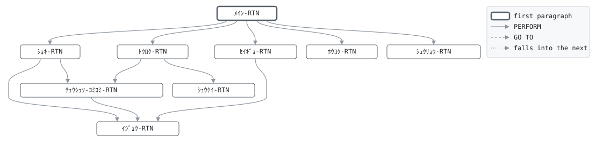

# GLO010

```text
GLO010: システム開設: 契約マスタの初期登録

システム開設時に1回だけ、コマンド行の業務日付 YYYYMMDD で
実行する。契約抽出ファイル (1行1マスタレコード) を読み、
証券番号をキーとする索引マスタに登録する。次に制御レコード
を、両暦の日付、採番カウンタ 1、登録した件数で書く。
抽出に二重にある証券番号は1件だけ登録し、数える。

復帰コード: 0 登録済、4 抽出に重複あり、
            8 日付が日付でない、16 ファイル異常。

変更履歴
日付       担当 変更
1999-11-08 MS   GL-0233 初版、PC システム移行時。
```

Program [GLO010.cbl](../../../gondwana/programs/GLO010.cbl): 4 files, 9 paragraphs. Its business rules: [5 decision tables](../rules/GLO010.md).

- AUTHOR: ゴンドワナ生命 システム部.
- DATE-WRITTEN: 1999-11-08.

## Contents

- [Files](#files)
- [Flow](#flow)
- [Paragraphs](#paragraphs)
- [Calls](#calls)
- [Data flow](#data-flow)
- [Lineage](#lineage)
  - [Into ﾁｭｳｼｭﾂ-ﾚｺｰﾄﾞ](#into-ﾁｭｳｼｭﾂ-ﾚｺｰﾄﾞ)
  - [Into PM-ｹｲﾔｸ-ﾚｺｰﾄﾞ](#into-pm-ｹｲﾔｸ-ﾚｺｰﾄﾞ)
  - [Into CT-ｾｲｷﾞｮ-ﾚｺｰﾄﾞ](#into-ct-ｾｲｷﾞｮ-ﾚｺｰﾄﾞ)
  - [Into ﾎｳｺｸ-ｷﾞｮｳ](#into-ﾎｳｺｸ-ｷﾞｮｳ)
  - [Into WS-ｺﾏﾝﾄﾞｷﾞｮｳ](#into-ws-ｺﾏﾝﾄﾞｷﾞｮｳ)
  - [Into WS-ｷﾞｮｳﾑﾋﾂﾞｹ](#into-ws-ｷﾞｮｳﾑﾋﾂﾞｹ)
  - [Into WS-ｷﾞｮｳﾑﾋﾂﾞｹ-ﾜﾚｷ](#into-ws-ｷﾞｮｳﾑﾋﾂﾞｹ-ﾜﾚｷ)
  - [Into WS-ﾎｳｺｳ](#into-ws-ﾎｳｺｳ)
  - [Into WS-ﾍﾝｶﾝｹｯｶ](#into-ws-ﾍﾝｶﾝｹｯｶ)
  - [Into WS-ｹﾝｽｳ](#into-ws-ｹﾝｽｳ)
  - [Into WS-ﾌｯｷｺｰﾄﾞ](#into-ws-ﾌｯｷｺｰﾄﾞ)
  - [Into WS-ﾎｳｺｸ](#into-ws-ﾎｳｺｸ)
  - [Out of the program](#out-of-the-program)
  - [Into other data items](#into-other-data-items)
- [Field origins](#field-origins)
  - [File POLMST-F](#file-polmst-f)
  - [File GLSCTL-F](#file-glsctl-f)
  - [File REPORT-F](#file-report-f)
- [Records](#records)
  - [ﾁｭｳｼｭﾂ-ﾚｺｰﾄﾞ](#ﾁｭｳｼｭﾂ-ﾚｺｰﾄﾞ)
  - [PM-ｹｲﾔｸ-ﾚｺｰﾄﾞ](#pm-ｹｲﾔｸ-ﾚｺｰﾄﾞ)
  - [CT-ｾｲｷﾞｮ-ﾚｺｰﾄﾞ](#ct-ｾｲｷﾞｮ-ﾚｺｰﾄﾞ)
  - [ﾎｳｺｸ-ｷﾞｮｳ](#ﾎｳｺｸ-ｷﾞｮｳ)
  - [WS-ｽﾃｰﾀｽ](#ws-ｽﾃｰﾀｽ)
  - [WS-ｺﾏﾝﾄﾞｷﾞｮｳ](#ws-ｺﾏﾝﾄﾞｷﾞｮｳ)
  - [WS-ｷﾞｮｳﾑﾋﾂﾞｹ](#ws-ｷﾞｮｳﾑﾋﾂﾞｹ)
  - [WS-ｷﾞｮｳﾑﾋﾂﾞｹ-ﾜﾚｷ](#ws-ｷﾞｮｳﾑﾋﾂﾞｹ-ﾜﾚｷ)
  - [WS-ﾎｳｺｳ](#ws-ﾎｳｺｳ)
  - [WS-ﾍﾝｶﾝｹｯｶ](#ws-ﾍﾝｶﾝｹｯｶ)
  - [WS-ｹﾝｽｳ](#ws-ｹﾝｽｳ)
  - [WS-ﾌｯｷｺｰﾄﾞ](#ws-ﾌｯｷｺｰﾄﾞ)
  - [WS-ﾎｳｺｸ](#ws-ﾎｳｺｸ)

## Files

| File | Kind | Assigned to | Organization | Status field | Opened | Records |
| --- | --- | --- | --- | --- | --- | --- |
| EXTRACT-F | FD | EXTRACT | LINE SEQUENTIAL | WS-ﾁｭｳｼｭﾂ-ST | INPUT | ﾁｭｳｼｭﾂ-ﾚｺｰﾄﾞ |
| POLMST-F | FD | POLMST | INDEXED, key PM-ｼｮｳｹﾝﾊﾞﾝｺﾞｳ, RANDOM access | WS-ｹｲﾔｸ-ST | OUTPUT | PM-ｹｲﾔｸ-ﾚｺｰﾄﾞ |
| GLSCTL-F | FD | GLSCTL | SEQUENTIAL | WS-ｾｲｷﾞｮ-ST | OUTPUT | CT-ｾｲｷﾞｮ-ﾚｺｰﾄﾞ |
| REPORT-F | FD | GLO010R | LINE SEQUENTIAL | WS-ﾎｳｺｸ-ST | OUTPUT | ﾎｳｺｸ-ｷﾞｮｳ |

## Flow



## Paragraphs

| Paragraph | Description | Source | Performs | Goes to | Performed by | Reached by |
| --- | --- | --- | --- | --- | --- | --- |
| ﾒｲﾝ-RTN | ﾒｲﾝ-RTN: 日付、登録、制御レコード、報告。 | [GLO010.cbl:97](../../../gondwana/programs/GLO010.cbl#L97) | ｼｮｷ-RTN, ﾄｳﾛｸ-RTN, ｾｲｷﾞｮ-RTN, ﾎｳｺｸ-RTN, ｼｭｳﾘｮｳ-RTN | | | |
| ｼｮｷ-RTN | ｼｮｷ-RTN: コマンド行の業務日付を両暦にし、ファイルを開く。 | [GLO010.cbl:109](../../../gondwana/programs/GLO010.cbl#L109) | ｲｼﾞｮｳ-RTN, ﾁｭｳｼｭﾂ-ﾖﾐｺﾐ-RTN | | ﾒｲﾝ-RTN | |
| ﾁｭｳｼｭﾂ-ﾖﾐｺﾐ-RTN | ﾁｭｳｼｭﾂ-ﾖﾐｺﾐ-RTN: 抽出ファイルの次の行。 | [GLO010.cbl:148](../../../gondwana/programs/GLO010.cbl#L148) | ｲｼﾞｮｳ-RTN | | ｼｮｷ-RTN, ﾄｳﾛｸ-RTN | |
| ﾄｳﾛｸ-RTN | ﾄｳﾛｸ-RTN: 契約1件をマスタに登録し、状態別に数える。 | [GLO010.cbl:163](../../../gondwana/programs/GLO010.cbl#L163) | ｼｭｳｹｲ-RTN, ﾁｭｳｼｭﾂ-ﾖﾐｺﾐ-RTN | | ﾒｲﾝ-RTN | |
| ｼｭｳｹｲ-RTN | ｼｭｳｹｲ-RTN: 契約を状態別に数える。 | [GLO010.cbl:178](../../../gondwana/programs/GLO010.cbl#L178) | | | ﾄｳﾛｸ-RTN | |
| ｾｲｷﾞｮ-RTN | ｾｲｷﾞｮ-RTN: 制御レコードを1回書く。 | [GLO010.cbl:195](../../../gondwana/programs/GLO010.cbl#L195) | ｲｼﾞｮｳ-RTN | | ﾒｲﾝ-RTN | |
| ﾎｳｺｸ-RTN | ﾎｳｺｸ-RTN: 登録結果の報告。 | [GLO010.cbl:215](../../../gondwana/programs/GLO010.cbl#L215) | | | ﾒｲﾝ-RTN | |
| ｼｭｳﾘｮｳ-RTN | ｼｭｳﾘｮｳ-RTN: ファイルを閉じ、件数を表示する。 | [GLO010.cbl:247](../../../gondwana/programs/GLO010.cbl#L247) | | | ﾒｲﾝ-RTN | |
| ｲｼﾞｮｳ-RTN | ｲｼﾞｮｳ-RTN: ファイル異常は 16 で終わる。ファイル名と状態は コマンド行域にある。 | [GLO010.cbl:256](../../../gondwana/programs/GLO010.cbl#L256) | | | ｼｮｷ-RTN, ﾁｭｳｼｭﾂ-ﾖﾐｺﾐ-RTN, ｾｲｷﾞｮ-RTN | |

## Calls

| Calls | Passing | Paragraph | Source |
| --- | --- | --- | --- |
| [GLC020](GLC020.md) | WS-ﾎｳｺｳ, WS-ｷﾞｮｳﾑﾋﾂﾞｹ, WS-ｷﾞｮｳﾑﾋﾂﾞｹ-ﾜﾚｷ, WS-ﾍﾝｶﾝｹｯｶ | ｼｮｷ-RTN | [GLO010.cbl:112](../../../gondwana/programs/GLO010.cbl#L112) |

## Data flow

| Paragraph | Reads | Writes |
| --- | --- | --- |
| ﾒｲﾝ-RTN | WS-ﾁｭｳｼｭﾂ-ST, WS-ﾌｯｷｺｰﾄﾞ | RETURN-CODE |
| ｼｮｷ-RTN | WS-ｺﾏﾝﾄﾞｷﾞｮｳ, WS-ﾎｳｺｳ, WS-ｷﾞｮｳﾑﾋﾂﾞｹ, WS-ｷﾞｮｳﾑﾋﾂﾞｹ-ﾜﾚｷ, WS-ﾍﾝｶﾝｹｯｶ, WS-ﾁｭｳｼｭﾂ-ST, WS-ｹｲﾔｸ-ST, WS-ｾｲｷﾞｮ-ST, WS-ﾎｳｺｸ-ST | WS-ｺﾏﾝﾄﾞｷﾞｮｳ, WS-ｷﾞｮｳﾑﾋﾂﾞｹ, WS-ﾎｳｺｳ, WS-ｷﾞｮｳﾑﾋﾂﾞｹ-ﾜﾚｷ, WS-ﾍﾝｶﾝｹｯｶ, RETURN-CODE, WS-ﾁｭｳｼｭﾂ-ST, WS-ｹｲﾔｸ-ST, WS-ｾｲｷﾞｮ-ST, WS-ﾎｳｺｸ-ST |
| ﾁｭｳｼｭﾂ-ﾖﾐｺﾐ-RTN | WS-ﾁｭｳｼｭﾂ-ST, WS-ﾖﾐｺﾐｹﾝｽｳ | ﾁｭｳｼｭﾂ-ﾚｺｰﾄﾞ, WS-ﾁｭｳｼｭﾂ-ST, WS-ﾖﾐｺﾐｹﾝｽｳ, WS-ｺﾏﾝﾄﾞｷﾞｮｳ |
| ﾄｳﾛｸ-RTN | ﾁｭｳｼｭﾂ-ﾚｺｰﾄﾞ, WS-ﾁｮｳﾌｸｹﾝｽｳ, WS-ﾄｳﾛｸｹﾝｽｳ | PM-ｹｲﾔｸ-ﾚｺｰﾄﾞ, WS-ｹｲﾔｸ-ST, WS-ﾁｮｳﾌｸｹﾝｽｳ, WS-ﾌｯｷｺｰﾄﾞ, WS-ﾄｳﾛｸｹﾝｽｳ |
| ｼｭｳｹｲ-RTN | PM-ｼﾞｮｳﾀｲ, WS-ﾕｳｺｳｹﾝｽｳ, PM-ﾎｹﾝｷﾝｶﾞｸ, WS-ﾕｳｺｳﾎｹﾝｷﾝｶﾞｸ, WS-ﾕｳﾖｹﾝｽｳ, WS-ｼｯｺｳｹﾝｽｳ, WS-ｼｮｳﾒﾂｹﾝｽｳ | WS-ﾕｳｺｳｹﾝｽｳ, WS-ﾕｳｺｳﾎｹﾝｷﾝｶﾞｸ, WS-ﾕｳﾖｹﾝｽｳ, WS-ｼｯｺｳｹﾝｽｳ, WS-ｼｮｳﾒﾂｹﾝｽｳ |
| ｾｲｷﾞｮ-RTN | WS-ｷﾞｮｳﾑﾋﾂﾞｹ, WS-ｷﾞｮｳﾑﾋﾂﾞｹ-ﾜﾚｷ, WS-ﾕｳｺｳｹﾝｽｳ, WS-ﾕｳﾖｹﾝｽｳ, WS-ﾄｳﾛｸｹﾝｽｳ, WS-ﾕｳｺｳﾎｹﾝｷﾝｶﾞｸ, WS-ｾｲｷﾞｮ-ST | CT-ｾｲｷﾞｮ-ﾚｺｰﾄﾞ, CT-ｷﾞｮｳﾑﾋﾂﾞｹ, CT-ｷﾞｮｳﾑﾋﾂﾞｹ-ﾜﾚｷ, CT-ｻｲｼｭｳｾｲｷｭｳﾈﾝｹﾞﾂ, CT-ｼﾞｶｲｼﾊﾗｲﾊﾞﾝｺﾞｳ, CT-ｼﾞｶｲｼﾜｹﾊﾞﾝｺﾞｳ, CT-ﾕｳｺｳｹﾝｽｳ, CT-ｿｳｹﾝｽｳ, CT-ﾕｳｺｳﾎｹﾝｷﾝｶﾞｸ, WS-ｾｲｷﾞｮ-ST, WS-ｺﾏﾝﾄﾞｷﾞｮｳ |
| ﾎｳｺｸ-RTN | WS-ｷﾞｮｳﾑﾋﾂﾞｹ-ﾜﾚｷ, WS-ﾋｮｳﾀﾞｲ-ｷﾞｮｳ, WS-ﾖﾐｺﾐｹﾝｽｳ, WS-ｹﾝｽｳ-ｷﾞｮｳ, WS-ﾄｳﾛｸｹﾝｽｳ, WS-ﾁｮｳﾌｸｹﾝｽｳ, WS-ﾕｳｺｳｹﾝｽｳ, WS-ﾕｳﾖｹﾝｽｳ, WS-ｼｯｺｳｹﾝｽｳ, WS-ｼｮｳﾒﾂｹﾝｽｳ, WS-ﾕｳｺｳﾎｹﾝｷﾝｶﾞｸ, WS-ｷﾝｶﾞｸ-ｷﾞｮｳ | WS-ﾋｮｳﾀﾞｲ-ﾋﾂﾞｹ, ﾎｳｺｸ-ｷﾞｮｳ, WS-ﾎｳｺｸ-ST, WS-ｹﾝｽｳ-ﾗﾍﾞﾙ, WS-ｹﾝｽｳ-ｱﾀｲ, WS-ｷﾝｶﾞｸ-ｱﾀｲ |
| ｼｭｳﾘｮｳ-RTN | WS-ﾄｳﾛｸｹﾝｽｳ, WS-ﾁｮｳﾌｸｹﾝｽｳ | WS-ﾁｭｳｼｭﾂ-ST, WS-ｹｲﾔｸ-ST, WS-ｾｲｷﾞｮ-ST, WS-ﾎｳｺｸ-ST |
| ｲｼﾞｮｳ-RTN | WS-ｺﾏﾝﾄﾞｷﾞｮｳ | RETURN-CODE |

## Lineage

Where each data item's values come from, grouped by the record they go into. A data item links to the record it belongs to.

### Into ﾁｭｳｼｭﾂ-ﾚｺｰﾄﾞ

Record [ﾁｭｳｼｭﾂ-ﾚｺｰﾄﾞ](#ﾁｭｳｼｭﾂ-ﾚｺｰﾄﾞ).

| Into | From | Statement | Paragraph | Source |
| --- | --- | --- | --- | --- |
| ﾁｭｳｼｭﾂ-ﾚｺｰﾄﾞ | file EXTRACT-F | READ | ﾁｭｳｼｭﾂ-ﾖﾐｺﾐ-RTN | [GLO010.cbl:149](../../../gondwana/programs/GLO010.cbl#L149) |

### Into PM-ｹｲﾔｸ-ﾚｺｰﾄﾞ

Record [PM-ｹｲﾔｸ-ﾚｺｰﾄﾞ](#pm-ｹｲﾔｸ-ﾚｺｰﾄﾞ), from copybook [POLMST](../copybooks/POLMST.md).

| Into | From | Statement | Paragraph | Source |
| --- | --- | --- | --- | --- |
| PM-ｹｲﾔｸ-ﾚｺｰﾄﾞ | [ﾁｭｳｼｭﾂ-ﾚｺｰﾄﾞ](#ﾁｭｳｼｭﾂ-ﾚｺｰﾄﾞ) | MOVE | ﾄｳﾛｸ-RTN | [GLO010.cbl:164](../../../gondwana/programs/GLO010.cbl#L164) |

### Into CT-ｾｲｷﾞｮ-ﾚｺｰﾄﾞ

Record [CT-ｾｲｷﾞｮ-ﾚｺｰﾄﾞ](#ct-ｾｲｷﾞｮ-ﾚｺｰﾄﾞ), from copybook [CTLREC](../copybooks/CTLREC.md).

| Into | From | Statement | Paragraph | Source |
| --- | --- | --- | --- | --- |
| CT-ｷﾞｮｳﾑﾋﾂﾞｹ | [WS-ｷﾞｮｳﾑﾋﾂﾞｹ](#ws-ｷﾞｮｳﾑﾋﾂﾞｹ) | MOVE | ｾｲｷﾞｮ-RTN | [GLO010.cbl:197](../../../gondwana/programs/GLO010.cbl#L197) |
| CT-ｷﾞｮｳﾑﾋﾂﾞｹ-ﾜﾚｷ | [WS-ｷﾞｮｳﾑﾋﾂﾞｹ-ﾜﾚｷ](#ws-ｷﾞｮｳﾑﾋﾂﾞｹ-ﾜﾚｷ) | MOVE | ｾｲｷﾞｮ-RTN | [GLO010.cbl:198](../../../gondwana/programs/GLO010.cbl#L198) |
| CT-ｻｲｼｭｳｾｲｷｭｳﾈﾝｹﾞﾂ | literal 0 | MOVE | ｾｲｷﾞｮ-RTN | [GLO010.cbl:199](../../../gondwana/programs/GLO010.cbl#L199) |
| CT-ｼﾞｶｲｼﾊﾗｲﾊﾞﾝｺﾞｳ | literal 1 | MOVE | ｾｲｷﾞｮ-RTN | [GLO010.cbl:200](../../../gondwana/programs/GLO010.cbl#L200) |
| CT-ｼﾞｶｲｼﾜｹﾊﾞﾝｺﾞｳ | literal 1 | MOVE | ｾｲｷﾞｮ-RTN | [GLO010.cbl:201](../../../gondwana/programs/GLO010.cbl#L201) |
| CT-ｾｲｷﾞｮ-ﾚｺｰﾄﾞ | literal SPACES | MOVE | ｾｲｷﾞｮ-RTN | [GLO010.cbl:196](../../../gondwana/programs/GLO010.cbl#L196) |
| CT-ｿｳｹﾝｽｳ | [WS-ﾄｳﾛｸｹﾝｽｳ](#ws-ｹﾝｽｳ "in WS-ｹﾝｽｳ") | MOVE | ｾｲｷﾞｮ-RTN | [GLO010.cbl:203](../../../gondwana/programs/GLO010.cbl#L203) |
| CT-ﾕｳｺｳｹﾝｽｳ | [WS-ﾕｳｺｳｹﾝｽｳ](#ws-ｹﾝｽｳ "in WS-ｹﾝｽｳ") | COMPUTE | ｾｲｷﾞｮ-RTN | [GLO010.cbl:202](../../../gondwana/programs/GLO010.cbl#L202) |
| CT-ﾕｳｺｳｹﾝｽｳ | [WS-ﾕｳﾖｹﾝｽｳ](#ws-ｹﾝｽｳ "in WS-ｹﾝｽｳ") | COMPUTE | ｾｲｷﾞｮ-RTN | [GLO010.cbl:202](../../../gondwana/programs/GLO010.cbl#L202) |
| CT-ﾕｳｺｳﾎｹﾝｷﾝｶﾞｸ | [WS-ﾕｳｺｳﾎｹﾝｷﾝｶﾞｸ](#ws-ｹﾝｽｳ "in WS-ｹﾝｽｳ") | MOVE | ｾｲｷﾞｮ-RTN | [GLO010.cbl:204](../../../gondwana/programs/GLO010.cbl#L204) |

### Into ﾎｳｺｸ-ｷﾞｮｳ

Record [ﾎｳｺｸ-ｷﾞｮｳ](#ﾎｳｺｸ-ｷﾞｮｳ).

| Into | From | Statement | Paragraph | Source |
| --- | --- | --- | --- | --- |
| ﾎｳｺｸ-ｷﾞｮｳ | [WS-ﾋｮｳﾀﾞｲ-ｷﾞｮｳ](#ws-ﾎｳｺｸ "in WS-ﾎｳｺｸ") | WRITE | ﾎｳｺｸ-RTN | [GLO010.cbl:217](../../../gondwana/programs/GLO010.cbl#L217) |
| ﾎｳｺｸ-ｷﾞｮｳ | literal SPACES | MOVE | ﾎｳｺｸ-RTN | [GLO010.cbl:218](../../../gondwana/programs/GLO010.cbl#L218) |
| ﾎｳｺｸ-ｷﾞｮｳ | [WS-ｹﾝｽｳ-ｷﾞｮｳ](#ws-ﾎｳｺｸ "in WS-ﾎｳｺｸ") | WRITE | ﾎｳｺｸ-RTN | [GLO010.cbl:222](../../../gondwana/programs/GLO010.cbl#L222) |
| ﾎｳｺｸ-ｷﾞｮｳ | [WS-ｹﾝｽｳ-ｷﾞｮｳ](#ws-ﾎｳｺｸ "in WS-ﾎｳｺｸ") | WRITE | ﾎｳｺｸ-RTN | [GLO010.cbl:225](../../../gondwana/programs/GLO010.cbl#L225) |
| ﾎｳｺｸ-ｷﾞｮｳ | [WS-ｹﾝｽｳ-ｷﾞｮｳ](#ws-ﾎｳｺｸ "in WS-ﾎｳｺｸ") | WRITE | ﾎｳｺｸ-RTN | [GLO010.cbl:228](../../../gondwana/programs/GLO010.cbl#L228) |
| ﾎｳｺｸ-ｷﾞｮｳ | [WS-ｹﾝｽｳ-ｷﾞｮｳ](#ws-ﾎｳｺｸ "in WS-ﾎｳｺｸ") | WRITE | ﾎｳｺｸ-RTN | [GLO010.cbl:231](../../../gondwana/programs/GLO010.cbl#L231) |
| ﾎｳｺｸ-ｷﾞｮｳ | [WS-ｹﾝｽｳ-ｷﾞｮｳ](#ws-ﾎｳｺｸ "in WS-ﾎｳｺｸ") | WRITE | ﾎｳｺｸ-RTN | [GLO010.cbl:234](../../../gondwana/programs/GLO010.cbl#L234) |
| ﾎｳｺｸ-ｷﾞｮｳ | [WS-ｹﾝｽｳ-ｷﾞｮｳ](#ws-ﾎｳｺｸ "in WS-ﾎｳｺｸ") | WRITE | ﾎｳｺｸ-RTN | [GLO010.cbl:237](../../../gondwana/programs/GLO010.cbl#L237) |
| ﾎｳｺｸ-ｷﾞｮｳ | [WS-ｹﾝｽｳ-ｷﾞｮｳ](#ws-ﾎｳｺｸ "in WS-ﾎｳｺｸ") | WRITE | ﾎｳｺｸ-RTN | [GLO010.cbl:240](../../../gondwana/programs/GLO010.cbl#L240) |
| ﾎｳｺｸ-ｷﾞｮｳ | [WS-ｷﾝｶﾞｸ-ｷﾞｮｳ](#ws-ﾎｳｺｸ "in WS-ﾎｳｺｸ") | WRITE | ﾎｳｺｸ-RTN | [GLO010.cbl:242](../../../gondwana/programs/GLO010.cbl#L242) |

### Into WS-ｺﾏﾝﾄﾞｷﾞｮｳ

Record [WS-ｺﾏﾝﾄﾞｷﾞｮｳ](#ws-ｺﾏﾝﾄﾞｷﾞｮｳ).

| Into | From | Statement | Paragraph | Source |
| --- | --- | --- | --- | --- |
| WS-ｺﾏﾝﾄﾞｷﾞｮｳ | COMMAND-LINE | ACCEPT | ｼｮｷ-RTN | [GLO010.cbl:110](../../../gondwana/programs/GLO010.cbl#L110) |
| WS-ｺﾏﾝﾄﾞｷﾞｮｳ | literal 'EXTRACT' | MOVE | ｼｮｷ-RTN | [GLO010.cbl:121](../../../gondwana/programs/GLO010.cbl#L121) |
| WS-ｺﾏﾝﾄﾞｷﾞｮｳ | [WS-ﾁｭｳｼｭﾂ-ST](#ws-ｽﾃｰﾀｽ "in WS-ｽﾃｰﾀｽ") | MOVE | ｼｮｷ-RTN | [GLO010.cbl:122](../../../gondwana/programs/GLO010.cbl#L122) |
| WS-ｺﾏﾝﾄﾞｷﾞｮｳ | literal 'POLMST' | MOVE | ｼｮｷ-RTN | [GLO010.cbl:127](../../../gondwana/programs/GLO010.cbl#L127) |
| WS-ｺﾏﾝﾄﾞｷﾞｮｳ | [WS-ｹｲﾔｸ-ST](#ws-ｽﾃｰﾀｽ "in WS-ｽﾃｰﾀｽ") | MOVE | ｼｮｷ-RTN | [GLO010.cbl:128](../../../gondwana/programs/GLO010.cbl#L128) |
| WS-ｺﾏﾝﾄﾞｷﾞｮｳ | literal 'GLSCTL' | MOVE | ｼｮｷ-RTN | [GLO010.cbl:133](../../../gondwana/programs/GLO010.cbl#L133) |
| WS-ｺﾏﾝﾄﾞｷﾞｮｳ | [WS-ｾｲｷﾞｮ-ST](#ws-ｽﾃｰﾀｽ "in WS-ｽﾃｰﾀｽ") | MOVE | ｼｮｷ-RTN | [GLO010.cbl:134](../../../gondwana/programs/GLO010.cbl#L134) |
| WS-ｺﾏﾝﾄﾞｷﾞｮｳ | literal 'GLO010R' | MOVE | ｼｮｷ-RTN | [GLO010.cbl:139](../../../gondwana/programs/GLO010.cbl#L139) |
| WS-ｺﾏﾝﾄﾞｷﾞｮｳ | [WS-ﾎｳｺｸ-ST](#ws-ｽﾃｰﾀｽ "in WS-ｽﾃｰﾀｽ") | MOVE | ｼｮｷ-RTN | [GLO010.cbl:140](../../../gondwana/programs/GLO010.cbl#L140) |
| WS-ｺﾏﾝﾄﾞｷﾞｮｳ | literal 'EXTRACT' | MOVE | ﾁｭｳｼｭﾂ-ﾖﾐｺﾐ-RTN | [GLO010.cbl:154](../../../gondwana/programs/GLO010.cbl#L154) |
| WS-ｺﾏﾝﾄﾞｷﾞｮｳ | [WS-ﾁｭｳｼｭﾂ-ST](#ws-ｽﾃｰﾀｽ "in WS-ｽﾃｰﾀｽ") | MOVE | ﾁｭｳｼｭﾂ-ﾖﾐｺﾐ-RTN | [GLO010.cbl:155](../../../gondwana/programs/GLO010.cbl#L155) |
| WS-ｺﾏﾝﾄﾞｷﾞｮｳ | literal 'GLSCTL' | MOVE | ｾｲｷﾞｮ-RTN | [GLO010.cbl:207](../../../gondwana/programs/GLO010.cbl#L207) |
| WS-ｺﾏﾝﾄﾞｷﾞｮｳ | [WS-ｾｲｷﾞｮ-ST](#ws-ｽﾃｰﾀｽ "in WS-ｽﾃｰﾀｽ") | MOVE | ｾｲｷﾞｮ-RTN | [GLO010.cbl:208](../../../gondwana/programs/GLO010.cbl#L208) |

### Into WS-ｷﾞｮｳﾑﾋﾂﾞｹ

Record [WS-ｷﾞｮｳﾑﾋﾂﾞｹ](#ws-ｷﾞｮｳﾑﾋﾂﾞｹ).

| Into | From | Statement | Paragraph | Source |
| --- | --- | --- | --- | --- |
| WS-ｷﾞｮｳﾑﾋﾂﾞｹ | [WS-ｺﾏﾝﾄﾞｷﾞｮｳ](#ws-ｺﾏﾝﾄﾞｷﾞｮｳ) | MOVE | ｼｮｷ-RTN | [GLO010.cbl:111](../../../gondwana/programs/GLO010.cbl#L111) |
| WS-ｷﾞｮｳﾑﾋﾂﾞｹ | call GLC020 argument 2 | CALL | ｼｮｷ-RTN | [GLO010.cbl:112](../../../gondwana/programs/GLO010.cbl#L112) |

### Into WS-ｷﾞｮｳﾑﾋﾂﾞｹ-ﾜﾚｷ

Record [WS-ｷﾞｮｳﾑﾋﾂﾞｹ-ﾜﾚｷ](#ws-ｷﾞｮｳﾑﾋﾂﾞｹ-ﾜﾚｷ).

| Into | From | Statement | Paragraph | Source |
| --- | --- | --- | --- | --- |
| WS-ｷﾞｮｳﾑﾋﾂﾞｹ-ﾜﾚｷ | call GLC020 argument 3 | CALL | ｼｮｷ-RTN | [GLO010.cbl:112](../../../gondwana/programs/GLO010.cbl#L112) |

### Into WS-ﾎｳｺｳ

Record [WS-ﾎｳｺｳ](#ws-ﾎｳｺｳ).

| Into | From | Statement | Paragraph | Source |
| --- | --- | --- | --- | --- |
| WS-ﾎｳｺｳ | call GLC020 argument 1 | CALL | ｼｮｷ-RTN | [GLO010.cbl:112](../../../gondwana/programs/GLO010.cbl#L112) |

### Into WS-ﾍﾝｶﾝｹｯｶ

Record [WS-ﾍﾝｶﾝｹｯｶ](#ws-ﾍﾝｶﾝｹｯｶ).

| Into | From | Statement | Paragraph | Source |
| --- | --- | --- | --- | --- |
| WS-ﾍﾝｶﾝｹｯｶ | call GLC020 argument 4 | CALL | ｼｮｷ-RTN | [GLO010.cbl:112](../../../gondwana/programs/GLO010.cbl#L112) |

### Into WS-ｹﾝｽｳ

Record [WS-ｹﾝｽｳ](#ws-ｹﾝｽｳ).

| Into | From | Statement | Paragraph | Source |
| --- | --- | --- | --- | --- |
| WS-ｼｮｳﾒﾂｹﾝｽｳ | literal 1 | ADD | ｼｭｳｹｲ-RTN | [GLO010.cbl:189](../../../gondwana/programs/GLO010.cbl#L189) |
| WS-ｼｯｺｳｹﾝｽｳ | literal 1 | ADD | ｼｭｳｹｲ-RTN | [GLO010.cbl:187](../../../gondwana/programs/GLO010.cbl#L187) |
| WS-ﾁｮｳﾌｸｹﾝｽｳ | literal 1 | ADD | ﾄｳﾛｸ-RTN | [GLO010.cbl:167](../../../gondwana/programs/GLO010.cbl#L167) |
| WS-ﾄｳﾛｸｹﾝｽｳ | literal 1 | ADD | ﾄｳﾛｸ-RTN | [GLO010.cbl:170](../../../gondwana/programs/GLO010.cbl#L170) |
| WS-ﾕｳｺｳｹﾝｽｳ | literal 1 | ADD | ｼｭｳｹｲ-RTN | [GLO010.cbl:181](../../../gondwana/programs/GLO010.cbl#L181) |
| WS-ﾕｳｺｳﾎｹﾝｷﾝｶﾞｸ | [PM-ﾎｹﾝｷﾝｶﾞｸ](#pm-ｹｲﾔｸ-ﾚｺｰﾄﾞ "in PM-ｹｲﾔｸ-ﾚｺｰﾄﾞ") | ADD | ｼｭｳｹｲ-RTN | [GLO010.cbl:182](../../../gondwana/programs/GLO010.cbl#L182) |
| WS-ﾕｳｺｳﾎｹﾝｷﾝｶﾞｸ | [PM-ﾎｹﾝｷﾝｶﾞｸ](#pm-ｹｲﾔｸ-ﾚｺｰﾄﾞ "in PM-ｹｲﾔｸ-ﾚｺｰﾄﾞ") | ADD | ｼｭｳｹｲ-RTN | [GLO010.cbl:185](../../../gondwana/programs/GLO010.cbl#L185) |
| WS-ﾕｳﾖｹﾝｽｳ | literal 1 | ADD | ｼｭｳｹｲ-RTN | [GLO010.cbl:184](../../../gondwana/programs/GLO010.cbl#L184) |
| WS-ﾖﾐｺﾐｹﾝｽｳ | literal 1 | ADD | ﾁｭｳｼｭﾂ-ﾖﾐｺﾐ-RTN | [GLO010.cbl:151](../../../gondwana/programs/GLO010.cbl#L151) |

### Into WS-ﾌｯｷｺｰﾄﾞ

Record [WS-ﾌｯｷｺｰﾄﾞ](#ws-ﾌｯｷｺｰﾄﾞ).

| Into | From | Statement | Paragraph | Source |
| --- | --- | --- | --- | --- |
| WS-ﾌｯｷｺｰﾄﾞ | literal 4 | MOVE | ﾄｳﾛｸ-RTN | [GLO010.cbl:168](../../../gondwana/programs/GLO010.cbl#L168) |

### Into WS-ﾎｳｺｸ

Record [WS-ﾎｳｺｸ](#ws-ﾎｳｺｸ).

| Into | From | Statement | Paragraph | Source |
| --- | --- | --- | --- | --- |
| WS-ｷﾝｶﾞｸ-ｱﾀｲ | [WS-ﾕｳｺｳﾎｹﾝｷﾝｶﾞｸ](#ws-ｹﾝｽｳ "in WS-ｹﾝｽｳ") | MOVE | ﾎｳｺｸ-RTN | [GLO010.cbl:241](../../../gondwana/programs/GLO010.cbl#L241) |
| WS-ｹﾝｽｳ-ｱﾀｲ | [WS-ﾖﾐｺﾐｹﾝｽｳ](#ws-ｹﾝｽｳ "in WS-ｹﾝｽｳ") | MOVE | ﾎｳｺｸ-RTN | [GLO010.cbl:221](../../../gondwana/programs/GLO010.cbl#L221) |
| WS-ｹﾝｽｳ-ｱﾀｲ | [WS-ﾄｳﾛｸｹﾝｽｳ](#ws-ｹﾝｽｳ "in WS-ｹﾝｽｳ") | MOVE | ﾎｳｺｸ-RTN | [GLO010.cbl:224](../../../gondwana/programs/GLO010.cbl#L224) |
| WS-ｹﾝｽｳ-ｱﾀｲ | [WS-ﾁｮｳﾌｸｹﾝｽｳ](#ws-ｹﾝｽｳ "in WS-ｹﾝｽｳ") | MOVE | ﾎｳｺｸ-RTN | [GLO010.cbl:227](../../../gondwana/programs/GLO010.cbl#L227) |
| WS-ｹﾝｽｳ-ｱﾀｲ | [WS-ﾕｳｺｳｹﾝｽｳ](#ws-ｹﾝｽｳ "in WS-ｹﾝｽｳ") | MOVE | ﾎｳｺｸ-RTN | [GLO010.cbl:230](../../../gondwana/programs/GLO010.cbl#L230) |
| WS-ｹﾝｽｳ-ｱﾀｲ | [WS-ﾕｳﾖｹﾝｽｳ](#ws-ｹﾝｽｳ "in WS-ｹﾝｽｳ") | MOVE | ﾎｳｺｸ-RTN | [GLO010.cbl:233](../../../gondwana/programs/GLO010.cbl#L233) |
| WS-ｹﾝｽｳ-ｱﾀｲ | [WS-ｼｯｺｳｹﾝｽｳ](#ws-ｹﾝｽｳ "in WS-ｹﾝｽｳ") | MOVE | ﾎｳｺｸ-RTN | [GLO010.cbl:236](../../../gondwana/programs/GLO010.cbl#L236) |
| WS-ｹﾝｽｳ-ｱﾀｲ | [WS-ｼｮｳﾒﾂｹﾝｽｳ](#ws-ｹﾝｽｳ "in WS-ｹﾝｽｳ") | MOVE | ﾎｳｺｸ-RTN | [GLO010.cbl:239](../../../gondwana/programs/GLO010.cbl#L239) |
| WS-ｹﾝｽｳ-ﾗﾍﾞﾙ | literal '抽出件数' | MOVE | ﾎｳｺｸ-RTN | [GLO010.cbl:220](../../../gondwana/programs/GLO010.cbl#L220) |
| WS-ｹﾝｽｳ-ﾗﾍﾞﾙ | literal '登録件数' | MOVE | ﾎｳｺｸ-RTN | [GLO010.cbl:223](../../../gondwana/programs/GLO010.cbl#L223) |
| WS-ｹﾝｽｳ-ﾗﾍﾞﾙ | literal '重複件数' | MOVE | ﾎｳｺｸ-RTN | [GLO010.cbl:226](../../../gondwana/programs/GLO010.cbl#L226) |
| WS-ｹﾝｽｳ-ﾗﾍﾞﾙ | literal '有効' | MOVE | ﾎｳｺｸ-RTN | [GLO010.cbl:229](../../../gondwana/programs/GLO010.cbl#L229) |
| WS-ｹﾝｽｳ-ﾗﾍﾞﾙ | literal '猶予中' | MOVE | ﾎｳｺｸ-RTN | [GLO010.cbl:232](../../../gondwana/programs/GLO010.cbl#L232) |
| WS-ｹﾝｽｳ-ﾗﾍﾞﾙ | literal '失効' | MOVE | ﾎｳｺｸ-RTN | [GLO010.cbl:235](../../../gondwana/programs/GLO010.cbl#L235) |
| WS-ｹﾝｽｳ-ﾗﾍﾞﾙ | literal '消滅' | MOVE | ﾎｳｺｸ-RTN | [GLO010.cbl:238](../../../gondwana/programs/GLO010.cbl#L238) |
| WS-ﾋｮｳﾀﾞｲ-ﾋﾂﾞｹ | [WS-ｷﾞｮｳﾑﾋﾂﾞｹ-ﾜﾚｷ](#ws-ｷﾞｮｳﾑﾋﾂﾞｹ-ﾜﾚｷ) | MOVE | ﾎｳｺｸ-RTN | [GLO010.cbl:216](../../../gondwana/programs/GLO010.cbl#L216) |

### Out of the program

Records written to files, items passed to the programs called, and items displayed to the job's output.

| Into | From | Statement | Paragraph | Source |
| --- | --- | --- | --- | --- |
| call GLC020 argument 1 | [WS-ﾎｳｺｳ](#ws-ﾎｳｺｳ) | CALL | ｼｮｷ-RTN | [GLO010.cbl:112](../../../gondwana/programs/GLO010.cbl#L112) |
| call GLC020 argument 2 | [WS-ｷﾞｮｳﾑﾋﾂﾞｹ](#ws-ｷﾞｮｳﾑﾋﾂﾞｹ) | CALL | ｼｮｷ-RTN | [GLO010.cbl:112](../../../gondwana/programs/GLO010.cbl#L112) |
| call GLC020 argument 3 | [WS-ｷﾞｮｳﾑﾋﾂﾞｹ-ﾜﾚｷ](#ws-ｷﾞｮｳﾑﾋﾂﾞｹ-ﾜﾚｷ) | CALL | ｼｮｷ-RTN | [GLO010.cbl:112](../../../gondwana/programs/GLO010.cbl#L112) |
| call GLC020 argument 4 | [WS-ﾍﾝｶﾝｹｯｶ](#ws-ﾍﾝｶﾝｹｯｶ) | CALL | ｼｮｷ-RTN | [GLO010.cbl:112](../../../gondwana/programs/GLO010.cbl#L112) |
| file GLSCTL-F | [CT-ｾｲｷﾞｮ-ﾚｺｰﾄﾞ](#ct-ｾｲｷﾞｮ-ﾚｺｰﾄﾞ) | WRITE | ｾｲｷﾞｮ-RTN | [GLO010.cbl:205](../../../gondwana/programs/GLO010.cbl#L205) |
| file POLMST-F | [PM-ｹｲﾔｸ-ﾚｺｰﾄﾞ](#pm-ｹｲﾔｸ-ﾚｺｰﾄﾞ) | WRITE | ﾄｳﾛｸ-RTN | [GLO010.cbl:165](../../../gondwana/programs/GLO010.cbl#L165) |
| file REPORT-F | [ﾎｳｺｸ-ｷﾞｮｳ](#ﾎｳｺｸ-ｷﾞｮｳ) | WRITE | ﾎｳｺｸ-RTN | [GLO010.cbl:217](../../../gondwana/programs/GLO010.cbl#L217) |
| file REPORT-F | [ﾎｳｺｸ-ｷﾞｮｳ](#ﾎｳｺｸ-ｷﾞｮｳ) | WRITE | ﾎｳｺｸ-RTN | [GLO010.cbl:219](../../../gondwana/programs/GLO010.cbl#L219) |
| file REPORT-F | [ﾎｳｺｸ-ｷﾞｮｳ](#ﾎｳｺｸ-ｷﾞｮｳ) | WRITE | ﾎｳｺｸ-RTN | [GLO010.cbl:222](../../../gondwana/programs/GLO010.cbl#L222) |
| file REPORT-F | [ﾎｳｺｸ-ｷﾞｮｳ](#ﾎｳｺｸ-ｷﾞｮｳ) | WRITE | ﾎｳｺｸ-RTN | [GLO010.cbl:225](../../../gondwana/programs/GLO010.cbl#L225) |
| file REPORT-F | [ﾎｳｺｸ-ｷﾞｮｳ](#ﾎｳｺｸ-ｷﾞｮｳ) | WRITE | ﾎｳｺｸ-RTN | [GLO010.cbl:228](../../../gondwana/programs/GLO010.cbl#L228) |
| file REPORT-F | [ﾎｳｺｸ-ｷﾞｮｳ](#ﾎｳｺｸ-ｷﾞｮｳ) | WRITE | ﾎｳｺｸ-RTN | [GLO010.cbl:231](../../../gondwana/programs/GLO010.cbl#L231) |
| file REPORT-F | [ﾎｳｺｸ-ｷﾞｮｳ](#ﾎｳｺｸ-ｷﾞｮｳ) | WRITE | ﾎｳｺｸ-RTN | [GLO010.cbl:234](../../../gondwana/programs/GLO010.cbl#L234) |
| file REPORT-F | [ﾎｳｺｸ-ｷﾞｮｳ](#ﾎｳｺｸ-ｷﾞｮｳ) | WRITE | ﾎｳｺｸ-RTN | [GLO010.cbl:237](../../../gondwana/programs/GLO010.cbl#L237) |
| file REPORT-F | [ﾎｳｺｸ-ｷﾞｮｳ](#ﾎｳｺｸ-ｷﾞｮｳ) | WRITE | ﾎｳｺｸ-RTN | [GLO010.cbl:240](../../../gondwana/programs/GLO010.cbl#L240) |
| file REPORT-F | [ﾎｳｺｸ-ｷﾞｮｳ](#ﾎｳｺｸ-ｷﾞｮｳ) | WRITE | ﾎｳｺｸ-RTN | [GLO010.cbl:242](../../../gondwana/programs/GLO010.cbl#L242) |
| SYSOUT | [WS-ｺﾏﾝﾄﾞｷﾞｮｳ](#ws-ｺﾏﾝﾄﾞｷﾞｮｳ) | DISPLAY | ｼｮｷ-RTN | [GLO010.cbl:115](../../../gondwana/programs/GLO010.cbl#L115) |
| SYSOUT | [WS-ﾄｳﾛｸｹﾝｽｳ](#ws-ｹﾝｽｳ "in WS-ｹﾝｽｳ") | DISPLAY | ｼｭｳﾘｮｳ-RTN | [GLO010.cbl:249](../../../gondwana/programs/GLO010.cbl#L249) |
| SYSOUT | [WS-ﾁｮｳﾌｸｹﾝｽｳ](#ws-ｹﾝｽｳ "in WS-ｹﾝｽｳ") | DISPLAY | ｼｭｳﾘｮｳ-RTN | [GLO010.cbl:249](../../../gondwana/programs/GLO010.cbl#L249) |
| SYSOUT | [WS-ｺﾏﾝﾄﾞｷﾞｮｳ](#ws-ｺﾏﾝﾄﾞｷﾞｮｳ) | DISPLAY | ｲｼﾞｮｳ-RTN | [GLO010.cbl:257](../../../gondwana/programs/GLO010.cbl#L257) |
| SYSOUT | [WS-ｺﾏﾝﾄﾞｷﾞｮｳ](#ws-ｺﾏﾝﾄﾞｷﾞｮｳ) | DISPLAY | ｲｼﾞｮｳ-RTN | [GLO010.cbl:257](../../../gondwana/programs/GLO010.cbl#L257) |

### Into other data items

Data items the program does not declare, such as special registers and index names.

| Into | From | Statement | Paragraph | Source |
| --- | --- | --- | --- | --- |
| RETURN-CODE | [WS-ﾌｯｷｺｰﾄﾞ](#ws-ﾌｯｷｺｰﾄﾞ) | MOVE | ﾒｲﾝ-RTN | [GLO010.cbl:103](../../../gondwana/programs/GLO010.cbl#L103) |
| RETURN-CODE | literal 8 | MOVE | ｼｮｷ-RTN | [GLO010.cbl:116](../../../gondwana/programs/GLO010.cbl#L116) |
| RETURN-CODE | literal 16 | MOVE | ｲｼﾞｮｳ-RTN | [GLO010.cbl:259](../../../gondwana/programs/GLO010.cbl#L259) |

## Field origins

Where the values of each field the program writes to a file come from: the fields of the files it reads, literals, and initial values, followed through every statement that moves a value, and through groups and redefinitions by the bytes they share.

### File POLMST-F

Written from [PM-ｹｲﾔｸ-ﾚｺｰﾄﾞ](#pm-ｹｲﾔｸ-ﾚｺｰﾄﾞ).

| Field | Position | Origins |
| --- | --: | --- |
| PM-ｼｮｳｹﾝﾊﾞﾝｺﾞｳ | 1-10 | file EXTRACT-F ﾁｭｳｼｭﾂ-ﾚｺｰﾄﾞ 1-10 |
| PM-ｼﾞｮｳﾀｲ | 11 | file EXTRACT-F ﾁｭｳｼｭﾂ-ﾚｺｰﾄﾞ 11-11 |
| PM-ｼｮｳﾋﾝ | 12-13 | file EXTRACT-F ﾁｭｳｼｭﾂ-ﾚｺｰﾄﾞ 12-13 |
| PM-ﾎｹﾝｷﾝｶﾞｸ | 14-22 | file EXTRACT-F ﾁｭｳｼｭﾂ-ﾚｺｰﾄﾞ 14-22 |
| PM-ﾎｹﾝﾘｮｳ | 23-29 | file EXTRACT-F ﾁｭｳｼｭﾂ-ﾚｺｰﾄﾞ 23-29 |
| PM-ﾊﾗｲｺﾐﾎｳﾎｳ | 30 | file EXTRACT-F ﾁｭｳｼｭﾂ-ﾚｺｰﾄﾞ 30-30 |
| PM-ｹｲﾔｸﾋﾞ | 31-37 | file EXTRACT-F ﾁｭｳｼｭﾂ-ﾚｺｰﾄﾞ 31-37 |
| PM-ﾎｹﾝｷｶﾝ | 38-39 | file EXTRACT-F ﾁｭｳｼｭﾂ-ﾚｺｰﾄﾞ 38-39 |
| PM-ﾏﾝｷﾋﾞ | 40-46 | file EXTRACT-F ﾁｭｳｼｭﾂ-ﾚｺｰﾄﾞ 40-46 |
| PM-ｹｲｶﾈﾝｽｳ | 47-48 | file EXTRACT-F ﾁｭｳｼｭﾂ-ﾚｺｰﾄﾞ 47-48 |
| PM-ﾊﾗｲｺﾐｽﾞﾐﾈﾝｹﾞﾂ | 49-54 | file EXTRACT-F ﾁｭｳｼｭﾂ-ﾚｺｰﾄﾞ 49-54 |
| PM-ﾐﾉｳｶｲｽｳ | 55-56 | file EXTRACT-F ﾁｭｳｼｭﾂ-ﾚｺｰﾄﾞ 55-56 |
| PM-ﾕｳﾖｶｲｼﾋﾞ | 57-63 | file EXTRACT-F ﾁｭｳｼｭﾂ-ﾚｺｰﾄﾞ 57-63 |
| PM-ｼｯｺｳﾋﾞ | 64-70 | file EXTRACT-F ﾁｭｳｼｭﾂ-ﾚｺｰﾄﾞ 64-70 |
| PM-ｼﾞｮｳﾀｲﾋﾂﾞｹ | 71-77 | file EXTRACT-F ﾁｭｳｼｭﾂ-ﾚｺｰﾄﾞ 71-77 |
| PM-ｼﾒｲ | 78-97 | file EXTRACT-F ﾁｭｳｼｭﾂ-ﾚｺｰﾄﾞ 78-97 |
| PM-ｼﾒｲｶﾅ | 98-117 | file EXTRACT-F ﾁｭｳｼｭﾂ-ﾚｺｰﾄﾞ 98-117 |
| PM-ｾｲﾈﾝｶﾞｯﾋﾟ | 118-124 | file EXTRACT-F ﾁｭｳｼｭﾂ-ﾚｺｰﾄﾞ 118-124 |
| PM-ｾｲﾍﾞﾂ | 125 | file EXTRACT-F ﾁｭｳｼｭﾂ-ﾚｺｰﾄﾞ 125-125 |
| PM-ｶﾆｭｳﾈﾝﾚｲ | 126-127 | file EXTRACT-F ﾁｭｳｼｭﾂ-ﾚｺｰﾄﾞ 126-127 |
| PM-ｼﾞｭｳｼｮ | 128-167 | file EXTRACT-F ﾁｭｳｼｭﾂ-ﾚｺｰﾄﾞ 128-167 |
| PM-ｳｹﾄﾘﾆﾝ | 168-187 | file EXTRACT-F ﾁｭｳｼｭﾂ-ﾚｺｰﾄﾞ 168-187 |
| PM-ｷﾞﾝｺｳｺｰﾄﾞ | 188-191 | file EXTRACT-F ﾁｭｳｼｭﾂ-ﾚｺｰﾄﾞ 188-191 |
| PM-ｼﾃﾝｺｰﾄﾞ | 192-194 | file EXTRACT-F ﾁｭｳｼｭﾂ-ﾚｺｰﾄﾞ 192-194 |
| PM-ﾖｷﾝｼｭﾓｸ | 195 | file EXTRACT-F ﾁｭｳｼｭﾂ-ﾚｺｰﾄﾞ 195-195 |
| PM-ｺｳｻﾞﾊﾞﾝｺﾞｳ | 196-202 | file EXTRACT-F ﾁｭｳｼｭﾂ-ﾚｺｰﾄﾞ 196-202 |
| PM-ｺｳｻﾞﾒｲｷﾞ | 203-232 | file EXTRACT-F ﾁｭｳｼｭﾂ-ﾚｺｰﾄﾞ 203-232 |
| PM-ﾀﾞｲﾘﾃﾝｺｰﾄﾞ | 233-238 | file EXTRACT-F ﾁｭｳｼｭﾂ-ﾚｺｰﾄﾞ 233-238 |
| PM-ｶｼﾂｹｻﾞﾝﾀﾞｶ | 239-247 | file EXTRACT-F ﾁｭｳｼｭﾂ-ﾚｺｰﾄﾞ 239-247 |
| PM-ｾｷﾆﾝｼﾞｭﾝﾋﾞｷﾝ | 248-256 | file EXTRACT-F ﾁｭｳｼｭﾂ-ﾚｺｰﾄﾞ 248-256 |
| PM-ﾊｲﾄｳﾙｲｹｲ | 257-265 | file EXTRACT-F ﾁｭｳｼｭﾂ-ﾚｺｰﾄﾞ 257-265 |
| PM-ｻｲｼｭｳﾆｭｳｷﾝﾈﾝｹﾞﾂ | 266-271 | file EXTRACT-F ﾁｭｳｼｭﾂ-ﾚｺｰﾄﾞ 266-271 |
| PM-ｻｲｼｭｳﾆｭｳｷﾝｶﾞｸ | 272-278 | file EXTRACT-F ﾁｭｳｼｭﾂ-ﾚｺｰﾄﾞ 272-278 |

### File GLSCTL-F

Written from [CT-ｾｲｷﾞｮ-ﾚｺｰﾄﾞ](#ct-ｾｲｷﾞｮ-ﾚｺｰﾄﾞ).

| Field | Position | Origins |
| --- | --: | --- |
| CT-ｷﾞｮｳﾑﾋﾂﾞｹ | 1-8 | call GLC020 argument 2 WS-ｷﾞｮｳﾑﾋﾂﾞｹ; stream COMMAND-LINE WS-ｺﾏﾝﾄﾞｷﾞｮｳ |
| CT-ｷﾞｮｳﾑﾋﾂﾞｹ-ﾜﾚｷ | 9-15 | call GLC020 argument 3 WS-ｷﾞｮｳﾑﾋﾂﾞｹ-ﾜﾚｷ; stream COMMAND-LINE WS-ｺﾏﾝﾄﾞｷﾞｮｳ |
| CT-ｻｲｼｭｳｾｲｷｭｳﾈﾝｹﾞﾂ | 17-22 | literal 0 |
| CT-ｼﾞｶｲｼﾊﾗｲﾊﾞﾝｺﾞｳ | 25-28 | literal 1 |
| CT-ｼﾞｶｲｼﾜｹﾊﾞﾝｺﾞｳ | 29-32 | literal 1 |
| CT-ﾕｳｺｳｹﾝｽｳ | 33-36 | initial value of WS-ﾕｳｺｳｹﾝｽｳ; initial value of WS-ﾕｳﾖｹﾝｽｳ; literal 1 |
| CT-ｿｳｹﾝｽｳ | 37-40 | initial value of WS-ﾄｳﾛｸｹﾝｽｳ; literal 1 |
| CT-ﾕｳｺｳﾎｹﾝｷﾝｶﾞｸ | 41-48 | file EXTRACT-F ﾁｭｳｼｭﾂ-ﾚｺｰﾄﾞ 14-22; initial value of WS-ﾕｳｺｳﾎｹﾝｷﾝｶﾞｸ |

### File REPORT-F

Written from [ﾎｳｺｸ-ｷﾞｮｳ](#ﾎｳｺｸ-ｷﾞｮｳ).

| Field | Position | Origins |
| --- | --: | --- |
| ﾎｳｺｸ-ｷﾞｮｳ | 1-80 | literal SPACES |

## Records

### ﾁｭｳｼｭﾂ-ﾚｺｰﾄﾞ

File EXTRACT-F. 300 bytes.

| Level | Field | Kind | Start | Length | Picture | Usage | Notes | Source |
| --: | --- | --- | --: | --: | --- | --- | --- | --- |
| 01 | ﾁｭｳｼｭﾂ-ﾚｺｰﾄﾞ | text | 1 | 300 | X(300) | | | [GLO010.cbl:43](../../../gondwana/programs/GLO010.cbl#L43) |

### PM-ｹｲﾔｸ-ﾚｺｰﾄﾞ

File POLMST-F. 300 bytes, layout in copybook [POLMST](../copybooks/POLMST.md).

### CT-ｾｲｷﾞｮ-ﾚｺｰﾄﾞ

File GLSCTL-F. 64 bytes, layout in copybook [CTLREC](../copybooks/CTLREC.md).

### ﾎｳｺｸ-ｷﾞｮｳ

File REPORT-F. 80 bytes.

| Level | Field | Kind | Start | Length | Picture | Usage | Notes | Source |
| --: | --- | --- | --: | --: | --- | --- | --- | --- |
| 01 | ﾎｳｺｸ-ｷﾞｮｳ | text | 1 | 80 | X(80) | | | [GLO010.cbl:50](../../../gondwana/programs/GLO010.cbl#L50) |

### WS-ｽﾃｰﾀｽ

Working storage. 8 bytes.

| Level | Field | Kind | Start | Length | Picture | Usage | Notes | Source |
| --: | --- | --- | --: | --: | --- | --- | --- | --- |
| 01 | WS-ｽﾃｰﾀｽ | group | 1 | 8 | | | | [GLO010.cbl:53](../../../gondwana/programs/GLO010.cbl#L53) |
| 05 | ├ WS-ﾁｭｳｼｭﾂ-ST | code | 1 | 2 | XX | | | [GLO010.cbl:54](../../../gondwana/programs/GLO010.cbl#L54) |
| 88 | │ ├ WS-ﾁｭｳｼｭﾂ-OK | | | | | | VALUE '00' | [GLO010.cbl:55](../../../gondwana/programs/GLO010.cbl#L55) |
| 88 | │ └ WS-ﾁｭｳｼｭﾂ-ｵﾜﾘ | | | | | | VALUE '10' | [GLO010.cbl:56](../../../gondwana/programs/GLO010.cbl#L56) |
| 05 | ├ WS-ｹｲﾔｸ-ST | code | 3 | 2 | XX | | | [GLO010.cbl:57](../../../gondwana/programs/GLO010.cbl#L57) |
| 88 | │ └ WS-ｹｲﾔｸ-OK | | | | | | VALUE '00' | [GLO010.cbl:58](../../../gondwana/programs/GLO010.cbl#L58) |
| 05 | ├ WS-ｾｲｷﾞｮ-ST | code | 5 | 2 | XX | | | [GLO010.cbl:59](../../../gondwana/programs/GLO010.cbl#L59) |
| 88 | │ └ WS-ｾｲｷﾞｮ-OK | | | | | | VALUE '00' | [GLO010.cbl:60](../../../gondwana/programs/GLO010.cbl#L60) |
| 05 | └ WS-ﾎｳｺｸ-ST | code | 7 | 2 | XX | | | [GLO010.cbl:61](../../../gondwana/programs/GLO010.cbl#L61) |
| 88 |   └ WS-ﾎｳｺｸ-OK | | | | | | VALUE '00' | [GLO010.cbl:62](../../../gondwana/programs/GLO010.cbl#L62) |

### WS-ｺﾏﾝﾄﾞｷﾞｮｳ

Working storage. 80 bytes.

| Level | Field | Kind | Start | Length | Picture | Usage | Notes | Source |
| --: | --- | --- | --: | --: | --- | --- | --- | --- |
| 01 | WS-ｺﾏﾝﾄﾞｷﾞｮｳ | text | 1 | 80 | X(80) | | | [GLO010.cbl:63](../../../gondwana/programs/GLO010.cbl#L63) |

### WS-ｷﾞｮｳﾑﾋﾂﾞｹ

Working storage. 8 bytes.

| Level | Field | Kind | Start | Length | Picture | Usage | Notes | Source |
| --: | --- | --- | --: | --: | --- | --- | --- | --- |
| 01 | WS-ｷﾞｮｳﾑﾋﾂﾞｹ | date | 1 | 8 | 9(8) | | | [GLO010.cbl:64](../../../gondwana/programs/GLO010.cbl#L64) |

### WS-ｷﾞｮｳﾑﾋﾂﾞｹ-ﾜﾚｷ

Working storage. 7 bytes.

| Level | Field | Kind | Start | Length | Picture | Usage | Notes | Source |
| --: | --- | --- | --: | --: | --- | --- | --- | --- |
| 01 | WS-ｷﾞｮｳﾑﾋﾂﾞｹ-ﾜﾚｷ | date | 1 | 7 | X(7) | | | [GLO010.cbl:65](../../../gondwana/programs/GLO010.cbl#L65) |

### WS-ﾎｳｺｳ

Working storage. 1 bytes.

| Level | Field | Kind | Start | Length | Picture | Usage | Notes | Source |
| --: | --- | --- | --: | --: | --- | --- | --- | --- |
| 01 | WS-ﾎｳｺｳ | text | 1 | 1 | X | | VALUE 'W' | [GLO010.cbl:66](../../../gondwana/programs/GLO010.cbl#L66) |

### WS-ﾍﾝｶﾝｹｯｶ

Working storage. 1 bytes.

| Level | Field | Kind | Start | Length | Picture | Usage | Notes | Source |
| --: | --- | --- | --: | --: | --- | --- | --- | --- |
| 01 | WS-ﾍﾝｶﾝｹｯｶ | number | 1 | 1 | 9 | | | [GLO010.cbl:67](../../../gondwana/programs/GLO010.cbl#L67) |

### WS-ｹﾝｽｳ

Working storage. 64 bytes.

| Level | Field | Kind | Start | Length | Picture | Usage | Notes | Source |
| --: | --- | --- | --: | --: | --- | --- | --- | --- |
| 01 | WS-ｹﾝｽｳ | group | 1 | 64 | | | | [GLO010.cbl:68](../../../gondwana/programs/GLO010.cbl#L68) |
| 05 | ├ WS-ﾖﾐｺﾐｹﾝｽｳ | number | 1 | 7 | 9(7) | | VALUE 0 | [GLO010.cbl:69](../../../gondwana/programs/GLO010.cbl#L69) |
| 05 | ├ WS-ﾄｳﾛｸｹﾝｽｳ | number | 8 | 7 | 9(7) | | VALUE 0 | [GLO010.cbl:70](../../../gondwana/programs/GLO010.cbl#L70) |
| 05 | ├ WS-ﾁｮｳﾌｸｹﾝｽｳ | number | 15 | 7 | 9(7) | | VALUE 0 | [GLO010.cbl:71](../../../gondwana/programs/GLO010.cbl#L71) |
| 05 | ├ WS-ﾕｳｺｳｹﾝｽｳ | number | 22 | 7 | 9(7) | | VALUE 0 | [GLO010.cbl:72](../../../gondwana/programs/GLO010.cbl#L72) |
| 05 | ├ WS-ﾕｳﾖｹﾝｽｳ | number | 29 | 7 | 9(7) | | VALUE 0 | [GLO010.cbl:73](../../../gondwana/programs/GLO010.cbl#L73) |
| 05 | ├ WS-ｼｯｺｳｹﾝｽｳ | number | 36 | 7 | 9(7) | | VALUE 0 | [GLO010.cbl:74](../../../gondwana/programs/GLO010.cbl#L74) |
| 05 | ├ WS-ｼｮｳﾒﾂｹﾝｽｳ | number | 43 | 7 | 9(7) | | VALUE 0 | [GLO010.cbl:75](../../../gondwana/programs/GLO010.cbl#L75) |
| 05 | └ WS-ﾕｳｺｳﾎｹﾝｷﾝｶﾞｸ | amount | 50 | 15 | 9(15) | | VALUE 0 | [GLO010.cbl:76](../../../gondwana/programs/GLO010.cbl#L76) |

### WS-ﾌｯｷｺｰﾄﾞ

Working storage. 2 bytes.

| Level | Field | Kind | Start | Length | Picture | Usage | Notes | Source |
| --: | --- | --- | --: | --: | --- | --- | --- | --- |
| 01 | WS-ﾌｯｷｺｰﾄﾞ | number | 1 | 2 | 99 | | VALUE 0 | [GLO010.cbl:77](../../../gondwana/programs/GLO010.cbl#L77) |

### WS-ﾎｳｺｸ

Working storage. 97 bytes.

| Level | Field | Kind | Start | Length | Picture | Usage | Notes | Source |
| --: | --- | --- | --: | --: | --- | --- | --- | --- |
| 01 | WS-ﾎｳｺｸ | group | 1 | 97 | | | | [GLO010.cbl:78](../../../gondwana/programs/GLO010.cbl#L78) |
| 05 | ├ WS-ﾋｮｳﾀﾞｲ-ｷﾞｮｳ | group | 1 | 39 | | | | [GLO010.cbl:79](../../../gondwana/programs/GLO010.cbl#L79) |
| 10 | │ ├ FILLER | filler | 1 | 28 | X(28) | | VALUE 'ゴンドワナ生命  システム開設' | [GLO010.cbl:80](../../../gondwana/programs/GLO010.cbl#L80) |
| 10 | │ ├ FILLER | filler | 29 | 4 | X(4) | | VALUE SPACES | [GLO010.cbl:82](../../../gondwana/programs/GLO010.cbl#L82) |
| 10 | │ └ WS-ﾋｮｳﾀﾞｲ-ﾋﾂﾞｹ | date | 33 | 7 | X(7) | | | [GLO010.cbl:83](../../../gondwana/programs/GLO010.cbl#L83) |
| 05 | ├ WS-ｹﾝｽｳ-ｷﾞｮｳ | group | 40 | 25 | | | | [GLO010.cbl:84](../../../gondwana/programs/GLO010.cbl#L84) |
| 10 | │ ├ WS-ｹﾝｽｳ-ﾗﾍﾞﾙ | text | 40 | 16 | X(16) | | | [GLO010.cbl:85](../../../gondwana/programs/GLO010.cbl#L85) |
| 10 | │ └ WS-ｹﾝｽｳ-ｱﾀｲ | edited | 56 | 9 | Z,ZZZ,ZZ9 | | | [GLO010.cbl:86](../../../gondwana/programs/GLO010.cbl#L86) |
| 05 | └ WS-ｷﾝｶﾞｸ-ｷﾞｮｳ | group | 65 | 33 | | | | [GLO010.cbl:87](../../../gondwana/programs/GLO010.cbl#L87) |
| 10 |   ├ FILLER | filler | 65 | 16 | X(16) | | VALUE '有効保険金額' | [GLO010.cbl:88](../../../gondwana/programs/GLO010.cbl#L88) |
| 10 |   ├ WS-ｷﾝｶﾞｸ-ｱﾀｲ | edited | 81 | 15 | ZZZ,ZZZ,ZZZ,ZZ9 | | | [GLO010.cbl:90](../../../gondwana/programs/GLO010.cbl#L90) |
| 10 |   └ FILLER | filler | 96 | 2 | X(2) | | VALUE '円' | [GLO010.cbl:91](../../../gondwana/programs/GLO010.cbl#L91) |
