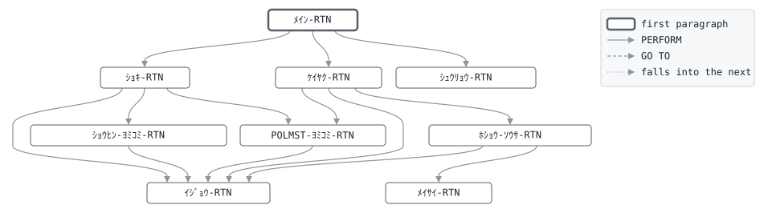

# GLY020

```text
GLY020: ご契約内容のお知らせ

年次、契約者配当 (GLY010) の後。保障中 (有効・猶予中) の契約
1件につき1頁のお知らせを、レポートライタで作る。頁の見出しに
契約者の住所と氏名、契約の内容 (証券番号、契約日、払込方法、
払込済年月、保険料、配当金累計、貸付残高、解約返戻金) を置き、
明細に有効な保障 (保障マスタ COVMST の主契約と特約) を1行
ずつ、最後に保障の保険料の合計を置く。解約返戻金は GLC030。
お知らせは印刷会社に渡す NOTICE に書く。

復帰コード: 0 作成済、8 日付が日付でない、16 ファイル異常。

変更履歴
日付       担当 変更
2026-11-19 YN   GL-0827 初版。
```

Program [GLY020.cbl](../../../gondwana/programs/GLY020.cbl): 4 files, 9 paragraphs. Its business rules: [7 decision tables](../rules/GLY020.md).

- AUTHOR: ゴンドワナ生命 システム部.
- DATE-WRITTEN: 2026-11-19.

## Contents

- [Files](#files)
- [Flow](#flow)
- [Paragraphs](#paragraphs)
- [Calls](#calls)
- [Data flow](#data-flow)
- [Lineage](#lineage)
  - [Into PM-ｹｲﾔｸ-ﾚｺｰﾄﾞ](#into-pm-ｹｲﾔｸ-ﾚｺｰﾄﾞ)
  - [Into HS-ﾎｼｮｳ-ﾚｺｰﾄﾞ](#into-hs-ﾎｼｮｳ-ﾚｺｰﾄﾞ)
  - [Into PR-ｼｮｳﾋﾝ-ﾚｺｰﾄﾞ](#into-pr-ｼｮｳﾋﾝ-ﾚｺｰﾄﾞ)
  - [Into PAGE-HEADING](#into-page-heading)
  - [Into CONTROL-HEADING-WS-ｼｮｳｹﾝﾊﾞﾝｺﾞｳ-LINE-1](#into-control-heading-ws-ｼｮｳｹﾝﾊﾞﾝｺﾞｳ-line-1)
  - [Into CONTROL-HEADING-WS-ｼｮｳｹﾝﾊﾞﾝｺﾞｳ-LINE-2](#into-control-heading-ws-ｼｮｳｹﾝﾊﾞﾝｺﾞｳ-line-2)
  - [Into CONTROL-HEADING-WS-ｼｮｳｹﾝﾊﾞﾝｺﾞｳ-LINE-3](#into-control-heading-ws-ｼｮｳｹﾝﾊﾞﾝｺﾞｳ-line-3)
  - [Into CONTROL-HEADING-WS-ｼｮｳｹﾝﾊﾞﾝｺﾞｳ-LINE-4](#into-control-heading-ws-ｼｮｳｹﾝﾊﾞﾝｺﾞｳ-line-4)
  - [Into CONTROL-HEADING-WS-ｼｮｳｹﾝﾊﾞﾝｺﾞｳ-LINE-5](#into-control-heading-ws-ｼｮｳｹﾝﾊﾞﾝｺﾞｳ-line-5)
  - [Into CONTROL-HEADING-WS-ｼｮｳｹﾝﾊﾞﾝｺﾞｳ-LINE-6](#into-control-heading-ws-ｼｮｳｹﾝﾊﾞﾝｺﾞｳ-line-6)
  - [Into NOTICE-DETAIL](#into-notice-detail)
  - [Into CONTROL-FOOTING-WS-ｼｮｳｹﾝﾊﾞﾝｺﾞｳ](#into-control-footing-ws-ｼｮｳｹﾝﾊﾞﾝｺﾞｳ)
  - [Into WS-ｽﾃｰﾀｽ](#into-ws-ｽﾃｰﾀｽ)
  - [Into WS-ｺﾏﾝﾄﾞｷﾞｮｳ](#into-ws-ｺﾏﾝﾄﾞｷﾞｮｳ)
  - [Into WS-ｴﾗｰﾌｧｲﾙ](#into-ws-ｴﾗｰﾌｧｲﾙ)
  - [Into WS-ｴﾗｰｽﾃｰﾀｽ](#into-ws-ｴﾗｰｽﾃｰﾀｽ)
  - [Into WS-ｷﾞｮｳﾑﾋﾂﾞｹ](#into-ws-ｷﾞｮｳﾑﾋﾂﾞｹ)
  - [Into WS-ｷﾞｮｳﾑﾋﾂﾞｹ-ﾜﾚｷ](#into-ws-ｷﾞｮｳﾑﾋﾂﾞｹ-ﾜﾚｷ)
  - [Into WS-ﾎｳｺｳ](#into-ws-ﾎｳｺｳ)
  - [Into WS-ﾍﾝｶﾝｹｯｶ](#into-ws-ﾍﾝｶﾝｹｯｶ)
  - [Into WS-ｼｮｳｹﾝﾊﾞﾝｺﾞｳ](#into-ws-ｼｮｳｹﾝﾊﾞﾝｺﾞｳ)
  - [Into WS-ﾊﾗｲｺﾐﾒｲ](#into-ws-ﾊﾗｲｺﾐﾒｲ)
  - [Into WS-ﾍﾝﾚｲｷﾝ](#into-ws-ﾍﾝﾚｲｷﾝ)
  - [Into WS-ｼｮｳﾋﾝﾒｲ](#into-ws-ｼｮｳﾋﾝﾒｲ)
  - [Into WS-ﾂｳﾁｹﾝｽｳ](#into-ws-ﾂｳﾁｹﾝｽｳ)
  - [Into WS-ｼｮｳﾋﾝ-TBL](#into-ws-ｼｮｳﾋﾝ-tbl)
  - [Out of the program](#out-of-the-program)
  - [Into other data items](#into-other-data-items)
- [Field origins](#field-origins)
  - [File NOTICE-F](#file-notice-f)
- [Links between records](#links-between-records)
- [Records](#records)
  - [PM-ｹｲﾔｸ-ﾚｺｰﾄﾞ](#pm-ｹｲﾔｸ-ﾚｺｰﾄﾞ)
  - [HS-ﾎｼｮｳ-ﾚｺｰﾄﾞ](#hs-ﾎｼｮｳ-ﾚｺｰﾄﾞ)
  - [PR-ｼｮｳﾋﾝ-ﾚｺｰﾄﾞ](#pr-ｼｮｳﾋﾝ-ﾚｺｰﾄﾞ)
  - [PAGE-HEADING](#page-heading)
  - [CONTROL-HEADING-WS-ｼｮｳｹﾝﾊﾞﾝｺﾞｳ-LINE-1](#control-heading-ws-ｼｮｳｹﾝﾊﾞﾝｺﾞｳ-line-1)
  - [CONTROL-HEADING-WS-ｼｮｳｹﾝﾊﾞﾝｺﾞｳ-LINE-2](#control-heading-ws-ｼｮｳｹﾝﾊﾞﾝｺﾞｳ-line-2)
  - [CONTROL-HEADING-WS-ｼｮｳｹﾝﾊﾞﾝｺﾞｳ-LINE-3](#control-heading-ws-ｼｮｳｹﾝﾊﾞﾝｺﾞｳ-line-3)
  - [CONTROL-HEADING-WS-ｼｮｳｹﾝﾊﾞﾝｺﾞｳ-LINE-4](#control-heading-ws-ｼｮｳｹﾝﾊﾞﾝｺﾞｳ-line-4)
  - [CONTROL-HEADING-WS-ｼｮｳｹﾝﾊﾞﾝｺﾞｳ-LINE-5](#control-heading-ws-ｼｮｳｹﾝﾊﾞﾝｺﾞｳ-line-5)
  - [CONTROL-HEADING-WS-ｼｮｳｹﾝﾊﾞﾝｺﾞｳ-LINE-6](#control-heading-ws-ｼｮｳｹﾝﾊﾞﾝｺﾞｳ-line-6)
  - [CONTROL-HEADING-WS-ｼｮｳｹﾝﾊﾞﾝｺﾞｳ-LINE-7](#control-heading-ws-ｼｮｳｹﾝﾊﾞﾝｺﾞｳ-line-7)
  - [NOTICE-DETAIL](#notice-detail)
  - [CONTROL-FOOTING-WS-ｼｮｳｹﾝﾊﾞﾝｺﾞｳ](#control-footing-ws-ｼｮｳｹﾝﾊﾞﾝｺﾞｳ)
  - [WS-ｽﾃｰﾀｽ](#ws-ｽﾃｰﾀｽ)
  - [WS-ｺﾏﾝﾄﾞｷﾞｮｳ](#ws-ｺﾏﾝﾄﾞｷﾞｮｳ)
  - [WS-ｴﾗｰﾌｧｲﾙ](#ws-ｴﾗｰﾌｧｲﾙ)
  - [WS-ｴﾗｰｽﾃｰﾀｽ](#ws-ｴﾗｰｽﾃｰﾀｽ)
  - [WS-ｷﾞｮｳﾑﾋﾂﾞｹ](#ws-ｷﾞｮｳﾑﾋﾂﾞｹ)
  - [WS-ｷﾞｮｳﾑﾋﾂﾞｹ-ﾜﾚｷ](#ws-ｷﾞｮｳﾑﾋﾂﾞｹ-ﾜﾚｷ)
  - [WS-ﾎｳｺｳ](#ws-ﾎｳｺｳ)
  - [WS-ﾍﾝｶﾝｹｯｶ](#ws-ﾍﾝｶﾝｹｯｶ)
  - [WS-ｼｮｳｹﾝﾊﾞﾝｺﾞｳ](#ws-ｼｮｳｹﾝﾊﾞﾝｺﾞｳ)
  - [WS-ﾊﾗｲｺﾐﾒｲ](#ws-ﾊﾗｲｺﾐﾒｲ)
  - [WS-ﾍﾝﾚｲｷﾝ](#ws-ﾍﾝﾚｲｷﾝ)
  - [WS-ｼｮｳﾋﾝﾒｲ](#ws-ｼｮｳﾋﾝﾒｲ)
  - [WS-ﾂｳﾁｹﾝｽｳ](#ws-ﾂｳﾁｹﾝｽｳ)
  - [WS-ｼｮｳﾋﾝ-TBL](#ws-ｼｮｳﾋﾝ-tbl)
  - [WS-ﾘｮｳﾘﾂ-TBL](#ws-ﾘｮｳﾘﾂ-tbl)
  - [WS-ﾈﾝﾚｲ-ｿｴｼﾞ](#ws-ﾈﾝﾚｲ-ｿｴｼﾞ)

## Files

| File | Kind | Assigned to | Organization | Status field | Opened | Records |
| --- | --- | --- | --- | --- | --- | --- |
| POLMST-F | FD | POLMST | INDEXED, key PM-ｼｮｳｹﾝﾊﾞﾝｺﾞｳ | WS-POLMST-ST | INPUT | PM-ｹｲﾔｸ-ﾚｺｰﾄﾞ |
| COVMST-F | FD | COVMST | INDEXED, key HS-ｷｰ, DYNAMIC access | WS-COVMST-ST | INPUT | HS-ﾎｼｮｳ-ﾚｺｰﾄﾞ |
| PRODTB-F | FD | PRODTB | LINE SEQUENTIAL | WS-PRODTB-ST | INPUT | PR-ｼｮｳﾋﾝ-ﾚｺｰﾄﾞ |
| NOTICE-F | FD | NOTICE | LINE SEQUENTIAL | WS-NOTICE-ST | OUTPUT | PAGE-HEADING, CONTROL-HEADING-WS-ｼｮｳｹﾝﾊﾞﾝｺﾞｳ-LINE-1, CONTROL-HEADING-WS-ｼｮｳｹﾝﾊﾞﾝｺﾞｳ-LINE-2, CONTROL-HEADING-WS-ｼｮｳｹﾝﾊﾞﾝｺﾞｳ-LINE-3, CONTROL-HEADING-WS-ｼｮｳｹﾝﾊﾞﾝｺﾞｳ-LINE-4, CONTROL-HEADING-WS-ｼｮｳｹﾝﾊﾞﾝｺﾞｳ-LINE-5, CONTROL-HEADING-WS-ｼｮｳｹﾝﾊﾞﾝｺﾞｳ-LINE-6, CONTROL-HEADING-WS-ｼｮｳｹﾝﾊﾞﾝｺﾞｳ-LINE-7, NOTICE-DETAIL, CONTROL-FOOTING-WS-ｼｮｳｹﾝﾊﾞﾝｺﾞｳ |

## Flow



## Paragraphs

| Paragraph | Description | Source | Performs | Goes to | Performed by | Reached by |
| --- | --- | --- | --- | --- | --- | --- |
| ﾒｲﾝ-RTN | ﾒｲﾝ-RTN: 準備、契約ごとのお知らせ、終了。 | [GLY020.cbl:147](../../../gondwana/programs/GLY020.cbl#L147) | ｼｮｷ-RTN, ｹｲﾔｸ-RTN, ｼｭｳﾘｮｳ-RTN | | | |
| ｼｮｷ-RTN | ｼｮｷ-RTN: 業務日付、ファイル、商品。 | [GLY020.cbl:159](../../../gondwana/programs/GLY020.cbl#L159) | ｲｼﾞｮｳ-RTN, ｼｮｳﾋﾝ-ﾖﾐｺﾐ-RTN, POLMST-ﾖﾐｺﾐ-RTN | | ﾒｲﾝ-RTN | |
| POLMST-ﾖﾐｺﾐ-RTN | POLMST-ﾖﾐｺﾐ-RTN: マスタの次の契約。 | [GLY020.cbl:197](../../../gondwana/programs/GLY020.cbl#L197) | ｲｼﾞｮｳ-RTN | | ｼｮｷ-RTN, ｹｲﾔｸ-RTN | |
| ｹｲﾔｸ-RTN | ｹｲﾔｸ-RTN: 保障中の契約の見出しの値を整え、保障をたどる。 | [GLY020.cbl:208](../../../gondwana/programs/GLY020.cbl#L208) | ｲｼﾞｮｳ-RTN, ﾎｼｮｳ-ｿｳｻ-RTN, POLMST-ﾖﾐｺﾐ-RTN | | ﾒｲﾝ-RTN | |
| ﾎｼｮｳ-ｿｳｻ-RTN | ﾎｼｮｳ-ｿｳｻ-RTN: 契約の保障を保障番号順にたどり、有効な保障を 1行ずつ出す。 | [GLY020.cbl:235](../../../gondwana/programs/GLY020.cbl#L235) | ﾒｲｻｲ-RTN, ｲｼﾞｮｳ-RTN | | ｹｲﾔｸ-RTN | |
| ﾒｲｻｲ-RTN | ﾒｲｻｲ-RTN: 保障1件の商品名を引いて明細を出す。 | [GLY020.cbl:258](../../../gondwana/programs/GLY020.cbl#L258) | | | ﾎｼｮｳ-ｿｳｻ-RTN | |
| ｼｭｳﾘｮｳ-RTN | ｼｭｳﾘｮｳ-RTN: ファイルを閉じ、件数を表示する。 | [GLY020.cbl:270](../../../gondwana/programs/GLY020.cbl#L270) | | | ﾒｲﾝ-RTN | |
| ｲｼﾞｮｳ-RTN | ｲｼﾞｮｳ-RTN: ファイル異常は 16 で終わる。 | [GLY020.cbl:277](../../../gondwana/programs/GLY020.cbl#L277) | | | ｼｮｷ-RTN, POLMST-ﾖﾐｺﾐ-RTN, ｹｲﾔｸ-RTN, ﾎｼｮｳ-ｿｳｻ-RTN, ｼｮｳﾋﾝ-ﾖﾐｺﾐ-RTN | |
| ｼｮｳﾋﾝ-ﾖﾐｺﾐ-RTN | ｼｮｳﾋﾝ-ﾖﾐｺﾐ-RTN: 商品テーブルを読み込む。 | [PRDLOD.cpy:17](../../../gondwana/copybooks/PRDLOD.cpy#L17) | ｲｼﾞｮｳ-RTN | | ｼｮｷ-RTN | |

## Calls

| Calls | Passing | Paragraph | Source |
| --- | --- | --- | --- |
| [GLC020](GLC020.md) | WS-ﾎｳｺｳ, WS-ｷﾞｮｳﾑﾋﾂﾞｹ, WS-ｷﾞｮｳﾑﾋﾂﾞｹ-ﾜﾚｷ, WS-ﾍﾝｶﾝｹｯｶ | ｼｮｷ-RTN | [GLY020.cbl:163](../../../gondwana/programs/GLY020.cbl#L163) |
| [GLC030](GLC030.md) | PM-ｼｮｳﾋﾝ, PM-ｶﾆｭｳﾈﾝﾚｲ, PM-ｹｲｶﾈﾝｽｳ, PM-ﾎｹﾝｷﾝｶﾞｸ, WS-ﾍﾝﾚｲｷﾝ, WS-CSVTB-ST | ｹｲﾔｸ-RTN | [GLY020.cbl:219](../../../gondwana/programs/GLY020.cbl#L219) |

## Data flow

| Paragraph | Reads | Writes |
| --- | --- | --- |
| ﾒｲﾝ-RTN | NOTICE-RPT, WS-POLMST-ST, WS-ｷﾞｮｳﾑﾋﾂﾞｹ-ﾜﾚｷ, PM-ｼﾞｭｳｼｮ, PM-ｼﾒｲ, PM-ｼｮｳｹﾝﾊﾞﾝｺﾞｳ, PM-ｹｲﾔｸﾋﾞ, WS-ﾊﾗｲｺﾐﾒｲ, PM-ﾊﾗｲｺﾐｽﾞﾐﾈﾝｹﾞﾂ, PM-ﾎｹﾝﾘｮｳ, PM-ﾊｲﾄｳﾙｲｹｲ, PM-ｶｼﾂｹｻﾞﾝﾀﾞｶ, WS-ﾍﾝﾚｲｷﾝ, HS-ﾎｼｮｳﾊﾞﾝｺﾞｳ, HS-ｼｮｳﾋﾝ, WS-ｼｮｳﾋﾝﾒｲ, HS-ﾎｹﾝｷﾝｶﾞｸ, HS-ﾎｹﾝﾘｮｳ, HS-ﾏﾝｷﾋﾞ | PAGE-HEADING, CONTROL-HEADING-WS-ｼｮｳｹﾝﾊﾞﾝｺﾞｳ-LINE-1, CONTROL-HEADING-WS-ｼｮｳｹﾝﾊﾞﾝｺﾞｳ-LINE-2, CONTROL-HEADING-WS-ｼｮｳｹﾝﾊﾞﾝｺﾞｳ-LINE-3, CONTROL-HEADING-WS-ｼｮｳｹﾝﾊﾞﾝｺﾞｳ-LINE-4, CONTROL-HEADING-WS-ｼｮｳｹﾝﾊﾞﾝｺﾞｳ-LINE-5, CONTROL-HEADING-WS-ｼｮｳｹﾝﾊﾞﾝｺﾞｳ-LINE-6, CONTROL-HEADING-WS-ｼｮｳｹﾝﾊﾞﾝｺﾞｳ-LINE-7, NOTICE-DETAIL, CONTROL-FOOTING-WS-ｼｮｳｹﾝﾊﾞﾝｺﾞｳ, RETURN-CODE |
| ｼｮｷ-RTN | WS-ｺﾏﾝﾄﾞｷﾞｮｳ, WS-ﾎｳｺｳ, WS-ｷﾞｮｳﾑﾋﾂﾞｹ, WS-ｷﾞｮｳﾑﾋﾂﾞｹ-ﾜﾚｷ, WS-ﾍﾝｶﾝｹｯｶ, WS-POLMST-ST, WS-COVMST-ST, WS-PRODTB-ST, WS-NOTICE-ST, WS-ｴﾗｰﾌｧｲﾙ | WS-ｺﾏﾝﾄﾞｷﾞｮｳ, WS-ｷﾞｮｳﾑﾋﾂﾞｹ, WS-ﾎｳｺｳ, WS-ｷﾞｮｳﾑﾋﾂﾞｹ-ﾜﾚｷ, WS-ﾍﾝｶﾝｹｯｶ, RETURN-CODE, WS-POLMST-ST, WS-COVMST-ST, WS-PRODTB-ST, WS-NOTICE-ST, WS-ｴﾗｰﾌｧｲﾙ, WS-ｴﾗｰｽﾃｰﾀｽ |
| POLMST-ﾖﾐｺﾐ-RTN | WS-POLMST-ST | PM-ｹｲﾔｸ-ﾚｺｰﾄﾞ, WS-POLMST-ST, WS-ｴﾗｰﾌｧｲﾙ, WS-ｴﾗｰｽﾃｰﾀｽ |
| ｹｲﾔｸ-RTN | PM-ｼﾞｮｳﾀｲ, PM-ｼｮｳｹﾝﾊﾞﾝｺﾞｳ, PM-ﾊﾗｲｺﾐﾎｳﾎｳ, PM-ｼｮｳﾋﾝ, PM-ｶﾆｭｳﾈﾝﾚｲ, PM-ｹｲｶﾈﾝｽｳ, PM-ﾎｹﾝｷﾝｶﾞｸ, WS-ﾍﾝﾚｲｷﾝ, WS-CSVTB-ST, WS-ﾂｳﾁｹﾝｽｳ | WS-ｼｮｳｹﾝﾊﾞﾝｺﾞｳ, WS-ﾊﾗｲｺﾐﾒｲ, PM-ｼｮｳﾋﾝ, PM-ｶﾆｭｳﾈﾝﾚｲ, PM-ｹｲｶﾈﾝｽｳ, PM-ﾎｹﾝｷﾝｶﾞｸ, WS-ﾍﾝﾚｲｷﾝ, WS-CSVTB-ST, WS-ｴﾗｰﾌｧｲﾙ, WS-ｴﾗｰｽﾃｰﾀｽ, WS-ﾂｳﾁｹﾝｽｳ |
| ﾎｼｮｳ-ｿｳｻ-RTN | PM-ｼｮｳｹﾝﾊﾞﾝｺﾞｳ, HS-ｷｰ, WS-COVMST-ST, HS-ｼｮｳｹﾝﾊﾞﾝｺﾞｳ, HS-ｼﾞｮｳﾀｲ | HS-ｼｮｳｹﾝﾊﾞﾝｺﾞｳ, HS-ﾎｼｮｳﾊﾞﾝｺﾞｳ, WS-COVMST-ST, HS-ﾎｼｮｳ-ﾚｺｰﾄﾞ, WS-ｴﾗｰﾌｧｲﾙ, WS-ｴﾗｰｽﾃｰﾀｽ |
| ﾒｲｻｲ-RTN | WS-ｼｮｳﾋﾝ, WS-ｼｮｳﾋﾝ-ｺｰﾄﾞ, WS-ｼｮｳﾋﾝ-IX, HS-ｼｮｳﾋﾝ, WS-ｼｮｳﾋﾝ-ﾒｲｼｮｳ, NOTICE-DETAIL, WS-ｷﾞｮｳﾑﾋﾂﾞｹ-ﾜﾚｷ, PM-ｼﾞｭｳｼｮ, PM-ｼﾒｲ, PM-ｼｮｳｹﾝﾊﾞﾝｺﾞｳ, PM-ｹｲﾔｸﾋﾞ, WS-ﾊﾗｲｺﾐﾒｲ, PM-ﾊﾗｲｺﾐｽﾞﾐﾈﾝｹﾞﾂ, PM-ﾎｹﾝﾘｮｳ, PM-ﾊｲﾄｳﾙｲｹｲ, PM-ｶｼﾂｹｻﾞﾝﾀﾞｶ, WS-ﾍﾝﾚｲｷﾝ, HS-ﾎｼｮｳﾊﾞﾝｺﾞｳ, WS-ｼｮｳﾋﾝﾒｲ, HS-ﾎｹﾝｷﾝｶﾞｸ, HS-ﾎｹﾝﾘｮｳ, HS-ﾏﾝｷﾋﾞ | WS-ｼｮｳﾋﾝﾒｲ, WS-ｼｮｳﾋﾝ-IX, PAGE-HEADING, CONTROL-HEADING-WS-ｼｮｳｹﾝﾊﾞﾝｺﾞｳ-LINE-1, CONTROL-HEADING-WS-ｼｮｳｹﾝﾊﾞﾝｺﾞｳ-LINE-2, CONTROL-HEADING-WS-ｼｮｳｹﾝﾊﾞﾝｺﾞｳ-LINE-3, CONTROL-HEADING-WS-ｼｮｳｹﾝﾊﾞﾝｺﾞｳ-LINE-4, CONTROL-HEADING-WS-ｼｮｳｹﾝﾊﾞﾝｺﾞｳ-LINE-5, CONTROL-HEADING-WS-ｼｮｳｹﾝﾊﾞﾝｺﾞｳ-LINE-6, CONTROL-HEADING-WS-ｼｮｳｹﾝﾊﾞﾝｺﾞｳ-LINE-7, NOTICE-DETAIL, CONTROL-FOOTING-WS-ｼｮｳｹﾝﾊﾞﾝｺﾞｳ |
| ｼｭｳﾘｮｳ-RTN | WS-ﾂｳﾁｹﾝｽｳ | WS-POLMST-ST, WS-COVMST-ST, WS-PRODTB-ST, WS-NOTICE-ST |
| ｲｼﾞｮｳ-RTN | WS-ｴﾗｰﾌｧｲﾙ, WS-ｴﾗｰｽﾃｰﾀｽ | RETURN-CODE |
| ｼｮｳﾋﾝ-ﾖﾐｺﾐ-RTN | WS-PRODTB-ST, WS-ｼｮｳﾋﾝｹﾝｽｳ, PR-ｺｰﾄﾞ, WS-ｼｮｳﾋﾝ-IX, PR-ﾒｲｼｮｳ, PR-ｼｭﾙｲ, PR-ｻｲﾃｲﾈﾝﾚｲ, PR-ｻｲｺｳﾈﾝﾚｲ, PR-ﾎｹﾝｷｶﾝ, PR-ｻｲﾃｲﾎｹﾝｷﾝｶﾞｸ, PR-ｻｲｺｳﾎｹﾝｷﾝｶﾞｸ, PR-ﾆｭｳｲﾝﾆﾁｶﾞｸﾘﾂ, PR-ﾒﾝｾｷﾆｯｽｳ, PR-ﾊｲﾄｳﾘﾂ, PR-ｸﾌﾞﾝ | PR-ｼｮｳﾋﾝ-ﾚｺｰﾄﾞ, WS-PRODTB-ST, WS-ｼｮｳﾋﾝｹﾝｽｳ, WS-ｼｮｳﾋﾝ-IX, WS-ｼｮｳﾋﾝ-ｺｰﾄﾞ, WS-ｼｮｳﾋﾝ-ﾒｲｼｮｳ, WS-ｼｮｳﾋﾝ-ｼｭﾙｲ, WS-ｼｮｳﾋﾝ-ｻｲﾃｲﾈﾝﾚｲ, WS-ｼｮｳﾋﾝ-ｻｲｺｳﾈﾝﾚｲ, WS-ｼｮｳﾋﾝ-ﾎｹﾝｷｶﾝ, WS-ｼｮｳﾋﾝ-ｻｲﾃｲｷﾝｶﾞｸ, WS-ｼｮｳﾋﾝ-ｻｲｺｳｷﾝｶﾞｸ, WS-ｼｮｳﾋﾝ-ﾆｭｳｲﾝﾆﾁｶﾞｸﾘﾂ, WS-ｼｮｳﾋﾝ-ﾒﾝｾｷﾆｯｽｳ, WS-ｼｮｳﾋﾝ-ﾊｲﾄｳﾘﾂ, WS-ｼｮｳﾋﾝ-ｸﾌﾞﾝ, WS-ｴﾗｰﾌｧｲﾙ, WS-ｴﾗｰｽﾃｰﾀｽ |

## Lineage

Where each data item's values come from, grouped by the record they go into. A data item links to the record it belongs to.

### Into PM-ｹｲﾔｸ-ﾚｺｰﾄﾞ

Record [PM-ｹｲﾔｸ-ﾚｺｰﾄﾞ](#pm-ｹｲﾔｸ-ﾚｺｰﾄﾞ), from copybook [POLMST](../copybooks/POLMST.md).

| Into | From | Statement | Paragraph | Source |
| --- | --- | --- | --- | --- |
| PM-ｶﾆｭｳﾈﾝﾚｲ | call GLC030 argument 2 | CALL | ｹｲﾔｸ-RTN | [GLY020.cbl:219](../../../gondwana/programs/GLY020.cbl#L219) |
| PM-ｹｲｶﾈﾝｽｳ | call GLC030 argument 3 | CALL | ｹｲﾔｸ-RTN | [GLY020.cbl:219](../../../gondwana/programs/GLY020.cbl#L219) |
| PM-ｹｲﾔｸ-ﾚｺｰﾄﾞ | file POLMST-F | READ | POLMST-ﾖﾐｺﾐ-RTN | [GLY020.cbl:198](../../../gondwana/programs/GLY020.cbl#L198) |
| PM-ｼｮｳﾋﾝ | call GLC030 argument 1 | CALL | ｹｲﾔｸ-RTN | [GLY020.cbl:219](../../../gondwana/programs/GLY020.cbl#L219) |
| PM-ﾎｹﾝｷﾝｶﾞｸ | call GLC030 argument 4 | CALL | ｹｲﾔｸ-RTN | [GLY020.cbl:219](../../../gondwana/programs/GLY020.cbl#L219) |

### Into HS-ﾎｼｮｳ-ﾚｺｰﾄﾞ

Record [HS-ﾎｼｮｳ-ﾚｺｰﾄﾞ](#hs-ﾎｼｮｳ-ﾚｺｰﾄﾞ), from copybook [COVMST](../copybooks/COVMST.md).

| Into | From | Statement | Paragraph | Source |
| --- | --- | --- | --- | --- |
| HS-ｼｮｳｹﾝﾊﾞﾝｺﾞｳ | [PM-ｼｮｳｹﾝﾊﾞﾝｺﾞｳ](#pm-ｹｲﾔｸ-ﾚｺｰﾄﾞ "in PM-ｹｲﾔｸ-ﾚｺｰﾄﾞ") | MOVE | ﾎｼｮｳ-ｿｳｻ-RTN | [GLY020.cbl:236](../../../gondwana/programs/GLY020.cbl#L236) |
| HS-ﾎｼｮｳ-ﾚｺｰﾄﾞ | file COVMST-F | READ | ﾎｼｮｳ-ｿｳｻ-RTN | [GLY020.cbl:240](../../../gondwana/programs/GLY020.cbl#L240) |
| HS-ﾎｼｮｳ-ﾚｺｰﾄﾞ | file COVMST-F | READ | ﾎｼｮｳ-ｿｳｻ-RTN | [GLY020.cbl:247](../../../gondwana/programs/GLY020.cbl#L247) |
| HS-ﾎｼｮｳﾊﾞﾝｺﾞｳ | literal 0 | MOVE | ﾎｼｮｳ-ｿｳｻ-RTN | [GLY020.cbl:237](../../../gondwana/programs/GLY020.cbl#L237) |

### Into PR-ｼｮｳﾋﾝ-ﾚｺｰﾄﾞ

Record [PR-ｼｮｳﾋﾝ-ﾚｺｰﾄﾞ](#pr-ｼｮｳﾋﾝ-ﾚｺｰﾄﾞ), from copybook [PRODTB](../copybooks/PRODTB.md).

| Into | From | Statement | Paragraph | Source |
| --- | --- | --- | --- | --- |
| PR-ｼｮｳﾋﾝ-ﾚｺｰﾄﾞ | file PRODTB-F | READ | ｼｮｳﾋﾝ-ﾖﾐｺﾐ-RTN | [PRDLOD.cpy:18](../../../gondwana/copybooks/PRDLOD.cpy#L18) |
| PR-ｼｮｳﾋﾝ-ﾚｺｰﾄﾞ | file PRODTB-F | READ | ｼｮｳﾋﾝ-ﾖﾐｺﾐ-RTN | [PRDLOD.cpy:37](../../../gondwana/copybooks/PRDLOD.cpy#L37) |

### Into PAGE-HEADING

Record [PAGE-HEADING](#page-heading).

| Into | From | Statement | Paragraph | Source |
| --- | --- | --- | --- | --- |
| PAGE-HEADING-COL-40 | [WS-ｷﾞｮｳﾑﾋﾂﾞｹ-ﾜﾚｷ](#ws-ｷﾞｮｳﾑﾋﾂﾞｹ-ﾜﾚｷ) | TERMINATE | ﾒｲﾝ-RTN | [GLY020.cbl:151](../../../gondwana/programs/GLY020.cbl#L151) |
| PAGE-HEADING-COL-40 | [WS-ｷﾞｮｳﾑﾋﾂﾞｹ-ﾜﾚｷ](#ws-ｷﾞｮｳﾑﾋﾂﾞｹ-ﾜﾚｷ) | GENERATE | ﾒｲｻｲ-RTN | [GLY020.cbl:265](../../../gondwana/programs/GLY020.cbl#L265) |

### Into CONTROL-HEADING-WS-ｼｮｳｹﾝﾊﾞﾝｺﾞｳ-LINE-1

Record [CONTROL-HEADING-WS-ｼｮｳｹﾝﾊﾞﾝｺﾞｳ-LINE-1](#control-heading-ws-ｼｮｳｹﾝﾊﾞﾝｺﾞｳ-line-1).

| Into | From | Statement | Paragraph | Source |
| --- | --- | --- | --- | --- |
| CONTROL-HEADING-WS-ｼｮｳｹﾝﾊﾞﾝｺﾞｳ-LINE-1-COL-1 | [PM-ｼﾞｭｳｼｮ](#pm-ｹｲﾔｸ-ﾚｺｰﾄﾞ "in PM-ｹｲﾔｸ-ﾚｺｰﾄﾞ") | TERMINATE | ﾒｲﾝ-RTN | [GLY020.cbl:151](../../../gondwana/programs/GLY020.cbl#L151) |
| CONTROL-HEADING-WS-ｼｮｳｹﾝﾊﾞﾝｺﾞｳ-LINE-1-COL-1 | [PM-ｼﾞｭｳｼｮ](#pm-ｹｲﾔｸ-ﾚｺｰﾄﾞ "in PM-ｹｲﾔｸ-ﾚｺｰﾄﾞ") | GENERATE | ﾒｲｻｲ-RTN | [GLY020.cbl:265](../../../gondwana/programs/GLY020.cbl#L265) |

### Into CONTROL-HEADING-WS-ｼｮｳｹﾝﾊﾞﾝｺﾞｳ-LINE-2

Record [CONTROL-HEADING-WS-ｼｮｳｹﾝﾊﾞﾝｺﾞｳ-LINE-2](#control-heading-ws-ｼｮｳｹﾝﾊﾞﾝｺﾞｳ-line-2).

| Into | From | Statement | Paragraph | Source |
| --- | --- | --- | --- | --- |
| CONTROL-HEADING-WS-ｼｮｳｹﾝﾊﾞﾝｺﾞｳ-LINE-2-COL-1 | [PM-ｼﾒｲ](#pm-ｹｲﾔｸ-ﾚｺｰﾄﾞ "in PM-ｹｲﾔｸ-ﾚｺｰﾄﾞ") | TERMINATE | ﾒｲﾝ-RTN | [GLY020.cbl:151](../../../gondwana/programs/GLY020.cbl#L151) |
| CONTROL-HEADING-WS-ｼｮｳｹﾝﾊﾞﾝｺﾞｳ-LINE-2-COL-1 | [PM-ｼﾒｲ](#pm-ｹｲﾔｸ-ﾚｺｰﾄﾞ "in PM-ｹｲﾔｸ-ﾚｺｰﾄﾞ") | GENERATE | ﾒｲｻｲ-RTN | [GLY020.cbl:265](../../../gondwana/programs/GLY020.cbl#L265) |

### Into CONTROL-HEADING-WS-ｼｮｳｹﾝﾊﾞﾝｺﾞｳ-LINE-3

Record [CONTROL-HEADING-WS-ｼｮｳｹﾝﾊﾞﾝｺﾞｳ-LINE-3](#control-heading-ws-ｼｮｳｹﾝﾊﾞﾝｺﾞｳ-line-3).

| Into | From | Statement | Paragraph | Source |
| --- | --- | --- | --- | --- |
| CONTROL-HEADING-WS-ｼｮｳｹﾝﾊﾞﾝｺﾞｳ-LINE-3-COL-12 | [PM-ｼｮｳｹﾝﾊﾞﾝｺﾞｳ](#pm-ｹｲﾔｸ-ﾚｺｰﾄﾞ "in PM-ｹｲﾔｸ-ﾚｺｰﾄﾞ") | TERMINATE | ﾒｲﾝ-RTN | [GLY020.cbl:151](../../../gondwana/programs/GLY020.cbl#L151) |
| CONTROL-HEADING-WS-ｼｮｳｹﾝﾊﾞﾝｺﾞｳ-LINE-3-COL-12 | [PM-ｼｮｳｹﾝﾊﾞﾝｺﾞｳ](#pm-ｹｲﾔｸ-ﾚｺｰﾄﾞ "in PM-ｹｲﾔｸ-ﾚｺｰﾄﾞ") | GENERATE | ﾒｲｻｲ-RTN | [GLY020.cbl:265](../../../gondwana/programs/GLY020.cbl#L265) |
| CONTROL-HEADING-WS-ｼｮｳｹﾝﾊﾞﾝｺﾞｳ-LINE-3-COL-36 | [PM-ｹｲﾔｸﾋﾞ](#pm-ｹｲﾔｸ-ﾚｺｰﾄﾞ "in PM-ｹｲﾔｸ-ﾚｺｰﾄﾞ") | TERMINATE | ﾒｲﾝ-RTN | [GLY020.cbl:151](../../../gondwana/programs/GLY020.cbl#L151) |
| CONTROL-HEADING-WS-ｼｮｳｹﾝﾊﾞﾝｺﾞｳ-LINE-3-COL-36 | [PM-ｹｲﾔｸﾋﾞ](#pm-ｹｲﾔｸ-ﾚｺｰﾄﾞ "in PM-ｹｲﾔｸ-ﾚｺｰﾄﾞ") | GENERATE | ﾒｲｻｲ-RTN | [GLY020.cbl:265](../../../gondwana/programs/GLY020.cbl#L265) |
| CONTROL-HEADING-WS-ｼｮｳｹﾝﾊﾞﾝｺﾞｳ-LINE-3-COL-56 | [WS-ﾊﾗｲｺﾐﾒｲ](#ws-ﾊﾗｲｺﾐﾒｲ) | TERMINATE | ﾒｲﾝ-RTN | [GLY020.cbl:151](../../../gondwana/programs/GLY020.cbl#L151) |
| CONTROL-HEADING-WS-ｼｮｳｹﾝﾊﾞﾝｺﾞｳ-LINE-3-COL-56 | [WS-ﾊﾗｲｺﾐﾒｲ](#ws-ﾊﾗｲｺﾐﾒｲ) | GENERATE | ﾒｲｻｲ-RTN | [GLY020.cbl:265](../../../gondwana/programs/GLY020.cbl#L265) |

### Into CONTROL-HEADING-WS-ｼｮｳｹﾝﾊﾞﾝｺﾞｳ-LINE-4

Record [CONTROL-HEADING-WS-ｼｮｳｹﾝﾊﾞﾝｺﾞｳ-LINE-4](#control-heading-ws-ｼｮｳｹﾝﾊﾞﾝｺﾞｳ-line-4).

| Into | From | Statement | Paragraph | Source |
| --- | --- | --- | --- | --- |
| CONTROL-HEADING-WS-ｼｮｳｹﾝﾊﾞﾝｺﾞｳ-LINE-4-COL-12 | [PM-ﾊﾗｲｺﾐｽﾞﾐﾈﾝｹﾞﾂ](#pm-ｹｲﾔｸ-ﾚｺｰﾄﾞ "in PM-ｹｲﾔｸ-ﾚｺｰﾄﾞ") | TERMINATE | ﾒｲﾝ-RTN | [GLY020.cbl:151](../../../gondwana/programs/GLY020.cbl#L151) |
| CONTROL-HEADING-WS-ｼｮｳｹﾝﾊﾞﾝｺﾞｳ-LINE-4-COL-12 | [PM-ﾊﾗｲｺﾐｽﾞﾐﾈﾝｹﾞﾂ](#pm-ｹｲﾔｸ-ﾚｺｰﾄﾞ "in PM-ｹｲﾔｸ-ﾚｺｰﾄﾞ") | GENERATE | ﾒｲｻｲ-RTN | [GLY020.cbl:265](../../../gondwana/programs/GLY020.cbl#L265) |
| CONTROL-HEADING-WS-ｼｮｳｹﾝﾊﾞﾝｺﾞｳ-LINE-4-COL-34 | [PM-ﾎｹﾝﾘｮｳ](#pm-ｹｲﾔｸ-ﾚｺｰﾄﾞ "in PM-ｹｲﾔｸ-ﾚｺｰﾄﾞ") | TERMINATE | ﾒｲﾝ-RTN | [GLY020.cbl:151](../../../gondwana/programs/GLY020.cbl#L151) |
| CONTROL-HEADING-WS-ｼｮｳｹﾝﾊﾞﾝｺﾞｳ-LINE-4-COL-34 | [PM-ﾎｹﾝﾘｮｳ](#pm-ｹｲﾔｸ-ﾚｺｰﾄﾞ "in PM-ｹｲﾔｸ-ﾚｺｰﾄﾞ") | GENERATE | ﾒｲｻｲ-RTN | [GLY020.cbl:265](../../../gondwana/programs/GLY020.cbl#L265) |

### Into CONTROL-HEADING-WS-ｼｮｳｹﾝﾊﾞﾝｺﾞｳ-LINE-5

Record [CONTROL-HEADING-WS-ｼｮｳｹﾝﾊﾞﾝｺﾞｳ-LINE-5](#control-heading-ws-ｼｮｳｹﾝﾊﾞﾝｺﾞｳ-line-5).

| Into | From | Statement | Paragraph | Source |
| --- | --- | --- | --- | --- |
| CONTROL-HEADING-WS-ｼｮｳｹﾝﾊﾞﾝｺﾞｳ-LINE-5-COL-12 | [PM-ﾊｲﾄｳﾙｲｹｲ](#pm-ｹｲﾔｸ-ﾚｺｰﾄﾞ "in PM-ｹｲﾔｸ-ﾚｺｰﾄﾞ") | TERMINATE | ﾒｲﾝ-RTN | [GLY020.cbl:151](../../../gondwana/programs/GLY020.cbl#L151) |
| CONTROL-HEADING-WS-ｼｮｳｹﾝﾊﾞﾝｺﾞｳ-LINE-5-COL-12 | [PM-ﾊｲﾄｳﾙｲｹｲ](#pm-ｹｲﾔｸ-ﾚｺｰﾄﾞ "in PM-ｹｲﾔｸ-ﾚｺｰﾄﾞ") | GENERATE | ﾒｲｻｲ-RTN | [GLY020.cbl:265](../../../gondwana/programs/GLY020.cbl#L265) |
| CONTROL-HEADING-WS-ｼｮｳｹﾝﾊﾞﾝｺﾞｳ-LINE-5-COL-36 | [PM-ｶｼﾂｹｻﾞﾝﾀﾞｶ](#pm-ｹｲﾔｸ-ﾚｺｰﾄﾞ "in PM-ｹｲﾔｸ-ﾚｺｰﾄﾞ") | TERMINATE | ﾒｲﾝ-RTN | [GLY020.cbl:151](../../../gondwana/programs/GLY020.cbl#L151) |
| CONTROL-HEADING-WS-ｼｮｳｹﾝﾊﾞﾝｺﾞｳ-LINE-5-COL-36 | [PM-ｶｼﾂｹｻﾞﾝﾀﾞｶ](#pm-ｹｲﾔｸ-ﾚｺｰﾄﾞ "in PM-ｹｲﾔｸ-ﾚｺｰﾄﾞ") | GENERATE | ﾒｲｻｲ-RTN | [GLY020.cbl:265](../../../gondwana/programs/GLY020.cbl#L265) |

### Into CONTROL-HEADING-WS-ｼｮｳｹﾝﾊﾞﾝｺﾞｳ-LINE-6

Record [CONTROL-HEADING-WS-ｼｮｳｹﾝﾊﾞﾝｺﾞｳ-LINE-6](#control-heading-ws-ｼｮｳｹﾝﾊﾞﾝｺﾞｳ-line-6).

| Into | From | Statement | Paragraph | Source |
| --- | --- | --- | --- | --- |
| CONTROL-HEADING-WS-ｼｮｳｹﾝﾊﾞﾝｺﾞｳ-LINE-6-COL-12 | [WS-ﾍﾝﾚｲｷﾝ](#ws-ﾍﾝﾚｲｷﾝ) | TERMINATE | ﾒｲﾝ-RTN | [GLY020.cbl:151](../../../gondwana/programs/GLY020.cbl#L151) |
| CONTROL-HEADING-WS-ｼｮｳｹﾝﾊﾞﾝｺﾞｳ-LINE-6-COL-12 | [WS-ﾍﾝﾚｲｷﾝ](#ws-ﾍﾝﾚｲｷﾝ) | GENERATE | ﾒｲｻｲ-RTN | [GLY020.cbl:265](../../../gondwana/programs/GLY020.cbl#L265) |

### Into NOTICE-DETAIL

Record [NOTICE-DETAIL](#notice-detail).

| Into | From | Statement | Paragraph | Source |
| --- | --- | --- | --- | --- |
| NOTICE-DETAIL-COL-2 | [HS-ﾎｼｮｳﾊﾞﾝｺﾞｳ](#hs-ﾎｼｮｳ-ﾚｺｰﾄﾞ "in HS-ﾎｼｮｳ-ﾚｺｰﾄﾞ") | TERMINATE | ﾒｲﾝ-RTN | [GLY020.cbl:151](../../../gondwana/programs/GLY020.cbl#L151) |
| NOTICE-DETAIL-COL-2 | [HS-ﾎｼｮｳﾊﾞﾝｺﾞｳ](#hs-ﾎｼｮｳ-ﾚｺｰﾄﾞ "in HS-ﾎｼｮｳ-ﾚｺｰﾄﾞ") | GENERATE | ﾒｲｻｲ-RTN | [GLY020.cbl:265](../../../gondwana/programs/GLY020.cbl#L265) |
| NOTICE-DETAIL-COL-30 | [HS-ﾎｹﾝｷﾝｶﾞｸ](#hs-ﾎｼｮｳ-ﾚｺｰﾄﾞ "in HS-ﾎｼｮｳ-ﾚｺｰﾄﾞ") | TERMINATE | ﾒｲﾝ-RTN | [GLY020.cbl:151](../../../gondwana/programs/GLY020.cbl#L151) |
| NOTICE-DETAIL-COL-30 | [HS-ﾎｹﾝｷﾝｶﾞｸ](#hs-ﾎｼｮｳ-ﾚｺｰﾄﾞ "in HS-ﾎｼｮｳ-ﾚｺｰﾄﾞ") | GENERATE | ﾒｲｻｲ-RTN | [GLY020.cbl:265](../../../gondwana/programs/GLY020.cbl#L265) |
| NOTICE-DETAIL-COL-44 | [HS-ﾎｹﾝﾘｮｳ](#hs-ﾎｼｮｳ-ﾚｺｰﾄﾞ "in HS-ﾎｼｮｳ-ﾚｺｰﾄﾞ") | TERMINATE | ﾒｲﾝ-RTN | [GLY020.cbl:151](../../../gondwana/programs/GLY020.cbl#L151) |
| NOTICE-DETAIL-COL-44 | [HS-ﾎｹﾝﾘｮｳ](#hs-ﾎｼｮｳ-ﾚｺｰﾄﾞ "in HS-ﾎｼｮｳ-ﾚｺｰﾄﾞ") | GENERATE | ﾒｲｻｲ-RTN | [GLY020.cbl:265](../../../gondwana/programs/GLY020.cbl#L265) |
| NOTICE-DETAIL-COL-56 | [HS-ﾏﾝｷﾋﾞ](#hs-ﾎｼｮｳ-ﾚｺｰﾄﾞ "in HS-ﾎｼｮｳ-ﾚｺｰﾄﾞ") | TERMINATE | ﾒｲﾝ-RTN | [GLY020.cbl:151](../../../gondwana/programs/GLY020.cbl#L151) |
| NOTICE-DETAIL-COL-56 | [HS-ﾏﾝｷﾋﾞ](#hs-ﾎｼｮｳ-ﾚｺｰﾄﾞ "in HS-ﾎｼｮｳ-ﾚｺｰﾄﾞ") | GENERATE | ﾒｲｻｲ-RTN | [GLY020.cbl:265](../../../gondwana/programs/GLY020.cbl#L265) |
| NOTICE-DETAIL-COL-6 | [HS-ｼｮｳﾋﾝ](#hs-ﾎｼｮｳ-ﾚｺｰﾄﾞ "in HS-ﾎｼｮｳ-ﾚｺｰﾄﾞ") | TERMINATE | ﾒｲﾝ-RTN | [GLY020.cbl:151](../../../gondwana/programs/GLY020.cbl#L151) |
| NOTICE-DETAIL-COL-6 | [HS-ｼｮｳﾋﾝ](#hs-ﾎｼｮｳ-ﾚｺｰﾄﾞ "in HS-ﾎｼｮｳ-ﾚｺｰﾄﾞ") | GENERATE | ﾒｲｻｲ-RTN | [GLY020.cbl:265](../../../gondwana/programs/GLY020.cbl#L265) |
| NOTICE-DETAIL-COL-9 | [WS-ｼｮｳﾋﾝﾒｲ](#ws-ｼｮｳﾋﾝﾒｲ) | TERMINATE | ﾒｲﾝ-RTN | [GLY020.cbl:151](../../../gondwana/programs/GLY020.cbl#L151) |
| NOTICE-DETAIL-COL-9 | [WS-ｼｮｳﾋﾝﾒｲ](#ws-ｼｮｳﾋﾝﾒｲ) | GENERATE | ﾒｲｻｲ-RTN | [GLY020.cbl:265](../../../gondwana/programs/GLY020.cbl#L265) |

### Into CONTROL-FOOTING-WS-ｼｮｳｹﾝﾊﾞﾝｺﾞｳ

Record [CONTROL-FOOTING-WS-ｼｮｳｹﾝﾊﾞﾝｺﾞｳ](#control-footing-ws-ｼｮｳｹﾝﾊﾞﾝｺﾞｳ).

| Into | From | Statement | Paragraph | Source |
| --- | --- | --- | --- | --- |
| CONTROL-FOOTING-WS-ｼｮｳｹﾝﾊﾞﾝｺﾞｳ-COL-42 | [HS-ﾎｹﾝﾘｮｳ](#hs-ﾎｼｮｳ-ﾚｺｰﾄﾞ "in HS-ﾎｼｮｳ-ﾚｺｰﾄﾞ") | TERMINATE | ﾒｲﾝ-RTN | [GLY020.cbl:151](../../../gondwana/programs/GLY020.cbl#L151) |
| CONTROL-FOOTING-WS-ｼｮｳｹﾝﾊﾞﾝｺﾞｳ-COL-42 | [HS-ﾎｹﾝﾘｮｳ](#hs-ﾎｼｮｳ-ﾚｺｰﾄﾞ "in HS-ﾎｼｮｳ-ﾚｺｰﾄﾞ") | GENERATE | ﾒｲｻｲ-RTN | [GLY020.cbl:265](../../../gondwana/programs/GLY020.cbl#L265) |

### Into WS-ｽﾃｰﾀｽ

Record [WS-ｽﾃｰﾀｽ](#ws-ｽﾃｰﾀｽ).

| Into | From | Statement | Paragraph | Source |
| --- | --- | --- | --- | --- |
| WS-CSVTB-ST | call GLC030 argument 6 | CALL | ｹｲﾔｸ-RTN | [GLY020.cbl:219](../../../gondwana/programs/GLY020.cbl#L219) |

### Into WS-ｺﾏﾝﾄﾞｷﾞｮｳ

Record [WS-ｺﾏﾝﾄﾞｷﾞｮｳ](#ws-ｺﾏﾝﾄﾞｷﾞｮｳ).

| Into | From | Statement | Paragraph | Source |
| --- | --- | --- | --- | --- |
| WS-ｺﾏﾝﾄﾞｷﾞｮｳ | COMMAND-LINE | ACCEPT | ｼｮｷ-RTN | [GLY020.cbl:160](../../../gondwana/programs/GLY020.cbl#L160) |

### Into WS-ｴﾗｰﾌｧｲﾙ

Record [WS-ｴﾗｰﾌｧｲﾙ](#ws-ｴﾗｰﾌｧｲﾙ).

| Into | From | Statement | Paragraph | Source |
| --- | --- | --- | --- | --- |
| WS-ｴﾗｰﾌｧｲﾙ | literal 'POLMST' | MOVE | ｼｮｷ-RTN | [GLY020.cbl:174](../../../gondwana/programs/GLY020.cbl#L174) |
| WS-ｴﾗｰﾌｧｲﾙ | literal 'COVMST' | MOVE | ｼｮｷ-RTN | [GLY020.cbl:177](../../../gondwana/programs/GLY020.cbl#L177) |
| WS-ｴﾗｰﾌｧｲﾙ | literal 'PRODTB' | MOVE | ｼｮｷ-RTN | [GLY020.cbl:180](../../../gondwana/programs/GLY020.cbl#L180) |
| WS-ｴﾗｰﾌｧｲﾙ | literal 'NOTICE' | MOVE | ｼｮｷ-RTN | [GLY020.cbl:183](../../../gondwana/programs/GLY020.cbl#L183) |
| WS-ｴﾗｰﾌｧｲﾙ | literal SPACES | MOVE | ｼｮｷ-RTN | [GLY020.cbl:186](../../../gondwana/programs/GLY020.cbl#L186) |
| WS-ｴﾗｰﾌｧｲﾙ | literal 'POLMST' | MOVE | POLMST-ﾖﾐｺﾐ-RTN | [GLY020.cbl:200](../../../gondwana/programs/GLY020.cbl#L200) |
| WS-ｴﾗｰﾌｧｲﾙ | literal 'CSVTB' | MOVE | ｹｲﾔｸ-RTN | [GLY020.cbl:222](../../../gondwana/programs/GLY020.cbl#L222) |
| WS-ｴﾗｰﾌｧｲﾙ | literal 'COVMST' | MOVE | ﾎｼｮｳ-ｿｳｻ-RTN | [GLY020.cbl:250](../../../gondwana/programs/GLY020.cbl#L250) |
| WS-ｴﾗｰﾌｧｲﾙ | literal 'PRODTB' | MOVE | ｼｮｳﾋﾝ-ﾖﾐｺﾐ-RTN | [PRDLOD.cpy:40](../../../gondwana/copybooks/PRDLOD.cpy#L40) |

### Into WS-ｴﾗｰｽﾃｰﾀｽ

Record [WS-ｴﾗｰｽﾃｰﾀｽ](#ws-ｴﾗｰｽﾃｰﾀｽ).

| Into | From | Statement | Paragraph | Source |
| --- | --- | --- | --- | --- |
| WS-ｴﾗｰｽﾃｰﾀｽ | [WS-POLMST-ST](#ws-ｽﾃｰﾀｽ "in WS-ｽﾃｰﾀｽ") | MOVE | ｼｮｷ-RTN | [GLY020.cbl:175](../../../gondwana/programs/GLY020.cbl#L175) |
| WS-ｴﾗｰｽﾃｰﾀｽ | [WS-COVMST-ST](#ws-ｽﾃｰﾀｽ "in WS-ｽﾃｰﾀｽ") | MOVE | ｼｮｷ-RTN | [GLY020.cbl:178](../../../gondwana/programs/GLY020.cbl#L178) |
| WS-ｴﾗｰｽﾃｰﾀｽ | [WS-PRODTB-ST](#ws-ｽﾃｰﾀｽ "in WS-ｽﾃｰﾀｽ") | MOVE | ｼｮｷ-RTN | [GLY020.cbl:181](../../../gondwana/programs/GLY020.cbl#L181) |
| WS-ｴﾗｰｽﾃｰﾀｽ | [WS-NOTICE-ST](#ws-ｽﾃｰﾀｽ "in WS-ｽﾃｰﾀｽ") | MOVE | ｼｮｷ-RTN | [GLY020.cbl:184](../../../gondwana/programs/GLY020.cbl#L184) |
| WS-ｴﾗｰｽﾃｰﾀｽ | [WS-POLMST-ST](#ws-ｽﾃｰﾀｽ "in WS-ｽﾃｰﾀｽ") | MOVE | POLMST-ﾖﾐｺﾐ-RTN | [GLY020.cbl:201](../../../gondwana/programs/GLY020.cbl#L201) |
| WS-ｴﾗｰｽﾃｰﾀｽ | [WS-CSVTB-ST](#ws-ｽﾃｰﾀｽ "in WS-ｽﾃｰﾀｽ") | MOVE | ｹｲﾔｸ-RTN | [GLY020.cbl:223](../../../gondwana/programs/GLY020.cbl#L223) |
| WS-ｴﾗｰｽﾃｰﾀｽ | [WS-COVMST-ST](#ws-ｽﾃｰﾀｽ "in WS-ｽﾃｰﾀｽ") | MOVE | ﾎｼｮｳ-ｿｳｻ-RTN | [GLY020.cbl:251](../../../gondwana/programs/GLY020.cbl#L251) |
| WS-ｴﾗｰｽﾃｰﾀｽ | [WS-PRODTB-ST](#ws-ｽﾃｰﾀｽ "in WS-ｽﾃｰﾀｽ") | MOVE | ｼｮｳﾋﾝ-ﾖﾐｺﾐ-RTN | [PRDLOD.cpy:41](../../../gondwana/copybooks/PRDLOD.cpy#L41) |

### Into WS-ｷﾞｮｳﾑﾋﾂﾞｹ

Record [WS-ｷﾞｮｳﾑﾋﾂﾞｹ](#ws-ｷﾞｮｳﾑﾋﾂﾞｹ).

| Into | From | Statement | Paragraph | Source |
| --- | --- | --- | --- | --- |
| WS-ｷﾞｮｳﾑﾋﾂﾞｹ | [WS-ｺﾏﾝﾄﾞｷﾞｮｳ](#ws-ｺﾏﾝﾄﾞｷﾞｮｳ) | MOVE | ｼｮｷ-RTN | [GLY020.cbl:161](../../../gondwana/programs/GLY020.cbl#L161) |
| WS-ｷﾞｮｳﾑﾋﾂﾞｹ | call GLC020 argument 2 | CALL | ｼｮｷ-RTN | [GLY020.cbl:163](../../../gondwana/programs/GLY020.cbl#L163) |

### Into WS-ｷﾞｮｳﾑﾋﾂﾞｹ-ﾜﾚｷ

Record [WS-ｷﾞｮｳﾑﾋﾂﾞｹ-ﾜﾚｷ](#ws-ｷﾞｮｳﾑﾋﾂﾞｹ-ﾜﾚｷ).

| Into | From | Statement | Paragraph | Source |
| --- | --- | --- | --- | --- |
| WS-ｷﾞｮｳﾑﾋﾂﾞｹ-ﾜﾚｷ | call GLC020 argument 3 | CALL | ｼｮｷ-RTN | [GLY020.cbl:163](../../../gondwana/programs/GLY020.cbl#L163) |

### Into WS-ﾎｳｺｳ

Record [WS-ﾎｳｺｳ](#ws-ﾎｳｺｳ).

| Into | From | Statement | Paragraph | Source |
| --- | --- | --- | --- | --- |
| WS-ﾎｳｺｳ | literal 'W' | MOVE | ｼｮｷ-RTN | [GLY020.cbl:162](../../../gondwana/programs/GLY020.cbl#L162) |
| WS-ﾎｳｺｳ | call GLC020 argument 1 | CALL | ｼｮｷ-RTN | [GLY020.cbl:163](../../../gondwana/programs/GLY020.cbl#L163) |

### Into WS-ﾍﾝｶﾝｹｯｶ

Record [WS-ﾍﾝｶﾝｹｯｶ](#ws-ﾍﾝｶﾝｹｯｶ).

| Into | From | Statement | Paragraph | Source |
| --- | --- | --- | --- | --- |
| WS-ﾍﾝｶﾝｹｯｶ | call GLC020 argument 4 | CALL | ｼｮｷ-RTN | [GLY020.cbl:163](../../../gondwana/programs/GLY020.cbl#L163) |

### Into WS-ｼｮｳｹﾝﾊﾞﾝｺﾞｳ

Record [WS-ｼｮｳｹﾝﾊﾞﾝｺﾞｳ](#ws-ｼｮｳｹﾝﾊﾞﾝｺﾞｳ).

| Into | From | Statement | Paragraph | Source |
| --- | --- | --- | --- | --- |
| WS-ｼｮｳｹﾝﾊﾞﾝｺﾞｳ | [PM-ｼｮｳｹﾝﾊﾞﾝｺﾞｳ](#pm-ｹｲﾔｸ-ﾚｺｰﾄﾞ "in PM-ｹｲﾔｸ-ﾚｺｰﾄﾞ") | MOVE | ｹｲﾔｸ-RTN | [GLY020.cbl:210](../../../gondwana/programs/GLY020.cbl#L210) |

### Into WS-ﾊﾗｲｺﾐﾒｲ

Record [WS-ﾊﾗｲｺﾐﾒｲ](#ws-ﾊﾗｲｺﾐﾒｲ).

| Into | From | Statement | Paragraph | Source |
| --- | --- | --- | --- | --- |
| WS-ﾊﾗｲｺﾐﾒｲ | literal '年払' | MOVE | ｹｲﾔｸ-RTN | [GLY020.cbl:213](../../../gondwana/programs/GLY020.cbl#L213) |
| WS-ﾊﾗｲｺﾐﾒｲ | literal '半年払' | MOVE | ｹｲﾔｸ-RTN | [GLY020.cbl:215](../../../gondwana/programs/GLY020.cbl#L215) |
| WS-ﾊﾗｲｺﾐﾒｲ | literal '月払' | MOVE | ｹｲﾔｸ-RTN | [GLY020.cbl:217](../../../gondwana/programs/GLY020.cbl#L217) |

### Into WS-ﾍﾝﾚｲｷﾝ

Record [WS-ﾍﾝﾚｲｷﾝ](#ws-ﾍﾝﾚｲｷﾝ).

| Into | From | Statement | Paragraph | Source |
| --- | --- | --- | --- | --- |
| WS-ﾍﾝﾚｲｷﾝ | call GLC030 argument 5 | CALL | ｹｲﾔｸ-RTN | [GLY020.cbl:219](../../../gondwana/programs/GLY020.cbl#L219) |

### Into WS-ｼｮｳﾋﾝﾒｲ

Record [WS-ｼｮｳﾋﾝﾒｲ](#ws-ｼｮｳﾋﾝﾒｲ).

| Into | From | Statement | Paragraph | Source |
| --- | --- | --- | --- | --- |
| WS-ｼｮｳﾋﾝﾒｲ | literal SPACES | MOVE | ﾒｲｻｲ-RTN | [GLY020.cbl:259](../../../gondwana/programs/GLY020.cbl#L259) |
| WS-ｼｮｳﾋﾝﾒｲ | [WS-ｼｮｳﾋﾝ-ﾒｲｼｮｳ](#ws-ｼｮｳﾋﾝ-tbl "in WS-ｼｮｳﾋﾝ-TBL") | MOVE | ﾒｲｻｲ-RTN | [GLY020.cbl:263](../../../gondwana/programs/GLY020.cbl#L263) |

### Into WS-ﾂｳﾁｹﾝｽｳ

Record [WS-ﾂｳﾁｹﾝｽｳ](#ws-ﾂｳﾁｹﾝｽｳ).

| Into | From | Statement | Paragraph | Source |
| --- | --- | --- | --- | --- |
| WS-ﾂｳﾁｹﾝｽｳ | literal 1 | ADD | ｹｲﾔｸ-RTN | [GLY020.cbl:227](../../../gondwana/programs/GLY020.cbl#L227) |

### Into WS-ｼｮｳﾋﾝ-TBL

Record [WS-ｼｮｳﾋﾝ-TBL](#ws-ｼｮｳﾋﾝ-tbl), from copybook [TBLWS](../copybooks/TBLWS.md).

| Into | From | Statement | Paragraph | Source |
| --- | --- | --- | --- | --- |
| WS-ｼｮｳﾋﾝ-ｸﾌﾞﾝ | [PR-ｸﾌﾞﾝ](#pr-ｼｮｳﾋﾝ-ﾚｺｰﾄﾞ "in PR-ｼｮｳﾋﾝ-ﾚｺｰﾄﾞ") | MOVE | ｼｮｳﾋﾝ-ﾖﾐｺﾐ-RTN | [PRDLOD.cpy:36](../../../gondwana/copybooks/PRDLOD.cpy#L36) |
| WS-ｼｮｳﾋﾝ-ｺｰﾄﾞ | [PR-ｺｰﾄﾞ](#pr-ｼｮｳﾋﾝ-ﾚｺｰﾄﾞ "in PR-ｼｮｳﾋﾝ-ﾚｺｰﾄﾞ") | MOVE | ｼｮｳﾋﾝ-ﾖﾐｺﾐ-RTN | [PRDLOD.cpy:22](../../../gondwana/copybooks/PRDLOD.cpy#L22) |
| WS-ｼｮｳﾋﾝ-ｻｲｺｳｷﾝｶﾞｸ | [PR-ｻｲｺｳﾎｹﾝｷﾝｶﾞｸ](#pr-ｼｮｳﾋﾝ-ﾚｺｰﾄﾞ "in PR-ｼｮｳﾋﾝ-ﾚｺｰﾄﾞ") | MOVE | ｼｮｳﾋﾝ-ﾖﾐｺﾐ-RTN | [PRDLOD.cpy:30](../../../gondwana/copybooks/PRDLOD.cpy#L30) |
| WS-ｼｮｳﾋﾝ-ｻｲｺｳﾈﾝﾚｲ | [PR-ｻｲｺｳﾈﾝﾚｲ](#pr-ｼｮｳﾋﾝ-ﾚｺｰﾄﾞ "in PR-ｼｮｳﾋﾝ-ﾚｺｰﾄﾞ") | MOVE | ｼｮｳﾋﾝ-ﾖﾐｺﾐ-RTN | [PRDLOD.cpy:26](../../../gondwana/copybooks/PRDLOD.cpy#L26) |
| WS-ｼｮｳﾋﾝ-ｻｲﾃｲｷﾝｶﾞｸ | [PR-ｻｲﾃｲﾎｹﾝｷﾝｶﾞｸ](#pr-ｼｮｳﾋﾝ-ﾚｺｰﾄﾞ "in PR-ｼｮｳﾋﾝ-ﾚｺｰﾄﾞ") | MOVE | ｼｮｳﾋﾝ-ﾖﾐｺﾐ-RTN | [PRDLOD.cpy:28](../../../gondwana/copybooks/PRDLOD.cpy#L28) |
| WS-ｼｮｳﾋﾝ-ｻｲﾃｲﾈﾝﾚｲ | [PR-ｻｲﾃｲﾈﾝﾚｲ](#pr-ｼｮｳﾋﾝ-ﾚｺｰﾄﾞ "in PR-ｼｮｳﾋﾝ-ﾚｺｰﾄﾞ") | MOVE | ｼｮｳﾋﾝ-ﾖﾐｺﾐ-RTN | [PRDLOD.cpy:25](../../../gondwana/copybooks/PRDLOD.cpy#L25) |
| WS-ｼｮｳﾋﾝ-ｼｭﾙｲ | [PR-ｼｭﾙｲ](#pr-ｼｮｳﾋﾝ-ﾚｺｰﾄﾞ "in PR-ｼｮｳﾋﾝ-ﾚｺｰﾄﾞ") | MOVE | ｼｮｳﾋﾝ-ﾖﾐｺﾐ-RTN | [PRDLOD.cpy:24](../../../gondwana/copybooks/PRDLOD.cpy#L24) |
| WS-ｼｮｳﾋﾝ-ﾆｭｳｲﾝﾆﾁｶﾞｸﾘﾂ | [PR-ﾆｭｳｲﾝﾆﾁｶﾞｸﾘﾂ](#pr-ｼｮｳﾋﾝ-ﾚｺｰﾄﾞ "in PR-ｼｮｳﾋﾝ-ﾚｺｰﾄﾞ") | MOVE | ｼｮｳﾋﾝ-ﾖﾐｺﾐ-RTN | [PRDLOD.cpy:32](../../../gondwana/copybooks/PRDLOD.cpy#L32) |
| WS-ｼｮｳﾋﾝ-ﾊｲﾄｳﾘﾂ | [PR-ﾊｲﾄｳﾘﾂ](#pr-ｼｮｳﾋﾝ-ﾚｺｰﾄﾞ "in PR-ｼｮｳﾋﾝ-ﾚｺｰﾄﾞ") | MOVE | ｼｮｳﾋﾝ-ﾖﾐｺﾐ-RTN | [PRDLOD.cpy:35](../../../gondwana/copybooks/PRDLOD.cpy#L35) |
| WS-ｼｮｳﾋﾝ-ﾎｹﾝｷｶﾝ | [PR-ﾎｹﾝｷｶﾝ](#pr-ｼｮｳﾋﾝ-ﾚｺｰﾄﾞ "in PR-ｼｮｳﾋﾝ-ﾚｺｰﾄﾞ") | MOVE | ｼｮｳﾋﾝ-ﾖﾐｺﾐ-RTN | [PRDLOD.cpy:27](../../../gondwana/copybooks/PRDLOD.cpy#L27) |
| WS-ｼｮｳﾋﾝ-ﾒｲｼｮｳ | [PR-ﾒｲｼｮｳ](#pr-ｼｮｳﾋﾝ-ﾚｺｰﾄﾞ "in PR-ｼｮｳﾋﾝ-ﾚｺｰﾄﾞ") | MOVE | ｼｮｳﾋﾝ-ﾖﾐｺﾐ-RTN | [PRDLOD.cpy:23](../../../gondwana/copybooks/PRDLOD.cpy#L23) |
| WS-ｼｮｳﾋﾝ-ﾒﾝｾｷﾆｯｽｳ | [PR-ﾒﾝｾｷﾆｯｽｳ](#pr-ｼｮｳﾋﾝ-ﾚｺｰﾄﾞ "in PR-ｼｮｳﾋﾝ-ﾚｺｰﾄﾞ") | MOVE | ｼｮｳﾋﾝ-ﾖﾐｺﾐ-RTN | [PRDLOD.cpy:34](../../../gondwana/copybooks/PRDLOD.cpy#L34) |
| WS-ｼｮｳﾋﾝｹﾝｽｳ | literal 1 | ADD | ｼｮｳﾋﾝ-ﾖﾐｺﾐ-RTN | [PRDLOD.cpy:20](../../../gondwana/copybooks/PRDLOD.cpy#L20) |

### Out of the program

Records written to files, items passed to the programs called, and items displayed to the job's output.

| Into | From | Statement | Paragraph | Source |
| --- | --- | --- | --- | --- |
| call GLC020 argument 1 | [WS-ﾎｳｺｳ](#ws-ﾎｳｺｳ) | CALL | ｼｮｷ-RTN | [GLY020.cbl:163](../../../gondwana/programs/GLY020.cbl#L163) |
| call GLC020 argument 2 | [WS-ｷﾞｮｳﾑﾋﾂﾞｹ](#ws-ｷﾞｮｳﾑﾋﾂﾞｹ) | CALL | ｼｮｷ-RTN | [GLY020.cbl:163](../../../gondwana/programs/GLY020.cbl#L163) |
| call GLC020 argument 3 | [WS-ｷﾞｮｳﾑﾋﾂﾞｹ-ﾜﾚｷ](#ws-ｷﾞｮｳﾑﾋﾂﾞｹ-ﾜﾚｷ) | CALL | ｼｮｷ-RTN | [GLY020.cbl:163](../../../gondwana/programs/GLY020.cbl#L163) |
| call GLC020 argument 4 | [WS-ﾍﾝｶﾝｹｯｶ](#ws-ﾍﾝｶﾝｹｯｶ) | CALL | ｼｮｷ-RTN | [GLY020.cbl:163](../../../gondwana/programs/GLY020.cbl#L163) |
| call GLC030 argument 1 | [PM-ｼｮｳﾋﾝ](#pm-ｹｲﾔｸ-ﾚｺｰﾄﾞ "in PM-ｹｲﾔｸ-ﾚｺｰﾄﾞ") | CALL | ｹｲﾔｸ-RTN | [GLY020.cbl:219](../../../gondwana/programs/GLY020.cbl#L219) |
| call GLC030 argument 2 | [PM-ｶﾆｭｳﾈﾝﾚｲ](#pm-ｹｲﾔｸ-ﾚｺｰﾄﾞ "in PM-ｹｲﾔｸ-ﾚｺｰﾄﾞ") | CALL | ｹｲﾔｸ-RTN | [GLY020.cbl:219](../../../gondwana/programs/GLY020.cbl#L219) |
| call GLC030 argument 3 | [PM-ｹｲｶﾈﾝｽｳ](#pm-ｹｲﾔｸ-ﾚｺｰﾄﾞ "in PM-ｹｲﾔｸ-ﾚｺｰﾄﾞ") | CALL | ｹｲﾔｸ-RTN | [GLY020.cbl:219](../../../gondwana/programs/GLY020.cbl#L219) |
| call GLC030 argument 4 | [PM-ﾎｹﾝｷﾝｶﾞｸ](#pm-ｹｲﾔｸ-ﾚｺｰﾄﾞ "in PM-ｹｲﾔｸ-ﾚｺｰﾄﾞ") | CALL | ｹｲﾔｸ-RTN | [GLY020.cbl:219](../../../gondwana/programs/GLY020.cbl#L219) |
| call GLC030 argument 5 | [WS-ﾍﾝﾚｲｷﾝ](#ws-ﾍﾝﾚｲｷﾝ) | CALL | ｹｲﾔｸ-RTN | [GLY020.cbl:219](../../../gondwana/programs/GLY020.cbl#L219) |
| call GLC030 argument 6 | [WS-CSVTB-ST](#ws-ｽﾃｰﾀｽ "in WS-ｽﾃｰﾀｽ") | CALL | ｹｲﾔｸ-RTN | [GLY020.cbl:219](../../../gondwana/programs/GLY020.cbl#L219) |
| file NOTICE-F | [PAGE-HEADING](#page-heading) | TERMINATE | ﾒｲﾝ-RTN | [GLY020.cbl:151](../../../gondwana/programs/GLY020.cbl#L151) |
| file NOTICE-F | [CONTROL-HEADING-WS-ｼｮｳｹﾝﾊﾞﾝｺﾞｳ-LINE-1](#control-heading-ws-ｼｮｳｹﾝﾊﾞﾝｺﾞｳ-line-1) | TERMINATE | ﾒｲﾝ-RTN | [GLY020.cbl:151](../../../gondwana/programs/GLY020.cbl#L151) |
| file NOTICE-F | [CONTROL-HEADING-WS-ｼｮｳｹﾝﾊﾞﾝｺﾞｳ-LINE-2](#control-heading-ws-ｼｮｳｹﾝﾊﾞﾝｺﾞｳ-line-2) | TERMINATE | ﾒｲﾝ-RTN | [GLY020.cbl:151](../../../gondwana/programs/GLY020.cbl#L151) |
| file NOTICE-F | [CONTROL-HEADING-WS-ｼｮｳｹﾝﾊﾞﾝｺﾞｳ-LINE-3](#control-heading-ws-ｼｮｳｹﾝﾊﾞﾝｺﾞｳ-line-3) | TERMINATE | ﾒｲﾝ-RTN | [GLY020.cbl:151](../../../gondwana/programs/GLY020.cbl#L151) |
| file NOTICE-F | [CONTROL-HEADING-WS-ｼｮｳｹﾝﾊﾞﾝｺﾞｳ-LINE-4](#control-heading-ws-ｼｮｳｹﾝﾊﾞﾝｺﾞｳ-line-4) | TERMINATE | ﾒｲﾝ-RTN | [GLY020.cbl:151](../../../gondwana/programs/GLY020.cbl#L151) |
| file NOTICE-F | [CONTROL-HEADING-WS-ｼｮｳｹﾝﾊﾞﾝｺﾞｳ-LINE-5](#control-heading-ws-ｼｮｳｹﾝﾊﾞﾝｺﾞｳ-line-5) | TERMINATE | ﾒｲﾝ-RTN | [GLY020.cbl:151](../../../gondwana/programs/GLY020.cbl#L151) |
| file NOTICE-F | [CONTROL-HEADING-WS-ｼｮｳｹﾝﾊﾞﾝｺﾞｳ-LINE-6](#control-heading-ws-ｼｮｳｹﾝﾊﾞﾝｺﾞｳ-line-6) | TERMINATE | ﾒｲﾝ-RTN | [GLY020.cbl:151](../../../gondwana/programs/GLY020.cbl#L151) |
| file NOTICE-F | [CONTROL-HEADING-WS-ｼｮｳｹﾝﾊﾞﾝｺﾞｳ-LINE-7](#control-heading-ws-ｼｮｳｹﾝﾊﾞﾝｺﾞｳ-line-7) | TERMINATE | ﾒｲﾝ-RTN | [GLY020.cbl:151](../../../gondwana/programs/GLY020.cbl#L151) |
| file NOTICE-F | [NOTICE-DETAIL](#notice-detail) | TERMINATE | ﾒｲﾝ-RTN | [GLY020.cbl:151](../../../gondwana/programs/GLY020.cbl#L151) |
| file NOTICE-F | [CONTROL-FOOTING-WS-ｼｮｳｹﾝﾊﾞﾝｺﾞｳ](#control-footing-ws-ｼｮｳｹﾝﾊﾞﾝｺﾞｳ) | TERMINATE | ﾒｲﾝ-RTN | [GLY020.cbl:151](../../../gondwana/programs/GLY020.cbl#L151) |
| file NOTICE-F | [PAGE-HEADING](#page-heading) | GENERATE | ﾒｲｻｲ-RTN | [GLY020.cbl:265](../../../gondwana/programs/GLY020.cbl#L265) |
| file NOTICE-F | [CONTROL-HEADING-WS-ｼｮｳｹﾝﾊﾞﾝｺﾞｳ-LINE-1](#control-heading-ws-ｼｮｳｹﾝﾊﾞﾝｺﾞｳ-line-1) | GENERATE | ﾒｲｻｲ-RTN | [GLY020.cbl:265](../../../gondwana/programs/GLY020.cbl#L265) |
| file NOTICE-F | [CONTROL-HEADING-WS-ｼｮｳｹﾝﾊﾞﾝｺﾞｳ-LINE-2](#control-heading-ws-ｼｮｳｹﾝﾊﾞﾝｺﾞｳ-line-2) | GENERATE | ﾒｲｻｲ-RTN | [GLY020.cbl:265](../../../gondwana/programs/GLY020.cbl#L265) |
| file NOTICE-F | [CONTROL-HEADING-WS-ｼｮｳｹﾝﾊﾞﾝｺﾞｳ-LINE-3](#control-heading-ws-ｼｮｳｹﾝﾊﾞﾝｺﾞｳ-line-3) | GENERATE | ﾒｲｻｲ-RTN | [GLY020.cbl:265](../../../gondwana/programs/GLY020.cbl#L265) |
| file NOTICE-F | [CONTROL-HEADING-WS-ｼｮｳｹﾝﾊﾞﾝｺﾞｳ-LINE-4](#control-heading-ws-ｼｮｳｹﾝﾊﾞﾝｺﾞｳ-line-4) | GENERATE | ﾒｲｻｲ-RTN | [GLY020.cbl:265](../../../gondwana/programs/GLY020.cbl#L265) |
| file NOTICE-F | [CONTROL-HEADING-WS-ｼｮｳｹﾝﾊﾞﾝｺﾞｳ-LINE-5](#control-heading-ws-ｼｮｳｹﾝﾊﾞﾝｺﾞｳ-line-5) | GENERATE | ﾒｲｻｲ-RTN | [GLY020.cbl:265](../../../gondwana/programs/GLY020.cbl#L265) |
| file NOTICE-F | [CONTROL-HEADING-WS-ｼｮｳｹﾝﾊﾞﾝｺﾞｳ-LINE-6](#control-heading-ws-ｼｮｳｹﾝﾊﾞﾝｺﾞｳ-line-6) | GENERATE | ﾒｲｻｲ-RTN | [GLY020.cbl:265](../../../gondwana/programs/GLY020.cbl#L265) |
| file NOTICE-F | [CONTROL-HEADING-WS-ｼｮｳｹﾝﾊﾞﾝｺﾞｳ-LINE-7](#control-heading-ws-ｼｮｳｹﾝﾊﾞﾝｺﾞｳ-line-7) | GENERATE | ﾒｲｻｲ-RTN | [GLY020.cbl:265](../../../gondwana/programs/GLY020.cbl#L265) |
| file NOTICE-F | [NOTICE-DETAIL](#notice-detail) | GENERATE | ﾒｲｻｲ-RTN | [GLY020.cbl:265](../../../gondwana/programs/GLY020.cbl#L265) |
| file NOTICE-F | [CONTROL-FOOTING-WS-ｼｮｳｹﾝﾊﾞﾝｺﾞｳ](#control-footing-ws-ｼｮｳｹﾝﾊﾞﾝｺﾞｳ) | GENERATE | ﾒｲｻｲ-RTN | [GLY020.cbl:265](../../../gondwana/programs/GLY020.cbl#L265) |
| SYSOUT | [WS-ｺﾏﾝﾄﾞｷﾞｮｳ](#ws-ｺﾏﾝﾄﾞｷﾞｮｳ) | DISPLAY | ｼｮｷ-RTN | [GLY020.cbl:166](../../../gondwana/programs/GLY020.cbl#L166) |
| SYSOUT | [WS-ﾂｳﾁｹﾝｽｳ](#ws-ﾂｳﾁｹﾝｽｳ) | DISPLAY | ｼｭｳﾘｮｳ-RTN | [GLY020.cbl:272](../../../gondwana/programs/GLY020.cbl#L272) |
| SYSOUT | [WS-ｴﾗｰﾌｧｲﾙ](#ws-ｴﾗｰﾌｧｲﾙ) | DISPLAY | ｲｼﾞｮｳ-RTN | [GLY020.cbl:278](../../../gondwana/programs/GLY020.cbl#L278) |
| SYSOUT | [WS-ｴﾗｰｽﾃｰﾀｽ](#ws-ｴﾗｰｽﾃｰﾀｽ) | DISPLAY | ｲｼﾞｮｳ-RTN | [GLY020.cbl:278](../../../gondwana/programs/GLY020.cbl#L278) |

### Into other data items

Data items the program does not declare, such as special registers and index names.

| Into | From | Statement | Paragraph | Source |
| --- | --- | --- | --- | --- |
| RETURN-CODE | literal 0 | MOVE | ﾒｲﾝ-RTN | [GLY020.cbl:153](../../../gondwana/programs/GLY020.cbl#L153) |
| RETURN-CODE | literal 8 | MOVE | ｼｮｷ-RTN | [GLY020.cbl:167](../../../gondwana/programs/GLY020.cbl#L167) |
| RETURN-CODE | literal 16 | MOVE | ｲｼﾞｮｳ-RTN | [GLY020.cbl:280](../../../gondwana/programs/GLY020.cbl#L280) |
| WS-ｼｮｳﾋﾝ-IX | literal 1 | SET | ﾒｲｻｲ-RTN | [GLY020.cbl:260](../../../gondwana/programs/GLY020.cbl#L260) |
| WS-ｼｮｳﾋﾝ-IX | [WS-ｼｮｳﾋﾝｹﾝｽｳ](#ws-ｼｮｳﾋﾝ-tbl "in WS-ｼｮｳﾋﾝ-TBL") | SET | ｼｮｳﾋﾝ-ﾖﾐｺﾐ-RTN | [PRDLOD.cpy:21](../../../gondwana/copybooks/PRDLOD.cpy#L21) |

## Field origins

Where the values of each field the program writes to a file come from: the fields of the files it reads, literals, and initial values, followed through every statement that moves a value, and through groups and redefinitions by the bytes they share.

### File NOTICE-F

Written from [PAGE-HEADING](#page-heading), [CONTROL-HEADING-WS-ｼｮｳｹﾝﾊﾞﾝｺﾞｳ-LINE-1](#control-heading-ws-ｼｮｳｹﾝﾊﾞﾝｺﾞｳ-line-1), [CONTROL-HEADING-WS-ｼｮｳｹﾝﾊﾞﾝｺﾞｳ-LINE-2](#control-heading-ws-ｼｮｳｹﾝﾊﾞﾝｺﾞｳ-line-2), [CONTROL-HEADING-WS-ｼｮｳｹﾝﾊﾞﾝｺﾞｳ-LINE-3](#control-heading-ws-ｼｮｳｹﾝﾊﾞﾝｺﾞｳ-line-3), [CONTROL-HEADING-WS-ｼｮｳｹﾝﾊﾞﾝｺﾞｳ-LINE-4](#control-heading-ws-ｼｮｳｹﾝﾊﾞﾝｺﾞｳ-line-4), [CONTROL-HEADING-WS-ｼｮｳｹﾝﾊﾞﾝｺﾞｳ-LINE-5](#control-heading-ws-ｼｮｳｹﾝﾊﾞﾝｺﾞｳ-line-5), [CONTROL-HEADING-WS-ｼｮｳｹﾝﾊﾞﾝｺﾞｳ-LINE-6](#control-heading-ws-ｼｮｳｹﾝﾊﾞﾝｺﾞｳ-line-6), [CONTROL-HEADING-WS-ｼｮｳｹﾝﾊﾞﾝｺﾞｳ-LINE-7](#control-heading-ws-ｼｮｳｹﾝﾊﾞﾝｺﾞｳ-line-7), [NOTICE-DETAIL](#notice-detail) and [CONTROL-FOOTING-WS-ｼｮｳｹﾝﾊﾞﾝｺﾞｳ](#control-footing-ws-ｼｮｳｹﾝﾊﾞﾝｺﾞｳ).

#### Record PAGE-HEADING

| Field | Position | Origins |
| --- | --: | --- |
| PAGE-HEADING-COL-1 | 1-36 | initial value of PAGE-HEADING-COL-1 |
| PAGE-HEADING-COL-40 | 40-46 | call GLC020 argument 3 WS-ｷﾞｮｳﾑﾋﾂﾞｹ-ﾜﾚｷ; stream COMMAND-LINE WS-ｺﾏﾝﾄﾞｷﾞｮｳ 1-8 |
| PAGE-HEADING-COL-48 | 48-51 | initial value of PAGE-HEADING-COL-48 |

#### Record CONTROL-HEADING-WS-ｼｮｳｹﾝﾊﾞﾝｺﾞｳ-LINE-1

| Field | Position | Origins |
| --- | --: | --- |
| CONTROL-HEADING-WS-ｼｮｳｹﾝﾊﾞﾝｺﾞｳ-LINE-1-COL-1 | 1-40 | file POLMST-F PM-ｼﾞｭｳｼｮ |

#### Record CONTROL-HEADING-WS-ｼｮｳｹﾝﾊﾞﾝｺﾞｳ-LINE-2

| Field | Position | Origins |
| --- | --: | --- |
| CONTROL-HEADING-WS-ｼｮｳｹﾝﾊﾞﾝｺﾞｳ-LINE-2-COL-1 | 1-20 | file POLMST-F PM-ｼﾒｲ |
| CONTROL-HEADING-WS-ｼｮｳｹﾝﾊﾞﾝｺﾞｳ-LINE-2-COL-22 | 22-23 | initial value of CONTROL-HEADING-WS-ｼｮｳｹﾝﾊﾞﾝｺﾞｳ-LINE-2-COL-22 |

#### Record CONTROL-HEADING-WS-ｼｮｳｹﾝﾊﾞﾝｺﾞｳ-LINE-3

| Field | Position | Origins |
| --- | --: | --- |
| CONTROL-HEADING-WS-ｼｮｳｹﾝﾊﾞﾝｺﾞｳ-LINE-3-COL-1 | 1-8 | initial value of CONTROL-HEADING-WS-ｼｮｳｹﾝﾊﾞﾝｺﾞｳ-LINE-3-COL-1 |
| CONTROL-HEADING-WS-ｼｮｳｹﾝﾊﾞﾝｺﾞｳ-LINE-3-COL-12 | 12-21 | file POLMST-F PM-ｼｮｳｹﾝﾊﾞﾝｺﾞｳ |
| CONTROL-HEADING-WS-ｼｮｳｹﾝﾊﾞﾝｺﾞｳ-LINE-3-COL-26 | 26-31 | initial value of CONTROL-HEADING-WS-ｼｮｳｹﾝﾊﾞﾝｺﾞｳ-LINE-3-COL-26 |
| CONTROL-HEADING-WS-ｼｮｳｹﾝﾊﾞﾝｺﾞｳ-LINE-3-COL-36 | 36-42 | file POLMST-F PM-ｹｲﾔｸﾋﾞ |
| CONTROL-HEADING-WS-ｼｮｳｹﾝﾊﾞﾝｺﾞｳ-LINE-3-COL-46 | 46-53 | initial value of CONTROL-HEADING-WS-ｼｮｳｹﾝﾊﾞﾝｺﾞｳ-LINE-3-COL-46 |
| CONTROL-HEADING-WS-ｼｮｳｹﾝﾊﾞﾝｺﾞｳ-LINE-3-COL-56 | 56-61 | literal '半年払'; literal '年払'; literal '月払' |

#### Record CONTROL-HEADING-WS-ｼｮｳｹﾝﾊﾞﾝｺﾞｳ-LINE-4

| Field | Position | Origins |
| --- | --: | --- |
| CONTROL-HEADING-WS-ｼｮｳｹﾝﾊﾞﾝｺﾞｳ-LINE-4-COL-1 | 1-10 | initial value of CONTROL-HEADING-WS-ｼｮｳｹﾝﾊﾞﾝｺﾞｳ-LINE-4-COL-1 |
| CONTROL-HEADING-WS-ｼｮｳｹﾝﾊﾞﾝｺﾞｳ-LINE-4-COL-12 | 12-17 | file POLMST-F PM-ﾊﾗｲｺﾐｽﾞﾐﾈﾝｹﾞﾂ |
| CONTROL-HEADING-WS-ｼｮｳｹﾝﾊﾞﾝｺﾞｳ-LINE-4-COL-26 | 26-31 | initial value of CONTROL-HEADING-WS-ｼｮｳｹﾝﾊﾞﾝｺﾞｳ-LINE-4-COL-26 |
| CONTROL-HEADING-WS-ｼｮｳｹﾝﾊﾞﾝｺﾞｳ-LINE-4-COL-34 | 34-42 | file POLMST-F PM-ﾎｹﾝﾘｮｳ |

#### Record CONTROL-HEADING-WS-ｼｮｳｹﾝﾊﾞﾝｺﾞｳ-LINE-5

| Field | Position | Origins |
| --- | --: | --- |
| CONTROL-HEADING-WS-ｼｮｳｹﾝﾊﾞﾝｺﾞｳ-LINE-5-COL-1 | 1-10 | initial value of CONTROL-HEADING-WS-ｼｮｳｹﾝﾊﾞﾝｺﾞｳ-LINE-5-COL-1 |
| CONTROL-HEADING-WS-ｼｮｳｹﾝﾊﾞﾝｺﾞｳ-LINE-5-COL-12 | 12-22 | file POLMST-F PM-ﾊｲﾄｳﾙｲｹｲ |
| CONTROL-HEADING-WS-ｼｮｳｹﾝﾊﾞﾝｺﾞｳ-LINE-5-COL-26 | 26-33 | initial value of CONTROL-HEADING-WS-ｼｮｳｹﾝﾊﾞﾝｺﾞｳ-LINE-5-COL-26 |
| CONTROL-HEADING-WS-ｼｮｳｹﾝﾊﾞﾝｺﾞｳ-LINE-5-COL-36 | 36-46 | file POLMST-F PM-ｶｼﾂｹｻﾞﾝﾀﾞｶ |

#### Record CONTROL-HEADING-WS-ｼｮｳｹﾝﾊﾞﾝｺﾞｳ-LINE-6

| Field | Position | Origins |
| --- | --: | --- |
| CONTROL-HEADING-WS-ｼｮｳｹﾝﾊﾞﾝｺﾞｳ-LINE-6-COL-1 | 1-10 | initial value of CONTROL-HEADING-WS-ｼｮｳｹﾝﾊﾞﾝｺﾞｳ-LINE-6-COL-1 |
| CONTROL-HEADING-WS-ｼｮｳｹﾝﾊﾞﾝｺﾞｳ-LINE-6-COL-12 | 12-22 | call GLC030 argument 5 WS-ﾍﾝﾚｲｷﾝ; in GLC030, literal 0; file POLMST-F PM-ﾎｹﾝｷﾝｶﾞｸ; in GLC030, file CSVTB-F CV-ｹｲｽｳ; in GLC030, literal 1; in GLC030, literal 6; file POLMST-F PM-ｶﾆｭｳﾈﾝﾚｲ; in GLC030, literal 40; file POLMST-F PM-ｹｲｶﾈﾝｽｳ |

#### Record CONTROL-HEADING-WS-ｼｮｳｹﾝﾊﾞﾝｺﾞｳ-LINE-7

| Field | Position | Origins |
| --- | --: | --- |
| CONTROL-HEADING-WS-ｼｮｳｹﾝﾊﾞﾝｺﾞｳ-LINE-7-COL-1 | 1-4 | initial value of CONTROL-HEADING-WS-ｼｮｳｹﾝﾊﾞﾝｺﾞｳ-LINE-7-COL-1 |
| CONTROL-HEADING-WS-ｼｮｳｹﾝﾊﾞﾝｺﾞｳ-LINE-7-COL-6 | 6-9 | initial value of CONTROL-HEADING-WS-ｼｮｳｹﾝﾊﾞﾝｺﾞｳ-LINE-7-COL-6 |
| CONTROL-HEADING-WS-ｼｮｳｹﾝﾊﾞﾝｺﾞｳ-LINE-7-COL-33 | 33-40 | initial value of CONTROL-HEADING-WS-ｼｮｳｹﾝﾊﾞﾝｺﾞｳ-LINE-7-COL-33 |
| CONTROL-HEADING-WS-ｼｮｳｹﾝﾊﾞﾝｺﾞｳ-LINE-7-COL-47 | 47-52 | initial value of CONTROL-HEADING-WS-ｼｮｳｹﾝﾊﾞﾝｺﾞｳ-LINE-7-COL-47 |
| CONTROL-HEADING-WS-ｼｮｳｹﾝﾊﾞﾝｺﾞｳ-LINE-7-COL-56 | 56-61 | initial value of CONTROL-HEADING-WS-ｼｮｳｹﾝﾊﾞﾝｺﾞｳ-LINE-7-COL-56 |

#### Record NOTICE-DETAIL

| Field | Position | Origins |
| --- | --: | --- |
| NOTICE-DETAIL-COL-2 | 2-3 | file COVMST-F HS-ﾎｼｮｳﾊﾞﾝｺﾞｳ; literal 0 |
| NOTICE-DETAIL-COL-6 | 6-7 | file COVMST-F HS-ｼｮｳﾋﾝ |
| NOTICE-DETAIL-COL-9 | 9-28 | file PRODTB-F PR-ﾒｲｼｮｳ; literal SPACES |
| NOTICE-DETAIL-COL-30 | 30-40 | file COVMST-F HS-ﾎｹﾝｷﾝｶﾞｸ |
| NOTICE-DETAIL-COL-44 | 44-52 | file COVMST-F HS-ﾎｹﾝﾘｮｳ |
| NOTICE-DETAIL-COL-56 | 56-62 | file COVMST-F HS-ﾏﾝｷﾋﾞ |

#### Record CONTROL-FOOTING-WS-ｼｮｳｹﾝﾊﾞﾝｺﾞｳ

| Field | Position | Origins |
| --- | --: | --- |
| CONTROL-FOOTING-WS-ｼｮｳｹﾝﾊﾞﾝｺﾞｳ-COL-1 | 1-10 | initial value of CONTROL-FOOTING-WS-ｼｮｳｹﾝﾊﾞﾝｺﾞｳ-COL-1 |
| CONTROL-FOOTING-WS-ｼｮｳｹﾝﾊﾞﾝｺﾞｳ-COL-42 | 42-52 | file COVMST-F HS-ﾎｹﾝﾘｮｳ |

## Links between records

Fields of one input the program relies on to find or match the records of another: moved into an indexed file's record key to read it by, compared for equality, or compared for order to merge the two in that order, each side's values from that field alone.

| Field | Of | Links to | Of | How | Source |
| --- | --- | --- | --- | --- | --- |
| PM-ｼｮｳｹﾝﾊﾞﾝｺﾞｳ | POLMST-F | HS-ｼｮｳｹﾝﾊﾞﾝｺﾞｳ | COVMST-F | key to read by | [GLY020.cbl:236](../../../gondwana/programs/GLY020.cbl#L236) |
| PR-ｺｰﾄﾞ | PRODTB-F | HS-ｼｮｳﾋﾝ | COVMST-F | equal to | [GLY020.cbl:261](../../../gondwana/programs/GLY020.cbl#L261) |

## Records

### PM-ｹｲﾔｸ-ﾚｺｰﾄﾞ

File POLMST-F. 300 bytes, layout in copybook [POLMST](../copybooks/POLMST.md).

### HS-ﾎｼｮｳ-ﾚｺｰﾄﾞ

File COVMST-F. 80 bytes, layout in copybook [COVMST](../copybooks/COVMST.md).

### PR-ｼｮｳﾋﾝ-ﾚｺｰﾄﾞ

File PRODTB-F. 60 bytes, layout in copybook [PRODTB](../copybooks/PRODTB.md).

### PAGE-HEADING

File NOTICE-F. 51 bytes.

| Level | Field | Kind | Start | Length | Picture | Usage | Notes | Source |
| --: | --- | --- | --: | --: | --- | --- | --- | --- |
| 01 | PAGE-HEADING | group | 1 | 51 | | | | [GLY020.cbl:92](../../../gondwana/programs/GLY020.cbl#L92) |
| 10 | ├ PAGE-HEADING-COL-1 | text | 1 | 36 | X(36) | | VALUE 'ゴンドワナ生命  ご契約内容のお知らせ' | [GLY020.cbl:93](../../../gondwana/programs/GLY020.cbl#L93) |
| 10 | ├ PAGE-HEADING-COL-40 | text | 40 | 7 | X(7) | | | [GLY020.cbl:95](../../../gondwana/programs/GLY020.cbl#L95) |
| 10 | └ PAGE-HEADING-COL-48 | text | 48 | 4 | X(4) | | VALUE '現在' | [GLY020.cbl:96](../../../gondwana/programs/GLY020.cbl#L96) |

### CONTROL-HEADING-WS-ｼｮｳｹﾝﾊﾞﾝｺﾞｳ-LINE-1

File NOTICE-F. 40 bytes.

| Level | Field | Kind | Start | Length | Picture | Usage | Notes | Source |
| --: | --- | --- | --: | --: | --- | --- | --- | --- |
| 01 | CONTROL-HEADING-WS-ｼｮｳｹﾝﾊﾞﾝｺﾞｳ-LINE-1 | group | 1 | 40 | | | | [GLY020.cbl:98](../../../gondwana/programs/GLY020.cbl#L98) |
| 10 | └ CONTROL-HEADING-WS-ｼｮｳｹﾝﾊﾞﾝｺﾞｳ-LINE-1-COL-1 | text | 1 | 40 | X(40) | | | [GLY020.cbl:99](../../../gondwana/programs/GLY020.cbl#L99) |

### CONTROL-HEADING-WS-ｼｮｳｹﾝﾊﾞﾝｺﾞｳ-LINE-2

File NOTICE-F. 23 bytes.

| Level | Field | Kind | Start | Length | Picture | Usage | Notes | Source |
| --: | --- | --- | --: | --: | --- | --- | --- | --- |
| 01 | CONTROL-HEADING-WS-ｼｮｳｹﾝﾊﾞﾝｺﾞｳ-LINE-2 | group | 1 | 23 | | | | [GLY020.cbl:100](../../../gondwana/programs/GLY020.cbl#L100) |
| 10 | ├ CONTROL-HEADING-WS-ｼｮｳｹﾝﾊﾞﾝｺﾞｳ-LINE-2-COL-1 | text | 1 | 20 | X(20) | | | [GLY020.cbl:101](../../../gondwana/programs/GLY020.cbl#L101) |
| 10 | └ CONTROL-HEADING-WS-ｼｮｳｹﾝﾊﾞﾝｺﾞｳ-LINE-2-COL-22 | text | 22 | 2 | X(2) | | VALUE '様' | [GLY020.cbl:102](../../../gondwana/programs/GLY020.cbl#L102) |

### CONTROL-HEADING-WS-ｼｮｳｹﾝﾊﾞﾝｺﾞｳ-LINE-3

File NOTICE-F. 61 bytes.

| Level | Field | Kind | Start | Length | Picture | Usage | Notes | Source |
| --: | --- | --- | --: | --: | --- | --- | --- | --- |
| 01 | CONTROL-HEADING-WS-ｼｮｳｹﾝﾊﾞﾝｺﾞｳ-LINE-3 | group | 1 | 61 | | | | [GLY020.cbl:103](../../../gondwana/programs/GLY020.cbl#L103) |
| 10 | ├ CONTROL-HEADING-WS-ｼｮｳｹﾝﾊﾞﾝｺﾞｳ-LINE-3-COL-1 | text | 1 | 8 | X(8) | | VALUE '証券番号' | [GLY020.cbl:104](../../../gondwana/programs/GLY020.cbl#L104) |
| 10 | ├ CONTROL-HEADING-WS-ｼｮｳｹﾝﾊﾞﾝｺﾞｳ-LINE-3-COL-12 | text | 12 | 10 | X(10) | | | [GLY020.cbl:105](../../../gondwana/programs/GLY020.cbl#L105) |
| 10 | ├ CONTROL-HEADING-WS-ｼｮｳｹﾝﾊﾞﾝｺﾞｳ-LINE-3-COL-26 | text | 26 | 6 | X(6) | | VALUE '契約日' | [GLY020.cbl:106](../../../gondwana/programs/GLY020.cbl#L106) |
| 10 | ├ CONTROL-HEADING-WS-ｼｮｳｹﾝﾊﾞﾝｺﾞｳ-LINE-3-COL-36 | text | 36 | 7 | X(7) | | | [GLY020.cbl:107](../../../gondwana/programs/GLY020.cbl#L107) |
| 10 | ├ CONTROL-HEADING-WS-ｼｮｳｹﾝﾊﾞﾝｺﾞｳ-LINE-3-COL-46 | text | 46 | 8 | X(8) | | VALUE '払込方法' | [GLY020.cbl:108](../../../gondwana/programs/GLY020.cbl#L108) |
| 10 | └ CONTROL-HEADING-WS-ｼｮｳｹﾝﾊﾞﾝｺﾞｳ-LINE-3-COL-56 | text | 56 | 6 | X(6) | | | [GLY020.cbl:109](../../../gondwana/programs/GLY020.cbl#L109) |

### CONTROL-HEADING-WS-ｼｮｳｹﾝﾊﾞﾝｺﾞｳ-LINE-4

File NOTICE-F. 42 bytes.

| Level | Field | Kind | Start | Length | Picture | Usage | Notes | Source |
| --: | --- | --- | --: | --: | --- | --- | --- | --- |
| 01 | CONTROL-HEADING-WS-ｼｮｳｹﾝﾊﾞﾝｺﾞｳ-LINE-4 | group | 1 | 42 | | | | [GLY020.cbl:110](../../../gondwana/programs/GLY020.cbl#L110) |
| 10 | ├ CONTROL-HEADING-WS-ｼｮｳｹﾝﾊﾞﾝｺﾞｳ-LINE-4-COL-1 | text | 1 | 10 | X(10) | | VALUE '払込済年月' | [GLY020.cbl:111](../../../gondwana/programs/GLY020.cbl#L111) |
| 10 | ├ CONTROL-HEADING-WS-ｼｮｳｹﾝﾊﾞﾝｺﾞｳ-LINE-4-COL-12 | number | 12 | 6 | 9(6) | | | [GLY020.cbl:112](../../../gondwana/programs/GLY020.cbl#L112) |
| 10 | ├ CONTROL-HEADING-WS-ｼｮｳｹﾝﾊﾞﾝｺﾞｳ-LINE-4-COL-26 | text | 26 | 6 | X(6) | | VALUE '保険料' | [GLY020.cbl:113](../../../gondwana/programs/GLY020.cbl#L113) |
| 10 | └ CONTROL-HEADING-WS-ｼｮｳｹﾝﾊﾞﾝｺﾞｳ-LINE-4-COL-34 | edited | 34 | 9 | Z,ZZZ,ZZ9 | | | [GLY020.cbl:114](../../../gondwana/programs/GLY020.cbl#L114) |

### CONTROL-HEADING-WS-ｼｮｳｹﾝﾊﾞﾝｺﾞｳ-LINE-5

File NOTICE-F. 46 bytes.

| Level | Field | Kind | Start | Length | Picture | Usage | Notes | Source |
| --: | --- | --- | --: | --: | --- | --- | --- | --- |
| 01 | CONTROL-HEADING-WS-ｼｮｳｹﾝﾊﾞﾝｺﾞｳ-LINE-5 | group | 1 | 46 | | | | [GLY020.cbl:115](../../../gondwana/programs/GLY020.cbl#L115) |
| 10 | ├ CONTROL-HEADING-WS-ｼｮｳｹﾝﾊﾞﾝｺﾞｳ-LINE-5-COL-1 | text | 1 | 10 | X(10) | | VALUE '配当金累計' | [GLY020.cbl:116](../../../gondwana/programs/GLY020.cbl#L116) |
| 10 | ├ CONTROL-HEADING-WS-ｼｮｳｹﾝﾊﾞﾝｺﾞｳ-LINE-5-COL-12 | edited | 12 | 11 | ZZZ,ZZZ,ZZ9 | | | [GLY020.cbl:117](../../../gondwana/programs/GLY020.cbl#L117) |
| 10 | ├ CONTROL-HEADING-WS-ｼｮｳｹﾝﾊﾞﾝｺﾞｳ-LINE-5-COL-26 | text | 26 | 8 | X(8) | | VALUE '貸付残高' | [GLY020.cbl:118](../../../gondwana/programs/GLY020.cbl#L118) |
| 10 | └ CONTROL-HEADING-WS-ｼｮｳｹﾝﾊﾞﾝｺﾞｳ-LINE-5-COL-36 | edited | 36 | 11 | ZZZ,ZZZ,ZZ9 | | | [GLY020.cbl:119](../../../gondwana/programs/GLY020.cbl#L119) |

### CONTROL-HEADING-WS-ｼｮｳｹﾝﾊﾞﾝｺﾞｳ-LINE-6

File NOTICE-F. 22 bytes.

| Level | Field | Kind | Start | Length | Picture | Usage | Notes | Source |
| --: | --- | --- | --: | --: | --- | --- | --- | --- |
| 01 | CONTROL-HEADING-WS-ｼｮｳｹﾝﾊﾞﾝｺﾞｳ-LINE-6 | group | 1 | 22 | | | | [GLY020.cbl:120](../../../gondwana/programs/GLY020.cbl#L120) |
| 10 | ├ CONTROL-HEADING-WS-ｼｮｳｹﾝﾊﾞﾝｺﾞｳ-LINE-6-COL-1 | text | 1 | 10 | X(10) | | VALUE '解約返戻金' | [GLY020.cbl:121](../../../gondwana/programs/GLY020.cbl#L121) |
| 10 | └ CONTROL-HEADING-WS-ｼｮｳｹﾝﾊﾞﾝｺﾞｳ-LINE-6-COL-12 | edited | 12 | 11 | ZZZ,ZZZ,ZZ9 | | | [GLY020.cbl:122](../../../gondwana/programs/GLY020.cbl#L122) |

### CONTROL-HEADING-WS-ｼｮｳｹﾝﾊﾞﾝｺﾞｳ-LINE-7

File NOTICE-F. 61 bytes.

| Level | Field | Kind | Start | Length | Picture | Usage | Notes | Source |
| --: | --- | --- | --: | --: | --- | --- | --- | --- |
| 01 | CONTROL-HEADING-WS-ｼｮｳｹﾝﾊﾞﾝｺﾞｳ-LINE-7 | group | 1 | 61 | | | | [GLY020.cbl:123](../../../gondwana/programs/GLY020.cbl#L123) |
| 10 | ├ CONTROL-HEADING-WS-ｼｮｳｹﾝﾊﾞﾝｺﾞｳ-LINE-7-COL-1 | text | 1 | 4 | X(4) | | VALUE '保障' | [GLY020.cbl:124](../../../gondwana/programs/GLY020.cbl#L124) |
| 10 | ├ CONTROL-HEADING-WS-ｼｮｳｹﾝﾊﾞﾝｺﾞｳ-LINE-7-COL-6 | text | 6 | 4 | X(4) | | VALUE '商品' | [GLY020.cbl:125](../../../gondwana/programs/GLY020.cbl#L125) |
| 10 | ├ CONTROL-HEADING-WS-ｼｮｳｹﾝﾊﾞﾝｺﾞｳ-LINE-7-COL-33 | text | 33 | 8 | X(8) | | VALUE '保険金額' | [GLY020.cbl:126](../../../gondwana/programs/GLY020.cbl#L126) |
| 10 | ├ CONTROL-HEADING-WS-ｼｮｳｹﾝﾊﾞﾝｺﾞｳ-LINE-7-COL-47 | text | 47 | 6 | X(6) | | VALUE '保険料' | [GLY020.cbl:127](../../../gondwana/programs/GLY020.cbl#L127) |
| 10 | └ CONTROL-HEADING-WS-ｼｮｳｹﾝﾊﾞﾝｺﾞｳ-LINE-7-COL-56 | text | 56 | 6 | X(6) | | VALUE '満期日' | [GLY020.cbl:128](../../../gondwana/programs/GLY020.cbl#L128) |

### NOTICE-DETAIL

File NOTICE-F. 62 bytes.

| Level | Field | Kind | Start | Length | Picture | Usage | Notes | Source |
| --: | --- | --- | --: | --: | --- | --- | --- | --- |
| 01 | NOTICE-DETAIL | group | 1 | 62 | | | | [GLY020.cbl:130](../../../gondwana/programs/GLY020.cbl#L130) |
| 10 | ├ NOTICE-DETAIL-COL-2 | number | 2 | 2 | 99 | | | [GLY020.cbl:131](../../../gondwana/programs/GLY020.cbl#L131) |
| 10 | ├ NOTICE-DETAIL-COL-6 | text | 6 | 2 | X(2) | | | [GLY020.cbl:132](../../../gondwana/programs/GLY020.cbl#L132) |
| 10 | ├ NOTICE-DETAIL-COL-9 | text | 9 | 20 | X(20) | | | [GLY020.cbl:133](../../../gondwana/programs/GLY020.cbl#L133) |
| 10 | ├ NOTICE-DETAIL-COL-30 | edited | 30 | 11 | ZZZ,ZZZ,ZZ9 | | | [GLY020.cbl:134](../../../gondwana/programs/GLY020.cbl#L134) |
| 10 | ├ NOTICE-DETAIL-COL-44 | edited | 44 | 9 | Z,ZZZ,ZZ9 | | | [GLY020.cbl:135](../../../gondwana/programs/GLY020.cbl#L135) |
| 10 | └ NOTICE-DETAIL-COL-56 | text | 56 | 7 | X(7) | | | [GLY020.cbl:136](../../../gondwana/programs/GLY020.cbl#L136) |

### CONTROL-FOOTING-WS-ｼｮｳｹﾝﾊﾞﾝｺﾞｳ

File NOTICE-F. 52 bytes.

| Level | Field | Kind | Start | Length | Picture | Usage | Notes | Source |
| --: | --- | --- | --: | --: | --- | --- | --- | --- |
| 01 | CONTROL-FOOTING-WS-ｼｮｳｹﾝﾊﾞﾝｺﾞｳ | group | 1 | 52 | | | | [GLY020.cbl:139](../../../gondwana/programs/GLY020.cbl#L139) |
| 10 | ├ CONTROL-FOOTING-WS-ｼｮｳｹﾝﾊﾞﾝｺﾞｳ-COL-1 | text | 1 | 10 | X(10) | | VALUE '保険料合計' | [GLY020.cbl:140](../../../gondwana/programs/GLY020.cbl#L140) |
| 10 | └ CONTROL-FOOTING-WS-ｼｮｳｹﾝﾊﾞﾝｺﾞｳ-COL-42 | edited | 42 | 11 | ZZZ,ZZZ,ZZ9 | | | [GLY020.cbl:141](../../../gondwana/programs/GLY020.cbl#L141) |

### WS-ｽﾃｰﾀｽ

Working storage. 10 bytes.

| Level | Field | Kind | Start | Length | Picture | Usage | Notes | Source |
| --: | --- | --- | --: | --: | --- | --- | --- | --- |
| 01 | WS-ｽﾃｰﾀｽ | group | 1 | 10 | | | | [GLY020.cbl:55](../../../gondwana/programs/GLY020.cbl#L55) |
| 05 | ├ WS-POLMST-ST | code | 1 | 2 | XX | | | [GLY020.cbl:56](../../../gondwana/programs/GLY020.cbl#L56) |
| 88 | │ ├ WS-POLMST-OK | | | | | | VALUE '00' | [GLY020.cbl:57](../../../gondwana/programs/GLY020.cbl#L57) |
| 88 | │ └ WS-POLMST-ｵﾜﾘ | | | | | | VALUE '10' | [GLY020.cbl:58](../../../gondwana/programs/GLY020.cbl#L58) |
| 05 | ├ WS-COVMST-ST | code | 3 | 2 | XX | | | [GLY020.cbl:59](../../../gondwana/programs/GLY020.cbl#L59) |
| 88 | │ ├ WS-COVMST-OK | | | | | | VALUE '00' | [GLY020.cbl:60](../../../gondwana/programs/GLY020.cbl#L60) |
| 88 | │ └ WS-COVMST-ｵﾜﾘ | | | | | | VALUE '10', '23' | [GLY020.cbl:61](../../../gondwana/programs/GLY020.cbl#L61) |
| 05 | ├ WS-PRODTB-ST | code | 5 | 2 | XX | | | [GLY020.cbl:62](../../../gondwana/programs/GLY020.cbl#L62) |
| 88 | │ ├ WS-PRODTB-OK | | | | | | VALUE '00' | [GLY020.cbl:63](../../../gondwana/programs/GLY020.cbl#L63) |
| 88 | │ └ WS-PRODTB-ｵﾜﾘ | | | | | | VALUE '10' | [GLY020.cbl:64](../../../gondwana/programs/GLY020.cbl#L64) |
| 05 | ├ WS-NOTICE-ST | code | 7 | 2 | XX | | | [GLY020.cbl:65](../../../gondwana/programs/GLY020.cbl#L65) |
| 88 | │ └ WS-NOTICE-OK | | | | | | VALUE '00' | [GLY020.cbl:66](../../../gondwana/programs/GLY020.cbl#L66) |
| 05 | └ WS-CSVTB-ST | code | 9 | 2 | XX | | | [GLY020.cbl:67](../../../gondwana/programs/GLY020.cbl#L67) |
| 88 |   └ WS-CSVTB-OK | | | | | | VALUE '00' | [GLY020.cbl:68](../../../gondwana/programs/GLY020.cbl#L68) |

### WS-ｺﾏﾝﾄﾞｷﾞｮｳ

Working storage. 80 bytes.

| Level | Field | Kind | Start | Length | Picture | Usage | Notes | Source |
| --: | --- | --- | --: | --: | --- | --- | --- | --- |
| 01 | WS-ｺﾏﾝﾄﾞｷﾞｮｳ | text | 1 | 80 | X(80) | | | [GLY020.cbl:69](../../../gondwana/programs/GLY020.cbl#L69) |

### WS-ｴﾗｰﾌｧｲﾙ

Working storage. 8 bytes.

| Level | Field | Kind | Start | Length | Picture | Usage | Notes | Source |
| --: | --- | --- | --: | --: | --- | --- | --- | --- |
| 01 | WS-ｴﾗｰﾌｧｲﾙ | text | 1 | 8 | X(8) | | | [GLY020.cbl:70](../../../gondwana/programs/GLY020.cbl#L70) |

### WS-ｴﾗｰｽﾃｰﾀｽ

Working storage. 2 bytes.

| Level | Field | Kind | Start | Length | Picture | Usage | Notes | Source |
| --: | --- | --- | --: | --: | --- | --- | --- | --- |
| 01 | WS-ｴﾗｰｽﾃｰﾀｽ | text | 1 | 2 | XX | | | [GLY020.cbl:71](../../../gondwana/programs/GLY020.cbl#L71) |

### WS-ｷﾞｮｳﾑﾋﾂﾞｹ

Working storage. 8 bytes.

| Level | Field | Kind | Start | Length | Picture | Usage | Notes | Source |
| --: | --- | --- | --: | --: | --- | --- | --- | --- |
| 01 | WS-ｷﾞｮｳﾑﾋﾂﾞｹ | date | 1 | 8 | 9(8) | | | [GLY020.cbl:72](../../../gondwana/programs/GLY020.cbl#L72) |

### WS-ｷﾞｮｳﾑﾋﾂﾞｹ-ﾜﾚｷ

Working storage. 7 bytes.

| Level | Field | Kind | Start | Length | Picture | Usage | Notes | Source |
| --: | --- | --- | --: | --: | --- | --- | --- | --- |
| 01 | WS-ｷﾞｮｳﾑﾋﾂﾞｹ-ﾜﾚｷ | date | 1 | 7 | X(7) | | | [GLY020.cbl:73](../../../gondwana/programs/GLY020.cbl#L73) |

### WS-ﾎｳｺｳ

Working storage. 1 bytes.

| Level | Field | Kind | Start | Length | Picture | Usage | Notes | Source |
| --: | --- | --- | --: | --: | --- | --- | --- | --- |
| 01 | WS-ﾎｳｺｳ | text | 1 | 1 | X | | | [GLY020.cbl:74](../../../gondwana/programs/GLY020.cbl#L74) |

### WS-ﾍﾝｶﾝｹｯｶ

Working storage. 1 bytes.

| Level | Field | Kind | Start | Length | Picture | Usage | Notes | Source |
| --: | --- | --- | --: | --: | --- | --- | --- | --- |
| 01 | WS-ﾍﾝｶﾝｹｯｶ | number | 1 | 1 | 9 | | | [GLY020.cbl:75](../../../gondwana/programs/GLY020.cbl#L75) |

### WS-ｼｮｳｹﾝﾊﾞﾝｺﾞｳ

Working storage. 10 bytes.

| Level | Field | Kind | Start | Length | Picture | Usage | Notes | Source |
| --: | --- | --- | --: | --: | --- | --- | --- | --- |
| 01 | WS-ｼｮｳｹﾝﾊﾞﾝｺﾞｳ | text | 1 | 10 | X(10) | | | [GLY020.cbl:76](../../../gondwana/programs/GLY020.cbl#L76) |

### WS-ﾊﾗｲｺﾐﾒｲ

Working storage. 6 bytes.

| Level | Field | Kind | Start | Length | Picture | Usage | Notes | Source |
| --: | --- | --- | --: | --: | --- | --- | --- | --- |
| 01 | WS-ﾊﾗｲｺﾐﾒｲ | text | 1 | 6 | X(6) | | | [GLY020.cbl:77](../../../gondwana/programs/GLY020.cbl#L77) |

### WS-ﾍﾝﾚｲｷﾝ

Working storage. 9 bytes.

| Level | Field | Kind | Start | Length | Picture | Usage | Notes | Source |
| --: | --- | --- | --: | --: | --- | --- | --- | --- |
| 01 | WS-ﾍﾝﾚｲｷﾝ | amount | 1 | 9 | 9(9) | | | [GLY020.cbl:78](../../../gondwana/programs/GLY020.cbl#L78) |

### WS-ｼｮｳﾋﾝﾒｲ

Working storage. 20 bytes.

| Level | Field | Kind | Start | Length | Picture | Usage | Notes | Source |
| --: | --- | --- | --: | --: | --- | --- | --- | --- |
| 01 | WS-ｼｮｳﾋﾝﾒｲ | text | 1 | 20 | X(20) | | | [GLY020.cbl:79](../../../gondwana/programs/GLY020.cbl#L79) |

### WS-ﾂｳﾁｹﾝｽｳ

Working storage. 7 bytes.

| Level | Field | Kind | Start | Length | Picture | Usage | Notes | Source |
| --: | --- | --- | --: | --: | --- | --- | --- | --- |
| 01 | WS-ﾂｳﾁｹﾝｽｳ | number | 1 | 7 | 9(7) | | VALUE 0 | [GLY020.cbl:80](../../../gondwana/programs/GLY020.cbl#L80) |

### WS-ｼｮｳﾋﾝ-TBL

Working storage. 602 bytes, layout in copybook [TBLWS](../copybooks/TBLWS.md).

### WS-ﾘｮｳﾘﾂ-TBL

Working storage. 8100 bytes, layout in copybook [TBLWS](../copybooks/TBLWS.md).

### WS-ﾈﾝﾚｲ-ｿｴｼﾞ

Working storage. 2 bytes, layout in copybook [TBLWS](../copybooks/TBLWS.md).
