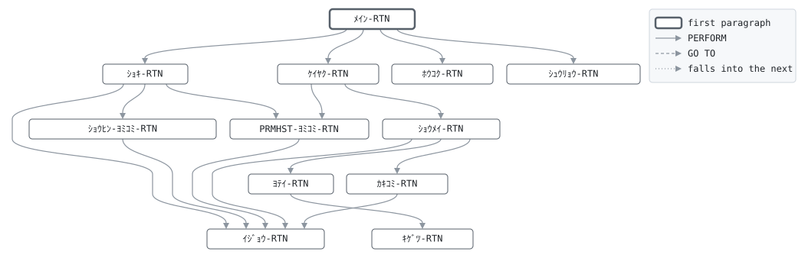

# GLY030

```text
GLY030: 保険料控除証明書

年次、10月の最初の営業日。収納履歴 PRMHST を証券番号順に
読み、コマンド行の日付の年の1月1日からその日までに収納した
保険料を契約ごとに合計する。収納のあった契約に証明書1通を
PRMCERT に書く。証明額はその合計。予定額は、払込中 (有効・
猶予中) の契約では、払込済年月の後、12月までに払込期月の来る
保険料を証明額に加えた額: 月払は残りの月数分、年払は次の
払込期月が年内なら1回分、半年払は年内の回数分。払込中で
ない契約の予定額は証明額に等しい。
収納履歴にあって契約マスタにない契約は数えて飛ばす。

復帰コード: 0 作成済、4 契約のない収納履歴あり、
            8 日付が日付でない、16 ファイル異常。

変更履歴
日付       担当 変更
2026-11-19 YN   GL-0827 初版。
```

Program [GLY030.cbl](../../../gondwana/programs/GLY030.cbl): 5 files, 12 paragraphs. Its business rules: [9 decision tables](../rules/GLY030.md).

- AUTHOR: ゴンドワナ生命 システム部.
- DATE-WRITTEN: 2026-11-19.

## Contents

- [Files](#files)
- [Flow](#flow)
- [Paragraphs](#paragraphs)
- [Calls](#calls)
- [Data flow](#data-flow)
- [Lineage](#lineage)
  - [Into SH-ｼｭｳﾉｳ-ﾚｺｰﾄﾞ](#into-sh-ｼｭｳﾉｳ-ﾚｺｰﾄﾞ)
  - [Into PM-ｹｲﾔｸ-ﾚｺｰﾄﾞ](#into-pm-ｹｲﾔｸ-ﾚｺｰﾄﾞ)
  - [Into PR-ｼｮｳﾋﾝ-ﾚｺｰﾄﾞ](#into-pr-ｼｮｳﾋﾝ-ﾚｺｰﾄﾞ)
  - [Into SM-ｼｮｳﾒｲ-ﾚｺｰﾄﾞ](#into-sm-ｼｮｳﾒｲ-ﾚｺｰﾄﾞ)
  - [Into ﾎｳｺｸ-ｷﾞｮｳ](#into-ﾎｳｺｸ-ｷﾞｮｳ)
  - [Into WS-ｺﾏﾝﾄﾞｷﾞｮｳ](#into-ws-ｺﾏﾝﾄﾞｷﾞｮｳ)
  - [Into WS-ｴﾗｰﾌｧｲﾙ](#into-ws-ｴﾗｰﾌｧｲﾙ)
  - [Into WS-ｴﾗｰｽﾃｰﾀｽ](#into-ws-ｴﾗｰｽﾃｰﾀｽ)
  - [Into WS-ｷﾞｮｳﾑﾋﾂﾞｹ](#into-ws-ｷﾞｮｳﾑﾋﾂﾞｹ)
  - [Into WS-ｷﾞｮｳﾑﾋﾂﾞｹ-ﾜﾚｷ](#into-ws-ｷﾞｮｳﾑﾋﾂﾞｹ-ﾜﾚｷ)
  - [Into WS-ﾎｳｺｳ](#into-ws-ﾎｳｺｳ)
  - [Into WS-ﾍﾝｶﾝｹｯｶ](#into-ws-ﾍﾝｶﾝｹｯｶ)
  - [Into WS-ﾈﾝｼｮ](#into-ws-ﾈﾝｼｮ)
  - [Into WS-ﾈﾝﾏﾂ](#into-ws-ﾈﾝﾏﾂ)
  - [Into WS-ｼｮｳｹﾝﾊﾞﾝｺﾞｳ](#into-ws-ｼｮｳｹﾝﾊﾞﾝｺﾞｳ)
  - [Into WS-ｼｮｳﾒｲｶﾞｸ](#into-ws-ｼｮｳﾒｲｶﾞｸ)
  - [Into WS-ﾖﾃｲｶｲｽｳ](#into-ws-ﾖﾃｲｶｲｽｳ)
  - [Into WS-ﾊﾗｲｺﾐｽﾞﾐ](#into-ws-ﾊﾗｲｺﾐｽﾞﾐ)
  - [Into WS-ｼｮｳﾋﾝ-TBL](#into-ws-ｼｮｳﾋﾝ-tbl)
  - [Into WS-ｹﾝｽｳ](#into-ws-ｹﾝｽｳ)
  - [Into WS-ﾌｯｷｺｰﾄﾞ](#into-ws-ﾌｯｷｺｰﾄﾞ)
  - [Into WS-ﾎｳｺｸ](#into-ws-ﾎｳｺｸ)
  - [Out of the program](#out-of-the-program)
  - [Into other data items](#into-other-data-items)
- [Field origins](#field-origins)
  - [File REPORT-F](#file-report-f)
  - [File PRMCERT-F](#file-prmcert-f)
- [Links between records](#links-between-records)
- [Records](#records)
  - [SH-ｼｭｳﾉｳ-ﾚｺｰﾄﾞ](#sh-ｼｭｳﾉｳ-ﾚｺｰﾄﾞ)
  - [PM-ｹｲﾔｸ-ﾚｺｰﾄﾞ](#pm-ｹｲﾔｸ-ﾚｺｰﾄﾞ)
  - [PR-ｼｮｳﾋﾝ-ﾚｺｰﾄﾞ](#pr-ｼｮｳﾋﾝ-ﾚｺｰﾄﾞ)
  - [SM-ｼｮｳﾒｲ-ﾚｺｰﾄﾞ](#sm-ｼｮｳﾒｲ-ﾚｺｰﾄﾞ)
  - [ﾎｳｺｸ-ｷﾞｮｳ](#ﾎｳｺｸ-ｷﾞｮｳ)
  - [WS-ｽﾃｰﾀｽ](#ws-ｽﾃｰﾀｽ)
  - [WS-ｺﾏﾝﾄﾞｷﾞｮｳ](#ws-ｺﾏﾝﾄﾞｷﾞｮｳ)
  - [WS-ｴﾗｰﾌｧｲﾙ](#ws-ｴﾗｰﾌｧｲﾙ)
  - [WS-ｴﾗｰｽﾃｰﾀｽ](#ws-ｴﾗｰｽﾃｰﾀｽ)
  - [WS-ｷﾞｮｳﾑﾋﾂﾞｹ](#ws-ｷﾞｮｳﾑﾋﾂﾞｹ)
  - [WS-ｷﾞｮｳﾑﾋﾂﾞｹ-ﾌﾞﾝｶｲ](#ws-ｷﾞｮｳﾑﾋﾂﾞｹ-ﾌﾞﾝｶｲ)
  - [WS-ｷﾞｮｳﾑﾋﾂﾞｹ-ﾜﾚｷ](#ws-ｷﾞｮｳﾑﾋﾂﾞｹ-ﾜﾚｷ)
  - [WS-ﾎｳｺｳ](#ws-ﾎｳｺｳ)
  - [WS-ﾍﾝｶﾝｹｯｶ](#ws-ﾍﾝｶﾝｹｯｶ)
  - [WS-ﾈﾝｼｮ](#ws-ﾈﾝｼｮ)
  - [WS-ﾈﾝﾏﾂ](#ws-ﾈﾝﾏﾂ)
  - [WS-ｼｮｳｹﾝﾊﾞﾝｺﾞｳ](#ws-ｼｮｳｹﾝﾊﾞﾝｺﾞｳ)
  - [WS-ｼｮｳﾒｲｶﾞｸ](#ws-ｼｮｳﾒｲｶﾞｸ)
  - [WS-ﾖﾃｲｶｲｽｳ](#ws-ﾖﾃｲｶｲｽｳ)
  - [WS-ﾊﾗｲｺﾐｽﾞﾐ](#ws-ﾊﾗｲｺﾐｽﾞﾐ)
  - [WS-ﾊﾗｲｺﾐ-YYYYMM](#ws-ﾊﾗｲｺﾐ-yyyymm)
  - [WS-ｼｮｳﾋﾝ-TBL](#ws-ｼｮｳﾋﾝ-tbl)
  - [WS-ﾘｮｳﾘﾂ-TBL](#ws-ﾘｮｳﾘﾂ-tbl)
  - [WS-ﾈﾝﾚｲ-ｿｴｼﾞ](#ws-ﾈﾝﾚｲ-ｿｴｼﾞ)
  - [WS-ｹﾝｽｳ](#ws-ｹﾝｽｳ)
  - [WS-ﾌｯｷｺｰﾄﾞ](#ws-ﾌｯｷｺｰﾄﾞ)
  - [WS-ﾎｳｺｸ](#ws-ﾎｳｺｸ)

## Files

| File | Kind | Assigned to | Organization | Status field | Opened | Records |
| --- | --- | --- | --- | --- | --- | --- |
| PRMHST-F | FD | PRMHST | INDEXED, key SH-ｷｰ | WS-PRMHST-ST | INPUT | SH-ｼｭｳﾉｳ-ﾚｺｰﾄﾞ |
| POLMST-F | FD | POLMST | INDEXED, key PM-ｼｮｳｹﾝﾊﾞﾝｺﾞｳ, RANDOM access | WS-POLMST-ST | INPUT | PM-ｹｲﾔｸ-ﾚｺｰﾄﾞ |
| PRODTB-F | FD | PRODTB | LINE SEQUENTIAL | WS-PRODTB-ST | INPUT | PR-ｼｮｳﾋﾝ-ﾚｺｰﾄﾞ |
| PRMCERT-F | FD | PRMCERT | LINE SEQUENTIAL | WS-PRMCERT-ST | OUTPUT | SM-ｼｮｳﾒｲ-ﾚｺｰﾄﾞ |
| REPORT-F | FD | GLY030R | LINE SEQUENTIAL | WS-REPORT-ST | OUTPUT | ﾎｳｺｸ-ｷﾞｮｳ |

## Flow



## Paragraphs

| Paragraph | Description | Source | Performs | Goes to | Performed by | Reached by |
| --- | --- | --- | --- | --- | --- | --- |
| ﾒｲﾝ-RTN | ﾒｲﾝ-RTN: 準備、契約ごとの集計と証明書、報告、終了。 | [GLY030.cbl:129](../../../gondwana/programs/GLY030.cbl#L129) | ｼｮｷ-RTN, ｹｲﾔｸ-RTN, ﾎｳｺｸ-RTN, ｼｭｳﾘｮｳ-RTN | | | |
| ｼｮｷ-RTN | ｼｮｷ-RTN: 業務日付、その年の初めと終わり、ファイル、商品。 | [GLY030.cbl:140](../../../gondwana/programs/GLY030.cbl#L140) | ｲｼﾞｮｳ-RTN, ｼｮｳﾋﾝ-ﾖﾐｺﾐ-RTN, PRMHST-ﾖﾐｺﾐ-RTN | | ﾒｲﾝ-RTN | |
| PRMHST-ﾖﾐｺﾐ-RTN | PRMHST-ﾖﾐｺﾐ-RTN: 収納履歴の次の1件。 | [GLY030.cbl:188](../../../gondwana/programs/GLY030.cbl#L188) | ｲｼﾞｮｳ-RTN | | ｼｮｷ-RTN, ｹｲﾔｸ-RTN | |
| ｹｲﾔｸ-RTN | ｹｲﾔｸ-RTN: 証券番号が変わるまで、その年の業務日付までの収納を 合計し、あれば証明書を作る。 | [GLY030.cbl:204](../../../gondwana/programs/GLY030.cbl#L204) | PRMHST-ﾖﾐｺﾐ-RTN, ｼｮｳﾒｲ-RTN | | ﾒｲﾝ-RTN | |
| ｼｮｳﾒｲ-RTN | ｼｮｳﾒｲ-RTN: 契約を読み、予定額を求めて証明書1通を書く。 | [GLY030.cbl:222](../../../gondwana/programs/GLY030.cbl#L222) | ｲｼﾞｮｳ-RTN, ﾖﾃｲ-RTN, ｶｷｺﾐ-RTN | | ｹｲﾔｸ-RTN | |
| ﾖﾃｲ-RTN | ﾖﾃｲ-RTN: 払込中の契約の、払込済年月の後、12月までに払込期月 の来る保険料の回数。月払は残りの月数、年払は次の払込期月が 年内なら 1、半年払は年内に来る回数。 | [GLY030.cbl:243](../../../gondwana/programs/GLY030.cbl#L243) | ｷｹﾞﾂ-RTN | | ｼｮｳﾒｲ-RTN | |
| ｷｹﾞﾂ-RTN | ｷｹﾞﾂ-RTN: 進めた払込期月が年内なら1回と数える。 | [GLY030.cbl:269](../../../gondwana/programs/GLY030.cbl#L269) | | | ﾖﾃｲ-RTN | |
| ｶｷｺﾐ-RTN | ｶｷｺﾐ-RTN: 証明書1通と明細行。 | [GLY030.cbl:281](../../../gondwana/programs/GLY030.cbl#L281) | ｲｼﾞｮｳ-RTN | | ｼｮｳﾒｲ-RTN | |
| ﾎｳｺｸ-RTN | ﾎｳｺｸ-RTN: 件数と合計。 | [GLY030.cbl:318](../../../gondwana/programs/GLY030.cbl#L318) | | | ﾒｲﾝ-RTN | |
| ｼｭｳﾘｮｳ-RTN | ｼｭｳﾘｮｳ-RTN: ファイルを閉じ、件数を表示する。 | [GLY030.cbl:340](../../../gondwana/programs/GLY030.cbl#L340) | | | ﾒｲﾝ-RTN | |
| ｲｼﾞｮｳ-RTN | ｲｼﾞｮｳ-RTN: ファイル異常は 16 で終わる。 | [GLY030.cbl:347](../../../gondwana/programs/GLY030.cbl#L347) | | | ｼｮｷ-RTN, PRMHST-ﾖﾐｺﾐ-RTN, ｼｮｳﾒｲ-RTN, ｶｷｺﾐ-RTN, ｼｮｳﾋﾝ-ﾖﾐｺﾐ-RTN | |
| ｼｮｳﾋﾝ-ﾖﾐｺﾐ-RTN | ｼｮｳﾋﾝ-ﾖﾐｺﾐ-RTN: 商品テーブルを読み込む。 | [PRDLOD.cpy:17](../../../gondwana/copybooks/PRDLOD.cpy#L17) | ｲｼﾞｮｳ-RTN | | ｼｮｷ-RTN | |

## Calls

| Calls | Passing | Paragraph | Source |
| --- | --- | --- | --- |
| [GLC020](GLC020.md) | WS-ﾎｳｺｳ, WS-ｷﾞｮｳﾑﾋﾂﾞｹ, WS-ｷﾞｮｳﾑﾋﾂﾞｹ-ﾜﾚｷ, WS-ﾍﾝｶﾝｹｯｶ | ｼｮｷ-RTN | [GLY030.cbl:144](../../../gondwana/programs/GLY030.cbl#L144) |

## Data flow

| Paragraph | Reads | Writes |
| --- | --- | --- |
| ﾒｲﾝ-RTN | WS-PRMHST-ST, WS-ﾌｯｷｺｰﾄﾞ | RETURN-CODE |
| ｼｮｷ-RTN | WS-ｺﾏﾝﾄﾞｷﾞｮｳ, WS-ﾎｳｺｳ, WS-ｷﾞｮｳﾑﾋﾂﾞｹ, WS-ｷﾞｮｳﾑﾋﾂﾞｹ-ﾜﾚｷ, WS-ﾍﾝｶﾝｹｯｶ, WS-ｷﾞｮｳﾑ-YYYY, WS-PRMHST-ST, WS-POLMST-ST, WS-PRODTB-ST, WS-PRMCERT-ST, WS-REPORT-ST, WS-ｴﾗｰﾌｧｲﾙ, WS-ﾋｮｳﾀﾞｲ-ｷﾞｮｳ | WS-ｺﾏﾝﾄﾞｷﾞｮｳ, WS-ｷﾞｮｳﾑﾋﾂﾞｹ, WS-ﾎｳｺｳ, WS-ｷﾞｮｳﾑﾋﾂﾞｹ-ﾜﾚｷ, WS-ﾍﾝｶﾝｹｯｶ, RETURN-CODE, WS-ﾈﾝｼｮ, WS-ﾈﾝﾏﾂ, WS-PRMHST-ST, WS-POLMST-ST, WS-PRODTB-ST, WS-PRMCERT-ST, WS-REPORT-ST, WS-ｴﾗｰﾌｧｲﾙ, WS-ｴﾗｰｽﾃｰﾀｽ, WS-ﾋｮｳﾀﾞｲ-ﾈﾝ, WS-ﾋｮｳﾀﾞｲ-ﾋﾂﾞｹ, ﾎｳｺｸ-ｷﾞｮｳ |
| PRMHST-ﾖﾐｺﾐ-RTN | WS-PRMHST-ST, WS-ﾘﾚｷｹﾝｽｳ | SH-ｼｭｳﾉｳ-ﾚｺｰﾄﾞ, WS-PRMHST-ST, WS-ﾘﾚｷｹﾝｽｳ, WS-ｴﾗｰﾌｧｲﾙ, WS-ｴﾗｰｽﾃｰﾀｽ |
| ｹｲﾔｸ-RTN | SH-ｼｮｳｹﾝﾊﾞﾝｺﾞｳ, WS-PRMHST-ST, WS-ｼｮｳｹﾝﾊﾞﾝｺﾞｳ, SH-ｼｭｳﾉｳﾋﾞ, WS-ﾈﾝｼｮ, WS-ｷﾞｮｳﾑﾋﾂﾞｹ, SH-ｷﾝｶﾞｸ, WS-ｼｮｳﾒｲｶﾞｸ | WS-ｼｮｳｹﾝﾊﾞﾝｺﾞｳ, WS-ｼｮｳﾒｲｶﾞｸ |
| ｼｮｳﾒｲ-RTN | WS-ｼｮｳｹﾝﾊﾞﾝｺﾞｳ, WS-POLMST-ST, WS-ｹｲﾔｸﾅｼｹﾝｽｳ | PM-ｼｮｳｹﾝﾊﾞﾝｺﾞｳ, PM-ｹｲﾔｸ-ﾚｺｰﾄﾞ, WS-POLMST-ST, WS-ｹｲﾔｸﾅｼｹﾝｽｳ, WS-ﾌｯｷｺｰﾄﾞ, WS-ｴﾗｰﾌｧｲﾙ, WS-ｴﾗｰｽﾃｰﾀｽ |
| ﾖﾃｲ-RTN | PM-ﾊﾗｲｺﾐｽﾞﾐﾈﾝｹﾞﾂ, PM-ｼﾞｮｳﾀｲ, PM-ﾊﾗｲｺﾐﾎｳﾎｳ, WS-ﾊﾗｲｺﾐ-YYYY, WS-ﾊﾗｲｺﾐ-MM, WS-ｷﾞｮｳﾑ-YYYY, WS-ﾖﾃｲｶｲｽｳ | WS-ﾖﾃｲｶｲｽｳ, WS-ﾊﾗｲｺﾐｽﾞﾐ, WS-ﾊﾗｲｺﾐ-YYYY, WS-ﾊﾗｲｺﾐ-MM |
| ｷｹﾞﾂ-RTN | WS-ﾊﾗｲｺﾐ-MM, WS-ﾊﾗｲｺﾐ-YYYY, WS-ﾊﾗｲｺﾐ-YYYYMM, WS-ﾈﾝﾏﾂ, WS-ﾖﾃｲｶｲｽｳ | WS-ﾊﾗｲｺﾐ-MM, WS-ﾊﾗｲｺﾐ-YYYY, WS-ﾖﾃｲｶｲｽｳ |
| ｶｷｺﾐ-RTN | PM-ｼｮｳｹﾝﾊﾞﾝｺﾞｳ, WS-ｷﾞｮｳﾑ-YYYY, WS-ｷﾞｮｳﾑﾋﾂﾞｹ-ﾜﾚｷ, PM-ｼﾒｲ, PM-ｼﾞｭｳｼｮ, PM-ｼｮｳﾋﾝ, WS-ｼｮｳﾋﾝ, WS-ｼｮｳﾋﾝ-ｺｰﾄﾞ, WS-ｼｮｳﾋﾝ-IX, WS-ｼｮｳﾋﾝ-ﾒｲｼｮｳ, PM-ｹｲﾔｸﾋﾞ, PM-ﾊﾗｲｺﾐﾎｳﾎｳ, WS-ｼｮｳﾒｲｶﾞｸ, PM-ﾎｹﾝﾘｮｳ, WS-ﾖﾃｲｶｲｽｳ, WS-PRMCERT-ST, WS-ｼｮｳﾒｲｹﾝｽｳ, SM-ｼｮｳﾒｲｶﾞｸ, WS-ｼｮｳﾒｲｺﾞｳｹｲ, SM-ﾖﾃｲｶﾞｸ, WS-ﾖﾃｲｺﾞｳｹｲ, WS-ﾒｲｻｲ-ｷﾞｮｳ | SM-ｼｮｳﾒｲ-ﾚｺｰﾄﾞ, SM-ｼｮｳｹﾝﾊﾞﾝｺﾞｳ, SM-ﾈﾝﾌﾞﾝ, SM-ﾊｯｺｳﾋﾞ, SM-ｼﾒｲ, SM-ｼﾞｭｳｼｮ, SM-ｼｮｳﾋﾝ, WS-ｼｮｳﾋﾝ-IX, SM-ｼｮｳﾋﾝﾒｲ, SM-ｹｲﾔｸﾋﾞ, SM-ﾊﾗｲｺﾐﾎｳﾎｳ, SM-ｼｮｳﾒｲｶﾞｸ, SM-ﾖﾃｲｶﾞｸ, WS-PRMCERT-ST, WS-ｴﾗｰﾌｧｲﾙ, WS-ｴﾗｰｽﾃｰﾀｽ, WS-ｼｮｳﾒｲｹﾝｽｳ, WS-ｼｮｳﾒｲｺﾞｳｹｲ, WS-ﾖﾃｲｺﾞｳｹｲ, WS-ﾒｲｻｲ-ｼｮｳｹﾝ, WS-ﾒｲｻｲ-ｼｮｳﾋﾝ, WS-ﾒｲｻｲ-ｼﾒｲ, WS-ﾒｲｻｲ-ｼｮｳﾒｲｶﾞｸ, WS-ﾒｲｻｲ-ﾖﾃｲｶﾞｸ, ﾎｳｺｸ-ｷﾞｮｳ, WS-REPORT-ST |
| ﾎｳｺｸ-RTN | WS-ﾘﾚｷｹﾝｽｳ, WS-ｹﾝｽｳ-ｷﾞｮｳ, WS-ｼｮｳﾒｲｹﾝｽｳ, WS-ｹｲﾔｸﾅｼｹﾝｽｳ, WS-ｼｮｳﾒｲｺﾞｳｹｲ, WS-ﾖﾃｲｺﾞｳｹｲ | ﾎｳｺｸ-ｷﾞｮｳ, WS-REPORT-ST, WS-ｹﾝｽｳ-ﾗﾍﾞﾙ, WS-ｹﾝｽｳ-ｱﾀｲ |
| ｼｭｳﾘｮｳ-RTN | WS-ｼｮｳﾒｲｹﾝｽｳ | WS-PRMHST-ST, WS-POLMST-ST, WS-PRODTB-ST, WS-PRMCERT-ST, WS-REPORT-ST |
| ｲｼﾞｮｳ-RTN | WS-ｴﾗｰﾌｧｲﾙ, WS-ｴﾗｰｽﾃｰﾀｽ | RETURN-CODE |
| ｼｮｳﾋﾝ-ﾖﾐｺﾐ-RTN | WS-PRODTB-ST, WS-ｼｮｳﾋﾝｹﾝｽｳ, PR-ｺｰﾄﾞ, WS-ｼｮｳﾋﾝ-IX, PR-ﾒｲｼｮｳ, PR-ｼｭﾙｲ, PR-ｻｲﾃｲﾈﾝﾚｲ, PR-ｻｲｺｳﾈﾝﾚｲ, PR-ﾎｹﾝｷｶﾝ, PR-ｻｲﾃｲﾎｹﾝｷﾝｶﾞｸ, PR-ｻｲｺｳﾎｹﾝｷﾝｶﾞｸ, PR-ﾆｭｳｲﾝﾆﾁｶﾞｸﾘﾂ, PR-ﾒﾝｾｷﾆｯｽｳ, PR-ﾊｲﾄｳﾘﾂ, PR-ｸﾌﾞﾝ | PR-ｼｮｳﾋﾝ-ﾚｺｰﾄﾞ, WS-PRODTB-ST, WS-ｼｮｳﾋﾝｹﾝｽｳ, WS-ｼｮｳﾋﾝ-IX, WS-ｼｮｳﾋﾝ-ｺｰﾄﾞ, WS-ｼｮｳﾋﾝ-ﾒｲｼｮｳ, WS-ｼｮｳﾋﾝ-ｼｭﾙｲ, WS-ｼｮｳﾋﾝ-ｻｲﾃｲﾈﾝﾚｲ, WS-ｼｮｳﾋﾝ-ｻｲｺｳﾈﾝﾚｲ, WS-ｼｮｳﾋﾝ-ﾎｹﾝｷｶﾝ, WS-ｼｮｳﾋﾝ-ｻｲﾃｲｷﾝｶﾞｸ, WS-ｼｮｳﾋﾝ-ｻｲｺｳｷﾝｶﾞｸ, WS-ｼｮｳﾋﾝ-ﾆｭｳｲﾝﾆﾁｶﾞｸﾘﾂ, WS-ｼｮｳﾋﾝ-ﾒﾝｾｷﾆｯｽｳ, WS-ｼｮｳﾋﾝ-ﾊｲﾄｳﾘﾂ, WS-ｼｮｳﾋﾝ-ｸﾌﾞﾝ, WS-ｴﾗｰﾌｧｲﾙ, WS-ｴﾗｰｽﾃｰﾀｽ |

## Lineage

Where each data item's values come from, grouped by the record they go into. A data item links to the record it belongs to.

### Into SH-ｼｭｳﾉｳ-ﾚｺｰﾄﾞ

Record [SH-ｼｭｳﾉｳ-ﾚｺｰﾄﾞ](#sh-ｼｭｳﾉｳ-ﾚｺｰﾄﾞ), from copybook [PRMHST](../copybooks/PRMHST.md).

| Into | From | Statement | Paragraph | Source |
| --- | --- | --- | --- | --- |
| SH-ｼｭｳﾉｳ-ﾚｺｰﾄﾞ | file PRMHST-F | READ | PRMHST-ﾖﾐｺﾐ-RTN | [GLY030.cbl:189](../../../gondwana/programs/GLY030.cbl#L189) |

### Into PM-ｹｲﾔｸ-ﾚｺｰﾄﾞ

Record [PM-ｹｲﾔｸ-ﾚｺｰﾄﾞ](#pm-ｹｲﾔｸ-ﾚｺｰﾄﾞ), from copybook [POLMST](../copybooks/POLMST.md).

| Into | From | Statement | Paragraph | Source |
| --- | --- | --- | --- | --- |
| PM-ｹｲﾔｸ-ﾚｺｰﾄﾞ | file POLMST-F | READ | ｼｮｳﾒｲ-RTN | [GLY030.cbl:224](../../../gondwana/programs/GLY030.cbl#L224) |
| PM-ｼｮｳｹﾝﾊﾞﾝｺﾞｳ | [WS-ｼｮｳｹﾝﾊﾞﾝｺﾞｳ](#ws-ｼｮｳｹﾝﾊﾞﾝｺﾞｳ) | MOVE | ｼｮｳﾒｲ-RTN | [GLY030.cbl:223](../../../gondwana/programs/GLY030.cbl#L223) |

### Into PR-ｼｮｳﾋﾝ-ﾚｺｰﾄﾞ

Record [PR-ｼｮｳﾋﾝ-ﾚｺｰﾄﾞ](#pr-ｼｮｳﾋﾝ-ﾚｺｰﾄﾞ), from copybook [PRODTB](../copybooks/PRODTB.md).

| Into | From | Statement | Paragraph | Source |
| --- | --- | --- | --- | --- |
| PR-ｼｮｳﾋﾝ-ﾚｺｰﾄﾞ | file PRODTB-F | READ | ｼｮｳﾋﾝ-ﾖﾐｺﾐ-RTN | [PRDLOD.cpy:18](../../../gondwana/copybooks/PRDLOD.cpy#L18) |
| PR-ｼｮｳﾋﾝ-ﾚｺｰﾄﾞ | file PRODTB-F | READ | ｼｮｳﾋﾝ-ﾖﾐｺﾐ-RTN | [PRDLOD.cpy:37](../../../gondwana/copybooks/PRDLOD.cpy#L37) |

### Into SM-ｼｮｳﾒｲ-ﾚｺｰﾄﾞ

Record [SM-ｼｮｳﾒｲ-ﾚｺｰﾄﾞ](#sm-ｼｮｳﾒｲ-ﾚｺｰﾄﾞ), from copybook [PRMCERT](../copybooks/PRMCERT.md).

| Into | From | Statement | Paragraph | Source |
| --- | --- | --- | --- | --- |
| SM-ｹｲﾔｸﾋﾞ | [PM-ｹｲﾔｸﾋﾞ](#pm-ｹｲﾔｸ-ﾚｺｰﾄﾞ "in PM-ｹｲﾔｸ-ﾚｺｰﾄﾞ") | MOVE | ｶｷｺﾐ-RTN | [GLY030.cbl:294](../../../gondwana/programs/GLY030.cbl#L294) |
| SM-ｼｮｳｹﾝﾊﾞﾝｺﾞｳ | [PM-ｼｮｳｹﾝﾊﾞﾝｺﾞｳ](#pm-ｹｲﾔｸ-ﾚｺｰﾄﾞ "in PM-ｹｲﾔｸ-ﾚｺｰﾄﾞ") | MOVE | ｶｷｺﾐ-RTN | [GLY030.cbl:283](../../../gondwana/programs/GLY030.cbl#L283) |
| SM-ｼｮｳﾋﾝ | [PM-ｼｮｳﾋﾝ](#pm-ｹｲﾔｸ-ﾚｺｰﾄﾞ "in PM-ｹｲﾔｸ-ﾚｺｰﾄﾞ") | MOVE | ｶｷｺﾐ-RTN | [GLY030.cbl:288](../../../gondwana/programs/GLY030.cbl#L288) |
| SM-ｼｮｳﾋﾝﾒｲ | [WS-ｼｮｳﾋﾝ-ﾒｲｼｮｳ](#ws-ｼｮｳﾋﾝ-tbl "in WS-ｼｮｳﾋﾝ-TBL") | MOVE | ｶｷｺﾐ-RTN | [GLY030.cbl:292](../../../gondwana/programs/GLY030.cbl#L292) |
| SM-ｼｮｳﾒｲ-ﾚｺｰﾄﾞ | literal SPACES | MOVE | ｶｷｺﾐ-RTN | [GLY030.cbl:282](../../../gondwana/programs/GLY030.cbl#L282) |
| SM-ｼｮｳﾒｲｶﾞｸ | [WS-ｼｮｳﾒｲｶﾞｸ](#ws-ｼｮｳﾒｲｶﾞｸ) | MOVE | ｶｷｺﾐ-RTN | [GLY030.cbl:296](../../../gondwana/programs/GLY030.cbl#L296) |
| SM-ｼﾒｲ | [PM-ｼﾒｲ](#pm-ｹｲﾔｸ-ﾚｺｰﾄﾞ "in PM-ｹｲﾔｸ-ﾚｺｰﾄﾞ") | MOVE | ｶｷｺﾐ-RTN | [GLY030.cbl:286](../../../gondwana/programs/GLY030.cbl#L286) |
| SM-ｼﾞｭｳｼｮ | [PM-ｼﾞｭｳｼｮ](#pm-ｹｲﾔｸ-ﾚｺｰﾄﾞ "in PM-ｹｲﾔｸ-ﾚｺｰﾄﾞ") | MOVE | ｶｷｺﾐ-RTN | [GLY030.cbl:287](../../../gondwana/programs/GLY030.cbl#L287) |
| SM-ﾈﾝﾌﾞﾝ | [WS-ｷﾞｮｳﾑ-YYYY](#ws-ｷﾞｮｳﾑﾋﾂﾞｹ-ﾌﾞﾝｶｲ "in WS-ｷﾞｮｳﾑﾋﾂﾞｹ-ﾌﾞﾝｶｲ") | MOVE | ｶｷｺﾐ-RTN | [GLY030.cbl:284](../../../gondwana/programs/GLY030.cbl#L284) |
| SM-ﾊｯｺｳﾋﾞ | [WS-ｷﾞｮｳﾑﾋﾂﾞｹ-ﾜﾚｷ](#ws-ｷﾞｮｳﾑﾋﾂﾞｹ-ﾜﾚｷ) | MOVE | ｶｷｺﾐ-RTN | [GLY030.cbl:285](../../../gondwana/programs/GLY030.cbl#L285) |
| SM-ﾊﾗｲｺﾐﾎｳﾎｳ | [PM-ﾊﾗｲｺﾐﾎｳﾎｳ](#pm-ｹｲﾔｸ-ﾚｺｰﾄﾞ "in PM-ｹｲﾔｸ-ﾚｺｰﾄﾞ") | MOVE | ｶｷｺﾐ-RTN | [GLY030.cbl:295](../../../gondwana/programs/GLY030.cbl#L295) |
| SM-ﾖﾃｲｶﾞｸ | [WS-ｼｮｳﾒｲｶﾞｸ](#ws-ｼｮｳﾒｲｶﾞｸ) | COMPUTE | ｶｷｺﾐ-RTN | [GLY030.cbl:297](../../../gondwana/programs/GLY030.cbl#L297) |
| SM-ﾖﾃｲｶﾞｸ | [PM-ﾎｹﾝﾘｮｳ](#pm-ｹｲﾔｸ-ﾚｺｰﾄﾞ "in PM-ｹｲﾔｸ-ﾚｺｰﾄﾞ") | COMPUTE | ｶｷｺﾐ-RTN | [GLY030.cbl:297](../../../gondwana/programs/GLY030.cbl#L297) |
| SM-ﾖﾃｲｶﾞｸ | [WS-ﾖﾃｲｶｲｽｳ](#ws-ﾖﾃｲｶｲｽｳ) | COMPUTE | ｶｷｺﾐ-RTN | [GLY030.cbl:297](../../../gondwana/programs/GLY030.cbl#L297) |

### Into ﾎｳｺｸ-ｷﾞｮｳ

Record [ﾎｳｺｸ-ｷﾞｮｳ](#ﾎｳｺｸ-ｷﾞｮｳ).

| Into | From | Statement | Paragraph | Source |
| --- | --- | --- | --- | --- |
| ﾎｳｺｸ-ｷﾞｮｳ | [WS-ﾋｮｳﾀﾞｲ-ｷﾞｮｳ](#ws-ﾎｳｺｸ "in WS-ﾎｳｺｸ") | WRITE | ｼｮｷ-RTN | [GLY030.cbl:180](../../../gondwana/programs/GLY030.cbl#L180) |
| ﾎｳｺｸ-ｷﾞｮｳ | literal SPACES | MOVE | ｼｮｷ-RTN | [GLY030.cbl:181](../../../gondwana/programs/GLY030.cbl#L181) |
| ﾎｳｺｸ-ｷﾞｮｳ | [WS-ﾒｲｻｲ-ｷﾞｮｳ](#ws-ﾎｳｺｸ "in WS-ﾎｳｺｸ") | WRITE | ｶｷｺﾐ-RTN | [GLY030.cbl:313](../../../gondwana/programs/GLY030.cbl#L313) |
| ﾎｳｺｸ-ｷﾞｮｳ | literal SPACES | MOVE | ﾎｳｺｸ-RTN | [GLY030.cbl:319](../../../gondwana/programs/GLY030.cbl#L319) |
| ﾎｳｺｸ-ｷﾞｮｳ | [WS-ｹﾝｽｳ-ｷﾞｮｳ](#ws-ﾎｳｺｸ "in WS-ﾎｳｺｸ") | WRITE | ﾎｳｺｸ-RTN | [GLY030.cbl:323](../../../gondwana/programs/GLY030.cbl#L323) |
| ﾎｳｺｸ-ｷﾞｮｳ | [WS-ｹﾝｽｳ-ｷﾞｮｳ](#ws-ﾎｳｺｸ "in WS-ﾎｳｺｸ") | WRITE | ﾎｳｺｸ-RTN | [GLY030.cbl:326](../../../gondwana/programs/GLY030.cbl#L326) |
| ﾎｳｺｸ-ｷﾞｮｳ | [WS-ｹﾝｽｳ-ｷﾞｮｳ](#ws-ﾎｳｺｸ "in WS-ﾎｳｺｸ") | WRITE | ﾎｳｺｸ-RTN | [GLY030.cbl:329](../../../gondwana/programs/GLY030.cbl#L329) |
| ﾎｳｺｸ-ｷﾞｮｳ | [WS-ｹﾝｽｳ-ｷﾞｮｳ](#ws-ﾎｳｺｸ "in WS-ﾎｳｺｸ") | WRITE | ﾎｳｺｸ-RTN | [GLY030.cbl:332](../../../gondwana/programs/GLY030.cbl#L332) |
| ﾎｳｺｸ-ｷﾞｮｳ | [WS-ｹﾝｽｳ-ｷﾞｮｳ](#ws-ﾎｳｺｸ "in WS-ﾎｳｺｸ") | WRITE | ﾎｳｺｸ-RTN | [GLY030.cbl:335](../../../gondwana/programs/GLY030.cbl#L335) |

### Into WS-ｺﾏﾝﾄﾞｷﾞｮｳ

Record [WS-ｺﾏﾝﾄﾞｷﾞｮｳ](#ws-ｺﾏﾝﾄﾞｷﾞｮｳ).

| Into | From | Statement | Paragraph | Source |
| --- | --- | --- | --- | --- |
| WS-ｺﾏﾝﾄﾞｷﾞｮｳ | COMMAND-LINE | ACCEPT | ｼｮｷ-RTN | [GLY030.cbl:141](../../../gondwana/programs/GLY030.cbl#L141) |

### Into WS-ｴﾗｰﾌｧｲﾙ

Record [WS-ｴﾗｰﾌｧｲﾙ](#ws-ｴﾗｰﾌｧｲﾙ).

| Into | From | Statement | Paragraph | Source |
| --- | --- | --- | --- | --- |
| WS-ｴﾗｰﾌｧｲﾙ | literal 'PRMHST' | MOVE | ｼｮｷ-RTN | [GLY030.cbl:157](../../../gondwana/programs/GLY030.cbl#L157) |
| WS-ｴﾗｰﾌｧｲﾙ | literal 'POLMST' | MOVE | ｼｮｷ-RTN | [GLY030.cbl:160](../../../gondwana/programs/GLY030.cbl#L160) |
| WS-ｴﾗｰﾌｧｲﾙ | literal 'PRODTB' | MOVE | ｼｮｷ-RTN | [GLY030.cbl:163](../../../gondwana/programs/GLY030.cbl#L163) |
| WS-ｴﾗｰﾌｧｲﾙ | literal 'PRMCERT' | MOVE | ｼｮｷ-RTN | [GLY030.cbl:166](../../../gondwana/programs/GLY030.cbl#L166) |
| WS-ｴﾗｰﾌｧｲﾙ | literal 'GLY030R' | MOVE | ｼｮｷ-RTN | [GLY030.cbl:169](../../../gondwana/programs/GLY030.cbl#L169) |
| WS-ｴﾗｰﾌｧｲﾙ | literal SPACES | MOVE | ｼｮｷ-RTN | [GLY030.cbl:172](../../../gondwana/programs/GLY030.cbl#L172) |
| WS-ｴﾗｰﾌｧｲﾙ | literal 'PRMHST' | MOVE | PRMHST-ﾖﾐｺﾐ-RTN | [GLY030.cbl:194](../../../gondwana/programs/GLY030.cbl#L194) |
| WS-ｴﾗｰﾌｧｲﾙ | literal 'POLMST' | MOVE | ｼｮｳﾒｲ-RTN | [GLY030.cbl:230](../../../gondwana/programs/GLY030.cbl#L230) |
| WS-ｴﾗｰﾌｧｲﾙ | literal 'PRMCERT' | MOVE | ｶｷｺﾐ-RTN | [GLY030.cbl:301](../../../gondwana/programs/GLY030.cbl#L301) |
| WS-ｴﾗｰﾌｧｲﾙ | literal 'PRODTB' | MOVE | ｼｮｳﾋﾝ-ﾖﾐｺﾐ-RTN | [PRDLOD.cpy:40](../../../gondwana/copybooks/PRDLOD.cpy#L40) |

### Into WS-ｴﾗｰｽﾃｰﾀｽ

Record [WS-ｴﾗｰｽﾃｰﾀｽ](#ws-ｴﾗｰｽﾃｰﾀｽ).

| Into | From | Statement | Paragraph | Source |
| --- | --- | --- | --- | --- |
| WS-ｴﾗｰｽﾃｰﾀｽ | [WS-PRMHST-ST](#ws-ｽﾃｰﾀｽ "in WS-ｽﾃｰﾀｽ") | MOVE | ｼｮｷ-RTN | [GLY030.cbl:158](../../../gondwana/programs/GLY030.cbl#L158) |
| WS-ｴﾗｰｽﾃｰﾀｽ | [WS-POLMST-ST](#ws-ｽﾃｰﾀｽ "in WS-ｽﾃｰﾀｽ") | MOVE | ｼｮｷ-RTN | [GLY030.cbl:161](../../../gondwana/programs/GLY030.cbl#L161) |
| WS-ｴﾗｰｽﾃｰﾀｽ | [WS-PRODTB-ST](#ws-ｽﾃｰﾀｽ "in WS-ｽﾃｰﾀｽ") | MOVE | ｼｮｷ-RTN | [GLY030.cbl:164](../../../gondwana/programs/GLY030.cbl#L164) |
| WS-ｴﾗｰｽﾃｰﾀｽ | [WS-PRMCERT-ST](#ws-ｽﾃｰﾀｽ "in WS-ｽﾃｰﾀｽ") | MOVE | ｼｮｷ-RTN | [GLY030.cbl:167](../../../gondwana/programs/GLY030.cbl#L167) |
| WS-ｴﾗｰｽﾃｰﾀｽ | [WS-REPORT-ST](#ws-ｽﾃｰﾀｽ "in WS-ｽﾃｰﾀｽ") | MOVE | ｼｮｷ-RTN | [GLY030.cbl:170](../../../gondwana/programs/GLY030.cbl#L170) |
| WS-ｴﾗｰｽﾃｰﾀｽ | [WS-PRMHST-ST](#ws-ｽﾃｰﾀｽ "in WS-ｽﾃｰﾀｽ") | MOVE | PRMHST-ﾖﾐｺﾐ-RTN | [GLY030.cbl:195](../../../gondwana/programs/GLY030.cbl#L195) |
| WS-ｴﾗｰｽﾃｰﾀｽ | [WS-POLMST-ST](#ws-ｽﾃｰﾀｽ "in WS-ｽﾃｰﾀｽ") | MOVE | ｼｮｳﾒｲ-RTN | [GLY030.cbl:231](../../../gondwana/programs/GLY030.cbl#L231) |
| WS-ｴﾗｰｽﾃｰﾀｽ | [WS-PRMCERT-ST](#ws-ｽﾃｰﾀｽ "in WS-ｽﾃｰﾀｽ") | MOVE | ｶｷｺﾐ-RTN | [GLY030.cbl:302](../../../gondwana/programs/GLY030.cbl#L302) |
| WS-ｴﾗｰｽﾃｰﾀｽ | [WS-PRODTB-ST](#ws-ｽﾃｰﾀｽ "in WS-ｽﾃｰﾀｽ") | MOVE | ｼｮｳﾋﾝ-ﾖﾐｺﾐ-RTN | [PRDLOD.cpy:41](../../../gondwana/copybooks/PRDLOD.cpy#L41) |

### Into WS-ｷﾞｮｳﾑﾋﾂﾞｹ

Record [WS-ｷﾞｮｳﾑﾋﾂﾞｹ](#ws-ｷﾞｮｳﾑﾋﾂﾞｹ).

| Into | From | Statement | Paragraph | Source |
| --- | --- | --- | --- | --- |
| WS-ｷﾞｮｳﾑﾋﾂﾞｹ | [WS-ｺﾏﾝﾄﾞｷﾞｮｳ](#ws-ｺﾏﾝﾄﾞｷﾞｮｳ) | MOVE | ｼｮｷ-RTN | [GLY030.cbl:142](../../../gondwana/programs/GLY030.cbl#L142) |
| WS-ｷﾞｮｳﾑﾋﾂﾞｹ | call GLC020 argument 2 | CALL | ｼｮｷ-RTN | [GLY030.cbl:144](../../../gondwana/programs/GLY030.cbl#L144) |

### Into WS-ｷﾞｮｳﾑﾋﾂﾞｹ-ﾜﾚｷ

Record [WS-ｷﾞｮｳﾑﾋﾂﾞｹ-ﾜﾚｷ](#ws-ｷﾞｮｳﾑﾋﾂﾞｹ-ﾜﾚｷ).

| Into | From | Statement | Paragraph | Source |
| --- | --- | --- | --- | --- |
| WS-ｷﾞｮｳﾑﾋﾂﾞｹ-ﾜﾚｷ | call GLC020 argument 3 | CALL | ｼｮｷ-RTN | [GLY030.cbl:144](../../../gondwana/programs/GLY030.cbl#L144) |

### Into WS-ﾎｳｺｳ

Record [WS-ﾎｳｺｳ](#ws-ﾎｳｺｳ).

| Into | From | Statement | Paragraph | Source |
| --- | --- | --- | --- | --- |
| WS-ﾎｳｺｳ | literal 'W' | MOVE | ｼｮｷ-RTN | [GLY030.cbl:143](../../../gondwana/programs/GLY030.cbl#L143) |
| WS-ﾎｳｺｳ | call GLC020 argument 1 | CALL | ｼｮｷ-RTN | [GLY030.cbl:144](../../../gondwana/programs/GLY030.cbl#L144) |

### Into WS-ﾍﾝｶﾝｹｯｶ

Record [WS-ﾍﾝｶﾝｹｯｶ](#ws-ﾍﾝｶﾝｹｯｶ).

| Into | From | Statement | Paragraph | Source |
| --- | --- | --- | --- | --- |
| WS-ﾍﾝｶﾝｹｯｶ | call GLC020 argument 4 | CALL | ｼｮｷ-RTN | [GLY030.cbl:144](../../../gondwana/programs/GLY030.cbl#L144) |

### Into WS-ﾈﾝｼｮ

Record [WS-ﾈﾝｼｮ](#ws-ﾈﾝｼｮ).

| Into | From | Statement | Paragraph | Source |
| --- | --- | --- | --- | --- |
| WS-ﾈﾝｼｮ | [WS-ｷﾞｮｳﾑ-YYYY](#ws-ｷﾞｮｳﾑﾋﾂﾞｹ-ﾌﾞﾝｶｲ "in WS-ｷﾞｮｳﾑﾋﾂﾞｹ-ﾌﾞﾝｶｲ") | COMPUTE | ｼｮｷ-RTN | [GLY030.cbl:151](../../../gondwana/programs/GLY030.cbl#L151) |

### Into WS-ﾈﾝﾏﾂ

Record [WS-ﾈﾝﾏﾂ](#ws-ﾈﾝﾏﾂ).

| Into | From | Statement | Paragraph | Source |
| --- | --- | --- | --- | --- |
| WS-ﾈﾝﾏﾂ | [WS-ｷﾞｮｳﾑ-YYYY](#ws-ｷﾞｮｳﾑﾋﾂﾞｹ-ﾌﾞﾝｶｲ "in WS-ｷﾞｮｳﾑﾋﾂﾞｹ-ﾌﾞﾝｶｲ") | COMPUTE | ｼｮｷ-RTN | [GLY030.cbl:152](../../../gondwana/programs/GLY030.cbl#L152) |

### Into WS-ｼｮｳｹﾝﾊﾞﾝｺﾞｳ

Record [WS-ｼｮｳｹﾝﾊﾞﾝｺﾞｳ](#ws-ｼｮｳｹﾝﾊﾞﾝｺﾞｳ).

| Into | From | Statement | Paragraph | Source |
| --- | --- | --- | --- | --- |
| WS-ｼｮｳｹﾝﾊﾞﾝｺﾞｳ | [SH-ｼｮｳｹﾝﾊﾞﾝｺﾞｳ](#sh-ｼｭｳﾉｳ-ﾚｺｰﾄﾞ "in SH-ｼｭｳﾉｳ-ﾚｺｰﾄﾞ") | MOVE | ｹｲﾔｸ-RTN | [GLY030.cbl:205](../../../gondwana/programs/GLY030.cbl#L205) |

### Into WS-ｼｮｳﾒｲｶﾞｸ

Record [WS-ｼｮｳﾒｲｶﾞｸ](#ws-ｼｮｳﾒｲｶﾞｸ).

| Into | From | Statement | Paragraph | Source |
| --- | --- | --- | --- | --- |
| WS-ｼｮｳﾒｲｶﾞｸ | literal 0 | MOVE | ｹｲﾔｸ-RTN | [GLY030.cbl:206](../../../gondwana/programs/GLY030.cbl#L206) |
| WS-ｼｮｳﾒｲｶﾞｸ | [SH-ｷﾝｶﾞｸ](#sh-ｼｭｳﾉｳ-ﾚｺｰﾄﾞ "in SH-ｼｭｳﾉｳ-ﾚｺｰﾄﾞ") | ADD | ｹｲﾔｸ-RTN | [GLY030.cbl:211](../../../gondwana/programs/GLY030.cbl#L211) |

### Into WS-ﾖﾃｲｶｲｽｳ

Record [WS-ﾖﾃｲｶｲｽｳ](#ws-ﾖﾃｲｶｲｽｳ).

| Into | From | Statement | Paragraph | Source |
| --- | --- | --- | --- | --- |
| WS-ﾖﾃｲｶｲｽｳ | literal 0 | MOVE | ﾖﾃｲ-RTN | [GLY030.cbl:244](../../../gondwana/programs/GLY030.cbl#L244) |
| WS-ﾖﾃｲｶｲｽｳ | [WS-ｷﾞｮｳﾑ-YYYY](#ws-ｷﾞｮｳﾑﾋﾂﾞｹ-ﾌﾞﾝｶｲ "in WS-ｷﾞｮｳﾑﾋﾂﾞｹ-ﾌﾞﾝｶｲ") | COMPUTE | ﾖﾃｲ-RTN | [GLY030.cbl:257](../../../gondwana/programs/GLY030.cbl#L257) |
| WS-ﾖﾃｲｶｲｽｳ | [WS-ﾊﾗｲｺﾐ-YYYY](#ws-ﾊﾗｲｺﾐｽﾞﾐ "in WS-ﾊﾗｲｺﾐｽﾞﾐ") | COMPUTE | ﾖﾃｲ-RTN | [GLY030.cbl:257](../../../gondwana/programs/GLY030.cbl#L257) |
| WS-ﾖﾃｲｶｲｽｳ | [WS-ﾊﾗｲｺﾐ-MM](#ws-ﾊﾗｲｺﾐｽﾞﾐ "in WS-ﾊﾗｲｺﾐｽﾞﾐ") | COMPUTE | ﾖﾃｲ-RTN | [GLY030.cbl:257](../../../gondwana/programs/GLY030.cbl#L257) |
| WS-ﾖﾃｲｶｲｽｳ | literal 0 | MOVE | ﾖﾃｲ-RTN | [GLY030.cbl:261](../../../gondwana/programs/GLY030.cbl#L261) |
| WS-ﾖﾃｲｶｲｽｳ | literal 1 | ADD | ｷｹﾞﾂ-RTN | [GLY030.cbl:275](../../../gondwana/programs/GLY030.cbl#L275) |

### Into WS-ﾊﾗｲｺﾐｽﾞﾐ

Record [WS-ﾊﾗｲｺﾐｽﾞﾐ](#ws-ﾊﾗｲｺﾐｽﾞﾐ).

| Into | From | Statement | Paragraph | Source |
| --- | --- | --- | --- | --- |
| WS-ﾊﾗｲｺﾐ-MM | literal 6 | ADD | ﾖﾃｲ-RTN | [GLY030.cbl:253](../../../gondwana/programs/GLY030.cbl#L253) |
| WS-ﾊﾗｲｺﾐ-MM | literal 12 | SUBTRACT | ｷｹﾞﾂ-RTN | [GLY030.cbl:271](../../../gondwana/programs/GLY030.cbl#L271) |
| WS-ﾊﾗｲｺﾐ-YYYY | literal 1 | ADD | ﾖﾃｲ-RTN | [GLY030.cbl:249](../../../gondwana/programs/GLY030.cbl#L249) |
| WS-ﾊﾗｲｺﾐ-YYYY | literal 1 | ADD | ｷｹﾞﾂ-RTN | [GLY030.cbl:272](../../../gondwana/programs/GLY030.cbl#L272) |
| WS-ﾊﾗｲｺﾐｽﾞﾐ | [PM-ﾊﾗｲｺﾐｽﾞﾐﾈﾝｹﾞﾂ](#pm-ｹｲﾔｸ-ﾚｺｰﾄﾞ "in PM-ｹｲﾔｸ-ﾚｺｰﾄﾞ") | MOVE | ﾖﾃｲ-RTN | [GLY030.cbl:245](../../../gondwana/programs/GLY030.cbl#L245) |

### Into WS-ｼｮｳﾋﾝ-TBL

Record [WS-ｼｮｳﾋﾝ-TBL](#ws-ｼｮｳﾋﾝ-tbl), from copybook [TBLWS](../copybooks/TBLWS.md).

| Into | From | Statement | Paragraph | Source |
| --- | --- | --- | --- | --- |
| WS-ｼｮｳﾋﾝ-ｸﾌﾞﾝ | [PR-ｸﾌﾞﾝ](#pr-ｼｮｳﾋﾝ-ﾚｺｰﾄﾞ "in PR-ｼｮｳﾋﾝ-ﾚｺｰﾄﾞ") | MOVE | ｼｮｳﾋﾝ-ﾖﾐｺﾐ-RTN | [PRDLOD.cpy:36](../../../gondwana/copybooks/PRDLOD.cpy#L36) |
| WS-ｼｮｳﾋﾝ-ｺｰﾄﾞ | [PR-ｺｰﾄﾞ](#pr-ｼｮｳﾋﾝ-ﾚｺｰﾄﾞ "in PR-ｼｮｳﾋﾝ-ﾚｺｰﾄﾞ") | MOVE | ｼｮｳﾋﾝ-ﾖﾐｺﾐ-RTN | [PRDLOD.cpy:22](../../../gondwana/copybooks/PRDLOD.cpy#L22) |
| WS-ｼｮｳﾋﾝ-ｻｲｺｳｷﾝｶﾞｸ | [PR-ｻｲｺｳﾎｹﾝｷﾝｶﾞｸ](#pr-ｼｮｳﾋﾝ-ﾚｺｰﾄﾞ "in PR-ｼｮｳﾋﾝ-ﾚｺｰﾄﾞ") | MOVE | ｼｮｳﾋﾝ-ﾖﾐｺﾐ-RTN | [PRDLOD.cpy:30](../../../gondwana/copybooks/PRDLOD.cpy#L30) |
| WS-ｼｮｳﾋﾝ-ｻｲｺｳﾈﾝﾚｲ | [PR-ｻｲｺｳﾈﾝﾚｲ](#pr-ｼｮｳﾋﾝ-ﾚｺｰﾄﾞ "in PR-ｼｮｳﾋﾝ-ﾚｺｰﾄﾞ") | MOVE | ｼｮｳﾋﾝ-ﾖﾐｺﾐ-RTN | [PRDLOD.cpy:26](../../../gondwana/copybooks/PRDLOD.cpy#L26) |
| WS-ｼｮｳﾋﾝ-ｻｲﾃｲｷﾝｶﾞｸ | [PR-ｻｲﾃｲﾎｹﾝｷﾝｶﾞｸ](#pr-ｼｮｳﾋﾝ-ﾚｺｰﾄﾞ "in PR-ｼｮｳﾋﾝ-ﾚｺｰﾄﾞ") | MOVE | ｼｮｳﾋﾝ-ﾖﾐｺﾐ-RTN | [PRDLOD.cpy:28](../../../gondwana/copybooks/PRDLOD.cpy#L28) |
| WS-ｼｮｳﾋﾝ-ｻｲﾃｲﾈﾝﾚｲ | [PR-ｻｲﾃｲﾈﾝﾚｲ](#pr-ｼｮｳﾋﾝ-ﾚｺｰﾄﾞ "in PR-ｼｮｳﾋﾝ-ﾚｺｰﾄﾞ") | MOVE | ｼｮｳﾋﾝ-ﾖﾐｺﾐ-RTN | [PRDLOD.cpy:25](../../../gondwana/copybooks/PRDLOD.cpy#L25) |
| WS-ｼｮｳﾋﾝ-ｼｭﾙｲ | [PR-ｼｭﾙｲ](#pr-ｼｮｳﾋﾝ-ﾚｺｰﾄﾞ "in PR-ｼｮｳﾋﾝ-ﾚｺｰﾄﾞ") | MOVE | ｼｮｳﾋﾝ-ﾖﾐｺﾐ-RTN | [PRDLOD.cpy:24](../../../gondwana/copybooks/PRDLOD.cpy#L24) |
| WS-ｼｮｳﾋﾝ-ﾆｭｳｲﾝﾆﾁｶﾞｸﾘﾂ | [PR-ﾆｭｳｲﾝﾆﾁｶﾞｸﾘﾂ](#pr-ｼｮｳﾋﾝ-ﾚｺｰﾄﾞ "in PR-ｼｮｳﾋﾝ-ﾚｺｰﾄﾞ") | MOVE | ｼｮｳﾋﾝ-ﾖﾐｺﾐ-RTN | [PRDLOD.cpy:32](../../../gondwana/copybooks/PRDLOD.cpy#L32) |
| WS-ｼｮｳﾋﾝ-ﾊｲﾄｳﾘﾂ | [PR-ﾊｲﾄｳﾘﾂ](#pr-ｼｮｳﾋﾝ-ﾚｺｰﾄﾞ "in PR-ｼｮｳﾋﾝ-ﾚｺｰﾄﾞ") | MOVE | ｼｮｳﾋﾝ-ﾖﾐｺﾐ-RTN | [PRDLOD.cpy:35](../../../gondwana/copybooks/PRDLOD.cpy#L35) |
| WS-ｼｮｳﾋﾝ-ﾎｹﾝｷｶﾝ | [PR-ﾎｹﾝｷｶﾝ](#pr-ｼｮｳﾋﾝ-ﾚｺｰﾄﾞ "in PR-ｼｮｳﾋﾝ-ﾚｺｰﾄﾞ") | MOVE | ｼｮｳﾋﾝ-ﾖﾐｺﾐ-RTN | [PRDLOD.cpy:27](../../../gondwana/copybooks/PRDLOD.cpy#L27) |
| WS-ｼｮｳﾋﾝ-ﾒｲｼｮｳ | [PR-ﾒｲｼｮｳ](#pr-ｼｮｳﾋﾝ-ﾚｺｰﾄﾞ "in PR-ｼｮｳﾋﾝ-ﾚｺｰﾄﾞ") | MOVE | ｼｮｳﾋﾝ-ﾖﾐｺﾐ-RTN | [PRDLOD.cpy:23](../../../gondwana/copybooks/PRDLOD.cpy#L23) |
| WS-ｼｮｳﾋﾝ-ﾒﾝｾｷﾆｯｽｳ | [PR-ﾒﾝｾｷﾆｯｽｳ](#pr-ｼｮｳﾋﾝ-ﾚｺｰﾄﾞ "in PR-ｼｮｳﾋﾝ-ﾚｺｰﾄﾞ") | MOVE | ｼｮｳﾋﾝ-ﾖﾐｺﾐ-RTN | [PRDLOD.cpy:34](../../../gondwana/copybooks/PRDLOD.cpy#L34) |
| WS-ｼｮｳﾋﾝｹﾝｽｳ | literal 1 | ADD | ｼｮｳﾋﾝ-ﾖﾐｺﾐ-RTN | [PRDLOD.cpy:20](../../../gondwana/copybooks/PRDLOD.cpy#L20) |

### Into WS-ｹﾝｽｳ

Record [WS-ｹﾝｽｳ](#ws-ｹﾝｽｳ).

| Into | From | Statement | Paragraph | Source |
| --- | --- | --- | --- | --- |
| WS-ｹｲﾔｸﾅｼｹﾝｽｳ | literal 1 | ADD | ｼｮｳﾒｲ-RTN | [GLY030.cbl:227](../../../gondwana/programs/GLY030.cbl#L227) |
| WS-ｼｮｳﾒｲｹﾝｽｳ | literal 1 | ADD | ｶｷｺﾐ-RTN | [GLY030.cbl:305](../../../gondwana/programs/GLY030.cbl#L305) |
| WS-ｼｮｳﾒｲｺﾞｳｹｲ | [SM-ｼｮｳﾒｲｶﾞｸ](#sm-ｼｮｳﾒｲ-ﾚｺｰﾄﾞ "in SM-ｼｮｳﾒｲ-ﾚｺｰﾄﾞ") | ADD | ｶｷｺﾐ-RTN | [GLY030.cbl:306](../../../gondwana/programs/GLY030.cbl#L306) |
| WS-ﾖﾃｲｺﾞｳｹｲ | [SM-ﾖﾃｲｶﾞｸ](#sm-ｼｮｳﾒｲ-ﾚｺｰﾄﾞ "in SM-ｼｮｳﾒｲ-ﾚｺｰﾄﾞ") | ADD | ｶｷｺﾐ-RTN | [GLY030.cbl:307](../../../gondwana/programs/GLY030.cbl#L307) |
| WS-ﾘﾚｷｹﾝｽｳ | literal 1 | ADD | PRMHST-ﾖﾐｺﾐ-RTN | [GLY030.cbl:191](../../../gondwana/programs/GLY030.cbl#L191) |

### Into WS-ﾌｯｷｺｰﾄﾞ

Record [WS-ﾌｯｷｺｰﾄﾞ](#ws-ﾌｯｷｺｰﾄﾞ).

| Into | From | Statement | Paragraph | Source |
| --- | --- | --- | --- | --- |
| WS-ﾌｯｷｺｰﾄﾞ | literal 4 | MOVE | ｼｮｳﾒｲ-RTN | [GLY030.cbl:228](../../../gondwana/programs/GLY030.cbl#L228) |

### Into WS-ﾎｳｺｸ

Record [WS-ﾎｳｺｸ](#ws-ﾎｳｺｸ).

| Into | From | Statement | Paragraph | Source |
| --- | --- | --- | --- | --- |
| WS-ｹﾝｽｳ-ｱﾀｲ | [WS-ﾘﾚｷｹﾝｽｳ](#ws-ｹﾝｽｳ "in WS-ｹﾝｽｳ") | MOVE | ﾎｳｺｸ-RTN | [GLY030.cbl:322](../../../gondwana/programs/GLY030.cbl#L322) |
| WS-ｹﾝｽｳ-ｱﾀｲ | [WS-ｼｮｳﾒｲｹﾝｽｳ](#ws-ｹﾝｽｳ "in WS-ｹﾝｽｳ") | MOVE | ﾎｳｺｸ-RTN | [GLY030.cbl:325](../../../gondwana/programs/GLY030.cbl#L325) |
| WS-ｹﾝｽｳ-ｱﾀｲ | [WS-ｹｲﾔｸﾅｼｹﾝｽｳ](#ws-ｹﾝｽｳ "in WS-ｹﾝｽｳ") | MOVE | ﾎｳｺｸ-RTN | [GLY030.cbl:328](../../../gondwana/programs/GLY030.cbl#L328) |
| WS-ｹﾝｽｳ-ｱﾀｲ | [WS-ｼｮｳﾒｲｺﾞｳｹｲ](#ws-ｹﾝｽｳ "in WS-ｹﾝｽｳ") | MOVE | ﾎｳｺｸ-RTN | [GLY030.cbl:331](../../../gondwana/programs/GLY030.cbl#L331) |
| WS-ｹﾝｽｳ-ｱﾀｲ | [WS-ﾖﾃｲｺﾞｳｹｲ](#ws-ｹﾝｽｳ "in WS-ｹﾝｽｳ") | MOVE | ﾎｳｺｸ-RTN | [GLY030.cbl:334](../../../gondwana/programs/GLY030.cbl#L334) |
| WS-ｹﾝｽｳ-ﾗﾍﾞﾙ | literal '収納履歴件数' | MOVE | ﾎｳｺｸ-RTN | [GLY030.cbl:321](../../../gondwana/programs/GLY030.cbl#L321) |
| WS-ｹﾝｽｳ-ﾗﾍﾞﾙ | literal '証明書件数' | MOVE | ﾎｳｺｸ-RTN | [GLY030.cbl:324](../../../gondwana/programs/GLY030.cbl#L324) |
| WS-ｹﾝｽｳ-ﾗﾍﾞﾙ | literal '契約なし' | MOVE | ﾎｳｺｸ-RTN | [GLY030.cbl:327](../../../gondwana/programs/GLY030.cbl#L327) |
| WS-ｹﾝｽｳ-ﾗﾍﾞﾙ | literal '証明額合計' | MOVE | ﾎｳｺｸ-RTN | [GLY030.cbl:330](../../../gondwana/programs/GLY030.cbl#L330) |
| WS-ｹﾝｽｳ-ﾗﾍﾞﾙ | literal '予定額合計' | MOVE | ﾎｳｺｸ-RTN | [GLY030.cbl:333](../../../gondwana/programs/GLY030.cbl#L333) |
| WS-ﾋｮｳﾀﾞｲ-ﾈﾝ | [WS-ｷﾞｮｳﾑ-YYYY](#ws-ｷﾞｮｳﾑﾋﾂﾞｹ-ﾌﾞﾝｶｲ "in WS-ｷﾞｮｳﾑﾋﾂﾞｹ-ﾌﾞﾝｶｲ") | MOVE | ｼｮｷ-RTN | [GLY030.cbl:178](../../../gondwana/programs/GLY030.cbl#L178) |
| WS-ﾋｮｳﾀﾞｲ-ﾋﾂﾞｹ | [WS-ｷﾞｮｳﾑﾋﾂﾞｹ-ﾜﾚｷ](#ws-ｷﾞｮｳﾑﾋﾂﾞｹ-ﾜﾚｷ) | MOVE | ｼｮｷ-RTN | [GLY030.cbl:179](../../../gondwana/programs/GLY030.cbl#L179) |
| WS-ﾒｲｻｲ-ｼｮｳｹﾝ | [PM-ｼｮｳｹﾝﾊﾞﾝｺﾞｳ](#pm-ｹｲﾔｸ-ﾚｺｰﾄﾞ "in PM-ｹｲﾔｸ-ﾚｺｰﾄﾞ") | MOVE | ｶｷｺﾐ-RTN | [GLY030.cbl:308](../../../gondwana/programs/GLY030.cbl#L308) |
| WS-ﾒｲｻｲ-ｼｮｳﾋﾝ | [PM-ｼｮｳﾋﾝ](#pm-ｹｲﾔｸ-ﾚｺｰﾄﾞ "in PM-ｹｲﾔｸ-ﾚｺｰﾄﾞ") | MOVE | ｶｷｺﾐ-RTN | [GLY030.cbl:309](../../../gondwana/programs/GLY030.cbl#L309) |
| WS-ﾒｲｻｲ-ｼｮｳﾒｲｶﾞｸ | [SM-ｼｮｳﾒｲｶﾞｸ](#sm-ｼｮｳﾒｲ-ﾚｺｰﾄﾞ "in SM-ｼｮｳﾒｲ-ﾚｺｰﾄﾞ") | MOVE | ｶｷｺﾐ-RTN | [GLY030.cbl:311](../../../gondwana/programs/GLY030.cbl#L311) |
| WS-ﾒｲｻｲ-ｼﾒｲ | [PM-ｼﾒｲ](#pm-ｹｲﾔｸ-ﾚｺｰﾄﾞ "in PM-ｹｲﾔｸ-ﾚｺｰﾄﾞ") | MOVE | ｶｷｺﾐ-RTN | [GLY030.cbl:310](../../../gondwana/programs/GLY030.cbl#L310) |
| WS-ﾒｲｻｲ-ﾖﾃｲｶﾞｸ | [SM-ﾖﾃｲｶﾞｸ](#sm-ｼｮｳﾒｲ-ﾚｺｰﾄﾞ "in SM-ｼｮｳﾒｲ-ﾚｺｰﾄﾞ") | MOVE | ｶｷｺﾐ-RTN | [GLY030.cbl:312](../../../gondwana/programs/GLY030.cbl#L312) |

### Out of the program

Records written to files, items passed to the programs called, and items displayed to the job's output.

| Into | From | Statement | Paragraph | Source |
| --- | --- | --- | --- | --- |
| call GLC020 argument 1 | [WS-ﾎｳｺｳ](#ws-ﾎｳｺｳ) | CALL | ｼｮｷ-RTN | [GLY030.cbl:144](../../../gondwana/programs/GLY030.cbl#L144) |
| call GLC020 argument 2 | [WS-ｷﾞｮｳﾑﾋﾂﾞｹ](#ws-ｷﾞｮｳﾑﾋﾂﾞｹ) | CALL | ｼｮｷ-RTN | [GLY030.cbl:144](../../../gondwana/programs/GLY030.cbl#L144) |
| call GLC020 argument 3 | [WS-ｷﾞｮｳﾑﾋﾂﾞｹ-ﾜﾚｷ](#ws-ｷﾞｮｳﾑﾋﾂﾞｹ-ﾜﾚｷ) | CALL | ｼｮｷ-RTN | [GLY030.cbl:144](../../../gondwana/programs/GLY030.cbl#L144) |
| call GLC020 argument 4 | [WS-ﾍﾝｶﾝｹｯｶ](#ws-ﾍﾝｶﾝｹｯｶ) | CALL | ｼｮｷ-RTN | [GLY030.cbl:144](../../../gondwana/programs/GLY030.cbl#L144) |
| file PRMCERT-F | [SM-ｼｮｳﾒｲ-ﾚｺｰﾄﾞ](#sm-ｼｮｳﾒｲ-ﾚｺｰﾄﾞ) | WRITE | ｶｷｺﾐ-RTN | [GLY030.cbl:299](../../../gondwana/programs/GLY030.cbl#L299) |
| file REPORT-F | [ﾎｳｺｸ-ｷﾞｮｳ](#ﾎｳｺｸ-ｷﾞｮｳ) | WRITE | ｼｮｷ-RTN | [GLY030.cbl:180](../../../gondwana/programs/GLY030.cbl#L180) |
| file REPORT-F | [ﾎｳｺｸ-ｷﾞｮｳ](#ﾎｳｺｸ-ｷﾞｮｳ) | WRITE | ｼｮｷ-RTN | [GLY030.cbl:182](../../../gondwana/programs/GLY030.cbl#L182) |
| file REPORT-F | [ﾎｳｺｸ-ｷﾞｮｳ](#ﾎｳｺｸ-ｷﾞｮｳ) | WRITE | ｶｷｺﾐ-RTN | [GLY030.cbl:313](../../../gondwana/programs/GLY030.cbl#L313) |
| file REPORT-F | [ﾎｳｺｸ-ｷﾞｮｳ](#ﾎｳｺｸ-ｷﾞｮｳ) | WRITE | ﾎｳｺｸ-RTN | [GLY030.cbl:320](../../../gondwana/programs/GLY030.cbl#L320) |
| file REPORT-F | [ﾎｳｺｸ-ｷﾞｮｳ](#ﾎｳｺｸ-ｷﾞｮｳ) | WRITE | ﾎｳｺｸ-RTN | [GLY030.cbl:323](../../../gondwana/programs/GLY030.cbl#L323) |
| file REPORT-F | [ﾎｳｺｸ-ｷﾞｮｳ](#ﾎｳｺｸ-ｷﾞｮｳ) | WRITE | ﾎｳｺｸ-RTN | [GLY030.cbl:326](../../../gondwana/programs/GLY030.cbl#L326) |
| file REPORT-F | [ﾎｳｺｸ-ｷﾞｮｳ](#ﾎｳｺｸ-ｷﾞｮｳ) | WRITE | ﾎｳｺｸ-RTN | [GLY030.cbl:329](../../../gondwana/programs/GLY030.cbl#L329) |
| file REPORT-F | [ﾎｳｺｸ-ｷﾞｮｳ](#ﾎｳｺｸ-ｷﾞｮｳ) | WRITE | ﾎｳｺｸ-RTN | [GLY030.cbl:332](../../../gondwana/programs/GLY030.cbl#L332) |
| file REPORT-F | [ﾎｳｺｸ-ｷﾞｮｳ](#ﾎｳｺｸ-ｷﾞｮｳ) | WRITE | ﾎｳｺｸ-RTN | [GLY030.cbl:335](../../../gondwana/programs/GLY030.cbl#L335) |
| SYSOUT | [WS-ｺﾏﾝﾄﾞｷﾞｮｳ](#ws-ｺﾏﾝﾄﾞｷﾞｮｳ) | DISPLAY | ｼｮｷ-RTN | [GLY030.cbl:147](../../../gondwana/programs/GLY030.cbl#L147) |
| SYSOUT | [WS-ｼｮｳﾒｲｹﾝｽｳ](#ws-ｹﾝｽｳ "in WS-ｹﾝｽｳ") | DISPLAY | ｼｭｳﾘｮｳ-RTN | [GLY030.cbl:342](../../../gondwana/programs/GLY030.cbl#L342) |
| SYSOUT | [WS-ｴﾗｰﾌｧｲﾙ](#ws-ｴﾗｰﾌｧｲﾙ) | DISPLAY | ｲｼﾞｮｳ-RTN | [GLY030.cbl:348](../../../gondwana/programs/GLY030.cbl#L348) |
| SYSOUT | [WS-ｴﾗｰｽﾃｰﾀｽ](#ws-ｴﾗｰｽﾃｰﾀｽ) | DISPLAY | ｲｼﾞｮｳ-RTN | [GLY030.cbl:348](../../../gondwana/programs/GLY030.cbl#L348) |

### Into other data items

Data items the program does not declare, such as special registers and index names.

| Into | From | Statement | Paragraph | Source |
| --- | --- | --- | --- | --- |
| RETURN-CODE | [WS-ﾌｯｷｺｰﾄﾞ](#ws-ﾌｯｷｺｰﾄﾞ) | MOVE | ﾒｲﾝ-RTN | [GLY030.cbl:134](../../../gondwana/programs/GLY030.cbl#L134) |
| RETURN-CODE | literal 8 | MOVE | ｼｮｷ-RTN | [GLY030.cbl:148](../../../gondwana/programs/GLY030.cbl#L148) |
| RETURN-CODE | literal 16 | MOVE | ｲｼﾞｮｳ-RTN | [GLY030.cbl:350](../../../gondwana/programs/GLY030.cbl#L350) |
| WS-ｼｮｳﾋﾝ-IX | literal 1 | SET | ｶｷｺﾐ-RTN | [GLY030.cbl:289](../../../gondwana/programs/GLY030.cbl#L289) |
| WS-ｼｮｳﾋﾝ-IX | [WS-ｼｮｳﾋﾝｹﾝｽｳ](#ws-ｼｮｳﾋﾝ-tbl "in WS-ｼｮｳﾋﾝ-TBL") | SET | ｼｮｳﾋﾝ-ﾖﾐｺﾐ-RTN | [PRDLOD.cpy:21](../../../gondwana/copybooks/PRDLOD.cpy#L21) |

## Field origins

Where the values of each field the program writes to a file come from: the fields of the files it reads, literals, and initial values, followed through every statement that moves a value, and through groups and redefinitions by the bytes they share.

### File REPORT-F

Written from [ﾎｳｺｸ-ｷﾞｮｳ](#ﾎｳｺｸ-ｷﾞｮｳ).

| Field | Position | Origins |
| --- | --: | --- |
| ﾎｳｺｸ-ｷﾞｮｳ | 1-100 | literal SPACES |

### File PRMCERT-F

Written from [SM-ｼｮｳﾒｲ-ﾚｺｰﾄﾞ](#sm-ｼｮｳﾒｲ-ﾚｺｰﾄﾞ).

| Field | Position | Origins |
| --- | --: | --- |
| SM-ｼｮｳｹﾝﾊﾞﾝｺﾞｳ | 1-10 | file POLMST-F PM-ｼｮｳｹﾝﾊﾞﾝｺﾞｳ |
| SM-ﾈﾝﾌﾞﾝ | 11-14 | call GLC020 argument 2 WS-ｷﾞｮｳﾑ-YYYY; stream COMMAND-LINE WS-ｺﾏﾝﾄﾞｷﾞｮｳ 1-4 |
| SM-ﾊｯｺｳﾋﾞ | 15-21 | call GLC020 argument 3 WS-ｷﾞｮｳﾑﾋﾂﾞｹ-ﾜﾚｷ; stream COMMAND-LINE WS-ｺﾏﾝﾄﾞｷﾞｮｳ 1-8 |
| SM-ｼﾒｲ | 22-41 | file POLMST-F PM-ｼﾒｲ |
| SM-ｼﾞｭｳｼｮ | 42-81 | file POLMST-F PM-ｼﾞｭｳｼｮ |
| SM-ｼｮｳﾋﾝ | 82-83 | file POLMST-F PM-ｼｮｳﾋﾝ |
| SM-ｼｮｳﾋﾝﾒｲ | 84-103 | file PRODTB-F PR-ﾒｲｼｮｳ |
| SM-ｹｲﾔｸﾋﾞ | 104-110 | file POLMST-F PM-ｹｲﾔｸﾋﾞ |
| SM-ﾊﾗｲｺﾐﾎｳﾎｳ | 111 | file POLMST-F PM-ﾊﾗｲｺﾐﾎｳﾎｳ |
| SM-ｼｮｳﾒｲｶﾞｸ | 112-120 | file PRMHST-F SH-ｷﾝｶﾞｸ; literal 0 |
| SM-ﾖﾃｲｶﾞｸ | 121-129 | call GLC020 argument 2 WS-ｷﾞｮｳﾑ-YYYY; file POLMST-F PM-ﾊﾗｲｺﾐｽﾞﾐﾈﾝｹﾞﾂ 49-52; file POLMST-F PM-ﾊﾗｲｺﾐｽﾞﾐﾈﾝｹﾞﾂ 53-54; file POLMST-F PM-ﾎｹﾝﾘｮｳ; file PRMHST-F SH-ｷﾝｶﾞｸ; literal 0; literal 1; stream COMMAND-LINE WS-ｺﾏﾝﾄﾞｷﾞｮｳ 1-4 |

## Links between records

Fields of one input the program relies on to find or match the records of another: moved into an indexed file's record key to read it by, compared for equality, or compared for order to merge the two in that order, each side's values from that field alone.

| Field | Of | Links to | Of | How | Source |
| --- | --- | --- | --- | --- | --- |
| SH-ｼｮｳｹﾝﾊﾞﾝｺﾞｳ | PRMHST-F | PM-ｼｮｳｹﾝﾊﾞﾝｺﾞｳ | POLMST-F | key to read by | [GLY030.cbl:223](../../../gondwana/programs/GLY030.cbl#L223) |
| PR-ｺｰﾄﾞ | PRODTB-F | PM-ｼｮｳﾋﾝ | POLMST-F | equal to | [GLY030.cbl:290](../../../gondwana/programs/GLY030.cbl#L290) |

## Records

### SH-ｼｭｳﾉｳ-ﾚｺｰﾄﾞ

File PRMHST-F. 60 bytes, layout in copybook [PRMHST](../copybooks/PRMHST.md).

### PM-ｹｲﾔｸ-ﾚｺｰﾄﾞ

File POLMST-F. 300 bytes, layout in copybook [POLMST](../copybooks/POLMST.md).

### PR-ｼｮｳﾋﾝ-ﾚｺｰﾄﾞ

File PRODTB-F. 60 bytes, layout in copybook [PRODTB](../copybooks/PRODTB.md).

### SM-ｼｮｳﾒｲ-ﾚｺｰﾄﾞ

File PRMCERT-F. 140 bytes, layout in copybook [PRMCERT](../copybooks/PRMCERT.md).

### ﾎｳｺｸ-ｷﾞｮｳ

File REPORT-F. 100 bytes.

| Level | Field | Kind | Start | Length | Picture | Usage | Notes | Source |
| --: | --- | --- | --: | --: | --- | --- | --- | --- |
| 01 | ﾎｳｺｸ-ｷﾞｮｳ | text | 1 | 100 | X(100) | | | [GLY030.cbl:60](../../../gondwana/programs/GLY030.cbl#L60) |

### WS-ｽﾃｰﾀｽ

Working storage. 10 bytes.

| Level | Field | Kind | Start | Length | Picture | Usage | Notes | Source |
| --: | --- | --- | --: | --: | --- | --- | --- | --- |
| 01 | WS-ｽﾃｰﾀｽ | group | 1 | 10 | | | | [GLY030.cbl:63](../../../gondwana/programs/GLY030.cbl#L63) |
| 05 | ├ WS-PRMHST-ST | code | 1 | 2 | XX | | | [GLY030.cbl:64](../../../gondwana/programs/GLY030.cbl#L64) |
| 88 | │ ├ WS-PRMHST-OK | | | | | | VALUE '00', '05' | [GLY030.cbl:65](../../../gondwana/programs/GLY030.cbl#L65) |
| 88 | │ └ WS-PRMHST-ｵﾜﾘ | | | | | | VALUE '10' | [GLY030.cbl:66](../../../gondwana/programs/GLY030.cbl#L66) |
| 05 | ├ WS-POLMST-ST | code | 3 | 2 | XX | | | [GLY030.cbl:67](../../../gondwana/programs/GLY030.cbl#L67) |
| 88 | │ ├ WS-POLMST-OK | | | | | | VALUE '00' | [GLY030.cbl:68](../../../gondwana/programs/GLY030.cbl#L68) |
| 88 | │ └ WS-POLMST-ﾅｼ | | | | | | VALUE '23' | [GLY030.cbl:69](../../../gondwana/programs/GLY030.cbl#L69) |
| 05 | ├ WS-PRODTB-ST | code | 5 | 2 | XX | | | [GLY030.cbl:70](../../../gondwana/programs/GLY030.cbl#L70) |
| 88 | │ ├ WS-PRODTB-OK | | | | | | VALUE '00' | [GLY030.cbl:71](../../../gondwana/programs/GLY030.cbl#L71) |
| 88 | │ └ WS-PRODTB-ｵﾜﾘ | | | | | | VALUE '10' | [GLY030.cbl:72](../../../gondwana/programs/GLY030.cbl#L72) |
| 05 | ├ WS-PRMCERT-ST | code | 7 | 2 | XX | | | [GLY030.cbl:73](../../../gondwana/programs/GLY030.cbl#L73) |
| 88 | │ └ WS-PRMCERT-OK | | | | | | VALUE '00' | [GLY030.cbl:74](../../../gondwana/programs/GLY030.cbl#L74) |
| 05 | └ WS-REPORT-ST | code | 9 | 2 | XX | | | [GLY030.cbl:75](../../../gondwana/programs/GLY030.cbl#L75) |
| 88 |   └ WS-REPORT-OK | | | | | | VALUE '00' | [GLY030.cbl:76](../../../gondwana/programs/GLY030.cbl#L76) |

### WS-ｺﾏﾝﾄﾞｷﾞｮｳ

Working storage. 80 bytes.

| Level | Field | Kind | Start | Length | Picture | Usage | Notes | Source |
| --: | --- | --- | --: | --: | --- | --- | --- | --- |
| 01 | WS-ｺﾏﾝﾄﾞｷﾞｮｳ | text | 1 | 80 | X(80) | | | [GLY030.cbl:77](../../../gondwana/programs/GLY030.cbl#L77) |

### WS-ｴﾗｰﾌｧｲﾙ

Working storage. 8 bytes.

| Level | Field | Kind | Start | Length | Picture | Usage | Notes | Source |
| --: | --- | --- | --: | --: | --- | --- | --- | --- |
| 01 | WS-ｴﾗｰﾌｧｲﾙ | text | 1 | 8 | X(8) | | | [GLY030.cbl:78](../../../gondwana/programs/GLY030.cbl#L78) |

### WS-ｴﾗｰｽﾃｰﾀｽ

Working storage. 2 bytes.

| Level | Field | Kind | Start | Length | Picture | Usage | Notes | Source |
| --: | --- | --- | --: | --: | --- | --- | --- | --- |
| 01 | WS-ｴﾗｰｽﾃｰﾀｽ | text | 1 | 2 | XX | | | [GLY030.cbl:79](../../../gondwana/programs/GLY030.cbl#L79) |

### WS-ｷﾞｮｳﾑﾋﾂﾞｹ

Working storage. 8 bytes.

| Level | Field | Kind | Start | Length | Picture | Usage | Notes | Source |
| --: | --- | --- | --: | --: | --- | --- | --- | --- |
| 01 | WS-ｷﾞｮｳﾑﾋﾂﾞｹ | date | 1 | 8 | 9(8) | | | [GLY030.cbl:80](../../../gondwana/programs/GLY030.cbl#L80) |

### WS-ｷﾞｮｳﾑﾋﾂﾞｹ-ﾌﾞﾝｶｲ

Working storage. 8 bytes.

| Level | Field | Kind | Start | Length | Picture | Usage | Notes | Source |
| --: | --- | --- | --: | --: | --- | --- | --- | --- |
| 01 | WS-ｷﾞｮｳﾑﾋﾂﾞｹ-ﾌﾞﾝｶｲ | group | 1 | 8 | | | REDEFINES WS-ｷﾞｮｳﾑﾋﾂﾞｹ | [GLY030.cbl:81](../../../gondwana/programs/GLY030.cbl#L81) |
| 05 | ├ WS-ｷﾞｮｳﾑ-YYYY | number | 1 | 4 | 9(4) | | | [GLY030.cbl:82](../../../gondwana/programs/GLY030.cbl#L82) |
| 05 | └ WS-ｷﾞｮｳﾑ-MMDD | date | 5 | 4 | 9(4) | | | [GLY030.cbl:83](../../../gondwana/programs/GLY030.cbl#L83) |

### WS-ｷﾞｮｳﾑﾋﾂﾞｹ-ﾜﾚｷ

Working storage. 7 bytes.

| Level | Field | Kind | Start | Length | Picture | Usage | Notes | Source |
| --: | --- | --- | --: | --: | --- | --- | --- | --- |
| 01 | WS-ｷﾞｮｳﾑﾋﾂﾞｹ-ﾜﾚｷ | date | 1 | 7 | X(7) | | | [GLY030.cbl:84](../../../gondwana/programs/GLY030.cbl#L84) |

### WS-ﾎｳｺｳ

Working storage. 1 bytes.

| Level | Field | Kind | Start | Length | Picture | Usage | Notes | Source |
| --: | --- | --- | --: | --: | --- | --- | --- | --- |
| 01 | WS-ﾎｳｺｳ | text | 1 | 1 | X | | | [GLY030.cbl:85](../../../gondwana/programs/GLY030.cbl#L85) |

### WS-ﾍﾝｶﾝｹｯｶ

Working storage. 1 bytes.

| Level | Field | Kind | Start | Length | Picture | Usage | Notes | Source |
| --: | --- | --- | --: | --: | --- | --- | --- | --- |
| 01 | WS-ﾍﾝｶﾝｹｯｶ | number | 1 | 1 | 9 | | | [GLY030.cbl:86](../../../gondwana/programs/GLY030.cbl#L86) |

### WS-ﾈﾝｼｮ

Working storage. 8 bytes.

| Level | Field | Kind | Start | Length | Picture | Usage | Notes | Source |
| --: | --- | --- | --: | --: | --- | --- | --- | --- |
| 01 | WS-ﾈﾝｼｮ | number | 1 | 8 | 9(8) | | | [GLY030.cbl:87](../../../gondwana/programs/GLY030.cbl#L87) |

### WS-ﾈﾝﾏﾂ

Working storage. 6 bytes.

| Level | Field | Kind | Start | Length | Picture | Usage | Notes | Source |
| --: | --- | --- | --: | --: | --- | --- | --- | --- |
| 01 | WS-ﾈﾝﾏﾂ | number | 1 | 6 | 9(6) | | | [GLY030.cbl:88](../../../gondwana/programs/GLY030.cbl#L88) |

### WS-ｼｮｳｹﾝﾊﾞﾝｺﾞｳ

Working storage. 10 bytes.

| Level | Field | Kind | Start | Length | Picture | Usage | Notes | Source |
| --: | --- | --- | --: | --: | --- | --- | --- | --- |
| 01 | WS-ｼｮｳｹﾝﾊﾞﾝｺﾞｳ | text | 1 | 10 | X(10) | | | [GLY030.cbl:89](../../../gondwana/programs/GLY030.cbl#L89) |

### WS-ｼｮｳﾒｲｶﾞｸ

Working storage. 11 bytes.

| Level | Field | Kind | Start | Length | Picture | Usage | Notes | Source |
| --: | --- | --- | --: | --: | --- | --- | --- | --- |
| 01 | WS-ｼｮｳﾒｲｶﾞｸ | amount | 1 | 11 | 9(11) | | | [GLY030.cbl:90](../../../gondwana/programs/GLY030.cbl#L90) |

### WS-ﾖﾃｲｶｲｽｳ

Working storage. 5 bytes.

| Level | Field | Kind | Start | Length | Picture | Usage | Notes | Source |
| --: | --- | --- | --: | --: | --- | --- | --- | --- |
| 01 | WS-ﾖﾃｲｶｲｽｳ | number | 1 | 5 | S9(5) | | | [GLY030.cbl:91](../../../gondwana/programs/GLY030.cbl#L91) |

### WS-ﾊﾗｲｺﾐｽﾞﾐ

Working storage. 6 bytes.

| Level | Field | Kind | Start | Length | Picture | Usage | Notes | Source |
| --: | --- | --- | --: | --: | --- | --- | --- | --- |
| 01 | WS-ﾊﾗｲｺﾐｽﾞﾐ | group | 1 | 6 | | | | [GLY030.cbl:92](../../../gondwana/programs/GLY030.cbl#L92) |
| 05 | ├ WS-ﾊﾗｲｺﾐ-YYYY | number | 1 | 4 | 9(4) | | | [GLY030.cbl:93](../../../gondwana/programs/GLY030.cbl#L93) |
| 05 | └ WS-ﾊﾗｲｺﾐ-MM | number | 5 | 2 | 99 | | | [GLY030.cbl:94](../../../gondwana/programs/GLY030.cbl#L94) |

### WS-ﾊﾗｲｺﾐ-YYYYMM

Working storage. 6 bytes.

| Level | Field | Kind | Start | Length | Picture | Usage | Notes | Source |
| --: | --- | --- | --: | --: | --- | --- | --- | --- |
| 01 | WS-ﾊﾗｲｺﾐ-YYYYMM | date | 1 | 6 | 9(6) | | REDEFINES WS-ﾊﾗｲｺﾐｽﾞﾐ | [GLY030.cbl:95](../../../gondwana/programs/GLY030.cbl#L95) |

### WS-ｼｮｳﾋﾝ-TBL

Working storage. 602 bytes, layout in copybook [TBLWS](../copybooks/TBLWS.md).

### WS-ﾘｮｳﾘﾂ-TBL

Working storage. 8100 bytes, layout in copybook [TBLWS](../copybooks/TBLWS.md).

### WS-ﾈﾝﾚｲ-ｿｴｼﾞ

Working storage. 2 bytes, layout in copybook [TBLWS](../copybooks/TBLWS.md).

### WS-ｹﾝｽｳ

Working storage. 47 bytes.

| Level | Field | Kind | Start | Length | Picture | Usage | Notes | Source |
| --: | --- | --- | --: | --: | --- | --- | --- | --- |
| 01 | WS-ｹﾝｽｳ | group | 1 | 47 | | | | [GLY030.cbl:97](../../../gondwana/programs/GLY030.cbl#L97) |
| 05 | ├ WS-ﾘﾚｷｹﾝｽｳ | number | 1 | 7 | 9(7) | | VALUE 0 | [GLY030.cbl:98](../../../gondwana/programs/GLY030.cbl#L98) |
| 05 | ├ WS-ｼｮｳﾒｲｹﾝｽｳ | number | 8 | 7 | 9(7) | | VALUE 0 | [GLY030.cbl:99](../../../gondwana/programs/GLY030.cbl#L99) |
| 05 | ├ WS-ｹｲﾔｸﾅｼｹﾝｽｳ | number | 15 | 7 | 9(7) | | VALUE 0 | [GLY030.cbl:100](../../../gondwana/programs/GLY030.cbl#L100) |
| 05 | ├ WS-ｼｮｳﾒｲｺﾞｳｹｲ | amount | 22 | 13 | 9(13) | | VALUE 0 | [GLY030.cbl:101](../../../gondwana/programs/GLY030.cbl#L101) |
| 05 | └ WS-ﾖﾃｲｺﾞｳｹｲ | amount | 35 | 13 | 9(13) | | VALUE 0 | [GLY030.cbl:102](../../../gondwana/programs/GLY030.cbl#L102) |

### WS-ﾌｯｷｺｰﾄﾞ

Working storage. 2 bytes.

| Level | Field | Kind | Start | Length | Picture | Usage | Notes | Source |
| --: | --- | --- | --: | --: | --- | --- | --- | --- |
| 01 | WS-ﾌｯｷｺｰﾄﾞ | number | 1 | 2 | 99 | | VALUE 0 | [GLY030.cbl:103](../../../gondwana/programs/GLY030.cbl#L103) |

### WS-ﾎｳｺｸ

Working storage. 144 bytes.

| Level | Field | Kind | Start | Length | Picture | Usage | Notes | Source |
| --: | --- | --- | --: | --: | --- | --- | --- | --- |
| 01 | WS-ﾎｳｺｸ | group | 1 | 144 | | | | [GLY030.cbl:104](../../../gondwana/programs/GLY030.cbl#L104) |
| 05 | ├ WS-ﾋｮｳﾀﾞｲ-ｷﾞｮｳ | group | 1 | 51 | | | | [GLY030.cbl:105](../../../gondwana/programs/GLY030.cbl#L105) |
| 10 | │ ├ FILLER | filler | 1 | 32 | X(32) | | VALUE 'ゴンドワナ生命  保険料控除証明書' | [GLY030.cbl:106](../../../gondwana/programs/GLY030.cbl#L106) |
| 10 | │ ├ FILLER | filler | 33 | 2 | X(2) | | VALUE SPACES | [GLY030.cbl:108](../../../gondwana/programs/GLY030.cbl#L108) |
| 10 | │ ├ WS-ﾋｮｳﾀﾞｲ-ﾈﾝ | number | 35 | 4 | 9(4) | | | [GLY030.cbl:109](../../../gondwana/programs/GLY030.cbl#L109) |
| 10 | │ ├ FILLER | filler | 39 | 6 | X(6) | | VALUE '年分' | [GLY030.cbl:110](../../../gondwana/programs/GLY030.cbl#L110) |
| 10 | │ └ WS-ﾋｮｳﾀﾞｲ-ﾋﾂﾞｹ | date | 45 | 7 | X(7) | | | [GLY030.cbl:111](../../../gondwana/programs/GLY030.cbl#L111) |
| 05 | ├ WS-ﾒｲｻｲ-ｷﾞｮｳ | group | 52 | 60 | | | | [GLY030.cbl:112](../../../gondwana/programs/GLY030.cbl#L112) |
| 10 | │ ├ WS-ﾒｲｻｲ-ｼｮｳｹﾝ | text | 52 | 10 | X(10) | | | [GLY030.cbl:113](../../../gondwana/programs/GLY030.cbl#L113) |
| 10 | │ ├ FILLER | filler | 62 | 2 | X(2) | | VALUE SPACES | [GLY030.cbl:114](../../../gondwana/programs/GLY030.cbl#L114) |
| 10 | │ ├ WS-ﾒｲｻｲ-ｼｮｳﾋﾝ | text | 64 | 2 | X(2) | | | [GLY030.cbl:115](../../../gondwana/programs/GLY030.cbl#L115) |
| 10 | │ ├ FILLER | filler | 66 | 2 | X(2) | | VALUE SPACES | [GLY030.cbl:116](../../../gondwana/programs/GLY030.cbl#L116) |
| 10 | │ ├ WS-ﾒｲｻｲ-ｼﾒｲ | text | 68 | 20 | X(20) | | | [GLY030.cbl:117](../../../gondwana/programs/GLY030.cbl#L117) |
| 10 | │ ├ WS-ﾒｲｻｲ-ｼｮｳﾒｲｶﾞｸ | edited | 88 | 11 | ZZZ,ZZZ,ZZ9 | | | [GLY030.cbl:118](../../../gondwana/programs/GLY030.cbl#L118) |
| 10 | │ ├ FILLER | filler | 99 | 2 | X(2) | | VALUE SPACES | [GLY030.cbl:119](../../../gondwana/programs/GLY030.cbl#L119) |
| 10 | │ └ WS-ﾒｲｻｲ-ﾖﾃｲｶﾞｸ | edited | 101 | 11 | ZZZ,ZZZ,ZZ9 | | | [GLY030.cbl:120](../../../gondwana/programs/GLY030.cbl#L120) |
| 05 | └ WS-ｹﾝｽｳ-ｷﾞｮｳ | group | 112 | 33 | | | | [GLY030.cbl:121](../../../gondwana/programs/GLY030.cbl#L121) |
| 10 |   ├ WS-ｹﾝｽｳ-ﾗﾍﾞﾙ | text | 112 | 16 | X(16) | | | [GLY030.cbl:122](../../../gondwana/programs/GLY030.cbl#L122) |
| 10 |   └ WS-ｹﾝｽｳ-ｱﾀｲ | edited | 128 | 17 | Z,ZZZ,ZZZ,ZZZ,ZZ9 | | | [GLY030.cbl:123](../../../gondwana/programs/GLY030.cbl#L123) |
