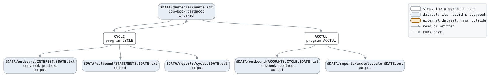

# cycle

```text
cycle.sh: close the billing cycles of the cards whose cycle day it is.

usage: cycle.sh DATE, the business date as YYYYMMDD.
environment: LCS_BIN, the programs; LCS_DATA, the data.

history
2013-06-03 rk  lcs-0219 original version.
```

Script [cycle.sh](../../../laurasia/scripts/cycle.sh): 2 steps.

## Contents

- [Network](#network)
- [Steps](#steps)
  - [CYCLE](#cycle)
  - [ACCTUL](#acctul)
- [Datasets](#datasets)
- [Findings](#findings)

## Network



## Steps

| Step | Program | Reads | Writes | Stops the script if | Description | Source |
| --- | --- | --- | --- | --- | --- | --- |
| CYCLE | [CYCLE](../programs/CYCLE.md), with $DATE | $DATA/master/accounts.idx | $DATA/master/accounts.idx, $DATA/outbound/INTEREST.$DATE.txt, $DATA/outbound/STATEMENTS.$DATE.txt, $DATA/reports/cycle.$DATE.out | RC >= 8 | interest, minimum payments and statements | [cycle.sh:20](../../../laurasia/scripts/cycle.sh#L20) |
| ACCTUL | [ACCTUL](../programs/ACCTUL.md) | $DATA/master/accounts.idx | $DATA/outbound/ACCOUNTS.CYCLE.$DATE.txt, $DATA/reports/acctul.cycle.$DATE.out | | the accounts as they stand after the cycle | [cycle.sh:28](../../../laurasia/scripts/cycle.sh#L28) |

### CYCLE

| Name | File | File in the program | Copybook | Use |
| --- | --- | --- | --- | --- |
| ACCOUNTS | $DATA/master/accounts.idx (indexed) | ACCOUNTS | [cardacct](../copybooks/cardacct.md) | update |
| POSTOUT | $DATA/outbound/INTEREST.$DATE.txt | POSTINGS-OUT | [postrec](../copybooks/postrec.md) | write |
| STMTOUT | $DATA/outbound/STATEMENTS.$DATE.txt | STATEMENTS-OUT | | write |
| stdout | $DATA/reports/cycle.$DATE.out | | | write |

### ACCTUL

| Name | File | File in the program | Copybook | Use |
| --- | --- | --- | --- | --- |
| ACCOUNTS | $DATA/master/accounts.idx (indexed) | ACCOUNTS | [cardacct](../copybooks/cardacct.md) | read |
| ACCTOUT | $DATA/outbound/ACCOUNTS.CYCLE.$DATE.txt | ACCOUNTS-OUT | [cardacct](../copybooks/cardacct.md) | write |
| stdout | $DATA/reports/acctul.cycle.$DATE.out | | | write |

## Datasets

Each dataset the job names, the copybook that describes its records, from the programs that read or write it in any job, and the steps that write and read it.

| Dataset | Copybook | Written by | Read by |
| --- | --- | --- | --- |
| $DATA/master/accounts.idx | [cardacct](../copybooks/cardacct.md) | CYCLE | CYCLE, ACCTUL |
| $DATA/outbound/INTEREST.$DATE.txt | [postrec](../copybooks/postrec.md) | CYCLE | |
| $DATA/outbound/STATEMENTS.$DATE.txt | | CYCLE | |
| $DATA/reports/cycle.$DATE.out | | CYCLE | |
| $DATA/outbound/ACCOUNTS.CYCLE.$DATE.txt | [cardacct](../copybooks/cardacct.md) | ACCTUL | |
| $DATA/reports/acctul.cycle.$DATE.out | | ACCTUL | |

## Findings

None: every program's file is bound by a DD_ variable.
