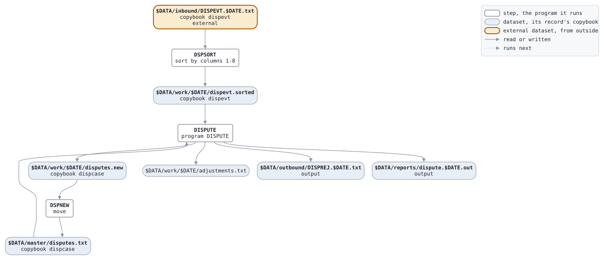

# disputes

```text
disputes.sh: move the disputes on by the day's events, and leave the
merchants' adjustments for the night's settlement.

usage: disputes.sh DATE, the business date as YYYYMMDD.
environment: LCS_BIN, the programs; LCS_DATA, the data.

history
2015-03-23 mt  lcs-0302 original version.
```

Script [disputes.sh](../../../laurasia/scripts/disputes.sh): 3 steps.

## Contents

- [Network](#network)
- [Steps](#steps)
  - [DSPSORT](#dspsort)
  - [DISPUTE](#dispute)
  - [DSPNEW](#dspnew)
- [Datasets](#datasets)
- [Findings](#findings)

## Network



## Steps

| Step | Program | Reads | Writes | Stops the script if | Description | Source |
| --- | --- | --- | --- | --- | --- | --- |
| DSPSORT | sort by columns 1-8 | $DATA/inbound/DISPEVT.$DATE.txt | $DATA/work/$DATE/dispevt.sorted | RC != 0 | the events in case order, each case's in the order given | [disputes.sh:20](../../../laurasia/scripts/disputes.sh#L20) |
| DISPUTE | [DISPUTE](../programs/DISPUTE.md), with $DATE | $DATA/master/disputes.txt, $DATA/work/$DATE/dispevt.sorted | $DATA/work/$DATE/disputes.new, $DATA/work/$DATE/adjustments.txt, $DATA/outbound/DISPREJ.$DATE.txt, $DATA/reports/dispute.$DATE.out | RC >= 8 | the cases moved on, a new master, the adjustments | [disputes.sh:31](../../../laurasia/scripts/disputes.sh#L31) |
| DSPNEW | move | $DATA/work/$DATE/disputes.new | $DATA/master/disputes.txt | | the new master in place of the old | [disputes.sh:37](../../../laurasia/scripts/disputes.sh#L37) |

### DSPSORT

| Name | File | File in the program | Copybook | Use |
| --- | --- | --- | --- | --- |
| input | $DATA/inbound/DISPEVT.$DATE.txt | | | read |
| output | $DATA/work/$DATE/dispevt.sorted | | | write |

### DISPUTE

| Name | File | File in the program | Copybook | Use |
| --- | --- | --- | --- | --- |
| DISPIN | $DATA/master/disputes.txt | MASTER-IN | | read |
| DISPEVT | $DATA/work/$DATE/dispevt.sorted | EVENTS-IN | [dispevt](../copybooks/dispevt.md) | read |
| DISPOUT | $DATA/work/$DATE/disputes.new | MASTER-OUT | [dispcase](../copybooks/dispcase.md) | write |
| ADJOUT | $DATA/work/$DATE/adjustments.txt | ADJUST-OUT | | write |
| DISPREJ | $DATA/outbound/DISPREJ.$DATE.txt | REJECT-OUT | | write |
| stdout | $DATA/reports/dispute.$DATE.out | | | write |

### DSPNEW

| Name | File | File in the program | Copybook | Use |
| --- | --- | --- | --- | --- |
| input | $DATA/work/$DATE/disputes.new | | | read |
| output | $DATA/master/disputes.txt | | | write |

## Datasets

Each dataset the job names, the copybook that describes its records, from the programs that read or write it in any job, and the steps that write and read it.

| Dataset | Copybook | Written by | Read by |
| --- | --- | --- | --- |
| $DATA/inbound/DISPEVT.$DATE.txt | [dispevt](../copybooks/dispevt.md) | | DSPSORT |
| $DATA/work/$DATE/dispevt.sorted | [dispevt](../copybooks/dispevt.md) | DSPSORT | DISPUTE |
| $DATA/master/disputes.txt | [dispcase](../copybooks/dispcase.md) | DSPNEW | DISPUTE |
| $DATA/work/$DATE/disputes.new | [dispcase](../copybooks/dispcase.md) | DISPUTE | DSPNEW |
| $DATA/work/$DATE/adjustments.txt | | DISPUTE | |
| $DATA/outbound/DISPREJ.$DATE.txt | | DISPUTE | |
| $DATA/reports/dispute.$DATE.out | | DISPUTE | |

## Findings

None: every program's file is bound by a DD_ variable.
