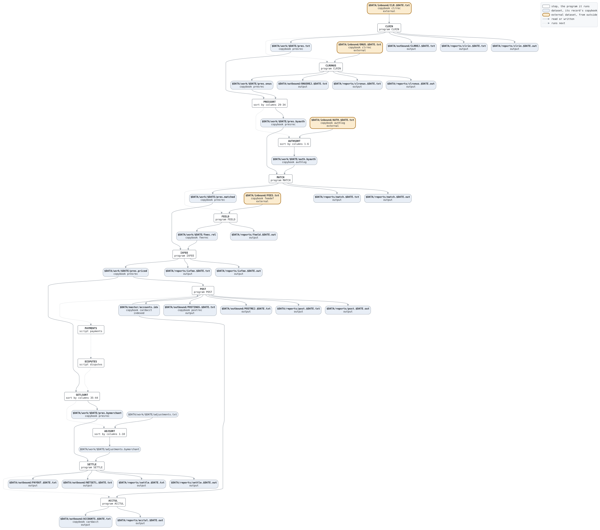

# nightly

```text
nightly.sh: the night's run: take in the clearing file, match it to the
day's authorizations, price the interchange, post to the cards, move the
disputes on, and settle with the merchants.

usage: nightly.sh DATE, the business date as YYYYMMDD.
environment: LCS_BIN, the programs; LCS_SCRIPTS, the scripts; LCS_DATA,
the data.

history
2011-04-04 rk  lcs-0102 original version.
2012-01-09 ah  lcs-0140 interchange.
2015-03-23 mt  lcs-0302 disputes before settlement.
```

Script [nightly.sh](../../../laurasia/scripts/nightly.sh): 12 steps.

## Contents

- [Network](#network)
- [Steps](#steps)
  - [CLRIN](#clrin)
  - [PRESSORT](#pressort)
  - [AUTHSORT](#authsort)
  - [MATCH](#match)
  - [FEELD](#feeld)
  - [IXFEE](#ixfee)
  - [POST](#post)
  - [SETLSORT](#setlsort)
  - [ADJSORT](#adjsort)
  - [SETTLE](#settle)
  - [ACCTUL](#acctul)
- [Datasets](#datasets)
- [Findings](#findings)

## Network



## Steps

| Step | Program | Reads | Writes | Stops the script if | Description | Source |
| --- | --- | --- | --- | --- | --- | --- |
| CLRIN | [CLRIN](../programs/CLRIN.md), with $DATE | $DATA/inbound/CLR.$DATE.txt | $DATA/work/$DATE/pres.txt, $DATA/outbound/CLRREJ.$DATE.txt, $DATA/reports/clrin.$DATE.txt, $DATA/reports/clrin.$DATE.out | RC >= 8 | the clearing file, checked batch by batch | [nightly.sh:28](../../../laurasia/scripts/nightly.sh#L28) |
| PRESSORT | sort by columns 29-34 | $DATA/work/$DATE/pres.txt | $DATA/work/$DATE/pres.byauth | RC != 0 | the presentments in authorization code order | [nightly.sh:34](../../../laurasia/scripts/nightly.sh#L34) |
| AUTHSORT | sort by columns 1-6 | $DATA/inbound/AUTH.$DATE.txt | $DATA/work/$DATE/auth.byauth | RC != 0 | the day's authorizations in authorization code order | [nightly.sh:40](../../../laurasia/scripts/nightly.sh#L40) |
| MATCH | [MATCH](../programs/MATCH.md), with $DATE | $DATA/work/$DATE/pres.byauth, $DATA/work/$DATE/auth.byauth | $DATA/work/$DATE/pres.matched, $DATA/reports/match.$DATE.txt, $DATA/reports/match.$DATE.out | RC >= 8 | each presentment marked by its authorization | [nightly.sh:50](../../../laurasia/scripts/nightly.sh#L50) |
| FEELD | [FEELD](../programs/FEELD.md), with $DATE | $DATA/inbound/FEES.txt | $DATA/work/$DATE/fees.rel, $DATA/reports/feeld.$DATE.out | RC >= 8 | the fee schedule into the fee table | [nightly.sh:58](../../../laurasia/scripts/nightly.sh#L58) |
| IXFEE | [IXFEE](../programs/IXFEE.md), with $DATE | $DATA/work/$DATE/pres.matched, $DATA/work/$DATE/fees.rel | $DATA/work/$DATE/pres.priced, $DATA/reports/ixfee.$DATE.txt, $DATA/reports/ixfee.$DATE.out | RC >= 8 | the interchange of each matched presentment | [nightly.sh:68](../../../laurasia/scripts/nightly.sh#L68) |
| POST | [POST](../programs/POST.md), with $DATE | $DATA/work/$DATE/pres.priced, $DATA/master/accounts.idx | $DATA/master/accounts.idx, $DATA/outbound/POSTINGS.$DATE.txt, $DATA/outbound/POSTREJ.$DATE.txt, $DATA/reports/post.$DATE.txt, $DATA/reports/post.$DATE.out | RC >= 8 | the purchases on the cards' accounts | [nightly.sh:79](../../../laurasia/scripts/nightly.sh#L79) |
| DISPUTES | script [disputes](disputes.md), with $DATE | | | RC >= 8 | the disputes moved on, the merchants' adjustments | [nightly.sh:85](../../../laurasia/scripts/nightly.sh#L85) |
| SETLSORT | sort by columns 35-44 | $DATA/work/$DATE/pres.priced | $DATA/work/$DATE/pres.bymerchant | RC != 0 | the priced presentments in merchant order | [nightly.sh:90](../../../laurasia/scripts/nightly.sh#L90) |
| ADJSORT | sort by columns 1-10 | $DATA/work/$DATE/adjustments.txt | $DATA/work/$DATE/adjustments.bymerchant | RC != 0 | the adjustments in merchant order | [nightly.sh:96](../../../laurasia/scripts/nightly.sh#L96) |
| SETTLE | [SETTLE](../programs/SETTLE.md), with $DATE | $DATA/work/$DATE/pres.bymerchant, $DATA/work/$DATE/adjustments.bymerchant | $DATA/outbound/PAYOUT.$DATE.txt, $DATA/reports/settle.$DATE.txt, $DATA/reports/settle.$DATE.out | RC >= 8 | what each merchant is paid | [nightly.sh:106](../../../laurasia/scripts/nightly.sh#L106) |
| ACCTUL | [ACCTUL](../programs/ACCTUL.md) | $DATA/master/accounts.idx | $DATA/outbound/ACCOUNTS.$DATE.txt, $DATA/reports/acctul.$DATE.out | | the accounts as they stand, for the card system | [nightly.sh:114](../../../laurasia/scripts/nightly.sh#L114) |

### CLRIN

| Name | File | File in the program | Copybook | Use |
| --- | --- | --- | --- | --- |
| CLRIN | $DATA/inbound/CLR.$DATE.txt | CLEARING-IN | [clrrec](../copybooks/clrrec.md) | read |
| PRESOUT | $DATA/work/$DATE/pres.txt | PRES-OUT | [presrec](../copybooks/presrec.md) | write |
| CLRREJ | $DATA/outbound/CLRREJ.$DATE.txt | REJECT-OUT | | write |
| CLRRPT | $DATA/reports/clrin.$DATE.txt | REPORT-OUT | | write |
| stdout | $DATA/reports/clrin.$DATE.out | | | write |

### PRESSORT

| Name | File | File in the program | Copybook | Use |
| --- | --- | --- | --- | --- |
| input | $DATA/work/$DATE/pres.txt | | | read |
| output | $DATA/work/$DATE/pres.byauth | | | write |

### AUTHSORT

| Name | File | File in the program | Copybook | Use |
| --- | --- | --- | --- | --- |
| input | $DATA/inbound/AUTH.$DATE.txt | | | read |
| output | $DATA/work/$DATE/auth.byauth | | | write |

### MATCH

| Name | File | File in the program | Copybook | Use |
| --- | --- | --- | --- | --- |
| PRESIN | $DATA/work/$DATE/pres.byauth | PRES-IN | [presrec](../copybooks/presrec.md) | read |
| AUTHIN | $DATA/work/$DATE/auth.byauth | AUTH-IN | [authlog](../copybooks/authlog.md) | read |
| PRESOUT | $DATA/work/$DATE/pres.matched | PRES-OUT | [presrec](../copybooks/presrec.md) | write |
| MATCHRPT | $DATA/reports/match.$DATE.txt | REPORT-OUT | | write |
| stdout | $DATA/reports/match.$DATE.out | | | write |

### FEELD

| Name | File | File in the program | Copybook | Use |
| --- | --- | --- | --- | --- |
| FEESCHED | $DATA/inbound/FEES.txt | FEE-SCHEDULE | [feedef](../copybooks/feedef.md) | read |
| FEETAB | $DATA/work/$DATE/fees.rel | FEE-TABLE | [feerec](../copybooks/feerec.md) | write |
| stdout | $DATA/reports/feeld.$DATE.out | | | write |

### IXFEE

| Name | File | File in the program | Copybook | Use |
| --- | --- | --- | --- | --- |
| PRESIN | $DATA/work/$DATE/pres.matched | PRES-IN | [presrec](../copybooks/presrec.md) | read |
| FEETAB | $DATA/work/$DATE/fees.rel | FEE-TABLE | [feerec](../copybooks/feerec.md) | read |
| PRESOUT | $DATA/work/$DATE/pres.priced | PRES-OUT | [presrec](../copybooks/presrec.md) | write |
| FEERPT | $DATA/reports/ixfee.$DATE.txt | REPORT-OUT | | write |
| stdout | $DATA/reports/ixfee.$DATE.out | | | write |

### POST

| Name | File | File in the program | Copybook | Use |
| --- | --- | --- | --- | --- |
| PRESIN | $DATA/work/$DATE/pres.priced | PRES-IN | [presrec](../copybooks/presrec.md) | read |
| ACCOUNTS | $DATA/master/accounts.idx (indexed) | ACCOUNTS | [cardacct](../copybooks/cardacct.md) | update |
| POSTOUT | $DATA/outbound/POSTINGS.$DATE.txt | POSTINGS-OUT | [postrec](../copybooks/postrec.md) | write |
| POSTREJ | $DATA/outbound/POSTREJ.$DATE.txt | REJECT-OUT | | write |
| POSTRPT | $DATA/reports/post.$DATE.txt | REPORT-OUT | | write |
| stdout | $DATA/reports/post.$DATE.out | | | write |

### SETLSORT

| Name | File | File in the program | Copybook | Use |
| --- | --- | --- | --- | --- |
| input | $DATA/work/$DATE/pres.priced | | | read |
| output | $DATA/work/$DATE/pres.bymerchant | | | write |

### ADJSORT

| Name | File | File in the program | Copybook | Use |
| --- | --- | --- | --- | --- |
| input | $DATA/work/$DATE/adjustments.txt | | | read |
| output | $DATA/work/$DATE/adjustments.bymerchant | | | write |

### SETTLE

| Name | File | File in the program | Copybook | Use |
| --- | --- | --- | --- | --- |
| PRESIN | $DATA/work/$DATE/pres.bymerchant | PRES-IN | [presrec](../copybooks/presrec.md) | read |
| ADJIN | $DATA/work/$DATE/adjustments.bymerchant | ADJUST-IN | | read |
| PAYOUT | $DATA/outbound/PAYOUT.$DATE.txt | PAYOUT-OUT | | write |
| SETLRPT | $DATA/reports/settle.$DATE.txt | REPORT-OUT | | write |
| stdout | $DATA/reports/settle.$DATE.out | | | write |

### ACCTUL

| Name | File | File in the program | Copybook | Use |
| --- | --- | --- | --- | --- |
| ACCOUNTS | $DATA/master/accounts.idx (indexed) | ACCOUNTS | [cardacct](../copybooks/cardacct.md) | read |
| ACCTOUT | $DATA/outbound/ACCOUNTS.$DATE.txt | ACCOUNTS-OUT | [cardacct](../copybooks/cardacct.md) | write |
| stdout | $DATA/reports/acctul.$DATE.out | | | write |

## Datasets

Each dataset the job names, the copybook that describes its records, from the programs that read or write it in any job, and the steps that write and read it.

| Dataset | Copybook | Written by | Read by |
| --- | --- | --- | --- |
| $DATA/inbound/CLR.$DATE.txt | [clrrec](../copybooks/clrrec.md) | | CLRIN |
| $DATA/work/$DATE/pres.txt | [presrec](../copybooks/presrec.md) | CLRIN | PRESSORT |
| $DATA/outbound/CLRREJ.$DATE.txt | | CLRIN | |
| $DATA/reports/clrin.$DATE.txt | | CLRIN | |
| $DATA/reports/clrin.$DATE.out | | CLRIN | |
| $DATA/work/$DATE/pres.byauth | [presrec](../copybooks/presrec.md) | PRESSORT | MATCH |
| $DATA/inbound/AUTH.$DATE.txt | [authlog](../copybooks/authlog.md) | | AUTHSORT |
| $DATA/work/$DATE/auth.byauth | [authlog](../copybooks/authlog.md) | AUTHSORT | MATCH |
| $DATA/work/$DATE/pres.matched | [presrec](../copybooks/presrec.md) | MATCH | IXFEE |
| $DATA/reports/match.$DATE.txt | | MATCH | |
| $DATA/reports/match.$DATE.out | | MATCH | |
| $DATA/inbound/FEES.txt | [feedef](../copybooks/feedef.md) | | FEELD |
| $DATA/work/$DATE/fees.rel | [feerec](../copybooks/feerec.md) | FEELD | IXFEE |
| $DATA/reports/feeld.$DATE.out | | FEELD | |
| $DATA/work/$DATE/pres.priced | [presrec](../copybooks/presrec.md) | IXFEE | POST, SETLSORT |
| $DATA/reports/ixfee.$DATE.txt | | IXFEE | |
| $DATA/reports/ixfee.$DATE.out | | IXFEE | |
| $DATA/master/accounts.idx | [cardacct](../copybooks/cardacct.md) | POST | POST, ACCTUL |
| $DATA/outbound/POSTINGS.$DATE.txt | [postrec](../copybooks/postrec.md) | POST | |
| $DATA/outbound/POSTREJ.$DATE.txt | | POST | |
| $DATA/reports/post.$DATE.txt | | POST | |
| $DATA/reports/post.$DATE.out | | POST | |
| $DATA/work/$DATE/pres.bymerchant | [presrec](../copybooks/presrec.md) | SETLSORT | SETTLE |
| $DATA/work/$DATE/adjustments.txt | | | ADJSORT |
| $DATA/work/$DATE/adjustments.bymerchant | | ADJSORT | SETTLE |
| $DATA/outbound/PAYOUT.$DATE.txt | | SETTLE | |
| $DATA/reports/settle.$DATE.txt | | SETTLE | |
| $DATA/reports/settle.$DATE.out | | SETTLE | |
| $DATA/outbound/ACCOUNTS.$DATE.txt | [cardacct](../copybooks/cardacct.md) | ACCTUL | |
| $DATA/reports/acctul.$DATE.out | | ACCTUL | |

## Findings

None: every program's file is bound by a DD_ variable.
