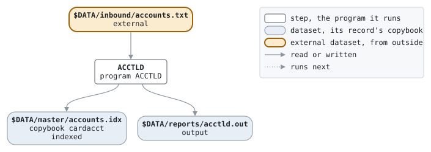

# open

```text
open.sh: open the card processor: load the card accounts into the indexed
account file the nights post to.

usage: open.sh
environment: LCS_BIN, the programs; LCS_DATA, the data.

history
2011-04-04 rk  lcs-0102 original version.
```

Script [open.sh](../../../laurasia/scripts/open.sh): 1 steps.

## Contents

- [Network](#network)
- [Steps](#steps)
  - [ACCTLD](#acctld)
- [Datasets](#datasets)
- [Findings](#findings)

## Network



## Steps

| Step | Program | Reads | Writes | Stops the script if | Description | Source |
| --- | --- | --- | --- | --- | --- | --- |
| ACCTLD | [ACCTLD](../programs/ACCTLD.md) | $DATA/inbound/accounts.txt | $DATA/master/accounts.idx, $DATA/reports/acctld.out | RC >= 8 | the accounts, from the card system's extract | [open.sh:19](../../../laurasia/scripts/open.sh#L19) |

### ACCTLD

| Name | File | File in the program | Copybook | Use |
| --- | --- | --- | --- | --- |
| ACCTIN | $DATA/inbound/accounts.txt | ACCOUNTS-IN | | read |
| ACCOUNTS | $DATA/master/accounts.idx (indexed) | ACCOUNTS | [cardacct](../copybooks/cardacct.md) | write |
| stdout | $DATA/reports/acctld.out | | | write |

## Datasets

Each dataset the job names, the copybook that describes its records, from the programs that read or write it in any job, and the steps that write and read it.

| Dataset | Copybook | Written by | Read by |
| --- | --- | --- | --- |
| $DATA/inbound/accounts.txt | | | ACCTLD |
| $DATA/master/accounts.idx | [cardacct](../copybooks/cardacct.md) | ACCTLD | |
| $DATA/reports/acctld.out | | ACCTLD | |

## Findings

None: every program's file is bound by a DD_ variable.
