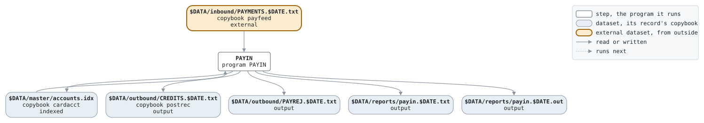

# payments

```text
payments.sh: take in the card system's feed: the cardholders' payments
off their balances, and the cards' status changes.

usage: payments.sh DATE, the business date as YYYYMMDD.
environment: LCS_BIN, the programs; LCS_DATA, the data.

history
2022-09-05 ah  lcs-0497 original version.
```

Script [payments.sh](../../../laurasia/scripts/payments.sh): 1 steps.

## Contents

- [Network](#network)
- [Steps](#steps)
  - [PAYIN](#payin)
- [Datasets](#datasets)
- [Findings](#findings)

## Network



## Steps

| Step | Program | Reads | Writes | Stops the script if | Description | Source |
| --- | --- | --- | --- | --- | --- | --- |
| PAYIN | [PAYIN](../programs/PAYIN.md), with $DATE | $DATA/inbound/PAYMENTS.$DATE.txt, $DATA/master/accounts.idx | $DATA/master/accounts.idx, $DATA/outbound/CREDITS.$DATE.txt, $DATA/outbound/PAYREJ.$DATE.txt, $DATA/reports/payin.$DATE.txt, $DATA/reports/payin.$DATE.out | RC >= 8 | the payments and status changes on the cards' accounts | [payments.sh:22](../../../laurasia/scripts/payments.sh#L22) |

### PAYIN

| Name | File | File in the program | Copybook | Use |
| --- | --- | --- | --- | --- |
| FEEDIN | $DATA/inbound/PAYMENTS.$DATE.txt | FEED-IN | [payfeed](../copybooks/payfeed.md) | read |
| ACCOUNTS | $DATA/master/accounts.idx (indexed) | ACCOUNTS | [cardacct](../copybooks/cardacct.md) | update |
| POSTOUT | $DATA/outbound/CREDITS.$DATE.txt | POSTINGS-OUT | [postrec](../copybooks/postrec.md) | write |
| PAYREJ | $DATA/outbound/PAYREJ.$DATE.txt | REJECT-OUT | | write |
| PAYRPT | $DATA/reports/payin.$DATE.txt | REPORT-OUT | | write |
| stdout | $DATA/reports/payin.$DATE.out | | | write |

## Datasets

Each dataset the job names, the copybook that describes its records, from the programs that read or write it in any job, and the steps that write and read it.

| Dataset | Copybook | Written by | Read by |
| --- | --- | --- | --- |
| $DATA/inbound/PAYMENTS.$DATE.txt | [payfeed](../copybooks/payfeed.md) | | PAYIN |
| $DATA/master/accounts.idx | [cardacct](../copybooks/cardacct.md) | PAYIN | PAYIN |
| $DATA/outbound/CREDITS.$DATE.txt | [postrec](../copybooks/postrec.md) | PAYIN | |
| $DATA/outbound/PAYREJ.$DATE.txt | | PAYIN | |
| $DATA/reports/payin.$DATE.txt | | PAYIN | |
| $DATA/reports/payin.$DATE.out | | PAYIN | |

## Findings

None: every program's file is bound by a DD_ variable.
