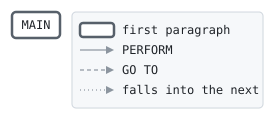

# ACCTLD

```text
acctld: load the card accounts into the indexed account file

return codes: 0 loaded, 8 some cards twice, 16 cannot write.

history
2011-04-04 rk  lcs-0102 original version.
```

Program [acctld.cbl](../../../laurasia/programs/acctld.cbl): 2 files, 1 paragraphs. Its business rules: [2 decision tables](../rules/ACCTLD.md).

## Contents

- [Files](#files)
- [Flow](#flow)
- [Paragraphs](#paragraphs)
- [Data flow](#data-flow)
- [Lineage](#lineage)
  - [Into ACCOUNT-LINE](#into-account-line)
  - [Into CARD-ACCOUNT](#into-card-account)
  - [Into WS-AT-END](#into-ws-at-end)
  - [Into WS-RESULT](#into-ws-result)
  - [Out of the program](#out-of-the-program)
- [Field origins](#field-origins)
  - [File ACCOUNTS](#file-accounts)
- [Records](#records)
  - [ACCOUNT-LINE](#account-line)
  - [CARD-ACCOUNT](#card-account)
  - [WS-ACCOUNTS-STATUS](#ws-accounts-status)
  - [WS-AT-END](#ws-at-end)
  - [WS-RESULT](#ws-result)

## Files

| File | Kind | Assigned to | Organization | Status field | Opened | Records |
| --- | --- | --- | --- | --- | --- | --- |
| ACCOUNTS-IN | FD | ACCTIN | LINE SEQUENTIAL | | INPUT | ACCOUNT-LINE |
| ACCOUNTS | FD | ACCOUNTS | INDEXED, key CA-CARD-NO, RANDOM access | WS-ACCOUNTS-STATUS | OUTPUT | CARD-ACCOUNT |

## Flow



## Paragraphs

| Paragraph | Description | Source | Performs | Goes to | Performed by | Reached by |
| --- | --- | --- | --- | --- | --- | --- |
| MAIN | | [acctld.cbl:36](../../../laurasia/programs/acctld.cbl#L36) | | | | |

## Data flow

| Paragraph | Reads | Writes |
| --- | --- | --- |
| MAIN | WS-ACCOUNTS-STATUS, WS-AT-END, ACCOUNT-LINE, WS-RESULT | RETURN-CODE, ACCOUNT-LINE, WS-AT-END, CARD-ACCOUNT, WS-RESULT |

## Lineage

Where each data item's values come from, grouped by the record they go into. A data item links to the record it belongs to.

### Into ACCOUNT-LINE

Record [ACCOUNT-LINE](#account-line).

| Into | From | Statement | Paragraph | Source |
| --- | --- | --- | --- | --- |
| ACCOUNT-LINE | file ACCOUNTS-IN | READ | MAIN | [acctld.cbl:42](../../../laurasia/programs/acctld.cbl#L42) |

### Into CARD-ACCOUNT

Record [CARD-ACCOUNT](#card-account), from copybook [cardacct](../copybooks/cardacct.md).

| Into | From | Statement | Paragraph | Source |
| --- | --- | --- | --- | --- |
| CARD-ACCOUNT | [ACCOUNT-LINE](#account-line) | WRITE | MAIN | [acctld.cbl:45](../../../laurasia/programs/acctld.cbl#L45) |

### Into WS-AT-END

Record [WS-AT-END](#ws-at-end).

| Into | From | Statement | Paragraph | Source |
| --- | --- | --- | --- | --- |
| WS-AT-END | literal condition ACCOUNTS-AT-END | SET | MAIN | [acctld.cbl:43](../../../laurasia/programs/acctld.cbl#L43) |

### Into WS-RESULT

Record [WS-RESULT](#ws-result).

| Into | From | Statement | Paragraph | Source |
| --- | --- | --- | --- | --- |
| WS-RESULT | literal 8 | MOVE | MAIN | [acctld.cbl:46](../../../laurasia/programs/acctld.cbl#L46) |

### Out of the program

Records written to files, items passed to the programs called, and items displayed to the job's output.

| Into | From | Statement | Paragraph | Source |
| --- | --- | --- | --- | --- |
| file ACCOUNTS | [CARD-ACCOUNT](#card-account) | WRITE | MAIN | [acctld.cbl:45](../../../laurasia/programs/acctld.cbl#L45) |

## Field origins

Where the values of each field the program writes to a file come from: the fields of the files it reads, literals, and initial values, followed through every statement that moves a value, and through groups and redefinitions by the bytes they share.

### File ACCOUNTS

Written from [ACCOUNT-LINE](#account-line).

| Field | Position | Origins |
| --- | --: | --- |
| ACCOUNT-LINE | 1-61 | file ACCOUNTS-IN ACCOUNT-LINE |

## Records

### ACCOUNT-LINE

File ACCOUNTS-IN. 61 bytes.

| Level | Field | Kind | Start | Length | Picture | Usage | Notes | Source |
| --: | --- | --- | --: | --: | --- | --- | --- | --- |
| 01 | ACCOUNT-LINE | text | 1 | 61 | X(61) | | | [acctld.cbl:25](../../../laurasia/programs/acctld.cbl#L25) |

### CARD-ACCOUNT

File ACCOUNTS. 61 bytes, layout in copybook [cardacct](../copybooks/cardacct.md).

### WS-ACCOUNTS-STATUS

Working storage. 2 bytes.

| Level | Field | Kind | Start | Length | Picture | Usage | Notes | Source |
| --: | --- | --- | --: | --: | --- | --- | --- | --- |
| 01 | WS-ACCOUNTS-STATUS | text | 1 | 2 | XX | | | [acctld.cbl:30](../../../laurasia/programs/acctld.cbl#L30) |

### WS-AT-END

Working storage. 1 bytes.

| Level | Field | Kind | Start | Length | Picture | Usage | Notes | Source |
| --: | --- | --- | --: | --: | --- | --- | --- | --- |
| 01 | WS-AT-END | code | 1 | 1 | X | | VALUE 'N' | [acctld.cbl:31](../../../laurasia/programs/acctld.cbl#L31) |
| 88 | └ ACCOUNTS-AT-END | | | | | | VALUE 'Y' | [acctld.cbl:32](../../../laurasia/programs/acctld.cbl#L32) |

### WS-RESULT

Working storage. 2 bytes.

| Level | Field | Kind | Start | Length | Picture | Usage | Notes | Source |
| --: | --- | --- | --: | --: | --- | --- | --- | --- |
| 01 | WS-RESULT | number | 1 | 2 | 99 | | VALUE ZERO | [acctld.cbl:33](../../../laurasia/programs/acctld.cbl#L33) |
