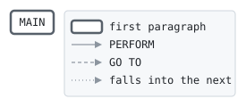

# ACCTUL

```text
acctul: unload the indexed account file, in card number order

history
2011-04-04 rk  lcs-0102 original version.
```

Program [acctul.cbl](../../../laurasia/programs/acctul.cbl): 2 files, 1 paragraphs. Its business rules: [1 decision tables](../rules/ACCTUL.md).

## Contents

- [Files](#files)
- [Flow](#flow)
- [Paragraphs](#paragraphs)
- [Data flow](#data-flow)
- [Lineage](#lineage)
  - [Into CARD-ACCOUNT](#into-card-account)
  - [Into ACCOUNT-LINE](#into-account-line)
  - [Out of the program](#out-of-the-program)
- [Field origins](#field-origins)
  - [File ACCOUNTS-OUT](#file-accounts-out)
- [Records](#records)
  - [CARD-ACCOUNT](#card-account)
  - [ACCOUNT-LINE](#account-line)
  - [WS-ACCOUNTS-STATUS](#ws-accounts-status)

## Files

| File | Kind | Assigned to | Organization | Status field | Opened | Records |
| --- | --- | --- | --- | --- | --- | --- |
| ACCOUNTS | FD | ACCOUNTS | INDEXED, key CA-CARD-NO | WS-ACCOUNTS-STATUS | INPUT | CARD-ACCOUNT |
| ACCOUNTS-OUT | FD | ACCTOUT | LINE SEQUENTIAL | | OUTPUT | ACCOUNT-LINE |

## Flow



## Paragraphs

| Paragraph | Description | Source | Performs | Goes to | Performed by | Reached by |
| --- | --- | --- | --- | --- | --- | --- |
| MAIN | | [acctul.cbl:32](../../../laurasia/programs/acctul.cbl#L32) | | | | |

## Data flow

| Paragraph | Reads | Writes |
| --- | --- | --- |
| MAIN | WS-ACCOUNTS-STATUS, CARD-ACCOUNT | RETURN-CODE, CARD-ACCOUNT, ACCOUNT-LINE |

## Lineage

Where each data item's values come from, grouped by the record they go into. A data item links to the record it belongs to.

### Into CARD-ACCOUNT

Record [CARD-ACCOUNT](#card-account), from copybook [cardacct](../copybooks/cardacct.md).

| Into | From | Statement | Paragraph | Source |
| --- | --- | --- | --- | --- |
| CARD-ACCOUNT | file ACCOUNTS | READ | MAIN | [acctul.cbl:37](../../../laurasia/programs/acctul.cbl#L37) |
| CARD-ACCOUNT | file ACCOUNTS | READ | MAIN | [acctul.cbl:40](../../../laurasia/programs/acctul.cbl#L40) |

### Into ACCOUNT-LINE

Record [ACCOUNT-LINE](#account-line).

| Into | From | Statement | Paragraph | Source |
| --- | --- | --- | --- | --- |
| ACCOUNT-LINE | [CARD-ACCOUNT](#card-account) | WRITE | MAIN | [acctul.cbl:39](../../../laurasia/programs/acctul.cbl#L39) |

### Out of the program

Records written to files, items passed to the programs called, and items displayed to the job's output.

| Into | From | Statement | Paragraph | Source |
| --- | --- | --- | --- | --- |
| file ACCOUNTS-OUT | [ACCOUNT-LINE](#account-line) | WRITE | MAIN | [acctul.cbl:39](../../../laurasia/programs/acctul.cbl#L39) |

## Field origins

Where the values of each field the program writes to a file come from: the fields of the files it reads, literals, and initial values, followed through every statement that moves a value, and through groups and redefinitions by the bytes they share.

### File ACCOUNTS-OUT

Written from [CARD-ACCOUNT](#card-account).

| Field | Position | Origins |
| --- | --: | --- |
| CA-CARD-NO | 1-16 | file ACCOUNTS CA-CARD-NO |
| CA-ACCOUNT-NO | 17-26 | file ACCOUNTS CA-ACCOUNT-NO |
| CA-PRODUCT | 27-28 | file ACCOUNTS CA-PRODUCT |
| CA-STATUS | 29 | file ACCOUNTS CA-STATUS |
| CA-LIMIT | 30-38 | file ACCOUNTS CA-LIMIT |
| CA-BALANCE | 39-48 | file ACCOUNTS CA-BALANCE |
| CA-STATEMENT-BALANCE | 49-58 | file ACCOUNTS CA-STATEMENT-BALANCE |
| CA-CYCLE-DAY | 59-60 | file ACCOUNTS CA-CYCLE-DAY |
| CA-PAID-IN-FULL | 61 | file ACCOUNTS CA-PAID-IN-FULL |

## Records

### CARD-ACCOUNT

File ACCOUNTS. 61 bytes, layout in copybook [cardacct](../copybooks/cardacct.md).

### ACCOUNT-LINE

File ACCOUNTS-OUT. 61 bytes.

| Level | Field | Kind | Start | Length | Picture | Usage | Notes | Source |
| --: | --- | --- | --: | --: | --- | --- | --- | --- |
| 01 | ACCOUNT-LINE | text | 1 | 61 | X(61) | | | [acctul.cbl:25](../../../laurasia/programs/acctul.cbl#L25) |

### WS-ACCOUNTS-STATUS

Working storage. 2 bytes.

| Level | Field | Kind | Start | Length | Picture | Usage | Notes | Source |
| --: | --- | --- | --: | --: | --- | --- | --- | --- |
| 01 | WS-ACCOUNTS-STATUS | code | 1 | 2 | XX | | | [acctul.cbl:28](../../../laurasia/programs/acctul.cbl#L28) |
| 88 | └ ACCOUNTS-AT-END | | | | | | VALUE '10' | [acctul.cbl:29](../../../laurasia/programs/acctul.cbl#L29) |
