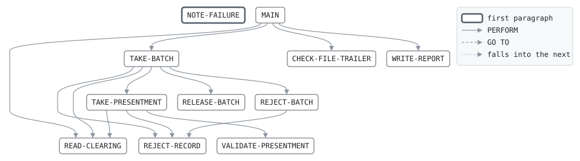

# CLRIN

```text
clrin: take in the networks' clearing file

reads the night's clearing file, checks it is for the business date the
run is given, and checks each acquirer's batch against its trailer: the
presentments of a batch whose count and amount agree go on to matching,
those of a batch that does not are rejected whole. a presentment that
does not validate is rejected alone, but counts towards its batch. the
file trailer's totals are checked last.

return codes: 0 all taken, 4 some rejected, 8 file totals differ,
12 not the night's file, 16 cannot read or write.

history
2011-04-04 rk  lcs-0102 original version.
2014-02-17 rk  lcs-0251 presentments held until their batch checks.
2016-09-12 ah  lcs-0377 card product validated.
```

Program [clrin.cbl](../../../laurasia/programs/clrin.cbl): 4 files, 11 paragraphs. Its business rules: [7 decision tables](../rules/CLRIN.md).

## Contents

- [Files](#files)
- [Constants](#constants)
- [Flow](#flow)
- [Paragraphs](#paragraphs)
- [Declaratives](#declaratives)
- [Data flow](#data-flow)
- [Lineage](#lineage)
  - [Into CLR-FILE-HEADER](#into-clr-file-header)
  - [Into CLR-BATCH-HEADER](#into-clr-batch-header)
  - [Into CLR-PRESENTMENT](#into-clr-presentment)
  - [Into CLR-BATCH-TRAILER](#into-clr-batch-trailer)
  - [Into CLR-FILE-TRAILER](#into-clr-file-trailer)
  - [Into PRES-RECORD](#into-pres-record)
  - [Into REJECT-LINE](#into-reject-line)
  - [Into REPORT-LINE](#into-report-line)
  - [Into WS-RUN-DATE](#into-ws-run-date)
  - [Into WS-STATUSES](#into-ws-statuses)
  - [Into WS-IO-FAILED](#into-ws-io-failed)
  - [Into WS-BATCH](#into-ws-batch)
  - [Into WS-FILE-TOTALS](#into-ws-file-totals)
  - [Into WS-COUNTS](#into-ws-counts)
  - [Into WS-RECORD-READ](#into-ws-record-read)
  - [Into WS-REASON](#into-ws-reason)
  - [Into WS-RESULT](#into-ws-result)
  - [Into WS-REPORT-COUNT](#into-ws-report-count)
  - [Out of the program](#out-of-the-program)
- [Field origins](#field-origins)
  - [File PRES-OUT](#file-pres-out)
  - [File REJECT-OUT](#file-reject-out)
  - [File REPORT-OUT](#file-report-out)
- [Links between records](#links-between-records)
- [Control totals](#control-totals)
- [Records](#records)
  - [CLR-FILE-HEADER](#clr-file-header)
  - [CLR-BATCH-HEADER](#clr-batch-header)
  - [CLR-PRESENTMENT](#clr-presentment)
  - [CLR-BATCH-TRAILER](#clr-batch-trailer)
  - [CLR-FILE-TRAILER](#clr-file-trailer)
  - [PRES-RECORD](#pres-record)
  - [REJECT-LINE](#reject-line)
  - [REPORT-LINE](#report-line)
  - [WS-RUN-DATE](#ws-run-date)
  - [WS-LINE-LENGTH](#ws-line-length)
  - [WS-STATUSES](#ws-statuses)
  - [WS-IO-FAILED](#ws-io-failed)
  - [WS-BATCH](#ws-batch)
  - [WS-FILE-TOTALS](#ws-file-totals)
  - [WS-COUNTS](#ws-counts)
  - [WS-RECORD-READ](#ws-record-read)
  - [WS-REASON](#ws-reason)
  - [WS-RESULT](#ws-result)
  - [WS-REPORT-COUNT](#ws-report-count)

## Files

| File | Kind | Assigned to | Organization | Status field | Opened | Records |
| --- | --- | --- | --- | --- | --- | --- |
| CLEARING-IN | FD | CLRIN | LINE SEQUENTIAL, records of 14 to 61 characters, length in WS-LINE-LENGTH | WS-CLEARING-STATUS | INPUT | CLR-FILE-HEADER, CLR-BATCH-HEADER, CLR-PRESENTMENT, CLR-BATCH-TRAILER, CLR-FILE-TRAILER |
| PRES-OUT | FD | PRESOUT | LINE SEQUENTIAL | WS-PRES-STATUS | OUTPUT | PRES-RECORD |
| REJECT-OUT | FD | CLRREJ | LINE SEQUENTIAL | WS-REJECT-STATUS | OUTPUT | REJECT-LINE |
| REPORT-OUT | FD | CLRRPT | LINE SEQUENTIAL | | OUTPUT | REPORT-LINE |

## Constants

| Constant | Value | Source |
| --- | --- | --- |
| MAX-BATCH | 500 | [clrin.cbl:54](../../../laurasia/programs/clrin.cbl#L54) |

## Flow



## Paragraphs

| Paragraph | Description | Source | Performs | Goes to | Performed by | Reached by |
| --- | --- | --- | --- | --- | --- | --- |
| NOTE-FAILURE | | [clrin.cbl:90](../../../laurasia/programs/clrin.cbl#L90) | | | | |
| MAIN | | [clrin.cbl:94](../../../laurasia/programs/clrin.cbl#L94) | READ-CLEARING, TAKE-BATCH, CHECK-FILE-TRAILER, WRITE-REPORT | | | |
| READ-CLEARING | | [clrin.cbl:116](../../../laurasia/programs/clrin.cbl#L116) | | | MAIN, TAKE-BATCH, TAKE-PRESENTMENT | |
| TAKE-BATCH | a batch: its header, its presentments held until its trailer, which lets them go on or rejects them all. the held presentments pass through the file's record, so the trailer read is set aside meanwhile. | [clrin.cbl:124](../../../laurasia/programs/clrin.cbl#L124) | REJECT-RECORD, READ-CLEARING, TAKE-PRESENTMENT, RELEASE-BATCH, REJECT-BATCH | | MAIN | |
| TAKE-PRESENTMENT | | [clrin.cbl:147](../../../laurasia/programs/clrin.cbl#L147) | VALIDATE-PRESENTMENT, REJECT-RECORD, READ-CLEARING | | TAKE-BATCH | |
| VALIDATE-PRESENTMENT | | [clrin.cbl:159](../../../laurasia/programs/clrin.cbl#L159) | | | TAKE-PRESENTMENT | |
| RELEASE-BATCH | | [clrin.cbl:175](../../../laurasia/programs/clrin.cbl#L175) | | | TAKE-BATCH | |
| REJECT-BATCH | | [clrin.cbl:193](../../../laurasia/programs/clrin.cbl#L193) | REJECT-RECORD | | TAKE-BATCH | |
| REJECT-RECORD | | [clrin.cbl:200](../../../laurasia/programs/clrin.cbl#L200) | | | TAKE-BATCH, TAKE-PRESENTMENT, REJECT-BATCH | |
| CHECK-FILE-TRAILER | | [clrin.cbl:211](../../../laurasia/programs/clrin.cbl#L211) | | | MAIN | |
| WRITE-REPORT | | [clrin.cbl:219](../../../laurasia/programs/clrin.cbl#L219) | | | MAIN | |

## Declaratives

Sections the runtime runs when an input or output statement fails, after which control goes on after the statement.

| Section | Runs on a failure of | Source |
| --- | --- | --- |
| FILE-ERRORS | CLEARING-IN, PRES-OUT, REJECT-OUT | [clrin.cbl:89](../../../laurasia/programs/clrin.cbl#L89) |

## Data flow

| Paragraph | Reads | Writes |
| --- | --- | --- |
| NOTE-FAILURE | | WS-IO-FAILED |
| MAIN | WS-IO-FAILED, WS-CLEARING-STATUS, CLR-RECORD-TYPE, FH-FILE-DATE, WS-RUN-DATE, WS-RESULT | WS-RUN-DATE, WS-CLEARING-STATUS, WS-PRES-STATUS, WS-REJECT-STATUS, RETURN-CODE, WS-RESULT |
| READ-CLEARING | | CLR-FILE-HEADER, CLR-BATCH-HEADER, CLR-PRESENTMENT, CLR-BATCH-TRAILER, CLR-FILE-TRAILER, WS-CLEARING-STATUS |
| TAKE-BATCH | CLR-RECORD-TYPE, BH-BATCH-NO, WS-BATCHES, WS-CLEARING-STATUS, CLR-PRESENTMENT, BT-COUNT, WS-BATCH-COUNT, BT-AMOUNT, WS-BATCH-AMOUNT, WS-RECORD-READ | WS-REASON, WS-BATCH-NO, WS-BATCH-COUNT, WS-BATCH-AMOUNT, WS-HELD-COUNT, WS-BATCHES, WS-RECORD-READ, CLR-PRESENTMENT |
| TAKE-PRESENTMENT | WS-BATCH-COUNT, WS-RECORDS, PR-AMOUNT, WS-BATCH-AMOUNT, WS-AMOUNT, WS-REASON, WS-HELD-COUNT, MAX-BATCH, CLR-PRESENTMENT | WS-BATCH-COUNT, WS-RECORDS, WS-BATCH-AMOUNT, WS-AMOUNT, WS-HELD-COUNT, WS-HELD-PRESENTMENT |
| VALIDATE-PRESENTMENT | PR-CARD-NO, PR-AMOUNT, PR-MCC, PR-REGION, PR-PRODUCT | WS-REASON |
| RELEASE-BATCH | WS-LINE-LENGTH, WS-HELD-COUNT, WS-HELD-PRESENTMENT, PR-CARD-NO, PR-AMOUNT, PR-AUTH-CODE, PR-MERCHANT, PR-MCC, PR-REGION, PR-PRODUCT, PR-TXN-DATE, WS-BATCH-NO, WS-TAKEN | WS-LINE-LENGTH, CLR-PRESENTMENT, PRES-RECORD, PS-CARD-NO, PS-AMOUNT, PS-AUTH-CODE, PS-MERCHANT, PS-MCC, PS-REGION, PS-PRODUCT, PS-TXN-DATE, PS-BATCH-NO, PS-FEE, WS-PRES-STATUS, WS-TAKEN |
| REJECT-BATCH | WS-LINE-LENGTH, WS-HELD-COUNT, WS-HELD-PRESENTMENT | WS-REASON, WS-LINE-LENGTH, CLR-PRESENTMENT |
| REJECT-RECORD | WS-REASON, WS-BATCH-NO, CLR-PRESENTMENT, WS-REJECTED, WS-RESULT | REJECT-LINE, RJ-REASON, RJ-BATCH-NO, RJ-RECORD, WS-REJECT-STATUS, WS-REJECTED, WS-RESULT |
| CHECK-FILE-TRAILER | CLR-RECORD-TYPE, FT-BATCH-COUNT, WS-BATCHES, FT-RECORD-COUNT, WS-RECORDS, FT-AMOUNT, WS-AMOUNT | WS-RESULT |
| WRITE-REPORT | WS-RUN-DATE, WS-TAKEN, WS-REPORT-COUNT, WS-REJECTED, WS-BATCHES | REPORT-LINE, RC-LABEL, RC-VALUE |

## Lineage

Where each data item's values come from, grouped by the record they go into. A data item links to the record it belongs to.

### Into CLR-FILE-HEADER

Record [CLR-FILE-HEADER](#clr-file-header), from copybook [clrrec](../copybooks/clrrec.md).

| Into | From | Statement | Paragraph | Source |
| --- | --- | --- | --- | --- |
| CLR-FILE-HEADER | file CLEARING-IN | READ | READ-CLEARING | [clrin.cbl:117](../../../laurasia/programs/clrin.cbl#L117) |

### Into CLR-BATCH-HEADER

Record [CLR-BATCH-HEADER](#clr-batch-header), from copybook [clrrec](../copybooks/clrrec.md).

| Into | From | Statement | Paragraph | Source |
| --- | --- | --- | --- | --- |
| CLR-BATCH-HEADER | file CLEARING-IN | READ | READ-CLEARING | [clrin.cbl:117](../../../laurasia/programs/clrin.cbl#L117) |

### Into CLR-PRESENTMENT

Record [CLR-PRESENTMENT](#clr-presentment), from copybook [clrrec](../copybooks/clrrec.md).

| Into | From | Statement | Paragraph | Source |
| --- | --- | --- | --- | --- |
| CLR-PRESENTMENT | file CLEARING-IN | READ | READ-CLEARING | [clrin.cbl:117](../../../laurasia/programs/clrin.cbl#L117) |
| CLR-PRESENTMENT | [WS-RECORD-READ](#ws-record-read) | MOVE | TAKE-BATCH | [clrin.cbl:142](../../../laurasia/programs/clrin.cbl#L142) |
| CLR-PRESENTMENT | [WS-HELD-PRESENTMENT](#ws-batch "in WS-BATCH") | MOVE | RELEASE-BATCH | [clrin.cbl:177](../../../laurasia/programs/clrin.cbl#L177) |
| CLR-PRESENTMENT | [WS-HELD-PRESENTMENT](#ws-batch "in WS-BATCH") | MOVE | REJECT-BATCH | [clrin.cbl:196](../../../laurasia/programs/clrin.cbl#L196) |

### Into CLR-BATCH-TRAILER

Record [CLR-BATCH-TRAILER](#clr-batch-trailer), from copybook [clrrec](../copybooks/clrrec.md).

| Into | From | Statement | Paragraph | Source |
| --- | --- | --- | --- | --- |
| CLR-BATCH-TRAILER | file CLEARING-IN | READ | READ-CLEARING | [clrin.cbl:117](../../../laurasia/programs/clrin.cbl#L117) |

### Into CLR-FILE-TRAILER

Record [CLR-FILE-TRAILER](#clr-file-trailer), from copybook [clrrec](../copybooks/clrrec.md).

| Into | From | Statement | Paragraph | Source |
| --- | --- | --- | --- | --- |
| CLR-FILE-TRAILER | file CLEARING-IN | READ | READ-CLEARING | [clrin.cbl:117](../../../laurasia/programs/clrin.cbl#L117) |

### Into PRES-RECORD

Record [PRES-RECORD](#pres-record), from copybook [presrec](../copybooks/presrec.md).

| Into | From | Statement | Paragraph | Source |
| --- | --- | --- | --- | --- |
| PRES-RECORD | literal SPACES | MOVE | RELEASE-BATCH | [clrin.cbl:178](../../../laurasia/programs/clrin.cbl#L178) |
| PS-AMOUNT | [PR-AMOUNT](#clr-presentment "in CLR-PRESENTMENT") | MOVE | RELEASE-BATCH | [clrin.cbl:180](../../../laurasia/programs/clrin.cbl#L180) |
| PS-AUTH-CODE | [PR-AUTH-CODE](#clr-presentment "in CLR-PRESENTMENT") | MOVE | RELEASE-BATCH | [clrin.cbl:181](../../../laurasia/programs/clrin.cbl#L181) |
| PS-BATCH-NO | [WS-BATCH-NO](#ws-batch "in WS-BATCH") | MOVE | RELEASE-BATCH | [clrin.cbl:187](../../../laurasia/programs/clrin.cbl#L187) |
| PS-CARD-NO | [PR-CARD-NO](#clr-presentment "in CLR-PRESENTMENT") | MOVE | RELEASE-BATCH | [clrin.cbl:179](../../../laurasia/programs/clrin.cbl#L179) |
| PS-FEE | literal ZERO | MOVE | RELEASE-BATCH | [clrin.cbl:188](../../../laurasia/programs/clrin.cbl#L188) |
| PS-MCC | [PR-MCC](#clr-presentment "in CLR-PRESENTMENT") | MOVE | RELEASE-BATCH | [clrin.cbl:183](../../../laurasia/programs/clrin.cbl#L183) |
| PS-MERCHANT | [PR-MERCHANT](#clr-presentment "in CLR-PRESENTMENT") | MOVE | RELEASE-BATCH | [clrin.cbl:182](../../../laurasia/programs/clrin.cbl#L182) |
| PS-PRODUCT | [PR-PRODUCT](#clr-presentment "in CLR-PRESENTMENT") | MOVE | RELEASE-BATCH | [clrin.cbl:185](../../../laurasia/programs/clrin.cbl#L185) |
| PS-REGION | [PR-REGION](#clr-presentment "in CLR-PRESENTMENT") | MOVE | RELEASE-BATCH | [clrin.cbl:184](../../../laurasia/programs/clrin.cbl#L184) |
| PS-TXN-DATE | [PR-TXN-DATE](#clr-presentment "in CLR-PRESENTMENT") | MOVE | RELEASE-BATCH | [clrin.cbl:186](../../../laurasia/programs/clrin.cbl#L186) |

### Into REJECT-LINE

Record [REJECT-LINE](#reject-line).

| Into | From | Statement | Paragraph | Source |
| --- | --- | --- | --- | --- |
| REJECT-LINE | literal SPACES | MOVE | REJECT-RECORD | [clrin.cbl:201](../../../laurasia/programs/clrin.cbl#L201) |
| RJ-BATCH-NO | [WS-BATCH-NO](#ws-batch "in WS-BATCH") | MOVE | REJECT-RECORD | [clrin.cbl:203](../../../laurasia/programs/clrin.cbl#L203) |
| RJ-REASON | [WS-REASON](#ws-reason) | MOVE | REJECT-RECORD | [clrin.cbl:202](../../../laurasia/programs/clrin.cbl#L202) |
| RJ-RECORD | [CLR-PRESENTMENT](#clr-presentment) | MOVE | REJECT-RECORD | [clrin.cbl:204](../../../laurasia/programs/clrin.cbl#L204) |

### Into REPORT-LINE

Record [REPORT-LINE](#report-line).

| Into | From | Statement | Paragraph | Source |
| --- | --- | --- | --- | --- |
| REPORT-LINE | literal SPACES | MOVE | WRITE-REPORT | [clrin.cbl:220](../../../laurasia/programs/clrin.cbl#L220) |
| REPORT-LINE | literal 'CLRIN    CLEARING FILE OF ' | STRING | WRITE-REPORT | [clrin.cbl:221](../../../laurasia/programs/clrin.cbl#L221) |
| REPORT-LINE | [WS-RUN-DATE](#ws-run-date) | STRING | WRITE-REPORT | [clrin.cbl:221](../../../laurasia/programs/clrin.cbl#L221) |
| REPORT-LINE | [WS-REPORT-COUNT](#ws-report-count) | WRITE | WRITE-REPORT | [clrin.cbl:225](../../../laurasia/programs/clrin.cbl#L225) |
| REPORT-LINE | [WS-REPORT-COUNT](#ws-report-count) | WRITE | WRITE-REPORT | [clrin.cbl:228](../../../laurasia/programs/clrin.cbl#L228) |
| REPORT-LINE | [WS-REPORT-COUNT](#ws-report-count) | WRITE | WRITE-REPORT | [clrin.cbl:231](../../../laurasia/programs/clrin.cbl#L231) |

### Into WS-RUN-DATE

Record [WS-RUN-DATE](#ws-run-date).

| Into | From | Statement | Paragraph | Source |
| --- | --- | --- | --- | --- |
| WS-RUN-DATE | COMMAND-LINE | ACCEPT | MAIN | [clrin.cbl:95](../../../laurasia/programs/clrin.cbl#L95) |

### Into WS-STATUSES

Record [WS-STATUSES](#ws-statuses).

| Into | From | Statement | Paragraph | Source |
| --- | --- | --- | --- | --- |
| WS-CLEARING-STATUS | literal condition CLEARING-AT-END | SET | READ-CLEARING | [clrin.cbl:118](../../../laurasia/programs/clrin.cbl#L118) |

### Into WS-IO-FAILED

Record [WS-IO-FAILED](#ws-io-failed).

| Into | From | Statement | Paragraph | Source |
| --- | --- | --- | --- | --- |
| WS-IO-FAILED | literal condition IO-FAILED | SET | NOTE-FAILURE | [clrin.cbl:91](../../../laurasia/programs/clrin.cbl#L91) |

### Into WS-BATCH

Record [WS-BATCH](#ws-batch).

| Into | From | Statement | Paragraph | Source |
| --- | --- | --- | --- | --- |
| WS-BATCH-AMOUNT | literal ZERO | MOVE | TAKE-BATCH | [clrin.cbl:132](../../../laurasia/programs/clrin.cbl#L132) |
| WS-BATCH-AMOUNT | [PR-AMOUNT](#clr-presentment "in CLR-PRESENTMENT") | ADD | TAKE-PRESENTMENT | [clrin.cbl:149](../../../laurasia/programs/clrin.cbl#L149) |
| WS-BATCH-AMOUNT | [WS-AMOUNT](#ws-file-totals "in WS-FILE-TOTALS") | ADD | TAKE-PRESENTMENT | [clrin.cbl:149](../../../laurasia/programs/clrin.cbl#L149) |
| WS-BATCH-COUNT | literal ZERO | MOVE | TAKE-BATCH | [clrin.cbl:132](../../../laurasia/programs/clrin.cbl#L132) |
| WS-BATCH-COUNT | literal 1 | ADD | TAKE-PRESENTMENT | [clrin.cbl:148](../../../laurasia/programs/clrin.cbl#L148) |
| WS-BATCH-COUNT | [WS-RECORDS](#ws-file-totals "in WS-FILE-TOTALS") | ADD | TAKE-PRESENTMENT | [clrin.cbl:148](../../../laurasia/programs/clrin.cbl#L148) |
| WS-BATCH-NO | [BH-BATCH-NO](#clr-batch-header "in CLR-BATCH-HEADER") | MOVE | TAKE-BATCH | [clrin.cbl:131](../../../laurasia/programs/clrin.cbl#L131) |
| WS-HELD-COUNT | literal ZERO | MOVE | TAKE-BATCH | [clrin.cbl:132](../../../laurasia/programs/clrin.cbl#L132) |
| WS-HELD-COUNT | literal 1 | ADD | TAKE-PRESENTMENT | [clrin.cbl:152](../../../laurasia/programs/clrin.cbl#L152) |
| WS-HELD-PRESENTMENT | [CLR-PRESENTMENT](#clr-presentment) | MOVE | TAKE-PRESENTMENT | [clrin.cbl:153](../../../laurasia/programs/clrin.cbl#L153) |

### Into WS-FILE-TOTALS

Record [WS-FILE-TOTALS](#ws-file-totals).

| Into | From | Statement | Paragraph | Source |
| --- | --- | --- | --- | --- |
| WS-AMOUNT | [PR-AMOUNT](#clr-presentment "in CLR-PRESENTMENT") | ADD | TAKE-PRESENTMENT | [clrin.cbl:149](../../../laurasia/programs/clrin.cbl#L149) |
| WS-AMOUNT | [WS-BATCH-AMOUNT](#ws-batch "in WS-BATCH") | ADD | TAKE-PRESENTMENT | [clrin.cbl:149](../../../laurasia/programs/clrin.cbl#L149) |
| WS-BATCHES | literal 1 | ADD | TAKE-BATCH | [clrin.cbl:133](../../../laurasia/programs/clrin.cbl#L133) |
| WS-RECORDS | literal 1 | ADD | TAKE-PRESENTMENT | [clrin.cbl:148](../../../laurasia/programs/clrin.cbl#L148) |
| WS-RECORDS | [WS-BATCH-COUNT](#ws-batch "in WS-BATCH") | ADD | TAKE-PRESENTMENT | [clrin.cbl:148](../../../laurasia/programs/clrin.cbl#L148) |

### Into WS-COUNTS

Record [WS-COUNTS](#ws-counts).

| Into | From | Statement | Paragraph | Source |
| --- | --- | --- | --- | --- |
| WS-REJECTED | literal 1 | ADD | REJECT-RECORD | [clrin.cbl:206](../../../laurasia/programs/clrin.cbl#L206) |
| WS-TAKEN | literal 1 | ADD | RELEASE-BATCH | [clrin.cbl:190](../../../laurasia/programs/clrin.cbl#L190) |

### Into WS-RECORD-READ

Record [WS-RECORD-READ](#ws-record-read).

| Into | From | Statement | Paragraph | Source |
| --- | --- | --- | --- | --- |
| WS-RECORD-READ | [CLR-PRESENTMENT](#clr-presentment) | MOVE | TAKE-BATCH | [clrin.cbl:136](../../../laurasia/programs/clrin.cbl#L136) |

### Into WS-REASON

Record [WS-REASON](#ws-reason).

| Into | From | Statement | Paragraph | Source |
| --- | --- | --- | --- | --- |
| WS-REASON | literal 'ORDR' | MOVE | TAKE-BATCH | [clrin.cbl:126](../../../laurasia/programs/clrin.cbl#L126) |
| WS-REASON | literal 'CARD' | MOVE | VALIDATE-PRESENTMENT | [clrin.cbl:162](../../../laurasia/programs/clrin.cbl#L162) |
| WS-REASON | literal 'AMNT' | MOVE | VALIDATE-PRESENTMENT | [clrin.cbl:164](../../../laurasia/programs/clrin.cbl#L164) |
| WS-REASON | literal 'MCC ' | MOVE | VALIDATE-PRESENTMENT | [clrin.cbl:166](../../../laurasia/programs/clrin.cbl#L166) |
| WS-REASON | literal 'REGN' | MOVE | VALIDATE-PRESENTMENT | [clrin.cbl:168](../../../laurasia/programs/clrin.cbl#L168) |
| WS-REASON | literal 'PROD' | MOVE | VALIDATE-PRESENTMENT | [clrin.cbl:170](../../../laurasia/programs/clrin.cbl#L170) |
| WS-REASON | literal SPACES | MOVE | VALIDATE-PRESENTMENT | [clrin.cbl:172](../../../laurasia/programs/clrin.cbl#L172) |
| WS-REASON | literal 'BTOT' | MOVE | REJECT-BATCH | [clrin.cbl:194](../../../laurasia/programs/clrin.cbl#L194) |

### Into WS-RESULT

Record [WS-RESULT](#ws-result).

| Into | From | Statement | Paragraph | Source |
| --- | --- | --- | --- | --- |
| WS-RESULT | literal 12 | MOVE | MAIN | [clrin.cbl:103](../../../laurasia/programs/clrin.cbl#L103) |
| WS-RESULT | literal 16 | MOVE | MAIN | [clrin.cbl:112](../../../laurasia/programs/clrin.cbl#L112) |
| WS-RESULT | literal 4 | MOVE | REJECT-RECORD | [clrin.cbl:208](../../../laurasia/programs/clrin.cbl#L208) |
| WS-RESULT | literal 8 | MOVE | CHECK-FILE-TRAILER | [clrin.cbl:216](../../../laurasia/programs/clrin.cbl#L216) |

### Into WS-REPORT-COUNT

Record [WS-REPORT-COUNT](#ws-report-count).

| Into | From | Statement | Paragraph | Source |
| --- | --- | --- | --- | --- |
| RC-LABEL | literal 'PRESENTMENTS TAKEN' | MOVE | WRITE-REPORT | [clrin.cbl:223](../../../laurasia/programs/clrin.cbl#L223) |
| RC-LABEL | literal 'RECORDS REJECTED' | MOVE | WRITE-REPORT | [clrin.cbl:226](../../../laurasia/programs/clrin.cbl#L226) |
| RC-LABEL | literal 'BATCHES' | MOVE | WRITE-REPORT | [clrin.cbl:229](../../../laurasia/programs/clrin.cbl#L229) |
| RC-VALUE | [WS-TAKEN](#ws-counts "in WS-COUNTS") | MOVE | WRITE-REPORT | [clrin.cbl:224](../../../laurasia/programs/clrin.cbl#L224) |
| RC-VALUE | [WS-REJECTED](#ws-counts "in WS-COUNTS") | MOVE | WRITE-REPORT | [clrin.cbl:227](../../../laurasia/programs/clrin.cbl#L227) |
| RC-VALUE | [WS-BATCHES](#ws-file-totals "in WS-FILE-TOTALS") | MOVE | WRITE-REPORT | [clrin.cbl:230](../../../laurasia/programs/clrin.cbl#L230) |

### Out of the program

Records written to files, items passed to the programs called, and items displayed to the job's output.

| Into | From | Statement | Paragraph | Source |
| --- | --- | --- | --- | --- |
| file PRES-OUT | [PRES-RECORD](#pres-record) | WRITE | RELEASE-BATCH | [clrin.cbl:189](../../../laurasia/programs/clrin.cbl#L189) |
| file REJECT-OUT | [REJECT-LINE](#reject-line) | WRITE | REJECT-RECORD | [clrin.cbl:205](../../../laurasia/programs/clrin.cbl#L205) |
| file REPORT-OUT | [REPORT-LINE](#report-line) | WRITE | WRITE-REPORT | [clrin.cbl:222](../../../laurasia/programs/clrin.cbl#L222) |
| file REPORT-OUT | [REPORT-LINE](#report-line) | WRITE | WRITE-REPORT | [clrin.cbl:225](../../../laurasia/programs/clrin.cbl#L225) |
| file REPORT-OUT | [REPORT-LINE](#report-line) | WRITE | WRITE-REPORT | [clrin.cbl:228](../../../laurasia/programs/clrin.cbl#L228) |
| file REPORT-OUT | [REPORT-LINE](#report-line) | WRITE | WRITE-REPORT | [clrin.cbl:231](../../../laurasia/programs/clrin.cbl#L231) |

## Field origins

Where the values of each field the program writes to a file come from: the fields of the files it reads, literals, and initial values, followed through every statement that moves a value, and through groups and redefinitions by the bytes they share.

### File PRES-OUT

Written from [PRES-RECORD](#pres-record).

| Field | Position | Origins |
| --- | --: | --- |
| PS-CARD-NO | 1-16 | file CLEARING-IN PR-CARD-NO |
| PS-AMOUNT | 17-28 | file CLEARING-IN PR-AMOUNT |
| PS-AUTH-CODE | 29-34 | file CLEARING-IN PR-AUTH-CODE |
| PS-MERCHANT | 35-44 | file CLEARING-IN PR-MERCHANT |
| PS-MCC | 45-48 | file CLEARING-IN PR-MCC |
| PS-REGION | 49 | file CLEARING-IN PR-REGION |
| PS-PRODUCT | 50-51 | file CLEARING-IN PR-PRODUCT |
| PS-TXN-DATE | 52-59 | file CLEARING-IN PR-TXN-DATE |
| PS-BATCH-NO | 60-65 | file CLEARING-IN BH-BATCH-NO |
| PS-MATCH | 66 | literal SPACES |
| PS-FEE | 67-76 | literal ZERO |

### File REJECT-OUT

Written from [REJECT-LINE](#reject-line).

| Field | Position | Origins |
| --- | --: | --- |
| RJ-REASON | 1-4 | literal 'AMNT'; literal 'BTOT'; literal 'CARD'; literal 'MCC '; literal 'ORDR'; literal 'PROD'; literal 'REGN'; literal SPACES |
| RJ-BATCH-NO | 6-11 | file CLEARING-IN BH-BATCH-NO |
| RJ-RECORD | 13-73 | file CLEARING-IN CLR-PRESENTMENT |

### File REPORT-OUT

Written from [REPORT-LINE](#report-line) and [WS-REPORT-COUNT](#ws-report-count).

#### Record REPORT-LINE

| Field | Position | Origins |
| --- | --: | --- |
| REPORT-LINE | 1-60 | literal 'CLRIN    CLEARING FILE OF '; literal SPACES; stream COMMAND-LINE WS-RUN-DATE |

#### Record WS-REPORT-COUNT

| Field | Position | Origins |
| --- | --: | --- |
| RC-LABEL | 1-30 | literal 'BATCHES'; literal 'PRESENTMENTS TAKEN'; literal 'RECORDS REJECTED' |
| RC-VALUE | 31-38 | initial value of WS-BATCHES; initial value of WS-REJECTED; initial value of WS-TAKEN; literal 1 |

## Links between records

Fields of one input the program relies on to find or match the records of another: moved into an indexed file's record key to read it by, compared for equality, or compared for order to merge the two in that order, each side's values from that field alone.

| Field | Of | Links to | Of | How | Source |
| --- | --- | --- | --- | --- | --- |
| FH-FILE-DATE | CLEARING-IN | WS-RUN-DATE | COMMAND-LINE | equal to | [clrin.cbl:102](../../../laurasia/programs/clrin.cbl#L102) |

## Control totals

Fields of an input the program checks against what it adds up from the input's other records: those of a type, and of them, those where a condition on their fields holds, if it adds up only those.

| Field | Of | Is | Over the records of type | Where | Source |
| --- | --- | --- | --- | --- | --- |
| BT-COUNT | CLEARING-IN | their count | IS-PRESENTMENT | | [clrin.cbl:137](../../../laurasia/programs/clrin.cbl#L137) |
| BT-AMOUNT | CLEARING-IN | the sum of PR-AMOUNT | IS-PRESENTMENT | | [clrin.cbl:137](../../../laurasia/programs/clrin.cbl#L137) |
| FT-BATCH-COUNT | CLEARING-IN | their count | | | [clrin.cbl:212](../../../laurasia/programs/clrin.cbl#L212) |
| FT-RECORD-COUNT | CLEARING-IN | their count | IS-PRESENTMENT | | [clrin.cbl:212](../../../laurasia/programs/clrin.cbl#L212) |
| FT-AMOUNT | CLEARING-IN | the sum of PR-AMOUNT | IS-PRESENTMENT | | [clrin.cbl:212](../../../laurasia/programs/clrin.cbl#L212) |

## Records

### CLR-FILE-HEADER

File CLEARING-IN. 18 bytes, layout in copybook [clrrec](../copybooks/clrrec.md). Its types, told apart by CLR-RECORD-TYPE: `IS-FILE-HEADER`, 'FH', its fields in CLR-FILE-HEADER; `IS-BATCH-HEADER`, 'BH', its fields in CLR-BATCH-HEADER; `IS-PRESENTMENT`, 'PR', its fields in CLR-PRESENTMENT; `IS-BATCH-TRAILER`, 'BT', its fields in CLR-BATCH-TRAILER; `IS-FILE-TRAILER`, 'FT', its fields in CLR-FILE-TRAILER.

### CLR-BATCH-HEADER

File CLEARING-IN. 14 bytes, layout in copybook [clrrec](../copybooks/clrrec.md).

### CLR-PRESENTMENT

File CLEARING-IN. 61 bytes, layout in copybook [clrrec](../copybooks/clrrec.md).

### CLR-BATCH-TRAILER

File CLEARING-IN. 24 bytes, layout in copybook [clrrec](../copybooks/clrrec.md).

### CLR-FILE-TRAILER

File CLEARING-IN. 32 bytes, layout in copybook [clrrec](../copybooks/clrrec.md).

### PRES-RECORD

File PRES-OUT. 76 bytes, layout in copybook [presrec](../copybooks/presrec.md).

### REJECT-LINE

File REJECT-OUT. 73 bytes.

| Level | Field | Kind | Start | Length | Picture | Usage | Notes | Source |
| --: | --- | --- | --: | --: | --- | --- | --- | --- |
| 01 | REJECT-LINE | group | 1 | 73 | | | | [clrin.cbl:44](../../../laurasia/programs/clrin.cbl#L44) |
| 05 | ├ RJ-REASON | text | 1 | 4 | X(4) | | | [clrin.cbl:45](../../../laurasia/programs/clrin.cbl#L45) |
| 05 | ├ FILLER | filler | 5 | 1 | X | | | [clrin.cbl:46](../../../laurasia/programs/clrin.cbl#L46) |
| 05 | ├ RJ-BATCH-NO | number | 6 | 6 | 9(6) | | | [clrin.cbl:47](../../../laurasia/programs/clrin.cbl#L47) |
| 05 | ├ FILLER | filler | 12 | 1 | X | | | [clrin.cbl:48](../../../laurasia/programs/clrin.cbl#L48) |
| 05 | └ RJ-RECORD | text | 13 | 61 | X(61) | | | [clrin.cbl:49](../../../laurasia/programs/clrin.cbl#L49) |

### REPORT-LINE

File REPORT-OUT. 60 bytes.

| Level | Field | Kind | Start | Length | Picture | Usage | Notes | Source |
| --: | --- | --- | --: | --: | --- | --- | --- | --- |
| 01 | REPORT-LINE | text | 1 | 60 | X(60) | | | [clrin.cbl:51](../../../laurasia/programs/clrin.cbl#L51) |

### WS-RUN-DATE

Working storage. 8 bytes.

| Level | Field | Kind | Start | Length | Picture | Usage | Notes | Source |
| --: | --- | --- | --: | --: | --- | --- | --- | --- |
| 01 | WS-RUN-DATE | date | 1 | 8 | 9(8) | | | [clrin.cbl:55](../../../laurasia/programs/clrin.cbl#L55) |

### WS-LINE-LENGTH

Working storage. 2 bytes.

| Level | Field | Kind | Start | Length | Picture | Usage | Notes | Source |
| --: | --- | --- | --: | --: | --- | --- | --- | --- |
| 01 | WS-LINE-LENGTH | number | 1 | 2 | 9(4) | COMP-5 | | [clrin.cbl:56](../../../laurasia/programs/clrin.cbl#L56) |

### WS-STATUSES

Working storage. 6 bytes.

| Level | Field | Kind | Start | Length | Picture | Usage | Notes | Source |
| --: | --- | --- | --: | --: | --- | --- | --- | --- |
| 01 | WS-STATUSES | group | 1 | 6 | | | | [clrin.cbl:57](../../../laurasia/programs/clrin.cbl#L57) |
| 05 | ├ WS-CLEARING-STATUS | code | 1 | 2 | XX | | | [clrin.cbl:58](../../../laurasia/programs/clrin.cbl#L58) |
| 88 | │ └ CLEARING-AT-END | | | | | | VALUE '10' | [clrin.cbl:59](../../../laurasia/programs/clrin.cbl#L59) |
| 05 | ├ WS-PRES-STATUS | text | 3 | 2 | XX | | | [clrin.cbl:60](../../../laurasia/programs/clrin.cbl#L60) |
| 05 | └ WS-REJECT-STATUS | text | 5 | 2 | XX | | | [clrin.cbl:61](../../../laurasia/programs/clrin.cbl#L61) |

### WS-IO-FAILED

Working storage. 1 bytes.

| Level | Field | Kind | Start | Length | Picture | Usage | Notes | Source |
| --: | --- | --- | --: | --: | --- | --- | --- | --- |
| 01 | WS-IO-FAILED | code | 1 | 1 | X | | VALUE 'N' | [clrin.cbl:62](../../../laurasia/programs/clrin.cbl#L62) |
| 88 | └ IO-FAILED | | | | | | VALUE 'Y' | [clrin.cbl:63](../../../laurasia/programs/clrin.cbl#L63) |

### WS-BATCH

Working storage. 30519 bytes.

| Level | Field | Kind | Start | Length | Picture | Usage | Notes | Source |
| --: | --- | --- | --: | --: | --- | --- | --- | --- |
| 01 | WS-BATCH | group | 1 | 30519 | | | | [clrin.cbl:64](../../../laurasia/programs/clrin.cbl#L64) |
| 05 | ├ WS-BATCH-NO | number | 1 | 6 | 9(6) | | | [clrin.cbl:65](../../../laurasia/programs/clrin.cbl#L65) |
| 05 | ├ WS-BATCH-COUNT | number | 7 | 3 | 9(6) | COMP-5 | | [clrin.cbl:66](../../../laurasia/programs/clrin.cbl#L66) |
| 05 | ├ WS-BATCH-AMOUNT | amount | 10 | 8 | S9(13)V99 | COMP-3 | | [clrin.cbl:67](../../../laurasia/programs/clrin.cbl#L67) |
| 05 | ├ WS-HELD-COUNT | number | 18 | 2 | 9(4) | COMP-5 | | [clrin.cbl:68](../../../laurasia/programs/clrin.cbl#L68) |
| 05 | └ WS-HELD | group | 20 | 61 | | | OCCURS 0 TO 500 DEPENDING ON WS-HELD-COUNT | [clrin.cbl:69](../../../laurasia/programs/clrin.cbl#L69) |
| 10 |   └ WS-HELD-PRESENTMENT | text | 20 | 61 | X(61) | | | [clrin.cbl:70](../../../laurasia/programs/clrin.cbl#L70) |

### WS-FILE-TOTALS

Working storage. 15 bytes.

| Level | Field | Kind | Start | Length | Picture | Usage | Notes | Source |
| --: | --- | --- | --: | --: | --- | --- | --- | --- |
| 01 | WS-FILE-TOTALS | group | 1 | 15 | | | | [clrin.cbl:71](../../../laurasia/programs/clrin.cbl#L71) |
| 05 | ├ WS-BATCHES | number | 1 | 2 | 9(4) | COMP-5 | VALUE ZERO | [clrin.cbl:72](../../../laurasia/programs/clrin.cbl#L72) |
| 05 | ├ WS-RECORDS | number | 3 | 4 | 9(8) | COMP-5 | VALUE ZERO | [clrin.cbl:73](../../../laurasia/programs/clrin.cbl#L73) |
| 05 | └ WS-AMOUNT | amount | 7 | 9 | S9(15)V99 | COMP-3 | VALUE ZERO | [clrin.cbl:74](../../../laurasia/programs/clrin.cbl#L74) |

### WS-COUNTS

Working storage. 16 bytes.

| Level | Field | Kind | Start | Length | Picture | Usage | Notes | Source |
| --: | --- | --- | --: | --: | --- | --- | --- | --- |
| 01 | WS-COUNTS | group | 1 | 16 | | | | [clrin.cbl:75](../../../laurasia/programs/clrin.cbl#L75) |
| 05 | ├ WS-TAKEN | number | 1 | 8 | 9(8) | | VALUE ZERO | [clrin.cbl:76](../../../laurasia/programs/clrin.cbl#L76) |
| 05 | └ WS-REJECTED | number | 9 | 8 | 9(8) | | VALUE ZERO | [clrin.cbl:77](../../../laurasia/programs/clrin.cbl#L77) |

### WS-RECORD-READ

Working storage. 61 bytes.

| Level | Field | Kind | Start | Length | Picture | Usage | Notes | Source |
| --: | --- | --- | --: | --: | --- | --- | --- | --- |
| 01 | WS-RECORD-READ | text | 1 | 61 | X(61) | | | [clrin.cbl:78](../../../laurasia/programs/clrin.cbl#L78) |

### WS-REASON

Working storage. 4 bytes.

| Level | Field | Kind | Start | Length | Picture | Usage | Notes | Source |
| --: | --- | --- | --: | --: | --- | --- | --- | --- |
| 01 | WS-REASON | code | 1 | 4 | X(4) | | | [clrin.cbl:79](../../../laurasia/programs/clrin.cbl#L79) |
| 88 | └ PRESENTMENT-IS-GOOD | | | | | | VALUE SPACES | [clrin.cbl:80](../../../laurasia/programs/clrin.cbl#L80) |

### WS-RESULT

Working storage. 2 bytes.

| Level | Field | Kind | Start | Length | Picture | Usage | Notes | Source |
| --: | --- | --- | --: | --: | --- | --- | --- | --- |
| 01 | WS-RESULT | number | 1 | 2 | 99 | | VALUE ZERO | [clrin.cbl:81](../../../laurasia/programs/clrin.cbl#L81) |

### WS-REPORT-COUNT

Working storage. 38 bytes.

| Level | Field | Kind | Start | Length | Picture | Usage | Notes | Source |
| --: | --- | --- | --: | --: | --- | --- | --- | --- |
| 01 | WS-REPORT-COUNT | group | 1 | 38 | | | | [clrin.cbl:82](../../../laurasia/programs/clrin.cbl#L82) |
| 05 | ├ RC-LABEL | text | 1 | 30 | X(30) | | | [clrin.cbl:83](../../../laurasia/programs/clrin.cbl#L83) |
| 05 | └ RC-VALUE | edited | 31 | 8 | Z(7)9 | | | [clrin.cbl:84](../../../laurasia/programs/clrin.cbl#L84) |
