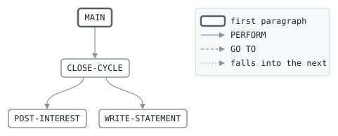

# CYCLE

```text
cycle: close the billing cycle of the cards whose cycle day it is

for each open or blocked card whose cycle day is the run's day of the
month: interest on the last statement's balance, unless it was paid in
full, as the grace period allows; the minimum payment; and the
statement, with the balance it closes on, which the next cycle charges
interest on.

return codes: 0 done, 16 cannot update the accounts.

history
2013-06-03 rk  lcs-0219 original version.
2021-03-01 mt  lcs-0481 interest by the card's product.
```

Program [cycle.cbl](../../../laurasia/programs/cycle.cbl): 3 files, 4 paragraphs. Its business rules: [3 decision tables](../rules/CYCLE.md).

## Contents

- [Files](#files)
- [Flow](#flow)
- [Paragraphs](#paragraphs)
- [Calls](#calls)
- [Data flow](#data-flow)
- [Lineage](#lineage)
  - [Into CARD-ACCOUNT](#into-card-account)
  - [Into POSTING](#into-posting)
  - [Into STATEMENT-LINE](#into-statement-line)
  - [Into WS-INTEREST-CENTS](#into-ws-interest-cents)
  - [Into WS-INTEREST](#into-ws-interest)
  - [Into WS-MINIMUM](#into-ws-minimum)
  - [Into WS-CLOSED-COUNT](#into-ws-closed-count)
  - [Into WS-STATEMENT-HEAD](#into-ws-statement-head)
  - [Into WS-STATEMENT-AMOUNT](#into-ws-statement-amount)
  - [Out of the program](#out-of-the-program)
- [Field origins](#field-origins)
  - [File ACCOUNTS](#file-accounts)
  - [File POSTINGS-OUT](#file-postings-out)
  - [File STATEMENTS-OUT](#file-statements-out)
- [Records](#records)
  - [CARD-ACCOUNT](#card-account)
  - [POSTING](#posting)
  - [STATEMENT-LINE](#statement-line)
  - [WS-RUN-DATE](#ws-run-date)
  - [WS-ACCOUNTS-STATUS](#ws-accounts-status)
  - [WS-INTEREST-CENTS](#ws-interest-cents)
  - [WS-INTEREST](#ws-interest)
  - [WS-MINIMUM](#ws-minimum)
  - [WS-CLOSED-COUNT](#ws-closed-count)
  - [WS-STATEMENT-HEAD](#ws-statement-head)
  - [WS-STATEMENT-AMOUNT](#ws-statement-amount)

## Files

| File | Kind | Assigned to | Organization | Status field | Opened | Records |
| --- | --- | --- | --- | --- | --- | --- |
| ACCOUNTS | FD | ACCOUNTS | INDEXED, key CA-CARD-NO | WS-ACCOUNTS-STATUS | I-O | CARD-ACCOUNT |
| POSTINGS-OUT | FD | POSTOUT | LINE SEQUENTIAL | | OUTPUT | POSTING |
| STATEMENTS-OUT | FD | STMTOUT | LINE SEQUENTIAL | | OUTPUT | STATEMENT-LINE |

## Flow



## Paragraphs

| Paragraph | Description | Source | Performs | Goes to | Performed by | Reached by |
| --- | --- | --- | --- | --- | --- | --- |
| MAIN | | [cycle.cbl:62](../../../laurasia/programs/cycle.cbl#L62) | CLOSE-CYCLE | | | |
| CLOSE-CYCLE | | [cycle.cbl:79](../../../laurasia/programs/cycle.cbl#L79) | POST-INTEREST, WRITE-STATEMENT | | MAIN | |
| POST-INTEREST | | [cycle.cbl:97](../../../laurasia/programs/cycle.cbl#L97) | | | CLOSE-CYCLE | |
| WRITE-STATEMENT | | [cycle.cbl:106](../../../laurasia/programs/cycle.cbl#L106) | | | CLOSE-CYCLE | |

## Calls

| Calls | Passing | Paragraph | Source |
| --- | --- | --- | --- |
| [INTCALC](INTCALC.md) | CA-PRODUCT, CA-STATEMENT-BALANCE; returning WS-INTEREST-CENTS | CLOSE-CYCLE | [cycle.cbl:82](../../../laurasia/programs/cycle.cbl#L82) |
| [MINPAY](MINPAY.md) | CA-BALANCE, WS-MINIMUM | CLOSE-CYCLE | [cycle.cbl:89](../../../laurasia/programs/cycle.cbl#L89) |

## Data flow

| Paragraph | Reads | Writes |
| --- | --- | --- |
| MAIN | WS-ACCOUNTS-STATUS, CA-CYCLE-DAY, WS-RUN-DAY, CA-STATUS | WS-RUN-DATE, RETURN-CODE, CARD-ACCOUNT |
| CLOSE-CYCLE | CA-PAID-IN-FULL, CA-STATEMENT-BALANCE, CA-PRODUCT, WS-INTEREST-CENTS, WS-INTEREST, CA-BALANCE, WS-MINIMUM, WS-CLOSED-COUNT | WS-INTEREST, CA-PRODUCT, CA-STATEMENT-BALANCE, WS-INTEREST-CENTS, CA-BALANCE, WS-MINIMUM, CARD-ACCOUNT, RETURN-CODE, WS-CLOSED-COUNT |
| POST-INTEREST | CA-CARD-NO, CA-ACCOUNT-NO, WS-INTEREST, WS-RUN-DATE | PO-CARD-NO, PO-ACCOUNT-NO, PO-KIND, PO-AMOUNT, PO-REFERENCE, PO-DATE, POSTING |
| WRITE-STATEMENT | CA-CARD-NO, CA-ACCOUNT-NO, WS-RUN-DATE, WS-STATEMENT-HEAD, CA-STATEMENT-BALANCE, WS-STATEMENT-AMOUNT, WS-INTEREST, CA-BALANCE, WS-MINIMUM | SH-CARD-NO, SH-ACCOUNT-NO, SH-DATE, STATEMENT-LINE, SA-LABEL, SA-VALUE |

## Lineage

Where each data item's values come from, grouped by the record they go into. A data item links to the record it belongs to.

### Into CARD-ACCOUNT

Record [CARD-ACCOUNT](#card-account), from copybook [cardacct](../copybooks/cardacct.md).

| Into | From | Statement | Paragraph | Source |
| --- | --- | --- | --- | --- |
| CA-BALANCE | [WS-INTEREST](#ws-interest) | ADD | CLOSE-CYCLE | [cycle.cbl:86](../../../laurasia/programs/cycle.cbl#L86) |
| CA-BALANCE | call MINPAY argument 1 | CALL | CLOSE-CYCLE | [cycle.cbl:89](../../../laurasia/programs/cycle.cbl#L89) |
| CA-PRODUCT | call INTCALC argument 1 | CALL | CLOSE-CYCLE | [cycle.cbl:82](../../../laurasia/programs/cycle.cbl#L82) |
| CA-STATEMENT-BALANCE | call INTCALC argument 2 | CALL | CLOSE-CYCLE | [cycle.cbl:82](../../../laurasia/programs/cycle.cbl#L82) |
| CA-STATEMENT-BALANCE | [CA-BALANCE](#card-account "in CARD-ACCOUNT") | MOVE | CLOSE-CYCLE | [cycle.cbl:91](../../../laurasia/programs/cycle.cbl#L91) |
| CARD-ACCOUNT | file ACCOUNTS | READ | MAIN | [cycle.cbl:69](../../../laurasia/programs/cycle.cbl#L69) |
| CARD-ACCOUNT | file ACCOUNTS | READ | MAIN | [cycle.cbl:74](../../../laurasia/programs/cycle.cbl#L74) |

### Into POSTING

Record [POSTING](#posting), from copybook [postrec](../copybooks/postrec.md).

| Into | From | Statement | Paragraph | Source |
| --- | --- | --- | --- | --- |
| PO-ACCOUNT-NO | [CA-ACCOUNT-NO](#card-account "in CARD-ACCOUNT") | MOVE | POST-INTEREST | [cycle.cbl:99](../../../laurasia/programs/cycle.cbl#L99) |
| PO-AMOUNT | [WS-INTEREST](#ws-interest) | MOVE | POST-INTEREST | [cycle.cbl:101](../../../laurasia/programs/cycle.cbl#L101) |
| PO-CARD-NO | [CA-CARD-NO](#card-account "in CARD-ACCOUNT") | MOVE | POST-INTEREST | [cycle.cbl:98](../../../laurasia/programs/cycle.cbl#L98) |
| PO-DATE | [WS-RUN-DATE](#ws-run-date) | MOVE | POST-INTEREST | [cycle.cbl:103](../../../laurasia/programs/cycle.cbl#L103) |
| PO-KIND | literal condition PO-INTEREST | SET | POST-INTEREST | [cycle.cbl:100](../../../laurasia/programs/cycle.cbl#L100) |
| PO-REFERENCE | literal SPACES | MOVE | POST-INTEREST | [cycle.cbl:102](../../../laurasia/programs/cycle.cbl#L102) |

### Into STATEMENT-LINE

Record [STATEMENT-LINE](#statement-line).

| Into | From | Statement | Paragraph | Source |
| --- | --- | --- | --- | --- |
| STATEMENT-LINE | [WS-STATEMENT-HEAD](#ws-statement-head) | WRITE | WRITE-STATEMENT | [cycle.cbl:110](../../../laurasia/programs/cycle.cbl#L110) |
| STATEMENT-LINE | [WS-STATEMENT-AMOUNT](#ws-statement-amount) | WRITE | WRITE-STATEMENT | [cycle.cbl:113](../../../laurasia/programs/cycle.cbl#L113) |
| STATEMENT-LINE | [WS-STATEMENT-AMOUNT](#ws-statement-amount) | WRITE | WRITE-STATEMENT | [cycle.cbl:116](../../../laurasia/programs/cycle.cbl#L116) |
| STATEMENT-LINE | [WS-STATEMENT-AMOUNT](#ws-statement-amount) | WRITE | WRITE-STATEMENT | [cycle.cbl:119](../../../laurasia/programs/cycle.cbl#L119) |
| STATEMENT-LINE | [WS-STATEMENT-AMOUNT](#ws-statement-amount) | WRITE | WRITE-STATEMENT | [cycle.cbl:122](../../../laurasia/programs/cycle.cbl#L122) |

### Into WS-INTEREST-CENTS

Record [WS-INTEREST-CENTS](#ws-interest-cents).

| Into | From | Statement | Paragraph | Source |
| --- | --- | --- | --- | --- |
| WS-INTEREST-CENTS | call INTCALC, what it returns | CALL | CLOSE-CYCLE | [cycle.cbl:82](../../../laurasia/programs/cycle.cbl#L82) |

### Into WS-INTEREST

Record [WS-INTEREST](#ws-interest).

| Into | From | Statement | Paragraph | Source |
| --- | --- | --- | --- | --- |
| WS-INTEREST | literal ZERO | MOVE | CLOSE-CYCLE | [cycle.cbl:80](../../../laurasia/programs/cycle.cbl#L80) |
| WS-INTEREST | [WS-INTEREST-CENTS](#ws-interest-cents) | COMPUTE | CLOSE-CYCLE | [cycle.cbl:83](../../../laurasia/programs/cycle.cbl#L83) |

### Into WS-MINIMUM

Record [WS-MINIMUM](#ws-minimum).

| Into | From | Statement | Paragraph | Source |
| --- | --- | --- | --- | --- |
| WS-MINIMUM | call MINPAY argument 2 | CALL | CLOSE-CYCLE | [cycle.cbl:89](../../../laurasia/programs/cycle.cbl#L89) |

### Into WS-CLOSED-COUNT

Record [WS-CLOSED-COUNT](#ws-closed-count).

| Into | From | Statement | Paragraph | Source |
| --- | --- | --- | --- | --- |
| WS-CLOSED-COUNT | literal 1 | ADD | CLOSE-CYCLE | [cycle.cbl:95](../../../laurasia/programs/cycle.cbl#L95) |

### Into WS-STATEMENT-HEAD

Record [WS-STATEMENT-HEAD](#ws-statement-head).

| Into | From | Statement | Paragraph | Source |
| --- | --- | --- | --- | --- |
| SH-ACCOUNT-NO | [CA-ACCOUNT-NO](#card-account "in CARD-ACCOUNT") | MOVE | WRITE-STATEMENT | [cycle.cbl:108](../../../laurasia/programs/cycle.cbl#L108) |
| SH-CARD-NO | [CA-CARD-NO](#card-account "in CARD-ACCOUNT") | MOVE | WRITE-STATEMENT | [cycle.cbl:107](../../../laurasia/programs/cycle.cbl#L107) |
| SH-DATE | [WS-RUN-DATE](#ws-run-date) | MOVE | WRITE-STATEMENT | [cycle.cbl:109](../../../laurasia/programs/cycle.cbl#L109) |

### Into WS-STATEMENT-AMOUNT

Record [WS-STATEMENT-AMOUNT](#ws-statement-amount).

| Into | From | Statement | Paragraph | Source |
| --- | --- | --- | --- | --- |
| SA-LABEL | literal 'PREVIOUS BALANCE' | MOVE | WRITE-STATEMENT | [cycle.cbl:111](../../../laurasia/programs/cycle.cbl#L111) |
| SA-LABEL | literal 'INTEREST' | MOVE | WRITE-STATEMENT | [cycle.cbl:114](../../../laurasia/programs/cycle.cbl#L114) |
| SA-LABEL | literal 'NEW BALANCE' | MOVE | WRITE-STATEMENT | [cycle.cbl:117](../../../laurasia/programs/cycle.cbl#L117) |
| SA-LABEL | literal 'MINIMUM PAYMENT' | MOVE | WRITE-STATEMENT | [cycle.cbl:120](../../../laurasia/programs/cycle.cbl#L120) |
| SA-VALUE | [CA-STATEMENT-BALANCE](#card-account "in CARD-ACCOUNT") | MOVE | WRITE-STATEMENT | [cycle.cbl:112](../../../laurasia/programs/cycle.cbl#L112) |
| SA-VALUE | [WS-INTEREST](#ws-interest) | MOVE | WRITE-STATEMENT | [cycle.cbl:115](../../../laurasia/programs/cycle.cbl#L115) |
| SA-VALUE | [CA-BALANCE](#card-account "in CARD-ACCOUNT") | MOVE | WRITE-STATEMENT | [cycle.cbl:118](../../../laurasia/programs/cycle.cbl#L118) |
| SA-VALUE | [WS-MINIMUM](#ws-minimum) | MOVE | WRITE-STATEMENT | [cycle.cbl:121](../../../laurasia/programs/cycle.cbl#L121) |

### Out of the program

Records written to files, items passed to the programs called, and items displayed to the job's output.

| Into | From | Statement | Paragraph | Source |
| --- | --- | --- | --- | --- |
| file ACCOUNTS | [CARD-ACCOUNT](#card-account) | REWRITE | CLOSE-CYCLE | [cycle.cbl:92](../../../laurasia/programs/cycle.cbl#L92) |
| call INTCALC argument 1 | [CA-PRODUCT](#card-account "in CARD-ACCOUNT") | CALL | CLOSE-CYCLE | [cycle.cbl:82](../../../laurasia/programs/cycle.cbl#L82) |
| call INTCALC argument 2 | [CA-STATEMENT-BALANCE](#card-account "in CARD-ACCOUNT") | CALL | CLOSE-CYCLE | [cycle.cbl:82](../../../laurasia/programs/cycle.cbl#L82) |
| call MINPAY argument 1 | [CA-BALANCE](#card-account "in CARD-ACCOUNT") | CALL | CLOSE-CYCLE | [cycle.cbl:89](../../../laurasia/programs/cycle.cbl#L89) |
| call MINPAY argument 2 | [WS-MINIMUM](#ws-minimum) | CALL | CLOSE-CYCLE | [cycle.cbl:89](../../../laurasia/programs/cycle.cbl#L89) |
| file POSTINGS-OUT | [POSTING](#posting) | WRITE | POST-INTEREST | [cycle.cbl:104](../../../laurasia/programs/cycle.cbl#L104) |
| file STATEMENTS-OUT | [STATEMENT-LINE](#statement-line) | WRITE | WRITE-STATEMENT | [cycle.cbl:110](../../../laurasia/programs/cycle.cbl#L110) |
| file STATEMENTS-OUT | [STATEMENT-LINE](#statement-line) | WRITE | WRITE-STATEMENT | [cycle.cbl:113](../../../laurasia/programs/cycle.cbl#L113) |
| file STATEMENTS-OUT | [STATEMENT-LINE](#statement-line) | WRITE | WRITE-STATEMENT | [cycle.cbl:116](../../../laurasia/programs/cycle.cbl#L116) |
| file STATEMENTS-OUT | [STATEMENT-LINE](#statement-line) | WRITE | WRITE-STATEMENT | [cycle.cbl:119](../../../laurasia/programs/cycle.cbl#L119) |
| file STATEMENTS-OUT | [STATEMENT-LINE](#statement-line) | WRITE | WRITE-STATEMENT | [cycle.cbl:122](../../../laurasia/programs/cycle.cbl#L122) |

## Field origins

Where the values of each field the program writes to a file come from: the fields of the files it reads, literals, and initial values, followed through every statement that moves a value, and through groups and redefinitions by the bytes they share.

### File ACCOUNTS

Written from [CARD-ACCOUNT](#card-account).

| Field | Position | Origins |
| --- | --: | --- |
| CA-CARD-NO | 1-16 | file ACCOUNTS CA-CARD-NO |
| CA-ACCOUNT-NO | 17-26 | file ACCOUNTS CA-ACCOUNT-NO |
| CA-PRODUCT | 27-28 | call INTCALC argument 1 CA-PRODUCT; file ACCOUNTS CA-PRODUCT |
| CA-STATUS | 29 | file ACCOUNTS CA-STATUS |
| CA-LIMIT | 30-38 | file ACCOUNTS CA-LIMIT |
| CA-BALANCE | 39-48 | call INTCALC returns WS-INTEREST-CENTS; call MINPAY argument 1 CA-BALANCE; file ACCOUNTS CA-BALANCE; literal ZERO |
| CA-STATEMENT-BALANCE | 49-58 | call INTCALC returns WS-INTEREST-CENTS; call MINPAY argument 1 CA-BALANCE; file ACCOUNTS CA-BALANCE; literal ZERO |
| CA-CYCLE-DAY | 59-60 | file ACCOUNTS CA-CYCLE-DAY |
| CA-PAID-IN-FULL | 61 | file ACCOUNTS CA-PAID-IN-FULL |

### File POSTINGS-OUT

Written from [POSTING](#posting).

| Field | Position | Origins |
| --- | --: | --- |
| PO-CARD-NO | 1-16 | file ACCOUNTS CA-CARD-NO |
| PO-ACCOUNT-NO | 17-26 | file ACCOUNTS CA-ACCOUNT-NO |
| PO-KIND | 27 | literal condition PO-INTEREST |
| PO-AMOUNT | 28-37 | call INTCALC returns WS-INTEREST-CENTS; literal ZERO |
| PO-REFERENCE | 38-43 | literal SPACES |
| PO-DATE | 44-51 | |

### File STATEMENTS-OUT

Written from [WS-STATEMENT-HEAD](#ws-statement-head) and [WS-STATEMENT-AMOUNT](#ws-statement-amount).

#### Record WS-STATEMENT-HEAD

| Field | Position | Origins |
| --- | --: | --- |
| SH-CARD-NO | 1-16 | file ACCOUNTS CA-CARD-NO |
| SH-ACCOUNT-NO | 18-27 | file ACCOUNTS CA-ACCOUNT-NO |
| SH-DATE | 32-39 | |

#### Record WS-STATEMENT-AMOUNT

| Field | Position | Origins |
| --- | --: | --- |
| SA-LABEL | 5-34 | literal 'INTEREST'; literal 'MINIMUM PAYMENT'; literal 'NEW BALANCE'; literal 'PREVIOUS BALANCE' |
| SA-VALUE | 35-45 | call INTCALC argument 2 CA-STATEMENT-BALANCE; call INTCALC returns WS-INTEREST-CENTS; call MINPAY argument 1 CA-BALANCE; call MINPAY argument 2 WS-MINIMUM; file ACCOUNTS CA-BALANCE; file ACCOUNTS CA-STATEMENT-BALANCE; literal ZERO |

## Records

### CARD-ACCOUNT

File ACCOUNTS. 61 bytes, layout in copybook [cardacct](../copybooks/cardacct.md).

### POSTING

File POSTINGS-OUT. 51 bytes, layout in copybook [postrec](../copybooks/postrec.md).

### STATEMENT-LINE

File STATEMENTS-OUT. 70 bytes.

| Level | Field | Kind | Start | Length | Picture | Usage | Notes | Source |
| --: | --- | --- | --: | --: | --- | --- | --- | --- |
| 01 | STATEMENT-LINE | text | 1 | 70 | X(70) | | | [cycle.cbl:38](../../../laurasia/programs/cycle.cbl#L38) |

### WS-RUN-DATE

Working storage. 8 bytes.

| Level | Field | Kind | Start | Length | Picture | Usage | Notes | Source |
| --: | --- | --- | --: | --: | --- | --- | --- | --- |
| 01 | WS-RUN-DATE | group | 1 | 8 | | | | [cycle.cbl:41](../../../laurasia/programs/cycle.cbl#L41) |
| 05 | ├ WS-RUN-YEAR-MONTH | date | 1 | 6 | 9(6) | | | [cycle.cbl:42](../../../laurasia/programs/cycle.cbl#L42) |
| 05 | └ WS-RUN-DAY | number | 7 | 2 | 99 | | | [cycle.cbl:43](../../../laurasia/programs/cycle.cbl#L43) |

### WS-ACCOUNTS-STATUS

Working storage. 2 bytes.

| Level | Field | Kind | Start | Length | Picture | Usage | Notes | Source |
| --: | --- | --- | --: | --: | --- | --- | --- | --- |
| 01 | WS-ACCOUNTS-STATUS | code | 1 | 2 | XX | | | [cycle.cbl:44](../../../laurasia/programs/cycle.cbl#L44) |
| 88 | └ ACCOUNTS-AT-END | | | | | | VALUE '10' | [cycle.cbl:45](../../../laurasia/programs/cycle.cbl#L45) |

### WS-INTEREST-CENTS

Working storage. 4 bytes.

| Level | Field | Kind | Start | Length | Picture | Usage | Notes | Source |
| --: | --- | --- | --: | --: | --- | --- | --- | --- |
| 01 | WS-INTEREST-CENTS | number | 1 | 4 | S9(9) | COMP-5 | | [cycle.cbl:46](../../../laurasia/programs/cycle.cbl#L46) |

### WS-INTEREST

Working storage. 9 bytes.

| Level | Field | Kind | Start | Length | Picture | Usage | Notes | Source |
| --: | --- | --- | --: | --: | --- | --- | --- | --- |
| 01 | WS-INTEREST | amount | 1 | 9 | S9(7)V99 | | | [cycle.cbl:47](../../../laurasia/programs/cycle.cbl#L47) |

### WS-MINIMUM

Working storage. 9 bytes.

| Level | Field | Kind | Start | Length | Picture | Usage | Notes | Source |
| --: | --- | --- | --: | --: | --- | --- | --- | --- |
| 01 | WS-MINIMUM | amount | 1 | 9 | S9(7)V99 | | | [cycle.cbl:48](../../../laurasia/programs/cycle.cbl#L48) |

### WS-CLOSED-COUNT

Working storage. 6 bytes.

| Level | Field | Kind | Start | Length | Picture | Usage | Notes | Source |
| --: | --- | --- | --: | --: | --- | --- | --- | --- |
| 01 | WS-CLOSED-COUNT | number | 1 | 6 | 9(6) | | VALUE ZERO | [cycle.cbl:49](../../../laurasia/programs/cycle.cbl#L49) |

### WS-STATEMENT-HEAD

Working storage. 39 bytes.

| Level | Field | Kind | Start | Length | Picture | Usage | Notes | Source |
| --: | --- | --- | --: | --: | --- | --- | --- | --- |
| 01 | WS-STATEMENT-HEAD | group | 1 | 39 | | | | [cycle.cbl:50](../../../laurasia/programs/cycle.cbl#L50) |
| 05 | ├ SH-CARD-NO | text | 1 | 16 | X(16) | | | [cycle.cbl:51](../../../laurasia/programs/cycle.cbl#L51) |
| 05 | ├ FILLER | filler | 17 | 1 | X | | VALUE SPACE | [cycle.cbl:52](../../../laurasia/programs/cycle.cbl#L52) |
| 05 | ├ SH-ACCOUNT-NO | text | 18 | 10 | X(10) | | | [cycle.cbl:53](../../../laurasia/programs/cycle.cbl#L53) |
| 05 | ├ FILLER | filler | 28 | 4 | X(4) | | VALUE ' ON ' | [cycle.cbl:54](../../../laurasia/programs/cycle.cbl#L54) |
| 05 | └ SH-DATE | date | 32 | 8 | 9(8) | | | [cycle.cbl:55](../../../laurasia/programs/cycle.cbl#L55) |

### WS-STATEMENT-AMOUNT

Working storage. 45 bytes.

| Level | Field | Kind | Start | Length | Picture | Usage | Notes | Source |
| --: | --- | --- | --: | --: | --- | --- | --- | --- |
| 01 | WS-STATEMENT-AMOUNT | group | 1 | 45 | | | | [cycle.cbl:56](../../../laurasia/programs/cycle.cbl#L56) |
| 05 | ├ FILLER | filler | 1 | 4 | X(4) | | VALUE SPACES | [cycle.cbl:57](../../../laurasia/programs/cycle.cbl#L57) |
| 05 | ├ SA-LABEL | text | 5 | 30 | X(30) | | | [cycle.cbl:58](../../../laurasia/programs/cycle.cbl#L58) |
| 05 | └ SA-VALUE | edited | 35 | 11 | -(7)9.99 | | | [cycle.cbl:59](../../../laurasia/programs/cycle.cbl#L59) |
