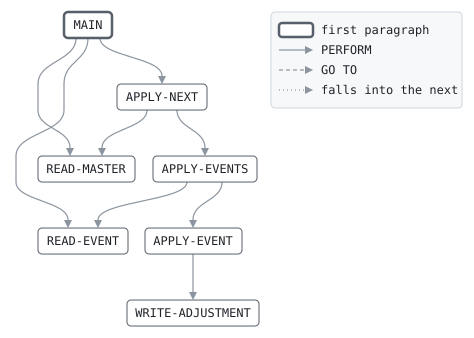

# DISPUTE

```text
dispute: move the disputes on by the day's events

applies the day's dispute events, in case order, to the dispute master,
and writes the new master. a dispute opens when the cardholder claims;
the chargeback takes the amount back from the merchant; the merchant
may accept it, or represent, which gives the amount back; the issuer
may then drop the dispute, or take it to pre-arbitration, where the
network rules for one side. an event a case cannot take where it stands
is rejected. each move of money is an adjustment for the merchant's
settlement.

return codes: 0 all applied, 4 some rejected, 16 cases out of order.

history
2015-03-23 mt  lcs-0302 original version.
2019-11-04 mt  lcs-0455 pre-arbitration.
```

Program [dispute.cbl](../../../laurasia/programs/dispute.cbl): 5 files, 7 paragraphs. Its business rules: [6 decision tables](../rules/DISPUTE.md).

## Contents

- [Files](#files)
- [Flow](#flow)
- [Paragraphs](#paragraphs)
- [Data flow](#data-flow)
- [Lineage](#lineage)
  - [Into MASTER-IN-RECORD](#into-master-in-record)
  - [Into DISPUTE-EVENT](#into-dispute-event)
  - [Into DISPUTE-CASE](#into-dispute-case)
  - [Into ADJUSTMENT](#into-adjustment)
  - [Into REJECT-LINE](#into-reject-line)
  - [Into WS-MASTER-KEY](#into-ws-master-key)
  - [Into WS-EVENT-KEY](#into-ws-event-key)
  - [Into WS-HELD-CASE](#into-ws-held-case)
  - [Into WS-HOLDING](#into-ws-holding)
  - [Into WS-RESULT](#into-ws-result)
  - [Out of the program](#out-of-the-program)
- [Field origins](#field-origins)
  - [File MASTER-OUT](#file-master-out)
  - [File REJECT-OUT](#file-reject-out)
  - [File ADJUST-OUT](#file-adjust-out)
- [Links between records](#links-between-records)
- [Records](#records)
  - [MASTER-IN-RECORD](#master-in-record)
  - [DISPUTE-EVENT](#dispute-event)
  - [DISPUTE-CASE](#dispute-case)
  - [ADJUSTMENT](#adjustment)
  - [REJECT-LINE](#reject-line)
  - [WS-MASTER-KEY](#ws-master-key)
  - [WS-EVENT-KEY](#ws-event-key)
  - [WS-HELD-CASE](#ws-held-case)
  - [WS-HOLDING](#ws-holding)
  - [WS-RESULT](#ws-result)

## Files

| File | Kind | Assigned to | Organization | Status field | Opened | Records |
| --- | --- | --- | --- | --- | --- | --- |
| MASTER-IN | FD | DISPIN | LINE SEQUENTIAL | | INPUT | MASTER-IN-RECORD |
| EVENTS-IN | FD | DISPEVT | LINE SEQUENTIAL | | INPUT | DISPUTE-EVENT |
| MASTER-OUT | FD | DISPOUT | LINE SEQUENTIAL | | OUTPUT | DISPUTE-CASE |
| ADJUST-OUT | FD | ADJOUT | LINE SEQUENTIAL | | OUTPUT | ADJUSTMENT |
| REJECT-OUT | FD | DISPREJ | LINE SEQUENTIAL | | OUTPUT | REJECT-LINE |

## Flow



## Paragraphs

| Paragraph | Description | Source | Performs | Goes to | Performed by | Reached by |
| --- | --- | --- | --- | --- | --- | --- |
| MAIN | | [dispute.cbl:65](../../../laurasia/programs/dispute.cbl#L65) | READ-MASTER, READ-EVENT, APPLY-NEXT | | | |
| READ-MASTER | | [dispute.cbl:74](../../../laurasia/programs/dispute.cbl#L74) | | | MAIN, APPLY-NEXT | |
| READ-EVENT | | [dispute.cbl:82](../../../laurasia/programs/dispute.cbl#L82) | | | MAIN, APPLY-EVENTS | |
| APPLY-NEXT | the lower case number first: a case with no events today is copied, the events of a case are applied to it in turn, and an event of no case opens one, if it opens. | [dispute.cbl:91](../../../laurasia/programs/dispute.cbl#L91) | READ-MASTER, APPLY-EVENTS | | MAIN | |
| APPLY-EVENTS | | [dispute.cbl:107](../../../laurasia/programs/dispute.cbl#L107) | APPLY-EVENT, READ-EVENT | | APPLY-NEXT | |
| APPLY-EVENT | the state machine of a dispute. | [dispute.cbl:125](../../../laurasia/programs/dispute.cbl#L125) | WRITE-ADJUSTMENT | | APPLY-EVENTS | |
| WRITE-ADJUSTMENT | | [dispute.cbl:164](../../../laurasia/programs/dispute.cbl#L164) | | | APPLY-EVENT | |

## Data flow

| Paragraph | Reads | Writes |
| --- | --- | --- |
| MAIN | WS-MASTER-KEY, WS-EVENT-KEY, WS-RESULT | RETURN-CODE |
| READ-MASTER | MASTER-IN-RECORD, DC-CASE-NO | MASTER-IN-RECORD, WS-MASTER-KEY, DISPUTE-CASE |
| READ-EVENT | DE-CASE-NO | DISPUTE-EVENT, WS-EVENT-KEY |
| APPLY-NEXT | WS-MASTER-KEY, WS-EVENT-KEY, MASTER-IN-RECORD | DISPUTE-CASE, WS-HELD-CASE, WS-HOLDING |
| APPLY-EVENTS | WS-EVENT-KEY, DC-CASE-NO, WS-HOLDING, WS-HELD-CASE, DISPUTE-CASE | DC-CASE-NO, DISPUTE-CASE, WS-HELD-CASE |
| APPLY-EVENT | WS-HOLDING, DE-EVENT, DC-STATUS, DE-CASE-NO, DE-MERCHANT, DE-AMOUNT, DE-DATE, DC-AMOUNT, DISPUTE-EVENT | DC-CASE-NO, DC-MERCHANT, DC-AMOUNT, DC-OPENED, DC-STATUS, WS-HOLDING, AD-AMOUNT, REJECT-LINE, RJ-REASON, RJ-EVENT, WS-RESULT, DC-UPDATED |
| WRITE-ADJUSTMENT | DC-MERCHANT, DC-CASE-NO, DE-EVENT | AD-MERCHANT, AD-CASE-NO, AD-EVENT, ADJUSTMENT |

## Lineage

Where each data item's values come from, grouped by the record they go into. A data item links to the record it belongs to.

### Into MASTER-IN-RECORD

Record [MASTER-IN-RECORD](#master-in-record).

| Into | From | Statement | Paragraph | Source |
| --- | --- | --- | --- | --- |
| MASTER-IN-RECORD | file MASTER-IN | READ | READ-MASTER | [dispute.cbl:75](../../../laurasia/programs/dispute.cbl#L75) |

### Into DISPUTE-EVENT

Record [DISPUTE-EVENT](#dispute-event), from copybook [dispevt](../copybooks/dispevt.md).

| Into | From | Statement | Paragraph | Source |
| --- | --- | --- | --- | --- |
| DISPUTE-EVENT | file EVENTS-IN | READ | READ-EVENT | [dispute.cbl:83](../../../laurasia/programs/dispute.cbl#L83) |

### Into DISPUTE-CASE

Record [DISPUTE-CASE](#dispute-case), from copybook [dispcase](../copybooks/dispcase.md).

| Into | From | Statement | Paragraph | Source |
| --- | --- | --- | --- | --- |
| DC-AMOUNT | [DE-AMOUNT](#dispute-event "in DISPUTE-EVENT") | MOVE | APPLY-EVENT | [dispute.cbl:130](../../../laurasia/programs/dispute.cbl#L130) |
| DC-CASE-NO | [WS-EVENT-KEY](#ws-event-key) | MOVE | APPLY-EVENTS | [dispute.cbl:108](../../../laurasia/programs/dispute.cbl#L108) |
| DC-CASE-NO | [DE-CASE-NO](#dispute-event "in DISPUTE-EVENT") | MOVE | APPLY-EVENT | [dispute.cbl:128](../../../laurasia/programs/dispute.cbl#L128) |
| DC-MERCHANT | [DE-MERCHANT](#dispute-event "in DISPUTE-EVENT") | MOVE | APPLY-EVENT | [dispute.cbl:129](../../../laurasia/programs/dispute.cbl#L129) |
| DC-OPENED | [DE-DATE](#dispute-event "in DISPUTE-EVENT") | MOVE | APPLY-EVENT | [dispute.cbl:131](../../../laurasia/programs/dispute.cbl#L131) |
| DC-STATUS | literal condition DC-OPEN | SET | APPLY-EVENT | [dispute.cbl:132](../../../laurasia/programs/dispute.cbl#L132) |
| DC-STATUS | literal condition DC-CHARGED-BACK | SET | APPLY-EVENT | [dispute.cbl:135](../../../laurasia/programs/dispute.cbl#L135) |
| DC-STATUS | literal condition DC-WON | SET | APPLY-EVENT | [dispute.cbl:139](../../../laurasia/programs/dispute.cbl#L139) |
| DC-STATUS | literal condition DC-REPRESENTED | SET | APPLY-EVENT | [dispute.cbl:141](../../../laurasia/programs/dispute.cbl#L141) |
| DC-STATUS | literal condition DC-LOST | SET | APPLY-EVENT | [dispute.cbl:145](../../../laurasia/programs/dispute.cbl#L145) |
| DC-STATUS | literal condition DC-PRE-ARBITRATION | SET | APPLY-EVENT | [dispute.cbl:147](../../../laurasia/programs/dispute.cbl#L147) |
| DC-STATUS | literal condition DC-WON | SET | APPLY-EVENT | [dispute.cbl:149](../../../laurasia/programs/dispute.cbl#L149) |
| DC-STATUS | literal condition DC-LOST | SET | APPLY-EVENT | [dispute.cbl:153](../../../laurasia/programs/dispute.cbl#L153) |
| DC-UPDATED | [DE-DATE](#dispute-event "in DISPUTE-EVENT") | MOVE | APPLY-EVENT | [dispute.cbl:162](../../../laurasia/programs/dispute.cbl#L162) |
| DISPUTE-CASE | [MASTER-IN-RECORD](#master-in-record) | MOVE | READ-MASTER | [dispute.cbl:78](../../../laurasia/programs/dispute.cbl#L78) |
| DISPUTE-CASE | [MASTER-IN-RECORD](#master-in-record) | MOVE | APPLY-NEXT | [dispute.cbl:94](../../../laurasia/programs/dispute.cbl#L94) |
| DISPUTE-CASE | [WS-HELD-CASE](#ws-held-case) | MOVE | APPLY-EVENTS | [dispute.cbl:111](../../../laurasia/programs/dispute.cbl#L111) |
| DISPUTE-CASE | [WS-HELD-CASE](#ws-held-case) | MOVE | APPLY-EVENTS | [dispute.cbl:120](../../../laurasia/programs/dispute.cbl#L120) |

### Into ADJUSTMENT

Record [ADJUSTMENT](#adjustment).

| Into | From | Statement | Paragraph | Source |
| --- | --- | --- | --- | --- |
| AD-AMOUNT | [DC-AMOUNT](#dispute-case "in DISPUTE-CASE") | COMPUTE | APPLY-EVENT | [dispute.cbl:136](../../../laurasia/programs/dispute.cbl#L136) |
| AD-AMOUNT | [DC-AMOUNT](#dispute-case "in DISPUTE-CASE") | MOVE | APPLY-EVENT | [dispute.cbl:142](../../../laurasia/programs/dispute.cbl#L142) |
| AD-AMOUNT | [DC-AMOUNT](#dispute-case "in DISPUTE-CASE") | COMPUTE | APPLY-EVENT | [dispute.cbl:150](../../../laurasia/programs/dispute.cbl#L150) |
| AD-CASE-NO | [DC-CASE-NO](#dispute-case "in DISPUTE-CASE") | MOVE | WRITE-ADJUSTMENT | [dispute.cbl:166](../../../laurasia/programs/dispute.cbl#L166) |
| AD-EVENT | [DE-EVENT](#dispute-event "in DISPUTE-EVENT") | MOVE | WRITE-ADJUSTMENT | [dispute.cbl:167](../../../laurasia/programs/dispute.cbl#L167) |
| AD-MERCHANT | [DC-MERCHANT](#dispute-case "in DISPUTE-CASE") | MOVE | WRITE-ADJUSTMENT | [dispute.cbl:165](../../../laurasia/programs/dispute.cbl#L165) |

### Into REJECT-LINE

Record [REJECT-LINE](#reject-line).

| Into | From | Statement | Paragraph | Source |
| --- | --- | --- | --- | --- |
| REJECT-LINE | literal SPACES | MOVE | APPLY-EVENT | [dispute.cbl:155](../../../laurasia/programs/dispute.cbl#L155) |
| RJ-EVENT | [DISPUTE-EVENT](#dispute-event) | MOVE | APPLY-EVENT | [dispute.cbl:157](../../../laurasia/programs/dispute.cbl#L157) |
| RJ-REASON | literal 'STAT' | MOVE | APPLY-EVENT | [dispute.cbl:156](../../../laurasia/programs/dispute.cbl#L156) |

### Into WS-MASTER-KEY

Record [WS-MASTER-KEY](#ws-master-key).

| Into | From | Statement | Paragraph | Source |
| --- | --- | --- | --- | --- |
| WS-MASTER-KEY | literal ALL '9' | MOVE | READ-MASTER | [dispute.cbl:76](../../../laurasia/programs/dispute.cbl#L76) |
| WS-MASTER-KEY | [DC-CASE-NO](#dispute-case "in DISPUTE-CASE") | MOVE | READ-MASTER | [dispute.cbl:79](../../../laurasia/programs/dispute.cbl#L79) |

### Into WS-EVENT-KEY

Record [WS-EVENT-KEY](#ws-event-key).

| Into | From | Statement | Paragraph | Source |
| --- | --- | --- | --- | --- |
| WS-EVENT-KEY | literal ALL '9' | MOVE | READ-EVENT | [dispute.cbl:84](../../../laurasia/programs/dispute.cbl#L84) |
| WS-EVENT-KEY | [DE-CASE-NO](#dispute-event "in DISPUTE-EVENT") | MOVE | READ-EVENT | [dispute.cbl:85](../../../laurasia/programs/dispute.cbl#L85) |

### Into WS-HELD-CASE

Record [WS-HELD-CASE](#ws-held-case).

| Into | From | Statement | Paragraph | Source |
| --- | --- | --- | --- | --- |
| WS-HELD-CASE | [MASTER-IN-RECORD](#master-in-record) | MOVE | APPLY-NEXT | [dispute.cbl:98](../../../laurasia/programs/dispute.cbl#L98) |
| WS-HELD-CASE | [DISPUTE-CASE](#dispute-case) | MOVE | APPLY-EVENTS | [dispute.cbl:115](../../../laurasia/programs/dispute.cbl#L115) |

### Into WS-HOLDING

Record [WS-HOLDING](#ws-holding).

| Into | From | Statement | Paragraph | Source |
| --- | --- | --- | --- | --- |
| WS-HOLDING | literal condition HOLDING-CASE | SET | APPLY-NEXT | [dispute.cbl:99](../../../laurasia/programs/dispute.cbl#L99) |
| WS-HOLDING | literal condition HOLDING-NOTHING | SET | APPLY-NEXT | [dispute.cbl:103](../../../laurasia/programs/dispute.cbl#L103) |
| WS-HOLDING | literal condition HOLDING-CASE | SET | APPLY-EVENT | [dispute.cbl:133](../../../laurasia/programs/dispute.cbl#L133) |

### Into WS-RESULT

Record [WS-RESULT](#ws-result).

| Into | From | Statement | Paragraph | Source |
| --- | --- | --- | --- | --- |
| WS-RESULT | literal 4 | MOVE | APPLY-EVENT | [dispute.cbl:159](../../../laurasia/programs/dispute.cbl#L159) |

### Out of the program

Records written to files, items passed to the programs called, and items displayed to the job's output.

| Into | From | Statement | Paragraph | Source |
| --- | --- | --- | --- | --- |
| file ADJUST-OUT | [ADJUSTMENT](#adjustment) | WRITE | WRITE-ADJUSTMENT | [dispute.cbl:168](../../../laurasia/programs/dispute.cbl#L168) |
| file MASTER-OUT | [DISPUTE-CASE](#dispute-case) | WRITE | APPLY-NEXT | [dispute.cbl:95](../../../laurasia/programs/dispute.cbl#L95) |
| file MASTER-OUT | [DISPUTE-CASE](#dispute-case) | WRITE | APPLY-EVENTS | [dispute.cbl:121](../../../laurasia/programs/dispute.cbl#L121) |
| file REJECT-OUT | [REJECT-LINE](#reject-line) | WRITE | APPLY-EVENT | [dispute.cbl:158](../../../laurasia/programs/dispute.cbl#L158) |

## Field origins

Where the values of each field the program writes to a file come from: the fields of the files it reads, literals, and initial values, followed through every statement that moves a value, and through groups and redefinitions by the bytes they share.

### File MASTER-OUT

Written from [DISPUTE-CASE](#dispute-case).

| Field | Position | Origins |
| --- | --: | --- |
| DC-CASE-NO | 1-8 | file EVENTS-IN DE-CASE-NO; file MASTER-IN MASTER-IN-RECORD 1-8; literal ALL '9' |
| DC-STATUS | 9-10 | file MASTER-IN MASTER-IN-RECORD 9-10; literal condition DC-CHARGED-BACK; literal condition DC-LOST; literal condition DC-OPEN; literal condition DC-PRE-ARBITRATION; literal condition DC-REPRESENTED; literal condition DC-WON |
| DC-MERCHANT | 11-20 | file EVENTS-IN DE-MERCHANT; file MASTER-IN MASTER-IN-RECORD 11-20 |
| DC-AMOUNT | 21-32 | file EVENTS-IN DE-AMOUNT; file MASTER-IN MASTER-IN-RECORD 21-32 |
| DC-OPENED | 33-40 | file EVENTS-IN DE-DATE; file MASTER-IN MASTER-IN-RECORD 33-40 |
| DC-UPDATED | 41-48 | file EVENTS-IN DE-DATE; file MASTER-IN MASTER-IN-RECORD 41-48 |

### File REJECT-OUT

Written from [REJECT-LINE](#reject-line).

| Field | Position | Origins |
| --- | --: | --- |
| RJ-REASON | 1-4 | literal 'STAT' |
| RJ-EVENT | 6-45 | file EVENTS-IN DISPUTE-EVENT |

### File ADJUST-OUT

Written from [ADJUSTMENT](#adjustment).

| Field | Position | Origins |
| --- | --: | --- |
| AD-MERCHANT | 1-10 | file EVENTS-IN DE-MERCHANT; file MASTER-IN MASTER-IN-RECORD 11-20 |
| AD-AMOUNT | 11-22 | file EVENTS-IN DE-AMOUNT; file MASTER-IN MASTER-IN-RECORD 21-32 |
| AD-CASE-NO | 23-30 | file EVENTS-IN DE-CASE-NO; file MASTER-IN MASTER-IN-RECORD 1-8; literal ALL '9' |
| AD-EVENT | 31-32 | file EVENTS-IN DE-EVENT |

## Links between records

Fields of one input the program relies on to find or match the records of another: moved into an indexed file's record key to read it by, compared for equality, or compared for order to merge the two in that order, each side's values from that field alone.

| Field | Of | Links to | Of | How | Source |
| --- | --- | --- | --- | --- | --- |
| DC-CASE-NO | MASTER-IN | DE-CASE-NO | EVENTS-IN | merged in order with | [dispute.cbl:92](../../../laurasia/programs/dispute.cbl#L92) |

## Records

### MASTER-IN-RECORD

File MASTER-IN. 48 bytes.

| Level | Field | Kind | Start | Length | Picture | Usage | Notes | Source |
| --: | --- | --- | --: | --: | --- | --- | --- | --- |
| 01 | MASTER-IN-RECORD | text | 1 | 48 | X(48) | | | [dispute.cbl:38](../../../laurasia/programs/dispute.cbl#L38) |

### DISPUTE-EVENT

File EVENTS-IN. 40 bytes, layout in copybook [dispevt](../copybooks/dispevt.md).

### DISPUTE-CASE

File MASTER-OUT. 48 bytes, layout in copybook [dispcase](../copybooks/dispcase.md).

### ADJUSTMENT

File ADJUST-OUT. 32 bytes.

| Level | Field | Kind | Start | Length | Picture | Usage | Notes | Source |
| --: | --- | --- | --: | --: | --- | --- | --- | --- |
| 01 | ADJUSTMENT | group | 1 | 32 | | | | [dispute.cbl:44](../../../laurasia/programs/dispute.cbl#L44) |
| 05 | ├ AD-MERCHANT | text | 1 | 10 | X(10) | | | [dispute.cbl:45](../../../laurasia/programs/dispute.cbl#L45) |
| 05 | ├ AD-AMOUNT | amount | 11 | 12 | S9(9)V99 | | SIGN LEADING SEPARATE | [dispute.cbl:46](../../../laurasia/programs/dispute.cbl#L46) |
| 05 | ├ AD-CASE-NO | number | 23 | 8 | 9(8) | | | [dispute.cbl:47](../../../laurasia/programs/dispute.cbl#L47) |
| 05 | └ AD-EVENT | text | 31 | 2 | X(2) | | | [dispute.cbl:48](../../../laurasia/programs/dispute.cbl#L48) |

### REJECT-LINE

File REJECT-OUT. 45 bytes.

| Level | Field | Kind | Start | Length | Picture | Usage | Notes | Source |
| --: | --- | --- | --: | --: | --- | --- | --- | --- |
| 01 | REJECT-LINE | group | 1 | 45 | | | | [dispute.cbl:50](../../../laurasia/programs/dispute.cbl#L50) |
| 05 | ├ RJ-REASON | text | 1 | 4 | X(4) | | | [dispute.cbl:51](../../../laurasia/programs/dispute.cbl#L51) |
| 05 | ├ FILLER | filler | 5 | 1 | X | | | [dispute.cbl:52](../../../laurasia/programs/dispute.cbl#L52) |
| 05 | └ RJ-EVENT | text | 6 | 40 | X(40) | | | [dispute.cbl:53](../../../laurasia/programs/dispute.cbl#L53) |

### WS-MASTER-KEY

Working storage. 8 bytes.

| Level | Field | Kind | Start | Length | Picture | Usage | Notes | Source |
| --: | --- | --- | --: | --: | --- | --- | --- | --- |
| 01 | WS-MASTER-KEY | number | 1 | 8 | 9(8) | | | [dispute.cbl:56](../../../laurasia/programs/dispute.cbl#L56) |

### WS-EVENT-KEY

Working storage. 8 bytes.

| Level | Field | Kind | Start | Length | Picture | Usage | Notes | Source |
| --: | --- | --- | --: | --: | --- | --- | --- | --- |
| 01 | WS-EVENT-KEY | number | 1 | 8 | 9(8) | | | [dispute.cbl:57](../../../laurasia/programs/dispute.cbl#L57) |

### WS-HELD-CASE

Working storage. 48 bytes.

| Level | Field | Kind | Start | Length | Picture | Usage | Notes | Source |
| --: | --- | --- | --: | --: | --- | --- | --- | --- |
| 01 | WS-HELD-CASE | text | 1 | 48 | X(48) | | | [dispute.cbl:58](../../../laurasia/programs/dispute.cbl#L58) |

### WS-HOLDING

Working storage. 1 bytes.

| Level | Field | Kind | Start | Length | Picture | Usage | Notes | Source |
| --: | --- | --- | --: | --: | --- | --- | --- | --- |
| 01 | WS-HOLDING | code | 1 | 1 | X | | VALUE 'N' | [dispute.cbl:59](../../../laurasia/programs/dispute.cbl#L59) |
| 88 | ├ HOLDING-CASE | | | | | | VALUE 'Y' | [dispute.cbl:60](../../../laurasia/programs/dispute.cbl#L60) |
| 88 | └ HOLDING-NOTHING | | | | | | VALUE 'N' | [dispute.cbl:61](../../../laurasia/programs/dispute.cbl#L61) |

### WS-RESULT

Working storage. 2 bytes.

| Level | Field | Kind | Start | Length | Picture | Usage | Notes | Source |
| --: | --- | --- | --: | --: | --- | --- | --- | --- |
| 01 | WS-RESULT | number | 1 | 2 | 99 | | VALUE ZERO | [dispute.cbl:62](../../../laurasia/programs/dispute.cbl#L62) |
