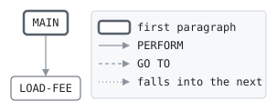

# FEELD

```text
feeld: load the interchange fee schedule into the fee table

reads the fee schedule, a line for each card product, region and
merchant group, and writes each fee into the fee table's slot for it,
where ixfee finds it without a search.

return codes: 0 loaded, 8 a fee for no slot, 16 cannot write.

history
2012-01-09 ah  lcs-0140 original version.
```

Program [feeld.cbl](../../../laurasia/programs/feeld.cbl): 2 files, 2 paragraphs. Its business rules: [3 decision tables](../rules/FEELD.md).

## Contents

- [Files](#files)
- [Flow](#flow)
- [Paragraphs](#paragraphs)
- [Calls](#calls)
- [Data flow](#data-flow)
- [Lineage](#lineage)
  - [Into FEE-DEFINITION](#into-fee-definition)
  - [Into FEE-SLOT-RECORD](#into-fee-slot-record)
  - [Into WS-SLOT](#into-ws-slot)
  - [Into WS-AT-END](#into-ws-at-end)
  - [Into WS-RESULT](#into-ws-result)
  - [Out of the program](#out-of-the-program)
  - [Into other data items](#into-other-data-items)
- [Field origins](#field-origins)
  - [File FEE-TABLE](#file-fee-table)
- [Records](#records)
  - [FEE-DEFINITION](#fee-definition)
  - [FEE-SLOT-RECORD](#fee-slot-record)
  - [WS-SLOT](#ws-slot)
  - [WS-FEE-STATUS](#ws-fee-status)
  - [WS-AT-END](#ws-at-end)
  - [WS-RESULT](#ws-result)

## Files

| File | Kind | Assigned to | Organization | Status field | Opened | Records |
| --- | --- | --- | --- | --- | --- | --- |
| FEE-SCHEDULE | FD | FEESCHED | LINE SEQUENTIAL | | INPUT | FEE-DEFINITION |
| FEE-TABLE | FD | FEETAB | RELATIVE, record number in WS-SLOT, RANDOM access | WS-FEE-STATUS | OUTPUT | FEE-SLOT-RECORD |

## Flow



## Paragraphs

| Paragraph | Description | Source | Performs | Goes to | Performed by | Reached by |
| --- | --- | --- | --- | --- | --- | --- |
| MAIN | | [feeld.cbl:41](../../../laurasia/programs/feeld.cbl#L41) | LOAD-FEE | | | |
| LOAD-FEE | | [feeld.cbl:55](../../../laurasia/programs/feeld.cbl#L55) | | | MAIN | |

## Calls

| Calls | Passing | Paragraph | Source |
| --- | --- | --- | --- |
| feeslot (not analyzed) | FD-PRODUCT, FD-REGION, FD-GROUP, RETURNING, WS-SLOT | LOAD-FEE | [feeld.cbl:56](../../../laurasia/programs/feeld.cbl#L56) |

## Data flow

| Paragraph | Reads | Writes |
| --- | --- | --- |
| MAIN | WS-FEE-STATUS, WS-AT-END, WS-RESULT | RETURN-CODE, FEE-DEFINITION, WS-AT-END |
| LOAD-FEE | FD-PRODUCT, FD-REGION, FD-GROUP, RETURNING, WS-SLOT, FD-RATE, FD-FIXED | FD-PRODUCT, FD-REGION, FD-GROUP, RETURNING, WS-SLOT, WS-RESULT, FS-RATE, FS-FIXED-CENTS, FEE-SLOT-RECORD |

## Lineage

Where each data item's values come from, grouped by the record they go into. A data item links to the record it belongs to.

### Into FEE-DEFINITION

Record [FEE-DEFINITION](#fee-definition), from copybook [feedef](../copybooks/feedef.md).

| Into | From | Statement | Paragraph | Source |
| --- | --- | --- | --- | --- |
| FD-GROUP | call feeslot argument 3 | CALL | LOAD-FEE | [feeld.cbl:56](../../../laurasia/programs/feeld.cbl#L56) |
| FD-PRODUCT | call feeslot argument 1 | CALL | LOAD-FEE | [feeld.cbl:56](../../../laurasia/programs/feeld.cbl#L56) |
| FD-REGION | call feeslot argument 2 | CALL | LOAD-FEE | [feeld.cbl:56](../../../laurasia/programs/feeld.cbl#L56) |
| FEE-DEFINITION | file FEE-SCHEDULE | READ | MAIN | [feeld.cbl:47](../../../laurasia/programs/feeld.cbl#L47) |

### Into FEE-SLOT-RECORD

Record [FEE-SLOT-RECORD](#fee-slot-record), from copybook [feerec](../copybooks/feerec.md).

| Into | From | Statement | Paragraph | Source |
| --- | --- | --- | --- | --- |
| FS-FIXED-CENTS | [FD-FIXED](#fee-definition "in FEE-DEFINITION") | MOVE | LOAD-FEE | [feeld.cbl:62](../../../laurasia/programs/feeld.cbl#L62) |
| FS-RATE | [FD-RATE](#fee-definition "in FEE-DEFINITION") | MOVE | LOAD-FEE | [feeld.cbl:61](../../../laurasia/programs/feeld.cbl#L61) |

### Into WS-SLOT

Record [WS-SLOT](#ws-slot).

| Into | From | Statement | Paragraph | Source |
| --- | --- | --- | --- | --- |
| WS-SLOT | call feeslot argument 5 | CALL | LOAD-FEE | [feeld.cbl:56](../../../laurasia/programs/feeld.cbl#L56) |

### Into WS-AT-END

Record [WS-AT-END](#ws-at-end).

| Into | From | Statement | Paragraph | Source |
| --- | --- | --- | --- | --- |
| WS-AT-END | literal condition SCHEDULE-AT-END | SET | MAIN | [feeld.cbl:48](../../../laurasia/programs/feeld.cbl#L48) |

### Into WS-RESULT

Record [WS-RESULT](#ws-result).

| Into | From | Statement | Paragraph | Source |
| --- | --- | --- | --- | --- |
| WS-RESULT | literal 8 | MOVE | LOAD-FEE | [feeld.cbl:58](../../../laurasia/programs/feeld.cbl#L58) |
| WS-RESULT | literal 8 | MOVE | LOAD-FEE | [feeld.cbl:64](../../../laurasia/programs/feeld.cbl#L64) |

### Out of the program

Records written to files, items passed to the programs called, and items displayed to the job's output.

| Into | From | Statement | Paragraph | Source |
| --- | --- | --- | --- | --- |
| file FEE-TABLE | [FEE-SLOT-RECORD](#fee-slot-record) | WRITE | LOAD-FEE | [feeld.cbl:63](../../../laurasia/programs/feeld.cbl#L63) |
| call feeslot argument 1 | [FD-PRODUCT](#fee-definition "in FEE-DEFINITION") | CALL | LOAD-FEE | [feeld.cbl:56](../../../laurasia/programs/feeld.cbl#L56) |
| call feeslot argument 2 | [FD-REGION](#fee-definition "in FEE-DEFINITION") | CALL | LOAD-FEE | [feeld.cbl:56](../../../laurasia/programs/feeld.cbl#L56) |
| call feeslot argument 3 | [FD-GROUP](#fee-definition "in FEE-DEFINITION") | CALL | LOAD-FEE | [feeld.cbl:56](../../../laurasia/programs/feeld.cbl#L56) |
| call feeslot argument 4 | RETURNING | CALL | LOAD-FEE | [feeld.cbl:56](../../../laurasia/programs/feeld.cbl#L56) |
| call feeslot argument 5 | [WS-SLOT](#ws-slot) | CALL | LOAD-FEE | [feeld.cbl:56](../../../laurasia/programs/feeld.cbl#L56) |

### Into other data items

Data items the program does not declare, such as special registers and index names.

| Into | From | Statement | Paragraph | Source |
| --- | --- | --- | --- | --- |
| RETURNING | call feeslot argument 4 | CALL | LOAD-FEE | [feeld.cbl:56](../../../laurasia/programs/feeld.cbl#L56) |

## Field origins

Where the values of each field the program writes to a file come from: the fields of the files it reads, literals, and initial values, followed through every statement that moves a value, and through groups and redefinitions by the bytes they share.

### File FEE-TABLE

Written from [FEE-SLOT-RECORD](#fee-slot-record).

| Field | Position | Origins |
| --- | --: | --- |
| FS-RATE | 1-5 | file FEE-SCHEDULE FD-RATE |
| FS-FIXED-CENTS | 6-8 | file FEE-SCHEDULE FD-FIXED |

## Records

### FEE-DEFINITION

File FEE-SCHEDULE. 14 bytes, layout in copybook [feedef](../copybooks/feedef.md).

### FEE-SLOT-RECORD

File FEE-TABLE. 8 bytes, layout in copybook [feerec](../copybooks/feerec.md).

### WS-SLOT

Working storage. 2 bytes.

| Level | Field | Kind | Start | Length | Picture | Usage | Notes | Source |
| --: | --- | --- | --: | --: | --- | --- | --- | --- |
| 01 | WS-SLOT | number | 1 | 2 | 9(4) | COMP-5 | | [feeld.cbl:34](../../../laurasia/programs/feeld.cbl#L34) |

### WS-FEE-STATUS

Working storage. 2 bytes.

| Level | Field | Kind | Start | Length | Picture | Usage | Notes | Source |
| --: | --- | --- | --: | --: | --- | --- | --- | --- |
| 01 | WS-FEE-STATUS | text | 1 | 2 | XX | | | [feeld.cbl:35](../../../laurasia/programs/feeld.cbl#L35) |

### WS-AT-END

Working storage. 1 bytes.

| Level | Field | Kind | Start | Length | Picture | Usage | Notes | Source |
| --: | --- | --- | --: | --: | --- | --- | --- | --- |
| 01 | WS-AT-END | code | 1 | 1 | X | | VALUE 'N' | [feeld.cbl:36](../../../laurasia/programs/feeld.cbl#L36) |
| 88 | └ SCHEDULE-AT-END | | | | | | VALUE 'Y' | [feeld.cbl:37](../../../laurasia/programs/feeld.cbl#L37) |

### WS-RESULT

Working storage. 2 bytes.

| Level | Field | Kind | Start | Length | Picture | Usage | Notes | Source |
| --: | --- | --- | --: | --: | --- | --- | --- | --- |
| 01 | WS-RESULT | number | 1 | 2 | 99 | | VALUE ZERO | [feeld.cbl:38](../../../laurasia/programs/feeld.cbl#L38) |
