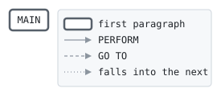

# FEESLOT

```text
feeslot: the fee table's slot for a card product, a region and a
merchant group, or zero for none: three products, two regions and five
groups, thirty slots. the slot is the return code, which a caller
receives with call ... returning.

history
2012-01-09 ah  lcs-0140 original version.
```

Program [feeslot.cbl](../../../laurasia/programs/feeslot.cbl): 0 files, 1 paragraphs. Its business rules: [1 decision tables](../rules/FEESLOT.md).

## Contents

- [Files](#files)
- [Flow](#flow)
- [Paragraphs](#paragraphs)
- [Calls](#calls)
- [Data flow](#data-flow)
- [Lineage](#lineage)
  - [Into WS-PRODUCT-INDEX](#into-ws-product-index)
  - [Into WS-REGION-INDEX](#into-ws-region-index)
  - [Into WS-SLOT](#into-ws-slot)
  - [Into other data items](#into-other-data-items)
- [Parameters](#parameters)
  - [Parameter 1, LK-PRODUCT](#parameter-1-lk-product)
  - [Parameter 2, LK-REGION](#parameter-2-lk-region)
  - [Parameter 3, LK-GROUP](#parameter-3-lk-group)
- [Records](#records)
  - [WS-PRODUCT-INDEX](#ws-product-index)
  - [WS-REGION-INDEX](#ws-region-index)
  - [WS-SLOT](#ws-slot)
  - [LK-PRODUCT](#lk-product)
  - [LK-REGION](#lk-region)
  - [LK-GROUP](#lk-group)

## Files

| File | Kind | Assigned to | Organization | Status field | Opened | Records |
| --- | --- | --- | --- | --- | --- | --- |

## Flow



## Paragraphs

| Paragraph | Description | Source | Performs | Goes to | Performed by | Reached by |
| --- | --- | --- | --- | --- | --- | --- |
| MAIN | | [feeslot.cbl:23](../../../laurasia/programs/feeslot.cbl#L23) | | | | |

## Calls

Called with LK-PRODUCT, LK-REGION, LK-GROUP by [FEELD](FEELD.md), [IXFEE](IXFEE.md).

## Data flow

| Paragraph | Reads | Writes |
| --- | --- | --- |
| MAIN | LK-PRODUCT, LK-REGION, LK-GROUP, WS-PRODUCT-INDEX, WS-REGION-INDEX, WS-SLOT | RETURN-CODE, WS-PRODUCT-INDEX, WS-REGION-INDEX, WS-SLOT |

## Lineage

Where each data item's values come from, grouped by the record they go into. A data item links to the record it belongs to.

### Into WS-PRODUCT-INDEX

Record [WS-PRODUCT-INDEX](#ws-product-index).

| Into | From | Statement | Paragraph | Source |
| --- | --- | --- | --- | --- |
| WS-PRODUCT-INDEX | literal 1 | MOVE | MAIN | [feeslot.cbl:26](../../../laurasia/programs/feeslot.cbl#L26) |
| WS-PRODUCT-INDEX | literal 2 | MOVE | MAIN | [feeslot.cbl:27](../../../laurasia/programs/feeslot.cbl#L27) |
| WS-PRODUCT-INDEX | literal 3 | MOVE | MAIN | [feeslot.cbl:28](../../../laurasia/programs/feeslot.cbl#L28) |

### Into WS-REGION-INDEX

Record [WS-REGION-INDEX](#ws-region-index).

| Into | From | Statement | Paragraph | Source |
| --- | --- | --- | --- | --- |
| WS-REGION-INDEX | literal 1 | MOVE | MAIN | [feeslot.cbl:32](../../../laurasia/programs/feeslot.cbl#L32) |
| WS-REGION-INDEX | literal 2 | MOVE | MAIN | [feeslot.cbl:33](../../../laurasia/programs/feeslot.cbl#L33) |

### Into WS-SLOT

Record [WS-SLOT](#ws-slot).

| Into | From | Statement | Paragraph | Source |
| --- | --- | --- | --- | --- |
| WS-SLOT | [WS-PRODUCT-INDEX](#ws-product-index) | COMPUTE | MAIN | [feeslot.cbl:39](../../../laurasia/programs/feeslot.cbl#L39) |
| WS-SLOT | [WS-REGION-INDEX](#ws-region-index) | COMPUTE | MAIN | [feeslot.cbl:39](../../../laurasia/programs/feeslot.cbl#L39) |
| WS-SLOT | [LK-GROUP](#lk-group) | COMPUTE | MAIN | [feeslot.cbl:39](../../../laurasia/programs/feeslot.cbl#L39) |

### Into other data items

Data items the program does not declare, such as special registers and index names.

| Into | From | Statement | Paragraph | Source |
| --- | --- | --- | --- | --- |
| RETURN-CODE | literal ZERO | MOVE | MAIN | [feeslot.cbl:24](../../../laurasia/programs/feeslot.cbl#L24) |
| RETURN-CODE | [WS-SLOT](#ws-slot) | MOVE | MAIN | [feeslot.cbl:40](../../../laurasia/programs/feeslot.cbl#L40) |

## Parameters

What the program does with each field of the items it is passed, by position: the contract its callers rely on. A statement on a whole item, or a group of it, counts for each field in it; a field neither read nor written is passed for nothing.

### Parameter 1, LK-PRODUCT

| Field | Reads | Writes |
| --- | :-: | :-: |
| LK-PRODUCT | yes | |

### Parameter 2, LK-REGION

| Field | Reads | Writes |
| --- | :-: | :-: |
| LK-REGION | yes | |

### Parameter 3, LK-GROUP

| Field | Reads | Writes |
| --- | :-: | :-: |
| LK-GROUP | yes | |

## Records

### WS-PRODUCT-INDEX

Working storage. 1 bytes.

| Level | Field | Kind | Start | Length | Picture | Usage | Notes | Source |
| --: | --- | --- | --: | --: | --- | --- | --- | --- |
| 01 | WS-PRODUCT-INDEX | number | 1 | 1 | 9 | COMP-5 | | [feeslot.cbl:14](../../../laurasia/programs/feeslot.cbl#L14) |

### WS-REGION-INDEX

Working storage. 1 bytes.

| Level | Field | Kind | Start | Length | Picture | Usage | Notes | Source |
| --: | --- | --- | --: | --: | --- | --- | --- | --- |
| 01 | WS-REGION-INDEX | number | 1 | 1 | 9 | COMP-5 | | [feeslot.cbl:15](../../../laurasia/programs/feeslot.cbl#L15) |

### WS-SLOT

Working storage. 2 bytes.

| Level | Field | Kind | Start | Length | Picture | Usage | Notes | Source |
| --: | --- | --- | --: | --: | --- | --- | --- | --- |
| 01 | WS-SLOT | number | 1 | 2 | 9(4) | COMP-5 | | [feeslot.cbl:16](../../../laurasia/programs/feeslot.cbl#L16) |

### LK-PRODUCT

Linkage. 2 bytes.

| Level | Field | Kind | Start | Length | Picture | Usage | Notes | Source |
| --: | --- | --- | --: | --: | --- | --- | --- | --- |
| 01 | LK-PRODUCT | text | 1 | 2 | X(2) | | | [feeslot.cbl:18](../../../laurasia/programs/feeslot.cbl#L18) |

### LK-REGION

Linkage. 1 bytes.

| Level | Field | Kind | Start | Length | Picture | Usage | Notes | Source |
| --: | --- | --- | --: | --: | --- | --- | --- | --- |
| 01 | LK-REGION | text | 1 | 1 | X | | | [feeslot.cbl:19](../../../laurasia/programs/feeslot.cbl#L19) |

### LK-GROUP

Linkage. 1 bytes.

| Level | Field | Kind | Start | Length | Picture | Usage | Notes | Source |
| --: | --- | --- | --: | --: | --- | --- | --- | --- |
| 01 | LK-GROUP | number | 1 | 1 | 9 | | | [feeslot.cbl:20](../../../laurasia/programs/feeslot.cbl#L20) |
