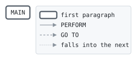

# INTCALC

```text
intcalc: a month's interest on a statement balance, in cents, as the
return code: a twelfth of the yearly rate of the card's product.

history
2013-06-03 rk  lcs-0219 original version.
2021-03-01 mt  lcs-0481 the rate by product.
```

Program [intcalc.cbl](../../../laurasia/programs/intcalc.cbl): 0 files, 1 paragraphs. Its business rules: [1 decision tables](../rules/INTCALC.md).

## Contents

- [Files](#files)
- [Flow](#flow)
- [Paragraphs](#paragraphs)
- [Calls](#calls)
- [Data flow](#data-flow)
- [Lineage](#lineage)
  - [Into WS-YEARLY-RATE](#into-ws-yearly-rate)
  - [Into WS-CENTS](#into-ws-cents)
  - [Into other data items](#into-other-data-items)
- [Parameters](#parameters)
  - [Parameter 1, LK-PRODUCT](#parameter-1-lk-product)
  - [Parameter 2, LK-BALANCE](#parameter-2-lk-balance)
- [Records](#records)
  - [WS-YEARLY-RATE](#ws-yearly-rate)
  - [WS-CENTS](#ws-cents)
  - [LK-PRODUCT](#lk-product)
  - [LK-BALANCE](#lk-balance)

## Files

| File | Kind | Assigned to | Organization | Status field | Opened | Records |
| --- | --- | --- | --- | --- | --- | --- |

## Flow



## Paragraphs

| Paragraph | Description | Source | Performs | Goes to | Performed by | Reached by |
| --- | --- | --- | --- | --- | --- | --- |
| MAIN | | [intcalc.cbl:23](../../../laurasia/programs/intcalc.cbl#L23) | | | | |

## Calls

Called with LK-PRODUCT, LK-BALANCE by [CYCLE](CYCLE.md).

## Data flow

| Paragraph | Reads | Writes |
| --- | --- | --- |
| MAIN | LK-PRODUCT, LK-BALANCE, WS-YEARLY-RATE, WS-CENTS | WS-YEARLY-RATE, WS-CENTS, RETURN-CODE |

## Lineage

Where each data item's values come from, grouped by the record they go into. A data item links to the record it belongs to.

### Into WS-YEARLY-RATE

Record [WS-YEARLY-RATE](#ws-yearly-rate).

| Into | From | Statement | Paragraph | Source |
| --- | --- | --- | --- | --- |
| WS-YEARLY-RATE | literal 0.1690 | MOVE | MAIN | [intcalc.cbl:26](../../../laurasia/programs/intcalc.cbl#L26) |
| WS-YEARLY-RATE | literal 0.1490 | MOVE | MAIN | [intcalc.cbl:28](../../../laurasia/programs/intcalc.cbl#L28) |
| WS-YEARLY-RATE | literal 0.1990 | MOVE | MAIN | [intcalc.cbl:30](../../../laurasia/programs/intcalc.cbl#L30) |

### Into WS-CENTS

Record [WS-CENTS](#ws-cents).

| Into | From | Statement | Paragraph | Source |
| --- | --- | --- | --- | --- |
| WS-CENTS | [LK-BALANCE](#lk-balance) | COMPUTE | MAIN | [intcalc.cbl:32](../../../laurasia/programs/intcalc.cbl#L32) |
| WS-CENTS | [WS-YEARLY-RATE](#ws-yearly-rate) | COMPUTE | MAIN | [intcalc.cbl:32](../../../laurasia/programs/intcalc.cbl#L32) |

### Into other data items

Data items the program does not declare, such as special registers and index names.

| Into | From | Statement | Paragraph | Source |
| --- | --- | --- | --- | --- |
| RETURN-CODE | [WS-CENTS](#ws-cents) | MOVE | MAIN | [intcalc.cbl:33](../../../laurasia/programs/intcalc.cbl#L33) |

## Parameters

What the program does with each field of the items it is passed, by position: the contract its callers rely on. A statement on a whole item, or a group of it, counts for each field in it; a field neither read nor written is passed for nothing.

### Parameter 1, LK-PRODUCT

| Field | Reads | Writes |
| --- | :-: | :-: |
| LK-PRODUCT | yes | |

### Parameter 2, LK-BALANCE

| Field | Reads | Writes |
| --- | :-: | :-: |
| LK-BALANCE | yes | |

## Records

### WS-YEARLY-RATE

Working storage. 4 bytes.

| Level | Field | Kind | Start | Length | Picture | Usage | Notes | Source |
| --: | --- | --- | --: | --: | --- | --- | --- | --- |
| 01 | WS-YEARLY-RATE | amount | 1 | 4 | V9(4) | | | [intcalc.cbl:13](../../../laurasia/programs/intcalc.cbl#L13) |

### WS-CENTS

Working storage. 4 bytes.

| Level | Field | Kind | Start | Length | Picture | Usage | Notes | Source |
| --: | --- | --- | --: | --: | --- | --- | --- | --- |
| 01 | WS-CENTS | number | 1 | 4 | S9(9) | COMP-5 | | [intcalc.cbl:14](../../../laurasia/programs/intcalc.cbl#L14) |

### LK-PRODUCT

Linkage. 2 bytes.

| Level | Field | Kind | Start | Length | Picture | Usage | Notes | Source |
| --: | --- | --- | --: | --: | --- | --- | --- | --- |
| 01 | LK-PRODUCT | code | 1 | 2 | X(2) | | | [intcalc.cbl:16](../../../laurasia/programs/intcalc.cbl#L16) |
| 88 | ├ LK-CLASSIC | | | | | | VALUE 'CL' | [intcalc.cbl:17](../../../laurasia/programs/intcalc.cbl#L17) |
| 88 | ├ LK-GOLD | | | | | | VALUE 'GD' | [intcalc.cbl:18](../../../laurasia/programs/intcalc.cbl#L18) |
| 88 | └ LK-BUSINESS | | | | | | VALUE 'BZ' | [intcalc.cbl:19](../../../laurasia/programs/intcalc.cbl#L19) |

### LK-BALANCE

Linkage. 10 bytes.

| Level | Field | Kind | Start | Length | Picture | Usage | Notes | Source |
| --: | --- | --- | --: | --: | --- | --- | --- | --- |
| 01 | LK-BALANCE | amount | 1 | 10 | S9(7)V99 | | SIGN LEADING SEPARATE | [intcalc.cbl:20](../../../laurasia/programs/intcalc.cbl#L20) |
