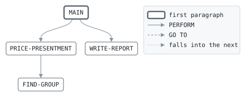

# IXFEE

```text
ixfee: work out each presentment's interchange fee

for each matched presentment, finds the merchant group by the
merchant's category code, and the fee for the card product, the region
and the group in the fee table: a rate on the amount and a fixed fee.
a combination the schedule has no fee for gets the default fee. a
presentment not matched to an approval pays no fee here; it is not
settled.

return codes: 0 done, 4 some default fees, 16 no fee table.

history
2012-01-09 ah  lcs-0140 original version.
2017-08-28 ah  lcs-0398 travel and fuel as merchant groups of their own.
```

Program [ixfee.cbl](../../../laurasia/programs/ixfee.cbl): 4 files, 4 paragraphs. Its business rules: [4 decision tables](../rules/IXFEE.md).

## Contents

- [Files](#files)
- [Constants](#constants)
- [Flow](#flow)
- [Paragraphs](#paragraphs)
- [Calls](#calls)
- [Data flow](#data-flow)
- [Lineage](#lineage)
  - [Into PRES-IN-RECORD](#into-pres-in-record)
  - [Into FEE-SLOT-RECORD](#into-fee-slot-record)
  - [Into PRES-RECORD](#into-pres-record)
  - [Into REPORT-LINE](#into-report-line)
  - [Into WS-SLOT](#into-ws-slot)
  - [Into WS-GROUP](#into-ws-group)
  - [Into WS-AT-END](#into-ws-at-end)
  - [Into WS-TOTALS](#into-ws-totals)
  - [Into WS-REPORT-AMOUNT](#into-ws-report-amount)
  - [Into WS-REPORT-COUNT](#into-ws-report-count)
  - [Out of the program](#out-of-the-program)
- [Field origins](#field-origins)
  - [File PRES-OUT](#file-pres-out)
  - [File REPORT-OUT](#file-report-out)
- [Records](#records)
  - [PRES-IN-RECORD](#pres-in-record)
  - [FEE-SLOT-RECORD](#fee-slot-record)
  - [PRES-RECORD](#pres-record)
  - [REPORT-LINE](#report-line)
  - [WS-SLOT](#ws-slot)
  - [WS-FEE-STATUS](#ws-fee-status)
  - [WS-GROUP](#ws-group)
  - [WS-AT-END](#ws-at-end)
  - [WS-TOTALS](#ws-totals)
  - [WS-REPORT-AMOUNT](#ws-report-amount)
  - [WS-REPORT-COUNT](#ws-report-count)

## Files

| File | Kind | Assigned to | Organization | Status field | Opened | Records |
| --- | --- | --- | --- | --- | --- | --- |
| PRES-IN | FD | PRESIN | LINE SEQUENTIAL | | INPUT | PRES-IN-RECORD |
| FEE-TABLE | FD | FEETAB | RELATIVE, record number in WS-SLOT, RANDOM access | WS-FEE-STATUS | INPUT | FEE-SLOT-RECORD |
| PRES-OUT | FD | PRESOUT | LINE SEQUENTIAL | | OUTPUT | PRES-RECORD |
| REPORT-OUT | FD | FEERPT | LINE SEQUENTIAL | | OUTPUT | REPORT-LINE |

## Constants

| Constant | Value | Source |
| --- | --- | --- |
| DEFAULT-RATE | 0.0200 | [ixfee.cbl:46](../../../laurasia/programs/ixfee.cbl#L46) |
| DEFAULT-FIXED-CENTS | 25 | [ixfee.cbl:47](../../../laurasia/programs/ixfee.cbl#L47) |

## Flow



## Paragraphs

| Paragraph | Description | Source | Performs | Goes to | Performed by | Reached by |
| --- | --- | --- | --- | --- | --- | --- |
| MAIN | | [ixfee.cbl:69](../../../laurasia/programs/ixfee.cbl#L69) | PRICE-PRESENTMENT, WRITE-REPORT | | | |
| PRICE-PRESENTMENT | | [ixfee.cbl:88](../../../laurasia/programs/ixfee.cbl#L88) | FIND-GROUP | | MAIN | |
| FIND-GROUP | the merchant group by the merchant category code. | [ixfee.cbl:105](../../../laurasia/programs/ixfee.cbl#L105) | | | PRICE-PRESENTMENT | |
| WRITE-REPORT | | [ixfee.cbl:122](../../../laurasia/programs/ixfee.cbl#L122) | | | MAIN | |

## Calls

| Calls | Passing | Paragraph | Source |
| --- | --- | --- | --- |
| [FEESLOT](FEESLOT.md) | PS-PRODUCT, PS-REGION, WS-GROUP; returning WS-SLOT | PRICE-PRESENTMENT | [ixfee.cbl:92](../../../laurasia/programs/ixfee.cbl#L92) |

## Data flow

| Paragraph | Reads | Writes |
| --- | --- | --- |
| MAIN | WS-FEE-STATUS, WS-AT-END, WS-DEFAULT-COUNT | RETURN-CODE, PRES-RECORD, PRES-IN-RECORD, WS-AT-END |
| PRICE-PRESENTMENT | PS-MATCH, PS-PRODUCT, PS-REGION, WS-GROUP, WS-DEFAULT-COUNT, PS-AMOUNT, DEFAULT-RATE, DEFAULT-FIXED-CENTS, FS-RATE, FS-FIXED-CENTS, PS-FEE, WS-FEES | PS-FEE, PS-PRODUCT, PS-REGION, WS-GROUP, WS-SLOT, FEE-SLOT-RECORD, WS-DEFAULT-COUNT, WS-FEES, PRES-RECORD |
| FIND-GROUP | PS-MCC | WS-GROUP |
| WRITE-REPORT | WS-FEES, WS-REPORT-AMOUNT, WS-DEFAULT-COUNT, WS-REPORT-COUNT | REPORT-LINE, RA-LABEL, RA-VALUE, RC-LABEL, RC-VALUE |

## Lineage

Where each data item's values come from, grouped by the record they go into. A data item links to the record it belongs to.

### Into PRES-IN-RECORD

Record [PRES-IN-RECORD](#pres-in-record).

| Into | From | Statement | Paragraph | Source |
| --- | --- | --- | --- | --- |
| PRES-IN-RECORD | file PRES-IN | READ | MAIN | [ixfee.cbl:76](../../../laurasia/programs/ixfee.cbl#L76) |

### Into FEE-SLOT-RECORD

Record [FEE-SLOT-RECORD](#fee-slot-record), from copybook [feerec](../copybooks/feerec.md).

| Into | From | Statement | Paragraph | Source |
| --- | --- | --- | --- | --- |
| FEE-SLOT-RECORD | file FEE-TABLE | READ | PRICE-PRESENTMENT | [ixfee.cbl:93](../../../laurasia/programs/ixfee.cbl#L93) |

### Into PRES-RECORD

Record [PRES-RECORD](#pres-record), from copybook [presrec](../copybooks/presrec.md).

| Into | From | Statement | Paragraph | Source |
| --- | --- | --- | --- | --- |
| PRES-RECORD | [PRES-IN-RECORD](#pres-in-record) | READ | MAIN | [ixfee.cbl:76](../../../laurasia/programs/ixfee.cbl#L76) |
| PS-FEE | literal ZERO | MOVE | PRICE-PRESENTMENT | [ixfee.cbl:89](../../../laurasia/programs/ixfee.cbl#L89) |
| PS-FEE | [PS-AMOUNT](#pres-record "in PRES-RECORD") | COMPUTE | PRICE-PRESENTMENT | [ixfee.cbl:96](../../../laurasia/programs/ixfee.cbl#L96) |
| PS-FEE | DEFAULT-RATE | COMPUTE | PRICE-PRESENTMENT | [ixfee.cbl:96](../../../laurasia/programs/ixfee.cbl#L96) |
| PS-FEE | DEFAULT-FIXED-CENTS | COMPUTE | PRICE-PRESENTMENT | [ixfee.cbl:96](../../../laurasia/programs/ixfee.cbl#L96) |
| PS-FEE | [PS-AMOUNT](#pres-record "in PRES-RECORD") | COMPUTE | PRICE-PRESENTMENT | [ixfee.cbl:98](../../../laurasia/programs/ixfee.cbl#L98) |
| PS-FEE | [FS-RATE](#fee-slot-record "in FEE-SLOT-RECORD") | COMPUTE | PRICE-PRESENTMENT | [ixfee.cbl:98](../../../laurasia/programs/ixfee.cbl#L98) |
| PS-FEE | [FS-FIXED-CENTS](#fee-slot-record "in FEE-SLOT-RECORD") | COMPUTE | PRICE-PRESENTMENT | [ixfee.cbl:98](../../../laurasia/programs/ixfee.cbl#L98) |
| PS-PRODUCT | call FEESLOT argument 1 | CALL | PRICE-PRESENTMENT | [ixfee.cbl:92](../../../laurasia/programs/ixfee.cbl#L92) |
| PS-REGION | call FEESLOT argument 2 | CALL | PRICE-PRESENTMENT | [ixfee.cbl:92](../../../laurasia/programs/ixfee.cbl#L92) |

### Into REPORT-LINE

Record [REPORT-LINE](#report-line).

| Into | From | Statement | Paragraph | Source |
| --- | --- | --- | --- | --- |
| REPORT-LINE | literal 'IXFEE    INTERCHANGE' | MOVE | WRITE-REPORT | [ixfee.cbl:123](../../../laurasia/programs/ixfee.cbl#L123) |
| REPORT-LINE | [WS-REPORT-AMOUNT](#ws-report-amount) | WRITE | WRITE-REPORT | [ixfee.cbl:127](../../../laurasia/programs/ixfee.cbl#L127) |
| REPORT-LINE | [WS-REPORT-COUNT](#ws-report-count) | WRITE | WRITE-REPORT | [ixfee.cbl:130](../../../laurasia/programs/ixfee.cbl#L130) |

### Into WS-SLOT

Record [WS-SLOT](#ws-slot).

| Into | From | Statement | Paragraph | Source |
| --- | --- | --- | --- | --- |
| WS-SLOT | call FEESLOT, what it returns | CALL | PRICE-PRESENTMENT | [ixfee.cbl:92](../../../laurasia/programs/ixfee.cbl#L92) |

### Into WS-GROUP

Record [WS-GROUP](#ws-group).

| Into | From | Statement | Paragraph | Source |
| --- | --- | --- | --- | --- |
| WS-GROUP | call FEESLOT argument 3 | CALL | PRICE-PRESENTMENT | [ixfee.cbl:92](../../../laurasia/programs/ixfee.cbl#L92) |
| WS-GROUP | literal condition GROUP-GROCERY | SET | FIND-GROUP | [ixfee.cbl:108](../../../laurasia/programs/ixfee.cbl#L108) |
| WS-GROUP | literal condition GROUP-RESTAURANTS | SET | FIND-GROUP | [ixfee.cbl:110](../../../laurasia/programs/ixfee.cbl#L110) |
| WS-GROUP | literal condition GROUP-TRAVEL | SET | FIND-GROUP | [ixfee.cbl:113](../../../laurasia/programs/ixfee.cbl#L113) |
| WS-GROUP | literal condition GROUP-FUEL | SET | FIND-GROUP | [ixfee.cbl:117](../../../laurasia/programs/ixfee.cbl#L117) |
| WS-GROUP | literal condition GROUP-OTHER | SET | FIND-GROUP | [ixfee.cbl:119](../../../laurasia/programs/ixfee.cbl#L119) |

### Into WS-AT-END

Record [WS-AT-END](#ws-at-end).

| Into | From | Statement | Paragraph | Source |
| --- | --- | --- | --- | --- |
| WS-AT-END | literal condition PRESENTMENTS-AT-END | SET | MAIN | [ixfee.cbl:77](../../../laurasia/programs/ixfee.cbl#L77) |

### Into WS-TOTALS

Record [WS-TOTALS](#ws-totals).

| Into | From | Statement | Paragraph | Source |
| --- | --- | --- | --- | --- |
| WS-DEFAULT-COUNT | literal 1 | ADD | PRICE-PRESENTMENT | [ixfee.cbl:95](../../../laurasia/programs/ixfee.cbl#L95) |
| WS-FEES | [PS-FEE](#pres-record "in PRES-RECORD") | ADD | PRICE-PRESENTMENT | [ixfee.cbl:100](../../../laurasia/programs/ixfee.cbl#L100) |

### Into WS-REPORT-AMOUNT

Record [WS-REPORT-AMOUNT](#ws-report-amount).

| Into | From | Statement | Paragraph | Source |
| --- | --- | --- | --- | --- |
| RA-LABEL | literal 'INTERCHANGE FEES' | MOVE | WRITE-REPORT | [ixfee.cbl:125](../../../laurasia/programs/ixfee.cbl#L125) |
| RA-VALUE | [WS-FEES](#ws-totals "in WS-TOTALS") | MOVE | WRITE-REPORT | [ixfee.cbl:126](../../../laurasia/programs/ixfee.cbl#L126) |

### Into WS-REPORT-COUNT

Record [WS-REPORT-COUNT](#ws-report-count).

| Into | From | Statement | Paragraph | Source |
| --- | --- | --- | --- | --- |
| RC-LABEL | literal 'DEFAULT FEES' | MOVE | WRITE-REPORT | [ixfee.cbl:128](../../../laurasia/programs/ixfee.cbl#L128) |
| RC-VALUE | [WS-DEFAULT-COUNT](#ws-totals "in WS-TOTALS") | MOVE | WRITE-REPORT | [ixfee.cbl:129](../../../laurasia/programs/ixfee.cbl#L129) |

### Out of the program

Records written to files, items passed to the programs called, and items displayed to the job's output.

| Into | From | Statement | Paragraph | Source |
| --- | --- | --- | --- | --- |
| call FEESLOT argument 1 | [PS-PRODUCT](#pres-record "in PRES-RECORD") | CALL | PRICE-PRESENTMENT | [ixfee.cbl:92](../../../laurasia/programs/ixfee.cbl#L92) |
| call FEESLOT argument 2 | [PS-REGION](#pres-record "in PRES-RECORD") | CALL | PRICE-PRESENTMENT | [ixfee.cbl:92](../../../laurasia/programs/ixfee.cbl#L92) |
| call FEESLOT argument 3 | [WS-GROUP](#ws-group) | CALL | PRICE-PRESENTMENT | [ixfee.cbl:92](../../../laurasia/programs/ixfee.cbl#L92) |
| file PRES-OUT | [PRES-RECORD](#pres-record) | WRITE | PRICE-PRESENTMENT | [ixfee.cbl:102](../../../laurasia/programs/ixfee.cbl#L102) |
| file REPORT-OUT | [REPORT-LINE](#report-line) | WRITE | WRITE-REPORT | [ixfee.cbl:124](../../../laurasia/programs/ixfee.cbl#L124) |
| file REPORT-OUT | [REPORT-LINE](#report-line) | WRITE | WRITE-REPORT | [ixfee.cbl:127](../../../laurasia/programs/ixfee.cbl#L127) |
| file REPORT-OUT | [REPORT-LINE](#report-line) | WRITE | WRITE-REPORT | [ixfee.cbl:130](../../../laurasia/programs/ixfee.cbl#L130) |

## Field origins

Where the values of each field the program writes to a file come from: the fields of the files it reads, literals, and initial values, followed through every statement that moves a value, and through groups and redefinitions by the bytes they share.

### File PRES-OUT

Written from [PRES-RECORD](#pres-record).

| Field | Position | Origins |
| --- | --: | --- |
| PS-CARD-NO | 1-16 | file PRES-IN PRES-IN-RECORD 1-16 |
| PS-AMOUNT | 17-28 | file PRES-IN PRES-IN-RECORD 17-28 |
| PS-AUTH-CODE | 29-34 | file PRES-IN PRES-IN-RECORD 29-34 |
| PS-MERCHANT | 35-44 | file PRES-IN PRES-IN-RECORD 35-44 |
| PS-MCC | 45-48 | file PRES-IN PRES-IN-RECORD 45-48 |
| PS-REGION | 49 | call FEESLOT argument 2 PS-REGION; file PRES-IN PRES-IN-RECORD 49-49 |
| PS-PRODUCT | 50-51 | call FEESLOT argument 1 PS-PRODUCT; file PRES-IN PRES-IN-RECORD 50-51 |
| PS-TXN-DATE | 52-59 | file PRES-IN PRES-IN-RECORD 52-59 |
| PS-BATCH-NO | 60-65 | file PRES-IN PRES-IN-RECORD 60-65 |
| PS-MATCH | 66 | file PRES-IN PRES-IN-RECORD 66-66 |
| PS-FEE | 67-76 | file FEE-TABLE FS-FIXED-CENTS; file FEE-TABLE FS-RATE; file PRES-IN PRES-IN-RECORD 17-28; literal ZERO |

### File REPORT-OUT

Written from [REPORT-LINE](#report-line), [WS-REPORT-AMOUNT](#ws-report-amount) and [WS-REPORT-COUNT](#ws-report-count).

#### Record REPORT-LINE

| Field | Position | Origins |
| --- | --: | --- |
| REPORT-LINE | 1-60 | literal 'IXFEE    INTERCHANGE' |

#### Record WS-REPORT-AMOUNT

| Field | Position | Origins |
| --- | --: | --- |
| RA-LABEL | 1-30 | literal 'INTERCHANGE FEES' |
| RA-VALUE | 31-43 | file FEE-TABLE FS-FIXED-CENTS; file FEE-TABLE FS-RATE; file PRES-IN PRES-IN-RECORD 17-28; initial value of WS-FEES |

#### Record WS-REPORT-COUNT

| Field | Position | Origins |
| --- | --: | --- |
| RC-LABEL | 1-30 | literal 'DEFAULT FEES' |
| RC-VALUE | 31-38 | initial value of WS-DEFAULT-COUNT; literal 1 |

## Records

### PRES-IN-RECORD

File PRES-IN. 76 bytes.

| Level | Field | Kind | Start | Length | Picture | Usage | Notes | Source |
| --: | --- | --- | --: | --: | --- | --- | --- | --- |
| 01 | PRES-IN-RECORD | text | 1 | 76 | X(76) | | | [ixfee.cbl:37](../../../laurasia/programs/ixfee.cbl#L37) |

### FEE-SLOT-RECORD

File FEE-TABLE. 8 bytes, layout in copybook [feerec](../copybooks/feerec.md).

### PRES-RECORD

File PRES-OUT. 76 bytes, layout in copybook [presrec](../copybooks/presrec.md).

### REPORT-LINE

File REPORT-OUT. 60 bytes.

| Level | Field | Kind | Start | Length | Picture | Usage | Notes | Source |
| --: | --- | --- | --: | --: | --- | --- | --- | --- |
| 01 | REPORT-LINE | text | 1 | 60 | X(60) | | | [ixfee.cbl:43](../../../laurasia/programs/ixfee.cbl#L43) |

### WS-SLOT

Working storage. 2 bytes.

| Level | Field | Kind | Start | Length | Picture | Usage | Notes | Source |
| --: | --- | --- | --: | --: | --- | --- | --- | --- |
| 01 | WS-SLOT | number | 1 | 2 | 9(4) | COMP-5 | | [ixfee.cbl:48](../../../laurasia/programs/ixfee.cbl#L48) |

### WS-FEE-STATUS

Working storage. 2 bytes.

| Level | Field | Kind | Start | Length | Picture | Usage | Notes | Source |
| --: | --- | --- | --: | --: | --- | --- | --- | --- |
| 01 | WS-FEE-STATUS | text | 1 | 2 | XX | | | [ixfee.cbl:49](../../../laurasia/programs/ixfee.cbl#L49) |

### WS-GROUP

Working storage. 1 bytes.

| Level | Field | Kind | Start | Length | Picture | Usage | Notes | Source |
| --: | --- | --- | --: | --: | --- | --- | --- | --- |
| 01 | WS-GROUP | code | 1 | 1 | 9 | | | [ixfee.cbl:50](../../../laurasia/programs/ixfee.cbl#L50) |
| 88 | ├ GROUP-GROCERY | | | | | | VALUE 1 | [ixfee.cbl:51](../../../laurasia/programs/ixfee.cbl#L51) |
| 88 | ├ GROUP-RESTAURANTS | | | | | | VALUE 2 | [ixfee.cbl:52](../../../laurasia/programs/ixfee.cbl#L52) |
| 88 | ├ GROUP-TRAVEL | | | | | | VALUE 3 | [ixfee.cbl:53](../../../laurasia/programs/ixfee.cbl#L53) |
| 88 | ├ GROUP-FUEL | | | | | | VALUE 4 | [ixfee.cbl:54](../../../laurasia/programs/ixfee.cbl#L54) |
| 88 | └ GROUP-OTHER | | | | | | VALUE 5 | [ixfee.cbl:55](../../../laurasia/programs/ixfee.cbl#L55) |

### WS-AT-END

Working storage. 1 bytes.

| Level | Field | Kind | Start | Length | Picture | Usage | Notes | Source |
| --: | --- | --- | --: | --: | --- | --- | --- | --- |
| 01 | WS-AT-END | code | 1 | 1 | X | | VALUE 'N' | [ixfee.cbl:56](../../../laurasia/programs/ixfee.cbl#L56) |
| 88 | └ PRESENTMENTS-AT-END | | | | | | VALUE 'Y' | [ixfee.cbl:57](../../../laurasia/programs/ixfee.cbl#L57) |

### WS-TOTALS

Working storage. 19 bytes.

| Level | Field | Kind | Start | Length | Picture | Usage | Notes | Source |
| --: | --- | --- | --: | --: | --- | --- | --- | --- |
| 01 | WS-TOTALS | group | 1 | 19 | | | | [ixfee.cbl:58](../../../laurasia/programs/ixfee.cbl#L58) |
| 05 | ├ WS-FEES | amount | 1 | 11 | S9(9)V99 | | VALUE ZERO | [ixfee.cbl:59](../../../laurasia/programs/ixfee.cbl#L59) |
| 05 | └ WS-DEFAULT-COUNT | number | 12 | 8 | 9(8) | | VALUE ZERO | [ixfee.cbl:60](../../../laurasia/programs/ixfee.cbl#L60) |

### WS-REPORT-AMOUNT

Working storage. 43 bytes.

| Level | Field | Kind | Start | Length | Picture | Usage | Notes | Source |
| --: | --- | --- | --: | --: | --- | --- | --- | --- |
| 01 | WS-REPORT-AMOUNT | group | 1 | 43 | | | | [ixfee.cbl:61](../../../laurasia/programs/ixfee.cbl#L61) |
| 05 | ├ RA-LABEL | text | 1 | 30 | X(30) | | | [ixfee.cbl:62](../../../laurasia/programs/ixfee.cbl#L62) |
| 05 | └ RA-VALUE | edited | 31 | 13 | -(9)9.99 | | | [ixfee.cbl:63](../../../laurasia/programs/ixfee.cbl#L63) |

### WS-REPORT-COUNT

Working storage. 38 bytes.

| Level | Field | Kind | Start | Length | Picture | Usage | Notes | Source |
| --: | --- | --- | --: | --: | --- | --- | --- | --- |
| 01 | WS-REPORT-COUNT | group | 1 | 38 | | | | [ixfee.cbl:64](../../../laurasia/programs/ixfee.cbl#L64) |
| 05 | ├ RC-LABEL | text | 1 | 30 | X(30) | | | [ixfee.cbl:65](../../../laurasia/programs/ixfee.cbl#L65) |
| 05 | └ RC-VALUE | edited | 31 | 8 | Z(7)9 | | | [ixfee.cbl:66](../../../laurasia/programs/ixfee.cbl#L66) |
