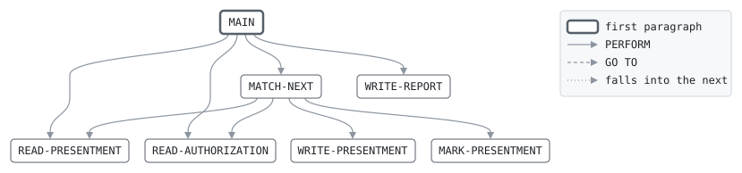

# MATCH

```text
match: match the presentments to their authorizations

reads the presentments and the day's authorizations, both in
authorization code order, and marks each presentment: matched to an
approval, presented on a declined authorization, for more than the
approval allows, or with no authorization at all. authorizations no
presentment claims are counted; they lapse.

return codes: 0 all matched, 4 some not.

history
2011-04-04 rk  lcs-0102 original version.
2014-02-17 rk  lcs-0251 marks instead of rejects.
2018-05-14 ah  lcs-0421 a presentment may exceed its approval by 15%.
```

Program [match.cbl](../../../laurasia/programs/match.cbl): 4 files, 7 paragraphs. Its business rules: [6 decision tables](../rules/MATCH.md).

## Contents

- [Files](#files)
- [Constants](#constants)
- [Flow](#flow)
- [Paragraphs](#paragraphs)
- [Data flow](#data-flow)
- [Lineage](#lineage)
  - [Into PRES-IN-RECORD](#into-pres-in-record)
  - [Into AUTH-ENTRY](#into-auth-entry)
  - [Into PRES-RECORD](#into-pres-record)
  - [Into REPORT-LINE](#into-report-line)
  - [Into WS-PRES-KEY](#into-ws-pres-key)
  - [Into WS-AUTH-KEY](#into-ws-auth-key)
  - [Into WS-COUNTS](#into-ws-counts)
  - [Into WS-AUTH-CLAIMED](#into-ws-auth-claimed)
  - [Into WS-REPORT-COUNT](#into-ws-report-count)
  - [Out of the program](#out-of-the-program)
- [Field origins](#field-origins)
  - [File PRES-OUT](#file-pres-out)
  - [File REPORT-OUT](#file-report-out)
- [Records](#records)
  - [PRES-IN-RECORD](#pres-in-record)
  - [AUTH-ENTRY](#auth-entry)
  - [PRES-RECORD](#pres-record)
  - [REPORT-LINE](#report-line)
  - [WS-PRES-KEY](#ws-pres-key)
  - [WS-AUTH-KEY](#ws-auth-key)
  - [WS-COUNTS](#ws-counts)
  - [WS-AUTH-CLAIMED](#ws-auth-claimed)
  - [WS-REPORT-COUNT](#ws-report-count)

## Files

| File | Kind | Assigned to | Organization | Status field | Opened | Records |
| --- | --- | --- | --- | --- | --- | --- |
| PRES-IN | FD | PRESIN | LINE SEQUENTIAL | | INPUT | PRES-IN-RECORD |
| AUTH-IN | FD | AUTHIN | LINE SEQUENTIAL | | INPUT | AUTH-ENTRY |
| PRES-OUT | FD | PRESOUT | LINE SEQUENTIAL | | OUTPUT | PRES-RECORD |
| REPORT-OUT | FD | MATCHRPT | LINE SEQUENTIAL | | OUTPUT | REPORT-LINE |

## Constants

| Constant | Value | Source |
| --- | --- | --- |
| TOLERANCE | 1.15 | [match.cbl:43](../../../laurasia/programs/match.cbl#L43) |

## Flow



## Paragraphs

| Paragraph | Description | Source | Performs | Goes to | Performed by | Reached by |
| --- | --- | --- | --- | --- | --- | --- |
| MAIN | | [match.cbl:57](../../../laurasia/programs/match.cbl#L57) | READ-PRESENTMENT, READ-AUTHORIZATION, MATCH-NEXT, WRITE-REPORT | | | |
| READ-PRESENTMENT | | [match.cbl:70](../../../laurasia/programs/match.cbl#L70) | | | MAIN, MATCH-NEXT | |
| READ-AUTHORIZATION | | [match.cbl:76](../../../laurasia/programs/match.cbl#L76) | | | MAIN, MATCH-NEXT | |
| MATCH-NEXT | the lower key goes first: a presentment with no authorization, or an authorization no presentment claims. several presentments may claim one authorization. | [match.cbl:86](../../../laurasia/programs/match.cbl#L86) | WRITE-PRESENTMENT, READ-PRESENTMENT, READ-AUTHORIZATION, MARK-PRESENTMENT | | MAIN | |
| MARK-PRESENTMENT | | [match.cbl:104](../../../laurasia/programs/match.cbl#L104) | | | MATCH-NEXT | |
| WRITE-PRESENTMENT | | [match.cbl:114](../../../laurasia/programs/match.cbl#L114) | | | MATCH-NEXT | |
| WRITE-REPORT | | [match.cbl:122](../../../laurasia/programs/match.cbl#L122) | | | MAIN | |

## Data flow

| Paragraph | Reads | Writes |
| --- | --- | --- |
| MAIN | WS-PRES-KEY, WS-AUTH-KEY, WS-NOT-MATCHED | RETURN-CODE |
| READ-PRESENTMENT | PS-AUTH-CODE | PRES-RECORD, PRES-IN-RECORD, WS-PRES-KEY |
| READ-AUTHORIZATION | AL-AUTH-CODE | AUTH-ENTRY, WS-AUTH-KEY, WS-AUTH-CLAIMED |
| MATCH-NEXT | WS-PRES-KEY, WS-AUTH-KEY, WS-AUTH-CLAIMED, WS-LAPSED | PS-MATCH, WS-LAPSED, WS-AUTH-CLAIMED |
| MARK-PRESENTMENT | AL-DECISION, PS-AMOUNT, AL-AMOUNT, TOLERANCE | PS-MATCH |
| WRITE-PRESENTMENT | PS-MATCH, WS-MATCHED, WS-NOT-MATCHED | PRES-RECORD, WS-MATCHED, WS-NOT-MATCHED |
| WRITE-REPORT | WS-MATCHED, WS-REPORT-COUNT, WS-NOT-MATCHED, WS-LAPSED | REPORT-LINE, RC-LABEL, RC-VALUE |

## Lineage

Where each data item's values come from, grouped by the record they go into. A data item links to the record it belongs to.

### Into PRES-IN-RECORD

Record [PRES-IN-RECORD](#pres-in-record).

| Into | From | Statement | Paragraph | Source |
| --- | --- | --- | --- | --- |
| PRES-IN-RECORD | file PRES-IN | READ | READ-PRESENTMENT | [match.cbl:71](../../../laurasia/programs/match.cbl#L71) |

### Into AUTH-ENTRY

Record [AUTH-ENTRY](#auth-entry), from copybook [authlog](../copybooks/authlog.md).

| Into | From | Statement | Paragraph | Source |
| --- | --- | --- | --- | --- |
| AUTH-ENTRY | file AUTH-IN | READ | READ-AUTHORIZATION | [match.cbl:77](../../../laurasia/programs/match.cbl#L77) |

### Into PRES-RECORD

Record [PRES-RECORD](#pres-record), from copybook [presrec](../copybooks/presrec.md).

| Into | From | Statement | Paragraph | Source |
| --- | --- | --- | --- | --- |
| PRES-RECORD | [PRES-IN-RECORD](#pres-in-record) | READ | READ-PRESENTMENT | [match.cbl:71](../../../laurasia/programs/match.cbl#L71) |
| PS-MATCH | literal condition PS-NO-AUTH | SET | MATCH-NEXT | [match.cbl:89](../../../laurasia/programs/match.cbl#L89) |
| PS-MATCH | literal condition PS-DECLINED | SET | MARK-PRESENTMENT | [match.cbl:107](../../../laurasia/programs/match.cbl#L107) |
| PS-MATCH | literal condition PS-OVER-AUTH | SET | MARK-PRESENTMENT | [match.cbl:109](../../../laurasia/programs/match.cbl#L109) |
| PS-MATCH | literal condition PS-MATCHED | SET | MARK-PRESENTMENT | [match.cbl:111](../../../laurasia/programs/match.cbl#L111) |

### Into REPORT-LINE

Record [REPORT-LINE](#report-line).

| Into | From | Statement | Paragraph | Source |
| --- | --- | --- | --- | --- |
| REPORT-LINE | literal 'MATCH    PRESENTMENTS TO AUTHORIZATIONS' | MOVE | WRITE-REPORT | [match.cbl:123](../../../laurasia/programs/match.cbl#L123) |
| REPORT-LINE | [WS-REPORT-COUNT](#ws-report-count) | WRITE | WRITE-REPORT | [match.cbl:127](../../../laurasia/programs/match.cbl#L127) |
| REPORT-LINE | [WS-REPORT-COUNT](#ws-report-count) | WRITE | WRITE-REPORT | [match.cbl:130](../../../laurasia/programs/match.cbl#L130) |
| REPORT-LINE | [WS-REPORT-COUNT](#ws-report-count) | WRITE | WRITE-REPORT | [match.cbl:133](../../../laurasia/programs/match.cbl#L133) |

### Into WS-PRES-KEY

Record [WS-PRES-KEY](#ws-pres-key).

| Into | From | Statement | Paragraph | Source |
| --- | --- | --- | --- | --- |
| WS-PRES-KEY | literal HIGH-VALUES | MOVE | READ-PRESENTMENT | [match.cbl:72](../../../laurasia/programs/match.cbl#L72) |
| WS-PRES-KEY | [PS-AUTH-CODE](#pres-record "in PRES-RECORD") | MOVE | READ-PRESENTMENT | [match.cbl:73](../../../laurasia/programs/match.cbl#L73) |

### Into WS-AUTH-KEY

Record [WS-AUTH-KEY](#ws-auth-key).

| Into | From | Statement | Paragraph | Source |
| --- | --- | --- | --- | --- |
| WS-AUTH-KEY | literal HIGH-VALUES | MOVE | READ-AUTHORIZATION | [match.cbl:78](../../../laurasia/programs/match.cbl#L78) |
| WS-AUTH-KEY | [AL-AUTH-CODE](#auth-entry "in AUTH-ENTRY") | MOVE | READ-AUTHORIZATION | [match.cbl:79](../../../laurasia/programs/match.cbl#L79) |

### Into WS-COUNTS

Record [WS-COUNTS](#ws-counts).

| Into | From | Statement | Paragraph | Source |
| --- | --- | --- | --- | --- |
| WS-LAPSED | literal 1 | ADD | MATCH-NEXT | [match.cbl:94](../../../laurasia/programs/match.cbl#L94) |
| WS-MATCHED | literal 1 | ADD | WRITE-PRESENTMENT | [match.cbl:117](../../../laurasia/programs/match.cbl#L117) |
| WS-NOT-MATCHED | literal 1 | ADD | WRITE-PRESENTMENT | [match.cbl:119](../../../laurasia/programs/match.cbl#L119) |

### Into WS-AUTH-CLAIMED

Record [WS-AUTH-CLAIMED](#ws-auth-claimed).

| Into | From | Statement | Paragraph | Source |
| --- | --- | --- | --- | --- |
| WS-AUTH-CLAIMED | literal 'N' | MOVE | READ-AUTHORIZATION | [match.cbl:81](../../../laurasia/programs/match.cbl#L81) |
| WS-AUTH-CLAIMED | literal condition AUTH-CLAIMED | SET | MATCH-NEXT | [match.cbl:99](../../../laurasia/programs/match.cbl#L99) |

### Into WS-REPORT-COUNT

Record [WS-REPORT-COUNT](#ws-report-count).

| Into | From | Statement | Paragraph | Source |
| --- | --- | --- | --- | --- |
| RC-LABEL | literal 'MATCHED' | MOVE | WRITE-REPORT | [match.cbl:125](../../../laurasia/programs/match.cbl#L125) |
| RC-LABEL | literal 'NOT MATCHED' | MOVE | WRITE-REPORT | [match.cbl:128](../../../laurasia/programs/match.cbl#L128) |
| RC-LABEL | literal 'AUTHORIZATIONS LAPSED' | MOVE | WRITE-REPORT | [match.cbl:131](../../../laurasia/programs/match.cbl#L131) |
| RC-VALUE | [WS-MATCHED](#ws-counts "in WS-COUNTS") | MOVE | WRITE-REPORT | [match.cbl:126](../../../laurasia/programs/match.cbl#L126) |
| RC-VALUE | [WS-NOT-MATCHED](#ws-counts "in WS-COUNTS") | MOVE | WRITE-REPORT | [match.cbl:129](../../../laurasia/programs/match.cbl#L129) |
| RC-VALUE | [WS-LAPSED](#ws-counts "in WS-COUNTS") | MOVE | WRITE-REPORT | [match.cbl:132](../../../laurasia/programs/match.cbl#L132) |

### Out of the program

Records written to files, items passed to the programs called, and items displayed to the job's output.

| Into | From | Statement | Paragraph | Source |
| --- | --- | --- | --- | --- |
| file PRES-OUT | [PRES-RECORD](#pres-record) | WRITE | WRITE-PRESENTMENT | [match.cbl:115](../../../laurasia/programs/match.cbl#L115) |
| file REPORT-OUT | [REPORT-LINE](#report-line) | WRITE | WRITE-REPORT | [match.cbl:124](../../../laurasia/programs/match.cbl#L124) |
| file REPORT-OUT | [REPORT-LINE](#report-line) | WRITE | WRITE-REPORT | [match.cbl:127](../../../laurasia/programs/match.cbl#L127) |
| file REPORT-OUT | [REPORT-LINE](#report-line) | WRITE | WRITE-REPORT | [match.cbl:130](../../../laurasia/programs/match.cbl#L130) |
| file REPORT-OUT | [REPORT-LINE](#report-line) | WRITE | WRITE-REPORT | [match.cbl:133](../../../laurasia/programs/match.cbl#L133) |

## Field origins

Where the values of each field the program writes to a file come from: the fields of the files it reads, literals, and initial values, followed through every statement that moves a value, and through groups and redefinitions by the bytes they share.

### File PRES-OUT

Written from [PRES-RECORD](#pres-record).

| Field | Position | Origins |
| --- | --: | --- |
| PS-CARD-NO | 1-16 | file PRES-IN PRES-IN-RECORD 1-16 |
| PS-AMOUNT | 17-28 | file PRES-IN PRES-IN-RECORD 17-28 |
| PS-AUTH-CODE | 29-34 | file PRES-IN PRES-IN-RECORD 29-34 |
| PS-MERCHANT | 35-44 | file PRES-IN PRES-IN-RECORD 35-44 |
| PS-MCC | 45-48 | file PRES-IN PRES-IN-RECORD 45-48 |
| PS-REGION | 49 | file PRES-IN PRES-IN-RECORD 49-49 |
| PS-PRODUCT | 50-51 | file PRES-IN PRES-IN-RECORD 50-51 |
| PS-TXN-DATE | 52-59 | file PRES-IN PRES-IN-RECORD 52-59 |
| PS-BATCH-NO | 60-65 | file PRES-IN PRES-IN-RECORD 60-65 |
| PS-MATCH | 66 | literal condition PS-DECLINED; literal condition PS-MATCHED; literal condition PS-NO-AUTH; literal condition PS-OVER-AUTH |
| PS-FEE | 67-76 | file PRES-IN PRES-IN-RECORD 67-76 |

### File REPORT-OUT

Written from [REPORT-LINE](#report-line) and [WS-REPORT-COUNT](#ws-report-count).

#### Record REPORT-LINE

| Field | Position | Origins |
| --- | --: | --- |
| REPORT-LINE | 1-60 | literal 'MATCH    PRESENTMENTS TO AUTHORIZATIONS' |

#### Record WS-REPORT-COUNT

| Field | Position | Origins |
| --- | --: | --- |
| RC-LABEL | 1-30 | literal 'AUTHORIZATIONS LAPSED'; literal 'MATCHED'; literal 'NOT MATCHED' |
| RC-VALUE | 31-38 | initial value of WS-LAPSED; initial value of WS-MATCHED; initial value of WS-NOT-MATCHED; literal 1 |

## Records

### PRES-IN-RECORD

File PRES-IN. 76 bytes.

| Level | Field | Kind | Start | Length | Picture | Usage | Notes | Source |
| --: | --- | --- | --: | --: | --- | --- | --- | --- |
| 01 | PRES-IN-RECORD | text | 1 | 76 | X(76) | | | [match.cbl:34](../../../laurasia/programs/match.cbl#L34) |

### AUTH-ENTRY

File AUTH-IN. 44 bytes, layout in copybook [authlog](../copybooks/authlog.md).

### PRES-RECORD

File PRES-OUT. 76 bytes, layout in copybook [presrec](../copybooks/presrec.md).

### REPORT-LINE

File REPORT-OUT. 60 bytes.

| Level | Field | Kind | Start | Length | Picture | Usage | Notes | Source |
| --: | --- | --- | --: | --: | --- | --- | --- | --- |
| 01 | REPORT-LINE | text | 1 | 60 | X(60) | | | [match.cbl:40](../../../laurasia/programs/match.cbl#L40) |

### WS-PRES-KEY

Working storage. 6 bytes.

| Level | Field | Kind | Start | Length | Picture | Usage | Notes | Source |
| --: | --- | --- | --: | --: | --- | --- | --- | --- |
| 01 | WS-PRES-KEY | text | 1 | 6 | X(6) | | | [match.cbl:44](../../../laurasia/programs/match.cbl#L44) |

### WS-AUTH-KEY

Working storage. 6 bytes.

| Level | Field | Kind | Start | Length | Picture | Usage | Notes | Source |
| --: | --- | --- | --: | --: | --- | --- | --- | --- |
| 01 | WS-AUTH-KEY | text | 1 | 6 | X(6) | | | [match.cbl:45](../../../laurasia/programs/match.cbl#L45) |

### WS-COUNTS

Working storage. 24 bytes.

| Level | Field | Kind | Start | Length | Picture | Usage | Notes | Source |
| --: | --- | --- | --: | --: | --- | --- | --- | --- |
| 01 | WS-COUNTS | group | 1 | 24 | | | | [match.cbl:46](../../../laurasia/programs/match.cbl#L46) |
| 05 | ├ WS-MATCHED | number | 1 | 8 | 9(8) | | VALUE ZERO | [match.cbl:47](../../../laurasia/programs/match.cbl#L47) |
| 05 | ├ WS-NOT-MATCHED | number | 9 | 8 | 9(8) | | VALUE ZERO | [match.cbl:48](../../../laurasia/programs/match.cbl#L48) |
| 05 | └ WS-LAPSED | number | 17 | 8 | 9(8) | | VALUE ZERO | [match.cbl:49](../../../laurasia/programs/match.cbl#L49) |

### WS-AUTH-CLAIMED

Working storage. 1 bytes.

| Level | Field | Kind | Start | Length | Picture | Usage | Notes | Source |
| --: | --- | --- | --: | --: | --- | --- | --- | --- |
| 01 | WS-AUTH-CLAIMED | code | 1 | 1 | X | | VALUE 'N' | [match.cbl:50](../../../laurasia/programs/match.cbl#L50) |
| 88 | └ AUTH-CLAIMED | | | | | | VALUE 'Y' | [match.cbl:51](../../../laurasia/programs/match.cbl#L51) |

### WS-REPORT-COUNT

Working storage. 38 bytes.

| Level | Field | Kind | Start | Length | Picture | Usage | Notes | Source |
| --: | --- | --- | --: | --: | --- | --- | --- | --- |
| 01 | WS-REPORT-COUNT | group | 1 | 38 | | | | [match.cbl:52](../../../laurasia/programs/match.cbl#L52) |
| 05 | ├ RC-LABEL | text | 1 | 30 | X(30) | | | [match.cbl:53](../../../laurasia/programs/match.cbl#L53) |
| 05 | └ RC-VALUE | edited | 31 | 8 | Z(7)9 | | | [match.cbl:54](../../../laurasia/programs/match.cbl#L54) |
