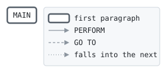

# MINPAY

```text
minpay: the minimum payment of a balance: the whole of a small one,
otherwise a fiftieth of it, but at least the floor.
```

Program [cycle.cbl](../../../laurasia/programs/cycle.cbl): 0 files, 1 paragraphs. Nested in [CYCLE](CYCLE.md), which alone can call it. Its business rules: [1 decision tables](../rules/MINPAY.md).

## Contents

- [Files](#files)
- [Constants](#constants)
- [Flow](#flow)
- [Paragraphs](#paragraphs)
- [Calls](#calls)
- [Data flow](#data-flow)
- [Lineage](#lineage)
  - [Into LK-MINIMUM](#into-lk-minimum)
- [Parameters](#parameters)
  - [Parameter 1, LK-BALANCE](#parameter-1-lk-balance)
  - [Parameter 2, LK-MINIMUM](#parameter-2-lk-minimum)
- [Records](#records)
  - [LK-BALANCE](#lk-balance)
  - [LK-MINIMUM](#lk-minimum)

## Files

| File | Kind | Assigned to | Organization | Status field | Opened | Records |
| --- | --- | --- | --- | --- | --- | --- |

## Constants

| Constant | Value | Source |
| --- | --- | --- |
| PAYMENT-FLOOR | 25.00 | [cycle.cbl:131](../../../laurasia/programs/cycle.cbl#L131) |

## Flow



## Paragraphs

| Paragraph | Description | Source | Performs | Goes to | Performed by | Reached by |
| --- | --- | --- | --- | --- | --- | --- |
| MAIN | | [cycle.cbl:137](../../../laurasia/programs/cycle.cbl#L137) | | | | |

## Calls

Called with LK-BALANCE, LK-MINIMUM by [CYCLE](CYCLE.md).

## Data flow

| Paragraph | Reads | Writes |
| --- | --- | --- |
| MAIN | LK-BALANCE, PAYMENT-FLOOR, LK-MINIMUM | LK-MINIMUM |

## Lineage

Where each data item's values come from, grouped by the record they go into. A data item links to the record it belongs to.

### Into LK-MINIMUM

Record [LK-MINIMUM](#lk-minimum).

| Into | From | Statement | Paragraph | Source |
| --- | --- | --- | --- | --- |
| LK-MINIMUM | literal ZERO | MOVE | MAIN | [cycle.cbl:140](../../../laurasia/programs/cycle.cbl#L140) |
| LK-MINIMUM | [LK-BALANCE](#lk-balance) | MOVE | MAIN | [cycle.cbl:142](../../../laurasia/programs/cycle.cbl#L142) |
| LK-MINIMUM | [LK-BALANCE](#lk-balance) | COMPUTE | MAIN | [cycle.cbl:144](../../../laurasia/programs/cycle.cbl#L144) |
| LK-MINIMUM | PAYMENT-FLOOR | MOVE | MAIN | [cycle.cbl:146](../../../laurasia/programs/cycle.cbl#L146) |

## Parameters

What the program does with each field of the items it is passed, by position: the contract its callers rely on. A statement on a whole item, or a group of it, counts for each field in it; a field neither read nor written is passed for nothing.

### Parameter 1, LK-BALANCE

| Field | Reads | Writes |
| --- | :-: | :-: |
| LK-BALANCE | yes | |

### Parameter 2, LK-MINIMUM

| Field | Reads | Writes |
| --- | :-: | :-: |
| LK-MINIMUM | yes | yes |

## Records

### LK-BALANCE

Linkage. 10 bytes.

| Level | Field | Kind | Start | Length | Picture | Usage | Notes | Source |
| --: | --- | --- | --: | --: | --- | --- | --- | --- |
| 01 | LK-BALANCE | amount | 1 | 10 | S9(7)V99 | | SIGN LEADING SEPARATE | [cycle.cbl:133](../../../laurasia/programs/cycle.cbl#L133) |

### LK-MINIMUM

Linkage. 9 bytes.

| Level | Field | Kind | Start | Length | Picture | Usage | Notes | Source |
| --: | --- | --- | --: | --: | --- | --- | --- | --- |
| 01 | LK-MINIMUM | amount | 1 | 9 | S9(7)V99 | | | [cycle.cbl:134](../../../laurasia/programs/cycle.cbl#L134) |
